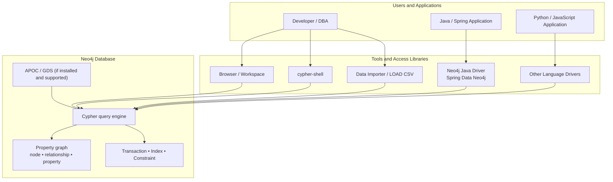
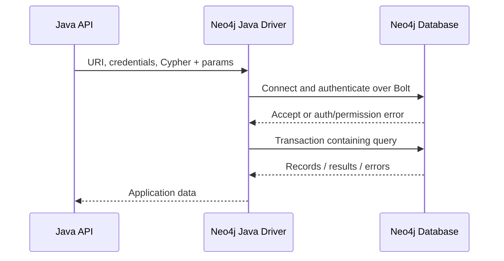
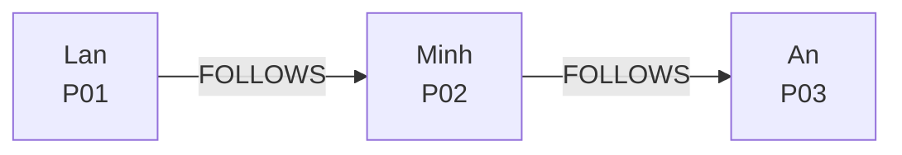

# The Neo4j Ecosystem: Server, Query Tools, Libraries, and Managed Services

> **Chapter:** Neo4j Overview  
> **Module:** `DATABASE_ENGINE_GRAPH_NEO4J`  
> **Focus:** Understanding the role of each component in the Neo4j ecosystem and how they fit together into a workflow for developing, querying, integrating, and operating a graph database.
>
> Neo4j is a platform for storing and querying connected data using a **property graph** and **Cypher**. Subsequent lessons in this module dive deep into nodes, relationships, indexes, constraints, query optimization, data import, the Java Driver, Spring Data Neo4j, and graph operations. This lesson helps you choose the right tool for each job before diving into technical specifics.

## 1. Learning Objectives

Upon completion, you will be able to:

1. Distinguish **Neo4j Database** (the server that stores data and executes queries) from query interfaces, client applications, libraries, plugins, and managed platforms.
2. Describe the ways to run Neo4j: direct installation, Docker, GUI development environments, self-managed deployments, and the **Neo4j Aura** cloud service.
3. Choose the appropriate query tool: web interfaces such as **Neo4j Browser/Workspace**, the **cypher-shell** CLI, or programming language drivers.
4. Understand the roles of **Neo4j Data Importer**, `LOAD CSV`, and large-scale data import tools.
5. Explain **Bolt**, connection URIs, authentication, TLS, sessions, transactions, and how Java/Spring applications send Cypher to the server.
6. Distinguish **Neo4j Java Driver**, **Spring Data Neo4j**, **APOC**, and **Graph Data Science (GDS)**.
7. Execute a small end-to-end hands-on flow from starting the database, importing nodes/relationships, and querying with Cypher to calling it from Java.
8. Propose a deployment architecture, key observability targets, and criteria for choosing an appropriate environment.

## 2. The Big Picture: Neo4j Is an Entire Ecosystem

In conversation, “Neo4j” may refer to the database server, a suite of data tools, or the cloud service. Each component has a distinct role:

| Layer | Typical Component | Function |
| --- | --- | --- |
| **Database** | Neo4j Database (DBMS) | Stores nodes/relationships/properties, manages transactions, executes Cypher, uses indexes and constraints |
| **Deployment method** | Server installer packages, Docker, container/Kubernetes environments | Launches and manages database processes in self-operated infrastructure |
| **Managed cloud** | Neo4j Aura / AuraDB | Provisions and operates the database as a service; users focus on data and queries |
| **Interactive querying** | Neo4j Browser, Query/Workspace UIs depending on environment | Submits Cypher, displays tabular results, renders graphs, and inspects query plans |
| **Command line** | `cypher-shell` | Runs Cypher from the terminal; supports repeatable tasks and automation |
| **Data import** | Neo4j Data Importer, `LOAD CSV`, offline import tools | Loads initial or recurring data from external sources into nodes and relationships |
| **Application integration** | Java Driver, Python/JavaScript/.NET/Go drivers | Connects applications, sends Cypher, and receives returned records |
| **Spring integration** | Spring Data Neo4j | Maps domain models to the graph and provides repositories and transaction integration |
| **Extensions** | APOC, Graph Data Science (GDS) | Adds procedures/functions and graph analytics algorithms within supported capabilities |
| **Operations** | Monitoring, logs, backup/restore, security, version management | Maintains availability, security, data integrity, and performance |

Product names, UI layouts, and access capabilities can vary by **Neo4j version, edition, Aura tier, and release timeline**. In real deployments, always check the documentation for your exact version; this lesson covers roles and principles that change far less often.

### 2.1. Component Relationship Diagram



**Key takeaway:** Browser or Spring Data Neo4j is **not** a standalone database. They send queries or assist operations against a **Neo4j server**. An application can use Neo4j without ever opening Browser, and a Browser interface can connect to a remote database.

## 3. Neo4j Database: The Server That Actually Stores and Processes Data

Neo4j Database is a graph database management system. Data is stored as a **labeled property graph**:

- **Node:** an entity, e.g., `(:Person {id: 'P01', name: 'Lan'})`.
- **Label:** categorizes nodes, e.g., `:Person`, `:Course`.
- **Relationship:** a directed, typed connection, e.g., `(Lan)-[:FOLLOWS]->(Minh)`.
- **Property:** a key–value pair attached to a node or relationship, e.g., `level: 4`.

The server is responsible for:

1. **Storage:** persisting the graph and protecting database-level data consistency.
2. **Cypher execution:** matching node/relationship patterns, filtering, and returning data.
3. **Transactions:** executing read/write operations with appropriate ACID transactional guarantees.
4. **Query planning and optimization:** using statistics and supporting structures to choose how to locate nodes and expand relationships.
5. **Indexes and constraints:** accelerating lookups and enforcing validity rules according to version/edition capabilities.
6. **Connectivity and security:** authentication, authorization, connection configuration, and encryption.
7. **Operations:** logging, configuration, observability, recovery, storage management, and upgrades.

Example data:

```cypher
(:Person {id: 'P01', name: 'Lan'})
  -[:FOLLOWS {since: date('2026-01-01')}]->
(:Person {id: 'P02', name: 'Minh'})
```

The snippet above is a **descriptive pattern**. To persist data, you must use statements such as `CREATE` or `MERGE` in a database session. To read data, use `MATCH`.

### 3.1. Where Does Cypher Run?

Cypher is a declarative language for describing **what to find or modify** in a property graph. You can write the exact same query in:

- The query editor of Browser/Workspace.
- A terminal running `cypher-shell`.
- A query string passed into the Java Driver.
- A custom query in Spring Data Neo4j.

All of these are **query submission points**. The Neo4j server is where execution happens. Recognizing this helps distinguish browser errors, client errors, network errors, and database-side query plan issues.

### 3.2. Community and Enterprise: Edition Is Not Deployment Location

Neo4j offers editions and distribution options with different feature scopes. From an architectural perspective:

| Criterion | Community | Enterprise / Appropriately Licensed Deployment |
| --- | --- | --- |
| Learning Cypher, node/relationship modeling | Yes | Yes |
| Exercises on a single database | Suitable | Suitable |
| Enterprise-scale administration features | Limited scope | Broader scope depending on version and license |
| Deployments requiring high availability, fine-grained RBAC, multi-database management | Must verify limitations | Can satisfy with appropriate features/configuration |
| Typical target | Labs, prototyping, apps fitting edition limits | Commercial workloads and broader operational needs |

**Do not equate “Enterprise” with “cloud-hosted”**: an Enterprise deployment can be self-managed on your own infrastructure. Likewise, **Aura is a managed service**, not another name for Neo4j Browser. All edition limits, licensing terms, and clustering/backup capabilities must be verified against the documentation for the version you use.

### 3.3. What Databases Can Live Inside One DBMS?

In editions that support multi-database administration, a single DBMS can host multiple logical databases with corresponding administrative controls. Applications must specify the correct **database name**. Never infer from a successful login alone that your application is reading the intended data environment.

Once connected with appropriate privileges, you can inspect databases with:

```cypher
SHOW DATABASES;
```

The exact listing and available administrative commands depend on permissions, edition, and version. In the Java Driver, you can specify the database when creating a session; in query UIs, check which database is currently selected before running write statements.

## 4. Ways to Run Neo4j

A Neo4j service can run on a personal workstation, an internal server, a container, or a managed cloud platform. The primary difference is **who owns infrastructure and operations**.

### 4.1. Personal Workstation: Neo4j Desktop or Direct Installation

**Neo4j Desktop** (where available for a given OS/version) is a local development and data exploration application that manages instances alongside connection tools. Desktop should not be mistaken for a different storage engine from Neo4j Database: it is a wrapper environment for **running and managing databases for development**.

Installing the server directly via an appropriate package also lets you run a database locally. This is useful when testing configuration files, reading raw logs, and understanding startup behavior.

Best suited for:

- Learning Cypher and experimenting with property graph models.
- Building small single-user datasets.
- Developing APIs before connecting to shared environments.

Drawback: shutting down your machine or stopping the process makes the database unavailable; you must preserve your data directory, configuration, and connection details if you want continuity.

### 4.2. Docker: Running a Reproducible Neo4j Server

Docker packages the database in a container. The following command is an **example strictly for a practice machine** with Docker installed and free ports:

```bash
docker run --name neo4j-lab \
  -p 127.0.0.1:7474:7474 \
  -p 127.0.0.1:7687:7687 \
  -e NEO4J_AUTH=neo4j/ChangeThisDemoPassword123 \
  -v neo4j_lab_data:/data \
  neo4j:5
```

In PowerShell, you can place this command on **one line** or use PowerShell's line-continuation character. The password shown is illustrative; replace it with your own value and **never use demo passwords in real environments**.

Breakdown:

- `neo4j:5`: an image tracking the version 5 line; when strict reproducibility is needed, **pin a specific image tag** rather than just the major line.
- `7474`: the HTTP port commonly used for the Browser UI in local setups.
- `7687`: the port commonly used by the **Bolt** protocol for drivers.
- `127.0.0.1:...`: binds ports only to the host loopback interface in this lab example.
- `NEO4J_AUTH`: sets initial credentials for the environment according to the image behavior.
- `neo4j_lab_data:/data`: a volume so data persists beyond the container's lifecycle. Persistent volume data still needs protection and backups when important.

After starting, open `http://localhost:7474` and authenticate to the database. Note that ports, web UIs, security settings, and initialization mechanics can differ across distributions or Neo4j releases.

If the image has already initialized a database in the volume, changing `NEO4J_AUTH` on a subsequent run **does not necessarily update an existing user's password**. Use the appropriate account administration mechanism instead.

### 4.3. Neo4j on Servers / Kubernetes

In self-managed deployments, operations teams can run Neo4j on VMs, bare-metal servers, or containers with persistent storage. In Kubernetes environments, pay close attention to stateful storage, networking, secrets management, resource allocation, upgrades, and multi-instance coordination when deploying clusters.

When choosing self-managed infrastructure, you take on more responsibilities:

- Server versioning and application compatibility.
- CPU, RAM, disk storage, and cache configuration.
- Authentication, TLS, authorization, and network segmentation.
- Backups and **restore drills**.
- Health monitoring, logs, metrics, and alerting.
- Upgrades, recovery plan testing, and incident response.

### 4.4. Neo4j Aura: Managed Cloud Database

**Neo4j Aura** is Neo4j's suite of managed cloud services; **AuraDB** is the managed graph database offering. You provision an instance/service, receive a connection URI and credentials, and run Cypher via drivers or the provided UI.

Typical responsibility split:

| Task | Self-Managed | Managed AuraDB |
| --- | --- | --- |
| Provisioning underlying machines/clusters | Your team | Service provider |
| Updating underlying database infrastructure | Planned and executed by your team | Managed by provider per service |
| Designing nodes, relationships, Cypher | Application team | Application team |
| Governing user identities and app-layer permissions | Application team | Application team |
| Data quality, application indexes, and constraints | Application team | Application team |
| Network connectivity, app access policies | Application team | Application team, aligned with service policies |
| Capacity, cost, retention/recovery per tier | Managed by operations team | Select and verify capabilities of the service tier |

Using Aura eliminates heavy infrastructure work, but **does not transfer responsibility for data modeling and correct queries** to the provider. Different tiers can vary in limits, admin privileges, backup/restore options, import methods, security controls, and analytics features; never assume a feature exists on every tier.

## 5. Query Tools: Browser, Workspace, and cypher-shell

Once the database is running, you need a way to send Cypher and inspect results. Three common tool categories are **web interfaces**, **command-line clients**, and **application code**.

### 5.1. Neo4j Browser: Visual Cypher Practice

Neo4j Browser is an interactive tool for:

- Writing and running Cypher statements.
- Viewing results as tables or graph diagrams when applicable.
- Inspecting nodes, relationships, and properties.
- Running `EXPLAIN` and `PROFILE` to examine execution plans.
- Exploring and verifying data after imports.

Example:

```cypher
MATCH (p:Person)-[r:FOLLOWS]->(q:Person)
RETURN p, r, q
LIMIT 25;
```

Returning nodes and relationships allows the UI to render a graph diagram. If you return only `p.name` and `q.name`, you typically see a two-column table of strings; the database is still a graph even when the UI draws no edges.

**Neo4j Browser is not the only place Cypher runs.** The UI is a client that can connect to multiple databases if network access, permissions, and configuration allow.

### 5.2. Workspace / Query / Explore

In some Neo4j environments, especially cloud experiences, you may encounter **Workspace**, **Query**, **Explore**, or different UI layouts depending on the version and tier. These interfaces support running queries, exploring graphs, visualizing data, and managing instance connections.

Functionally:

- **Query:** compose and execute Cypher, inspect tabular outputs.
- **Explore/visualization:** inspect nodes and relationships, filter, and interactively expand neighborhoods.
- **Project/connection management:** select which instance and database the UI targets.

Do not rely on exact tab names or button placements in long-lived study notes, because UI layouts evolve across releases. Focus on the **task** you need to perform and verify which database you are connected to.

Visualization tools such as **Neo4j Bloom** may also be available in supported versions or tiers. Visualization is a tool layer; it does not replace writing accurate Cypher or maintaining DBMS data quality.

### 5.3. cypher-shell: Querying from the Terminal

`cypher-shell` is a command-line client that connects to Neo4j and executes Cypher. When installed and authorized, you can connect using a command such as:

```bash
cypher-shell -a 'neo4j://localhost:7687' -u neo4j
```

Handle passwords safely for your environment: use interactive prompts or secret management rather than passing passwords directly on the command line (since command-line arguments can appear in shell history or process monitors).

Once inside a `cypher-shell` session:

```cypher
RETURN 'Neo4j connected' AS message;
```

It is well suited for:

- Running sample query sets or repeatable scripts.
- Checking databases on headless servers without a GUI.
- Integrating controlled admin or seeding steps into deployment pipelines.

**Distinction:** `cypher-shell` is a client. It does not start the server or store its own database copy. If a connection fails, check **whether the server is running**, the URI, port, credentials, and network rules.

### 5.4. Which Tool Fits Which Job?

| Need | Typical Appropriate Tool |
| --- | --- |
| Learning syntax, testing a quick `MATCH` | Browser or Query UI |
| Visually inspecting stored nodes and relationships | Browser / Explore UI or supported visualization tools |
| Running Cypher from a terminal on a server or CI | `cypher-shell` |
| Executing queries from a Java backend | Neo4j Java Driver or Spring Data Neo4j |
| Building domain-driven reports or alerts | Backend service using a driver and processing results |
| Importing two CSV tables into nodes and relationships | Neo4j Data Importer or `LOAD CSV` as appropriate |
| Running community detection, centrality, or advanced similarity | Graph Data Science (when deployed and supported by tier) |

## 6. Data Import: From CSV and External Systems to the Graph

Storing a graph does not mean source data already arrives as nodes and relationships. In real projects, inputs are typically CSV files, RDBMS tables, event streams, logs, or APIs.

An import pipeline must solve five concerns together:

1. **Entity mapping:** which rows become nodes, and what are their business keys?
2. **Connection mapping:** which columns identify the source and target nodes?
3. **Data types:** dates, numbers, booleans, identifiers, and empty fields.
4. **Idempotency:** will running the import a second time create duplicate nodes or edges?
5. **Post-import verification:** node counts, relationship counts, missing endpoints, or reversed edges.

### 6.1. Neo4j Data Importer

Neo4j Data Importer is a tool for visually mapping tabular/CSV data into a node–relationship model in supported environments.

Suppose you have two files:

```csv
# people.csv (actual data file does not contain this comment)
id,name
P01,Lan
P02,Minh
P03,An
```

```csv
# follows.csv (actual data file does not contain this comment)
sourceId,targetId,since
P01,P02,2026-01-01
P02,P03,2026-03-01
```

In a visual import workflow:

1. Select `people.id` and `follows.sourceId/targetId` to identify nodes and links.
2. Map `people` rows to nodes with label `Person` and properties `id`, `name`.
3. Map `follows` rows to `FOLLOWS` relationships directed **source → target**.
4. Map `since` to a date value or convert its type via the tool.
5. Validate schema, permissions, and supported requirements before importing.
6. Run Cypher queries to verify the results.

When choosing an import approach, verify **which Neo4j environment Data Importer is connected to** and what import capabilities your version/tier supports. An import tool assists with transforming and loading data; consistency rules still depend on your data model and DBMS/application controls.

### 6.2. LOAD CSV: Controlled Import with Cypher

`LOAD CSV` is a Cypher clause that reads CSV data from a location **accessible to the Neo4j server**. The following example illustrates the pattern when `people.csv` has been staged properly and the `file:///people.csv` URL is valid under the database's import configuration:

```cypher
LOAD CSV WITH HEADERS FROM 'file:///people.csv' AS row
WITH row
WHERE row.id IS NOT NULL AND trim(row.id) <> ''
MERGE (p:Person {id: row.id})
SET p.name = row.name;
```

For relationships, match **both previously imported endpoint nodes**:

```cypher
LOAD CSV WITH HEADERS FROM 'file:///follows.csv' AS row
MATCH (source:Person {id: row.sourceId})
MATCH (target:Person {id: row.targetId})
MERGE (source)-[r:FOLLOWS]->(target)
SET r.since = date(row.since);
```

In production runs, empty or malformed `since` values can cause errors; validate or transform inputs accordingly. If `MATCH` cannot find an endpoint node, no relationship is created for that row, so always **count and reconcile records** after importing.

**Common pitfall:** `file:///people.csv` is resolved on the **server/container side**, not arbitrarily from the local disk of whoever has Browser open. With Docker, place files via a mounted volume/import directory and matching configuration. Some cloud environments have restrictions or alternative import mechanisms; use sources and tools supported by your service tier.

### 6.3. Offline Bulk Import vs. Incremental Import

Some administrative tools support **bulk loading data while the target database is not serving normal traffic**. This is a very different problem from calling `LOAD CSV` to **update data in a live running database**.

- **Large initial load:** focuses on throughput, disk capacity, ID mapping schemas, offline/online requirements, and edition support.
- **Incremental import:** focuses on idempotency, transactions, inserts/updates, relationship changes, and error handling.
- **Continuous synchronization:** requires defining the source of truth, acceptable lag, event replay, and drift detection.

Administrative CLI subcommands and options, such as the `neo4j-admin database import` command group, vary by version; always consult the exact documentation for your server version.

## 7. Connection Protocols: Bolt, URIs, TLS, and Authentication

A Java backend does not connect to the database by “opening the Browser URL and scraping HTML.” It uses a **driver** and a database access protocol, most commonly **Bolt**.

### 7.1. Two Common Ports in Local Environments

| Common Default Port | Purpose | Typical Consumer |
| --- | --- | --- |
| `7474` | HTTP for Browser and corresponding endpoints where enabled | Web browsers / web tools |
| `7687` | Bolt for drivers and `cypher-shell` | Java/Python/JavaScript backends and CLI |

These are **common conventions** for local Neo4j setups, not mandatory ports in every architecture. In cloud environments, reverse proxies or security configurations can change ports and access URIs.

### 7.2. Common URI Schemes

| Illustrative URI | General Meaning |
| --- | --- |
| `bolt://localhost:7687` | Direct Bolt connection to a local endpoint |
| `neo4j://localhost:7687` | Routing-capable connection via Neo4j Driver; depends on topology |
| `neo4j+s://example.databases.neo4j.io` | Neo4j URI with TLS and certificate verification per driver config; common for Aura |
| `neo4j+ssc://host:7687` | TLS with self-signed certificates where supported; evaluate security carefully before use |

For Aura, **copy the exact URI from your instance connection details**. Do not guess hostnames, schemes, or ports. Production applications should use TLS and proper certificate validation; never use local plaintext examples as defaults over public networks.

### 7.3. The Role of Authentication and Authorization

A successful connection typically flows as follows:



Errors to distinguish clearly:

- **Wrong URI/port** → network connection cannot be established.
- **Wrong username or password** → connection rejected during authentication.
- **Insufficient privileges** → authenticated, but the operation is blocked.
- **Wrong database** → expected data may be missing or access denied.
- **Invalid certificate/TLS config** → secure connection cannot be established.
- **Bad query or unmatched data** → connected successfully, but statement errors or returns 0 rows.

Store passwords and access keys in a secret manager or secure configuration, never hardcoded in source code, public example files, or logs.

## 8. Neo4j Java Driver: Bridge from Application to Database

**Neo4j Java Driver** is the official library enabling Java applications to send Cypher, bind parameters, receive records, and manage transactions with Neo4j.

A typical division of responsibilities:

- **Driver:** holds connection configuration and manages reusable connection pools.
- **Session:** database working context; created for a unit of work, then closed.
- **Transaction:** groups read/write operations requiring consistency. The driver provides transaction functions integrated with its retry mechanism.
- **Result/Record:** data returned from Cypher, mapped into Java types or domain objects.

### 8.1. Java Example Calling Parameterized Cypher

Suppose the practice data from section 11 has been created in the `neo4j` database. Example using Java Driver **5.x** with `executeRead`:

```java
import org.neo4j.driver.AuthTokens;
import org.neo4j.driver.Driver;
import org.neo4j.driver.GraphDatabase;
import org.neo4j.driver.Session;
import org.neo4j.driver.SessionConfig;
import org.neo4j.driver.Values;

import java.util.List;

public final class Neo4jDemo {
    public static void main(String[] args) {
        String uri = System.getenv("NEO4J_URI");
        String user = System.getenv("NEO4J_USERNAME");
        String password = System.getenv("NEO4J_PASSWORD");

        try (Driver driver = GraphDatabase.driver(
                uri, AuthTokens.basic(user, password))) {
            driver.verifyConnectivity();

            try (Session session = driver.session(
                    SessionConfig.forDatabase("neo4j"))) {
                List<String> following = session.executeRead(tx ->
                    tx.run(
                        "MATCH (:Person {id: $personId})" +
                        "-[:FOLLOWS]->(other:Person) " +
                        "RETURN other.name AS name ORDER BY name",
                        Values.parameters("personId", "P01"))
                      .list(record -> record.get("name").asString())
                );

                System.out.println(following); // [Minh]
            }
        }
    }
}
```

This snippet illustrates API usage; it requires a compatible `org.neo4j.driver:neo4j-java-driver` dependency and the environment variables `NEO4J_URI`, `NEO4J_USERNAME`, and `NEO4J_PASSWORD`. If your database is not named `neo4j`, update the value in `SessionConfig`.

**Rationale behind these choices:**

1. The Driver is created and closed via `try-with-resources`.
2. A Session is scoped to a unit of work and closed; never share one Session across concurrent requests.
3. `executeRead` represents a driver-managed read transaction.
4. `$personId` is a **parameter**, avoiding string concatenation of user input into the query.
5. `record.get("name").asString()` maps each returned value to a Java type.

In a long-running backend application, **the Driver is normally managed as a shared resource with a clear lifecycle**; do not create and destroy a Driver per HTTP request. Sessions or units of work have shorter lifetimes. Avoid performing writes or external calls with side effects inside retried callbacks unless idempotency is designed in.

### 8.2. The Driver Does Not Design Your Data Model

The Java Driver knows how to communicate with Neo4j, but it does not decide whether you should have a `Person` label, a `FOLLOWS` type, or specific constraints. That is domain modeling responsibility.

Similarly, the Java Driver does not make inherently slow queries fast. If a query expands too broadly, you must optimize the Cypher, starting point selectivity, and supporting indexes/constraints.

## 9. Spring Data Neo4j: Integration in Spring Applications

**Spring Data Neo4j (SDN)** is the Spring integration layer that lets you define graph entities and repositories in a style familiar to Java domain modeling.

A simple mapping example (constructors and getters/setters omitted to focus on annotations):

```java
import org.springframework.data.annotation.Id;
import org.springframework.data.neo4j.core.schema.Node;
import org.springframework.data.neo4j.core.schema.Relationship;

import java.util.HashSet;
import java.util.Set;

@Node("Person")
public class Person {
    @Id
    private String id;

    private String name;

    @Relationship(type = "FOLLOWS",
                  direction = Relationship.Direction.OUTGOING)
    private Set<Person> following = new HashSet<>();

    // Constructor, getters/setters, or appropriate initialization
    // required when implementing real mapping.
}
```

A repository can expose data-access methods:

```java
import org.springframework.data.neo4j.repository.Neo4jRepository;
import org.springframework.data.neo4j.repository.query.Query;

import java.util.List;

public interface PersonRepository
        extends Neo4jRepository<Person, String> {

    @Query("""
        MATCH (p:Person {id: $personId})
              -[:FOLLOWS]->(other:Person)
        RETURN other
        ORDER BY other.name
        """)
    List<Person> findFollowing(String personId);
}
```

This example shows that SDN:

- Maps a Java entity class to the `:Person` node label.
- Knows the `following` field represents outgoing `FOLLOWS` relationships.
- Provides repository abstractions and lets you bind custom Cypher queries to methods.

**Do not treat SDN as a replacement for knowing Cypher.** With heavily connected models or complex queries, you still must understand edge direction, filtering, return shapes, and mapping behavior. Entity lifecycles, ID strategies, transactions, and relationship-loading performance must be designed for the specific SDN and Spring Boot versions you use.

### 9.1. How Java Driver and Spring Data Neo4j Differ

| Aspect | Java Driver | Spring Data Neo4j |
| --- | --- | --- |
| Abstraction level | Connections, sessions, transactions, queries, records | Entity mapping, repositories, Spring integration |
| Submitting Cypher | Direct `tx.run(...)` calls | Repositories, `@Query`, or query APIs |
| Data mapping | Application maps `Record` manually | Framework assists with entity mapping |
| Syntax & payload control | Very direct | Can be direct via custom queries; must watch mapping behavior |
| Best fit | Standalone Java or services needing explicit query control | Spring applications using domain repositories |
| Still required | Nodes, relationships, Cypher, transactions | Nodes, relationships, Cypher, transactions |

SDN relies on Neo4j connectivity underneath and does not embed a separate graph database. Avoid layering two independent transaction management schemes in parallel without verifying framework integration behavior.

## 10. Extension Libraries: APOC and Graph Data Science

Not every component with “Neo4j” in its name is built into the core server by default.

### 10.1. APOC: Additional Procedures and Functions

**APOC** is an extension library of procedures and functions for Neo4j, offering utilities for data processing, transformations, collection helpers, and graph tasks within supported installations.

For example, in an environment where **APOC is installed and enabled**, you can inspect available procedures per your server version's documentation; listing commands, procedure names, and required permissions can vary across releases.

Key points to remember:

- APOC is an **extension**, not synonymous with the core Cypher language.
- An APOC procedure seen in an online example may **not be available** on your database.
- Plugins, procedures, and import/export features are subject to environment restrictions and allowlists.
- Tasks touching the filesystem, network, or security settings must obey permissions and operational policies.

For tasks that standard Cypher handles cleanly—such as creating nodes, matching relationships, and filtering properties—avoid adding an unnecessary dependency on APOC.

### 10.2. Graph Data Science (GDS): Graph Analytics Algorithms

**Neo4j Graph Data Science** is a library and analytics capability for problems such as:

- Identifying central or influential nodes in a network.
- Detecting communities or connected clusters.
- Measuring similarity or building recommendation features.
- Running pathfinding algorithms under specific constraints.
- Building graph analytics pipelines within supported tiers.

Do not confuse these two categories of work:

| Standard Cypher | Graph Data Science |
| --- | --- |
| Create and update nodes/relationships | Run network-wide analytics algorithms |
| Match relationship patterns and specific paths | Analyze structure, centrality, communities, similarity |
| Query operational business data directly | Often requires creating an in-memory **graph projection** and managing algorithm memory |
| Core built-in part of Neo4j | Depends on version, service tier, license, and additional setup |

Many GDS workflows build an **in-memory graph projection** to run algorithms, separate from the persisted database graph. Never assume algorithm outputs are automatically written back as database properties; streaming vs. write-back depends on the exact procedure and mode called.

### 10.3. Why You Must Check Plugin Compatibility

A plugin may require a matching Neo4j version, sufficient memory, execution privileges, licensing, and specific startup configuration. In managed cloud environments in particular, custom plugin installation differs significantly from self-managed setups.

Before adopting a library:

1. Identify the domain question that standard Cypher does not solve efficiently.
2. Check **server version, plugin version, edition, and cloud tier**.
3. Review permissions, memory requirements, procedure allowlists, and security policies.
4. Benchmark on sample data and monitor resource cost.
5. Plan a fallback if a procedure is unavailable in another environment.

## 11. End-to-End Walkthrough: From Server to Query and Java

The goal of this lab is to prove that **the exact same graph** can be accessed from Browser, `cypher-shell`, and the Java Driver.

### 11.1. Prepare the Database

Choose one of two options:

- Run a local Neo4j instance (Desktop, server install, or Docker from section 4).
- Use a dedicated learning AuraDB instance and obtain its provided URI.

You will need the exact **URI**, **username**, **password**, and **database name**. For a local Docker setup as shown earlier: Browser typically opens at `http://localhost:7474`; drivers/CLI connect on Bolt port `7687`. For Aura, use the secure URI provided by your instance.

### 11.2. Create the Sample Graph

Run each block in Browser or the Query UI on a practice database without conflicting data.

First, create a constraint for the business key:

```cypher
CREATE CONSTRAINT person_id_unique IF NOT EXISTS
FOR (p:Person) REQUIRE p.id IS UNIQUE;
```

Next, create three nodes:

```cypher
UNWIND [
  {id: 'P01', name: 'Lan'},
  {id: 'P02', name: 'Minh'},
  {id: 'P03', name: 'An'}
] AS row
MERGE (p:Person {id: row.id})
SET p.name = row.name;
```

Finally, create two relationships:

```cypher
MATCH (lan:Person {id: 'P01'})
MATCH (minh:Person {id: 'P02'})
MATCH (an:Person {id: 'P03'})
MERGE (lan)-[r1:FOLLOWS]->(minh)
SET r1.since = date('2026-01-01')
MERGE (minh)-[r2:FOLLOWS]->(an)
SET r2.since = date('2026-03-01');
```

Expected graph:



`MERGE` avoids creating duplicate nodes with an existing key and, in this contention-free example, avoids recreating the relationship between matched endpoints. It does not replace all relationship constraints under concurrent write workloads.

### 11.3. Query in Browser or Workspace

One-hop query:

```cypher
MATCH (:Person {id: 'P01'})-[:FOLLOWS]->(p:Person)
RETURN p.id AS id, p.name AS name;
```

Expected result: **P02 — Minh**.

Two-hop query:

```cypher
MATCH (:Person {id: 'P01'})-[:FOLLOWS*1..2]->(p:Person)
RETURN DISTINCT p.id AS id, p.name AS name
ORDER BY id;
```

Expected result: **Minh** (one hop) and **An** (two hops).

View the graph diagram in a supported UI:

```cypher
MATCH (a:Person)-[r:FOLLOWS]->(b:Person)
RETURN a, r, b;
```

### 11.4. Run the Same Cypher with cypher-shell

Connect using your environment's URI, username, and password. Then run:

```cypher
MATCH (:Person {id: 'P01'})-[:FOLLOWS]->(p:Person)
RETURN p.name AS name;
```

The result is still **Minh** if both clients access the **same database**. If results differ, check the instance, database name, credentials, and whether the write transaction committed.

### 11.5. Run the Same Cypher from Java

Using the Java Driver program from section 8 with valid connection environment variables, the code runs the exact same one-hop query with `$personId = 'P01'` and returns `[Minh]`.

From here, you can expose it as a REST endpoint:

```text
GET /people/P01/following
→ Java/Spring service
→ driver or repository
→ Neo4j Cypher
→ ["Minh"]
```

The data path is **HTTP request to app → backend queries via driver → database → results → JSON**, never the end user's browser connecting directly to the Bolt port with database credentials.

### 11.6. Lab Verification Checklist

A lab exercise is complete when you can confirm:

| Check | Expected Result |
| --- | --- |
| `MATCH (p:Person) RETURN count(p)` on a lab-only database | 3 nodes |
| `MATCH ()-[r:FOLLOWS]->() RETURN count(r)` | 2 relationships |
| One hop from P01 | Minh |
| One to two hops from P01 | Minh and An |
| Browser and cypher-shell querying the same database | Matching results |
| Java Driver querying P01 | Returns Minh |
| Changing query to a nonexistent ID, e.g., P99 | Zero rows returned, no node created |

On a database containing other data, filter to your exact lab IDs rather than counting the entire database. If counts do not match, diagnose why before re-running creation scripts.

## 12. Operations: What a DBMS Needs Once It Runs

Successfully running a `MATCH` query only proves basic connectivity and demo data. For real environments, prepare for:

### 12.1. Observability

Monitor at minimum:

- Database health and ability to accept connections.
- Typical query latency, errors, timeouts, and concurrent load.
- CPU, memory, disk usage, I/O throughput, and data growth.
- Queries whose plans expand excessive numbers of nodes/relationships.
- System logs, query/diagnostic logs, and alerts per version/edition capabilities.

Use `EXPLAIN` to inspect the estimated plan without executing the query; `PROFILE` executes the query and provides actual plan metrics. On critical datasets, run `PROFILE` in an appropriate environment first because it **does execute** the query.

### 12.2. Data Integrity

Unique constraints protect business keys such as `Person.id`. Indexes speed up finding starting nodes by filtered properties; they do not automatically accelerate every traversal or every Cypher statement.

Questions to settle:

- Are two nodes allowed to share the same `email` or `id`?
- Which properties are mandatory?
- How many relationships of the same type can exist between a pair of nodes?
- Are cycles, self-loops, or reversed relationships allowed?
- Must relationship history be retained, or only current state?

Some domain invariants require enforcement in the application or write pipeline, as Neo4j cannot infer them solely from label or type names.

### 12.3. Backup and Recovery

An operational plan must define:

1. **RPO:** maximum acceptable data loss.
2. **RTO:** target time to restore service.
3. Backup/snapshot mechanisms appropriate to your edition, tier, and database state.
4. Storage location, retention period, and access control for backups.
5. How to run **test restores** and verify nodes/relationships afterward.

Exact backup mechanisms differ across Community, Enterprise, self-managed, and Aura. Never assume you can casually copy live database files while writes are occurring and obtain a consistent backup.

### 12.4. Security

- Separate service accounts from administrative accounts.
- Grant least-privilege permissions supported by your edition/tier.
- Enforce TLS for remote connections and validate certificates.
- Never commit passwords or sensitive URIs into repositories, source code, screenshots, or logs.
- Restrict network access and rotate secrets on schedule.
- Audit permissions for procedures, plugins, and import/export operations.

In particular, when the database sits on an internal network, **never let web end users connect directly to the Bolt port** with a shared account. The backend performs data access according to business authorization.

### 12.5. Version Compatibility and Upgrades

Track all of the following together:

- Neo4j Database version.
- Neo4j Java Driver version.
- Spring Boot / Spring Data Neo4j version.
- Plugins such as APOC/GDS.
- TLS protocols and parameters.
- Cypher syntax and features used by the application.
- Upgrade policies, configuration changes, and rollback/recovery procedures.

Never blindly auto-upgrade production images or packages to the latest version without compatibility testing. Likewise, online examples may target older driver APIs that are incompatible with your current project.

## 13. Choosing a Toolset for Three Real-World Scenarios

### Scenario A — Learning Cypher on a Personal Machine

**Needs:** single learner, small dataset, fast iteration.

Sensible toolset: a local instance via Docker/Desktop, Browser or Query UI, sample data loaded with `UNWIND`/`MERGE`, and `cypher-shell` if practicing CLI usage. For this purpose, Enterprise features are rarely an initial requirement.

### Scenario B — Building a Spring Boot Backend for a Team

**Needs:** multiple developers, dev/staging environments, repository integration, schema control, and testing.

Sensible toolset: shared or per-environment Neo4j instances; **Spring Data Neo4j** or **Java Driver** depending on query patterns; parameterized Cypher; constraints/indexes managed in deployment workflows; basic monitoring, secrets management, and test datasets. Verify Spring and driver version compatibility.

### Scenario C — Continuously Running Production Graph System

**Needs:** SLAs, data growth, backups, security, recovery, and performance tuning.

Consider **AuraDB** if you want to reduce infrastructure overhead within an appropriate tier, or **self-managed Enterprise** if you have specific deployment, security, or infrastructure-control requirements and an operations team to run it.

Evaluate on concrete criteria rather than product names:

| Criterion | Deciding Question |
| --- | --- |
| Administration | Who deploys, upgrades, and troubleshoots the database? |
| Scalability | What storage volume and concurrent query load are needed? |
| Recovery | What are the actual RPO/RTO and backup mechanisms? |
| Security | Can data reside in a managed cloud service? What TLS/RBAC controls are required? |
| Connectivity | Where does the backend run, and what network latency or firewall rules apply? |
| Data ingestion | Does data arrive from CSV, events, APIs, or relational systems? At what update frequency? |
| Query patterns | Are there deep multi-hop traversals, supernodes, path analytics, or GDS algorithms? |
| Cost | What are the infrastructure, license/tier, staffing, and migration costs? |

## 14. Diagnosing Errors at the Right Ecosystem Layer

| Symptom | Likely Layer | First Thing to Check |
| --- | --- | --- |
| Browser fails to open local URL | Web UI / container / HTTP port | Is the database/container running, and is port 7474 mapped properly? |
| Browser opens, but driver cannot connect | Bolt URI / network / TLS | Is the driver using port 7687 or the Aura URI? Check firewall/certs. |
| `cypher-shell` reports auth error | Credentials | Are username, password, and target instance correct? |
| Login succeeds, but `MATCH` returns 0 rows | Selected database / data / edge direction | Are you on the right database, label, and `FOLLOWS` direction? |
| `LOAD CSV file:///...` file not found | Server-side / import directory | Is the file inside the container/server import directory with proper permissions/config? |
| Java string concatenation in Cypher errors or risks injection | Application / driver layer | Use driver parameters `$paramName` instead of string concatenation |
| Query is slow across multiple hops | Model, depth, cardinality, plan | Bound relationship types/depth; inspect `EXPLAIN`/`PROFILE` and starting index |
| APOC/GDS procedure does not exist | Plugin, permissions, edition/tier, version | Is the plugin/feature installed and allowlisted? |
| Production results differ from staging | Data sync and configuration | Check import timestamps, constraints, versions, missing data, and database names |

A reliable diagnostic workflow follows the **execution path**: application → driver → URI/network → auth/permissions → selected database → data → Cypher/plan → results. Each layer has its own root causes and inspection tools.

## 15. Review Exercises

**Exercise 1 — Classifying tools.** Given Neo4j Database, Neo4j Browser, cypher-shell, Java Driver, Spring Data Neo4j, APOC, GDS, and AuraDB, match each component to its role: **engine, UI, CLI, driver, framework, plugin/algorithms, managed service**.

**Exercise 2 — Designing a flow.** A Spring Boot application needs to find everyone Lan follows. Trace the component chain from HTTP request to data and explain where Cypher is executed.

**Exercise 3 — Choosing an environment.** A three-person team is learning Neo4j, has no dedicated infrastructure yet, and only works with sample data. Which deployment option should they try first? When moving toward production, what operational questions arise?

**Exercise 4 — Importing data.** You have `people.csv` and `follows.csv` as in section 6. Why must person nodes be imported before using `MATCH` to connect relationships? What happens if a `targetId` is missing from the people data?

**Exercise 5 — Database names.** Running `MATCH (p:Person) RETURN count(p)` in Browser returns 3, but a Java program returns 0 people. Name at least three possible causes and how to check them.

**Exercise 6 — Protocols.** Contrast `http://localhost:7474` with `bolt://localhost:7687`, and explain why passing the Browser URL into the Neo4j Java Driver connection variable causes an error.

**Exercise 7 — Extensions.** Why is finding an online example calling APOC/GDS not enough to guarantee it runs on an Aura instance or local container? What factors would you verify?

**Exercise 8 — Reading Java code.** In the `Neo4jDemo` example, where is a parameter used? Why is creating a new Driver per HTTP request and sharing one Session across all requests generally a poor design?

<details>
<summary>Answer Hints</summary>

1. **Engine:** Neo4j Database. **UI:** Browser. **CLI:** cypher-shell. **Driver:** Java Driver. **Spring Framework:** Spring Data Neo4j. **Extension/procedures:** APOC. **Graph algorithms:** GDS. **Managed service:** AuraDB.
2. HTTP request → Controller/Service → Spring Data Neo4j or Java Driver → Bolt → Neo4j Database executes Cypher → records → JSON. The user's browser never needs database credentials.
3. Start with Docker/Desktop or a managed Aura lab instance depending on constraints. For production, define operational ownership, backup/restore, security, SLAs, resources, cost, and recovery testing.
4. Relationships require both endpoint nodes to exist to connect them. With `MATCH`, if a target node is missing, that row creates no relationship; reconcile counts and handle missing references.
5. Java connected to a different instance, different database name, wrong URI, uncommitted data, different label/ID, different filter/direction in the query, or insufficient account permissions.
6. Port 7474 typically serves HTTP/UI; port 7687 serves Bolt for drivers/CLI. The driver requires a URI matching its protocol, certificates, and server configuration.
7. Verify whether the plugin is installed and allowlisted, plugin–server version compatibility, edition/Aura tier, licensing, memory, and network/filesystem requirements.
8. `$personId` is the parameter, supplied via `Values.parameters(...)`. A Driver is designed to be reused under managed lifecycle, while a Session is opened and closed per unit of work rather than shared concurrently across requests.

</details>

## 16. Final Takeaways

- **Neo4j Database** stores the graph and handles Cypher, transactions, and indexes/constraints. Other tools form the access, management, or extension layers.
- **Browser/Workspace** serves interactive querying and visual exploration; **cypher-shell** serves CLI workflows; **Java Driver** and **Spring Data Neo4j** serve applications.
- **Data Importer** and **LOAD CSV** bring external data into the graph. File paths resolve on the server/container side and require proper access configuration.
- **APOC** adds utility procedures/functions; **GDS** provides graph analytics algorithms. Availability depends on tier, version, and permissions.
- **AuraDB** provides managed Neo4j; self-managed deployments give direct infrastructure control at the cost of full operational responsibility.
- In every deployment, explicitly verify the **instance, database, URI, access privileges, versions, data sources, and backup responsibilities**. Understanding each layer enables systematic Neo4j development and troubleshooting.
