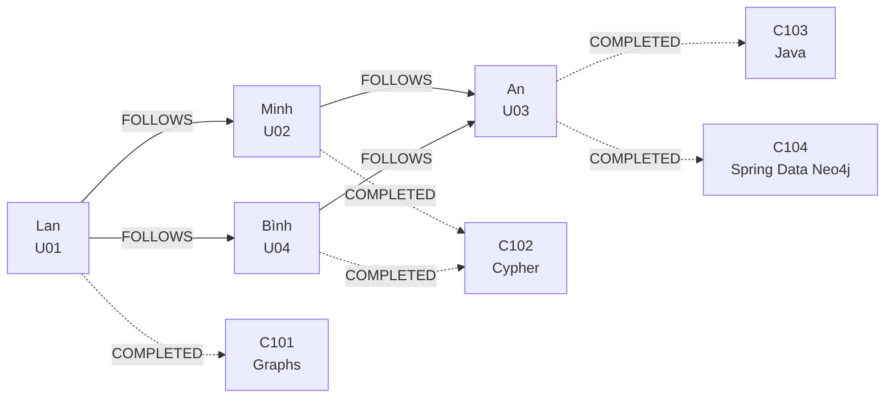
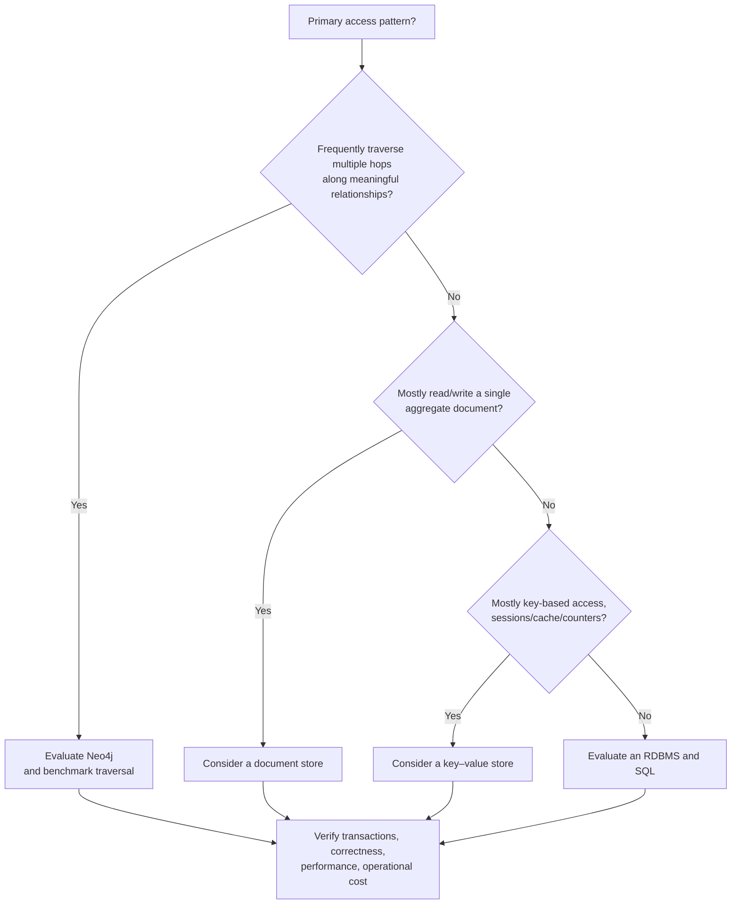
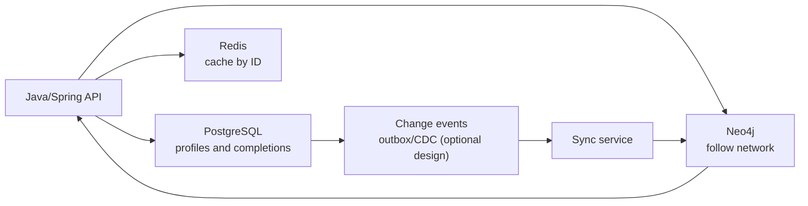

# Comparing Neo4j with Relational, Document, and Key–Value Databases

> **Chapter:** Neo4j Overview  
> **Module:** `DATABASE_ENGINE_GRAPH_NEO4J`  
> **Scope:** Comparing how data is modeled, queried, kept accurate, and operated in Neo4j, relational databases, document databases, and key–value stores. The focus is on **data shape, access paths, and the types of questions** the application actually needs to answer.
>
> Neo4j uses a **property graph** (nodes, relationships, labels, properties) and **Cypher** to query relationships and paths. This lesson builds the foundation for technology selection before diving deep into indexes, constraints, query optimization, data import, the Java Driver, Spring Data Neo4j, and operating graph systems.

## 1. Learning Objectives

After this lesson, you will be able to:

1. Distinguish four ways of organizing data: **relational tables**, **documents**, **key–value**, and **property graphs**.
2. Express **the same domain problem** using PostgreSQL, MongoDB, Redis, and Neo4j; read examples in SQL, MongoDB aggregation, Redis commands, and Cypher.
3. Explain when multi-hop relationships and paths are the central query targets, and when record, document, or key lookups are more natural.
4. Understand the capabilities and limits of `JOIN`/recursive CTEs, `$lookup`/`$graphLookup`, Redis sets, and Cypher traversals.
5. Compare choices across consistency, transactions, identity, indexes, schema flexibility, scalability, and operational cost **without relying on absolute speed claims**.
6. Outline approaches using single or multiple data stores, identifying the source of truth and synchronization mechanisms.
7. Design an objective benchmark to decide whether Neo4j delivers real value for a workload.

## 2. Asking the Right Question: What Do We Store and How Do We Access It?

A database management system can store **the exact same facts** in several ways. However, efficiency and complexity depend on which questions the application asks most often.

Suppose a learning platform manages learners and courses. Different questions include:

- **Lookup by ID:** “What is learner `U01`'s name?”
- **Read an entire object:** “Return learner `U01`'s profile, interests, and completed courses.”
- **Frequent state read/write:** “Is login session `session:abc` still valid?”
- **Find direct connections:** “Which learners does Lan follow?”
- **Multi-hop discovery:** “Which courses were completed by people Lan follows directly or within at most two hops, that Lan has not taken?”
- **Explain a path:** “Through which chain of learners was course C104 recommended?”

That set of questions suggests four storage models:

| Model | Unit Placed at the Center | Example Engines | Common Strengths |
| --- | --- | --- | --- |
| **Relational** | Tables, rows, columns, keys, and constraints | PostgreSQL, MySQL | Structured data, transactions, integrity constraints, and SQL |
| **Document** | Documents with fields and nested structures | MongoDB | Reading/writing an aggregate object, flexible per-document schema |
| **Key–value** | Direct key lookup to a value or data structure | Redis | Key-based reads/writes, caches, sessions, counters, small sets with known access patterns |
| **Graph** | Nodes and directed, typed relationships | Neo4j | Exploring relationships, finding connection patterns and paths |

**No system has a monopoly on any query type.** PostgreSQL has recursive CTEs; MongoDB has aggregation and `$graphLookup`; Redis has sets, sorted sets, and rich set commands; Neo4j can still look up properties by ID. The difference lies in **what feels natural to express, what each engine optimizes for, and the cost for a specific workload**.

### 2.1. Four Storage Paradigms Do Not Equal Four Fixed Performance Definitions

- “Relational requires JOINs so it's slow” is false. RDBMSs have highly sophisticated optimizers and indexes.
- “Document stores cannot query relationships” is false. MongoDB supports references, `$lookup`, and `$graphLookup`.
- “Redis is only a cache and always loses data on shutdown” is false. Redis offers configurable persistence and rich data structures.
- “Neo4j edge traversal is always O(1)” is false. Branching factor, depth, path semantics, starting point, and result volume heavily affect cost.

Therefore, before choosing a technology, you must know **which queries run frequently**, **data size and distribution**, **update rules**, **consistency requirements**, **budget, and operational experience**.

## 3. A Shared Problem for Comparing All Four Systems

Let's build a small learner network. A learner can follow multiple other learners and complete multiple courses. The requirement is:

> **Recommend courses completed by people whom Lan follows directly or indirectly within at most two hops, that Lan has not completed yet.**

### 3.1. Sample Data

**Learners**

| ID | Name |
| --- | --- |
| `U01` | Lan |
| `U02` | Minh |
| `U03` | An |
| `U04` | Bình |

**Courses**

| ID | Title |
| --- | --- |
| `C101` | Introduction to Graphs |
| `C102` | Cypher Queries |
| `C103` | Java Fundamentals |
| `C104` | Spring Data Neo4j |

**Follow relationships**

| Follower | Followed |
| --- | --- |
| Lan (`U01`) | Minh (`U02`) |
| Lan (`U01`) | Bình (`U04`) |
| Minh (`U02`) | An (`U03`) |
| Bình (`U04`) | An (`U03`) |

**Completed courses**

| Learner | Course |
| --- | --- |
| Lan | C101 |
| Minh | C102 |
| Bình | C102 |
| An | C103, C104 |

Relationship graph:



Lan has one-hop paths to Minh and Bình, and **two two-hop paths** to An:

```text
Lan → Minh → An
Lan → Bình → An
```

An is still **one** learner even though two paths reach An. Both Minh and Bình completed C102, yet C102 should appear only **once** in the recommendation list.

**Expected result** across all four implementations:

| Code | Recommended Course | Data Source |
| --- | --- | --- |
| C102 | Cypher Queries | Completed by Minh and Bình |
| C103 | Java Fundamentals | Completed by An |
| C104 | Spring Data Neo4j | Completed by An |

C101 is excluded because Lan has already completed it. This is an **illustrative** recommendation rule, not a complete recommendation algorithm: a real product would also consider prerequisites, access permissions, interests, relevance, and ranking.

## 4. Four Ways to Model the Same Data

| Domain Fact | Relational | Document | Key–Value | Neo4j |
| --- | --- | --- | --- | --- |
| Learner | Row in `learners` | Document in `learners` | `learner:U01` → hash/value | Node `(:Learner {id:'U01'})` |
| Course | Row in `courses` | Document in `courses` | `course:C101` → hash/value | Node `(:Course {id:'C101'})` |
| Lan follows Minh | Row `follows(U01,U02)` | Array `follows:['U02']` or reference doc | Set `learner:U01:follows` containing `U02` | `(Lan)-[:FOLLOWS]->(Minh)` |
| Lan completed C101 | Row `completions(U01,C101)` | Array of completed IDs or separate enrollment doc | Set `learner:U01:completed` containing `C101` | `(Lan)-[:COMPLETED]->(C101)` |
| Traverse two follow hops | Recursive CTE / joins | `$graphLookup` or multi-step query | Client expands sets level by level | `[:FOLLOWS*1..2]` pattern in Cypher |
| Fetch recommended course titles | Join `courses` | `$lookup` or lookup by ID | Multi-get `course:*` keys | Follow to `Course` nodes and `RETURN` |

Just looking at this table shows that **not every piece of information needs to be a separate element**. In documents, data frequently read together can be embedded in one document. In key–value stores, key naming and value types dictate access paths. In Neo4j, typed/directed connections are stored directly in the graph.

Below are the four implementations; the examples are **independent**. They illustrate the same dataset and do not require running all four engines to understand the lesson.

## 5. Relational Databases: Tables, Foreign Keys, and JOINs

PostgreSQL is a classic example of a relational database. We organize the data into tables with primary keys and associative tables.

### 5.1. Schema Design

```sql
-- Example PostgreSQL, run in an empty practice database.
CREATE TABLE learners (
    id TEXT PRIMARY KEY,
    name TEXT NOT NULL
);

CREATE TABLE courses (
    id TEXT PRIMARY KEY,
    title TEXT NOT NULL
);

CREATE TABLE follows (
    follower_id TEXT NOT NULL REFERENCES learners(id),
    followed_id TEXT NOT NULL REFERENCES learners(id),
    PRIMARY KEY (follower_id, followed_id),
    CHECK (follower_id <> followed_id)
);

CREATE TABLE completions (
    learner_id TEXT NOT NULL REFERENCES learners(id),
    course_id TEXT NOT NULL REFERENCES courses(id),
    PRIMARY KEY (learner_id, course_id)
);

CREATE INDEX idx_follows_followed
    ON follows (followed_id);
CREATE INDEX idx_completions_course
    ON completions (course_id);
```

The `follows` and `completions` tables represent many-to-many relationships. Foreign keys prevent links to nonexistent learners or courses; composite primary keys prevent duplicate link rows under the exercise rules. `CHECK` illustrates a rule preventing self-follows, though a real system might define that differently.

To find learners whom Lan follows directly:

```sql
SELECT followed.id, followed.name
FROM follows AS f
JOIN learners AS followed
  ON followed.id = f.followed_id
WHERE f.follower_id = 'U01'
ORDER BY followed.id;
```

Result: Minh and Bình. A single-hop question like this is completely natural in SQL and runs efficiently with proper indexes.

### 5.2. Creating Sample Data

```sql
INSERT INTO learners(id, name) VALUES
  ('U01', 'Lan'),
  ('U02', 'Minh'),
  ('U03', 'An'),
  ('U04', 'Bình');

INSERT INTO courses(id, title) VALUES
  ('C101', 'Introduction to Graphs'),
  ('C102', 'Cypher Queries'),
  ('C103', 'Java Fundamentals'),
  ('C104', 'Spring Data Neo4j');

INSERT INTO follows(follower_id, followed_id) VALUES
  ('U01', 'U02'),
  ('U01', 'U04'),
  ('U02', 'U03'),
  ('U04', 'U03');

INSERT INTO completions(learner_id, course_id) VALUES
  ('U01', 'C101'),
  ('U02', 'C102'),
  ('U04', 'C102'),
  ('U03', 'C103'),
  ('U03', 'C104');
```

This script is for a one-time run on a practice database without those keys. Re-running the full `INSERT` will trigger primary-key duplicate errors; real imports require upsert or conflict-handling logic.

### 5.3. Querying Multi-Hop Follow Networks with a Recursive CTE

To traverse a variable number of hops, PostgreSQL supports `WITH RECURSIVE`. In this example, we bound depth to **two levels** and carry an array of visited IDs to prevent repeating nodes within the same path.

```sql
WITH RECURSIVE network(learner_id, depth, path) AS (
    -- Step 1: people Lan follows directly.
    SELECT f.followed_id,
           1,
           ARRAY['U01', f.followed_id]::TEXT[]
    FROM follows AS f
    WHERE f.follower_id = 'U01'

    UNION ALL

    -- Next step: people followed by network members.
    SELECT f.followed_id,
           network.depth + 1,
           network.path || f.followed_id
    FROM network
    JOIN follows AS f
      ON f.follower_id = network.learner_id
    WHERE network.depth < 2
      AND NOT (f.followed_id = ANY(network.path))
)
SELECT DISTINCT c.id, c.title
FROM network
JOIN completions AS done
  ON done.learner_id = network.learner_id
JOIN courses AS c
  ON c.id = done.course_id
WHERE NOT EXISTS (
    SELECT 1
    FROM completions AS my_done
    WHERE my_done.learner_id = 'U01'
      AND my_done.course_id = c.id
)
ORDER BY c.id;
```

Result: C102, C103, C104. The `network` CTE generates rows for Minh, Bình, and An (An can appear via two routes). `DISTINCT` collapses courses completed by multiple people or reached via multiple routes into one row each.

This example uses **PostgreSQL syntax**, relying on `ARRAY`, `::TEXT[]`, and `ANY`. Other SQL dialects use different syntax for path tracking and cycle prevention.

### 5.4. Strengths and Trade-Offs

**Strengths:**

- Tables and columns clearly describe structured entities; primary keys, foreign keys, unique constraints, and check constraints protect validity.
- SQL excels at structured transactions, aggregations, reporting, joins, and many analytical queries.
- Many teams already have deep operational experience with backups, monitoring, tuning, and Java integration via JDBC/JPA.
- Graph problems can be solved with recursive CTEs; **you do not have to adopt Neo4j just because you need two or three hops**.

**Trade-offs:** when requirements frequently involve interwoven relationship patterns, variable depths, returning full paths, or matching patterns across multiple edge types, SQL queries can become verbose and hard to maintain. That is an issue of **expressiveness and maintainability** to evaluate in your project, not proof that SQL is always slower.

## 6. Document Databases: Related Data Together in a Document

MongoDB is an example of a document database. Documents can hold scalar fields, arrays, or nested subdocuments. A document-oriented design usually starts from **the unit of data read and written together**.

### 6.1. Modeling Learners and Connections via References

Data can live in a `learners` collection:

```javascript
db.learners.insertMany([
  {
    _id: "U01",
    name: "Lan",
    follows: ["U02", "U04"],
    completedCourseIds: ["C101"]
  },
  {
    _id: "U02",
    name: "Minh",
    follows: ["U03"],
    completedCourseIds: ["C102"]
  },
  {
    _id: "U03",
    name: "An",
    follows: [],
    completedCourseIds: ["C103", "C104"]
  },
  {
    _id: "U04",
    name: "Bình",
    follows: ["U03"],
    completedCourseIds: ["C102"]
  }
]);

db.courses.insertMany([
  {_id: "C101", title: "Introduction to Graphs"},
  {_id: "C102", title: "Cypher Queries"},
  {_id: "C103", title: "Java Fundamentals"},
  {_id: "C104", title: "Spring Data Neo4j"}
]);
```

The `follows` and `completedCourseIds` arrays store **reference IDs**. Followed users remain separate documents rather than copying full profiles into Lan's document. For larger datasets, you might move relationships into a dedicated collection if connection counts or update frequency make arrays unwieldy.

A simple lookup:

```javascript
db.learners.findOne(
  {_id: "U01"},
  {name: 1, follows: 1, completedCourseIds: 1}
);
```

This returns Lan's profile along with her arrays of followed user IDs and completed course IDs **in a single document**. That is the natural access pattern of a document store.

### 6.2. MongoDB Can Still Query Multi-Hop Relationships

MongoDB supports `$lookup` to join collections and `$graphLookup` for recursive traversal across documents. With the `follows` data above:

```javascript
db.learners.aggregate([
  {$match: {_id: "U01"}},
  {
    $graphLookup: {
      from: "learners",
      startWith: "$follows",
      connectFromField: "follows",
      connectToField: "_id",
      as: "reachable",
      maxDepth: 1
    }
  },
  {
    $project: {
      myCourses: "$completedCourseIds",
      candidates: {
        $reduce: {
          input: "$reachable",
          initialValue: [],
          in: {$setUnion: ["$$value", "$$this.completedCourseIds"]}
        }
      }
    }
  },
  {
    $project: {
      recommendedIds: {$setDifference: ["$candidates", "$myCourses"]}
    }
  },
  {
    $lookup: {
      from: "courses",
      localField: "recommendedIds",
      foreignField: "_id",
      as: "recommendedCourses"
    }
  },
  {$project: {_id: 0, recommendedCourses: 1}}
]);
```

Meaning of each stage:

1. `$match` selects Lan.
2. `$graphLookup` starts from Lan's `follows` array, matches documents with corresponding `_id` values, and continues following their `follows` arrays.
3. `maxDepth: 1` covers **two layers of followed learners from Lan**: direct follows at depth 0, and two-hop follows at depth 1. Note this `$graphLookup` depth convention differs from Cypher's `*1..2`.
4. `$reduce` merges completed-course arrays across reachable learners using `$setUnion`.
5. `$setDifference` removes courses Lan has already completed.
6. `$lookup` fetches course titles from the `courses` collection.

Logically, the result contains C102, C103, and C104; element order in set arrays is **not guaranteed**, so add a sort stage if ordering is required.

**Key point:** MongoDB **does not lack graph traversal capability**. However, when an application has many relationship types, edge properties, link histories, and complex paths, representing them as ID arrays or reference documents increases modeling, indexing, and pipeline complexity.

### 6.3. When to Embed vs. Reference?

**Embedding** fits when a group of data is clearly owned by one document, stays bounded in size, and is normally read/written together — for example, a learner's UI preferences or contact addresses.

**Referencing** is usually better when an entity is shared, has an independent lifecycle, or has many/unbounded connections — for example, a course with millions of learners, where embedding every learner profile into the course document would duplicate data and complicate updates.

There is no rule that “a document must contain all related data.” MongoDB supports indexes, schema validation, multi-document transactions in supported deployments, and aggregation pipelines; evaluate these capabilities on your exact version and configuration.

### 6.4. Relative Strengths and Limitations

Document stores excel at **object-centric reads and writes**, optional fields, or evolving document shapes, provided document sizes and update frequencies stay appropriate. They can make building APIs that return aggregate profiles very convenient.

For multi-tier connected networks where relationships carry their own properties (such as `FOLLOWS.since` or trust scores) and lifecycles, a document store can still model them, but you must design reference representations and synchronization. That is the trade-off to compare against a graph database, rather than only looking at single-`_id` lookup speed.

## 7. Key–Value Stores: Key-Based Access and Data Structures

A **key–value store** centers on workloads where the application **already knows the key** and needs very fast reads or updates. Redis is a prominent example offering data types such as strings, hashes, sets, and sorted sets. Not every key–value store shares Redis's command set.

### 7.1. Modeling the Same Data in Redis

Let's organize keys by convention:

| Key | Data Type | Meaning |
| --- | --- | --- |
| `learner:U01` | Hash | Lan's name and basic attributes |
| `learner:U01:follows` | Set | List of learner IDs Lan follows |
| `learner:U01:completed` | Set | Course IDs Lan has completed |
| `course:C102` | Hash | Details of course C102 |

Illustrative Redis CLI commands:

```text
HSET learner:U01 name Lan
HSET learner:U02 name Minh
HSET learner:U03 name An
HSET learner:U04 name Bình

HSET course:C101 title "Introduction to Graphs"
HSET course:C102 title "Cypher Queries"
HSET course:C103 title "Java Fundamentals"
HSET course:C104 title "Spring Data Neo4j"

SADD learner:U01:follows U02 U04
SADD learner:U02:follows U03
SADD learner:U04:follows U03

SADD learner:U01:completed C101
SADD learner:U02:completed C102
SADD learner:U04:completed C102
SADD learner:U03:completed C103 C104
```

`SET` and `SADD` serve two different concepts here: in Redis terminology, `SET` can refer to the string command `SET key value`, while the **Set data type** is an unordered collection supporting `SADD`, `SMEMBERS`, `SUNION`, and `SDIFF`. Using Sets for multi-ID relationships prevents duplicates within a single set.

Reading Lan's profile:

```text
HGETALL learner:U01
SMEMBERS learner:U01:follows
```

`SMEMBERS` returns U02 and U04 (in no guaranteed order).

### 7.2. Two-Hop Queries: The Application Orchestrates Expansion

Step 1: get whom Lan follows:

```text
SMEMBERS learner:U01:follows
# U02, U04
```

Step 2: get whom those accounts follow:

```text
SUNION learner:U02:follows learner:U04:follows
# U03
```

Step 3: union the courses completed by learners U02, U04, and U03:

```text
SUNION learner:U02:completed learner:U04:completed learner:U03:completed
# C102, C103, C104 (order may vary)
```

Step 4: exclude courses Lan has completed. Given the candidate IDs, check in batch:

```text
SMISMEMBER learner:U01:completed C102 C103 C104
# 0 0 0: Lan has not completed any of the three candidate courses
```

Then the backend reads hashes `course:C102`, `course:C103`, and `course:C104` to get their titles.

General algorithm when depth varies:

```text
frontier = {U01}
visited = {U01}
candidates = {}

for depth in 1..2:
    next = {}
    for learnerId in frontier:
        for followedId in MEMBERS(follows(learnerId)):
            if followedId not in visited:
                next.add(followedId)
                visited.add(followedId)
    for learnerId in next:
        candidates += MEMBERS(completed(learnerId))
    frontier = next

recommendations = candidates - MEMBERS(completed(U01))
```

This is **application-level orchestration pseudocode**, not runnable Redis syntax. Redis provides fast key and set primitives, but does not natively understand `FOLLOWS` as a property graph relationship type or run arbitrary domain traversals on its own.

With Redis, the backend can use **pipelining**, set operations, Lua scripting/Functions, or precomputation where appropriate to reduce round trips. Even with those primitives, the application must manage **depth, visited sets, update ordering, intermediate state, and missing keys**.

### 7.3. Where Key–Value Stores Shine

Common strong fits:

- Session/token lookups and state lookups by ID.
- Caching rebuildable aggregated views.
- Counters, rate limiting, and real-time structures with appropriate sync strategies.
- Retrieving member lists or attribute sets when **the key is already known**.
- Time-to-live (TTL) expiration for temporary data.

By contrast, a large graph requiring path discovery forces the application to issue many key reads, track connections, and assemble results; performance evaluation must count application CPU, network round trips, and synchronization complexity.

### 7.4. Redis Does Not Mean “Unimportant” Data

Redis supports persistence options suited to deployment configurations, as well as transactions, scripting, and atomic single commands. Even so, **Redis transactions and references are not RDBMS foreign keys**, nor do they enforce domain integrity across a multi-key network.

For example, deleting `learner:U03` does not automatically remove `U03` from every `learner:*:follows` set. Likewise, inconsistent TTLs between profiles and related sets can leave dangling references. If using Redis as a primary store, design persistence, recovery, cross-key updates, and integrity checks explicitly.

## 8. Neo4j: Nodes and Relationships as First-Class Query Units

Neo4j models the same network as:

- `(:Learner {id, name})` nodes.
- `(:Course {id, title})` nodes.
- Directed `(learner)-[:FOLLOWS]->(peer)` relationships.
- Directed `(learner)-[:COMPLETED]->(course)` relationships.

Connections are stored with **type and direction** directly in the model. When asked “Through whom is Lan connected to An?”, you can query a **path pattern** and return the participating nodes and relationships.

### 8.1. Creating Constraints and Sample Data

The blocks below use **Neo4j 5.x** Cypher syntax. Run on a clean practice database without conflicting data.

```cypher
CREATE CONSTRAINT learner_id_unique IF NOT EXISTS
FOR (l:Learner) REQUIRE l.id IS UNIQUE;

CREATE CONSTRAINT course_id_unique IF NOT EXISTS
FOR (c:Course) REQUIRE c.id IS UNIQUE;
```

Unique constraints prevent duplicate `id` values within a label and back lookups by code with an index. `UNIQUE` does not by itself require every node to have an `id`; if existence is mandatory, add appropriate version/edition constraints and application-layer validation.

Create nodes:

```cypher
UNWIND [
  {id:'U01', name:'Lan'},
  {id:'U02', name:'Minh'},
  {id:'U03', name:'An'},
  {id:'U04', name:'Bình'}
] AS row
MERGE (l:Learner {id:row.id})
SET l.name = row.name;

UNWIND [
  {id:'C101', title:'Introduction to Graphs'},
  {id:'C102', title:'Cypher Queries'},
  {id:'C103', title:'Java Fundamentals'},
  {id:'C104', title:'Spring Data Neo4j'}
] AS row
MERGE (c:Course {id:row.id})
SET c.title = row.title;
```

Create relationships between identified nodes:

```cypher
UNWIND [
  {from:'U01', to:'U02'},
  {from:'U01', to:'U04'},
  {from:'U02', to:'U03'},
  {from:'U04', to:'U03'}
] AS row
MATCH (a:Learner {id:row.from})
MATCH (b:Learner {id:row.to})
MERGE (a)-[:FOLLOWS]->(b);

UNWIND [
  {learnerId:'U01', courseId:'C101'},
  {learnerId:'U02', courseId:'C102'},
  {learnerId:'U04', courseId:'C102'},
  {learnerId:'U03', courseId:'C103'},
  {learnerId:'U03', courseId:'C104'}
] AS row
MATCH (l:Learner {id:row.learnerId})
MATCH (c:Course {id:row.courseId})
MERGE (l)-[:COMPLETED]->(c);
```

The dataset has **8 nodes** and **9 relationships**: four `FOLLOWS` edges and five `COMPLETED` edges. In the sample script, `MERGE` makes re-running edge creation safe once both nodes exist, though it does not replace concurrency controls against duplicate relationships under parallel writes.

### 8.2. Cypher Query for the Recommendation Problem

```cypher
MATCH (me:Learner {id:'U01'})
      -[:FOLLOWS*1..2]->(peer:Learner)
      -[:COMPLETED]->(course:Course)
WHERE NOT EXISTS {
  MATCH (me)-[:COMPLETED]->(course)
}
RETURN DISTINCT course.id AS id, course.title AS title
ORDER BY id;
```

How to read it:

1. Select Lan by `U01`.
2. Follow `FOLLOWS` relationships **in the outgoing direction**, for **1 to 2 hops**.
3. From matched peers, follow `COMPLETED` to course nodes.
4. Exclude courses already linked to Lan via `COMPLETED`.
5. Use `DISTINCT` so each course appears once even when reached via multiple learners and paths.

Result: C102, C103, C104.

The `[:FOLLOWS*1..2]` pattern expresses **relationship type, direction, and path length** directly. It aligns closely with domain questions when network structure is central to the product.

### 8.3. When Recommendations Must Be Explained by Paths

For example, to see the follow paths from Lan to An:

```cypher
MATCH path = (:Learner {id:'U01'})
             -[:FOLLOWS*1..2]->(:Learner {id:'U03'})
RETURN [n IN nodes(path) | n.name] AS duong_di,
       length(path) AS so_buoc
ORDER BY duong_di;
```

Expected result consists of **two two-hop paths**:

```text
['Lan', 'Bình', 'An']
['Lan', 'Minh', 'An']
```

The distinction: asking “which courses qualify?” returns distinct `Course` nodes; asking “why was that course recommended?” requires **paths** or explanatory link sets. A graph database lets you express the second question directly in Cypher.

### 8.4. Neo4j Also Has Costs and Limits

- A `*1..2` traversal is relatively easy to bound; `*1..10` in a high-branching graph can generate an enormous number of candidate paths.
- A node with millions of connections can make traversal expensive even after locating the starting node quickly.
- If you only filter courses by ID or sum monthly revenue, migrating to Neo4j offers no inherent advantage.
- Constraints and indexes assist starting-node lookups and data integrity, but **do not automatically prevent semantically invalid relationships, reversed directions, or domain cycles**.
- Neo4j provides transactions and durable storage; you still need backups, authorization, monitoring, version upgrades, and architectural governance.

To locate bottlenecks, use `EXPLAIN` or `PROFILE` on Cypher queries. Evaluate **actual queries and representative data**, never judge by concise query syntax alone.

## 9. Detailed Comparison Across Technical Dimensions

### 9.1. Access Patterns and Query Languages

| Criterion | PostgreSQL / Relational | MongoDB / Document | Redis / Key–Value | Neo4j / Graph |
| --- | --- | --- | --- | --- |
| Primary concepts | Rows, tables, keys | Documents, collections | Keys, values, data structures | Nodes, relationships |
| Basic queries | SQL `SELECT`, `WHERE` | `find`, aggregation | `GET`, `HGET`, `SMEMBERS`... | Cypher `MATCH` |
| Combining data | `JOIN` | `$lookup` | App/scripting, set ops | Relationship patterns |
| Recursion / traversal | `WITH RECURSIVE` | `$graphLookup` | Client multi-key expansion | Cypher variable-length paths |
| Nested data | JSON/JSONB and engine-specific types | Native documents/arrays | Hashes/lists/sets or serialized values | Nodes, relationships, properties |
| Meaningful paths | Representable via CTE/arrays | Reconstructible from references | Tracked in application | `path`, `nodes(path)`, `relationships(path)` |
| Identity | Primary key | Typically `_id` | App-chosen key names | Business-key property + constraint |
| Aggregations | SQL aggregation | Aggregation pipeline | Specialized commands/code | Cypher aggregation; benchmark per workload |

This table summarizes general approaches. Each product evolves features across releases and can be extended with plugins or companion tools.

### 9.2. Transactions, Constraints, and Consistency

A common misconception is “NoSQL has no transactions.” That statement is **false as a general rule**.

| Engine | What You Can Conceptually Rely On | What You Must Design |
| --- | --- | --- |
| **PostgreSQL** | ACID transactions, primary/foreign keys, unique/check constraints, indexes | Isolation levels, locks, contention, schema migrations |
| **MongoDB** | Single-document atomicity; multi-document transactions in supported topologies | Cross-doc references, schema validation, transaction overhead, topology consistency |
| **Redis** | Atomic single commands; transaction/scripting/persistence features per setup | Multi-key sync, TTLs, recovery, no built-in SQL foreign keys |
| **Neo4j** | Graph transactions, indexes/constraints per version/edition | Direction/type rules, cross-node invariants, edge uniqueness, domain rules |

For example, “Lan cannot follow herself” can be enforced by `CHECK (follower_id <> followed_id)` in a relational table. In a graph model, since a relationship can legally connect a node to itself, the application must **explicitly disallow** `(Lan)-[:FOLLOWS]->(Lan)` if business rules forbid it.

### 9.3. Indexes and the Value of Starting Points

The recommendation query starts from `U01`. Regardless of engine, you need a fast way to **locate that starting object**:

- PostgreSQL uses a primary key/index on `learners.id` and join-table keys.
- MongoDB has a default index on `_id` and supports additional indexes on filtered fields.
- Redis accesses `learner:U01` or named sets directly by key.
- Neo4j uses a unique constraint/index on `:Learner(id)` to locate the starting node, then traverses relationships.

**Indexes do not replace a relationship model.** A Neo4j index locates the starting point; the number of expanded relationships still drives much of the cost. SQL indexes accelerate joins and recursive CTEs for aligned access patterns. MongoDB indexes support pipeline lookups. Redis key-based access requires designing the right key layout and handling non-key queries separately.

### 9.4. Schema and Evolving Data

- In relational tables, adding new entity types or relationships typically requires migrations for tables, columns, indexes, and constraints.
- Document stores let documents in the same collection vary in fields; however, **flexible schema does not mean no data contract**. Applications still handle legacy shapes, type conversions, and validation.
- Redis offers flexible key names and value layouts; changing key conventions alters the application's data API and may require data migration.
- Neo4j lets you add labels, relationship types, and properties, while still requiring consistent semantics, identifiers, edge rules, and aligned queries.

Distinguish **technical schema flexibility** from the **cost of changing domain semantics**. Changing “follows” into “mentorship” requires clarifying business logic in every data model.

### 9.5. Latency, Scale, and Resource Cost

No universal ranking like “Neo4j is fastest, Redis is second...” holds for every problem. Each technology optimizes different access patterns, and results depend on:

- Mix of ID lookups, document reads, joins, aggregations, and traversals.
- Number of nodes/rows/documents/keys and how much data is actually touched.
- **Connection degree**: a learner following 5 peers behaves very differently from an account following 2 million peers.
- Path depth, cycles, and route multiplicity to the same target.
- Index types, RAM, caches, storage, network latency, and concurrency.
- Write-heavy updates vs. read-heavy traffic, plus consistency and transaction needs.
- API design and cross-system synchronization overhead.

Redis excels when keys are known upfront, but does not magically turn multi-type edge traversals into a native graph query. Neo4j offers clear traversal syntax, yet does not eliminate branching costs. MongoDB reads embedded profiles cleanly without graph hops. PostgreSQL can win on complex aggregations with proper joins and indexes. Only benchmarking on representative data settles the question.

## 10. Workloads Better Suited to Each Model

### 10.1. Relational: Transactional Systems and Structured Reporting

**Examples:** order management, unit pricing, invoicing, payments, and revenue reporting.

When the core involves invariants such as “every line item belongs to a valid order” or “period revenue totals,” a relational model with constraints and SQL fits naturally. Neo4j may complement it when analyzing complex relationship networks around orders or entities, without necessarily replacing the transactional database.

### 10.2. Document: Aggregate Objects with Variable Structure

**Examples:** product catalogs with category-specific specs, article content with nested display blocks, form metadata.

When the application reads and writes by document and subcomponents belong primarily to one entity, embedding simplifies access paths. Once subcomponents become shared entities linked from many sides, re-evaluate using references or another model.

### 10.3. Key–Value: Known-Key Lookups and Hot Data

**Examples:** sessions, caches, counters, ephemeral state, or pre-keyed course/follower sets used in fast single-step lookups.

Redis fits well when keys, value types, and lifecycles are well defined. If data requires long-term durability or backs critical workflows, configure persistence, backups, memory limits, update rules, and monitoring accordingly.

### 10.4. Graph: Connected Networks Where Relationships Are Query Targets

**Examples:** multi-hop social connections; network-based course recommendations; shared-device fraud investigations; microservice dependency chains; prerequisite learning paths.

When requirements ask “through what steps is A connected to B?”, traverse variable depths, detect connected clusters, or filter across distinct relationship types, **Neo4j is a strong candidate to evaluate**. Still define concrete queries, bound traversals, and measure real performance.

### 10.5. Needs-Based Selection Flowchart



This diagram is only an **evaluation guide**, not an absolute decision algorithm. Real systems often handle mixed workloads and may combine multiple data stores with clear boundaries of responsibility.

## 11. Polyglot Architecture: Combining Multiple Storage Systems

A single product might simultaneously use:

- **PostgreSQL:** source of truth for learner accounts, payments, and course completions.
- **Neo4j:** graph of follow links, prerequisites, and traversal-heavy connections.
- **Redis:** key-based cache for recommendations or sessions.
- **MongoDB:** content documents or UI layouts with flexible schemas, if a genuine need exists.

Rarely does a system need all four. Every additional store adds operational, synchronization, and recovery cost, so introduce one only when it brings measurable value.



### 11.1. The “Source of Truth” Must Have One Clear Owner

Suppose the `completions` table in PostgreSQL decides whether a learner completed a course. Neo4j holds a replica `COMPLETED` relationship to power recommendations. If the application writes to both systems via two separate calls, the following can happen:

1. PostgreSQL write succeeds.
2. Network call to Neo4j fails.
3. API returns an error or retries.
4. The relational database and graph diverge.

Because there is no built-in cross-product ACID transaction by default, design a **reliable propagation pipeline from source of truth to replica**: such as outbox/CDC, idempotent consumers, checkpoints, retries, dead-letter policies, periodic reconciliation, and graph rebuild capability.

**Query replicas** can lag behind the source of truth. APIs must know where eventual consistency is acceptable and where critical decisions must read from the source of truth.

### 11.2. Redis Caches Need an Invalidation Policy

Suppose Lan's recommendations are cached under `recommendations:U01`. Once Lan follows someone new or completes C102, the cached value becomes stale. You need:

- Appropriate TTLs or explicit invalidation when underlying relationships change.
- Cache-miss handling rules.
- Hit-ratio and staleness monitoring.
- Fallback behavior when Redis is unavailable.
- Never relying on a cache for strong-consistency decisions unless designed to guarantee it.

Caching reduces load, but does not make a flawed recommendation rule accurate.

### 11.3. Choosing Integration Layers in Java/Spring

| Data Store | Common Java/Spring Integration |
| --- | --- |
| PostgreSQL | JDBC, Spring Data JPA, or Spring Data JDBC |
| MongoDB | MongoDB Java Driver or Spring Data MongoDB |
| Redis | Redis clients such as Lettuce, Spring Data Redis |
| Neo4j | Neo4j Java Driver or Spring Data Neo4j |

Driver/framework selection is an **application-layer decision**; it does not design your data model for you. Using Spring Data Neo4j still requires understanding labels, relationships, Cypher, indexes, constraints, and transactions. Using the Java Driver directly still requires parameterized queries and proper session management.

## 12. How to Run a Fair Benchmark Before Choosing

A demo on 4 learners only proves **syntax and logical correctness**, not which engine performs better at millions of entities.

### 12.1. Define the Workload and Success Criteria

For example, define a test suite:

| Workload | Question / Action | Metrics to Measure |
| --- | --- | --- |
| W1 — ID lookup | U01 profile | Latency and actual payload size |
| W2 — One hop | List of users U01 follows | Latency and accuracy |
| W3 — Two hops | Recommended courses across two hops | Latency and zero duplicates |
| W4 — Multi-hop | 4–6 hop relationship network | Cost as branching increases |
| W5 — Explanation | Paths recommending a course | Path count, correctness, memory cost |
| W6 — Updates | Follow, unfollow, course completion | Write latency, post-write consistency |
| W7 — Concurrent load | Many concurrent user queries/writes | Throughput, error rate, tail latency |

If transactional guarantees or heavy reporting matter more, add workloads for those rather than benchmarking only traversals to bias the result.

### 12.2. Prepare Representative Data

Do not just scale row counts; simulate **degree distribution**:

- Users following 1–10 accounts alongside accounts following hundreds of thousands.
- Multiple paths converging on the same node.
- Cycles and some bidirectional relationships.
- Varying numbers of completed courses per learner.
- Realistic read/write ratios and hourly update rates.
- Production-like network latency, cache/RAM sizing, and proper indexes per engine.

For document or key–value stores, include the **extra work done in the backend** to orchestrate graph traversal; for Neo4j, include connection overhead, query execution, serialization, and DTO mapping. Never compare server-only query time of one engine against end-to-end API time of another.

### 12.3. Measure and Compare

An evaluation report should include:

1. **Correctness:** identical definitions of depth, direction, and deduplication; verify matching outputs before measuring speed.
2. **Latency:** median and p95/p99 per workload under target load.
3. **Throughput:** successful requests per second as concurrency increases.
4. **Resources:** CPU, RAM, disk, network, infrastructure cost, and storage limits.
5. **Updates:** impact of indexes, transactions, synchronization, and read-after-write behavior.
6. **Maintainability:** code complexity, logic layers, and effort to adapt when relationships evolve.
7. **Operations:** backup/restore, monitoring, security, upgrades, and team expertise.

For Neo4j, use `EXPLAIN` to inspect plans without executing and `PROFILE` to measure runtime execution in an appropriate environment. PostgreSQL provides `EXPLAIN (ANALYZE, BUFFERS)`; MongoDB provides `explain`. Redis offers command and load monitoring tools, while application-side instrumentation is essential when implementing custom traversal logic.

**Do not invent benchmark claims.** Statements like “Redis is always under 1 ms” or “Neo4j is 100x faster than SQL” are meaningless without dataset size, hardware, query definitions, load conditions, and verified measurements.

## 13. Misconceptions to Avoid

**Misconception 1 — “Neo4j replaces all relational databases.”**  
Neo4j shines when connected data is central. For aggregate reporting, tightly constrained tabular transactions, or non-traversal workloads, an RDBMS often remains simpler and more effective.

**Misconception 2 — “If SQL has many JOINs, you must switch to a graph.”**  
JOIN count alone is not a sufficient metric. Recursive CTEs, indexes, views, and well-structured SQL can handle a great deal. Evaluate path complexity, variable depth, maintainability, and measured performance.

**Misconception 3 — “MongoDB cannot handle graph problems.”**  
MongoDB offers `$graphLookup` and rich aggregation operators. The difference lies in the document model, how edges are represented, and convenience when continuously querying complex link patterns.

**Misconception 4 — “Redis only stores one string value per key.”**  
Redis supports hashes, lists, sets, sorted sets, and more. However, it does not natively provide nodes/relationships with property-graph traversal semantics; the application organizes keys and traversal logic.

**Misconception 5 — “NoSQL has no transactions or constraints.”**  
Different products offer different transaction, indexing, and validation mechanisms. Check the exact product, version, and requirements rather than lumping all non-relational systems together.

**Misconception 6 — “Graphs need no schema.”**  
Labeled property graphs are flexible, yet systems still need consistent label/type names, stable business keys, appropriate constraints, edge direction conventions, and missing/duplicate data handling.

**Misconception 7 — “If a path exists, recommend it immediately.”**  
A connecting path is a **signal**. Ranking, skill fit, prerequisites, permissions, expired records, and product rules still need evaluation.

**Misconception 8 — “Running multiple databases is just adding a few connections.”**  
Each database adds backups, access control, monitoring, upgrades, error handling, consistency management, and operational overhead. Prove the benefit outweighs the cost.

## 14. Self-Assessment Exercises

**Exercise 1 — Initial model selection.** For each scenario, name the best first candidate model to evaluate and explain based on access patterns: (a) monthly revenue aggregation; (b) an API returning product profile documents with category-specific fields; (c) checking session state by key; (d) discovering rings of accounts indirectly linked via shared devices and money transfers.

**Exercise 2 — Reading the model.** In our example, both Minh and Bình connect to An. Why does the recommendation query need `DISTINCT`? Without `DISTINCT`, how could C103 and C104 be duplicated?

**Exercise 3 — SQL.** Using the PostgreSQL schema in section 5, write a query to get the names of all learners whom Lan follows **directly**. Then explain what must be added to traverse variable hop depths.

**Exercise 4 — MongoDB.** Explain why `$graphLookup.maxDepth: 1` returns two layers of followed learners in section 6's pipeline. If changed to `maxDepth: 0`, which learners remain in the sample data?

**Exercise 5 — Redis.** Why does `SUNION learner:U02:completed learner:U03:completed learner:U04:completed` not automatically exclude courses Lan completed? Who is responsible for determining which IDs U02/U03/U04 to read if the hop limit increases from two to five?

**Exercise 6 — Cypher.** Write a query returning the **two learner-name sequences** from Lan to An within at most two `FOLLOWS` edges. Can a query returning only the target node distinguish those two paths?

**Exercise 7 — Consistency design.** You store course completion transactions in PostgreSQL and replicate `COMPLETED` relationships in Neo4j. Describe how to detect and recover when PostgreSQL commits successfully but Neo4j fails to update.

**Exercise 8 — Evaluating performance claims.** A colleague concludes “Neo4j is faster than PostgreSQL” after running a Cypher query on 20 nodes and a SQL query on 2 million rows. Name at least four conditions that must be fixed for a valid comparison.

**Exercise 9 — Extending the domain.** Each time a learner completes a course, you must store `completedAt`, `score`, `attemptId`, and full retake history. In Neo4j, is placing a single `score` property on `COMPLETED` enough? Suggest an alternative model.

<details>
<summary>Answer Hints</summary>

1. (a) Relational/SQL; (b) document; (c) key–value; (d) graph. These are initial candidates to validate against context-specific measurements.
2. An is reached via both Lan → Minh → An and Lan → Bình → An, so An's courses can appear multiple times. C102 also appears twice because both Minh and Bình completed it.
3. `SELECT l.name FROM follows f JOIN learners l ON l.id=f.followed_id WHERE f.follower_id='U01';`. For multiple hops, use a recursive CTE or iterative traversal with depth bounds and cycle prevention.
4. `$graphLookup` assigns depth 0 to the initial matches from `startWith`, so `maxDepth:1` adds one more expansion hop. `maxDepth:0` includes only Minh and Bình.
5. `SUNION` only unions the specified completed-course sets. The backend must subtract Lan's set (or apply set difference logic) and manage frontier/visited tracking across multiple hops.
6. `MATCH p=(:Learner {id:'U01'})-[:FOLLOWS*1..2]->(:Learner {id:'U03'}) RETURN [n IN nodes(p) | n.name];`. Returning only An's node loses the distinction between the two routes.
7. Designate PostgreSQL as the source of truth; emit change events via outbox/CDC or a reliable pipeline, use idempotent consumers, retries, and reconciliation after failures. APIs must account for replica lag.
8. Use the same dataset and semantics, proper indexes, comparable hardware and load, the same end-to-end metric, verified output equivalence, repeated trials, and realistic degree distributions.
9. If full attempt history is needed, model each attempt as a `(:CourseAttempt {attemptId, score, completedAt})` node linked to `Learner` and `Course` via meaningful relationships. A single state edge easily overwrites history.

</details>

## 15. Key Takeaways

- **Relational databases** center on tables, keys, and constraints; `JOIN` and recursive CTEs can still solve multi-hop link questions.
- **Document databases** center on documents; embed, reference, and aggregate (`$lookup`, `$graphLookup`) according to access patterns.
- **Key–value stores** center on keys and data structures; great when read/write keys are known, though applications may need to orchestrate multi-hop traversals manually.
- **Neo4j** centers on nodes and relationships; Cypher directly expresses connection patterns, relationship direction, path length, and paths.
- **No engine is fastest in every scenario.** Choose based on correctness, query types, connection depth, realistic data, transactions, operations, and benchmarks.
- When combining multiple stores, explicitly define the **source of truth**, sync strategy, acceptable consistency, and failure recovery. Those decisions matter just as much as a concise query.
