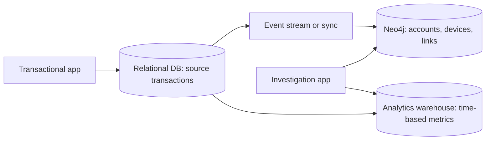

# Signs a Problem Fits a Graph and When to Choose Another Data Store

## 1. Objectives and Selection Principles

Neo4j is a graph database built on the **property graph** model: entities are represented as **nodes** (vertices), connections as **relationships** (directed, typed edges), and both can carry properties. Cypher lets you express connection patterns and paths directly. In a large system, Neo4j is typically considered when **relationships between entities are central to domain questions**, rather than acting merely as foreign keys for table joins.

After this lesson, you will be able to:

- Recognize requirements where graph queries deliver practical value: finding multi-hop links, detecting clusters, discovering paths, and explaining why two entities are connected.
- Distinguish between *data having relationships* and *business logic needing to explore a relationship network*.
- Choose among Neo4j, relational, document, key-value, search, time-series, and analytical stores based on real query patterns.
- Propose a small proof-of-concept benchmark, measure query cost, and identify conditions under which an initial choice may change.

> **Principle:** There is no rule that “having many JOINs means you must use a graph.” Start from **the questions the system must answer frequently, target latency, and how data changes**. Graphs excel at link-exploration queries; other storage engines are better optimized for record operations, full-text search, time series, or large-scale analytical aggregations.

## 2. Having Relationships in Data Is Not Enough to Require Neo4j

Almost every business system has relationships: orders belong to customers, products belong to categories, employees belong to departments. These relationships are usually fixed, shallow, and straightforward to handle with foreign keys, indexes, and a few SQL JOINs.

Compare three questions over the same money-transfer dataset:

| Business Question | Nature of Query | Initial Guidance |
| --- | --- | --- |
| “What is the total transfer amount for account A in October?” | Filter by account and time, then aggregate amounts | SQL or a columnar analytics store usually fits |
| “Show A's 20 most recent transactions” | Index-backed filtering and sorting of records | SQL/document depending on data model |
| “Within at most three hops, which accounts can money from A reach, and do any of those accounts share devices?” | Multi-hop relationship traversal combined with heterogeneous link patterns | Neo4j is worth evaluating |

A relational database can still answer the third question via `JOIN` or `WITH RECURSIVE` in supporting RDBMSs. The difference is that **a graph model makes path and connection-pattern queries far more natural**; whether it is faster or cheaper must be measured on real data.

## 3. Signals to Put Neo4j on Your Shortlist

### 3.1. Queries Frequently Traverse Multiple Relationship Hops

Examples: “Which employees have access to resource X via groups, roles, and nested subgroups?”, “Which components are indirectly impacted if supplier Y goes offline?”. The hop count can vary with real-world structure rather than being fixed across two known tables.

In a graph model, you can start from a clearly identified vertex and traverse along relevant edges. Cypher supports expressing path patterns, length bounds, and relationship types. When requirements shift from two hops to three or four, graph expressions typically track the change more cleanly than adding manual JOIN chains.

**Verification signal:** The engineering team frequently writes recursive queries, repeated self-joins, or custom graph-traversal algorithms in application code.

### 3.2. Many-to-Many Connections That Evolve Frequently

A user can use multiple devices, a device links to multiple accounts, accounts transact with many other accounts, and groups nest inside larger groups. Business needs regularly introduce new relationship types: `USES_DEVICE`, `MEMBER_OF`, `REFERRED_BY`, `TRANSFERRED_TO`.

Property graphs represent these links as first-class typed edges carrying properties when needed. This helps when the application frequently asks “who is connected via which edge types?” or adds new relationship dimensions.

**Limitation:** A flexible graph model does not mean skipping data design. You still must standardize edge direction, relationship type names, identifiers, uniqueness, and temporal conventions; otherwise the same fact gets represented inconsistently, making queries unreliable.

### 3.3. Results Need to Explain *Why* Two Entities Are Connected

A recommendation system might explain: “Customer A may like product P because A follows B, and B bought P.” A fraud investigation system can output the exact transaction chain linking two accounts. A path serves as auditable evidence for human review, unlike returning only an opaque similarity score.

Graphs shine when **edges and paths carry business meaning that needs explanation**. Still, finding a connecting path between two vertices does not automatically prove causality or fraudulent intent.

### 3.4. Need to Detect Clusters, Cycles, Bridge Nodes, or Network Motifs

Examples include detecting rings of accounts sharing devices, money-laundering transfer cycles, cascading failure impact in dependency graphs, or bottlenecks in supply networks. You can combine Cypher patterns with specialized graph algorithms when structural analysis at scale is required.

**Important distinction:** Interactive queries exploring a small neighborhood around a starting node and whole-graph algorithms scanning millions of nodes are two different workloads. For whole-graph algorithms, evaluate memory footprint, data-loading time, and batch processing capabilities, including dedicated analytics tools.

### 3.5. Queries Start from a Specific Entity and Expand Along Links

Example: “Starting from device ID D-17, find accounts that have used it, then accounts receiving transfers within at most two hops.” This is a **selective-start traversal**. When indexes/constraints locate the starting vertex quickly and edge fan-out stays bounded, a graph model works well.

Conversely, if most queries scan nearly all records to compute revenue totals, group by month, or export periodic reports, edge-traversal advantages are rarely the deciding factor.

### 3.6. Relationships Are Part of Core Business Logic, Not Just Reporting

Strong candidates to evaluate include nested-group authorization, data lineage, service dependency analysis, and fraud-ring detection. Here, the application makes decisions based on **the shape of the live connection network**.

A recommendation feature that only shows “top selling products this week” probably does not need a graph; one that needs “recommendations from authors in communities the user follows with an explainable link path” has a much stronger case for considering a graph.

### Quick Screening Table

| Observed Signal | Question to Ask Product / Domain Team | What to Verify |
| --- | --- | --- |
| Multi-hop queries | Do we frequently traverse 2–N relationships? | Max depth, result cardinality, latency SLA |
| Heterogeneous relationships | Which combinations of edge types do users query? | Does the edge model accurately reflect semantics? |
| Valuable paths | Must we return the link chain as an explanation? | Validation rules, access permissions along paths |
| Evolving links | Do relationship types and connection rules change often? | Cost of updating model and application code |
| Single-vertex start | Are there clear identifiers to anchor the start? | Indexes and real-world branching factor |
| Network structure analysis | Do we need community, cycle, or bridge detection? | Real-time vs. batch execution, scale, and resources |

## 4. Running Example: Finding a Suspicious Account Network

Suppose a fraud-prevention team needs to identify accounts reachable from a flagged account within at most three transfer hops, while also finding accounts sharing devices. A simple property graph model:

```text
(A-001:Account) --TRANSFERRED_TO--> (A-002:Account)
       |                                   |
       |                                   +--TRANSFERRED_TO--> (A-003:Account)
       +--TRANSFERRED_TO--> (A-004:Account) --TRANSFERRED_TO--> (A-003)
       |
       +--USED_DEVICE--> (D-7:Device) <--USED_DEVICE-- (A-004)
```

Accounts are `:Account` nodes, devices are `:Device` nodes, and `:TRANSFERRED_TO` and `:USED_DEVICE` are two relationship types. `txId`, amount, and timestamp can live on transfer edges. In real systems, deciding whether a transaction should be a **relationship** or its own `:Transaction` node depends on whether transactions carry many attributes, involve multiple parties, have independent lifecycles, or need extra links.

### 4.1. Creating Sample Data

The example below uses Neo4j 5 Cypher syntax; run it in an isolated practice environment. Constraints uniquely identify each account and device.

```cypher
CREATE CONSTRAINT account_id_unique IF NOT EXISTS
FOR (a:Account) REQUIRE a.id IS UNIQUE;

CREATE CONSTRAINT device_id_unique IF NOT EXISTS
FOR (d:Device) REQUIRE d.id IS UNIQUE;

MERGE (a1:Account {id: 'A-001'})
MERGE (a2:Account {id: 'A-002'})
MERGE (a3:Account {id: 'A-003'})
MERGE (a4:Account {id: 'A-004'})
MERGE (d7:Device {id: 'D-7'})
MERGE (a1)-[:TRANSFERRED_TO {txId: 'TX-01', amount: 1000}]->(a2)
MERGE (a2)-[:TRANSFERRED_TO {txId: 'TX-02', amount: 800}]->(a3)
MERGE (a1)-[:TRANSFERRED_TO {txId: 'TX-03', amount: 500}]->(a4)
MERGE (a4)-[:TRANSFERRED_TO {txId: 'TX-04', amount: 400}]->(a3)
MERGE (a1)-[:USED_DEVICE]->(d7)
MERGE (a4)-[:USED_DEVICE]->(d7);
```

In this example, `MERGE` allows re-running the script without duplicating relationships that share the exact property pattern. When loading production data, design proper transaction IDs and idempotent ingestion strategies rather than assuming every `MERGE` on relationships is cheap or automatically enforces domain uniqueness.

### 4.2. Querying Accounts Reachable in 1–3 Hops

```cypher
// Provide the accountId = 'A-001' parameter from your application or Neo4j Browser.
MATCH p = (source:Account {id: $accountId})
          -[:TRANSFERRED_TO*1..3]->(target:Account)
WHERE target <> source
RETURN target.id AS accountId,
       min(length(p)) AS minimumHops
ORDER BY minimumHops, accountId;
```

On the data above, expected results are `A-002` and `A-004` at **1 hop**, and `A-003` at **2 hops**. `min(length(p))` takes the shortest length among **paths enumerated within the three-hop bound**, and is not by default an optimal shortest-path algorithm for every problem. When finding shortest paths on large networks, select dedicated syntax or algorithms appropriate to your Neo4j version, edge direction, and weighting rules.

The `*1..3` syntax is the classic variable-length pattern in Cypher 5. Newer Cypher/GQL versions also introduce quantified path patterns; check your project's actual version.

### 4.3. Finding Accounts Sharing a Device

```cypher
MATCH (source:Account {id: $accountId})-[:USED_DEVICE]->(d:Device)
      <-[:USED_DEVICE]-(other:Account)
WHERE other <> source
RETURN DISTINCT other.id AS relatedAccount, d.id AS sharedDevice;
```

With `accountId = 'A-001'`, this query finds `A-004` via device `D-7`. This is only a **connection signal**. Shared devices can be public kiosks or family devices; concluding risk requires corroborating evidence such as timing, frequency, anomalies, and business rules.

### 4.4. When Does This Example Not Need Neo4j?

If actual requirements only fetch an account's transaction history, look up recipient details, and sum daily amounts, a relational database indexed on `from_account_id`, `to_account_id`, and `created_at` is usually a sound starting point. Recursive SQL may even suffice if multi-hop queries are infrequent, depth is fixed, and measured latency meets targets.

Measure not only single Cypher query speed, but also **data ingestion/update time, sync cost, memory, consistency, concurrent query load, and operational effort**.

## 5. When to Prefer Another Data Store

Neo4j can participate in an overall architecture without being the sole database. Choose storage engines according to primary data access paths:

| Dominant Use Case | Preferred First Choice | Why | When a Graph Can Complement |
| --- | --- | --- | --- |
| Orders, payments, inventory; multi-record transactions with classic constraints | **Relational DB** such as PostgreSQL, MySQL | SQL, foreign keys, JOINs, ACID transactions, and tabular reporting fit well | Tracing complex networks across entities, partners, or provenance |
| Profiles/applications with nested structures, typically read/written as one document | **Document database** | Each document is retrieved and updated as one cohesive unit | Cross-links across many profiles become core queries |
| Key lookups, sessions, caches, simple counters | **Key-value store** | Simple and ultra-fast key-based access | Need to traverse relationship networks across keys |
| Full-text search, linguistic analysis, autocomplete, relevance ranking | **Search engine** | Inverted indexes, text scoring, search queries | Finding relationships among results or explaining links |
| Metrics, sensor logs, timestamped measurements, time-windowed rollups | **Time-series database** | Optimized for time-ordered data, retention, compression, and time aggregations | Tracing relationships across devices, locations, incidents, and dependencies |
| Dashboards, analyzing billions of events, `SUM`/`AVG`/`GROUP BY` at huge scale | **Columnar warehouse / OLAP** | Columnar scans and massive aggregations | Exploring network structure of entities surfaced by analytics |
| Semantic similarity search via embeddings | **Vector index / vector database** | Vector similarity and nearest-neighbor search | Combining similarity with typed links and path constraints |
| Heavy point, polygon, and geospatial distance queries | **Spatial DB / engine** | Geospatial operators and spatial indexes | Analyzing route networks and dependencies between locations |

These categories are not mutually exclusive. Relational engines can support JSON, full-text, vectors, or spatial data; graph engines can also provide search and vector capabilities. This table serves as a **primary-query evaluation guide**, not a rigid boundary on product capabilities.

### 5.1. Choose Relational When Hops Are Shallow and Workflows Center on Records

For example, an e-commerce platform handling `Customer`, `Order`, `OrderItem`, and `Product`. Questions like “orders for customer X,” “monthly top-selling products,” or “refund transaction Y” fit SQL tables, constraints, and indexes naturally. Migrating everything to a graph solely because foreign keys exist can raise operational cost without improving core queries.

Worth noting: **Neo4j also supports ACID transactions**; do not rule it out merely because a workload needs transactions. The difference lies in query patterns, modeling style, integration ecosystem, and total cost.

### 5.2. Choose Document When the Data Boundary Is a Single Document

A UI configuration page containing nested subcomponents that are normally loaded and saved together is often cleaner as a document. If those subcomponents rarely connect to other documents via multi-hop paths, turning every sub-element into a node creates unnecessary modeling overhead.

### 5.3. Choose Search or Vector When Content Relevance Is the Core Problem

“Which articles contain this phrase?” or “Which paragraphs are semantically closest to this question?” are primarily indexing and ranking problems. A graph helps when results must also satisfy relational constraints such as “written by an author I follow” or “part of a project dependency,” rather than replacing a search engine outright.

### 5.4. Choose Time-Series or OLAP When Scanning and Aggregating Dominates

Example: 100 million temperature readings from sensors and hourly average dashboards. Measurements are time-series streams that compress and partition well; creating a node for every reading and chaining them adds modeling and traversal cost with no gain. If the goal is to find “which sensors indirectly depend on a failing substation,” a graph of **entities and dependencies** can still be a valuable companion layer.

## 6. Situations Where a Graph Can Also Be a Poor Fit

### 6.1. Excessive Branching Factor or Queries Without Selective Anchors

Suppose an account connects to tens of thousands of other accounts and a query expands multiple hops without bounds. Potential paths can explode with depth. With average branching factor `d`, branches at step `k` can approach `d^k` before accounting for duplicates, filters, and topology.

Vertices with huge edge counts (*supernodes*) such as “a device shared by everyone,” “country,” or “viral event” can cause traversals to expand massive intermediate sets. **Graphs do not magically eliminate combinatorial explosion.**

Mitigations to consider: choose a selective starting node, traverse only required edge types, cap depth, apply domain-specific bounds, filter by time/edge attributes, remodel supernodes, and verify the query plan. Putting `LIMIT` at the end of a query does not always avoid work performed earlier in the plan.

### 6.2. Continuously Changing Data Where the Graph Is a Hard-to-Sync Replica

If source transactions live in SQL, graph data may require updates via events or sync pipelines. You must define acceptable sync lag, duplicate handling, out-of-order updates, deletions, and recovery procedures. If graph queries are rarely used, the cost of keeping two stores consistent can outweigh the benefit.

Especially for high-stakes decisions like blocking payments or granting access, clearly separate authoritative source-of-truth data from analytical graph replicas, and enforce minimum freshness requirements before acting.

### 6.3. “Only Need Ranked Recommendations” Without Link Modeling

Product recommendations built from co-purchase statistics, embeddings, or ML models can work well without storing every interaction as a graph edge. Choose a graph only when relationship queries, path constraints, or explainability deliver enough value to justify building and maintaining it.

### 6.4. Overly Complex Multi-Dimensional Temporal Modeling

Relationships change over time: which team an employee belonged to on a past date, when an access grant took effect, when an edge was modified or revoked. A property graph does not automatically generate exact historical snapshots; you must explicitly model validity intervals, versions, events, and point-in-time query rules. If requirements are mainly historical time-slice reporting, a temporal table or data warehouse may be simpler.

## 7. A Query- and Measurement-Driven Decision Process

A technology choice can follow six structured steps:

1. **Collect the 5–10 most critical queries.** Record what users ask, inputs, call frequency, concurrency, and acceptable latency. Write questions in domain language before thinking in Cypher or SQL.
2. **Classify each query.** Tag queries as record lookup, aggregation, text search, similarity, time series, multi-hop traversal, or graph algorithm. Identify the group that truly defines product experience.
3. **Sketch a small model.** Define nodes, relationships, properties, edge directions, unique keys, and update patterns. For a graph, try answering the questions directly with edge patterns instead of copying existing table schemas.
4. **Compare at least one alternative.** Write equivalent queries in SQL (including recursive queries where applicable) or in a workload-specific engine. Compare model maintenance simplicity as well.
5. **Benchmark on realistic data.** Match production-like edge distributions, supernodes, traversal depths, dataset sizes, and read/write ratios. Measure p50/p95 latency, CPU/RAM usage, throughput, ingestion/update speed, and operational cost. In Neo4j, use `EXPLAIN` to read the plan and `PROFILE` to inspect actual execution; verify queries start from indexed nodes and avoid excessive edge expansion.
6. **Finalize the choice and re-evaluation triggers.** Document the source of truth, where apps read from, freshness SLAs, security, backups, monitoring, rollback plans, and when to re-benchmark (e.g., if query depth grows or a node becomes a supernode).

The matrix below structures discussion without replacing benchmarks:

| Criterion | Leans Toward Neo4j | Leans Toward Another Store |
| --- | --- | --- |
| Core queries | Multi-hop traversal and path patterns | Record lookups, aggregations, full-text or vector search |
| Access pattern | Start from specific entities and expand | Scan many records or fetch whole documents |
| Domain evolution | Adding relationship types and traversal rules | Stable structure, a few fixed JOINs |
| Desired output | Paths, link networks, and explanations | Tabular rows, aggregate metrics, top-k similarity |
| Integration cost | Value justifies maintaining graph and sync | Existing infrastructure already meets requirements |

## 8. Hybrid Architecture: Using a Graph Where It Fits

A realistic fraud-prevention architecture might look like this:



In this example:

- **Relational DB** stores authoritative transactions with required business rules and constraints.
- **Neo4j** powers investigations of account links, devices, money-transfer paths, and explainable relationship patterns.
- **Analytics warehouse** handles daily/monthly aggregations, trends, and large-scale reporting.

If a Java application queries the graph, it can use the **Neo4j Java Driver** to execute parameterized Cypher explicitly, or **Spring Data Neo4j** when object mapping and repositories genuinely fit. That is an integration-layer choice: using the Java Driver or Spring Data Neo4j **does not by itself make a graph model the right fit**. You still must evaluate query patterns, transactions, data freshness, and synchronization cost.

Simpler systems may only need a single relational database. A polyglot architecture pays off only when the value of specialized queries exceeds the cost of syncing and operating an extra engine.

## 9. Common Misconceptions

| Misconception | Accurate Understanding |
| --- | --- |
| “Many foreign keys automatically mean you need a graph.” | Foreign keys are normal; consider a graph only when the link network is central to key queries. |
| “Neo4j is always faster than SQL with multi-table JOINs.” | Performance depends on data, indexes, execution plans, depth, node degree, and load; always benchmark. |
| “Once stored as a graph, any path is fast to find.” | Unbounded expansion can explode path counts; weighted shortest paths also need appropriate algorithms. |
| “A graph replaces all other databases.” | Search, time-series, OLAP, key-value, and RDBMS engines retain clear advantages for their workloads. |
| “A path between two accounts proves fraud.” | A link is an investigative lead requiring context and corroborating evidence. |
| “Graphs are flexible, so constraints aren't needed.” | You still need constraints, indexes, consistent app-level schemas, and data quality rules. |

## 10. Applied Exercises

**Scenario A — Course Management Platform.** The system needs lists of courses enrolled by students, total tuition per semester, and reports. A new requirement is added: “Through which prerequisite chains can a student reach course K, and which courses are indirectly affected if course X changes?”

**Question:** Which technologies would you prioritize for each group of requirements? Specify appropriate nodes/relationships if adding a graph, and what traversal depth limits to set.

**Scenario B — IoT System.** Millions of temperature readings arrive every minute, yet operators occasionally need to find sensors indirectly dependent on a failing power substation across multiple connection layers.

**Question:** Which part fits time-series and which fits a graph? Would you store temperature readings as nodes or keep them in a time-series store? Why?

**Scenario C — Recommendation Service.** Current requirements return the 10 articles semantically closest to a query, filtered by language. Future requirements may add “only include articles from authors within communities the user follows within at most two hops.”

**Question:** Which technology solves the current requirement? Under what conditions does a graph play a supporting role? What would you benchmark before introducing Neo4j?

### Self-Check Hints

- **A:** Enrollments and tuition typically fit SQL; the prerequisite network fits a graph with `(:Course)-[:REQUIRES]->(:Course)` and multi-hop impact queries. Enforce rules preventing invalid prerequisite cycles.
- **B:** Per-minute readings fit a time-series store; the graph only needs `Sensor`, `Station`, `PowerSource`, and dependency relationships. Do not create nodes for every measurement point just to infer substation dependencies.
- **C:** Semantic search prioritizes vector search; author–follower–community links can use a graph if link traversal becomes a frequent, high-value filter. Benchmark on real data and latency targets, including identity and relationship sync cost.

## Conclusion

Neo4j is a strong candidate when a system continuously answers **“who is connected to whom, through which edges, in how many hops, and why?”**. When business logic centers on tabular transactions, self-contained documents, time-series rollups, full-text search, or vector similarity, evaluate specialized stores first. Sound architectural choices are backed by key domain queries, realistic data distributions, empirical benchmarks, and full-system operational costs.
