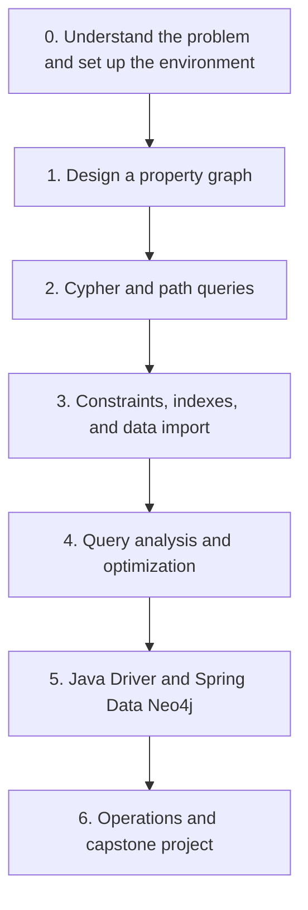
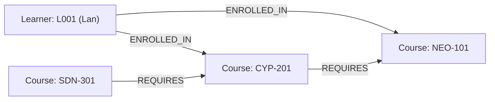

# Neo4j Learning Roadmap: From Data Modeling to Queries, Applications, and Operations

## 1. What Problems Are You Learning Neo4j to Solve?

Neo4j is a graph database management system built on the **property graph** model: data is represented through **nodes** (vertices), **relationships** (directed edges), and **properties** on both nodes and relationships. The **Cypher** query language lets you express connection patterns and query paths across entities. This approach is especially effective when business questions revolve around *who is connected to whom, through which relationships, and across how many hops*.

For example, on a learning platform, beyond listing the courses a learner has enrolled in, the system must also find all prerequisites of a course, identify which prerequisites a learner is still missing, or recommend next courses. Scenarios like these help learners see when a graph model yields a more natural expression than multi-table joins.

This guide outlines a **learning sequence and completion criteria** spanning modeling fundamentals, querying, data import, optimization, integrating the **Neo4j Java Driver**, **Spring Data Neo4j**, and operations. It is a hands-on roadmap: each stage produces an artifact you will build on in the next stage.

### Expected Outcomes

Upon completing this roadmap, you will be able to:

1. Translate business requirements into a node–relationship–property model, choosing stable identifiers and sound relationship directions.
2. Write Cypher to create/update data, filter, aggregate, traverse relationships, and find bounded paths.
3. Set up **constraints**, **indexes**, data import pipelines, and data quality checks.
4. Read execution plans with `EXPLAIN`/`PROFILE` and tune query patterns against realistic data.
5. Access Neo4j from Java, design data-access layers with Spring Data Neo4j, and manage transaction boundaries properly.
6. Implement security, monitoring, backup/restore, and deployment workflows for operating a graph application.

## 2. Roadmap Overview



The durations below are **suggestions for learners who already know basic databases and Java**; actual pacing varies with prior experience and dataset complexity.

| Stage | Suggested Time | Readiness Gate Before Moving On |
|---|---|---|
| 0. Setup | 1–2 sessions | Can connect to Neo4j, run a Cypher query, and state data goals |
| 1. Modeling | Week 1 | Can diagram nodes/relationships and explain identifiers, direction, and properties |
| 2. Cypher | Weeks 2–3 | Can create data, query multi-hop paths, filter, aggregate, and use parameters |
| 3. Integrity & Import | Week 4 | Can create constraints/indexes; re-importing the same data creates no duplicates |
| 4. Performance | Late Week 4 – Early Week 5 | Can read query plans and spot expensive starting scans or graph expansions |
| 5. App Integration | Weeks 5–6 | Java/Spring API calls Cypher with data tests and transaction management |
| 6. Operations & Capstone | Weeks 7–8 | Has deployment notes, monitoring, recovery drill, and an end-to-end project |

You do not need to memorize every Cypher function before building an application. Follow an iterative loop: **ask domain questions → model → seed sample data → query → measure → refine**.

## 3. Running Scenario: An Online Learning Platform

Suppose a system must answer three questions:

- Which courses is a learner currently enrolled in?
- To take an advanced course, which prerequisites are required, including multi-level prerequisites?
- Which prerequisites is a learner still missing for an advanced course?

Initial model:

| Component | Meaning | Illustrative Properties |
|---|---|---|
| `(:Learner)` | A learner | `id`, `name` |
| `(:Course)` | A course | `code`, `title` |
| `(:Learner)-[:ENROLLED_IN]->(:Course)` | Learner enrolled in course | `enrolledAt` (if needed) |
| `(:Course)-[:REQUIRES]->(:Course)` | Left-hand course requires right-hand course as a prerequisite | Properties optional |



**Direction convention is a domain decision:** `(A)-[:REQUIRES]->(B)` means taking A requires prior knowledge of B. Therefore, starting at `SDN-301` and following `REQUIRES` visits `CYP-201` and then `NEO-101`. This direction will remain consistent across all examples.

### Modeling Principles to Grasp Early

**Node or property?** Make an object a node when it has its own identity or must participate in independent relationships. For instance, `Course` should be a node, whereas `title` is usually just a property on `Course`. Do not turn every string into a node if there is no need to traverse connections through it.

**Relationship or intermediate node?** `ENROLLED_IN` suffices when an enrollment carries only a few simple attributes. If each enrollment has its own lifecycle, payment, status history, and extra links, you may need a dedicated `Enrollment` node with its own identity. Base the choice on query patterns and data lifecycle.

**Which identifier is durable?** Choose `Learner.id` and `Course.code` as stable business keys; learner names and course titles can change. Avoid using a mutable attribute like `title` as the identity key in `MERGE`.

**Does everything need a graph?** If requirements are just storing lists and looking up records by key, a relational database may already suffice. Evaluate Neo4j based on multi-hop questions, actual access patterns, and your team's operational readiness.

**End of Stage 1 exercise:** sketch a graph for an “instructor teaches course” feature, listing new nodes/relationships, unique keys, and at least three domain questions the model can answer.

## 4. Stages 0–2: Setup, Building the Graph, and Mastering Cypher

### 4.1. Setting Up the Learning Environment

Use a dedicated practice Neo4j database with **Neo4j Browser** or an equivalent Cypher tool. Confirm you can connect, read data, and run write statements within the exercise scope. Note that Java applications typically connect over **Bolt** using a URI and credentials configured outside source code.

Before running examples, standardize label names (`Learner`, `Course`), relationship types (`ENROLLED_IN`, `REQUIRES`), property keys (`id`, `code`), and the sample dataset. Execute the statements below in order in your practice environment.

### 4.2. Creating Constraints Before Importing Data

```cypher
CREATE CONSTRAINT learner_id_unique IF NOT EXISTS
FOR (l:Learner) REQUIRE l.id IS UNIQUE;

CREATE CONSTRAINT course_code_unique IF NOT EXISTS
FOR (c:Course) REQUIRE c.code IS UNIQUE;
```

Unique constraints prevent two learners from sharing the same `id` or two courses from sharing the same `code`. Verify exact syntax and administrative privileges against your Neo4j version and user role. A uniqueness constraint differs from requiring every node to possess the property; if existence is mandatory, check which constraint types your version and edition support.

### 4.3. Creating Idempotent Sample Data

```cypher
UNWIND [
  {id: 'L001', name: 'Lan'},
  {id: 'L002', name: 'Minh'}
] AS item
MERGE (l:Learner {id: item.id})
SET l.name = item.name;

UNWIND [
  {code: 'NEO-101', title: 'Introduction to Neo4j'},
  {code: 'CYP-201', title: 'Hands-On Cypher'},
  {code: 'SDN-301', title: 'Spring Data Neo4j'}
] AS item
MERGE (c:Course {code: item.code})
SET c.title = item.title;

MATCH (cypher:Course {code: 'CYP-201'}),
      (intro:Course {code: 'NEO-101'})
MERGE (cypher)-[:REQUIRES]->(intro);

MATCH (spring:Course {code: 'SDN-301'}),
      (cypher:Course {code: 'CYP-201'})
MERGE (spring)-[:REQUIRES]->(cypher);

MATCH (lan:Learner {id: 'L001'}),
      (intro:Course {code: 'NEO-101'})
MERGE (lan)-[r:ENROLLED_IN]->(intro)
ON CREATE SET r.enrolledAt = date('2026-11-01');

MATCH (lan:Learner {id: 'L001'}),
      (cypher:Course {code: 'CYP-201'})
MERGE (lan)-[:ENROLLED_IN]->(cypher);

MATCH (minh:Learner {id: 'L002'}),
      (intro:Course {code: 'NEO-101'})
MERGE (minh)-[:ENROLLED_IN]->(intro);
```

Here `MERGE` matches existing patterns or creates new ones; combining **stable business keys + constraints** makes re-running data loads safer. Use `SET` to update mutable properties. With production data, you must also handle key normalization, conflicts, and concurrent writes.

### 4.4. Writing Queries from Simple Lookups to Multi-Hop Paths

**Question 1 — What is Lan currently enrolled in?**

```cypher
MATCH (l:Learner {id: $learnerId})-[:ENROLLED_IN]->(c:Course)
RETURN c.code AS code, c.title AS title
ORDER BY code;
```

Pass the parameter `learnerId = 'L001'` in your query tool or application. On the sample data, this returns `CYP-201` and `NEO-101`. Parameters separate user input from Cypher query text and enable query plan reuse.

**Question 2 — What are the direct and indirect prerequisites of `SDN-301`?**

```cypher
MATCH (target:Course {code: $courseCode})
      -[:REQUIRES*1..4]->(required:Course)
RETURN DISTINCT required.code AS code, required.title AS title
ORDER BY code;
```

With `courseCode = 'SDN-301'`, the result is `CYP-201` and `NEO-101`. The pattern `*1..4` traverses **1 to 4 relationships**; bounding traversal depth is critical in high-branching graphs. `DISTINCT` avoids duplicate courses when multiple paths reach the same node.

**Question 3 — Which prerequisites of `SDN-301` is Lan still missing?**

```cypher
MATCH (l:Learner {id: $learnerId})
MATCH (target:Course {code: $courseCode})
      -[:REQUIRES*1..4]->(required:Course)
WHERE NOT EXISTS {
  MATCH (l)-[:ENROLLED_IN]->(required)
}
RETURN DISTINCT required.code AS missingCode,
                required.title AS missingTitle
ORDER BY missingCode;
```

With `learnerId = 'L001'` and `courseCode = 'SDN-301'`, the missing set is **empty** because Lan is already enrolled in both prerequisites. Changing to `learnerId = 'L002'` returns `CYP-201` as missing. Note: *enrolled* does not mean *completed*. If business rules require completion, add a completion status or pass criterion to the model and update the filter condition accordingly.

**Question 4 — How many learners are enrolled in each course?**

```cypher
MATCH (c:Course)
OPTIONAL MATCH (l:Learner)-[:ENROLLED_IN]->(c)
RETURN c.code AS courseCode, count(DISTINCT l) AS learnerCount
ORDER BY learnerCount DESC, courseCode;
```

`OPTIONAL MATCH` preserves courses with zero enrollments; `count(DISTINCT l)` does not count `null` values. To avoid subtle logic bugs, always state explicitly **what one output row represents**, especially when combining multiple `MATCH`, `OPTIONAL MATCH`, `WITH`, `UNWIND`, and aggregation clauses.

**Stage 2 completion milestone:** independently write a bounded path query, an `OPTIONAL MATCH`/aggregation query, and a parameterized query; explain relationship directions and what each result row means.

## 5. Stage 3: Data Integrity, Indexes, and Data Import

### 5.1. Distinguishing Constraints and Indexes

| Tool | Question Answered | Example |
|---|---|---|
| **Uniqueness constraint** | Can two nodes of the same label share a key? | No two `Course` nodes share the same `code` |
| **Index** | Which properties do queries frequently filter on first? | Looking up courses by `title` |
| **Application rule** | Is the value domain-valid? | Preventing `REQUIRES` edges that create prerequisite cycles |

Example index on course title:

```cypher
CREATE INDEX course_title_idx IF NOT EXISTS
FOR (c:Course) ON (c.title);
```

Neo4j automatically manages backing indexes for certain constraints; do not blindly create a redundant index on `Course.code`. Choose indexes based on **filter predicates and starting-point lookups** of frequent queries, not every property in the dataset.

### 5.2. Batch Data Import

When importing CSV files, follow a minimal pipeline: validate formatting → normalize identifiers → load nodes → load relationships once endpoints exist → reconcile counts and errors → test re-running idempotently. Suppose `courses.csv` has columns `code,title` and sits in the import directory allowed by the Neo4j server:

```cypher
LOAD CSV WITH HEADERS FROM 'file:///courses.csv' AS row
WITH row
WHERE row.code IS NOT NULL AND trim(row.code) <> ''
MERGE (c:Course {code: trim(row.code)})
SET c.title = row.title;
```

Where `file:///` resolves depends on server configuration and deployment environment; never assume the server can read files directly from your local laptop path. For large datasets, **batch transactions**, measure throughput, handle per-batch errors, and avoid massive single-transaction writes. Ensure every relationship resolves valid start/end nodes; missing references should be surfaced rather than silently dropped.

### 5.3. Post-Import Data Verification

```cypher
MATCH (l:Learner) RETURN count(l) AS learners;

MATCH (c:Course) RETURN count(c) AS courses;

MATCH ()-[r:REQUIRES]->() RETURN count(r) AS prerequisites;

MATCH (a:Course)-[:REQUIRES]->(a)
RETURN a.code AS selfDependency;
```

On the sample data, the counts are **2 learners**, **3 courses**, **2 prerequisite relationships**, and **no direct self-dependencies**. The final query detects only single-edge self-loops; multi-hop cycles require dedicated validation rules. A uniqueness constraint **does not automatically prevent cycles** in a prerequisite graph.

**Stage 3 completion milestone:** re-import the sample dataset twice without increasing node/relationship counts, verify unique keys, and document how malformed records are handled.

## 6. Stage 4: Understanding Query Cost and Optimizing Cypher

A graph query typically has two phases: **locating starting nodes** (e.g., via `Course.code`) and **expanding relationships** from those nodes. Queries that start too broadly, traverse unbounded depths, or pass through high-degree nodes can generate massive intermediate path counts.

Start by inspecting with:

```cypher
EXPLAIN
MATCH (c:Course {code: $courseCode})-[:REQUIRES*1..4]->(p:Course)
RETURN DISTINCT p.code;
```

`EXPLAIN` shows the estimated execution plan without running the query; `PROFILE` executes the query and attaches runtime metrics. Inspect node-lookup operators, intermediate row counts, database hits, and relationship-expansion steps. Plans and costs depend on Neo4j version, statistics, and dataset shape; observe behavior on representative data volumes before drawing conclusions.

Optimization order should be:

1. Verify business correctness first, including deduplication and cyclic paths.
2. Anchor on selective starting nodes using appropriate keys/properties; verify supporting indexes/constraints.
3. Traverse only required relationship types, directions, and depths; avoid unnecessary whole-graph scans.
4. Minimize intermediate rows and return only needed columns. Consider API-level pagination for large outputs.
5. Use `PROFILE` to compare before/after on representative data and re-verify result correctness.

There is no universal “best” traversal depth or index across all problems. Set bounds from domain semantics; if prerequisite chains can exceed four levels, production queries must support that depth alongside appropriate cost controls.

**Stage 4 completion milestone:** present a `PROFILE` plan, explain which starting node lookup operator was chosen and why, and demonstrate a concrete optimization backed by measured metrics.

## 7. Stage 5: Integrating Queries into Java Applications

### 7.1. Using the Neo4j Java Driver for Direct Cypher Control

At the application level, typically share a single `Driver` across the application lifecycle, open a `Session` per unit of work, and close sessions cleanly. Read URIs, usernames, and passwords from secure configuration—**never hardcode them in source code**. The example below assumes `Driver` is already configured and initialized:

```java
import org.neo4j.driver.Driver;
import org.neo4j.driver.Session;
import org.neo4j.driver.SessionConfig;

import java.util.List;
import java.util.Map;

public class EnrollmentQueries {
    private final Driver driver;

    public EnrollmentQueries(Driver driver) {
        this.driver = driver;
    }

    public List<String> findCourseTitles(String learnerId) {
        try (Session session = driver.session(
                SessionConfig.forDatabase("neo4j"))) {
            return session.executeRead(tx -> tx.run("""
                    MATCH (l:Learner {id: $learnerId})-[:ENROLLED_IN]->(c:Course)
                    RETURN c.title AS title
                    ORDER BY title
                    """, Map.of("learnerId", learnerId))
                .list(record -> record.get("title").asString()));
        }
    }
}
```

`executeRead` manages read transactions cleanly for query-only flows; write flows should use the corresponding write transaction method. This snippet focuses on the read operation; production code must handle connection/transaction errors, timeouts, result limits, and closing `Driver` on shutdown. Consult the Java Driver documentation for your exact version for API names and configuration options.

### 7.2. Using Spring Data Neo4j for the Repository Layer

With Spring Boot, Spring Data Neo4j helps map nodes/relationships to domain classes and repositories. Simplified `Course` entity example:

```java
import org.springframework.data.annotation.Id;
import org.springframework.data.neo4j.core.schema.Node;
import org.springframework.data.neo4j.core.schema.Relationship;
import java.util.HashSet;
import java.util.Set;

@Node("Course")
public class Course {
    @Id
    private String code;
    private String title;

    @Relationship(type = "REQUIRES",
                  direction = Relationship.Direction.OUTGOING)
    private Set<Course> prerequisites = new HashSet<>();

    // Constructors/getters/setters per project conventions.
}
```

And a repository query for prerequisites:

```java
import org.springframework.data.neo4j.repository.Neo4jRepository;
import org.springframework.data.neo4j.repository.query.Query;
import org.springframework.data.repository.query.Param;
import java.util.List;

public interface CourseRepository extends Neo4jRepository<Course, String> {
    @Query("""
           MATCH (:Course {code: $code})-[:REQUIRES*1..4]->(required:Course)
           RETURN DISTINCT required
           """)
    List<Course> findPrerequisites(@Param("code") String code);
}
```

These Java snippets illustrate the pattern; add dependency configuration, `Driver`/repository bean management, constructors, and accessors appropriate to your project's Spring/Neo4j versions. For queries returning deep relationships or subgraphs, design mapping boundaries carefully to avoid automatically hydrating unintended portions of the graph.

**When to choose which?** Use the Java Driver when you want direct control over Cypher, transactions, and returned record shapes. Use Spring Data Neo4j when your application follows the Spring repository/domain model. Both can coexist if transaction boundaries and connection ownership are clearly defined.

### 7.3. Building a Small API to Verify Integration

Create an endpoint such as `GET /learners/{id}/missing-prerequisites?courseCode=SDN-301` with this processing flow:

```text
HTTP request
  -> validate learnerId, courseCode parameters
  -> service applies business rules
  -> repository/driver runs parameterized Cypher
  -> map missing courses list
  -> return JSON (with error/not-found handling)
```

Write integration tests against isolated test data: Lan has no missing prerequisites; Minh is missing `CYP-201`; a nonexistent learner ID is handled per API contract. Never infer “course completed” from “enrolled” without modeling learning status explicitly.

**Stage 5 completion milestone:** the API returns correct responses for all three test cases, uses parameters instead of string concatenation, and has repeatable tests independent of production data.

## 8. Stage 6: Operating a Graph System

Getting a query right in Neo4j Browser is not enough for production deployment. At a minimum, prepare the following operational areas:

| Area | Tasks to Complete | Completion Evidence |
|---|---|---|
| **Security** | Manage secrets, role-based access control, network restrictions, and TLS encryption suited to the environment | App runs with least-privilege credentials; zero passwords in source |
| **Data reliability** | Controlled imports/migrations; regular backups and restore testing | Written test-restore log with verified data integrity |
| **Monitoring** | Track query latency, errors/timeouts, CPU, memory, page cache, disk usage, and graph growth rate | Dashboards and alert thresholds tied to system SLAs |
| **Performance** | Track slow queries and index usage; periodically run `PROFILE` on critical queries | Baseline metrics and before/after measurements |
| **Deployment** | Per-environment config, driver/server version compatibility, upgrade and rollback runbooks | Deployment guide and verified rollback/recovery steps |
| **Availability** | Choose deployment topology matching load and SLA; test connection-failure behavior | Simulated failure drills and verified app resilience |

To inspect existing schema structures, run administrative commands supported by your version and privileges, such as:

```cypher
SHOW CONSTRAINTS;
SHOW INDEXES;
```

**Deployment note:** backup tooling, user management, clustering, constraint types, and monitoring tools vary across **Neo4j versions, editions, and service models** (self-managed vs. managed cloud). Always verify exact capabilities on your target system and test restore procedures rather than assuming a backup is usable.

## 9. Capstone Project and Evaluation Rubric

**Project Topic:** “Prerequisite Advisor Assistant” for a learning platform.

Minimum requirements:

1. **Model:** two node labels `Learner`, `Course`; two relationship types `ENROLLED_IN`, `REQUIRES`; document direction and meaning; explain how to extend the model for course completion status.
2. **Data:** expand on the lesson's small dataset with additional prerequisite branches and learners; define constraints/indexes; build an idempotent load script; detect missing foreign references or invalid cycles.
3. **Cypher:** query enrolled courses, full prerequisite chains, and missing prerequisites; verify accuracy on graphs with multiple paths to the same node.
4. **Integration:** Java/Spring API returning JSON with safe parameters; test eligible, missing-prerequisite, and nonexistent-input cases.
5. **Performance:** capture a `PROFILE` plan and metrics for a key query on a representative dataset; document traversal depth and result bounds.
6. **Operations:** document connection configuration, secret management, error monitoring, backups, and a test-restore drill in your target environment.

Self-evaluate using the rubric below:

| Level | Indicators |
|---|---|
| **Not Yet Passing** | Created only a few nodes and cannot explain relationship direction or result meaning |
| **Foundational** | Correct model and sample queries; unique keys defined and load script is idempotent |
| **Production-Ready Skills** | Working API and tests, parameterized queries, bounded traversals, and analyzed query plans |
| **Scale-Ready** | Evaluated realistic datasets, edge cases, query cost, and full operational/recovery procedures |

### Pitfalls to Avoid Across the Entire Roadmap

- **Table-habit modeling:** stuffing everything into one giant node, or turning every attribute into a node without a query-driven reason.
- **Import first, identity later:** running `CREATE` repeatedly and creating duplicates; calling `MERGE` on mutable attributes or skipping constraints.
- **Forgetting relationship direction:** traversing `REQUIRES` backward and misinterpreting prerequisites.
- **Unbounded path traversal:** omitting depth limits, relationship-type filters, or selective starting points.
- **Testing only on a handful of nodes:** queries look fine on toy data but blow up in path count or latency at scale.
- **Equating enrollment with completion:** drawing domain conclusions beyond what the model actually records.
- **Focusing only on queries:** neglecting access control, connection lifecycles, error observability, and recovery drills.

## 10. Next Steps After This Roadmap

After completing your first project, dive deeper into the real challenges you encounter: modeling attributed and time-varying relationships; advanced path-query patterns; large-scale bulk import strategies; tuning graphs with supernodes; and transaction boundaries, testing, and observability in Spring applications. Whenever reading official documentation, match the exact versions of **Neo4j, Cypher, Java Driver, and Spring Data Neo4j** running in your environment.

The roadmap is complete when you can **justify your model choices, prove query correctness, measure execution cost, ship an application querying the graph, and explain how to recover from failure**. That forms a cohesive skill chain from data modeling all the way to running Neo4j in production.
