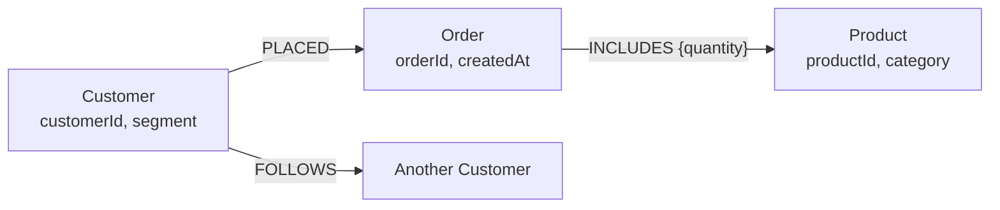

# Aggregating Relationships, Node Degree, and Business Group Distributions

In a **Neo4j** graph database, an analytical query often starts from relationships: how many orders has a customer placed, who has the most followers, how many orders does each customer segment generate, or which product category has the highest purchase volume. Unlike simply counting records in a table, a **Cypher** query must explicitly specify the **relationship type, relationship direction, start–end nodes, and how many times a path is matched**.

This lesson belongs to the **Aggregation** chapter and focuses on three measurement groups in a *property graph*:

1. **Relationship statistics:** edge counts by type, distinct related entities, and summed edge weights.
2. **Node degree:** outgoing, incoming, or total bidirectional relationships for each node.
3. **Business group distributions:** customer segments, product categories, time windows, and degree distributions per node.

The examples use Neo4j 5+ Cypher, including `COUNT { ... }` expressions. They can be run standalone in Neo4j Browser after creating the sample dataset.

## 1. Model and Sample Data

Suppose a commerce system has `Customer`, `Order`, `Product` nodes and three relationship types:



`PLACED` and `FOLLOWS` carry business-meaningful direction. `INCLUDES` connects an order to a product and stores the purchased quantity in the relationship's `quantity` property. For example, an order containing two different products has **two `INCLUDES` relationships**, yet may purchase more than two **units of goods**.

To re-run the examples without creating duplicate nodes by business ID, create uniqueness constraints (in a production database, check existing constraints before applying):

```cypher
CREATE CONSTRAINT customer_id IF NOT EXISTS
FOR (c:Customer) REQUIRE c.customerId IS UNIQUE;

CREATE CONSTRAINT order_id IF NOT EXISTS
FOR (o:Order) REQUIRE o.orderId IS UNIQUE;

CREATE CONSTRAINT product_id IF NOT EXISTS
FOR (p:Product) REQUIRE p.productId IS UNIQUE;
```

Run the following in a **practice database**. `MERGE` finds or creates the corresponding node/relationship, while `SET` assigns the properties used in this lesson:

```cypher
MERGE (an:Customer {customerId: 'C01'})
SET an.name = 'An', an.segment = 'Retail'
MERGE (binh:Customer {customerId: 'C02'})
SET binh.name = 'Bình', binh.segment = 'Retail'
MERGE (chi:Customer {customerId: 'C03'})
SET chi.name = 'Chi', chi.segment = 'SMB'
MERGE (dung:Customer {customerId: 'C04'})
SET dung.name = 'Dũng', dung.segment = 'Enterprise'

MERGE (o1:Order {orderId: 'O01'})
SET o1.createdAt = date('2026-10-10')
MERGE (o2:Order {orderId: 'O02'})
SET o2.createdAt = date('2026-11-01')
MERGE (o3:Order {orderId: 'O03'})
SET o3.createdAt = date('2026-11-05')
MERGE (o4:Order {orderId: 'O04'})
SET o4.createdAt = date('2026-11-07')

MERGE (p1:Product {productId: 'P01'})
SET p1.category = 'Food'
MERGE (p2:Product {productId: 'P02'})
SET p2.category = 'Books'
MERGE (p3:Product {productId: 'P03'})
SET p3.category = 'Food'

MERGE (an)-[:PLACED]->(o1)
MERGE (an)-[:PLACED]->(o2)
MERGE (binh)-[:PLACED]->(o3)
MERGE (chi)-[:PLACED]->(o4)

MERGE (an)-[:FOLLOWS]->(binh)
MERGE (an)-[:FOLLOWS]->(chi)
MERGE (chi)-[:FOLLOWS]->(binh)

MERGE (o1)-[l1:INCLUDES]->(p1)
SET l1.quantity = 2
MERGE (o1)-[l2:INCLUDES]->(p2)
SET l2.quantity = 1
MERGE (o2)-[l3:INCLUDES]->(p1)
SET l3.quantity = 1
MERGE (o3)-[l4:INCLUDES]->(p2)
SET l4.quantity = 3
MERGE (o4)-[l5:INCLUDES]->(p3)
SET l5.quantity = 2;
```

After creation, there are **4 customers**, **4 orders**, **3 products**, **4 `PLACED` relationships**, **3 `FOLLOWS` relationships**, and **5 `INCLUDES` relationships**. Customer Dũng has no orders and follows no one; this is an important case when summarizing nodes with degree `0`.

## 2. Counting Relationships: Clarify What Is Being Counted

### 2.1. Edge Count by Type

```cypher
MATCH ()-[r]->()
RETURN type(r) AS relationshipType,
       count(r) AS relationshipCount
ORDER BY relationshipCount DESC, relationshipType;
```

With the sample data:

| relationshipType | relationshipCount |
| --- | ---: |
| INCLUDES | 5 |
| PLACED | 4 |
| FOLLOWS | 3 |

The pattern `()-[r]->()` matches each directed relationship once. `type(r)` returns the relationship type, and `count(r)` counts the matched edges. If you only want to know how many order-placement relationships exist:

```cypher
MATCH (:Customer)-[r:PLACED]->(o:Order)
RETURN count(r) AS placedRelationships,
       count(DISTINCT o) AS distinctOrders;
```

The sample result is `4` and `4`. These two metrics are not always equal: if a model allows multiple `PLACED` edges pointing to the same order, `count(r)` counts **edges**, whereas `count(DISTINCT o)` counts only **distinct order nodes**.

### 2.2. `count(*)`, `count(x)`, and `count(DISTINCT x)`

| Expression | Counts | When to Use |
| --- | --- | --- |
| `count(*)` | All result rows, including rows with `null` values | Counting rows after pattern matching or after grouping per customer |
| `count(r)` | Rows where `r` is non-`null` | Counting relationships after `MATCH` or `OPTIONAL MATCH` |
| `count(DISTINCT o)` | Distinct, non-`null` values of `o` | Counting distinct orders when an order appears across multiple paths |

`OPTIONAL MATCH` preserves a node without matching relationships as a row with a `null` relationship value. Thus, the following query still returns Dũng with `orders = 0`:

```cypher
MATCH (c:Customer)
OPTIONAL MATCH (c)-[r:PLACED]->(:Order)
RETURN c.customerId AS customerId,
       count(r) AS orders
ORDER BY customerId;
```

If you use `count(*)` here, Dũng would be counted as `1` due to the empty row produced by `OPTIONAL MATCH`. This is a common mistake when intending to count relationships but counting rows instead.

## 3. Node Degree: Outgoing, Incoming, and by Relationship Type

**Out-degree** is the number of relationships starting from a node; **in-degree** is the number of relationships ending at that node. You must specify the relationship type when comparing: a customer can have a `PLACED` degree of `2` yet a `FOLLOWS` out-degree of `0`.

`COUNT { ... }` counts path patterns related to each node without expanding into multiple rows in the outer query:

```cypher
MATCH (c:Customer)
RETURN c.customerId AS customerId,
       COUNT { (c)-[:FOLLOWS]->(:Customer) } AS followsOut,
       COUNT { (c)<-[:FOLLOWS]-(:Customer) } AS followsIn,
       COUNT { (c)-[:PLACED]->(:Order) } AS orders
ORDER BY customerId;
```

| customerId | followsOut | followsIn | orders |
| --- | ---: | ---: | ---: |
| C01 | 2 | 0 | 2 |
| C02 | 0 | 2 | 1 |
| C03 | 1 | 1 | 1 |
| C04 | 0 | 0 | 0 |

When you need the **total degree in the directed follow network**, you can add `followsOut + followsIn`. A self-loop `(:Customer)-[:FOLLOWS]->(itself)` contributes once to in-degree and once to out-degree; hence total directed degree counts a self-loop twice according to standard graph theory convention.

To retrieve the most-followed customers (highest *in-degree*):

```cypher
MATCH (c:Customer)
WITH c, COUNT { (c)<-[:FOLLOWS]-(:Customer) } AS followers
RETURN c.customerId AS customerId, followers
ORDER BY followers DESC, customerId
LIMIT 5;
```

The top result is `C02` with `2` followers. `LIMIT` is placed **after** computing degrees and sorting to find the true top customers; limiting the node set beforehand can distort the ranking.

> **Distinguishing degree from item quantity:** `COUNT { (o)-[:INCLUDES]->(:Product) }` tells you how many **product line items** an order contains; `sum(line.quantity)` is the total **product units**. Weight properties do not increase node degree.

## 4. Degree Distribution: How Many Nodes at Each Activity Level?

Knowing the average customer has one order is not enough to understand the data. We need to know how many customers have placed zero orders, how many placed one order, and how many placed multiple orders. That is the **degree distribution**.

```cypher
MATCH (c:Customer)
WITH COUNT { (c)-[:PLACED]->(:Order) } AS degree
RETURN degree AS ordersPerCustomer,
       count(*) AS customerCount
ORDER BY ordersPerCustomer;
```

| ordersPerCustomer | customerCount | Interpretation |
| ---: | ---: | --- |
| 0 | 1 | Dũng has never placed an order |
| 1 | 2 | Bình and Chi each placed one order |
| 2 | 1 | An placed two orders |

Each customer enters the query exactly once before grouping by `degree`, so `count(*)` here truly counts **customers**, not relationships.

You can group degree levels into *buckets* for easier reporting when data spans many distinct values:

```cypher
MATCH (c:Customer)
WITH COUNT { (c)-[:PLACED]->(:Order) } AS degree
WITH CASE
       WHEN degree = 0 THEN '0 orders'
       WHEN degree <= 2 THEN '1-2 orders'
       ELSE '3+ orders'
     END AS bucket
RETURN bucket, count(*) AS customers
ORDER BY bucket;
```

Sample result: `0 orders = 1`, `1-2 orders = 3`. When charting, choose buckets suited to the business goal, such as `0`, `1`, `2–5`, `6–20`, `20+` for high-order-volume systems.

To measure concentration, compute the mean, median, and max degree **per node**:

```cypher
MATCH (c:Customer)
WITH COUNT { (c)-[:PLACED]->(:Order) } AS degree
RETURN count(*) AS customers,
       round(avg(toFloat(degree)), 2) AS meanDegree,
       percentileCont(degree, 0.5) AS medianDegree,
       max(degree) AS maxDegree;
```

The sample data gives `customers = 4`, `meanDegree = 1.0`, `medianDegree = 1.0`, `maxDegree = 2`. `percentileCont` interpolates a continuous percentile value; if you want an actual degree level appearing in the data, consider `percentileDisc`.

## 5. Aggregating by Business Groups

### 5.1. By Customer Segment, Including Groups Without Orders

Counting from the `Customer` set and using `OPTIONAL MATCH` retains all segments, including `Enterprise` with no orders yet:

```cypher
MATCH (c:Customer)
OPTIONAL MATCH (c)-[r:PLACED]->(:Order)
WITH coalesce(c.segment, 'Uncategorized') AS segment,
     c,
     count(r) AS ordersOfCustomer
RETURN segment,
       count(*) AS customers,
       sum(ordersOfCustomer) AS orders,
       round(1.0 * sum(ordersOfCustomer) / count(*), 2)
         AS ordersPerCustomer
ORDER BY segment;
```

| segment | customers | orders | ordersPerCustomer |
| --- | ---: | ---: | ---: |
| Enterprise | 1 | 0 | 0.0 |
| Retail | 2 | 3 | 1.5 |
| SMB | 1 | 1 | 1.0 |

**Why are two `WITH`/`RETURN` layers needed?** The `WITH` layer computes the order count **per individual customer** first. The `RETURN` layer then sums them by segment. This preserves the `customers` denominator when comparing activity levels across differently sized groups. `coalesce` also places customers missing a `segment` property into an explicit group, avoiding dropping uncategorized data.

### 5.2. By Product Category: Line Count and Units Sold

```cypher
MATCH (:Order)-[line:INCLUDES]->(p:Product)
RETURN p.category AS category,
       count(line) AS orderLines,
       sum(line.quantity) AS unitsSold
ORDER BY unitsSold DESC, category;
```

| category | orderLines | unitsSold |
| --- | ---: | ---: |
| Food | 3 | 5 |
| Books | 2 | 4 |

`orderLines = 3` for Food corresponds to three `INCLUDES` relationships from orders `O01`, `O02`, `O04`; `unitsSold = 5` is the sum `2 + 1 + 2` across those relationships. If an `Order` contains multiple product lines of the same category, do not assume the line count equals distinct orders.

### 5.3. Combining Segment and Product Category

```cypher
MATCH (c:Customer)-[:PLACED]->(o:Order)-[line:INCLUDES]->(p:Product)
RETURN c.segment AS segment,
       p.category AS category,
       count(line) AS orderLines,
       count(DISTINCT o) AS distinctOrders,
       sum(line.quantity) AS unitsSold
ORDER BY segment, category;
```

| segment | category | orderLines | distinctOrders | unitsSold |
| --- | --- | ---: | ---: | ---: |
| Retail | Books | 2 | 2 | 4 |
| Retail | Food | 2 | 2 | 3 |
| SMB | Food | 1 | 1 | 2 |

This query answers **which segment buys products in which category**. One order can span multiple product categories. Therefore, the sum of `distinctOrders` across product categories can be **greater than** the distinct orders for the entire segment; do not add distinct order counts across categories as if they were disjoint sets. The `Enterprise` segment does not appear in this result because it has no matching path. When you need a table including groups with `0`, start from the list of groups to report and use `OPTIONAL MATCH` appropriately.

### 5.4. Statistics by Time Window

You often need to constrain orders to a time window before aggregating by segment. For example, order counts in November 2026:

```cypher
MATCH (c:Customer)
OPTIONAL MATCH (c)-[r:PLACED]->(o:Order)
  WHERE o.createdAt >= date('2026-11-01')
    AND o.createdAt < date('2026-12-01')
RETURN c.segment AS segment,
       count(r) AS novemberOrders
ORDER BY segment;
```

The result is `Enterprise = 0`, `Retail = 2`, `SMB = 1`. Attaching the date condition directly to `OPTIONAL MATCH` preserves groups without qualifying orders. Half-open intervals **[start date, end date)** avoid overlaps when generating reports across consecutive months. Real datasets using `datetime` must keep timezones and filter property data types consistent.

## 6. Avoiding Miscounts Caused by Row Multiplication When Joining Multiple Relationships

A dangerous bug is joining two independent relationship sets of the same customer in a single query. For example:

```cypher
// WRONG when used to count each independent relationship type
MATCH (c:Customer)
OPTIONAL MATCH (c)-[placed:PLACED]->(:Order)
OPTIONAL MATCH (c)-[follow:FOLLOWS]->(:Customer)
RETURN c.customerId AS customerId,
       count(placed) AS orders,
       count(follow) AS follows;
```

An has `2` orders and `2` follow edges. The two pattern matches produce `2 × 2 = 4` rows for An; consequently, `count(placed)` and `count(follow)` both wrongly report `4`. `count(DISTINCT placed)` can fix this specific case, but if you only want two independent degree counts, `COUNT { ... }` expressions are clearer:

```cypher
MATCH (c:Customer)
RETURN c.customerId AS customerId,
       COUNT { (c)-[:PLACED]->(:Order) } AS orders,
       COUNT { (c)-[:FOLLOWS]->(:Customer) } AS follows
ORDER BY customerId;
```

For calculations requiring summing weights or complex per-branch filtering, you can **aggregate each branch before joining** using `CALL { ... }` or staged `WITH` clauses. The rule is to control the input row count entering aggregation: a relationship repeated across multiple paths will break `count`, `sum`, or `avg` unless an appropriate deduplication strategy is used.

Several other cases also require clear definition:

- **Parallel edges with same endpoints:** Neo4j can store multiple edges of the same type between two nodes. `count(r)` counts all edges, while `count(DISTINCT other)` counts distinct target nodes; choose according to the KPI definition.
- **Relationship direction:** `(a)-[:FOLLOWS]->(b)` means `a` follows `b`; reversing the direction swaps the meaning of `followers` and `following`.
- **Nodes without relationships:** start from `MATCH (c:Customer)` and use `OPTIONAL MATCH` or `COUNT { ... }` if you need degree `0`.
- **Missing values:** `count(x)` ignores `null`, `sum` ignores `null`; verify completeness of `quantity`, `segment`, and `createdAt` before using them as metrics.
- **Aggregation unit:** edge count, target node count, distinct order count, and total product units are four distinct measurements.

## 7. Optimizing on Large Graph Datasets

With millions of nodes and relationships, performance depends heavily on **starting points, filter selectivity, relationship traversal direction, and intermediate row counts**.

1. **Start from a clearly filtered node set.** When analyzing a specific customer, filter on a constrained/indexed identifier key before traversing relationships: `MATCH (c:Customer {customerId: 'C01'})`.
2. **Expand only the necessary relationship types.** `[:PLACED]` or `[:FOLLOWS]` lets Cypher focus on relevant edges instead of scanning all relationship types in a generic pattern.
3. **Avoid expanding multiple independent branches simultaneously.** Use `COUNT { ... }`, per-branch aggregation, or subqueries to reduce intermediate rows and multiplication errors.
4. **Filter before aggregating when semantically valid.** Restrict the time window or customer set before `count` and `sum`; apply `LIMIT` after computing KPIs if you need top-N by KPI.
5. **Do not collect all nodes/relationships just to count.** `collect(r)` builds a list in memory; use `count(r)` when you only need a count.
6. **Inspect the query plan.** `EXPLAIN` shows only the plan; `PROFILE` executes the query to display row counts, data accesses (*DB hits*), and expansion/aggregation steps.

Example using an execution plan to evaluate the top-followed users query:

```cypher
PROFILE
MATCH (c:Customer)
WITH c, COUNT { (c)<-[:FOLLOWS]-(:Customer) } AS followers
RETURN c.customerId AS customerId, followers
ORDER BY followers DESC
LIMIT 10;
```

Observe whether row counts spike during edge traversal steps. An index on `customerId` helps queries looking up a single customer; it does **not** automatically make a query ranking all customers by degree fast, because accurate ranking still requires computing degrees for all qualifying customers.

## 8. Verifying Results and Practice Exercises

You can quickly verify the sample dataset with two queries:

```cypher
MATCH (c:Customer)
RETURN count(c) AS customers;
```

```cypher
MATCH ()-[r]->()
RETURN type(r) AS relationshipType, count(r) AS edges
ORDER BY relationshipType;
```

On a database containing only the sample data, these two queries return `4` customers and `FOLLOWS = 3`, `INCLUDES = 5`, `PLACED = 4` respectively. If using a database with other existing data, filter to the practice scope before comparing.

**Exercise 1.** Write a query to find customers with `orders = 0`, returning `customerId` and `segment`. With the sample data, only `C04` should appear.

**Exercise 2.** Compute the **in-degree** distribution of `FOLLOWS` across customers, including degree `0`. Expected result: `degree 0 → 2 customers` (`C01`, `C04`), `degree 1 → 1 customer` (`C03`), `degree 2 → 1 customer` (`C02`).

**Exercise 3.** Compute the percentage of customers with at least one order in each segment using `100.0 * customers_with_orders / total_customers`. Result: `Retail = 100%`, `SMB = 100%`, `Enterprise = 0%`. Explain why total order count cannot be used as the numerator.

**Exercise 4.** Replace `count(line)` with `sum(line.quantity)` in the `Product.category` aggregation, and compare the group ordering. Interpret the difference between *product lines* and *product units* for inventory reporting.

### Key Takeaways

When aggregating data in Neo4j, always confirm three questions before writing Cypher: **Which entity is being counted? Which relationship direction and type are being counted? Which business unit are we grouping on?** Use `count(r)` for edge counts, `count(DISTINCT n)` for distinct nodes, `COUNT { ... }` for pattern-based degrees, `OPTIONAL MATCH` to preserve degree-`0` nodes, and `sum(relationshipProperty)` when relationships carry quantities or weights. Check intermediate row counts when combining multiple paths so metrics accurately reflect business activity.
