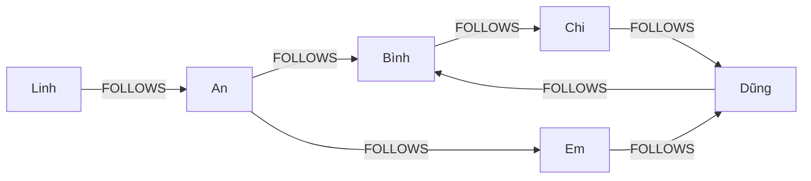

# Path Length, Hop Count, and Relationship Traversal Direction in Neo4j

In Neo4j, connected data is represented as a **property graph**: each **node** describes an entity, while each **relationship** represents a link with a defined **type** and **direction**. A Cypher query can traverse one or more relationships to answer questions such as "Who does An follow?", "What is the minimum number of steps from An to Dũng?", or "Can we traverse against the relationship direction to find related people?"

This lesson belongs to the **Paths and Graph Traversal** chapter and focuses on three concepts that must be clearly distinguished:

- **Path**: a sequence of nodes connected by relationships matching the query pattern.
- **Path length / hop count**: the number of relationships traversed, not the number of nodes, and not by default the travel time or cost.
- **Traversal direction**: specifies whether to follow the direction of the relationship arrow, go against it, or accept both directions.

After this lesson, you will be able to write Cypher queries with fixed or variable step counts, extract information from a path, choose the appropriate traversal direction, avoid common pitfalls during multi-hop expansion, and understand the scope of shortest-path search.

## 1. Building the Example Graph

Suppose the system has `Person` accounts and `FOLLOWS` relationships (A follows B). This is a **directed** relationship: A following B does not mean B also follows A.

Run the following two statements sequentially in Neo4j Browser or a Cypher-enabled environment. `MERGE` helps avoid creating duplicate nodes and relationships matching the specified pattern when re-running the example.

```cypher
UNWIND [
  {id: 'an',   name: 'An'},
  {id: 'binh', name: 'Bình'},
  {id: 'chi',  name: 'Chi'},
  {id: 'dung', name: 'Dũng'},
  {id: 'em',   name: 'Em'},
  {id: 'linh', name: 'Linh'}
] AS item
MERGE (p:Person {id: item.id})
SET p.name = item.name;
```

```cypher
UNWIND [
  {source: 'an',   target: 'binh'},
  {source: 'binh', target: 'chi'},
  {source: 'chi',  target: 'dung'},
  {source: 'an',   target: 'em'},
  {source: 'em',   target: 'dung'},
  {source: 'dung', target: 'binh'},
  {source: 'linh', target: 'an'}
] AS link
MATCH (source:Person {id: link.source})
MATCH (target:Person {id: link.target})
MERGE (source)-[:FOLLOWS]->(target);
```

Resulting graph:



Notice the two directed routes from **An** to **Dũng**: `An → Em → Dũng` and `An → Bình → Chi → Dũng`. In addition, there is a cycle `Bình → Chi → Dũng → Bình`; this detail will help illustrate why the number of paths can grow rapidly when traversing multiple hops.

> In a production system, there should be a uniqueness constraint on the `Person` identifier, such as `CREATE CONSTRAINT person_id IF NOT EXISTS FOR (p:Person) REQUIRE p.id IS UNIQUE;` on Neo4j versions that support this syntax. The example here assumes the initial dataset has no `Person` nodes with duplicate `id` values.

## 2. What Is a Path? How Is Length Calculated?

Consider the directed path:

```text
An --FOLLOWS--> Bình --FOLLOWS--> Chi --FOLLOWS--> Dũng
 ^                ^                ^               ^
 node 1           node 2           node 3          node 4
       hop 1            hop 2            hop 3
```

The path above has **4 nodes but only 3 relationships**, so its **length is 3**. One hop corresponds to traversing exactly one relationship. For a path `p` consisting of `k` relationships:

\[
\operatorname{length}(p) = k = \operatorname{size}(\operatorname{relationships}(p))
\]

\[
\operatorname{size}(\operatorname{nodes}(p)) = k + 1
\]

In Cypher, you can assign the entire path to a variable `p` and access its components:

```cypher
MATCH p = (a:Person {id: 'an'})-[:FOLLOWS]->(b:Person)
RETURN
  a.name AS bat_dau,
  b.name AS ket_thuc,
  length(p) AS so_buoc_nhay,
  size(nodes(p)) AS so_node,
  size(relationships(p)) AS so_relationship;
```

Because the pattern above contains **one** relationship, each returned path has `so_buoc_nhay = 1`, `so_node = 2`, and `so_relationship = 1`.

Common functions used with paths:

| Expression | Meaning | Example with `An → Em → Dũng` |
| --- | --- | --- |
| `length(p)` | Number of relationships in the path | `2` |
| `nodes(p)` | List of nodes in traversal order | `[An, Em, Dũng]` |
| `relationships(p)` | List of relationships in traversal order | Two `FOLLOWS` relationships |
| `size(nodes(p))` | Number of nodes appearing in the path | `3` |
| `size(relationships(p))` | Number of relationships appearing in the path | `2` |

**Note:** "Hop count" here refers to distance in terms of graph structure. If each relationship has a `minutes`, `price`, or `distanceKm` property, the sum of those properties is the **path weight**, not the result of `length(p)`.

## 3. Relationship Traversal Direction in Cypher

A relationship in a property graph has a start node, an end node, and a specific type. With `(:Person {id: 'an'})-[:FOLLOWS]->(:Person {id: 'binh'})`, the stored direction in the graph is **An → Bình**.

Cypher provides three basic traversal patterns:

| Cypher Pattern | Meaning when starting from `a` |
| --- | --- |
| `(a)-[:FOLLOWS]->(b)` | Traverse **with the direction** of the relationship, from `a` to `b` |
| `(a)<-[:FOLLOWS]-(b)` | Traverse **against the direction** of the relationship, finding `b` with an arrow pointing to `a` |
| `(a)-[:FOLLOWS]-(b)` | Allow the relationship in **either direction** |

### 3.1. Outgoing Traversal

```cypher
MATCH (an:Person {id: 'an'})-[:FOLLOWS]->(nguoi:Person)
RETURN nguoi.name AS an_theo_doi
ORDER BY an_theo_doi;
```

Result: **Bình, Em**. Because the arrow points out from `an`, the query finds the people An follows.

### 3.2. Incoming Traversal

```cypher
MATCH (an:Person {id: 'an'})<-[:FOLLOWS]-(nguoi:Person)
RETURN nguoi.name AS theo_doi_an;
```

Result: **Linh**. This query finds who follows An. The query does not alter the stored relationship; it simply matches the relationship in the opposite direction when viewed from the `an` node.

### 3.3. Undirected Matching

```cypher
MATCH (an:Person {id: 'an'})-[:FOLLOWS]-(nguoi:Person)
RETURN nguoi.name AS lien_ket_voi_an
ORDER BY lien_ket_voi_an;
```

Result: **Bình, Em, Linh**. The pattern without an arrowhead accepts both incoming and outgoing relationships relative to An.

**Common misconception:** omitting the arrowhead in a `MATCH` pattern **does not turn** the `FOLLOWS` relationship into a bidirectional relationship in the data. It only widens how the query can traverse the edge. The stored direction of the edge remains unchanged. If you need "mutual following" at the business-logic level, check for two separate relationships or model an appropriate relationship type.

## 4. Traversing Exact n Hops and a Range of Hops

Cypher variable-length patterns use the `*` symbol after the relationship type. The examples below use the variable-length relationship syntax common in Neo4j/Cypher 5; newer versions also provide quantified path patterns.

| Pattern | Hop Count Condition |
| --- | --- |
| `-[:FOLLOWS]->` | Exactly 1 hop |
| `-[:FOLLOWS*2]->` | Exactly 2 hops |
| `-[:FOLLOWS*1..3]->` | From 1 to 3 hops, inclusive |
| `-[:FOLLOWS*0..2]->` | From 0 to 2 hops, allowing paths that traverse no relationships |
| `-[:FOLLOWS*1..3]-` | From 1 to 3 hops, allowing edge traversal in either direction |

### 4.1. Exactly Two Hops

```cypher
MATCH (an:Person {id: 'an'})-[:FOLLOWS*2]->(nguoi:Person)
RETURN DISTINCT nguoi.name AS den_sau_2_buoc
ORDER BY den_sau_2_buoc;
```

Result: **Chi, Dũng**.

- `An → Bình → Chi`: exactly two relationships.
- `An → Em → Dũng`: exactly two relationships.

`DISTINCT` only deduplicates rows with the same target person in the output. It does not mean "find the shortest path"; if multiple different paths reach the same person, those paths can still exist in the graph.

### 4.2. From One to Three Hops: Returning Each Path

```cypher
MATCH p = (an:Person {id: 'an'})-[:FOLLOWS*1..3]->(dung:Person {id: 'dung'})
RETURN
  [n IN nodes(p) | n.name] AS cac_node_theo_thu_tu,
  length(p) AS so_buoc_nhay
ORDER BY so_buoc_nhay;
```

With the sample data, the result is:

| `cac_node_theo_thu_tu` | `so_buoc_nhay` |
| --- | ---: |
| `[An, Em, Dũng]` | 2 |
| `[An, Bình, Chi, Dũng]` | 3 |

Distinguish between two ways of asking the question:

- **"Which paths of at most 3 hops can reach Dũng?"**: query paths as above, where each matching path is one result row.
- **"What is the minimum number of hops from An to Dũng along FOLLOWS?"**: the shortest distance is **2**; you need to compute the minimum value or use a shortest-path operator if you do not need to enumerate every path.

### 4.3. Zero-Hop Paths

```cypher
MATCH p = (an:Person {id: 'an'})-[:FOLLOWS*0..2]->(nguoi:Person)
RETURN nguoi.name AS den_node, length(p) AS so_buoc
ORDER BY so_buoc, den_node;
```

Because `0` hops is allowed, one valid result is `den_node = 'An'`, `so_buoc = 0`. That path contains **one node and no relationships**, rather than a self-loop edge. The remaining results include Bình and Em at 1 hop, and Chi and Dũng at 2 hops.

Zero-hop paths are useful when the business logic treats "the starting point itself as reachable," but they can be misleading if the requirement demands **traversing at least one relationship**. In that case, use `*1..N`.

## 5. Traversal Direction Directly Affects Reachability

Consider the question: "Can you reach An from Dũng?" The answer depends on the traversal direction:

```cypher
// Only follow the FOLLOWS direction: no path from Dũng to An in the sample graph.
MATCH p = (dung:Person {id: 'dung'})-[:FOLLOWS*1..4]->(an:Person {id: 'an'})
RETURN [n IN nodes(p) | n.name] AS duong_di;
```

```cypher
// Allow traversing relationships in both directions: paths exist connecting Dũng and An.
MATCH p = (dung:Person {id: 'dung'})-[:FOLLOWS*1..2]-(an:Person {id: 'an'})
RETURN [n IN nodes(p) | n.name] AS duong_di;
```

The first query returns no results. The second query returns 2-hop paths: `Dũng — Em — An` and `Dũng — Bình — An`. The dashes in these two paths simply mean that **the directional constraint was omitted during traversal**; they do not imply that `Dũng` actually follows `Em` or `Bình` in the displayed order.

Choose the direction based on the domain question:

- **Following system:** person A follows B is the direction `A → B`; "who follows A?" is the reverse direction.
- **Genealogy:** `(:Person)-[:PARENT_OF]->(:Person)` going down to children and `<-[:PARENT_OF]-` going up to parents are two different queries.
- **Road networks:** a one-way route must be traversed in its valid direction; if a road allows two-way traffic, you can store two directed relationships or use an undirected query pattern when the domain model permits it.

**Be careful with direction inside a path:** `nodes(p)` lists nodes in order from the start point to the end point of the query pattern, even when you traverse against the stored direction of the relationships. Therefore, the order of nodes in a path does not guarantee that every relationship points in that order.

## 6. Paths, Cycles, and Result Counts

The example graph contains the cycle `Bình → Chi → Dũng → Bình`. You can match a cycle that starts and ends at Dũng:

```cypher
MATCH p = (dung:Person {id: 'dung'})-[:FOLLOWS*1..4]->(dich:Person {id: 'dung'})
RETURN [n IN nodes(p) | n.name] AS chu_trinh,
       length(p) AS so_buoc;
```

The result includes the path `Dũng → Bình → Chi → Dũng` with length **3 hops**. This illustrates two points:

1. **A node can appear more than once** in a path; for example, the Dũng node appears at both the start and the end of the cycle.
2. With standard Cypher variable-length path matching, **the same relationship cannot be traversed more than once within a single matched path**. This does not mean that all nodes must be distinct.

Furthermore, **the number of paths** and **the number of unique target nodes** are two different quantities. In multi-hop traversal, a single target node can be reached via multiple distinct paths. For example, from An to Dũng there are two paths within 1–3 hops, but only one target node `Dũng`.

```cypher
MATCH p = (an:Person {id: 'an'})-[:FOLLOWS*1..3]->(dung:Person {id: 'dung'})
RETURN count(p) AS so_duong_di,
       count(DISTINCT dung) AS so_node_dich;
```

Result: `so_duong_di = 2`, `so_node_dich = 1`. If you widen the hop limit, the number of paths can grow rapidly because the graph branches, contains cycles, and can reach the same node via different routes.

### Aggregating Paths by Target Node

If you only need the minimum number of hops from An to **each reachable person within at most three hops**, you can aggregate by target:

```cypher
MATCH p = (an:Person {id: 'an'})-[:FOLLOWS*1..3]->(nguoi:Person)
WITH nguoi, min(length(p)) AS buoc_it_nhat
RETURN nguoi.name AS nguoi_dich, buoc_it_nhat
ORDER BY buoc_it_nhat, nguoi_dich;
```

Minimum distances: Bình = 1, Em = 1, Chi = 2, Dũng = 2. Keep in mind that this approach **enumerates paths within the specified bound and then aggregates them**; on large graphs, that can be expensive if you only want a single shortest path between two nodes.

## 7. Shortest Path by Hop Count

When you only need a path with the **fewest relationships**, you can use `shortestPath` instead of enumerating all paths and sorting. The example below caps the search at 5 hops:

```cypher
MATCH (an:Person {id: 'an'}), (dung:Person {id: 'dung'})
MATCH p = shortestPath((an)-[:FOLLOWS*..5]->(dung))
RETURN [n IN nodes(p) | n.name] AS duong_di_ngan_nhat,
       length(p) AS so_buoc;
```

Result on the sample graph: `An → Em → Dũng`, **2 hops**. This function picks one of the shortest paths if multiple paths tie on hop count.

To retrieve **all** shortest paths by hop count, use `allShortestPaths`. For example, without a directional constraint:

```cypher
MATCH (an:Person {id: 'an'}), (dung:Person {id: 'dung'})
MATCH p = allShortestPaths((an)-[:FOLLOWS*..5]-(dung))
RETURN [n IN nodes(p) | n.name] AS duong_di,
       length(p) AS so_buoc
ORDER BY duong_di;
```

In the example, both `An — Em — Dũng` and `An — Bình — Dũng` are undirected paths of length 2 hops.

**Scope of application:** `shortestPath`/`allShortestPaths` defines "shortest" by **the number of relationships** in the pattern, not automatically by weight properties. The syntax shown here illustrates the form widely used in Cypher 5; when using newer Cypher versions that support `SHORTEST` and quantified path patterns, choose the syntax appropriate for your deployed version.

### What If Paths Have Weights?

In transit data, a 2-leg route might take 90 minutes, whereas a 3-leg route takes only 35 minutes. If a `:ROUTE` relationship has a numeric `minutes` property, total duration can be computed using `reduce` over the path's relationships:

```cypher
// Illustration on another model with :Station and :ROUTE {minutes: <number>}.
MATCH p = (a:Station {code: 'A'})-[:ROUTE*1..4]->(b:Station {code: 'B'})
WITH p,
     reduce(total = 0, r IN relationships(p) | total + r.minutes) AS tong_phut
RETURN [n IN nodes(p) | n.code] AS cac_tram,
       length(p) AS so_chang,
       tong_phut
ORDER BY tong_phut, so_chang;
```

This **computes and compares the weights of paths matched within the 1–4 hop bound**, assuming every relationship has a valid numeric `minutes` value. It does not automatically discover paths beyond that bound. For optimizing total weight on large graphs, consider algorithms such as **Dijkstra** in Neo4j Graph Data Science (GDS) alongside an appropriate weight model.

## 8. Efficient Queries and Common Pitfalls

| Situation | Issue | How to Handle |
| --- | --- | --- |
| Using unbounded `*` on a dense graph | Path count can explode; cycles make traversal unpredictable | Choose an explicit hop bound such as `*1..3` based on business requirements |
| Forgetting the arrowhead | The query accepts both incoming and outgoing edges, potentially returning paths invalid for the domain | Use `->` or `<-` when direction matters |
| Using `size(nodes(p))` as hop count | The result is off by +1 relative to the hop count | Use `length(p)` |
| Multiple paths reach the same node | Duplicate target people in results, even though paths differ | Use `DISTINCT` if you only need target nodes; keep `p` if analyzing individual paths |
| Using `shortestPath` for the cheapest/fastest route | Fewest hops may differ from lowest total cost | Model weights and use a weight-optimization algorithm |
| Filtering hop count after overly broad traversal | The engine may have to evaluate many paths before filtering | Bound hops directly in the pattern and anchor the query to specific nodes |

Helpful practices when developing queries:

1. **Anchor start/end points:** specify labels and identifying properties, e.g., `(an:Person {id: 'an'})`; create constraints/indexes appropriate for real data.
2. **Restrict relationship types:** use `:FOLLOWS` instead of traversing all relationship types when the question only concerns following.
3. **Restrict direction and hop count early:** place them directly inside the path pattern to narrow the traversal space.
4. **Distinguish paths from target nodes:** choose `RETURN p`, `RETURN DISTINCT nguoi`, or aggregation depending on the desired output.
5. **Use `EXPLAIN`/`PROFILE` in an appropriate environment:** inspect the execution plan and intermediate row counts when a query is slow. `LIMIT` at the end of a query does not always eliminate the cost of path expansion already performed earlier.

In social networks, device networks, and multi-layered dependency data, bounding hop count is often a **business constraint** rather than just a performance optimization: "friends of friends within at most 3 layers" is a different question from "anyone reachable, regardless of how many layers away."

## 9. Practice Exercises with Answers

The following exercises use the exact `Person`/`FOLLOWS` dataset from Section 1. Try predicting the result before running each query.

**Exercise 1.** Who follows An directly? How many hops is it from that person to An along the FOLLOWS direction?

```cypher
MATCH p = (nguoi:Person)-[:FOLLOWS]->(an:Person {id: 'an'})
RETURN nguoi.name AS nguoi_theo_doi, length(p) AS so_buoc;
```

**Answer:** Linh, `so_buoc = 1`.

**Exercise 2.** Who can be reached from An after **exactly two** hops along the FOLLOWS direction?

```cypher
MATCH (an:Person {id: 'an'})-[:FOLLOWS*2]->(dich:Person)
RETURN DISTINCT dich.name AS nguoi_dich
ORDER BY nguoi_dich;
```

**Answer:** Chi and Dũng.

**Exercise 3.** What is the shortest number of hops from Linh to Dũng along the FOLLOWS direction (maximum 5)?

```cypher
MATCH (linh:Person {id: 'linh'}), (dung:Person {id: 'dung'})
MATCH p = shortestPath((linh)-[:FOLLOWS*..5]->(dung))
RETURN [n IN nodes(p) | n.name] AS duong_di,
       length(p) AS so_buoc;
```

**Answer:** `Linh → An → Em → Dũng`, `so_buoc = 3`. The path `Linh → An → Bình → Chi → Dũng` requires 4 hops.

**Exercise 4.** Is there a directed result from Dũng to An within at most 2 hops? What if the directional constraint is removed?

```cypher
// Directed: no results.
MATCH p = (dung:Person {id: 'dung'})-[:FOLLOWS*1..2]->(an:Person {id: 'an'})
RETURN p;
```

```cypher
// Undirected: two 2-hop paths exist.
MATCH p = (dung:Person {id: 'dung'})-[:FOLLOWS*1..2]-(an:Person {id: 'an'})
RETURN [n IN nodes(p) | n.name] AS cac_node,
       length(p) AS so_buoc;
```

**Answer:** there is no outgoing path; `Dũng — Em — An` and `Dũng — Bình — An` exist if edges can be traversed in either direction.

## 10. Key Takeaways

- `length(p)` is the **number of relationships** in the path; the number of nodes appearing in order along the path equals the hop count plus 1.
- `-[:TYPE]->`, `<-[:TYPE]-`, and `-[:TYPE]-` specify three different **traversal direction** match patterns; omitting arrowheads only affects the query, not the stored relationship direction.
- `*2`, `*1..3`, and `*0..2` represent **exactly 2 hops**, **1 to 3 hops**, and **0 to 2 hops**, respectively. A zero-hop path consists of one node and no relationships.
- Multiple paths can lead to the same node. A node can repeat in a path containing a cycle, whereas the same relationship cannot be repeated within a single variable-length path under standard matching.
- The path with the **fewest hops** is not necessarily the **lowest-cost** path. Choose a path-finding method suited to the business rules, relationship direction, and weights.

When modeling or querying connected data in Neo4j, always ask in order: **which node to start from, which relationship types to follow, in which direction, what are the minimum and maximum hop counts, and does the result require individual paths or only target nodes?** Answering those five points clearly usually determines the exact Cypher pattern you need to write.
