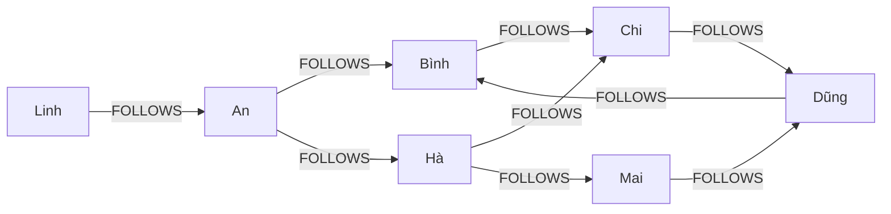

# Variable-Length Relationship Patterns and Depth Bounds in Neo4j

When querying connected data with Cypher, sometimes you know the exact number of relationships to traverse; other times you need to find all paths from a node within **at most N hops**. Neo4j represents links as directed, typed relationships in a **property graph**. Variable-length relationship patterns let you express multiple relationship traversals in a concise Cypher pattern.

This lesson belongs to the **Paths and Graph Traversal** chapter of `DATABASE_ENGINE_GRAPH_NEO4J`. It focuses on variable-length syntax, setting **minimum/maximum depth**, interpreting results, and the risks of overly broad query expansion. This is foundational knowledge before implementing queries with the Java Driver or Spring Data Neo4j, as well as before analyzing query plans in production environments.

**Learning objectives:** after this lesson, you will be able to write `*2`, `*1..3`, and `*0..2` patterns; distinguish a path from a target node; select traversal direction and relationship types; handle cycles; set safe traversal bounds; and know when to use shortest-path queries or quantified path pattern syntax.

## 1. Depth and Variable-Length Relationship Patterns

A **path** consists of alternating nodes and relationships. In graph traversal, **depth** is typically measured by the number of relationships traversed from the starting node—that is, the **hop count**. Thus, depth 0 is the starting node; depth 1 is a node reachable across one relationship; depth 2 requires two relationships, and so on.

```text
Depth 0         Depth 1         Depth 2         Depth 3
    An  ----------> Bình ----------> Chi ----------> Dũng
    |
    +-------------> Hà -----------> Mai ----------> Dũng
```

In Cypher, `length(p)` returns the number of relationships in path `p`. For a 3-hop path, `size(relationships(p)) = 3` and `size(nodes(p)) = 4`. Query depth differs from the number of nodes in a path and **does not mean** length in meters, time, or total relationship weight.

### Basic Syntax

```cypher
MATCH p = (bat_dau:TraversalPerson)-[:FOLLOWS*1..3]->(dich:TraversalPerson)
RETURN p, length(p) AS so_buoc_nhay;
```

In `[:FOLLOWS*1..3]`, `FOLLOWS` is the relationship type, `*` requests matching a **variable number of relationships**, `1` is the minimum depth, `3` is the maximum depth, and `->` permits following only the stored relationship direction. Every path of length 1, 2, or 3 hops matching the pattern can appear in the result.

| Relationship Pattern | Interpretation | Allowed Depth |
| --- | --- | --- |
| `-[:FOLLOWS]->` | Standard single-hop relationship | Only 1 |
| `-[:FOLLOWS*2]->` | Fixed length | Only 2 |
| `-[:FOLLOWS*1..3]->` | Variable length, bounded on both ends | 1, 2, 3 |
| `-[:FOLLOWS*0..2]->` | May traverse zero relationships | 0, 1, 2 |
| `-[:FOLLOWS*3..3]->` | Range with equal bounds | Only 3 |
| `-[:FOLLOWS*1..]->` | No upper bound in the pattern | 1 or more |
| `-[:FOLLOWS*]->` | Unbounded form | 1 or more |

**Recommendation:** for application queries, prefer specifying an explicit upper bound when the business requirement only cares about a finite range. Unbounded expansion can generate a huge number of paths and consume excessive CPU, memory, or query time.

## 2. Preparing the Sample Graph for Practice

Build a directed user network `(:TraversalPerson)-[:FOLLOWS]->(:TraversalPerson)`; the direction of the relationship means **the start person follows the end person**. The `TraversalPerson` label is reserved for this practice exercise so it does not collide with `Person` nodes or examples from other lessons in the same database. All queries with predicted results in this lesson use this dataset.

**Create nodes:**

```cypher
UNWIND [
  {id: 'an',   name: 'An'},
  {id: 'binh', name: 'Bình'},
  {id: 'chi',  name: 'Chi'},
  {id: 'dung', name: 'Dũng'},
  {id: 'ha',   name: 'Hà'},
  {id: 'linh', name: 'Linh'},
  {id: 'mai',  name: 'Mai'}
] AS item
MERGE (p:TraversalPerson {id: item.id})
SET p.name = item.name, p.active = true;
```

**Create relationships:**

```cypher
UNWIND [
  {f: 'an',   t: 'binh'},
  {f: 'an',   t: 'ha'},
  {f: 'binh', t: 'chi'},
  {f: 'ha',   t: 'chi'},
  {f: 'ha',   t: 'mai'},
  {f: 'chi',  t: 'dung'},
  {f: 'mai',  t: 'dung'},
  {f: 'dung', t: 'binh'},
  {f: 'linh', t: 'an'}
] AS edge
MATCH (a:TraversalPerson {id: edge.f})
MATCH (b:TraversalPerson {id: edge.t})
MERGE (a)-[:FOLLOWS]->(b);
```

The graph has branches converging toward Chi and Dũng, as well as the cycle **Bình → Chi → Dũng → Bình**:



In a real environment, the identifier property should be protected by a unique constraint so `MERGE` operations do not create unintended data. This example assumes the database does not already have `Person` nodes with duplicate `id` values; repeatedly running the statements above with consistent sample data will reuse the matched nodes and edges.

## 3. Distinguishing Exact-Depth Queries from Range Queries

### 3.1. Exactly Two Hops

```cypher
MATCH p = (an:TraversalPerson {id: 'an'})-[:FOLLOWS*2]->(dich:TraversalPerson)
RETURN [n IN nodes(p) | n.name] AS duong_di,
       dich.name AS nguoi_dich,
       length(p) AS do_sau
ORDER BY nguoi_dich, duong_di;
```

The three valid paths are:

| Path | Depth |
| --- | ---: |
| An → Bình → Chi | 2 |
| An → Hà → Chi | 2 |
| An → Hà → Mai | 2 |

**Chi appears twice** because there are two distinct paths reaching the same node. The depth condition applies to the path; it does not automatically deduplicate target nodes.

If the goal is solely the list of people reachable in exactly two hops, use:

```cypher
MATCH (:TraversalPerson {id: 'an'})-[:FOLLOWS*2]->(dich:TraversalPerson)
RETURN DISTINCT dich.name AS nguoi_dich
ORDER BY nguoi_dich;
```

The result is only **Chi** and **Mai**. `DISTINCT` removes duplicates from the output, does not change the set of matched paths, and does not turn the query into a shortest-path algorithm.

### 3.2. From One to Three Hops

```cypher
MATCH p = (an:TraversalPerson {id: 'an'})-[:FOLLOWS*1..3]->(dich:TraversalPerson)
RETURN length(p) AS do_sau, dich.name AS nguoi_dich
ORDER BY do_sau, nguoi_dich;
```

There are **8 paths** in this range:

| Depth | Target Nodes per Path | Path Count |
| ---: | --- | ---: |
| 1 | Bình, Hà | 2 |
| 2 | Chi, Chi, Mai | 3 |
| 3 | Dũng, Dũng, Dũng | 3 |
| **Total** | **5 distinct target nodes** | **8** |

At depth 3, the three paths to Dũng are `An → Bình → Chi → Dũng`, `An → Hà → Chi → Dũng`, and `An → Hà → Mai → Dũng`. This example shows that the number of paths is often greater than the number of target nodes.

### 3.3. Allowing Depth 0

```cypher
MATCH p = (an:TraversalPerson {id: 'an'})-[:FOLLOWS*0..2]->(dich:TraversalPerson)
RETURN dich.name AS nguoi_dich, length(p) AS do_sau
ORDER BY do_sau, nguoi_dich;
```

A depth-0 path is **An → An with zero relationships traversed**: `nodes(p)` contains only An, `relationships(p)` is empty, and `length(p) = 0`. It is not a self-loop relationship. On the sample data, the query yields 1 path at depth 0, 2 paths at depth 1, and 3 paths at depth 2, totaling **6 paths**.

Only use a lower bound of 0 when the business logic accepts the starting point as part of the result—such as querying all reachable entities **including the entity itself**. If at least one edge must be traversed, choose `*1..N`.

## 4. How Depth Bounds Affect the Result Set

The upper bound `N` in `*1..N` specifies the **maximum depth of each matched path**, not the number of returned rows. A single node can appear in multiple paths and at multiple depths.

For example, the request "find all people within three follow layers from An" has two interpretations:

1. **Find all connecting paths:** return every path of length at most 3 hops for route analysis.
2. **Find reachable people:** return each target node once, regardless of how many paths lead to it.

```cypher
// Count paths and unique target nodes within the same range.
MATCH p = (an:TraversalPerson {id: 'an'})-[:FOLLOWS*1..3]->(dich:TraversalPerson)
RETURN count(p) AS so_path, count(DISTINCT dich) AS so_node_dich;
```

The corresponding results are `so_path = 8` and `so_node_dich = 5`.

If you want the **minimum depth found within a maximum of 3 hops** for each target node:

```cypher
MATCH p = (an:TraversalPerson {id: 'an'})-[:FOLLOWS*1..3]->(dich:TraversalPerson)
WITH dich, min(length(p)) AS do_sau_it_nhat
RETURN dich.name AS nguoi_dich, do_sau_it_nhat
ORDER BY do_sau_it_nhat, nguoi_dich;
```

Result: Bình, Hà (1); Chi, Mai (2); Dũng (3). The `min(length(p))` aggregation only considers paths matched **within the 3-hop bound**. If no path exists below the upper bound, the target node will not appear, even if a longer path exists.

### Visualizing Traversal Layers and Path Counts

```text
                 Targets per FOLLOWS path from An
Depth 0          An                                1 path
Depth 1          Bình, Hà                          2 paths
Depth 2          Chi, Chi, Mai                     3 paths
Depth 3          Dũng, Dũng, Dũng                  3 paths
```

Increasing depth does not mean the path count always increases or always decreases; results depend on graph topology, relationship constraints, and cycles. In a highly branched network, the number of paths to evaluate can grow rapidly with depth.

## 5. Combining Depth Bounds, Direction, and Relationship Types

**Traversal direction** and **hop count** are two independent constraints:

| Pattern | Meaning |
| --- | --- |
| `(a)-[:FOLLOWS*1..3]->(b)` | 1–3 hops, following the FOLLOWS direction |
| `(a)<-[:FOLLOWS*1..3]-(b)` | 1–3 hops, against the FOLLOWS direction |
| `(a)-[:FOLLOWS*1..3]-(b)` | 1–3 hops, each relationship may be traversed in either direction |
| `(a)-[*1..3]->(b)` | 1–3 hops along the arrow direction, without restricting relationship type |

For example, from Chi you can trace backward to An in exactly two hops via `Chi ← Bình ← An` and `Chi ← Hà ← An`:

```cypher
MATCH p = (chi:TraversalPerson {id: 'chi'})<-[:FOLLOWS*2]-(an:TraversalPerson {id: 'an'})
RETURN [n IN nodes(p) | n.name] AS thu_tu_node_tu_chi, length(p) AS do_sau;
```

`nodes(p)` is listed in the pattern's traversal order—namely `Chi, Bình, An` or `Chi, Hà, An`—even though the stored relationships point in the opposite direction. An arrowless pattern allows traversing relationships in both directions; it **does not automatically create** symmetric relationships in the data.

### Multiple Relationship Types in the Same Path

Suppose the system also stores work connections, added as follows:

```cypher
MATCH (binh:TraversalPerson {id: 'binh'})
MATCH (mai:TraversalPerson {id: 'mai'})
MERGE (binh)-[:WORKS_WITH]->(mai);
```

Allow **each hop** to use `FOLLOWS` **or** `WORKS_WITH`:

```cypher
MATCH p = (an:TraversalPerson {id: 'an'})-[:FOLLOWS|WORKS_WITH*1..2]->(dich:TraversalPerson)
RETURN [n IN nodes(p) | n.name] AS duong_di,
       [r IN relationships(p) | type(r)] AS kieu_quan_he;
```

With the new edge, the path `An → Bình → Mai` is also valid: the first hop is `FOLLOWS`, and the second hop is `WORKS_WITH`. Relationship-type alternation applies **at each step** of the variable-length pattern; it does not require all steps to share the same type. When the question specifically concerns "people An follows," keep `:FOLLOWS` separate to avoid mixing business relationships.

## 6. Cycles, Node Revisits, and Path Explosion

The sample network has the cycle `Bình → Chi → Dũng → Bình`. Consider:

```cypher
MATCH p = (dau:TraversalPerson {id: 'binh'})-[:FOLLOWS*1..4]->(cuoi:TraversalPerson {id: 'binh'})
RETURN [n IN nodes(p) | n.name] AS chu_trinh, length(p) AS so_buoc;
```

The query can return the 3-hop path `Bình → Chi → Dũng → Bình`. The node Bình appears twice, while the three relationships in the path are three distinct relationships.

Under traditional Cypher variable-length relationship matching, **a relationship cannot be reused within the same matched path**. Nodes can still reappear, especially when cycles exist. This rule also means `*1..100` does not guarantee finding a path of length 100 if the graph lacks enough eligible relationships that can be traversed without repeating a relationship.

In many graphs, having many distinct paths to the same target node is the main cause of result explosion. Therefore, clarify whether the application requires **all paths**, **one valid path**, **the shortest path**, or simply **the set of reachable nodes**.

## 7. Depth Bounds Differ from `LIMIT` and `WHERE` Filters

The following three mechanisms serve different purposes:

| Mechanism | What Does It Bound? | Key Takeaway |
| --- | --- | --- |
| `*1..3` | Maximum depth of matched paths | Constraint directly inside the pattern |
| `WHERE length(p) <= 3` | Retains paths meeting the condition | If the initial pattern expands too broadly, many paths may still be evaluated before filtering |
| `LIMIT 10` | Number of final output rows | Does not mean traversing only 10 paths or at most 10 hops |

Example:

```cypher
MATCH p = (an:TraversalPerson {id: 'an'})-[:FOLLOWS*1..3]->(dich:TraversalPerson)
RETURN [n IN nodes(p) | n.name] AS duong_di
ORDER BY size(nodes(p))
LIMIT 5;
```

The query above returns at most five rows, yet the pattern still allows paths at depths 1–3. `ORDER BY` may also require the engine to collect many intermediate results for sorting. **Do not use `LIMIT` as a substitute for an upper bound in the relationship pattern.**

### Depth Bounds via Application Parameters

In legacy `*m..n` syntax, the pattern upper bound must be an integer literal in the Cypher statement; writing `*1..$maxDepth` directly is not a supported parameterization form. You can place a **hard cap** in the pattern and use a parameter to filter a narrower range:

```cypher
// Application passes $maxDepth in the range 1..5.
MATCH p = (an:TraversalPerson {id: 'an'})-[:FOLLOWS*1..5]->(dich:TraversalPerson)
WHERE length(p) <= $maxDepth
RETURN DISTINCT dich.name AS nguoi_dich;
```

For instance, with `$maxDepth = 2`, paths at depths 3–5 are not returned. However, the hard cap of 5 **can still dictate how many paths the engine evaluates**, so keep the cap close to actual requirements. For a small set of allowed traversal depths, the application can also select from pre-defined queries corresponding to each bound.

**Never concatenate an arbitrary depth value from user input into a Cypher statement.** Validate allowed bounds and use controlled query patterns to reduce the risk of overly broad traversals and unsafe query construction.

### Path-Based Filtering

If you only want paths where all nodes are active:

```cypher
MATCH p = (an:TraversalPerson {id: 'an'})-[:FOLLOWS*1..3]->(dich:TraversalPerson)
WHERE all(n IN nodes(p) WHERE n.active = true)
RETURN [n IN nodes(p) | n.name] AS duong_di;
```

With the sample data, every user has `active = true`, so the filter excludes no paths. In real data, this filter guarantees that **the output** satisfies the condition; do not assume the engine will always use it to prune expansion early. To optimize conditional expansion, inspect `EXPLAIN`/`PROFILE` and consider quantified path patterns or an appropriate traversal strategy.

## 8. Newer Syntax: Quantified Path Patterns (Cypher 5.9+)

Beyond legacy `[:FOLLOWS*1..3]` syntax, newer Neo4j/Cypher versions support **quantified path patterns (QPP)** starting in Neo4j 5.9. QPP places a `{m,n}` quantifier after **a parenthesized path pattern**. This notation can express repeated patterns more complex than a single relationship.

An example corresponding to following `FOLLOWS` from one to three times:

```cypher
// Requires a Neo4j/Cypher version that supports quantified path patterns.
MATCH p = (an:TraversalPerson {id: 'an'})
          ((nguon)-[:FOLLOWS]->(ke_tiep)){1,3}
          (dich:TraversalPerson)
RETURN dich.name AS nguoi_dich, length(p) AS so_buoc
ORDER BY so_buoc, nguoi_dich;
```

The `((nguon)-[:FOLLOWS]->(ke_tiep)){1,3}` clause repeats the single-hop pattern from 1 to 3 times. When variables are declared **inside** the repeated pattern, they can become **group variables** in the appropriate scope; do not assume they represent a single node like variables declared outside the repetition.

QPP is helpful when you want to apply constraints on the structure of each step or on a multi-relationship segment. If the system runs an older version, use the legacy syntax from earlier sections. When migrating syntax, verify compatibility, bound definitions, and actual output.

## 9. When Should You Use Shortest Path?

If you need **one path with the fewest hops** between two known nodes, scanning and returning all `*1..10` paths can be excessive. A shortest-path query is more appropriate:

```cypher
MATCH (an:TraversalPerson {id: 'an'})
MATCH (dung:TraversalPerson {id: 'dung'})
MATCH p = shortestPath((an)-[:FOLLOWS*..5]->(dung))
RETURN [n IN nodes(p) | n.name] AS duong_ngan_nhat,
       length(p) AS so_buoc;
```

In the sample graph, the shortest path along the `FOLLOWS` direction from An to Dũng takes **3 hops**, with multiple paths of that length. `shortestPath` returns one shortest path; `allShortestPaths` is used when you want all tied shortest paths.

**Important limitation:** the path with the fewest hops is not necessarily the lowest-cost, fastest, or lowest-risk path. If relationships carry weights, consider weighted optimization algorithms such as Dijkstra in Neo4j Graph Data Science. The Cypher shortest-path operators in the example above optimize by relationship count.

Also, `*1..N` only specifies a **length range**; it does not promise that the engine traverses using breadth-first search (BFS) or depth-first search (DFS) under direct application control. The specific algorithm and execution plan depend on the query pattern, version, and query planner.

## 10. Guidelines for Optimizing Multi-Hop Traversal Queries

In models involving users, devices, permissions, service dependencies, or system components, high branching factors can cause path counts to grow rapidly. The following principles help avoid unnecessary cost:

1. **Anchor the starting node specifically.** Use a label and identifying property, such as `(an:TraversalPerson {id: 'an'})`, along with an appropriate index/constraint. Starting from all `Person` nodes turns every node into a traversal root.
2. **Restrict relationship types and direction.** The pattern `[:FOLLOWS*1..3]->` has a narrower scope and clearer business meaning than `-[*1..3]-`.
3. **Set the upper bound as tight as the problem allows.** A bound of 3 for a "three-layer" requirement is better than a bound of 20 followed by result filtering.
4. **Select only the needed output.** If you only need target nodes, use `DISTINCT`; if you need the closest depth within a finite range, use `min(length(p))`; if you need a single shortest path, prefer shortest-path constructs.
5. **Monitor intermediate path counts.** `PROFILE` reveals expand steps, cardinality, and cost. Performance depends on edge density, cycle structure, starting points, and filter predicates.
6. **Enforce operational limits outside the query.** For user-facing APIs, validate depth inputs and apply appropriate timeouts/resource limits in the Neo4j operational environment.

Example of measuring result scope before returning a large list:

```cypher
PROFILE
MATCH p = (an:TraversalPerson {id: 'an'})-[:FOLLOWS*1..3]->(dich:TraversalPerson)
RETURN count(p) AS so_path;
```

`PROFILE` executes the query and reports plan metrics; only use it in an appropriate environment, especially being mindful of queries that modify data. For large traversal queries with unknown cost, inspect `EXPLAIN` first to review the plan without running the query.

## 11. Practice Exercises with Solutions

### Exercise 1 — Exact Depth Two and Distinct Nodes

**Task:** list the people reachable from An in exactly 2 hops; explain why the number of target nodes differs from the number of paths.

```cypher
MATCH p = (an:TraversalPerson {id: 'an'})-[:FOLLOWS*2]->(dich:TraversalPerson)
RETURN count(p) AS so_path,
       count(DISTINCT dich) AS so_node_dich;
```

**Solution:** `so_path = 3`, `so_node_dich = 2`; Chi is reached by 2 paths (`An → Bình → Chi`, `An → Hà → Chi`), and Mai is reached by 1 path.

### Exercise 2 — Finding Paths Within 1–3 Hops to Dũng

**Task:** write a query returning each path and its depth.

```cypher
MATCH p = (an:TraversalPerson {id: 'an'})-[:FOLLOWS*1..3]->(dung:TraversalPerson {id: 'dung'})
RETURN [n IN nodes(p) | n.name] AS cac_node,
       length(p) AS do_sau;
```

**Solution:** all three paths have length 3: via `Bình → Chi`, via `Hà → Chi`, or via `Hà → Mai` before reaching Dũng.

### Exercise 3 — When the Start Can Also Be a Target

**Task:** find nodes reachable from An in at most 1 hop, including An.

```cypher
MATCH p = (an:TraversalPerson {id: 'an'})-[:FOLLOWS*0..1]->(dich:TraversalPerson)
RETURN dich.name AS nguoi_dich, length(p) AS do_sau
ORDER BY do_sau, nguoi_dich;
```

**Solution:** An is at depth 0; Bình and Hà are at depth 1.

### Exercise 4 — Distinguishing Direction and Depth

**Task:** starting from Chi, find An in exactly 2 hops going **against** the `FOLLOWS` direction.

```cypher
MATCH p = (chi:TraversalPerson {id: 'chi'})<-[:FOLLOWS*2]-(an:TraversalPerson {id: 'an'})
RETURN [n IN nodes(p) | n.name] AS cac_node;
```

**Solution:** `Chi, Bình, An` and `Chi, Hà, An`. Using `->` here would not produce those paths because the relationships in the data point from An toward Chi.

### Exercise 5 — Choosing `*1..N` vs. Shortest Path

**Scenario:** an API only needs one route with the fewest hops from An to Dũng, not every possible route. Should you enumerate `*1..10` and sort the results?

**Solution:** prefer the shortest-path syntax or operator suited to your Neo4j version, with a defined direction and relationship type. Enumerating all paths and then sorting can generate many unnecessary intermediate results; a `*1..10` bound remains useful when the business logic itself requires inspecting **all paths** within ten hops.

## 12. Summary

- `*m..n` represents paths consisting of **m to n relationships**, inclusive; depth matches `length(p)`.
- `*0..n` accepts a depth-0 path containing the starting node and zero relationships.
- A depth bound **does not** limit the number of paths or target nodes. One node can appear in multiple paths; use `DISTINCT` when you want to deduplicate target nodes.
- Direction (`->`, `<-`, or arrowless) and type `:FOLLOWS` determine which edges are traversed at **each step**.
- Cycles increase traversal possibilities; under traditional variable-length matching, a node may reappear on a path, but a relationship cannot repeat within the same path.
- `LIMIT` caps the number of output rows and does not replace an upper bound `N`. `WHERE length(p) <= N` also does not necessarily reduce traversal work the way placing the bound directly in the pattern does.
- If you need the shortest path by hop count, consider `shortestPath`; if you need minimum weight, choose a weighted algorithm. On Neo4j 5.9+, you can use quantified path patterns for more complex repeated patterns.

Before every graph traversal query, determine **the starting point, relationship types and direction, minimum depth, maximum depth, and required output shape**. These five decisions clearly define the traversal scope, prevent over-expansion, and align Cypher results with business requirements.
