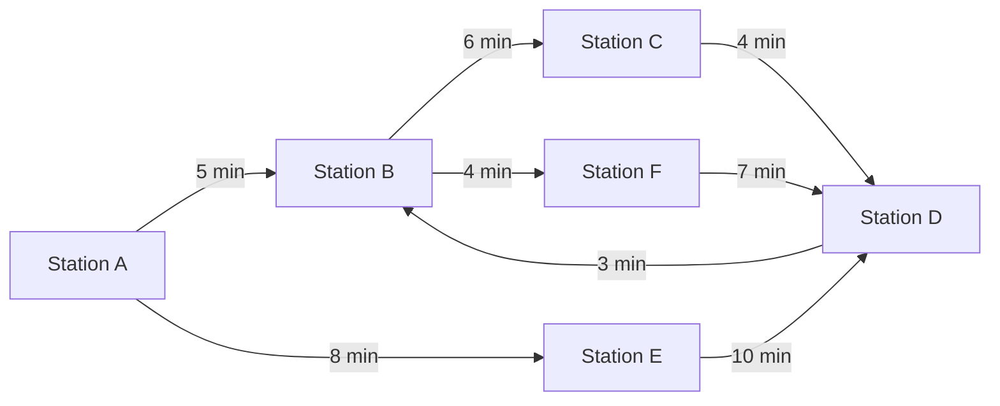

# Quantified Path Patterns When Supported by Cypher

In Neo4j, a **path** is a sequence of alternating nodes and relationships matching a query pattern. When traversing multiple edges, traditional Cypher lets you write `-[:TYPE*1..3]->`. Starting in **Neo4j 5.9**, Cypher adds **quantified path patterns (QPP)**: placing a `{m,n}` quantifier after **a parenthesized path pattern** to repeat that entire sub-pattern multiple times.

This lesson belongs to the **Paths and Graph Traversal** chapter of module `DATABASE_ENGINE_GRAPH_NEO4J`, where Neo4j is used to model connected data as a **property graph** and query nodes, relationships, and paths with Cypher. It focuses on reading, writing, and applying QPP with the right version, preparing for use in Java Driver queries, Spring Data Neo4j, and graph query optimization.

After this lesson, you will be able to:

- Recognize QPP syntax, quantifier forms, and how they differ from traditional variable-length relationship patterns.
- Understand **singleton variables** and **group variables**, extract nodes/edges per iteration, and aggregate data across a path.
- Use **inline predicates** to apply constraints to each repeated segment, bound iteration counts, and control results.
- Distinguish `quantified path pattern`, `quantified relationship`, whole-path filters, and shortest-path problems.
- Identify Cypher version constraints, performance considerations, and query parameterization patterns.

## 1. What Problem Does QPP Solve?

Consider a route system with `:CONNECTS` relationships, where each edge has a `minutes` property. A query might ask to "go from A to D in **one to three legs**." For repeating a single edge, the traditional syntax is:

```cypher
MATCH p = (a:QppStation {code: 'A'})-[:CONNECTS*1..3]->(d:QppStation {code: 'D'})
RETURN p, length(p) AS so_chang;
```

This traditional syntax repeats **a single relationship type**. QPP expresses the corresponding idea by wrapping **an entire pattern segment** in parentheses and placing a quantifier after it:

```cypher
MATCH p = (a:QppStation {code: 'A'})
          ((x:QppStation)-[r:CONNECTS]->(y:QppStation)){1,3}
          (d:QppStation {code: 'D'})
RETURN p, length(p) AS so_chang;
```

Both queries share the same goal on the sample graph: from A to D via 1–3 `CONNECTS` edges **along the arrow direction**. However, QPP can also repeat **a segment containing multiple relationships**, add predicates directly inside the segment, and provide **group variables** for nodes/relationships at each iteration.

> **Version requirement:** quantified path patterns and quantified relationships were introduced in **Neo4j 5.9**. If your running version does not support them, use traditional syntax or upgrade your environment accordingly. Examples with `{m,n}` quantifiers in this lesson assume QPP support is available.

## 2. Creating Isolated Practice Data

We use a dedicated label `QppStation` and relationship `CONNECTS` to avoid mixing illustration nodes with other practice lessons. Each `:CONNECTS` has `minutes` for leg travel time and `enabled` indicating route operational status.

Create six stations:

```cypher
UNWIND [
  {code: 'A', name: 'Station A'},
  {code: 'B', name: 'Station B'},
  {code: 'C', name: 'Station C'},
  {code: 'D', name: 'Station D'},
  {code: 'E', name: 'Station E'},
  {code: 'F', name: 'Station F'}
] AS item
MERGE (s:QppStation {code: item.code})
SET s.name = item.name;
```

Create directed route legs:

```cypher
UNWIND [
  {source: 'A', target: 'B', minutes: 5},
  {source: 'B', target: 'C', minutes: 6},
  {source: 'C', target: 'D', minutes: 4},
  {source: 'A', target: 'E', minutes: 8},
  {source: 'E', target: 'D', minutes: 10},
  {source: 'B', target: 'F', minutes: 4},
  {source: 'F', target: 'D', minutes: 7},
  {source: 'D', target: 'B', minutes: 3}
] AS item
MATCH (u:QppStation {code: item.source})
MATCH (v:QppStation {code: item.target})
MERGE (u)-[r:CONNECTS]->(v)
SET r.minutes = item.minutes, r.enabled = true;
```

`MERGE` reuses existing edge patterns when re-running the illustration data. In a production application, create a unique constraint on `QppStation.code` before loading data to prevent duplicate identifier nodes. This example assumes the database has no `QppStation` nodes with duplicate `code` values.



From A to D there are three edge-disjoint-per-path routes of at most three legs:

| Path | Leg Count | Total Minutes |
| --- | ---: | ---: |
| A → E → D | 2 | 18 |
| A → B → C → D | 3 | 15 |
| A → B → F → D | 3 | 16 |

The graph also contains the cycle **B → C → D → B**. This helps demonstrate the effect of depth and cycles on the path set.

## 3. Reading the Syntax of a Quantified Path Pattern Correctly

Here is a QPP query that binds the entire path to a variable:

```cypher
MATCH p = (start:QppStation {code: 'A'})
          ((leftNode:QppStation)-[leg:CONNECTS]->(rightNode:QppStation)){1,3}
          (finish:QppStation {code: 'D'})
RETURN [n IN nodes(p) | n.code] AS cac_ga,
       length(p) AS so_chang
ORDER BY so_chang, cac_ga;
```

Breaking down each component:

| Component | Role |
| --- | --- |
| `start` | Starting node, uniquely matching `code = 'A'` |
| `((leftNode)-[leg:CONNECTS]->(rightNode))` | Repeated pattern segment, here containing one directed edge |
| `{1,3}` | Repeats the segment from **1 to 3 times**, inclusive of 1 and 3 |
| `finish` | Ending node with `code = 'D'` |
| `p` | Path variable for the **entire** matched chain |
| `length(p)` | Actual number of relationships across the whole path |

The query returns the three paths listed above: one 2-leg path and two 3-leg paths. The `->` arrow remains significant: only `CONNECTS` edges aligned with the relationship direction match.

**Important:** the quantifier applies to the **parenthesized segment**, not necessarily to the number of relationships. If the repeated segment contains two relationships, one iteration produces **two hops**. We will examine that case in Section 7.

## 4. Quantifier Forms

With `((x)-[:CONNECTS]->(y))` as a single-edge pattern segment, QPP supports:

| Quantifier | Meaning | Iteration Count |
| --- | --- | --- |
| `{2}` | Exactly two times | 2 |
| `{1,3}` | From one to three times | 1, 2, 3 |
| `{0,2}` | Allows zero occurrences of the segment | 0, 1, 2 |
| `{1,}` | At least once, no upper bound specified | 1 or more |
| `+` | One or more times | 1 or more |
| `*` | Zero or more times | 0 or more |

In traditional syntax, `*1..3` sits **inside the relationship pattern**; in QPP, `{1,3}` sits **after the entire grouped path pattern**. Do not mix the placement of these two quantifier styles.

### 4.1. Exactly Two Repetitions

```cypher
MATCH p = (a:QppStation {code: 'A'})
          ((x)-[:CONNECTS]->(y)){2}
          (d:QppStation {code: 'D'})
RETURN [n IN nodes(p) | n.code] AS duong_di,
       length(p) AS so_chang;
```

Because the repeated segment consists of **one relationship**, the only result is `A → E → D`, which is exactly 2 legs long.

### 4.2. Allowing Zero Repetitions

```cypher
MATCH p = (a:QppStation {code: 'A'})
          ((x)-[:CONNECTS]->(y)){0,2}
          (destination:QppStation)
RETURN destination.code AS den_ga,
       min(length(p)) AS so_chang_it_nhat
ORDER BY so_chang_it_nhat, den_ga;
```

The results include A at depth **0**, B and E at depth **1**, and C, D, and F at depth **2**. For the depth-0 path, `nodes(p)` contains node A and `relationships(p)` is an empty list. This is not a self-loop edge A → A.

### 4.3. Why Should You Specify an Upper Bound?

Quantifiers like `+`, `*`, or `{1,}` can cause the engine to evaluate a huge number of paths in highly branched networks. When the business requirement is "at most 3 legs," write `{1,3}` directly. A trailing `LIMIT 10` only restricts the number of output rows and does not mean "traverse 10 edges."

## 5. Group Variables: A Key Differentiator of QPP

Variables declared **outside** the quantified segment, such as `start` and `finish`, are **singleton variables** in this example: each binds to one node per result row. Variables `leftNode`, `rightNode`, and `leg` appearing **inside the repeated segment** are **group variables**. They collect the corresponding values across iterations into **lists**.

```cypher
MATCH p = (start:QppStation {code: 'A'})
          ((leftNode:QppStation)-[leg:CONNECTS]->(rightNode:QppStation)){1,3}
          (finish:QppStation {code: 'D'})
RETURN [s IN leftNode | s.code] AS dau_moi_chang,
       [s IN rightNode | s.code] AS cuoi_moi_chang,
       [r IN leg | r.minutes] AS phut_tung_chang,
       size(leg) AS so_lan_lap,
       reduce(total = 0, r IN leg | total + r.minutes) AS tong_phut
ORDER BY tong_phut;
```

Expected result:

| `dau_moi_chang` | `cuoi_moi_chang` | `phut_tung_chang` | `so_lan_lap` | `tong_phut` |
| --- | --- | --- | ---: | ---: |
| [A, B, C] | [B, C, D] | [5, 6, 4] | 3 | 15 |
| [A, B, F] | [B, F, D] | [5, 4, 7] | 3 | 16 |
| [A, E] | [E, D] | [8, 10] | 2 | 18 |

For a **single-edge** repeated segment, `size(leg)` equals `length(p)` in these examples. If the repeated segment contains multiple edges or the path includes edges outside the QPP, those two values can differ.

Do not use `leg.minutes` as if `leg` were **a single relationship**: inside QPP, `leg` is a **list of relationships**. Use a list comprehension such as `[r IN leg | r.minutes]` or `reduce(...)` to aggregate. Likewise, `leftNode` and `rightNode` are lists of nodes across iterations, not just the first or last node of the entire path.

Because group variables are ordered, they preserve the alignment between each leg's start node, end node, and relationship across iterations. For instance, the second element of all three lists describes the second leg.

## 6. Inline Predicates: Filtering Each Iteration

One advantage of QPP is the ability to write `WHERE` **directly inside the repeated segment**. That condition is applied to the pattern of **each iteration**, which is convenient when every leg must satisfy a constraint.

For example, allow only active legs whose duration is **at most 8 minutes**:

```cypher
MATCH p = (start:QppStation {code: 'A'})
          ((u:QppStation)-[leg:CONNECTS]->(v:QppStation)
            WHERE leg.enabled = true AND leg.minutes <= 8){1,3}
          (finish:QppStation {code: 'D'})
RETURN [n IN nodes(p) | n.code] AS duong_di,
       length(p) AS so_chang
ORDER BY duong_di;
```

There are **two** matching paths:

- `A → B → C → D` with leg durations of 5, 6, and 4 minutes.
- `A → B → F → D` with leg durations of 5, 4, and 7 minutes.

The route `A → E → D` is excluded because leg E → D takes **10 minutes**, exceeding the 8-minute cap. This is a **per-leg limit**, not a limit on total travel time.

### Whole-Path Filters Have a Different Meaning

If the problem requires **total travel time** not to exceed 16 minutes, you must sum the relationships along the path:

```cypher
MATCH p = (start:QppStation {code: 'A'})
          ((u)-[leg:CONNECTS]->(v)){1,3}
          (finish:QppStation {code: 'D'})
WHERE reduce(total = 0, r IN leg | total + r.minutes) <= 16
RETURN [n IN nodes(p) | n.code] AS duong_di,
       reduce(total = 0, r IN leg | total + r.minutes) AS tong_phut
ORDER BY tong_phut;
```

Results include the 15-minute route and the 16-minute route; the 18-minute route is excluded. A whole-path `WHERE` may need to evaluate paths before summing, whereas an inline predicate can help the planner prune branches earlier when the condition allows. Use `PROFILE` to verify actual effectiveness rather than assuming every inline predicate is pushed down early.

You can also write a per-leg filter outside the QPP:

```cypher
MATCH p = (a:QppStation {code: 'A'})
          ((u)-[leg:CONNECTS]->(v)){1,3}
          (d:QppStation {code: 'D'})
WHERE all(r IN leg WHERE r.enabled = true AND r.minutes <= 8)
RETURN [n IN nodes(p) | n.code] AS duong_di;
```

On this dataset, the logical output matches the inline predicate example, though query plan optimization may differ. `all(...)` requires **every** relationship in the list to satisfy the predicate; filtering by total cost requires `reduce(...)` or an equivalent aggregation.

## 7. QPP Can Repeat Segments Containing Multiple Relationships

A QPP quantifier counts **repetitions of the pattern segment**, not edges directly. This is a fundamental difference from repeating a single relationship.

For example, require each iteration to traverse **two consecutive legs**:

```cypher
MATCH p = (a:QppStation {code: 'A'})
          ((x)-[:CONNECTS]->(mid)-[:CONNECTS]->(y)){1,2}
          (d:QppStation {code: 'D'})
RETURN [n IN nodes(p) | n.code] AS duong_di,
       length(p) AS so_chang;
```

The segment `((x)-[:CONNECTS]->(mid)-[:CONNECTS]->(y))` contains **2 relationships**. Therefore:

- **1 repetition** produces a path of **2 legs**.
- **2 repetitions** produce a path of **4 legs**.

With the sample data and destination D, the result is `A → E → D` (2 legs). The two 3-leg paths to D do **not** match because 3 is not a multiple of 2. This is useful when a domain segment structured as "go from station A to the next station, and from there to the following station" must repeat as a unit.

QPP lets you express repeating units more complex than a single edge, such as a segment combining multiple relationship types or predicates involving intermediate nodes. However, repeating long segments can significantly increase combinations; choose appropriate bounds and verify the output.

## 8. Quantified Relationships: Shorthand for Repeating a Single Edge

Also introduced in Neo4j 5.9, a **quantified relationship** is a shorter syntax when each iteration consists of **a single relationship**. The quantifier is placed after the relationship arrow:

```cypher
MATCH p = (a:QppStation {code: 'A'})-[:CONNECTS]->{1,3}(d:QppStation {code: 'D'})
RETURN [n IN nodes(p) | n.code] AS duong_di,
       length(p) AS so_chang;
```

Comparing the three ways of expressing the same requirement:

| Style | Pattern |
| --- | --- |
| Legacy variable-length relationship | `(a)-[:CONNECTS*1..3]->(d)` |
| Quantified relationship (5.9+) | `(a)-[:CONNECTS]->{1,3}(d)` |
| Quantified path pattern (5.9+) | `(a)((x)-[:CONNECTS]->(y)){1,3}(d)` |

When you only need one relationship type repeated multiple times, quantified relationships are concise and readable. When you need to group multiple nodes/relationships or add `WHERE` inside a complex repeated segment, choose full QPP.

Distinguish **the legacy `*` inside brackets** from the `*` quantifier placed **after a quantified path pattern**. Their "repeat multiple times" meaning is similar, but they belong to two different syntaxes and cannot be swapped arbitrarily.

## 9. Cycles, Path Counts, and Over-Expansion Risks

The dataset contains the cycle `B → C → D → B`. The following query finds closed walks starting and ending at B:

```cypher
MATCH p = (start:QppStation {code: 'B'})
          ((u)-[:CONNECTS]->(v)){1,4}
          (finish:QppStation {code: 'B'})
RETURN [n IN nodes(p) | n.code] AS chu_trinh,
       length(p) AS so_chang;
```

The 3-leg path `B → C → D → B` is one result. Node B appears at both start and end, so **nodes can repeat along a path**. Under standard Cypher relationship-uniqueness path matching, a relationship cannot be traversed twice within the same matched path; this still permits closed cycles formed from distinct relationships.

One target node can be reached by multiple paths. For instance, from A to D in 1–3 legs there are **3 paths but only 1 target node**:

```cypher
MATCH p = (start:QppStation {code: 'A'})
          ((u)-[:CONNECTS]->(v)){1,3}
          (finish:QppStation {code: 'D'})
RETURN count(p) AS so_path,
       count(DISTINCT finish) AS so_node_dich;
```

`DISTINCT` removes duplicate target node rows, but it is not an automatic mechanism that prevents the engine from matching many paths beforehand. When you only need one or a set of shortest paths, consider shortest-path operators instead of enumerating every path within a large bound.

## 10. Repetition Bounds, Parameters, and Execution Optimization

### 10.1. Maximum Depth Must Be Controlled

Quantifiers such as `{1,3}` and `{1,5}` use **integer literal values in the pattern syntax**, not `{1,$maxHops}` like property parameterization. If an API accepts a bound from users, you can place a controlled hard cap in the query and filter to the requested depth:

```cypher
// Example: $maxHops has been validated by the application to be in 1..5.
MATCH p = (a:QppStation {code: $from})
          ((u)-[:CONNECTS]->(v)){1,5}
          (d:QppStation {code: $to})
WHERE length(p) <= $maxHops
RETURN [n IN nodes(p) | n.code] AS duong_di,
       length(p) AS so_chang;
```

The hard cap of 5 still allows the query plan to consider paths up to 5 steps before applying the filter, so performance can be heavier than a bound matching the input tightly. When an application permits only a few depth levels, you can prepare **fixed queries** for each allowed depth. Never concatenate an unvalidated depth value directly into a Cypher string.

### 10.2. Return Only What You Need

- Need only **target nodes**: return `DISTINCT d` or `DISTINCT d.code` instead of returning full paths.
- Need **minimum legs within a specified range**: aggregate `min(length(p))` grouped by target node.
- Need **full routes**: keep the `p` variable and use `nodes(p)` and `relationships(p)`.
- Need **shortest path by hops** between two specific nodes: use the appropriate shortest-path construct rather than always enumerating all QPP paths and sorting.
- Need **route with fewest minutes**: that is a weighted problem; comparing total `minutes` within a QPP bound only draws conclusions within that bound and does not replace weighted shortest-path algorithms across the full graph.

### 10.3. EXPLAIN and PROFILE

You can inspect the query plan before deployment:

```cypher
EXPLAIN
MATCH p = (a:QppStation {code: 'A'})
          ((u)-[:CONNECTS]->(v)){1,3}
          (d:QppStation {code: 'D'})
RETURN length(p) AS so_chang;
```

`EXPLAIN` displays the plan without running the query. `PROFILE` executes the query and reports actual metrics such as intermediate row counts, making it suitable once execution scope is controlled. Performance also depends on starting points, node degrees, branching factors, index/constraint usage, and early filtering.

**Note:** a trailing `LIMIT 10` only caps output at 10 rows and is not equivalent to a `{1,10}` repetition bound. `WHERE length(p) <= 3` is a path filter and is not guaranteed to match the cost of declaring `{1,3}` directly.

## 11. Comparing QPP with Hop-Based or Weighted Shortest Path

If the question is "what takes the **fewest legs** from A to D?", the answer is **2**, via `A → E → D`. There is no need to enumerate all 1–3 leg routes and pick the minimum when the problem is actually shortest path.

In versions supporting the traditional syntax below, you can write:

```cypher
MATCH (a:QppStation {code: 'A'})
MATCH (d:QppStation {code: 'D'})
MATCH p = shortestPath((a)-[:CONNECTS*..5]->(d))
RETURN [n IN nodes(p) | n.code] AS duong_it_chang_nhat,
       length(p) AS so_chang;
```

Result: `A → E → D`: **2 legs, 18 minutes**. However, if the requirement is **lowest total time**, the route `A → B → C → D` takes only **15 minutes** despite being 3 legs long. On large datasets, consider weighted shortest-path algorithms such as **Dijkstra** in Neo4j Graph Data Science (GDS), with properly modeled weight properties.

QPP solves **matching paths that satisfy structural and repetition rules**. It does not inherently force the engine to execute BFS/DFS in a specific order, nor does it automatically optimize an arbitrary total weight function.

## 12. Practice Exercises and Solutions

The exercises below reuse `QppStation` and `CONNECTS` from Section 2.

### Exercise 1 — Finding Two-Leg Paths with QPP

**Task:** from A to D, in exactly two `CONNECTS` legs, using QPP with `{2}`.

```cypher
MATCH p = (a:QppStation {code: 'A'})
          ((x)-[:CONNECTS]->(y)){2}
          (d:QppStation {code: 'D'})
RETURN [n IN nodes(p) | n.code] AS cac_ga;
```

**Solution:** `[A, E, D]`. Both routes via B require three edges.

### Exercise 2 — Computing Total Time Using a Group Variable

**Task:** find A → D routes of at most 3 legs along with per-leg durations; sort ascending by total time.

```cypher
MATCH p = (a:QppStation {code: 'A'})
          ((x)-[r:CONNECTS]->(y)){1,3}
          (d:QppStation {code: 'D'})
RETURN [n IN nodes(p) | n.code] AS cac_ga,
       [edge IN r | edge.minutes] AS phut_tung_chang,
       reduce(total = 0, edge IN r | total + edge.minutes) AS tong_phut
ORDER BY tong_phut;
```

**Solution:** `A-B-C-D` (15 minutes), `A-B-F-D` (16 minutes), `A-E-D` (18 minutes).

### Exercise 3 — Distinguishing Per-Leg Conditions from Total Time

**Task:** (a) exclude any path with a leg over 8 minutes; (b) exclude any path with total time over 16 minutes. Do they produce the same set of paths?

**Solution:** On **this dataset**, both conditions return `A-B-C-D` and `A-B-F-D`, excluding `A-E-D`. However, **the two conditions are not equivalent** in general: a route with three 8-minute legs satisfies "each leg at most 8 minutes," yet totals 24 minutes and fails "total at most 16 minutes."

### Exercise 4 — Two Relationships per Iteration

**Task:** predict how many edges long a matched path is for `((x)-[:CONNECTS]->(m)-[:CONNECTS]->(y)){2}`.

**Solution:** **4 edges**. The quantifier 2 counts repetitions of the **two-edge** segment, so `length(p) = 2 × 2 = 4`. Do not interpret `{2}` as two hops in every QPP.

### Exercise 5 — Checking Version Compatibility

**Task:** a Neo4j environment rejects the syntax `((x)-[r:CONNECTS]->(y)){1,3}`. How should you handle this?

**Solution:** check the Neo4j version and active Cypher selection. QPP requires a **supported version**, starting from Neo4j 5.9. If the system runs an older version and the query only repeats a single relationship, replace it with `-[:CONNECTS*1..3]->`; do not use QPP group variables in that replacement. If complex segment repetition is needed, consider rewriting the query into multiple traditional patterns or upgrading the environment after compatibility testing.

## 13. Summary

- **QPP** repeats a **pattern segment that may contain multiple nodes and relationships**, with quantifiers such as `{1,3}`, `{2}`, `{0,2}`, `+`, and `*`.
- For a single-edge segment, each repetition is one hop; for a two-edge segment, `{2}` corresponds to **4 hops**.
- Nodes/relationships declared **inside the repeated segment** are **group variables**: use list comprehensions, `size(...)`, and `reduce(...)` to work with them.
- **Inline predicates** express constraints on **each iteration**; distinguish them from filtering and aggregating over the **entire path**.
- **Quantified relationships** `-[:TYPE]->{1,3}` are shorthand when repeating only one edge; the legacy syntax is `-[:TYPE*1..3]->`.
- Always verify the **Neo4j/Cypher version**, set sensible repetition bounds, distinguish **path count** from **target node count**, and inspect `EXPLAIN`/`PROFILE` plans when expanding large graphs.
- QPP is for **structural path matching**; optimizing **fewest hops** or **minimum total weight** are distinct requirements that call for appropriate operators or algorithms.

When writing advanced path queries, clearly specify **which sub-pattern repeats, how many times it repeats, which variables represent each iteration, and which predicates apply per step vs. across the entire path**. That is how to leverage QPP while keeping query results and execution cost under control.
