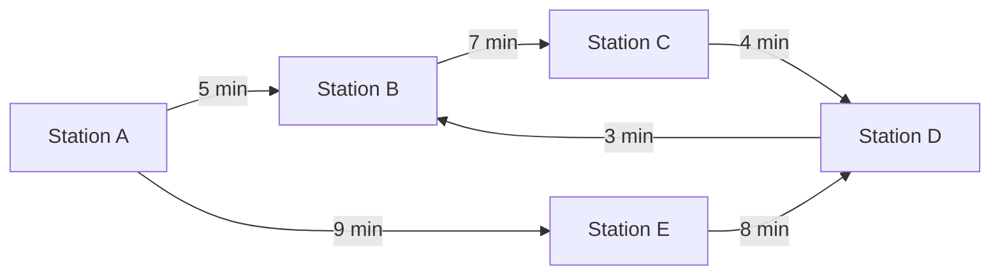

# Extracting Nodes, Relationships, and Length from a Path in Neo4j

In Neo4j, a **path** is not just a start–end pair of nodes. It stores **the ordered sequence of nodes and relationships** matched by a Cypher pattern. When you need to answer "which waypoints did it pass through?", "which edges were traversed?", "how many steps did it take?", or "what is the total route duration?", assign the path to a variable and use `nodes(p)`, `relationships(p)`, and `length(p)`.

This lesson belongs to the **Paths and Graph Traversal** chapter of module `DATABASE_ENGINE_GRAPH_NEO4J`, using Neo4j's property graph and Cypher to work with connected data. Path extraction techniques are also essential when returning data to the Java Driver, Spring Data Neo4j, routing services, dependency chain checks, or graph analytics.

After this lesson, you will know how to:

- Bind a variable to a path in `MATCH` and return either the raw path or structured data derived from it.
- Extract the **node list**, **relationship list**, **hop count**, and properties of each element.
- Understand element ordering along a path, even when a query traverses against the stored relationship direction.
- Read nodes/edges at specific positions, unwind individual legs into rows, and compute total weights.
- Handle zero-length paths, multiple paths to the same target, cycles, and missing paths.

## 1. What Is a Path in a Property Graph?

Neo4j represents data using **nodes** (entities) and **relationships** (typed, directed links with properties). A path is an alternating sequence:

```text
(node 0) --[relationship 0]--> (node 1)
                                   |
                              [relationship 1]
                                   |
                                   v
                                (node 2)
```

For a path with **k relationships**:

- `length(p) = k`: path length measured by number of relationships, also called the **hop count**.
- `size(relationships(p)) = k`: number of relationships traversed.
- `size(nodes(p)) = k + 1`: number of **node occurrences** in the path list, even if a node appears more than once.

For example, the path `A → B → C → D` has four node occurrences and three relationships, so `length(p) = 3`.

**Distinction:** length in hops is not automatically physical distance, travel time, cost, or the number of **unique** nodes. If relationships carry weights, you must read and aggregate those properties separately.

## 2. Creating an Isolated Sample Graph

Suppose a train network is modeled with `:PathDemoStation` nodes and directed `:PATH_DEMO_ROUTE` relationships. Each edge has `minutes` and `km` (kilometers). Using a dedicated label and relationship type for this exercise prevents data collisions with other Neo4j lessons in the same database.

Create five stations:

```cypher
UNWIND [
  {code: 'A', name: 'Station A'},
  {code: 'B', name: 'Station B'},
  {code: 'C', name: 'Station C'},
  {code: 'D', name: 'Station D'},
  {code: 'E', name: 'Station E'}
] AS item
MERGE (s:PathDemoStation {code: item.code})
SET s.name = item.name;
```

Create six one-way routes:

```cypher
UNWIND [
  {source: 'A', target: 'B', minutes: 5, km: 4},
  {source: 'B', target: 'C', minutes: 7, km: 6},
  {source: 'C', target: 'D', minutes: 4, km: 3},
  {source: 'A', target: 'E', minutes: 9, km: 8},
  {source: 'E', target: 'D', minutes: 8, km: 5},
  {source: 'D', target: 'B', minutes: 3, km: 2}
] AS item
MATCH (u:PathDemoStation {code: item.source})
MATCH (v:PathDemoStation {code: item.target})
MERGE (u)-[r:PATH_DEMO_ROUTE]->(v)
SET r.minutes = item.minutes, r.km = item.km;
```

`MERGE` reuses nodes or relationships that already match the pattern; the example assumes there are no `PathDemoStation` nodes with duplicate `code` values. In a real system, use a unique constraint to protect station identifiers.



From **A to D** along the arrow direction, within at most three hops there are two paths:

| Path | Relationships | Nodes on Path | Total Minutes | Total km |
| --- | ---: | ---: | ---: | ---: |
| A → E → D | 2 | 3 | 17 | 13 |
| A → B → C → D | 3 | 4 | 16 | 13 |

The graph also contains the cycle `B → C → D → B`. The examples below use this exact dataset.

## 3. Assigning the Entire Path to Variable `p`

In Cypher, place `p =` before a path pattern in `MATCH` to capture the full matched path:

```cypher
MATCH p = (a:PathDemoStation {code: 'A'})
          -[:PATH_DEMO_ROUTE*1..3]->
          (d:PathDemoStation {code: 'D'})
RETURN p;
```

`p` is a **PATH** value containing both nodes and relationships in traversal order. Neo4j Browser can render it as a graph; other applications may need list or tabular formats.

- `a` and `d` represent the **start and end nodes**.
- `p` represents the **complete path**.
- `*1..3` selects paths containing **1 to 3 relationships** following the `PATH_DEMO_ROUTE` direction.
- One pattern can match **multiple paths**, so `RETURN p` can return multiple rows.

If you only write `RETURN a, d`, you lose information about **the intermediate nodes and relationships traversed**. Whenever you need to extract or explain a route, keep the path variable.

## 4. Three Core Functions: `nodes`, `relationships`, `length`

### 4.1. Extracting the Ordered List of Nodes

```cypher
MATCH p = (a:PathDemoStation {code: 'A'})
          -[:PATH_DEMO_ROUTE*1..3]->
          (d:PathDemoStation {code: 'D'})
RETURN [n IN nodes(p) | n.code] AS cac_ga,
       size(nodes(p)) AS so_luot_node
ORDER BY so_luot_node;
```

Result:

| `cac_ga` | `so_luot_node` |
| --- | ---: |
| `[A, E, D]` | 3 |
| `[A, B, C, D]` | 4 |

`nodes(p)` returns **LIST<NODE>**, a list of node objects; the list comprehension `[n IN nodes(p) | n.code]` extracts each node's `code` property for convenient display, JSON serialization, or application consumption.

The order of the list is **the order in which nodes are visited along the path**, not sorted by `code`, creation time, or internal ID.

### 4.2. Extracting the Ordered List of Relationships

```cypher
MATCH p = (a:PathDemoStation {code: 'A'})
          -[:PATH_DEMO_ROUTE*1..3]->
          (d:PathDemoStation {code: 'D'})
RETURN [n IN nodes(p) | n.code] AS cac_ga,
       [r IN relationships(p) | r.minutes] AS phut_tung_chang,
       [r IN relationships(p) | type(r)] AS kieu_quan_he,
       size(relationships(p)) AS so_canh
ORDER BY so_canh;
```

Result:

| `cac_ga` | `phut_tung_chang` | `kieu_quan_he` | `so_canh` |
| --- | --- | --- | ---: |
| `[A, E, D]` | `[9, 8]` | `[PATH_DEMO_ROUTE, PATH_DEMO_ROUTE]` | 2 |
| `[A, B, C, D]` | `[5, 7, 4]` | `[PATH_DEMO_ROUTE, PATH_DEMO_ROUTE, PATH_DEMO_ROUTE]` | 3 |

`relationships(p)` returns **LIST<RELATIONSHIP>**, also ordered by **edge traversal order** along the path. Each relationship has a type (`type(r)`), start/end nodes according to its stored direction, and properties (`r.minutes`, `r.km`).

**Note:** `relationships(p)` holds actual relationship objects, not just type names or property values. Use list comprehensions to pick the exact fields to send to the client.

### 4.3. Getting Path Length

```cypher
MATCH p = (a:PathDemoStation {code: 'A'})
          -[:PATH_DEMO_ROUTE*1..3]->
          (d:PathDemoStation {code: 'D'})
RETURN [n IN nodes(p) | n.code] AS cac_ga,
       length(p) AS so_buoc_nhay,
       size(relationships(p)) AS so_relationship,
       size(nodes(p)) AS so_node
ORDER BY so_buoc_nhay;
```

| `cac_ga` | `so_buoc_nhay` | `so_relationship` | `so_node` |
| --- | ---: | ---: | ---: |
| `[A, E, D]` | 2 | 2 | 3 |
| `[A, B, C, D]` | 3 | 3 | 4 |

For every standard path:

```text
length(p) = size(relationships(p))
size(nodes(p)) = length(p) + 1
```

Both formulas count **element occurrences in the path**, not total unique nodes/relationships in the entire graph.

## 5. Turning Node and Relationship Lists into Structured Data

Returning raw NODE/RELATIONSHIP objects can be convenient in Neo4j Browser, but APIs usually only need selected properties. You can build maps directly inside a list comprehension:

```cypher
MATCH p = (a:PathDemoStation {code: 'A'})
          -[:PATH_DEMO_ROUTE*1..3]->
          (d:PathDemoStation {code: 'D'})
RETURN
  [n IN nodes(p) |
    {code: n.code, name: n.name, nhan: labels(n)}
  ] AS danh_sach_nut,
  [r IN relationships(p) |
    {kieu: type(r), minutes: r.minutes, km: r.km}
  ] AS danh_sach_quan_he,
  length(p) AS do_dai
ORDER BY do_dai;
```

Useful expressions:

| Expression | Result |
| --- | --- |
| `nodes(p)` | List of NODE objects |
| `relationships(p)` | List of RELATIONSHIP objects |
| `[n IN nodes(p) \| n.code]` | List of station codes |
| `[r IN relationships(p) \| r.minutes]` | List of minutes per leg |
| `[r IN relationships(p) \| type(r)]` | List of relationship types |
| `[n IN nodes(p) \| labels(n)]` | List of labels for each node |
| `[r IN relationships(p) \| properties(r)]` | List of property maps for each relationship |

`properties(r)` extracts the map of existing properties; it does not automatically include the relationship type or endpoints. If you need those fields, add `type(r)`, `startNode(r)`, and `endNode(r)` as needed.

### Preserving Order and Missing Values

If a relationship lacks `minutes`, `r.minutes` can evaluate to `null`. Inside a list comprehension, the corresponding element is still kept in the list as `null`. When summing weights, decide upfront in your business logic whether missing values are acceptable; do not assume every path has a computable total duration.

For example, accept only paths where **every relationship has a non-null duration**:

```cypher
MATCH p = (a:PathDemoStation {code: 'A'})
          -[:PATH_DEMO_ROUTE*1..3]->
          (d:PathDemoStation {code: 'D'})
WHERE all(r IN relationships(p) WHERE r.minutes IS NOT NULL)
RETURN [n IN nodes(p) | n.code] AS cac_ga,
       [r IN relationships(p) | r.minutes] AS phut_tung_chang;
```

In the sample dataset, both paths have `minutes` on every edge.

## 6. Accessing Nodes or Relationships at Specific Positions

Because `nodes(p)` and `relationships(p)` are **lists**, you can use **0-based** indexing along with `head` and `last`:

```cypher
MATCH p = (a:PathDemoStation {code: 'A'})
          -[:PATH_DEMO_ROUTE*1..3]->
          (d:PathDemoStation {code: 'D'})
WITH p, nodes(p) AS ns, relationships(p) AS rs
RETURN
  head(ns).code AS diem_bat_dau,
  last(ns).code AS diem_ket_thuc,
  ns[1].code AS ga_sau_buoc_dau,
  head(rs).minutes AS phut_chang_dau,
  last(rs).minutes AS phut_chang_cuoi,
  length(p) AS so_chang
ORDER BY so_chang;
```

| `so_chang` | `diem_bat_dau` | `diem_ket_thuc` | `ga_sau_buoc_dau` | `phut_chang_dau` | `phut_chang_cuoi` |
| ---: | --- | --- | --- | ---: | ---: |
| 2 | A | D | E | 9 | 8 |
| 3 | A | D | B | 5 | 4 |

- `head(ns)`: first node in the path.
- `last(ns)`: last node in the path.
- `ns[1]`: second node in the path.
- `head(rs)`/`last(rs)`: first/last relationship **in path order**.

**Boundary note:** for a 0-length path, `relationships(p)` is empty, so `head(relationships(p))` does not return a valid relationship. For a single-node path, `nodes(p)[1]` has no element; handle `null` values or check length before accessing properties.

## 7. Unwinding a Path into Ordered Legs

A route sometimes needs to be sent to a UI as a list of legs `from → to → minutes`. You can use `UNWIND` with list indices:

```cypher
MATCH p = (a:PathDemoStation {code: 'A'})
          -[:PATH_DEMO_ROUTE*1..3]->
          (d:PathDemoStation {code: 'D'})
WITH p, nodes(p) AS ns, relationships(p) AS rs
UNWIND range(0, size(rs) - 1) AS i
RETURN
  length(p) AS so_chang_trong_path,
  i + 1 AS thu_tu_chang,
  ns[i].code AS ga_di,
  ns[i + 1].code AS ga_den,
  type(rs[i]) AS kieu_quan_he,
  rs[i].minutes AS so_phut
ORDER BY so_chang_trong_path, thu_tu_chang;
```

Result:

| `so_chang_trong_path` | `thu_tu_chang` | `ga_di` | `ga_den` | `so_phut` |
| ---: | ---: | --- | --- | ---: |
| 2 | 1 | A | E | 9 |
| 2 | 2 | E | D | 8 |
| 3 | 1 | A | B | 5 |
| 3 | 2 | B | C | 7 |
| 3 | 3 | C | D | 4 |

Because these paths have **at least one relationship**, `range(0, size(rs) - 1)` generates indices from 0 to the last edge. `nodes(p)` has **exactly one more element** than `relationships(p)`, so `ns[i]` and `ns[i+1]` are adjacent nodes in traversal order, and `rs[i]` is the edge connecting them.

For a 0-length path, there are no legs to emit as rows; handle that separately if the UI should display the starting point even when zero legs were traversed. When multiple paths have the same leg count, include a path identifier or node list to distinguish row groups.

## 8. Path Traversal Order vs. Stored Relationship Direction

**`nodes(p)` always follows the matched path order.** Meanwhile, `startNode(r)` and `endNode(r)` reflect **the relationship direction stored in the database**. These two perspectives may match or differ depending on the query pattern.

For example, traversing from **D to A** while allowing edges in **both directions**:

```cypher
MATCH p = (d:PathDemoStation {code: 'D'})
          -[:PATH_DEMO_ROUTE*2]-
          (a:PathDemoStation {code: 'A'})
RETURN [n IN nodes(p) | n.code] AS cac_ga_theo_duong_di,
       [r IN relationships(p) |
          startNode(r).code + '->' + endNode(r).code
       ] AS cac_canh_theo_chieu_luu;
```

Two paths match:

| Node Order During Traversal | Stored Direction of Relationships in Path Order |
| --- | --- |
| `[D, E, A]` | `[E->D, A->E]` |
| `[D, B, A]` | `[D->B, A->B]` |

In path `D — E — A`, traversal moves **D → E** in path order, whereas the actual stored relationship is **E → D**. Therefore, you cannot always assume `startNode(relationships(p)[i]) = nodes(p)[i]` when a query pattern does not constrain direction.

To describe legs **along the path's traversal direction**, use `nodes(p)[i]` and `nodes(p)[i+1]`. To inspect **the stored relationship direction**, use `startNode(r)` and `endNode(r)`.

## 9. Zero-Length Paths and Cycles

### 9.1. Paths with Zero Relationships

If a pattern allows **0 hops**, a path contains one node and no relationships:

```cypher
MATCH p = (a:PathDemoStation {code: 'A'})
          -[:PATH_DEMO_ROUTE*0..1]->
          (dich:PathDemoStation)
RETURN [n IN nodes(p) | n.code] AS cac_ga,
       [r IN relationships(p) | r.minutes] AS phut_tung_chang,
       length(p) AS so_chang
ORDER BY so_chang, cac_ga;
```

Result:

| `cac_ga` | `phut_tung_chang` | `so_chang` |
| --- | --- | ---: |
| `[A]` | `[]` | 0 |
| `[A, B]` | `[5]` | 1 |
| `[A, E]` | `[9]` | 1 |

`length(p) = 0` means a path exists containing **the starting node itself**; it does not mean a connection error or missing result.

### 9.2. Nodes Can Appear Multiple Times on a Path

The graph has the cycle B → C → D → B. Query:

```cypher
MATCH p = (bat_dau:PathDemoStation {code: 'B'})
          -[:PATH_DEMO_ROUTE*3]->
          (ket_thuc:PathDemoStation {code: 'B'})
RETURN [n IN nodes(p) | n.code] AS cac_ga,
       length(p) AS so_chang,
       size(nodes(p)) AS so_luot_node,
       size(relationships(p)) AS so_canh;
```

This yields `[B, C, D, B]`: **3 relationships**, **4 node occurrences**, but only **3 distinct nodes**. `nodes(p)` **does not deduplicate nodes automatically**. Under traditional variable-length matching, a relationship cannot be reused within the same standard path, yet a node can reappear in a cycle.

If you want to count **unique nodes**, apply a separate deduplication/aggregation rather than using `size(nodes(p))`; clarify whether the business question asks for **node visits** or **distinct entities**.

## 10. Computing Values from the Relationship List

### 10.1. Total Duration and Total Distance

`length(p)` only counts edges. To compute weighted totals, use `reduce` over `relationships(p)`:

```cypher
MATCH p = (a:PathDemoStation {code: 'A'})
          -[:PATH_DEMO_ROUTE*1..3]->
          (d:PathDemoStation {code: 'D'})
RETURN [n IN nodes(p) | n.code] AS cac_ga,
       length(p) AS so_chang,
       reduce(total = 0, r IN relationships(p) | total + r.minutes) AS tong_phut,
       reduce(total = 0, r IN relationships(p) | total + r.km) AS tong_km
ORDER BY tong_phut;
```

| `cac_ga` | `so_chang` | `tong_phut` | `tong_km` |
| --- | ---: | ---: | ---: |
| `[A, B, C, D]` | 3 | 16 | 13 |
| `[A, E, D]` | 2 | 17 | 13 |

Thus, a path with **fewer edges** does not necessarily take **less time**. These `reduce(...)` formulas assume all evaluated relationships have valid numeric values. If fields may be missing, filter the data or define null-handling rules beforehand.

### 10.2. One Target Node Can Have Multiple Paths

Count paths from A to D in 1–3 hops:

```cypher
MATCH p = (a:PathDemoStation {code: 'A'})
          -[:PATH_DEMO_ROUTE*1..3]->
          (d:PathDemoStation {code: 'D'})
RETURN count(p) AS so_duong_di,
       count(DISTINCT d) AS so_node_dich;
```

Result: **2 paths** but **1 unique target node**. If you return `DISTINCT d`, you only see one D and lose visibility into the two different routes leading to D.

Example finding the minimum hop count within the **1–3 range** for the target node:

```cypher
MATCH p = (a:PathDemoStation {code: 'A'})
          -[:PATH_DEMO_ROUTE*1..3]->
          (d:PathDemoStation {code: 'D'})
RETURN d.code AS ga_dich,
       min(length(p)) AS buoc_it_nhat_trong_pham_vi;
```

Result: `D, 2`. This aggregates paths already matched within the given bound; on large graphs where you only need the shortest path between two nodes, consider shortest-path constructs instead of enumerating every path.

## 11. Distinguishing No Path Found from a Zero-Length Path

When `MATCH` finds no matching path, Cypher normally **returns no rows**. By contrast, a 0-length path can match when the start node is the end node and the pattern allows 0 relationships.

If you need to preserve a row even when no path exists, use `OPTIONAL MATCH`:

```cypher
MATCH (d:PathDemoStation {code: 'D'})
MATCH (a:PathDemoStation {code: 'A'})
OPTIONAL MATCH p = (d)-[:PATH_DEMO_ROUTE*1..3]->(a)
RETURN p IS NULL AS khong_tim_thay_duong,
       nodes(p) AS cac_node,
       relationships(p) AS cac_quan_he,
       length(p) AS so_buoc;
```

The sample graph has no **directed** path from D to A, so the output is one row with `khong_tim_thay_duong = true`; fields derived from the missing `p` evaluate to `null`. This differs from a 0-hop path: when a 0-hop path matches, `length(p)` is the number **0**, `nodes(p)` has one node, and `relationships(p)` is an empty list.

For APIs, do not blindly replace every `null` in `length(p)` with `0`, as that can confuse **no path found** with **a valid 0-hop path**.

## 12. Returning Path Data via the Java Driver

Java applications can read Neo4j Driver PATH/NODE/RELATIONSHIP values directly. However, for a JSON-returning API, it is often simpler to use Cypher to transform the path into **lists of properties** right inside the query:

```cypher
MATCH p = (a:PathDemoStation {code: 'A'})
          -[:PATH_DEMO_ROUTE*1..3]->
          (d:PathDemoStation {code: 'D'})
RETURN [n IN nodes(p) | n.code] AS stationCodes,
       [r IN relationships(p) | r.minutes] AS minutesPerLeg,
       length(p) AS hops
ORDER BY hops;
```

**Java Driver** example with Java 17+ (adjust URI, username, and password for your environment):

```java
import org.neo4j.driver.AuthTokens;
import org.neo4j.driver.GraphDatabase;
import org.neo4j.driver.Value;

import java.util.List;

public class ReadPathExample {
    public static void main(String[] args) {
        try (var driver = GraphDatabase.driver(
                 "bolt://localhost:7687",
                 AuthTokens.basic("neo4j", "<password>"));
             var session = driver.session()) {

            var result = session.run("""
                MATCH p = (a:PathDemoStation {code: 'A'})
                          -[:PATH_DEMO_ROUTE*1..3]->
                          (d:PathDemoStation {code: 'D'})
                RETURN [n IN nodes(p) | n.code] AS stationCodes,
                       [r IN relationships(p) | r.minutes] AS minutesPerLeg,
                       length(p) AS hops
                ORDER BY hops
                """);

            while (result.hasNext()) {
                var record = result.next();
                List<String> codes =
                    record.get("stationCodes").asList(Value::asString);
                List<Integer> minutes =
                    record.get("minutesPerLeg").asList(Value::asInt);
                int hops = record.get("hops").asInt();

                System.out.println(codes + " / " + minutes +
                                   " / hops=" + hops);
            }
        }
    }
}
```

Expected output:

```text
[A, E, D] / [9, 8] / hops=2
[A, B, C, D] / [5, 7, 4] / hops=3
```

The lists are converted into convenient application types. If you need to process raw path objects in Java, you can `RETURN p` and call `record.get("p").asPath()`; each node/relationship will then be a Neo4j Driver object. In Spring Data Neo4j, design a mapping/DTO matching the returned data shape instead of assuming a path result automatically maps to a single entity.

## 13. Common Mistakes and Fixes

| Mistake or Misconception | Why It Is Wrong | How to Fix It |
| --- | --- | --- |
| Using `size(nodes(p))` as hop count | A path has k edges but k + 1 node occurrences | Use `length(p)` |
| Thinking `nodes(p)` only contains unique nodes | A path can revisit a previously visited node | Count/extract node visits; deduplicate separately when needed |
| Thinking `relationships(p)` is unordered | The list reflects edge traversal order in the path | Use indices or `UNWIND` in order |
| Equating `startNode(r)` with the preceding node | When traversing in reverse, the stored edge start node can differ from the prior path node | Use `nodes(p)[i]` for traversal direction; `startNode(r)` for stored direction |
| Summing `length(p)` for time/distance | `length` only counts edges | Use `reduce` over numeric relationship properties |
| Calling a 0-hop path "no path found" | 0-hop is a valid path with one node | Distinguish `length(p) = 0` from `p IS NULL` |
| Returning only target nodes, dropping the path variable | Intermediate nodes and edges are lost | Bind `p = ...` in `MATCH` |
| Using `LIMIT` instead of a depth bound | `LIMIT` caps output rows, not edges per path | Specify bounds in the pattern, such as `*1..3` |
| Expanding many hops from too many nodes | Path count can explode, especially with heavy branching | Anchor the start node, filter edge type/direction, bound steps, and check `EXPLAIN`/`PROFILE` |

**Performance tip:** `nodes(p)`, `relationships(p)`, and `length(p)` operate on already-matched paths. The heavy cost usually lies in **finding and expanding paths**, not just reading lists. On large graphs, bound path length, relationship types/direction, and starting points; project only required properties to avoid large payloads.

## 14. Practice Exercises with Answers

### Exercise 1. Extracting Stations in Order and Leg Count

**Task:** return all routes from A to D with at most three legs; output only station codes and length.

```cypher
MATCH p = (a:PathDemoStation {code: 'A'})
          -[:PATH_DEMO_ROUTE*1..3]->
          (d:PathDemoStation {code: 'D'})
RETURN [n IN nodes(p) | n.code] AS cac_ga,
       length(p) AS so_chang
ORDER BY so_chang;
```

**Answer:** `[A, E, D]` with length 2, and `[A, B, C, D]` with length 3.

### Exercise 2. Extracting Duration for Each Relationship

**Task:** for the two paths above, retrieve the ordered list of `minutes` and total duration.

```cypher
MATCH p = (a:PathDemoStation {code: 'A'})
          -[:PATH_DEMO_ROUTE*1..3]->
          (d:PathDemoStation {code: 'D'})
RETURN [n IN nodes(p) | n.code] AS cac_ga,
       [r IN relationships(p) | r.minutes] AS phut_tung_chang,
       reduce(t = 0, r IN relationships(p) | t + r.minutes) AS tong_phut
ORDER BY tong_phut;
```

**Answer:** route A–B–C–D has `[5,7,4]` and 16 minutes; route A–E–D has `[9,8]` and 17 minutes.

### Exercise 3. Extracting Start, End, and Intermediate Stations

**Task:** for paths from A to D within at most 3 hops, extract only the stations **between** the start and end points.

```cypher
MATCH p = (a:PathDemoStation {code: 'A'})
          -[:PATH_DEMO_ROUTE*1..3]->
          (d:PathDemoStation {code: 'D'})
WITH p, nodes(p) AS ns
RETURN head(ns).code AS dau,
       [n IN ns[1..-1] | n.code] AS ga_trung_gian,
       last(ns).code AS cuoi
ORDER BY length(p);
```

**Answer:** intermediate stations are `[E]` or `[B,C]`. With list slicing `[1..-1]`, index 1 is the second element, and upper bound -1 excludes the last element (exclusive upper bound).

### Exercise 4. Distinguishing Stored Direction from Traversal Direction

**Task:** predict `nodes(p)` and `startNode(r)` for the path going from D through E to A when querying without a directional constraint.

```cypher
MATCH p = (d:PathDemoStation {code: 'D'})
          -[:PATH_DEMO_ROUTE*2]-
          (a:PathDemoStation {code: 'A'})
WHERE [n IN nodes(p) | n.code] = ['D','E','A']
RETURN [n IN nodes(p) | n.code] AS thu_tu_duyet,
       [r IN relationships(p) | startNode(r).code] AS nut_dau_theo_chieu_luu;
```

**Answer:** traversal order `[D,E,A]`, stored start nodes `[E,A]`. Hence `startNode(r)` cannot be used as a stand-in for the preceding node in a reverse-traversed path.

### Exercise 5. Distinguishing Node Visits from Distinct Nodes

**Task:** for the cycle B → C → D → B, state `length(p)`, `size(nodes(p))`, and the number of **unique** nodes.

**Answer:** `length(p) = 3`, `size(nodes(p)) = 4`, yet the number of distinct nodes is **3**: B, C, and D. `nodes(p)` records both occurrences of B along the path.

## 15. Key Takeaways

- Bind `p = (...)` in `MATCH` to capture **the entire path**. Keeping only endpoints discards intermediate segments from the result.
- `nodes(p)` returns **LIST<NODE>**; `relationships(p)` returns **LIST<RELATIONSHIP>**; both are **in path traversal order**.
- `length(p) = size(relationships(p))` and `size(nodes(p)) = length(p) + 1`. These formulas count **occurrences**, without deduplicating repeated nodes.
- Use list comprehensions to map nodes/edges into codes, names, types, durations, or property maps; use `head`, `last`, and indices to access specific elements.
- `startNode(r)` and `endNode(r)` reflect the relationship's **stored direction**; this can differ from the **traversal order** in `nodes(p)` when traversing in reverse.
- Use `reduce` to aggregate weights. Hop length and total minutes/kilometers are distinct metrics.
- A 0-length path is **a valid path containing one node**, whereas no path found in `OPTIONAL MATCH` produces `null`.
- When returning to a Java application or API, preserve enough information for the domain question and choose **lists/maps of properties** when raw path objects are unnecessary.

When working with a path in Neo4j, remember the trio: **`nodes(p)` tells you which nodes were visited, `relationships(p)` tells you which links were traversed, and `length(p)` tells you how many relationships were crossed**. This is the foundation for explaining routes, analyzing connections, aggregating weights, and passing graph query results to applications.
