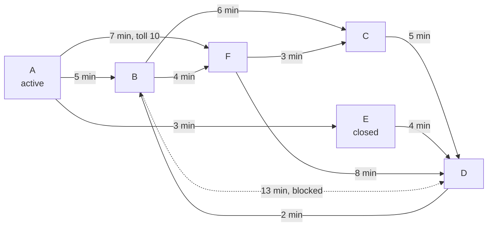

# Filtering Nodes and Relationships During Path Finding in Cypher

In a Neo4j **property graph**, finding a path connecting two nodes does not necessarily solve the problem. That path might pass through a closed station, an unavailable link, a toll edge, or a restricted zone. To find paths that are **valid under business rules**, you must inspect properties of **nodes and relationships across the entire path**, sometimes applying predicates directly inside the traversal pattern to avoid expanding branches that are guaranteed to be invalid.

This lesson belongs to the **Paths and Graph Traversal** chapter of module `DATABASE_ENGINE_GRAPH_NEO4J`. It uses Cypher to filter paths across nodes, relationships, and combined predicates, fitting Neo4j, the Java Driver, Spring Data Neo4j, and graph query optimization. The focus is on the question **"which paths are permitted?"**, rather than merely counting hops or listing nodes.

After this lesson, you will be able to:

- Distinguish conditions on **start/end nodes**, **intermediate nodes**, **all nodes**, and **all relationships** in a path.
- Write `WHERE` expressions using `all`, `any`, `none`, `single`, `nodes(p)`, and `relationships(p)`.
- Filter per step and by **aggregated properties** (such as total minutes or total toll), while handling `null` values.
- Understand the difference between placing predicates **after matching a path** versus **inside a quantified path pattern** when supported by your Cypher version.
- Choose depth bounds, traversal direction, relationship types, and execution-plan checks to keep queries within reasonable cost.

## 1. Sample Graph: Which Routes Are Permitted?

Suppose a dispatch system has `:FilterDemoStop` stops. Each stop has an `active` property indicating whether it is operational. A `:FILTER_DEMO_ROAD` connection has the following properties:

| Property | Example Type | Meaning |
| --- | --- | --- |
| `enabled` | Boolean | Connection is currently enabled for use |
| `minutes` | Integer | Travel time for one leg |
| `toll` | Integer | Toll fee for the leg, in standard units |
| `code` on node | String | Stop code used to identify origin/destination |
| `zone` on node | String | Operating zone for regional filtering |

In these examples, **E is closed**, segment **B → D is blocked**, and segment **A → F has toll 10**. All other legs are enabled and toll-free.

### 1.1. Create Nodes

```cypher
UNWIND [
  {code: 'A', active: true,  zone: 'NORTH'},
  {code: 'B', active: true,  zone: 'NORTH'},
  {code: 'C', active: true,  zone: 'CENTER'},
  {code: 'D', active: true,  zone: 'SOUTH'},
  {code: 'E', active: false, zone: 'CENTER'},
  {code: 'F', active: true,  zone: 'CENTER'}
] AS item
MERGE (s:FilterDemoStop {code: item.code})
SET s.active = item.active,
    s.zone = item.zone;
```

### 1.2. Create Directed Relationships

```cypher
UNWIND [
  {source: 'A', target: 'B', minutes: 5,  enabled: true,  toll: 0},
  {source: 'B', target: 'C', minutes: 6,  enabled: true,  toll: 0},
  {source: 'C', target: 'D', minutes: 5,  enabled: true,  toll: 0},
  {source: 'A', target: 'E', minutes: 3,  enabled: true,  toll: 0},
  {source: 'E', target: 'D', minutes: 4,  enabled: true,  toll: 0},
  {source: 'A', target: 'F', minutes: 7,  enabled: true,  toll: 10},
  {source: 'F', target: 'D', minutes: 8,  enabled: true,  toll: 0},
  {source: 'B', target: 'D', minutes: 13, enabled: false, toll: 0},
  {source: 'B', target: 'F', minutes: 4,  enabled: true,  toll: 0},
  {source: 'F', target: 'C', minutes: 3,  enabled: true,  toll: 0},
  {source: 'D', target: 'B', minutes: 2,  enabled: true,  toll: 0}
] AS item
MATCH (a:FilterDemoStop {code: item.source})
MATCH (b:FilterDemoStop {code: item.target})
MERGE (a)-[r:FILTER_DEMO_ROAD]->(b)
SET r.minutes = item.minutes,
    r.enabled = item.enabled,
    r.toll = item.toll;
```

The `FilterDemoStop` label and `FILTER_DEMO_ROAD` type are used solely for this example to avoid colliding with other lesson data. `MERGE` reuses matched node/edge patterns on re-runs. In a real database, use a **unique constraint** on `FilterDemoStop.code` to prevent duplicate identifier nodes.



Our queries focus on **directed paths from A to D in 1–3 hops**. Without business filters applied, there are **6 paths**:

| Path | Hops | Total Minutes | Issue |
| --- | ---: | ---: | --- |
| A → E → D | 2 | 7 | Passes through closed node E |
| A → F → D | 2 | 15 | Edge A → F has toll 10 |
| A → B → D | 2 | 18 | Edge B → D is blocked |
| A → B → C → D | 3 | 16 | Valid, toll-free |
| A → B → F → D | 3 | 17 | Valid, toll-free |
| A → F → C → D | 3 | 15 | Edge A → F has toll 10 |

The edge `D → B` creates a cycle in the graph, but it **does not produce any additional A–D paths of length at most 3** in the queried direction.

## 2. Binding a Path Variable and Filtering with `WHERE`

To inspect **every element** of a path, first bind a variable `p`:

```cypher
MATCH p = (a:FilterDemoStop {code: 'A'})
          -[:FILTER_DEMO_ROAD*1..3]->
          (d:FilterDemoStop {code: 'D'})
RETURN [n IN nodes(p) | n.code] AS cac_diem,
       length(p) AS so_buoc
ORDER BY so_buoc;
```

In traditional variable-length syntax `*1..3`, each matched path has 1 to 3 relationships following **the arrow direction**. With the sample data, the query returns six rows; `nodes(p)` is the list of path nodes in traversal order, and `relationships(p)` is the list of path relationships also in traversal order.

A `WHERE` clause after `MATCH` can check:

- **Start/end points:** `a.active = true`, `d.active = true`.
- **All nodes:** `all(n IN nodes(p) WHERE n.active = true)`.
- **All relationships:** `all(r IN relationships(p) WHERE r.enabled = true)`.
- **Total path property:** `reduce(total = 0, r IN relationships(p) | total + r.minutes) <= 16`.

Key point: these predicates describe **valid paths in the output**. They do not guarantee by default that the engine expands only valid edges upfront; execution choices depend on how the query is written and on the query planner.

## 3. Filtering by Node Properties

### 3.1. Every Node on the Path Must Be Active

```cypher
MATCH p = (a:FilterDemoStop {code: 'A'})
          -[:FILTER_DEMO_ROAD*1..3]->
          (d:FilterDemoStop {code: 'D'})
WHERE all(n IN nodes(p) WHERE n.active = true)
RETURN [n IN nodes(p) | n.code] AS cac_diem,
       length(p) AS so_buoc
ORDER BY so_buoc;
```

`all(n IN nodes(p) WHERE ...)` returns `true` only when **every node** in the list satisfies the condition. Because E has `active = false`, path `A → E → D` is excluded. The remaining **five paths** still appear—including the path using blocked edge `B → D`—because the query only checked **nodes**.

### 3.2. Filtering Intermediate Nodes Only

If start and end nodes are checked separately, you can use **list slicing** to exclude the two endpoints from the list check:

```cypher
MATCH p = (a:FilterDemoStop {code: 'A'})
          -[:FILTER_DEMO_ROAD*1..3]->
          (d:FilterDemoStop {code: 'D'})
WHERE a.active = true
  AND d.active = true
  AND all(n IN nodes(p)[1..-1] WHERE n.active = true)
RETURN [n IN nodes(p) | n.code] AS cac_diem;
```

`nodes(p)[1..-1]` takes nodes from the second position up to **before the last node**, because the upper slice bound is exclusive. For path `A → B → C → D`, the intermediate list is `[B, C]`; for path `A → F → D`, it is `[F]`.

This is useful when origin and destination have special rules—for example, passengers may wait at origin/destination stations but cannot pass through intermediate stations under maintenance.

### 3.3. Filtering Nodes in Restricted Zones

```cypher
MATCH p = (a:FilterDemoStop {code: 'A'})
          -[:FILTER_DEMO_ROAD*1..3]->
          (d:FilterDemoStop {code: 'D'})
WHERE none(n IN nodes(p)[1..-1] WHERE n.code = 'E')
RETURN [n IN nodes(p) | n.code] AS cac_diem;
```

`none(... WHERE ...)` requires that **no** intermediate node has code E. The result excludes exactly `A → E → D`. In a real application, you can filter by `n.zone` or a hazard-zone flag rather than checking a single hardcoded code.

> Filtering nodes within a path does not automatically check **other** nodes not on that path. The scope of `nodes(p)` is strictly the sequence of nodes matched in that result.

## 4. Filtering by Relationship Properties

### 4.1. Every Edge Must Be Enabled

```cypher
MATCH p = (a:FilterDemoStop {code: 'A'})
          -[:FILTER_DEMO_ROAD*1..3]->
          (d:FilterDemoStop {code: 'D'})
WHERE all(r IN relationships(p) WHERE r.enabled = true)
RETURN [n IN nodes(p) | n.code] AS cac_diem
ORDER BY length(p);
```

Because `B → D` has `enabled = false`, path `A → B → D` is excluded, leaving **five paths**. This query does not yet exclude closed stop E because that is a **node** property, not a relationship property.

### 4.2. Filtering Paths Without Any Toll Edges

```cypher
MATCH p = (a:FilterDemoStop {code: 'A'})
          -[:FILTER_DEMO_ROAD*1..3]->
          (d:FilterDemoStop {code: 'D'})
WHERE none(r IN relationships(p) WHERE r.toll > 0)
RETURN [n IN nodes(p) | n.code] AS cac_diem;
```

Paths traversing `A → F` are excluded because it has `toll = 10`. At this stage, `A → E → D` (E closed) and `A → B → D` (edge blocked) can still appear: **toll-free** is different from **permitted for travel**.

### 4.3. Limiting Per-Leg Duration

```cypher
MATCH p = (a:FilterDemoStop {code: 'A'})
          -[:FILTER_DEMO_ROAD*1..3]->
          (d:FilterDemoStop {code: 'D'})
WHERE all(r IN relationships(p) WHERE r.minutes <= 8)
RETURN [n IN nodes(p) | n.code] AS cac_diem;
```

Path `A → B → D` is excluded because leg `B → D` takes **13 minutes**; the other five paths each have **every** leg at most 8 minutes. Although this example also happens to exclude blocked edge B → D, **the two conditions have different meanings**: `minutes <= 8` does not guarantee an edge is enabled.

**Key distinction:** filtering with `all(r ... r.minutes <= 8)` checks a **per-edge cap**; it differs from checking the **total duration of the path**.

## 5. Combining Conditions on Nodes and Relationships

A route is considered **currently usable** when **every node is active** and **every edge is enabled**:

```cypher
MATCH p = (a:FilterDemoStop {code: 'A'})
          -[:FILTER_DEMO_ROAD*1..3]->
          (d:FilterDemoStop {code: 'D'})
WHERE all(n IN nodes(p) WHERE n.active = true)
  AND all(r IN relationships(p) WHERE r.enabled = true)
RETURN [n IN nodes(p) | n.code] AS cac_diem,
       length(p) AS so_buoc
ORDER BY so_buoc;
```

The **four** remaining paths:

| Path | Hops | Total Minutes | Total Toll |
| --- | ---: | ---: | ---: |
| A → F → D | 2 | 15 | 10 |
| A → B → C → D | 3 | 16 | 0 |
| A → B → F → D | 3 | 17 | 0 |
| A → F → C → D | 3 | 15 | 10 |

If we also add the **toll-free** condition:

```cypher
MATCH p = (a:FilterDemoStop {code: 'A'})
          -[:FILTER_DEMO_ROAD*1..3]->
          (d:FilterDemoStop {code: 'D'})
WHERE all(n IN nodes(p) WHERE n.active = true)
  AND all(r IN relationships(p) WHERE r.enabled = true)
  AND none(r IN relationships(p) WHERE r.toll > 0)
RETURN [n IN nodes(p) | n.code] AS cac_diem
ORDER BY length(p);
```

Only **two paths** remain: `A → B → C → D` and `A → B → F → D`.

You can write an equivalent toll-free check using `all(r IN relationships(p) WHERE r.toll = 0)` **if the data guarantees that `toll` is never missing**. If `toll` can be `null`, evaluate both forms against clear data rules before using them in production logic.

## 6. `all`, `any`, `none`, `single`: Using the Right Logical Quantifier

Predicate functions operate on a **list** and a `WHERE` condition:

| Function | When Does It Return `true`? | Example |
| --- | --- | --- |
| `all(x IN list WHERE P(x))` | Every element satisfies P | Every stop is active |
| `any(x IN list WHERE P(x))` | At least one element satisfies P | Route passes through at least one CENTER-zone stop |
| `none(x IN list WHERE P(x))` | No element satisfies P | Route has no toll edges |
| `single(x IN list WHERE P(x))` | **Exactly one** element satisfies P | Route has exactly one toll edge |

Example finding paths with **at least one** toll edge after filtering active/enabled status:

```cypher
MATCH p = (a:FilterDemoStop {code: 'A'})
          -[:FILTER_DEMO_ROAD*1..3]->
          (d:FilterDemoStop {code: 'D'})
WHERE all(n IN nodes(p) WHERE n.active = true)
  AND all(r IN relationships(p) WHERE r.enabled = true)
  AND any(r IN relationships(p) WHERE r.toll > 0)
RETURN [n IN nodes(p) | n.code] AS cac_diem;
```

Result: `A → F → D` and `A → F → C → D`.

Replacing `any` with `single` on **this sample dataset** yields the same two paths, because each has only **one** toll edge (`A → F`). However, in another graph where a path has **two** toll edges, `any` accepts it whereas `single` rejects it.

### Note on Zero-Length Paths

When a path allows **0 hops**, `relationships(p)` is empty. Under quantifier semantics on an empty list:

- `all(... )` is `true` (no edge violates the condition).
- `none(... )` is `true` (no edge satisfies the forbidden condition).
- `any(... )` and `single(... )` are `false`.

Therefore, if business rules require **actually traversing at least one relationship**, use `*1..N` or add `length(p) >= 1`; checking `all(r IN relationships(p) WHERE r.enabled)` alone is not enough to exclude 0-hop paths.

## 7. Filtering Per Leg vs. Filtering Total Path Weight

The following questions are not equivalent:

- **Each leg at most 8 minutes:** `all(r IN relationships(p) WHERE r.minutes <= 8)`.
- **Total trip at most 16 minutes:** sum using `reduce` and then compare.

Given active nodes and enabled relationships, this query checks **total minutes**:

```cypher
MATCH p = (a:FilterDemoStop {code: 'A'})
          -[:FILTER_DEMO_ROAD*1..3]->
          (d:FilterDemoStop {code: 'D'})
WHERE all(n IN nodes(p) WHERE n.active = true)
  AND all(r IN relationships(p) WHERE r.enabled = true)
WITH p,
     reduce(total = 0, r IN relationships(p) | total + r.minutes) AS tong_phut
WHERE tong_phut <= 16
RETURN [n IN nodes(p) | n.code] AS cac_diem,
       length(p) AS so_buoc,
       tong_phut
ORDER BY tong_phut, so_buoc;
```

Result:

| Path | Hops | Total Minutes |
| --- | ---: | ---: |
| A → F → D | 2 | 15 |
| A → F → C → D | 3 | 15 |
| A → B → C → D | 3 | 16 |

`A → B → F → D` (17 minutes) fails the total cap, even though its individual legs take only 5, 4, and 8 minutes. The `reduce` expression runs over **the relationships of already-matched paths**. It computes the sum within the evaluated path scope; it is not automatically a graph-wide minimum-weight path-finding algorithm.

Similarly, you can compute **total toll**:

```cypher
MATCH p = (a:FilterDemoStop {code: 'A'})
          -[:FILTER_DEMO_ROAD*1..3]->
          (d:FilterDemoStop {code: 'D'})
WHERE all(n IN nodes(p) WHERE n.active = true)
  AND all(r IN relationships(p) WHERE r.enabled = true)
WITH p, reduce(cost = 0, r IN relationships(p) | cost + r.toll) AS tong_phi
WHERE tong_phi <= 0
RETURN [n IN nodes(p) | n.code] AS cac_diem, tong_phi;
```

Because every `toll` in this example is non-negative, `tong_phi <= 0` is equivalent to `tong_phi = 0` and returns the two toll-free paths. If a model allows negative tolls/discounts, **a total toll of 0 does not mean every leg is free**.

## 8. `null` Values and Missing Properties

Cypher uses three-valued logic: **true / false / null**. If a relationship lacks an `enabled` property, `r.enabled = true` evaluates to `null` rather than `false`. Likewise, `r.minutes <= 8` evaluates to `null` when `minutes` is missing.

For quantifier functions:

- `all(...)` returns `false` if any element definitely **violates** the condition; if none violate it but at least one evaluates to `null`, the result can be `null`.
- `any(...)` returns `true` if any element definitely **satisfies** the condition; if none return true and at least one evaluates to `null`, the result can be `null`.
- `none(...)` and `single(...)` can also return `null` when data is insufficient to determine the outcome.
- `WHERE` keeps only rows where the predicate evaluates to `true`; both `false` and `null` are filtered out.

If the business rule states that **missing information means traversal is not permitted**, express that intent explicitly with `coalesce`:

```cypher
MATCH p = (a:FilterDemoStop {code: 'A'})
          -[:FILTER_DEMO_ROAD*1..3]->
          (d:FilterDemoStop {code: 'D'})
WHERE all(n IN nodes(p) WHERE coalesce(n.active, false) = true)
  AND all(r IN relationships(p) WHERE coalesce(r.enabled, false) = true)
RETURN [n IN nodes(p) | n.code] AS cac_diem;
```

For those two Boolean properties, `coalesce(value, false)` turns `null` into `false`. Numeric fields need their own rules: you can exclude paths missing `minutes` via `all(r IN relationships(p) WHERE r.minutes IS NOT NULL)` before aggregating. Do not silently treat `minutes = null` as `0` when travel time has not been confirmed.

**Data modeling practice:** enforce required properties, default values, and data types at ingestion time. Filtering rules are much easier to maintain when node/edge states are represented consistently.

## 9. Filtering Inside the Query Pattern: Labels, Types, Direction, and Endpoints

`WHERE` is not the only way to filter. You can restrict the match scope directly in the path pattern:

```cypher
MATCH p = (a:FilterDemoStop {code: 'A', active: true})
          -[:FILTER_DEMO_ROAD*1..3]->
          (d:FilterDemoStop {code: 'D', active: true})
RETURN p;
```

This query matches paths whose **endpoints** are active, but not necessarily whose **intermediate nodes** are active. Specifically, it can still return `A → E → D`. Therefore, combine this with filtering `nodes(p)` when every intermediate stop must be valid.

| Pattern Constraint | Effect |
| --- | --- |
| `(a:FilterDemoStop {code:'A'})` | Anchors the starting node by label and code |
| `(d:FilterDemoStop {code:'D'})` | Anchors the target node |
| `-[:FILTER_DEMO_ROAD]->` | Traverses only a single edge of the specified type |
| `->` | Follows the stored relationship direction |
| `<-` | Traverses against the stored relationship direction |
| `-[:FILTER_DEMO_ROAD]-` | Traverses matching edges in either direction |
| `*1..3` | Bounds each path to 1 to 3 relationships |

In an authorization system, `:CAN_ACCESS` typically must be traversed in its defined direction; in a bidirectional physical network, an undirected pattern may be appropriate. Choose direction based on **domain semantics**. Omitting the arrowhead in `MATCH` does not change the relationship direction stored in the database.

## 10. Filtering Directly Inside a Quantified Path Pattern (Neo4j 5.9+)

In versions that **support quantified path patterns (QPP)**, you can place `WHERE` directly **inside the repeated pattern segment**. This clearly states the condition required in **each iteration**, rather than only filtering completed paths:

```cypher
// Neo4j 5.9+ with quantified path patterns support.
MATCH p = (a:FilterDemoStop {code: 'A'})
          ((u:FilterDemoStop)-[r:FILTER_DEMO_ROAD]->(v:FilterDemoStop)
            WHERE r.enabled = true AND v.active = true){1,3}
          (d:FilterDemoStop {code: 'D'})
WHERE a.active = true
RETURN [n IN nodes(p) | n.code] AS cac_diem,
       length(p) AS so_buoc
ORDER BY so_buoc;
```

In each iteration:

1. `r.enabled = true`: the leg's relationship is enabled.
2. `v.active = true`: the node reached after that leg is active.
3. `a.active = true` (outside QPP): validates the starting node, since it is not checked through variable `v` on the first step.

The query returns the **four usable paths** from Section 5. This is a clean way to express "do not pass through forbidden nodes/edges." With QPP, the query planner **has the opportunity** to leverage per-iteration predicates to prune invalid branches early, though actual cost still depends on the version and execution plan.

### QPP Limitations and Syntax Selection

- `((u)-[r:TYPE]->(v) WHERE ...){1,3}` is **QPP**, requiring a supporting Cypher version (Neo4j 5.9 or later).
- `-[:TYPE*1..3]->` is the traditional **variable-length relationship pattern**, suited when compatibility with versions lacking QPP support is needed.
- Inside QPP, variables declared **inside** the repeated segment can become **group variables** when referenced outside the segment; do not assume `r` or `v` refers to a single element outside the QPP.
- If you only need to repeat a single edge with no inline pattern predicates, supporting versions also provide **quantified relationship** syntax `-[:TYPE]->{1,3}`.
- A tight business-driven upper bound limits the path combinations to evaluate; an unbounded pattern can generate huge numbers of paths on large graphs.

## 11. Post-Filtering Paths vs. Finding the Shortest Valid Path

Suppose you need **the fewest hops while avoiding closed stops and blocked edges**. On the sample graph:

- Paths with the fewest hops regardless of status are `A → E → D`, `A → B → D`, and `A → F → D` (all 2 hops).
- Among active/enabled paths, `A → F → D` is a valid **2-hop** path.
- If **toll-free** is also required, the valid paths become `A → B → C → D` and `A → B → F → D`, both **3 hops** long.

If an application picks the shortest path **first** and checks node/edge status afterward, it can miss a **longer yet valid** route. Therefore, determine the **set of permitted paths** before optimizing hops or weights within that set.

The statement below is a simple example computing the minimum hop count within the known **1–3** range, applying filters before aggregating:

```cypher
MATCH p = (a:FilterDemoStop {code: 'A'})
          -[:FILTER_DEMO_ROAD*1..3]->
          (d:FilterDemoStop {code: 'D'})
WHERE all(n IN nodes(p) WHERE n.active = true)
  AND all(r IN relationships(p) WHERE r.enabled = true)
  AND none(r IN relationships(p) WHERE r.toll > 0)
RETURN min(length(p)) AS it_buoc_nhat_khong_phi;
```

The result is **3**. However, the query may still have to match multiple paths to aggregate them. On large graphs, consider conditional shortest-path mechanisms suited to your Cypher version or algorithms in Neo4j Graph Data Science; consult the documentation for how each tool supports filtering during path search.

**Weight distinction:** the path with the fewest hops is not guaranteed to have the lowest total `minutes` or `toll`. For optimizing total weight on large networks, algorithms such as Dijkstra with a clear weight model and validity filters are typically needed.

## 12. Optimizing and Operating Filtered Path Queries

A `WHERE` clause that produces the right **output** can still be expensive if the engine must expand many paths before evaluating it. Apply these principles:

1. **Anchor start/end nodes by label and key:** `(a:FilterDemoStop {code:$from})` narrows the starting point. An appropriate unique constraint or index helps locate nodes.
2. **Restrict relationship types and direction:** `-[:FILTER_DEMO_ROAD*1..3]->` is narrower than `-[*1..3]-` because it avoids traversing unrelated edge types and invalid directions.
3. **Place the depth upper bound directly in the pattern:** `*1..3` or `{1,3}`. A trailing `LIMIT 10` only limits returned rows, **not traversal depth to 10 hops**.
4. **Push local conditions into supported pattern syntax when appropriate:** such as QPP inline predicates for each leg's status and next node.
5. **Distinguish per-element filters from whole-path totals:** `all(r ... r.minutes <= 8)` constrains each leg individually; `reduce(...) <= 16` must evaluate the sum across multiple legs.
6. **Inspect intermediate counts with `EXPLAIN` and `PROFILE`:** watch row counts at expand steps, query cost, filter predicates, index usage, and data volume.
7. **Validate API inputs:** pass `$from`, `$to`, and `$maxLegMinutes` as Cypher parameters, and validate allowed depth values in application code. Traditional `*1..3` bounds must be written as literals in the pattern, not directly as `*1..$depth`.

Example parameterizing properties in the Java Driver or a backend service:

```cypher
// Parameters: $from = 'A', $to = 'D', $maxLegMinutes = 8.
MATCH p = (a:FilterDemoStop {code: $from})
          -[:FILTER_DEMO_ROAD*1..3]->
          (d:FilterDemoStop {code: $to})
WHERE all(n IN nodes(p) WHERE coalesce(n.active, false) = true)
  AND all(r IN relationships(p) WHERE coalesce(r.enabled, false) = true)
  AND all(r IN relationships(p) WHERE r.minutes IS NOT NULL
                               AND r.minutes <= $maxLegMinutes)
RETURN [n IN nodes(p) | n.code] AS duong_di,
       [r IN relationships(p) | r.minutes] AS phut_tung_chang,
       length(p) AS so_buoc;
```

With the sample data and parameters above, the output contains the **four usable paths**: `A-F-D`, `A-B-C-D`, `A-B-F-D`, and `A-F-C-D`. Parameters for `code` and `minutes` do not alter query structure, avoiding any need to concatenate user input into query strings.

To inspect the plan without running the query:

```cypher
EXPLAIN
MATCH p = (a:FilterDemoStop {code: 'A'})
          -[:FILTER_DEMO_ROAD*1..3]->
          (d:FilterDemoStop {code: 'D'})
WHERE all(n IN nodes(p) WHERE n.active = true)
  AND all(r IN relationships(p) WHERE r.enabled = true)
RETURN length(p) AS so_buoc;
```

`PROFILE` executes the query and returns actual runtime statistics; use it once scope is controlled, and exercise caution with write queries. Large graphs with high branching, cycles, or many paths sharing endpoints can dramatically increase cost even when the final result set is small.

## 13. Practice Exercises with Answers

The exercises below use the `FilterDemoStop`/`FILTER_DEMO_ROAD` dataset from Section 1, considering directed paths from A → D up to three hops.

### Exercise 1. Filter Only Active Nodes

**Task:** use a single `WHERE all(...)` to exclude paths passing through closed stops.

```cypher
MATCH p = (a:FilterDemoStop {code: 'A'})
          -[:FILTER_DEMO_ROAD*1..3]->
          (d:FilterDemoStop {code: 'D'})
WHERE all(n IN nodes(p) WHERE n.active = true)
RETURN [n IN nodes(p) | n.code] AS duong_di;
```

**Answer:** there are **5 paths**; only `A-E-D` is excluded. `A-B-D` is still returned because nodes B and D are active, even though edge B → D is blocked.

### Exercise 2. Filter Only Enabled Relationships

**Task:** use `all(r IN relationships(p) WHERE r.enabled = true)`; predict which path is excluded.

**Answer:** there are **5 paths**; only `A-B-D` is excluded. `A-E-D` can still appear because both edges along that path are enabled, even though E is closed.

### Exercise 3. Filter Nodes, Edges, and Tolls Together

**Task:** paths must pass only through active nodes, enabled relationships, and have no toll edges.

```cypher
MATCH p = (a:FilterDemoStop {code: 'A'})
          -[:FILTER_DEMO_ROAD*1..3]->
          (d:FilterDemoStop {code: 'D'})
WHERE all(n IN nodes(p) WHERE n.active = true)
  AND all(r IN relationships(p) WHERE r.enabled = true)
  AND none(r IN relationships(p) WHERE r.toll > 0)
RETURN [n IN nodes(p) | n.code] AS duong_di;
```

**Answer:** only `A-B-C-D` (16 minutes) and `A-B-F-D` (17 minutes) remain.

### Exercise 4. Cap Total Minutes at 16

**Task:** among paths with active nodes and enabled edges, return only those with total minutes ≤ 16.

```cypher
MATCH p = (a:FilterDemoStop {code: 'A'})
          -[:FILTER_DEMO_ROAD*1..3]->
          (d:FilterDemoStop {code: 'D'})
WHERE all(n IN nodes(p) WHERE n.active = true)
  AND all(r IN relationships(p) WHERE r.enabled = true)
WITH p, reduce(t = 0, r IN relationships(p) | t + r.minutes) AS tong_phut
WHERE tong_phut <= 16
RETURN [n IN nodes(p) | n.code] AS duong_di, tong_phut;
```

**Answer:** `A-F-D` (15), `A-F-C-D` (15), and `A-B-C-D` (16). Path `A-B-F-D` is excluded because it takes 17 minutes.

### Exercise 5. Write Per-Iteration Conditions Using QPP

**Task:** in Neo4j with QPP support, write a pattern traversing only enabled edges to active nodes within at most three hops.

```cypher
MATCH p = (a:FilterDemoStop {code: 'A'})
          ((u)-[r:FILTER_DEMO_ROAD]->(v)
             WHERE r.enabled = true AND v.active = true){1,3}
          (d:FilterDemoStop {code: 'D'})
WHERE a.active = true
RETURN [n IN nodes(p) | n.code] AS duong_di;
```

**Answer:** the output consists of the **four usable paths** listed in Section 5. Placing `WHERE` inside QPP applies the condition to each repeated leg; the start node condition is checked separately.

### Exercise 6. Handling Missing `enabled` Properties

**Task:** business rules state that a relationship **missing** `enabled` must **not be used**. Adjust the filter.

**Answer:** `all(r IN relationships(p) WHERE coalesce(r.enabled, false) = true)`. For `null`, `coalesce(..., false)` returns `false`, explicitly excluding the path.

## 14. Common Mistakes

| Mistake | Consequence | Fix |
| --- | --- | --- |
| Filtering only `a.active` and `d.active` | Still passes through closed intermediate nodes | Check `all(n IN nodes(p) WHERE ...)` |
| Filtering only edge `enabled` | Can still pass through closed nodes | Check both nodes and relationships |
| Using `any` instead of `all` | Only one element needs to match; others may be invalid | Use `all` when **every node/edge** must be valid |
| Using `none(r ... r.toll > 0)` when `toll` may be missing | Result can be `null` or misrepresent missing-data rules | Define missing-data policy and use `coalesce`/`IS NOT NULL` properly |
| Using a per-leg cap instead of a total-minute cap | Path total can be large even if each leg is small | Use `reduce` over `relationships(p)` |
| Using `LIMIT` instead of a depth bound | May evaluate many paths before taking a few rows | Bound hops directly inside the pattern |
| Filtering paths after picking an arbitrary shortest path | Can miss a longer but valid path | Apply validity rules within the appropriate path-selection process |
| Not restricting direction or relationship type | Query may traverse unrelated links | Specify `:TYPE` and `->` / `<-` explicitly |
| Assuming `WHERE all(...)` always pushes into expansion | Hard to predict actual performance | Inspect `EXPLAIN`/`PROFILE` and consider QPP inline predicates |

## 15. Key Takeaways

- A business-valid path typically requires simultaneous constraints on **nodes**, **relationships**, **traversal direction**, and **hop count**.
- `all(n IN nodes(p) WHERE ...)` checks every node; `all(r IN relationships(p) WHERE ...)` checks every relationship; `none(...)` rejects paths containing forbidden elements.
- `any` means **at least one**, and `single` means **exactly one**; neither replaces `all` when every leg must be valid.
- **Per-edge** filtering (`r.minutes <= 8`) differs from **whole-path** filtering (`reduce(...) <= 16`).
- `null` in Cypher must be handled according to business rules. For Boolean flags, `coalesce(..., false)` can represent a "missing status means do not traverse" policy.
- Legacy Cypher allows `MATCH p = ... -[:TYPE*1..N]-> ... WHERE ...`; from Neo4j 5.9, QPP can place `WHERE` inside the **repeated segment** to express per-iteration constraints.
- Bound depth directly in the pattern, anchor start/end nodes, choose the right direction and relationship types, and inspect execution plans before running on large graphs.
- When finding the **shortest or lowest-total-weight path**, determine the valid path set **before optimizing**.

A reliable path-finding query must answer two questions at once: **which points does the path connect?** and **does that path obey every usage rule?** Combining node, relationship, and weight filters in Cypher keeps results aligned with business semantics and manageable as the system scales.
