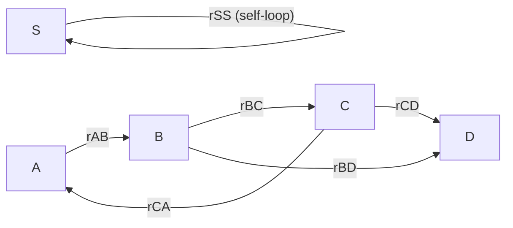

# Cycles, Repeated Relationships, and Path Matching Semantics by Neo4j/Cypher Version

In Neo4j, a **path** is a sequence of nodes connected by relationships. A graph can contain cycles, so a path-finding query may revisit an already visited node. However, **revisiting a node** does not mean **reusing the exact same relationship**. Cypher has specific rules governing how many times a node or relationship can appear in a single pattern match. Those rules can also change when you explicitly select a **match mode** and **path mode** in versions that support them.

This lesson belongs to the **Paths and Graph Traversal** chapter of module `DATABASE_ENGINE_GRAPH_NEO4J`, where Neo4j uses a **property graph** to store nodes, relationships, and properties and queries paths with Cypher. Understanding cycles and element uniqueness helps build queries for dependency analysis, connectivity networks, workflow loops, and system monitoring—while avoiding misinterpreting results when running queries from the Java Driver or Spring Data Neo4j.

**After this lesson**, you will be able to:

- Distinguish **walk**, **trail**, node-simple path, **cycle**, and **self-loop**.
- Explain why Cypher by default can revisit a node but cannot match the same relationship twice within one `MATCH` result.
- Handle multiple patterns inside **one `MATCH`** versus multiple separate `MATCH` clauses; understand the scope of relationship uniqueness checking.
- Use `REPEATABLE ELEMENTS` and `ACYCLIC` in the right Cypher/Neo4j versions, and distinguish `WALK`/`TRAIL` from **match mode**.
- Design sensible hop bounds to prevent path explosion in graphs with cycles.

## 1. Four Easily Confused Concepts

Assume arrows represent directed relationships. Different ways of traversing a graph have distinct meanings:

| Concept | Revisits Nodes? | Revisits Relationships? | Example |
| --- | --- | --- | --- |
| **Walk** (general route) | Allowed | Allowed | A → B → C → A → B |
| **Trail** (edge-simple route) | Allowed | **No** | A → B → C → A |
| **Node-simple / acyclic path** | **No** | No | A → B → C → D |
| **Closed cycle** | Start node = end node | May avoid repeating edges | A → B → C → A |

The graph-theory terms above describe **the kind of route**. In Cypher, actual results also depend on the **pattern-matching semantics** selected.

For example, **A → B → C → A** is a three-edge cycle: node A appears twice, but the three relationships are three distinct edges. It can still be matched by default `MATCH`. Conversely, **A → B → C → A → B** must reuse relationship A → B; that is a walk with a repeated relationship and is disallowed by default rules.

A **self-loop** is a relationship connecting a node to itself, such as `(X)-[:LINK]->(X)`. A path with a self-loop has `length(p) = 1` and `nodes(p) = [X, X]`: the node repeats, while the relationship appears only once. Do not confuse this with a **zero-hop path**, where `length(p) = 0` and there are no relationships at all.

> In graph theory, a **simple cycle** may allow the start node to equal the end node as long as internal nodes do not repeat. By contrast, `ACYCLIC` mode in Cypher 25 is stricter: it forbids **any** repeated node within a path, even when the start node is the end node of a cycle.

## 2. Creating a Sample Graph for Verification

This exercise uses a dedicated label `CycleDemoNode` and edge type `CYCLE_DEMO_LINK` to avoid colliding with data from other Neo4j lessons in the same database. There are five nodes (A, B, C, D, S), a cycle A → B → C → A, two paths to D, plus an independent node S with a self-loop.

### 2.1. Create Nodes

```cypher
UNWIND ['A', 'B', 'C', 'D', 'S'] AS code
MERGE (n:CycleDemoNode {code: code});
```

### 2.2. Create Relationships

```cypher
UNWIND [
  {source: 'A', target: 'B', edgeCode: 'rAB'},
  {source: 'B', target: 'C', edgeCode: 'rBC'},
  {source: 'C', target: 'A', edgeCode: 'rCA'},
  {source: 'B', target: 'D', edgeCode: 'rBD'},
  {source: 'C', target: 'D', edgeCode: 'rCD'},
  {source: 'S', target: 'S', edgeCode: 'rSS'}
] AS item
MATCH (from:CycleDemoNode {code: item.source})
MATCH (to:CycleDemoNode {code: item.target})
MERGE (from)-[r:CYCLE_DEMO_LINK]->(to)
SET r.edgeCode = item.edgeCode;
```

Here `rAB`, `rBC`, etc. are illustrative codes so you can see which edge is reused. Each relationship has its **own identity**, distinct from its start/end nodes and relationship type. In a real database, multiple parallel relationships may exist between the same two nodes; those relationships are still **separate edges**. The example above assumes no `CycleDemoNode` nodes have duplicate `code` values; in production, enforce a unique constraint on the identifier key.



Key paths:

| Node Sequence | Edges in Order | Notes |
| --- | --- | --- |
| A → B | [rAB] | One step, no repeats |
| A → B → C | [rAB, rBC] | Two steps, no repeats |
| A → B → D | [rAB, rBD] | Two steps to D |
| A → B → C → D | [rAB, rBC, rCD] | Three steps to D |
| A → B → C → A | [rAB, rBC, rCA] | Cycle, repeats node A but **no repeated edge** |
| A → B → C → A → B | [rAB, rBC, rCA, rAB] | Walk that must **reuse rAB** |
| S → S | [rSS] | One-edge self-loop |

## 3. Default Rule: Relationships Do Not Repeat Within One `MATCH` Result

By default, Cypher applies **relationship uniqueness** semantics: within a single match of a graph pattern in the **same `MATCH`**, **the same relationship cannot be used twice**, regardless of whether you traverse it forward or backward. This rule also applies when a graph pattern contains multiple comma-separated path patterns. **Nodes are not subject to the same uniqueness constraint.**

This is the foundational rule of **Cypher 5** and remains the default behavior in **Cypher 25**. In Cypher 25, this match mode is named **`DIFFERENT RELATIONSHIPS`** (which can be written explicitly starting in Neo4j 2025.06); omitting the keyword still gives this default behavior.

### 3.1. Cycle A → B → C → A Still Matches

```cypher
MATCH p = (a:CycleDemoNode {code: 'A'})
          -[:CYCLE_DEMO_LINK*3]->
          (finish:CycleDemoNode {code: 'A'})
RETURN [n IN nodes(p) | n.code] AS cac_node,
       [r IN relationships(p) | r.edgeCode] AS cac_canh,
       length(p) AS so_buoc;
```

Result:

| `cac_node` | `cac_canh` | `so_buoc` |
| --- | --- | ---: |
| [A, B, C, A] | [rAB, rBC, rCA] | 3 |

Node A appears at the start and end, yet `rAB`, `rBC`, and `rCA` are all distinct, so the path is accepted.

### 3.2. Taking One More Step A → B Again Is Excluded

```cypher
MATCH p = (a:CycleDemoNode {code: 'A'})
          -[:CYCLE_DEMO_LINK*4]->
          (b:CycleDemoNode {code: 'B'})
RETURN [n IN nodes(p) | n.code] AS cac_node,
       [r IN relationships(p) | r.edgeCode] AS cac_canh;
```

**No results.** The four-step route A → B → C → A → B must traverse `rAB` **twice**; that is why it is excluded by default. There is no other valid four-step route from A to B in the sample graph.

**Do not mistakenly conclude** that the graph lacks a physical route A–B–C–A–B. It exists as a **walk**; it is just that default `MATCH` semantics do not permit reusing an edge.

### 3.3. Inspecting Repeated Nodes and Edges

```cypher
MATCH p = (a:CycleDemoNode {code: 'A'})
          -[:CYCLE_DEMO_LINK*1..3]->
          (finish:CycleDemoNode)
RETURN [n IN nodes(p) | n.code] AS node_theo_thu_tu,
       [r IN relationships(p) | r.edgeCode] AS canh_theo_thu_tu,
       length(p) AS so_buoc
ORDER BY so_buoc, node_theo_thu_tu;
```

The results include path A → B → C → A (length 3) **even though A repeats**; no paths of length 4 or more appear because the upper bound is 3. Inspecting `nodes(p)` and `relationships(p)` reveals exactly which elements reappear on each path; `length(p)` counts relationships only, not distinct nodes.

## 4. Uniqueness Scope: One `MATCH` vs. Multiple `MATCH` Clauses

An important detail is that **relationship uniqueness is enforced within one match of a single graph pattern belonging to one `MATCH`**. Two comma-separated patterns **inside one `MATCH`** share the same constraint, whereas **two consecutive `MATCH` clauses** are two independent pattern matches and can reference the same matched relationship.

### 4.1. Two Patterns in the **Same** `MATCH`

```cypher
MATCH (a:CycleDemoNode {code: 'A'})-[r:CYCLE_DEMO_LINK]->(b:CycleDemoNode {code: 'B'}),
      (a)-[s:CYCLE_DEMO_LINK]->(b)
RETURN count(*) AS so_ket_qua;
```

The sample graph has only **one** A → B edge (`rAB`). Both patterns try to bind that edge to `r` and `s`, so the default query returns `so_ket_qua = 0`.

### 4.2. Two **Separate** `MATCH` Clauses Can Reuse the Edge

```cypher
MATCH (a:CycleDemoNode {code: 'A'})-[r:CYCLE_DEMO_LINK]->(b:CycleDemoNode {code: 'B'})
MATCH (a)-[s:CYCLE_DEMO_LINK]->(b)
RETURN r = s AS co_cung_relationship,
       r.edgeCode AS canh_thu_nhat,
       s.edgeCode AS canh_thu_hai;
```

Result: `co_cung_relationship = true`, and both codes are `rAB`.

These two `MATCH` clauses do **not** describe a path A → B → A; they produce two independent matches sharing the same endpoints. Splitting `MATCH` clauses solely to bypass the rule can alter business semantics. If you genuinely need a walk that can reuse relationships **within the same path**, use the dedicated match mode in supported versions.

## 5. Neo4j and Cypher Versions Determine Available Features

Starting in 2025, Neo4j uses `YYYY.MM` calendar versioning for the server. Neo4j 2025.06 introduced **Cypher 25** alongside **Cypher 5**. Distinguish **server version** from **the Cypher language version selected to execute a query**.

| Version / Language | Relevant Rules and Syntax |
| --- | --- |
| **Cypher 5** (on Neo4j 5.x or when explicitly running Cypher 5 on a newer server) | Default no-repeated-relationships within one `MATCH` result; uses legacy `-[:TYPE*1..N]->` and QPP if the Neo4j 5 version is recent enough |
| **Neo4j 5.9+** | Supports quantified path patterns and quantified relationships, e.g., `-[:TYPE]->{1,3}` |
| **Neo4j 2025.06+ with Cypher 25** | Adds explicit `DIFFERENT RELATIONSHIPS` keyword and `REPEATABLE ELEMENTS` match mode |
| **Neo4j 2026.03+ with Cypher 25** | Adds path modes `WALK`, `TRAIL`, `ACYCLIC` |
| **Default in supported versions** | Still enforces relationship uniqueness unless `REPEATABLE ELEMENTS` is explicitly chosen |

**Compatibility warning:** installing a newer server alone does not guarantee queries use the newer language. An environment may configure Cypher 5 as the default; new keywords like `REPEATABLE ELEMENTS` and `ACYCLIC` require **Cypher 25** and a qualifying server version.

Starting in Neo4j 2025.06, you can specify the language **per query** using a prefix:

```cypher
CYPHER 25
MATCH (n:CycleDemoNode {code: 'A'})
RETURN n.code;
```

Or explicitly select Cypher 5:

```cypher
CYPHER 5
MATCH (n:CycleDemoNode {code: 'A'})
RETURN n.code;
```

A database's default Cypher version can also be configured. When working via the Java Driver or Spring Data Neo4j, check which language the database defaults to and prepend `CYPHER 25` to statements that rely on newer features; **the driver cannot make unsupported server syntax valid**.

Official reference on version selection: [Select Cypher version – Neo4j Manual](https://neo4j.com/docs/cypher-manual/current/queries/select-version/).

## 6. `REPEATABLE ELEMENTS`: Allowing Relationship Reuse (Cypher 25)

The `REPEATABLE ELEMENTS` match mode was introduced in **Neo4j 2025.06, available only in Cypher 25**. When this mode is selected, relationships may appear **multiple times within the same `MATCH` result**, alongside nodes being able to repeat. This is the appropriate behavior when business logic needs to model general walks.

### 6.1. Query Permitted to Revisit Edge `rAB`

```cypher
CYPHER 25
MATCH REPEATABLE ELEMENTS p =
      (a:CycleDemoNode {code: 'A'})
      -[:CYCLE_DEMO_LINK]->{4}
      (b:CycleDemoNode {code: 'B'})
RETURN [n IN nodes(p) | n.code] AS cac_node,
       [r IN relationships(p) | r.edgeCode] AS cac_canh,
       length(p) AS so_buoc;
```

On the sample graph, this query returns:

| `cac_node` | `cac_canh` | `so_buoc` |
| --- | --- | ---: |
| [A, B, C, A, B] | [rAB, rBC, rCA, rAB] | 4 |

Compared to Section 3.2, the same node sequence becomes a valid result because the **match mode permits repeated relationships**. The `-[:CYCLE_DEMO_LINK]->{4}` part is a **quantified relationship**: repeating the relationship exactly four times, using syntax supported since Neo4j 5.9. The legacy `*4` form retains non-repeating edge semantics under default `MATCH`.

### 6.2. Traversing a Cycle Twice

```cypher
CYPHER 25
MATCH REPEATABLE ELEMENTS p =
      (start:CycleDemoNode {code: 'A'})
      -[:CYCLE_DEMO_LINK]->{3,6}
      (finish:CycleDemoNode {code: 'A'})
RETURN DISTINCT length(p) AS so_buoc
ORDER BY so_buoc;
```

Results: `so_buoc = 3` and `so_buoc = 6`:

- Three steps: `A → B → C → A`, traversing each edge of the cycle once.
- Six steps: `A → B → C → A → B → C → A`, traversing the cycle's three edges a second time.

Meanwhile, with the **default match mode**:

```cypher
MATCH p = (a:CycleDemoNode {code: 'A'})
          -[:CYCLE_DEMO_LINK*3..6]->
          (d:CycleDemoNode {code: 'A'})
RETURN DISTINCT length(p) AS so_buoc;
```

Only `so_buoc = 3` is returned. The six-step path must repeat edges and is excluded.

### 6.3. Finite Upper Bound Is Mandatory

When using `REPEATABLE ELEMENTS`, **every variable-length quantifier must have an upper bound**. For example, `{4}`, `{1,4}`, or `{,4}` are valid; unbounded forms such as `+`, `*`, or `{1,}` are disallowed.

Reason: if a graph has cycles and relationships can repeat without bound, infinitely many walks can exist, so enumerating all walks would never terminate. A finite upper bound keeps the result space finite on a finite graph, though it **does not guarantee a small number of paths**.

`REPEATABLE ELEMENTS` also allows the same relationship to be matched by **two path patterns inside the same `MATCH`**, unlike the default mode. Therefore, when using this mode, do not estimate result counts solely from the number of distinct nodes/edges in the graph.

## 7. `WALK`, `TRAIL`, and `ACYCLIC`: Cypher 25 Path Modes

Starting in **Neo4j 2026.03**, **Cypher 25** supports three **path modes**. A path mode is placed at the **beginning of a path pattern** and specifies uniqueness constraints **within that path**:

| Path Mode | Per-Path Rule |
| --- | --- |
| `WALK` | The path mode itself imposes no restriction on repeating nodes or relationships |
| `TRAIL` | Does not repeat relationships, though nodes may repeat |
| `ACYCLIC` | Does not repeat nodes within the path, and therefore does not repeat relationships either |

However, **path mode and match mode both take effect together**. Consequently, specifying `WALK` while the match mode remains `DIFFERENT RELATIONSHIPS` is **not** sufficient to repeat relationships. To actually allow edge reuse, select `REPEATABLE ELEMENTS` (optionally combined with `WALK` in supported versions).

| Match Mode | Path Mode | Effective Behavior |
| --- | --- | --- |
| `DIFFERENT RELATIONSHIPS` (default) | Omitted, or `TRAIL` | No repeated relationships; nodes may repeat |
| `DIFFERENT RELATIONSHIPS` | `WALK` | Still **no repeated relationships** due to match mode |
| `DIFFERENT RELATIONSHIPS` | `ACYCLIC` | No repeated nodes within each path |
| `REPEATABLE ELEMENTS` | Omitted, or `WALK` | Both nodes and relationships may repeat |
| `REPEATABLE ELEMENTS` | `TRAIL` or `ACYCLIC` | **Combination not supported** |

Path patterns within the **same `MATCH`** must use compatible path modes; to apply different modes, separate them into distinct `MATCH` clauses while re-evaluating the semantic meaning of the query.

### 7.1. `ACYCLIC` Excludes Cycle A → B → C → A

```cypher
CYPHER 25
MATCH p = ACYCLIC
      (a:CycleDemoNode {code: 'A'})
      -[:CYCLE_DEMO_LINK]->{3}
      (d:CycleDemoNode {code: 'A'})
RETURN [n IN nodes(p) | n.code] AS cac_node;
```

**No results**, because A appears again at the end of the path. Note that `ACYCLIC` goes **before the path pattern** (after `p =`) and requires **Neo4j 2026.03+ with Cypher 25**.

Conversely, if you want node-simple paths from A to D:

```cypher
CYPHER 25
MATCH p = ACYCLIC
      (a:CycleDemoNode {code: 'A'})
      -[:CYCLE_DEMO_LINK]->{1,4}
      (d:CycleDemoNode {code: 'D'})
RETURN [n IN nodes(p) | n.code] AS duong_di,
       length(p) AS so_buoc
ORDER BY so_buoc;
```

Results are `A → B → D` (2 steps) and `A → B → C → D` (3 steps), since neither repeats any node.

### 7.2. `TRAIL` Does Not Enable Edge Reuse

```cypher
CYPHER 25
MATCH p = TRAIL
      (a:CycleDemoNode {code: 'A'})
      -[:CYCLE_DEMO_LINK]->{4}
      (b:CycleDemoNode {code: 'B'})
RETURN p;
```

The query still returns **no results**: A → B → C → A → B must traverse `rAB` again. `TRAIL` enforces relationship uniqueness. Using `WALK` while keeping the default `DIFFERENT RELATIONSHIPS` match mode does not change this outcome either.

### 7.3. `REPEATABLE ELEMENTS` + `WALK`

```cypher
CYPHER 25
MATCH REPEATABLE ELEMENTS p = WALK
      (a:CycleDemoNode {code: 'A'})
      -[:CYCLE_DEMO_LINK]->{4}
      (b:CycleDemoNode {code: 'B'})
RETURN [r IN relationships(p) | r.edgeCode] AS cac_canh;
```

This query can return `[rAB, rBC, rCA, rAB]`. Both modes are now aligned: the match mode allows repeated edges and the `WALK` path mode imposes no further restriction. Since `WALK` is a **Neo4j 2026.03+** feature, on servers running 2025.06–2026.02 use `MATCH REPEATABLE ELEMENTS p = ...` **without `WALK`**.

## 8. What If You Need Node-Simple Paths in Cypher 5?

Before versions supporting `ACYCLIC`, you can apply a **post-match filter** to exclude paths with repeated nodes:

```cypher
MATCH p = (a:CycleDemoNode {code: 'A'})
          -[:CYCLE_DEMO_LINK*1..4]->
          (finish:CycleDemoNode)
WHERE all(n IN nodes(p)
          WHERE single(m IN nodes(p) WHERE m = n))
RETURN [n IN nodes(p) | n.code] AS duong_di,
       length(p) AS so_buoc
ORDER BY so_buoc, duong_di;
```

The expression `single(m IN nodes(p) WHERE m = n)` verifies that **each node appears exactly once in the path's node list**. On the sample graph, results include:

| `duong_di` | `so_buoc` |
| --- | ---: |
| [A, B] | 1 |
| [A, B, C] | 2 |
| [A, B, D] | 2 |
| [A, B, C, D] | 3 |

Path `[A, B, C, A]` is excluded because A appears twice. This filter guarantees **results have no repeated nodes**, though it does not necessarily prevent the engine from expanding paths with repeated nodes beforehand. It also compares nodes pairwise in the list, which can be costly for long paths. Once your server and language support `ACYCLIC`, prefer expressing intent directly via the path mode and compare costs with `EXPLAIN`/`PROFILE`.

**Note:** "no repeated nodes" is a **per-path** constraint; `DISTINCT end` only merges identical target nodes across rows and does **not** make nodes within each path unique.

## 9. Counting Results and Common Reasoning Pitfalls

### 9.1. `length(p)` Does Not Tell You the Number of Distinct Nodes

For the cycle `A → B → C → A`:

```cypher
MATCH p = (a:CycleDemoNode {code: 'A'})
          -[:CYCLE_DEMO_LINK*3]->
          (d:CycleDemoNode {code: 'A'})
RETURN length(p) AS so_canh,
       size(nodes(p)) AS so_luot_node,
       [n IN nodes(p) | n.code] AS cac_node;
```

The result has **3 edges, 4 node visits**, but only **3 distinct nodes**. If the business question asks for unique nodes, deduplicate or aggregate separately; `size(nodes(p))` does not do that automatically.

### 9.2. Path Count Differs from Target Node Count

```cypher
MATCH p = (a:CycleDemoNode {code: 'A'})
          -[:CYCLE_DEMO_LINK*1..3]->
          (d:CycleDemoNode {code: 'D'})
RETURN count(p) AS so_path,
       count(DISTINCT d) AS so_node_dich;
```

Result: `so_path = 2`, `so_node_dich = 1`. The two valid paths are `A → B → D` and `A → B → C → D`; both have **distinct edges within each path**, yet share target node D. `DISTINCT` only deduplicates node D in the output without changing relationship traversal semantics.

### 9.3. Traversal Direction Does Not Change Edge Identity

With an arrowless pattern `(a)-[:CYCLE_DEMO_LINK]-(b)`, Cypher can match relationships in either direction. A relationship `rAB` remains **a single edge**, even if you traverse from A to B and then try to go back from B to A. `DIFFERENT RELATIONSHIPS` does not let you reuse `rAB` simply because the traversal direction reversed.

With `REPEATABLE ELEMENTS`, the same edge can appear multiple times; however, set a depth bound and ensure the domain genuinely permits reverse traversal. Direction (`->`, `<-`, or arrowless) is a **separate constraint** from relationship uniqueness.

### 9.4. Self-Loops and Zero-Hop Paths

```cypher
MATCH p = (s:CycleDemoNode {code: 'S'})
          -[:CYCLE_DEMO_LINK]->
          (finish:CycleDemoNode {code: 'S'})
RETURN [n IN nodes(p) | n.code] AS cac_node,
       [r IN relationships(p) | r.edgeCode] AS cac_canh,
       length(p) AS so_buoc;
```

Result: `[S,S]`, `[rSS]`, `1`; a self-loop **does not violate** relationship uniqueness because edge `rSS` appears only once. By contrast, with `*0..1`, path `[S]` can appear at length 0 and contains no edges. Only the length-1 path actually traverses the self-loop.

In `ACYCLIC` mode, path `[S,S]` is excluded because node S repeats, whereas zero-hop path `[S]` does not repeat any node and can be accepted if the quantifier allows 0 steps.

## 10. Performance Impact When Allowing Repetitions

A finite graph can have a huge number of **walks** when repeated relationships are allowed, especially in networks with cycles or high branching. With an average of b choices per step, the number of path sequences of depth d can grow rapidly with d (a simple intuition is roughly b to the power of d in a uniformly branching network). Actual path counts also depend on labels, edge types, direction, and filter predicates.

| Query Choice | Typical Benefit / Cost |
| --- | --- |
| `*1..3` or `->{1,3}` | Sets a clear domain bound, limiting expansion scope |
| Default `DIFFERENT RELATIONSHIPS` | Prevents edge reuse within a single `MATCH` result |
| `REPEATABLE ELEMENTS` | Expresses walks that may repeat edges; **combinations can be much larger** |
| `ACYCLIC` | Excludes paths revisiting nodes via path mode (when supported) |
| Post-match `WHERE` filter | Guarantees output correctness but may generate many intermediate paths before filtering |
| Anchor start/end, specify edge type and direction | Narrows scope and clarifies business meaning |
| `EXPLAIN` / `PROFILE` | Inspects query plan and path expansion statistics |

**Key rule:** a trailing `LIMIT 10` only caps output rows; it is not equivalent to bounding each path to **10 steps** and does not guarantee the engine avoids expensive expansion before emitting results. In particular, never use `REPEATABLE ELEMENTS` with an overly large bound supplied by user input.

When running graph queries via the Java Driver or Spring Data Neo4j:

1. Verify the server version and database Cypher language version.
2. Set a finite depth bound aligned with business rules.
3. Anchor start/end nodes using labels and properties backed by indexes/constraints.
4. Select only the necessary relationship types, traversal directions, and returned properties.
5. Apply resource timeouts and inspect `PROFILE` in an appropriate environment if result counts spike unexpectedly.

## 11. Practice Exercises with Answers

The following exercises use the exact `CycleDemoNode` and `CYCLE_DEMO_LINK` graph from Section 2.

### Exercise 1. Is a Cycle Valid by Default?

**Question:** compute the length of path A → B → C → A and explain why default Cypher can return it.

```cypher
MATCH p = (:CycleDemoNode {code: 'A'})
          -[:CYCLE_DEMO_LINK*3]->
          (:CycleDemoNode {code: 'A'})
RETURN [n IN nodes(p) | n.code] AS cac_node,
       [r IN relationships(p) | r.edgeCode] AS cac_canh,
       length(p) AS so_buoc;
```

**Answer:** `length(p) = 3`, node list is `[A,B,C,A]`; relationships `rAB`, `rBC`, and `rCA` are all distinct. The default rule forbids **repeated edges**, not **repeated nodes**.

### Exercise 2. Which Four-Step Walk Is Blocked?

**Question:** does A → B → C → A → B appear in a default `MATCH`? If not, why?

**Answer:** **No.** Relationship `rAB` would have to appear twice in the same path. `CYPHER 25 MATCH REPEATABLE ELEMENTS` with quantified relationship `->{4}` allows matching this walk starting in Neo4j 2025.06.

### Exercise 3. Comma-Separated `MATCH` vs. Two `MATCH` Clauses

**Question:** there is only one edge A → B. Can two patterns `(a)-[r]->(b), (a)-[s]->(b)` inside a single `MATCH` match the same edge by default?

**Answer:** **No**, due to uniqueness within a single graph pattern. If each pattern is placed in its own `MATCH`, both relationship variables can bind to the same `rAB`, but those are two separate pattern matches, not a two-leg path.

### Exercise 4. Which Configuration Actually Enables Edge Reuse?

**Question:** compare `MATCH p = WALK ...` and `MATCH REPEATABLE ELEMENTS p = WALK ...` on a sufficiently recent Cypher 25 version.

**Answer:** `WALK` is a **path mode**. While `MATCH` still uses the default `DIFFERENT RELATIONSHIPS`, relationships still cannot repeat. Only when `REPEATABLE ELEMENTS` is enabled can a walk reuse relationships. Explicit `WALK` requires Neo4j 2026.03+; `REPEATABLE ELEMENTS` has been available since Neo4j 2025.06 with Cypher 25.

### Exercise 5. Does `ACYCLIC` Match a Simple Cycle?

**Question:** run `MATCH p = ACYCLIC (A)-[:CYCLE_DEMO_LINK]->{3}(A)` on a sufficiently recent Cypher 25 version. What is the result?

**Answer:** No paths. `ACYCLIC` forbids any repeated node within the same path, including when the start node equals the end node. Requires Neo4j 2026.03+ and Cypher 25 to use this keyword.

### Exercise 6. Why Does `REPEATABLE ELEMENTS` Require an Upper Bound?

**Question:** explain why `->{1,5}` is allowed while `->+` is rejected when using `REPEATABLE ELEMENTS`.

**Answer:** if edges can repeat and cycles exist, path sequences could extend infinitely. A finite upper bound guarantees a finite length range for matching. Even so, a large bound can still generate huge result sets, so bounds must be controlled both in application logic and in the pattern.

### Exercise 7. How Many Paths Exist from A to D by Default?

**Question:** for depth 1–3, state the number of paths and the number of unique target nodes.

**Answer:** two paths: `A-B-D` (2 steps) and `A-B-C-D` (3 steps). Both end at D, so `count(p) = 2` and `count(DISTINCT d) = 1`. You do not need `REPEATABLE ELEMENTS` to find these two paths.

## 12. Query Design Decision Table

| Business Requirement | Appropriate Choice |
| --- | --- |
| Allow revisiting nodes without reusing edges | Default `MATCH`; optionally write `DIFFERENT RELATIONSHIPS` in Cypher 25 |
| Detect closed cycles | Constrain start and end to the same node identifier; use positive length bounds |
| Need walks that can revisit both nodes and edges | `REPEATABLE ELEMENTS` (Cypher 25, Neo4j 2025.06+), with a **finite upper bound** |
| Prevent any node from appearing twice in a path | `ACYCLIC` (Cypher 25, Neo4j 2026.03+) |
| Must stay compatible with Cypher 5 | Use default semantics and filter on `nodes(p)`/`relationships(p)` when stricter constraints are needed |
| Need only fewest-hop or lowest-total-weight path | Consider shortest-path operators or appropriate weighted algorithms; still specify path-matching mode clearly |

## 13. Further Reading and Compatibility Notes

- [Neo4j Cypher Manual – Match modes and path modes](https://neo4j.com/docs/cypher-manual/current/patterns/reference/match-modes-and-path-modes/): compatibility matrix for `DIFFERENT RELATIONSHIPS`, `REPEATABLE ELEMENTS`, `WALK`, `TRAIL`, and `ACYCLIC`.
- [Neo4j Cypher Manual – Paths with unique relationships](https://neo4j.com/docs/cypher-manual/current/patterns/unique-relationship-paths/): default semantics and non-repeating relationship examples.
- [Neo4j Cypher Manual – Paths with repeated nodes and relationships](https://neo4j.com/docs/cypher-manual/current/patterns/repeatable-node-and-relationship-paths/): `REPEATABLE ELEMENTS`.
- [Neo4j Cypher Manual – Acyclic paths](https://neo4j.com/docs/cypher-manual/current/patterns/acyclic-paths/): `ACYCLIC` in Cypher 25, from Neo4j 2026.03.
- [Neo4j Cypher Manual – Select Cypher version](https://neo4j.com/docs/cypher-manual/current/queries/select-version/): selecting `CYPHER 5` and `CYPHER 25`.

These links point to the official **current** documentation. When deploying against a fixed server version, consult the manual for **that exact version** to confirm which keywords and features are available. If an environment does not yet support `REPEATABLE ELEMENTS`/`ACYCLIC`, do not assume new syntax will succeed merely because this lesson demonstrates it.

## 14. Key Takeaways

- **Cycles** cause the start node to reappear; that **does not by itself violate** Cypher's default matching semantics.
- In default `MATCH`, **each relationship can be matched only once per result**; nodes may appear multiple times.
- **One `MATCH`** can contain multiple path patterns while sharing the same relationship uniqueness constraint. **Two independent `MATCH`** clauses can reference the same relationship because they are separate matches.
- `REPEATABLE ELEMENTS` allows repeating both nodes and relationships, available from **Neo4j 2025.06 / Cypher 25**, and **requires a finite upper bound**.
- `WALK`, `TRAIL`, and `ACYCLIC` are **path modes** available from **Neo4j 2026.03 / Cypher 25**. `WALK` alone does not override the default match mode; `ACYCLIC` blocks all repeated nodes.
- `length(p)` is the number of relationships traversed; `nodes(p)` and `relationships(p)` show the sequence of elements on the path. `DISTINCT` on target nodes does not prove paths are cycle-free.
- Bound **edge types**, **traversal direction**, and **maximum depth**, and verify the active Cypher language version before deploying on large graphs.

To accurately predict Neo4j path queries, answer three questions in order: **can nodes be revisited, can the same relationship be traversed again, and which rules does the active Cypher version enforce?** The exact same graph can produce different result sets when match mode or path mode changes; understanding that is foundational to writing accurate and safe path queries.
