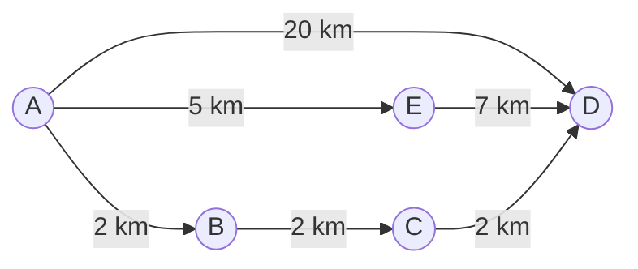

# Distinguishing Minimum-Hop Paths from Minimum-Total-Weight Paths

When querying paths in **Neo4j**, the word "shortest" is meaningful only when you specify **the unit of measurement**. A path traversing fewer relationships can have a longer physical distance, longer travel time, or higher cost than a path traversing more relationships. This is the core distinction between **minimum-hop shortest path** and **minimum-total-weight shortest path**.

This lesson belongs to the **Paths and Graph Traversal** topic in the **property graph** model: locations are nodes, connections are relationships, and weights reside in relationship properties. We will build a runnable Cypher example and then use the Neo4j Graph Data Science (GDS) library to find the minimum-total-weight path.

## 1. Two Different Optimization Problems

Consider a path `P = (v0, e1, v1, e2, ..., ek, vk)` from a source node to a target node:

- **Edge count**: `hops(P) = k`, which is the number of relationships on the path. Each edge is treated as having a "cost" of 1.
- **Total weight**: `cost(P) = w(e1) + w(e2) + ... + w(ek)`, where `w(e)` is a numeric edge property such as `km` (kilometers), `minutes`, or `fee` (currency units).
- **Minimum-hop path**: choose `P` that minimizes `hops(P)`.
- **Minimum-total-weight path**: choose `P` that minimizes `cost(P)`.

The two answers are **guaranteed to coincide only when all edges share the exact same positive weight**. If every edge has weight `c > 0`, then `cost(P) = c * hops(P)`; outside that condition, never infer that the fewest-hop path also has the lowest total weight.

| Criterion | Fewest Edges (Minimum Hops) | Lowest Total Weight |
| --- | --- | --- |
| Objective function | `min hops(P)` | `min cost(P)` |
| Interpretation | Fewest transfers, fewest intermediate relationships | Shortest in km, fastest in minutes, cheapest in fees, etc. |
| Required data | Topology: nodes and relationships | Topology **and** valid weights on relationships |
| Representative algorithm | BFS on an unweighted graph | Dijkstra with non-negative weights; or an algorithm suited to the weight model |
| In Neo4j | Cypher `ANY SHORTEST`, `shortestPath()` | GDS Dijkstra with `relationshipWeightProperty` |

> **Algorithm naming note:** Dijkstra is also commonly called "shortest path," but here path "length" is **total weight**, not edge count by default. The algorithm's objective must match the business objective.

## 2. Example: Three Routes from A to D

Suppose each `:ROAD` relationship is a **directed** route with a `km` property representing kilometers. The graph has the following connections:



| Path | Edges | Total `km` |
| --- | ---: | ---: |
| **A → D** | **1** | 20 |
| A → E → D | 2 | 12 |
| **A → B → C → D** | 3 | **6** |

Takeaways from the example:

- **The fewest-edge path** is `A → D`: just one edge, even though its total is 20 km.
- **The lowest-total-weight path** is `A → B → C → D`: three edges, yet only 6 km.
- `A → E → D` is an intermediate option: fewer edges than the km-optimal route, but longer in distance.

If the product requires "fewest transfers," picking by edge count is appropriate. If it requires "fewest kilometers," picking by edge count can produce the wrong result.

## 3. Building the Sample Data with Cypher

Run the following statements on a **test database**. The constraint ensures each `Station` node has a unique `id`, giving clear start and end points for queries.

```cypher
CREATE CONSTRAINT station_id_unique IF NOT EXISTS
FOR (s:Station)
REQUIRE s.id IS UNIQUE;
```

Next, create five nodes and six relationships. `MERGE` lets you re-run the example without unintentionally creating duplicate nodes or routes in the sample dataset.

```cypher
MERGE (a:Station {id: 'A'})
MERGE (b:Station {id: 'B'})
MERGE (c:Station {id: 'C'})
MERGE (d:Station {id: 'D'})
MERGE (e:Station {id: 'E'})
MERGE (a)-[ad:ROAD]->(d)
SET ad.km = 20
MERGE (a)-[ae:ROAD]->(e)
SET ae.km = 5
MERGE (e)-[ed:ROAD]->(d)
SET ed.km = 7
MERGE (a)-[ab:ROAD]->(b)
SET ab.km = 2
MERGE (b)-[bc:ROAD]->(c)
SET bc.km = 2
MERGE (c)-[cd:ROAD]->(d)
SET cd.km = 2;
```

Inspect the edges:

```cypher
MATCH (from:Station)-[r:ROAD]->(to:Station)
RETURN from.id AS fromId, to.id AS toId, r.km AS km
ORDER BY fromId, toId;
```

In this dataset, the direction from A to D follows the relationship direction. The pattern `(a)-[:ROAD]->(b)` **differs** from `(a)-[:ROAD]-(b)`: the second pattern allows traversing in both directions.

## 4. Finding the Fewest-Edge Path with Cypher

On Neo4j versions supporting shortest-path selector syntax (from Neo4j 5.21), `ANY SHORTEST` selects one path with the **fewest relationships** between two nodes:

```cypher
MATCH (start:Station {id: 'A'}), (finish:Station {id: 'D'})
MATCH p = ANY SHORTEST (start)-[:ROAD]->+(finish)
RETURN
  [n IN nodes(p) | n.id] AS route,
  length(p) AS hops,
  reduce(total = 0.0, r IN relationships(p) | total + r.km) AS totalKm;
```

Expected result:

```text
route       hops   totalKm
["A", "D"]   1      20.0
```

Component breakdown:

1. `(start)-[:ROAD]->+(finish)` traverses one or more `ROAD` edges along the arrow direction.
2. `ANY SHORTEST` finds one path with the fewest edges. If multiple paths tie for minimum edges, the chosen path is **not guaranteed** to have the lowest weight among them.
3. `length(p)` counts **relationships**, without summing `r.km`.
4. `reduce(...)` in `RETURN` only **sums km for the already-selected path**; it does not alter the search criterion of `ANY SHORTEST`.

In environments using traditional syntax, you can replace the `MATCH p` clause with:

```cypher
MATCH p = shortestPath((start)-[:ROAD*]->(finish))
```

`shortestPath()` and `allShortestPaths()` remain supported in Cypher, yet those functions also optimize by **edge count**, not by total weight property. If you need all tied minimum-edge paths, use `ALL SHORTEST` (or `allShortestPaths()` in legacy syntax); that still **does not** find the minimum-km path across the whole graph.

## 5. Finding the Minimum-Total-Weight Path with GDS Dijkstra

To optimize by `km`, use **Neo4j Graph Data Science (GDS)** with the Dijkstra algorithm. This section requires GDS to be installed and appropriate permissions granted on your running Neo4j environment.

### Step 1 — Project the Graph into GDS Memory

GDS runs algorithms on an **in-memory graph projection**; both the `ROAD` relationship and the `km` property must be included in the projection.

```cypher
CALL gds.graph.project(
  'station-roads',
  'Station',
  {
    ROAD: {
      orientation: 'NATURAL',
      properties: 'km'
    }
  }
)
YIELD graphName, nodeCount, relationshipCount
RETURN graphName, nodeCount, relationshipCount;
```

The sample graph has **5 nodes and 6 relationships**. `NATURAL` preserves edge directions from Neo4j. If the problem permits reverse travel, model the allowed directions properly or intentionally project as `UNDIRECTED`; do not make graphs undirected by default, as that breaks one-way road networks.

> The projection lives in GDS memory. Modifying `ROAD.km` in Neo4j **does not automatically update** an existing projection; recreate or update the projection before computing against new data.

### Step 2 — Run Dijkstra with the `km` Weight

```cypher
MATCH (start:Station {id: 'A'}), (finish:Station {id: 'D'})
CALL gds.shortestPath.dijkstra.stream('station-roads', {
  sourceNode: start,
  targetNodes: finish,
  relationshipWeightProperty: 'km'
})
YIELD totalCost, nodeIds, costs
RETURN
  [nodeId IN nodeIds | gds.util.asNode(nodeId).id] AS route,
  size(nodeIds) - 1 AS hops,
  totalCost AS totalKm,
  costs AS cumulativeKm;
```

Expected result:

```text
route                  hops   totalKm   cumulativeKm
["A", "B", "C", "D"]    3      6.0       [0.0, 2.0, 4.0, 6.0]
```

Here:

- `relationshipWeightProperty: 'km'` specifies the edge property used to compute cost.
- `totalCost` is the total weight of the optimal path; `costs` is the list of cumulative costs at each node.
- `nodeIds` represents the nodes on the path; `gds.util.asNode(nodeId).id` maps them into readable location IDs.
- `targetNodes` is the current GDS configuration key; the older `targetNode` parameter is deprecated.

Dijkstra solves minimum total weight when weights are **non-negative**; in this model all `km` values are positive. The weight property must be a valid number in a consistent unit. Omitting `relationshipWeightProperty` stops asking the algorithm to optimize by `km`.

### Step 3 — Drop the Projection When Done

```cypher
CALL gds.graph.drop('station-roads')
YIELD graphName
RETURN graphName;
```

This command drops the **in-memory GDS graph** named `station-roads`; it does not delete nodes or relationships in the Neo4j database.

## 6. Without GDS: Cross-Checking via Bounded Path Enumeration

For **small graphs**, Cypher can traverse paths up to four edges, sum weights manually, and rank them. This is a way to verify the example, **not** a general solution for finding optimal routes on large networks.

```cypher
MATCH (start:Station {id: 'A'}), (finish:Station {id: 'D'})
MATCH p = (start)-[:ROAD*1..4]->(finish)
WHERE all(r IN relationships(p) WHERE r.km IS NOT NULL AND r.km >= 0)
WITH p, reduce(total = 0.0, r IN relationships(p) | total + r.km) AS totalKm
RETURN
  [n IN nodes(p) | n.id] AS route,
  length(p) AS hops,
  totalKm
ORDER BY totalKm ASC, hops ASC
LIMIT 1;
```

On the sample data, this also yields `A → B → C → D` with `totalKm = 6`. However, if the optimal route needs **five or more edges**, the `*1..4` bound excludes it. Raising the bound arbitrarily can cause the number of evaluated paths to blow up rapidly, especially on branched graphs or graphs with cycles. Never place `ORDER BY totalKm LIMIT 1` after `ANY SHORTEST` to "turn" a minimum-hop algorithm into a weighted algorithm: Cypher would only sort **the paths already returned by the minimum-hop selector**.

## 7. Choosing the Right Solution for Business Requirements

| Real-World Question | Metric to Optimize | Approach |
| --- | --- | --- |
| Fewest intermediaries in a relationship network? | Relationship count | Cypher shortest path by edge count |
| Travel through the fewest transfer stations? | Leg count | Cypher shortest path by edge count |
| Shortest total road distance? | Total `km` | Dijkstra weighted by distance |
| Shortest total travel time? | Total `minutes` | Dijkstra weighted by time if time is additive and non-negative |
| Lowest total travel fee? | Total `fee` | Dijkstra by cost if per-edge fees are non-negative |
| Both few transfers and few km? | Multi-criteria | Define priority order or an explicit cost function before choosing an algorithm |

Be especially careful to distinguish **fewest edges** from **lowest cost** when consuming results in Java applications, the Neo4j Java Driver, or Spring Data Neo4j. Returning a field named `totalKm` from a Cypher query does not prove it optimized for `km`; always verify the algorithm and query configuration that produced the result.

### Common Mistakes

1. **Confusing `length(p)` with physical length.** `length(p)` counts relationships; actual distance must be read from properties and summed.
2. **Measuring cost after selecting a path by hops.** `reduce` in `RETURN` does not change how Cypher selects `p`.
3. **Forgetting edge direction.** A valid path in a directed graph might not exist in the reverse direction.
4. **Missing weights or mismatched units.** Every edge needs an appropriate numeric property (e.g., all in km); never sum km and minutes together.
5. **Using Dijkstra with negative weights.** Dijkstra is unsuitable for models with negative edge costs; revisit the model or choose an appropriate algorithm.
6. **Using a stale GDS projection.** Neo4j data changes after projection can leave algorithm outputs reflecting an outdated snapshot.
7. **Enumerating all paths on a large graph.** Unbounded traversal followed by cost sorting risks path explosion. Prefer dedicated algorithms and inspect query plans with `EXPLAIN` / `PROFILE`.

## 8. Self-Check

**Question 1.** If the weight of edge `A → D` changes from 20 km to 4 km and the projection is updated, what do the two problems return?

<details>
<summary>Answer hint</summary>

Both pick `A → D`: this route has both one edge and the lowest total weight (4 km). Agreeing on **this dataset** does not mean the two problems are equivalent in general.

</details>

**Question 2.** Why does placing `ORDER BY totalKm LIMIT 1` after `MATCH p = ANY SHORTEST ...` fail to find the 6 km route in the original example?

<details>
<summary>Answer hint</summary>

Because `ANY SHORTEST` returns only one path with the **minimum edge count** (`A → D`). `ORDER BY` has no 2- or 3-edge paths to compare against it. You must optimize by weight from the start, such as with GDS Dijkstra.

</details>

**Question 3.** In a system with one-way streets and `minutes` weights that vary by rush hour, what must you review before applying Dijkstra?

<details>
<summary>Answer hint</summary>

Preserve relationship directions, determine the snapshot time for `minutes`, ensure weights are non-negative and consistent, and refresh data/projections when values change. If an edge's cost depends on **the arrival time at that edge**, the problem may require time-dependent routing algorithms rather than simple static Dijkstra.

</details>

## Key Takeaways

- **Fewest edges:** optimizes `length(p)`; suited for step counts or transfer counts.
- **Minimum total weight:** optimizes `sum(weight)` across the entire path; suited for distance, duration, or cost.
- **Neo4j Cypher shortest path solves the fewest-edge problem by default.** When you need minimum total weight with non-negative weights, choose a weighted algorithm such as **GDS Dijkstra** and pass the right `relationshipWeightProperty`.

### References

- [Neo4j Cypher Manual — Shortest paths](https://neo4j.com/docs/cypher-manual/current/patterns/shortest-paths/)
- [Neo4j GDS — Dijkstra Source-Target Shortest Path](https://neo4j.com/docs/graph-data-science/current/algorithms/dijkstra-source-target/)
- [Neo4j GDS — Native projection](https://neo4j.com/docs/graph-data-science/current/management-ops/graph-creation/graph-project/)
