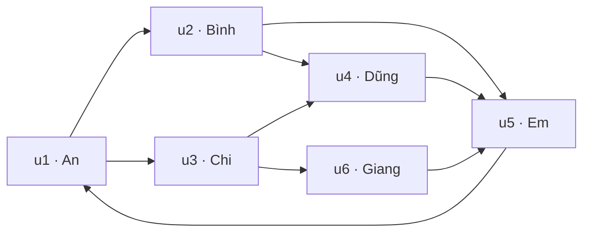

# Bounding Result Sets to Prevent Exponential Path Explosion

## 1. The Problem in Neo4j Graphs

In **Neo4j**, nodes and relationships form a **property graph** model. The **Cypher** language lets you find related nodes, traverse relationships, and query paths between entities. This underpins many use cases: finding connections between users, analyzing service dependency chains, tracing transactions, recommending content, and detecting risk.

However, a path query can generate a massive number of results even on a moderately sized graph. If each node has multiple outgoing branches on average and the query allows many steps (*hops*), the number of candidate paths can **grow exponentially**. When that happens, the query can take excessive time, consume large amounts of memory, and return far too many rows to the application.

This lesson belongs to the **Paths and Graph Traversal** chapter of module `DATABASE_ENGINE_GRAPH_NEO4J`. We will focus on **bounding depth and the candidate path space**, understanding the true role of `LIMIT`, choosing the right traversal style, and verifying performance with Neo4j tools. The examples are written in Cypher and apply equally when applications access Neo4j through the **Java Driver** or **Spring Data Neo4j**.

### After This Lesson, You Will Be Able To

- Explain why path counts grow rapidly as traversal depth increases.
- Distinguish **limiting output row count** from **bounding the search space**.
- Write Cypher queries that constrain hop count, node labels, relationship types, and direction.
- Choose between enumerating paths, finding target nodes, and finding a single shortest path.
- Read `EXPLAIN` / `PROFILE` to detect queries generating too many intermediate paths.

## 2. Why Can Path Counts Explode?

Suppose on average a node can continue to `b` other nodes. When traversing exactly `d` steps, the number of choice sequences can be approximated by:

\[
P(d) \approx b^d
\]

If you collect all paths of length 1 to `d`, the total number of choices in a uniformly branching tree model is:

\[
P(1..d) \approx b + b^2 + \cdots + b^d
\]

With `b = 10`, the potential paths at **step 5** is `10^5 = 100,000`; summing steps 1 through 5 gives `111,110`. In practice, actual counts depend on graph topology, relationship direction, overlap, and the rule against repeating relationships within a path. Even so, the formula accurately illustrates the risk: **adding one more hop can cause the search space to surge dramatically**.

| Max Hops | Paths at Final Hop if `b = 5` | Cumulative Total from 1 to Hop |
| ---: | ---: | ---: |
| 1 | 5 | 5 |
| 2 | 25 | 30 |
| 3 | 125 | 155 |
| 4 | 625 | 780 |
| 5 | 3,125 | 3,905 |
| 6 | 15,625 | 19,530 |

In particular, a single **target node can be reached by many different paths**. A query returning paths produces one row for each matched path, even when many rows terminate at the same node.

> Under Cypher's standard variable-length path matching, a relationship cannot be traversed twice within **the same** path; however, nodes can reappear when the graph has cycles. This rule does not eliminate rapid path growth, because many distinct sequences of relationships can still exist.

### Situations Prone to Explosion

1. Starting from too many nodes, such as `MATCH (n)` without filtering labels or identifiers.
2. Traversing relationships without restricting type or direction, e.g., `-[*1..6]-`.
3. Allowing a depth far larger than business requirements call for.
4. Enumerating every path when you only need to know **whether a connection exists** or **the shortest path**.
5. Calling `collect(p)`, `DISTINCT`, or `ORDER BY` over a huge set of paths before limiting the output.

## 3. Sample Dataset with Branching and Cycles

Suppose we model a user-following network. Nodes carry the label `TraversalUser`; the directed relationship `FOLLOWS` means the person on the left follows the person on the right. Using a dedicated label for practice data keeps the example independent of any existing application `User` nodes.



Create six nodes and nine relationships:

```cypher
UNWIND [
  {uid: 'u1', name: 'An'},
  {uid: 'u2', name: 'Bình'},
  {uid: 'u3', name: 'Chi'},
  {uid: 'u4', name: 'Dũng'},
  {uid: 'u5', name: 'Em'},
  {uid: 'u6', name: 'Giang'}
] AS item
MERGE (u:TraversalUser {uid: item.uid})
SET u.name = item.name;
```

```cypher
UNWIND [
  ['u1', 'u2'],
  ['u1', 'u3'],
  ['u2', 'u4'],
  ['u2', 'u5'],
  ['u3', 'u4'],
  ['u3', 'u6'],
  ['u4', 'u5'],
  ['u6', 'u5'],
  ['u5', 'u1']
] AS pair
MATCH (a:TraversalUser {uid: pair[0]})
MATCH (b:TraversalUser {uid: pair[1]})
MERGE (a)-[:FOLLOWS]->(b);
```

These two statements are suitable for trying on a practice database without duplicate identifier data. In production systems, add a unique constraint on `TraversalUser.uid` if it is a unique business identifier.

Consider specifically paths from An (`u1`) to Em (`u5`) of at most three hops:

```text
u1 -> u2 -> u5                   (2 hops)
u1 -> u2 -> u4 -> u5             (3 hops)
u1 -> u3 -> u4 -> u5             (3 hops)
u1 -> u3 -> u6 -> u5             (3 hops)
```

There are **four distinct paths** all ending at `u5`; only one of them is shortest. The query below returns all four:

```cypher
MATCH (s:TraversalUser {uid: 'u1'})
MATCH (t:TraversalUser {uid: 'u5'})
MATCH p = (s)-[:FOLLOWS*1..3]->(t)
RETURN [n IN nodes(p) | n.uid] AS duongDi,
       length(p) AS soHop
ORDER BY soHop;
```

`length(p)` counts relationships on the path; `nodes(p)` returns the list of nodes in path order. The list can be formatted as a string for UI display if needed.

## 4. The Most Important Strategy: Bounding Hop Count

### 4.1. Setting an Upper Bound on Variable-Length Paths

In Cypher variable-length relationship syntax, the pattern:

```cypher
MATCH p = (s)-[:FOLLOWS*1..3]->(t)
```

means find paths following `FOLLOWS` with length from **1 to 3 relationships**. Some variants:

| Pattern | Range |
| --- | --- |
| `-[:FOLLOWS]->` | Exactly 1 hop |
| `-[:FOLLOWS*1..2]->` | From 1 to 2 hops |
| `-[:FOLLOWS*2..4]->` | From 2 to 4 hops |
| `-[:FOLLOWS*..3]->` | From 1 to 3 hops |
| `-[:FOLLOWS*1..]->` | From 1 hop, **no explicit upper bound** |

**Prefer an explicit upper bound** aligned with business requirements—for example, use `*1..3` when finding "connections within at most three degrees." A `*1..10` query can be orders of magnitude larger; if users only need three degrees, ten degrees adds no commensurate value.

Example finding people reachable from An within at most two hops:

```cypher
MATCH (s:TraversalUser {uid: 'u1'})
MATCH p = (s)-[:FOLLOWS*1..2]->(t:TraversalUser)
RETURN [n IN nodes(p) | n.uid] AS duongDi,
       length(p) AS soHop
ORDER BY soHop;
```

Note: bounding hops **reduces the number of paths to evaluate**, but does not by itself guarantee a small output row count. A graph with thousands of branches on the very first hop can still produce many results even with `*1..2`.

### 4.2. Restricting Starting Points, Labels, Relationship Types, and Direction

Compare these two queries:

```cypher
// Very broad scope: many root nodes, all relationship types, both directions.
MATCH p = (s)-[*1..4]-(t)
RETURN p
LIMIT 20;
```

```cypher
// Narrow scope: one starting point, specific relationship type and direction.
MATCH (s:TraversalUser {uid: 'u1'})
MATCH p = (s)-[:FOLLOWS*1..3]->(t:TraversalUser)
RETURN t.uid AS nguoiDuocTheoDoi,
       length(p) AS soHop
LIMIT 20;
```

The second query directs the search far better because:

- The starting node is looked up by label `TraversalUser` and property `uid`.
- Only relationships of type `FOLLOWS` are traversed.
- Traversal goes **only along** the `FOLLOWS` direction.
- Depth does not exceed three hops.

With an index or unique constraint on `TraversalUser.uid`, locating the starting node can also be substantially cheaper. When only a specific set of starting points is needed, select that set before expanding paths.

**Note:** filtering the target node with `WHERE t.uid = ...` after building paths does not always prevent the planner from traversing intermediate paths. When both endpoints are known, anchor both in `MATCH` as shown in Section 3, and verify the plan with `EXPLAIN` / `PROFILE`.

## 5. Understanding `LIMIT`: Caps Returned Rows, Not Necessarily Traversal Work

`LIMIT` is essential to avoid sending millions of rows back:

```cypher
MATCH (s:TraversalUser {uid: 'u1'})
MATCH p = (s)-[:FOLLOWS*1..3]->(t:TraversalUser)
RETURN [n IN nodes(p) | n.uid] AS duongDi,
       length(p) AS soHop
LIMIT 10;
```

However, distinguish two questions:

1. **How many rows are returned to the application?** `LIMIT 10` caps the output at 10 rows.
2. **How many paths must Neo4j examine before answering?** This depends on the execution plan, operator order, filter predicates, sorting, and data. `LIMIT 10` **does not mean** the query only traverses at most ten paths.

Without `ORDER BY`, the ten rows picked have no guaranteed deterministic order. If you add `ORDER BY` to retrieve the "shortest among matched paths":

```cypher
MATCH (s:TraversalUser {uid: 'u1'})
MATCH p = (s)-[:FOLLOWS*1..4]->(t:TraversalUser)
RETURN t.uid AS dich,
       [n IN nodes(p) | n.uid] AS duongDi,
       length(p) AS soHop
ORDER BY soHop ASC
LIMIT 10;
```

then the output rows are ordered by hop count. Yet Neo4j may still need to generate and evaluate a large number of candidate paths **before picking the top 10**. This is not equivalent to a shortest-path algorithm for an endpoint pair.

### 5.1. `LIMIT` After `DISTINCT` or `collect()`

If the business logic only needs the list of reachable people, not individual paths:

```cypher
MATCH (s:TraversalUser {uid: 'u1'})
MATCH (s)-[:FOLLOWS*1..3]->(t:TraversalUser)
RETURN DISTINCT t.uid AS nguoiCoTheTiepCan
ORDER BY nguoiCoTheTiepCan
LIMIT 10;
```

`DISTINCT` eliminates duplicate target nodes in the output, yet by itself it **does not guarantee** reducing upstream path expansion work. Similarly, this pattern:

```cypher
MATCH (s:TraversalUser {uid: 'u1'})
MATCH p = (s)-[:FOLLOWS*1..4]->(t:TraversalUser)
WITH collect(p) AS tatCaDuongDi
RETURN tatCaDuongDi[0..10] AS muoiDuongDau;
```

must collect the entire list of paths before slicing ten elements. On large datasets, `collect(p)` can consume substantial memory; **never rely on list slicing as your primary defense** against path explosion.

### 5.2. Limiting the Starting Node Set Before Expansion

If a query scans many users, you can cap the **number of root nodes** first:

```cypher
MATCH (s:TraversalUser)
WITH s
ORDER BY s.uid
LIMIT 2
MATCH p = (s)-[:FOLLOWS*1..2]->(t:TraversalUser)
RETURN s.uid AS nguoiBatDau,
       t.uid AS nguoiKetThuc,
       length(p) AS soHop;
```

`WITH ... LIMIT 2` restricts the input to the expansion step to two nodes. This lowers the number of origins processed, but **each root node can still generate many paths**, so appropriate hop bounds and filters remain necessary.

### 5.3. Limiting Results per Root Node

When you need at most three paths **per user**, you can use a correlated subquery:

```cypher
MATCH (s:TraversalUser)
WITH s
ORDER BY s.uid
LIMIT 2
CALL {
  WITH s
  MATCH p = (s)-[:FOLLOWS*1..3]->(t:TraversalUser)
  RETURN p
  ORDER BY length(p)
  LIMIT 3
}
RETURN s.uid AS nguoiBatDau,
       [n IN nodes(p) | n.uid] AS duongDi,
       length(p) AS soHop;
```

The subquery runs in the context of each `s`, so `LIMIT 3` applies per starting point rather than across the combined result set. This is a way to **control output row count per group**. Even so, sorting by `length(p)` inside the subquery may still evaluate many paths before keeping the three shortest ones.

> When multiple paths have the same length, `ORDER BY length(p)` does not fully determine their relative order. If the product requires pagination or deterministic results, add a tie-breaking sort criterion capable of distinguishing paths.

## 6. Choosing the Right Query Type for the Business Question

Not every requirement needs all paths enumerated. Pinpointing the exact required output often yields far greater efficiency than merely adding `LIMIT`.

| Business Question | Required Output | Approach |
| --- | --- | --- |
| Who does An follow directly? | Nodes linked by 1 relationship | `(s)-[:FOLLOWS]->(t)` |
| Within three degrees, who is reachable? | Set of target nodes | Bound hops, use `DISTINCT t` when needed |
| Which paths exist within at most three degrees? | Individual paths | `MATCH p = ...*1..3` + appropriate constraints |
| What is the shortest path from An to Em? | One shortest path | `shortestPath(...)` with specific endpoints |
| Which path has the lowest total weight? | Weight-optimal path | Appropriate algorithm, such as Dijkstra in Graph Data Science if installed and configured |

### 6.1. When You Only Need One Shortest Path

In Cypher, `shortestPath()` finds one path with the **fewest relationships** between two nodes matching the pattern:

```cypher
MATCH (s:TraversalUser {uid: 'u1'})
MATCH (t:TraversalUser {uid: 'u5'})
MATCH p = shortestPath((s)-[:FOLLOWS*..5]->(t))
RETURN [n IN nodes(p) | n.uid] AS duongNganNhat,
       length(p) AS soHop;
```

On the sample data, the result is `u1 -> u2 -> u5`, **2 hops** long. The `*..5` bound prevents searching beyond five hops.

Do not replace this requirement with "enumerate all paths, sort by `length(p)`, then `LIMIT 1`" on large graphs. Those two approaches can have vastly different costs. With `shortestPath()`, if multiple equally short paths exist, the function returns **one** path; do not assume which tie is picked.

**Limitation to remember:** `shortestPath()` optimizes **hop count**, not total weight such as cost, time, or risk on relationships. Complex predicates across the entire path can also strongly affect the execution plan; evaluate with `PROFILE` on realistic data.

### 6.2. When You Only Need to Check Reachability

If the business logic only needs to answer "Can An reach Em within at most three hops?", you do not need to return each path as a row:

```cypher
MATCH (s:TraversalUser {uid: 'u1'})
MATCH (t:TraversalUser {uid: 'u5'})
RETURN EXISTS {
  MATCH (s)-[:FOLLOWS*1..3]->(t)
} AS coTheTiepCan;
```

`EXISTS { ... }` returns a Boolean. It expresses **existence checking** directly and avoids transferring path lists to the application. The three-hop upper bound remains essential to control the search scope.

### 6.3. When You Only Need Distinct Target Nodes

```cypher
MATCH (s:TraversalUser {uid: 'u1'})
MATCH (s)-[:FOLLOWS*1..2]->(t:TraversalUser)
RETURN DISTINCT t.uid AS nguoiKetThuc
ORDER BY nguoiKetThuc;
```

This pattern returns the **set of target nodes** instead of paths. It reduces transferred data, though `DISTINCT` does not bound traversal complexity; combine it with hop bounds.

## 7. Optional Extension: Configured Traversal with APOC

If the Neo4j environment has a compatible **APOC** version installed, the `apoc.path.expandConfig` procedure supports configuring traversal bounds, BFS strategy, and node-uniqueness rules:

```cypher
MATCH (s:TraversalUser {uid: 'u1'})
CALL apoc.path.expandConfig(s, {
  relationshipFilter: 'FOLLOWS>',
  minLevel: 1,
  maxLevel: 3,
  bfs: true,
  uniqueness: 'NODE_PATH',
  limit: 20
}) YIELD path
RETURN [n IN nodes(path) | n.uid] AS duongDi,
       length(path) AS soHop;
```

Key options:

- `relationshipFilter: 'FOLLOWS>'`: follow only outgoing `FOLLOWS` relationships.
- `minLevel: 1` and `maxLevel: 3`: find paths from one to three hops long.
- `bfs: true`: expand using *breadth-first search*.
- `uniqueness: 'NODE_PATH'`: do not reuse the same node within a path; this differs from only enforcing relationship uniqueness.
- `limit: 20`: caps the number of paths yielded by the procedure.

**Semantic distinction:** changing the `uniqueness` rule can alter the **set of valid paths**, especially on cyclic graphs. The procedure's `limit` can allow stopping inside the expander rather than only slicing rows at the end of the query, though you should still test plans and behavior on real data. This is an **optional** utility, not standard Cypher syntax, and is unavailable unless APOC is installed and permitted.

## 8. Workflow for Diagnosing Path-Explosion Queries

### Step 1. Determine the Exact Output Needed

Ask whether the application needs **all paths**, just **one path**, **unique target nodes**, or merely a Boolean flag. Each output shape maps to a different query approach as shown in Section 6.

### Step 2. Place Search Bounds Directly in the Pattern

Specify concrete start and target nodes if available, declare node labels, relationship types and direction, and choose a business-driven maximum hop count. Example:

```cypher
MATCH (s:TraversalUser {uid: $startUid})
MATCH p = (s)-[:FOLLOWS*1..3]->(t:TraversalUser)
RETURN t.uid, length(p)
LIMIT $resultLimit;
```

The application can pass `$startUid` and `$resultLimit` as parameters. Alongside limiting output rows, the application should **govern allowed depth levels** per business rules rather than letting clients request arbitrary depths. For instance, `*1..3` is a fixed, controlled depth configuration.

### Step 3. Run `EXPLAIN` Then `PROFILE`

`EXPLAIN` displays the estimated plan **without executing the query**:

```cypher
EXPLAIN
MATCH (s:TraversalUser {uid: 'u1'})
MATCH p = (s)-[:FOLLOWS*1..3]->(t:TraversalUser)
RETURN t.uid, length(p)
LIMIT 10;
```

After confirming the query scope is safe, use `PROFILE` to execute and inspect metrics:

```cypher
PROFILE
MATCH (s:TraversalUser {uid: 'u1'})
MATCH p = (s)-[:FOLLOWS*1..3]->(t:TraversalUser)
RETURN t.uid, length(p)
LIMIT 10;
```

Watch these indicators and operators in the plan:

| Symptom | Practical Meaning |
| --- | --- |
| High `Rows` after a path expansion step | Many intermediate paths are being generated. |
| Sharply rising `DbHits` | The engine is reading many nodes, relationships, or index entries. |
| `Sort` or `Distinct` processing many rows | May consume CPU and memory before `LIMIT` takes effect. |
| Root-node lookup scanning broadly | Review labels, filter predicates, and indexes. |
| Adding one hop spikes runtime | Likely hitting branching-factor growth. |

Specific operator names can vary across Neo4j versions and planner versions. When measuring with `PROFILE`, use data representative of your real graph, since the six-node graph in this lesson only illustrates syntax.

### Step 4. Enforce Application-Layer Guardrails

In the Java Driver or Spring Data Neo4j, set sensible limits on depth, row count, and execution time per product requirements. Use query parameters for identifiers and row limits; avoid letting clients pass arbitrary Cypher. Safeguards such as **transaction timeouts**, performance monitoring, and canceling resource-heavy queries serve as an extra defense when users query large graphs.

Do not rely solely on timeouts to handle queries generating unnecessary paths: fix the traversal scope first, and use timeouts to catch anomalies.

## 9. Common Misconceptions

| Misconception | Reality | How to Handle |
| --- | --- | --- |
| `LIMIT 10` means at most 10 paths are traversed. | `LIMIT` caps rows after preceding operators; search work can be much greater. | Constrain hops, root nodes, types, and direction; inspect `PROFILE`. |
| `DISTINCT t` eliminates the cost of generating duplicate paths. | Duplicate targets are removed after pattern matching; upfront expansion is not guaranteed to shrink. | Traverse only to the required depth; consider existence queries. |
| `collect(p)[0..10]` saves memory. | The list is usually collected before slicing. | Avoid collecting full paths when unnecessary. |
| `ORDER BY length(p) LIMIT 1` is always as cheap as shortest path. | May evaluate a huge number of paths just to sort them. | Use `shortestPath()` when you only need one minimum-hop path. |
| Increasing hops from 3 to 4 costs only one small extra step. | Branching factors can cause work to grow exponentially. | Set bounds based on domain needs; measure on real data. |
| Filtering the target node alone is enough. | With many intermediate candidates, the query can still generate a massive number of paths. | Constrain starting point, relationship type/direction, and depth as well. |
| Without cycles, there is no risk of explosion. | Acyclic branching trees can still have `b^d` paths. | Bound depth and branching factors considered. |

## 10. Practice Exercises

### Exercise 1. Comparing Path Counts as Depth Increases

On the `TraversalUser` dataset, run both queries sequentially and compare counts:

```cypher
MATCH (s:TraversalUser {uid: 'u1'})
MATCH p = (s)-[:FOLLOWS*1..2]->(:TraversalUser)
RETURN count(p) AS soDuongDiToiDa2Hop;
```

```cypher
MATCH (s:TraversalUser {uid: 'u1'})
MATCH p = (s)-[:FOLLOWS*1..3]->(:TraversalUser)
RETURN count(p) AS soDuongDiToiDa3Hop;
```

`count(p)` returns a single number, yet Neo4j still has to match the paths fitting the pattern. Counting is therefore not free. Predict why the second query yields more paths.

### Exercise 2. Retrieving Only the Shortest Path Between Two Nodes

Write a query to find one shortest path from `u1` to `u5` along the `FOLLOWS` direction, not exceeding four hops.

<details>
<summary>Solution hint</summary>

```cypher
MATCH (s:TraversalUser {uid: 'u1'})
MATCH (t:TraversalUser {uid: 'u5'})
MATCH p = shortestPath((s)-[:FOLLOWS*..4]->(t))
RETURN [n IN nodes(p) | n.uid] AS duongDi,
       length(p) AS soHop;
```

Expected result: `['u1', 'u2', 'u5']` and `soHop = 2`.

</details>

### Exercise 3. Checking Reachability Without Returning Paths

Return `true`/`false` for the question "Can `u3` reach `u5` within at most two hops?"

<details>
<summary>Solution hint</summary>

```cypher
MATCH (s:TraversalUser {uid: 'u3'})
MATCH (t:TraversalUser {uid: 'u5'})
RETURN EXISTS {
  MATCH (s)-[:FOLLOWS*1..2]->(t)
} AS coTheTiepCan;
```

Expected result is `true`: there are two two-hop paths `u3 -> u4 -> u5` and `u3 -> u6 -> u5`.

</details>

### Exercise 4. Analyzing the Impact of `LIMIT`

Run `EXPLAIN` and then `PROFILE` on a path-listing query with `ORDER BY length(p) LIMIT 2`. Then narrow `*1..4` to `*1..2`. Compare `Rows` at the relationship expansion step and total `DbHits`. Answer for yourself: **what changes in traversal scope, and what changes only in the returned row count?**

Never run `PROFILE` for unbounded queries on large production graphs; `PROFILE` actually executes the query.

## 11. Key Takeaways

To prevent exponential path growth in Neo4j, **bound the search when constructing the query pattern**: anchor start/end nodes, specify labels and relationship types, choose direction, and set a maximum hop count. Use `LIMIT` to cap returned output size, not as a guarantee on traversal workload. When business logic only requires reachability or one shortest path, use purpose-built tools like `EXISTS { ... }` or `shortestPath()`. Finally, inspect plans with `EXPLAIN` and measure actual execution with `PROFILE` to confirm your bounds truly keep the query efficient.
