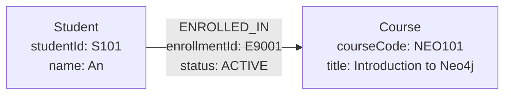

# The Role of Constraints in Protecting Graph Integrity

## 1. Why Does a Graph Database Need Constraints?

Neo4j stores data as a **property graph**: **nodes** represent entities, **relationships** represent directed connections between entities, and **properties** describe attributes of a node or relationship. This modeling approach is especially well suited for connected data such as users–courses, accounts–transactions, products–categories, or services–dependencies.

The flexibility of a property graph allows two nodes with the same label (`:User`) to have different sets of properties. That is convenient as a model evolves, but it also introduces risks: two users sharing the same identifier, a course missing its code, or an enrollment relationship containing a value of the wrong type. These issues can cause Cypher query results to be duplicated, lead applications to update the wrong record, or make reports unreliable.

A **data constraint** is a rule stored by Neo4j in the schema and checked whenever data changes. If a write operation violates an active constraint, the database rejects the operation. By placing rules at the storage layer, multiple applications writing to the graph must still adhere to a single consistent standard.

After this lesson, learners will be able to:

- Distinguish structural graph integrity from business data integrity.
- Explain when to use uniqueness, property existence, property type, node key, and relationship key constraints.
- Create, inspect, and manage constraints with Cypher, and understand why adding a constraint can fail on existing data.
- Recognize the rules that Neo4j constraints **do not automatically guarantee**, and allocate responsibility appropriately across transactions, Cypher queries, and the Java/Spring Data Neo4j application layer.

## 2. What Does Integrity in a Property Graph Include?

Suppose a learning system has two node types, `:Student` and `:Course`, connected by an `:ENROLLED_IN` relationship:



In this model, at least three layers of integrity need to be considered:

| Integrity Layer | Example | Appropriate Protection Mechanism |
| --- | --- | --- |
| **Graph structure** | A relationship is always attached to existing start and end nodes. | Neo4j's storage model itself: there are no "orphan" relationships pointing to a node that no longer exists. |
| **Properties and identity** | Each `Student` has a unique `studentId`, each `Course` has a `courseCode`, and the relationship's `status` has type `STRING`. | Schema constraints scoped to the corresponding node label or relationship type. |
| **Cross-entity business rules** | A student cannot enroll in the same course twice; only active students may enroll; an `ENROLLED_IN` relationship must connect a `Student` to a `Course`. | Conditional write queries, transactions, and/or business logic; some rules can be redesigned into constrained identifiers. |

Neo4j protects the structural validity of relationships: you cannot store a relationship without both endpoints. When deleting a node that still has relationships, a plain `DELETE` is rejected; `DETACH DELETE` deletes the attached relationships as well. However, **having two valid endpoints does not mean they are the right endpoint types from a business perspective**. Standard property constraints do not automatically enforce that `(:Student)-[:ENROLLED_IN]->(:Course)` is the only permitted connection pattern.

Let us distinguish three concepts that are often used interchangeably:

- A **constraint** decides what data is allowed to exist—for example, no two `:Student` nodes may carry the same `studentId`.
- An **index** helps locate data faster—for example, looking up students by name. A regular index does not forbid two students from sharing the same name. Certain uniqueness/key constraints are backed by an associated index in Neo4j.
- **Application validation** checks business requirements and produces user-friendly messages—for example, reporting that course enrollment is closed. Validation is useful, but it cannot replace database constraints when there are multiple write paths.

## 3. Core Constraints in Neo4j

The examples below use the schema syntax of **Neo4j 5.x and later**. Support for certain constraint types—especially property existence, property type, and keys—depends on the running version and edition; verify against the corresponding documentation before applying them. Each example illustrates a design choice and is not necessarily a script intended to be run sequentially.

### 3.1. Uniqueness: Preventing Duplicate Identifiers

A student's identifier must be unique among nodes carrying the `:Student` label:

```cypher
CREATE CONSTRAINT student_id_unique IF NOT EXISTS
FOR (s:Student)
REQUIRE s.studentId IS UNIQUE;
```

Once the constraint has been created, the following statements illustrate a violation:

```cypher
CREATE (:Student {studentId: 'S101', name: 'An'});

// Rejected if node S101 above already exists.
CREATE (:Student {studentId: 'S101', name: 'Bình'});
```

Common misconception: **uniqueness does not require the property to exist**. Without an additional constraint, multiple `:Student` nodes may *lack* `studentId`; a missing value (`null`) is not treated as a duplicate identifier to reject. Uniqueness also applies only to nodes with the `:Student` label, not automatically to every node in the database.

When an identifier consists of multiple components, a composite uniqueness constraint can be used:

```cypher
CREATE CONSTRAINT course_code_term_unique IF NOT EXISTS
FOR (c:Course)
REQUIRE (c.courseCode, c.term) IS UNIQUE;
```

This rule allows the same `courseCode` in different terms, while preventing two `:Course` nodes from duplicating **both** `courseCode` and `term` at the same time when those properties have values. It does not by itself require both properties to be present.

### 3.2. Property Existence: Requiring Mandatory Properties

To ensure every student has an identifier:

```cypher
CREATE CONSTRAINT student_id_required IF NOT EXISTS
FOR (s:Student)
REQUIRE s.studentId IS NOT NULL;
```

This constraint prevents creating or updating a `:Student` node into a state missing `studentId`. However, an empty string `''` is still **not** `null`: an existence constraint does not automatically validate the format, length, or meaning of the code. If `studentId` must match `S` followed by digits, that must be checked at input or business validation time.

Relationships can also have mandatory properties. For instance, an enrollment requires an `enrollmentId`:

```cypher
CREATE CONSTRAINT enrollment_id_required IF NOT EXISTS
FOR ()-[e:ENROLLED_IN]-()
REQUIRE e.enrollmentId IS NOT NULL;
```

This example applies to **all** relationships of type `ENROLLED_IN`, regardless of which nodes their endpoints connect to. That is another reason to model relationship types consistently.

### 3.3. Property Type: Blocking Wrong Value Types

If the data contract specifies that `studentId` is a string and a course's `credits` is an integer, you can define type constraints when supported by your version/edition:

```cypher
CREATE CONSTRAINT student_id_string IF NOT EXISTS
FOR (s:Student)
REQUIRE s.studentId IS :: STRING;

CREATE CONSTRAINT course_credits_integer IF NOT EXISTS
FOR (c:Course)
REQUIRE c.credits IS :: INTEGER;
```

A type constraint validates **the type of the stored value**. For example, it prevents storing `credits: '3'` instead of `credits: 3`. However, it does not ensure that credits fall within a valid range (such as 1 to 10), nor does it guarantee that the property is always present. To enforce both presence and type, combine the corresponding rules.

Note when sending data from the Java Driver: parameters with different Java types can be mapped to different Neo4j property types. Defining explicit types in the database helps detect data contract mismatches earlier.

### 3.4. Node Key: Both Unique and Mandatory Identity

When a business identifier must **always exist** and **never be duplicated**, a node key expresses both requirements together:

```cypher
CREATE CONSTRAINT student_id_key IF NOT EXISTS
FOR (s:Student)
REQUIRE s.studentId IS NODE KEY;
```

Semantically, `NODE KEY` combines property existence with uniqueness for nodes of the same label. Multi-property keys can represent composite identifiers, such as `(tenantId, studentId)` in a multi-tenant system:

```cypher
CREATE CONSTRAINT student_tenant_key IF NOT EXISTS
FOR (s:Student)
REQUIRE (s.tenantId, s.studentId) IS NODE KEY;
```

Here, every `(tenantId, studentId)` pair must have both components present and must not repeat across `:Student` nodes. If `studentId` must be unique **globally** rather than only within each tenant, this composite identifier does not satisfy that requirement; the key must be chosen according to the actual business rule.

The node key statements above are **alternatives** to the uniqueness/existence constraints shown earlier. You do not need to create all of them on the same label–property pair just to express the same rule.

### 3.5. Relationship Uniqueness/Key: Managing Relationship Identity

If each enrollment is identified by `enrollmentId`, you can place a uniqueness constraint on the relationship property when supported by your Neo4j version:

```cypher
CREATE CONSTRAINT enrollment_id_unique IF NOT EXISTS
FOR ()-[e:ENROLLED_IN]-()
REQUIRE e.enrollmentId IS UNIQUE;
```

In editions that support relationship keys, you can express that `enrollmentId` is both present and unique:

```cypher
CREATE CONSTRAINT enrollment_id_key IF NOT EXISTS
FOR ()-[e:ENROLLED_IN]-()
REQUIRE e.enrollmentId IS RELATIONSHIP KEY;
```

**Important distinction:** A unique `enrollmentId` **does not mean** Neo4j automatically forbids two different `ENROLLED_IN` relationships connecting the same `(Student, Course)` pair. If two relationships have different `enrollmentId` values, a uniqueness/key constraint on that property will not detect duplicate endpoints. To guarantee "each student enrolls in a given course at most once", you must design how enrollments are identified and control write operations appropriately, especially under concurrent transactions.

## 4. When Do Constraints Enforce Rules?

There are two critical moments:

1. **When creating the constraint:** Neo4j must verify that existing data satisfies the rule. If two `:Student` nodes already share the same `studentId`, creating the uniqueness constraint will fail. The constraint name only appears in the schema after creation succeeds.
2. **On subsequent writes:** `CREATE`, `MERGE`, `SET`, `REMOVE`, and related label/type changes must all produce a valid data state. A write that violates a constraint is rejected, and the containing transaction must be handled through the corresponding error/rollback mechanism.

For example, modifying an identifier can cause a conflict even without creating a new node:

```cypher
// Assume two students S101 and S102 already exist.
MATCH (s:Student {studentId: 'S102'})
SET s.studentId = 'S101';
// Rejected if a uniqueness/node key constraint on studentId is active.
```

Constraints therefore protect the **final committed state in the database**, not just data passing through one specific API. A Java application, an import job, and a manual Cypher operation are all bound by the same rules.

## 5. Real-World Scenario: Protecting Course Enrollment Data

Suppose a learning platform has these business requirements:

- Every student has a unique, mandatory `studentId`.
- Every course has a unique, mandatory `courseCode`.
- Every enrollment has a unique `enrollmentId`.
- Students may only enroll in courses that actually exist; the application must not silently create an "empty" course due to a typo in the code.

In a database that supports node keys and relationship keys, you might choose the following schema:

```cypher
CREATE CONSTRAINT student_id_key IF NOT EXISTS
FOR (s:Student)
REQUIRE s.studentId IS NODE KEY;

CREATE CONSTRAINT course_code_key IF NOT EXISTS
FOR (c:Course)
REQUIRE c.courseCode IS NODE KEY;

CREATE CONSTRAINT enrollment_id_key IF NOT EXISTS
FOR ()-[e:ENROLLED_IN]-()
REQUIRE e.enrollmentId IS RELATIONSHIP KEY;
```

If the edition does not support keys, evaluate combining uniqueness and existence constraints according to what that edition provides. Never assume that creating only a uniqueness constraint makes the property mandatory.

To perform an enrollment, you can start with a parameterized query:

```cypher
MATCH (s:Student {studentId: $studentId})
MATCH (c:Course {courseCode: $courseCode})
CREATE (s)-[e:ENROLLED_IN {
    enrollmentId: $enrollmentId,
    status: 'ACTIVE',
    enrolledAt: datetime()
}]->(c)
RETURN s.studentId AS studentId,
       c.courseCode AS courseCode,
       e.enrollmentId AS enrollmentId;
```

The two `MATCH` clauses create the relationship only if both the student and the course are found. If either is missing, the query returns 0 rows and creates no enrollment; **the application must check the 0-row case** to report "student/course not found". If `enrollmentId` is already in use, the relationship key will reject the new write.

However, the query above **does not prevent** a student from enrolling in the same course multiple times with different `enrollmentId` values. You can use `MERGE` on the endpoint pair to support idempotent retries:

```cypher
MATCH (s:Student {studentId: $studentId})
MATCH (c:Course {courseCode: $courseCode})
MERGE (s)-[e:ENROLLED_IN]->(c)
ON CREATE SET e.enrollmentId = $enrollmentId,
              e.enrolledAt = datetime(),
              e.status = 'ACTIVE'
RETURN e.enrollmentId AS enrollmentId;
```

`MERGE` is useful for finding or creating a relationship pattern under normal conditions; it **does not by itself turn "at most one relationship between two nodes" into a schema constraint under all concurrent workloads**. To protect this invariant against write contention, design a stable enrollment identity tied to the student–course pair (for example, an `:Enrollment` node with a composite key), or add appropriate synchronization and transactional checks matching your actual load. Choosing between `CREATE`, `MERGE`, or modeling `Enrollment` as a node depends on what an "enrollment" means: whether re-enrollment across multiple terms or keeping history is allowed.

### Modeling an Enrollment as a Node

When each student–course pair may have only one enrollment, one option is:


```cypher
CREATE CONSTRAINT enrollment_pair_key IF NOT EXISTS
FOR (e:Enrollment)
REQUIRE (e.studentId, e.courseCode) IS NODE KEY;
```

This key forbids two `Enrollment` **nodes** with the same identifier pair and requires both properties to be present. Even so, it does not automatically cross-check that `studentId` and `courseCode` on `Enrollment` match the `Student` and `Course` nodes at the ends of the relationships. You need a transaction to look up the right two nodes and create the relationships according to the business rules. If a student is allowed to re-enroll in the same course across multiple terms, the key should include a property distinguishing the enrollment period.

## 6. What Constraints Cannot Replace

Constraints are one part of data integrity design, not the entire business control system.

| Requirement | Directly Guaranteed by the Constraints Above? | What Else Is Needed |
| --- | --- | --- |
| No two `Student` nodes share the same declared `studentId` | **Yes** – uniqueness/node key. | Choose the right label scope and identifier key. |
| Every `Student` has a `studentId` | **Yes** – existence/node key, when supported. | Validate non-empty `studentId` or pattern at the business layer. |
| `credits` has an integer type | **Yes** – property type, when supported. | Validate valid value range, e.g., `1 <= credits <= 10`. |
| A relationship has two existing endpoints | **Yes** – Neo4j structural rule. | Validate labels and business permission to connect. |
| `ENROLLED_IN` only connects `Student` to `Course` | **No** via standard property constraints. | Write only through queries that check the right labels/endpoints and appropriate control layers. |
| A student cannot enroll twice in the same course | **No**, if only `enrollmentId` is constrained to be unique. | Model identity per pair or design concurrency-safe write workflows. |
| No cycles in dependency relationships | **No** via uniqueness/existence/type/key. | Validate paths and graph invariants in the business layer. |
| Only administrators may modify courses | **No**. | Role-based access control, authentication, and authorization checks. |

With the Java Driver or Spring Data Neo4j, two layers should be combined:

**In the application:** validate inputs, use Cypher parameters, handle missing-entity cases, execute related writes inside an appropriate transaction, and translate constraint errors into clear business responses.

**In Neo4j:** maintain constraints as the final line of defense, especially when multiple services, batch imports, migrations, or operators have write access. Java validation only protects paths going through that Java code; database constraints protect every write entering the same database.

## 7. Safely Applying Constraints to Existing Data

### Step 1: Audit Data Before Creating Constraints

Find students missing `studentId`:

```cypher
MATCH (s:Student)
WHERE s.studentId IS NULL
RETURN elementId(s) AS nodeId, s.name AS name
LIMIT 20;
```

Find duplicate student identifiers:

```cypher
MATCH (s:Student)
WHERE s.studentId IS NOT NULL
WITH s.studentId AS studentId,
     count(*) AS occurrences,
     collect(elementId(s)) AS nodeIds
WHERE occurrences > 1
RETURN studentId, occurrences, nodeIds
ORDER BY occurrences DESC
LIMIT 20;
```

`elementId()` in this inspection query is an internal identifier for observation, **not a durable business ID** to store in external systems. When duplicates are found, determine which node is the authoritative record, which relationships need to be redirected, and what history must be preserved before merging or deleting data.

### Step 2: Standardize and Fix Violating Data

For example: populate missing identifiers according to a verifiable rule; merge duplicate records after reviewing their relationships; convert the string `'3'` to the number `3` if it genuinely represents credit count; and fix the import rule that caused the bad data. Avoid assigning the same default code to all missing records, as doing so can introduce new duplicate errors.

### Step 3: Create the Constraint and Verify the Schema

Once the data is valid, run `CREATE CONSTRAINT` in a controlled migration process. You can view the current list with:

```cypher
SHOW CONSTRAINTS;
```

`IF NOT EXISTS` supports repeatable deployments, but it does not replace **verifying the exact name, type, label, and properties** of the actual constraint. In large systems, creating a constraint may scan existing data and consume resources; account for deployment duration and operational impact.

When a change is required, a constraint can be dropped by **name**:

```cypher
DROP CONSTRAINT student_id_unique IF EXISTS;
```

This is an administrative syntax example; drop a constraint only after confirming its impact. Dropping a constraint removes the corresponding guard for subsequent writes and may also drop the index created by the system to back that constraint.

### Step 4: Test Real Write Paths

Test at least the following cases: creating a valid record; creating a duplicate code; omitting a mandatory property; writing the wrong type; updating an existing record to a violating value; and two concurrent requests creating the same identifier. Run constraint-breaking tests against a staging/test database so examples do not pollute production with junk data.

## 8. Common Misconceptions

1. **"It's unique, so the ID must be present."** False: uniqueness and property existence are two distinct invariants; a node key expresses both in one constraint.
2. **"The constraint will automatically fix old bad data."** False: constraint creation only succeeds if existing data already complies. Clean up the data first.
3. **"`MERGE` always eliminates all duplicate relationships."** False: pattern modeling and transaction concurrency determine behavior; you must define the business identifier clearly.
4. **"If a relationship exists, it must connect the right two node types."** False: Neo4j guarantees that endpoints exist, but the property constraints introduced here do not validate endpoint business labels.
5. **"Having an index means the data is protected."** False: regular indexes serve lookups; only the corresponding constraints reject violating writes.
6. **"Catching errors in the UI is enough."** False: import jobs, admin tools, or other services can still write bad data; database constraints provide the shared safeguard.

## 9. Design Summary

When modeling in Neo4j, start from **business invariants**: which entities need distinct identities, which properties are mandatory, which data types must be consistent, and how a relationship is identified. From there, decide which invariants can be enforced directly with uniqueness, existence, property type, or key constraints, and which require transactions and business-layer checks.

A reliable graph system combines **a sound relationship model**, **properly scoped constraints**, **intentional Cypher queries**, and **operational procedures that audit data before schema changes**. Constraints keep foundational identifiers and attributes intact; the rest of the logic ensures the graph accurately represents the business domain the system manages.
