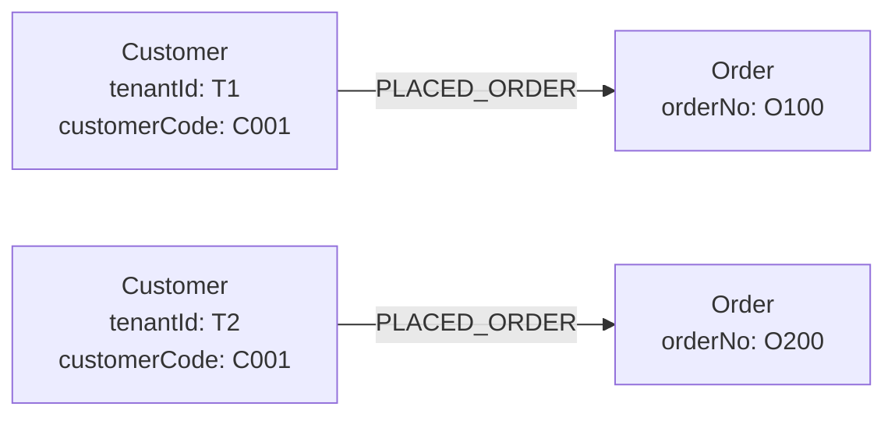

# Uniqueness Constraints on Node Business Keys

## 1. What Is a Business Key and Why Must It Be Unique?

In Neo4j, each **node** represents an entity and can carry one or more labels along with properties. A customer management system might store `(:Customer {customerCode: 'C001', name: 'An'})`; a learning platform might use `(:Student {studentId: 'S101'})`. `customerCode` and `studentId` are **business keys**: values that system processes use to identify an object according to domain conventions.

If two `:Customer` nodes both carry `customerCode: 'C001'` when business rules require customer codes to be unique, the following query cannot identify a single customer:

```cypher
MATCH (c:Customer {customerCode: 'C001'})
RETURN c;
```

Consequences can include updating multiple nodes by mistake, duplicating `:PLACED_ORDER` relationships, displaying duplicate customers, or linking an order to the wrong record. In a graph database, duplicate-node bugs are even more dangerous once many relationships are attached to each copy: fixing the data is no longer just editing a row attribute, but evaluating and reconciling all connected relationships.

A **node property uniqueness constraint** is Neo4j's mechanism to guarantee that nodes with a **specific label** cannot share the same declared key value. Neo4j enforces this rule when creating the constraint and on subsequent write operations. It acts as a database-level safeguard, applying across Cypher queries, the Java Driver, Spring Data Neo4j, import jobs, and any other write source accessing the database.

After this lesson, you will be able to:

- Choose the right business key and **uniqueness scope** for a node.
- Create uniqueness constraints on one or multiple properties using Cypher.
- Distinguish **uniqueness**, **mandatory existence**, and **node key** constraints.
- Use `MERGE` on constrained keys and avoid patterns that trigger unexpected conflicts.
- Detect duplicate data before migration, verify constraints after deployment, and handle write errors in the application.

## 2. Determine the Right Key Scope Before Writing Cypher

Suppose a multi-tenant sales system has `:Customer` nodes:



Both customers in the diagram share code `C001`, but they belong to **two different tenants**. Depending on the business rule, there are two choices:

| Rule | Identifying Key | Meaning |
| --- | --- | --- |
| Customer code is unique across the entire system | `customerCode` | No two `:Customer` nodes can have the same code, even in different tenants. |
| Code only needs to be unique **within each tenant** | `(tenantId, customerCode)` | `T1/C001` and `T2/C001` are valid; two `T1/C001` nodes are duplicates. |

Before choosing a constraint, answer: which entity is the key unique **for**, within what **scope**, and can it **change over time**? An order number might be unique company-wide, whereas an accounting voucher number might only be unique per year or branch. Picking the wrong key can cause the database to reject valid data while letting genuine duplicates slip through.

Also distinguish three kinds of identifiers:

- **Business key**: defined by the business domain, such as `customerCode`, `courseCode`, or `taxId`; it may be a single property or a tuple of properties.
- **Application-assigned technical identifier**: for example, a UUID assigned to `customerId`. If the UUID is the identifier used to look up the entity, its uniqueness should still be protected with an appropriate schema constraint.
- **Neo4j's `elementId()`**: an internal identifier useful for diagnostics or operations in supported contexts; it should not be used as a durable business key or an identity contract with external systems.

## 3. Creating a Uniqueness Constraint on a Single Property

If the rule states that `customerCode` is unique across all `:Customer` nodes, declare:

```cypher
CREATE CONSTRAINT customer_code_unique IF NOT EXISTS
FOR (c:Customer)
REQUIRE c.customerCode IS UNIQUE;
```

Reading the statement from bottom to top:

- `REQUIRE c.customerCode IS UNIQUE`: no two nodes within the constraint's scope can have the same existing `customerCode` value.
- `FOR (c:Customer)`: applies only to nodes carrying the `Customer` label.
- `customer_code_unique`: the constraint name for administration, inspection, and dropping by name.
- `IF NOT EXISTS`: supports re-running schema creation scripts when a matching constraint already exists; you should still verify the actual schema after migration.

Example against an empty test database after the constraint is created:

```cypher
CREATE (:Customer {customerCode: 'C001', name: 'An'});

// Fails: C001 is already used by another Customer.
CREATE (:Customer {customerCode: 'C001', name: 'Bình'});
```

The constraint also protects property updates:

```cypher
CREATE (:Customer {customerCode: 'C002', name: 'Bình'});

// Fails: changing C002 to C001 causes a duplicate code.
MATCH (c:Customer {customerCode: 'C002'})
SET c.customerCode = 'C001';
```

The error in this example is an **integrity violation**, not a query failure where `MATCH` couldn't find the node. When a write violates a constraint, the database rejects the operation and the application must handle the transaction accordingly; never assume violating data was saved successfully.

### Scoped by Label, Not by Global Property Name

With the constraint above in place, nodes with other labels can still use the same value:

```cypher
CREATE (:Supplier {customerCode: 'C001', name: 'Supplier X'});
```

This is **not** a `:Customer` uniqueness violation because `:Supplier` does not carry the `Customer` label. Conversely, a node with *multiple labels* that includes `:Customer` is still within the constraint's scope. Running `SET n:Customer` to add the label can also be rejected if that node holds a value duplicating another `:Customer` node.

> Conflicting `CREATE` examples in this lesson are intended to illustrate behavior. Run them individually on a test database, never as a single batch against production data.

## 4. Uniqueness Does Not Mean the Key Is Mandatory

This is the most important limitation when applying uniqueness to a business key. With **only** the `customer_code_unique` constraint, the following nodes **do not violate uniqueness**:

```cypher
CREATE (:Customer {name: 'Unassigned Customer A'});
CREATE (:Customer {name: 'Unassigned Customer B'});
```

Reason: uniqueness does not require every node to have the `customerCode` property. In Neo4j, `null` represents the absence of a property; setting a property to `null` removes it from storage. Multiple nodes missing `customerCode` are therefore not considered duplicates under this constraint.

Distinguish the goals:

| Goal | Constraint Type | Condition Example |
| --- | --- | --- |
| No two codes may match **when the code is present** | Uniqueness | `c.customerCode IS UNIQUE` |
| Every node must have a code | Property existence | `c.customerCode IS NOT NULL` |
| Every node must have a code **and** codes must not duplicate | Node key | `c.customerCode IS NODE KEY` |

If your Neo4j environment supports property existence constraints, you can combine them with uniqueness:

```cypher
CREATE CONSTRAINT customer_code_required IF NOT EXISTS
FOR (c:Customer)
REQUIRE c.customerCode IS NOT NULL;
```

Or use a **node key** to express both existence and uniqueness together:

```cypher
CREATE CONSTRAINT customer_code_key IF NOT EXISTS
FOR (c:Customer)
REQUIRE c.customerCode IS NODE KEY;
```

Property existence and node keys have version/edition requirements; in widely used Neo4j 5 releases, they require Neo4j Enterprise, whereas node property uniqueness is available in Community. When designing for a specific deployment, check your running edition and version documentation before selecting syntax and constraint types. The statements above are **illustrative alternatives**, not a requirement to create overlapping constraints with the same meaning simultaneously.

Even when the property exists, `customerCode: ''` (an empty string) is still not `null`. Existence/node key constraints do not automatically enforce that `customerCode` matches a format like `C` followed by four digits. Such rules require input validation and proper code-generation workflows.

## 5. Composite Business Keys: Uniqueness Across Multiple Properties

Returning to the multi-tenant example: if each tenant is allowed its own `C001` code, use composite uniqueness:

```cypher
CREATE CONSTRAINT customer_tenant_code_unique IF NOT EXISTS
FOR (c:Customer)
REQUIRE (c.tenantId, c.customerCode) IS UNIQUE;
```

Expected outcomes:

| `:Customer` Node Written | Outcome with Composite Constraint | Reason |
| --- | --- | --- |
| `{tenantId: 'T1', customerCode: 'C001'}` | Succeeds if the pair does not yet exist | New pair. |
| `{tenantId: 'T2', customerCode: 'C001'}` | Succeeds if the pair does not yet exist | Different `tenantId`. |
| `{tenantId: 'T1', customerCode: 'C002'}` | Succeeds if the pair does not yet exist | Different `customerCode`. |
| Adding a second `{tenantId: 'T1', customerCode: 'C001'}` node | Rejected | Both values match simultaneously. |
| `{tenantId: 'T1'}` | Not blocked by **this uniqueness constraint** | A key component is missing; there is no complete pair to check for duplication. |

Do not interpret composite uniqueness as "`tenantId` must be unique **and** `customerCode` must be unique." It protects the uniqueness of the **combination**. If the business requires both components to be present and your edition supports node keys, you can choose:

```cypher
CREATE CONSTRAINT customer_tenant_code_key IF NOT EXISTS
FOR (c:Customer)
REQUIRE (c.tenantId, c.customerCode) IS NODE KEY;
```

A composite node key both requires `tenantId` and `customerCode` to be present and forbids duplicate value pairs. Note: if the application ever needs to look up `customerCode` independently of the tenant, re-evaluate the identity requirement; constraining only the pair does not guarantee that a single-property lookup will return a unique node.

## 6. Choosing Stable Key Values and Normalizing Consistently

Constraints compare **the stored values**—they do not infer that two representations mean the same code under business rules. For strings, `'c001'` and `'C001'` are two distinct strings; leading or trailing whitespace also produces a different value.

If the system considers those variants to be the same code, you must design a normalization step **before writing**. For instance, the application specifies that customer codes are always trimmed and uppercased:

```text
Input                    Normalized Code
" c001 "                 "C001"
"C001"                   "C001"
"c001"                   "C001"
```

Or for login email addresses, the system can maintain a dedicated `normalizedEmail` property following an agreed-upon email matching policy:

```cypher
CREATE CONSTRAINT user_normalized_email_unique IF NOT EXISTS
FOR (u:User)
REQUIRE u.normalizedEmail IS UNIQUE;
```

Do not apply ad-hoc email normalization, Unicode folding, or case-conversion rules inconsistently: the policy must match how the system defines identity and be applied identically across APIs, import jobs, and migrations. Constraints do not automatically run `trim()`, `toUpper()`, or custom normalization logic before comparing properties.

For long-term design, prefer stable business keys. Mutable attributes such as user names, phone numbers, or emails are not inherently good primary identifiers, even if they may warrant a separate constraint per business requirements. When a key can change, you must define how external references are updated and how history is handled.

## 7. Writing Nodes Properly with `MERGE` and Constraints

A common flow is "if the customer already exists, reuse it; otherwise, create a new one." With the composite key `(tenantId, customerCode)`, the query should match or create the node using **the exact constrained identifying properties**:

```cypher
MERGE (c:Customer {
    tenantId: $tenantId,
    customerCode: $customerCode
})
ON CREATE SET c.name = $name,
              c.createdAt = datetime()
RETURN c.tenantId AS tenantId,
       c.customerCode AS customerCode,
       c.name AS name;
```

The application passes `tenantId`, `customerCode`, and `name` as parameters via the Java Driver or data access layer. For valid key values, `MERGE` finds the existing pattern or creates a new node matching it; `ON CREATE SET` runs only when the pattern is created. Repeating the same query with the same key normally resolves to the existing node.

**Do not put frequently changing attributes into the `MERGE` pattern if they are not part of the identifying key.** For example:

```cypher
// Prone to uniqueness conflicts when the name is updated.
MERGE (c:Customer {
    tenantId: $tenantId,
    customerCode: $customerCode,
    name: $name
})
RETURN c;
```

If `T1/C001` already exists with name `An` and a new request sends name `Nguyễn An`, the full pattern including `name` fails to match. `MERGE` attempts to create a new node with the same `tenantId/customerCode` pair and hits a uniqueness error. A better approach is to `MERGE` on the key, then decide whether to update `name` via `ON MATCH SET` or a dedicated update operation, depending on system policy.

### Concurrent Writes: `MERGE` Is Convenient, Constraints Are the Final Guard

Suppose two requests concurrently try to create `T1/C001`. Without a uniqueness constraint, concurrent writes can create two separate nodes with the same key. Once uniqueness is created on the key pair, the database will not allow two duplicate records to commit. A request may wait on a lock, locate the existing node, or receive a conflict error depending on execution context; the application still needs appropriate error handling and retry policies.

In particular, if you place **multiple independent uniqueness constraints** and then `MERGE` on multiple properties at once, you can hit a conflict when one property matches one node and the other matches a different node. For example, `customerCode` and `taxId` are each uniquely constrained separately, yet incoming data references two different customers. Do not treat `MERGE` as an automatic reconciler for such identity mismatches.

A safer operational pattern is to designate **the primary key used to identify the node**, `MERGE` on that key, and then validate or update the remaining properties according to business rules. Other independent constraints can still catch conflicts and reject writes if data is inconsistent.

## 8. Applying from the Java Driver and Spring Data Neo4j

With Neo4j Java Driver 5.x, pass key values as parameters to keep queries separate from input data:

```java
import org.neo4j.driver.Driver;
import java.util.Map;

public String upsertCustomer(
        Driver driver, String tenantId, String customerCode, String name) {

    String cypher = """
        MERGE (c:Customer {
            tenantId: $tenantId,
            customerCode: $customerCode
        })
        ON CREATE SET c.name = $name,
                      c.createdAt = datetime()
        RETURN c.customerCode AS customerCode
        """;

    try (var session = driver.session()) {
        return session.executeWrite(tx -> tx.run(cypher, Map.of(
            "tenantId", tenantId,
            "customerCode", customerCode,
            "name", name
        )).single().get("customerCode").asString());
    }
}
```

This example assumes `Driver` is already initialized, the keys have been validated, and the database has the corresponding constraint. `executeWrite` runs a write transaction via the driver API; when encountering a constraint error that cannot be resolved by standard retries, the application must catch the error appropriately and return a business-level outcome such as "customer code already exists or identity mismatch." Do not expose raw database error messages verbatim or silently ignore conflicts.

With **Spring Data Neo4j**, keep these roles separate:

- `@Node` declares the graph entity for the mapping layer.
- `@Id` identifies the property used by Spring Data Neo4j's mapping/persistence mechanism.
- A uniqueness constraint is a **schema rule in Neo4j**; never assume that declaring `@Id` or validation annotations in Java automatically creates a database uniqueness constraint for an arbitrary business key.

If the `Customer` model has a technical ID and a business key tuple `(tenantId, customerCode)`, manage the key constraint in Cypher migrations appropriate for your deployment environment. APIs and batch imports must also share the same normalization conventions and tenant resolution rules.

## 9. Migration: Finding Duplicates Before Creating Constraints

When a database already holds data, `CREATE CONSTRAINT` must validate the current state. It **does not automatically merge** nodes with duplicate keys. If existing data violates the rule, constraint creation fails and data must be cleaned up first.

### 9.1. Finding Duplicate Key Pairs

For the `(tenantId, customerCode)` key:

```cypher
MATCH (c:Customer)
WHERE c.tenantId IS NOT NULL
  AND c.customerCode IS NOT NULL
WITH c.tenantId AS tenantId,
     c.customerCode AS customerCode,
     count(*) AS total,
     collect(elementId(c)) AS nodeIds
WHERE total > 1
RETURN tenantId, customerCode, total, nodeIds
ORDER BY total DESC
LIMIT 20;
```

The `nodeIds` list helps temporarily identify records during inspection; do not turn them into durable business keys. For large datasets, `collect()` on all IDs in a group can consume significant memory; adjust aggregation queries and fetch details per group in real-world cleanups.

If the application has code normalization rules, run an additional duplicate check **on normalized values**, because records like `' c001 '` and `'C001'` may currently look distinct in the database yet collide into the same code after migration.

### 9.2. Finding Nodes Missing Key Components

```cypher
MATCH (c:Customer)
WHERE c.tenantId IS NULL
   OR c.customerCode IS NULL
RETURN elementId(c) AS nodeId,
       c.tenantId AS tenantId,
       c.customerCode AS customerCode,
       c.name AS name
LIMIT 20;
```

This query is essential when the end goal is a **node key** or combining uniqueness with property existence. If only uniqueness is deployed, nodes missing a key component will not fail that constraint; however, they may still fail the system's business identity requirements.

### 9.3. Fixing Data and Relationships Before Locking the Schema

If two nodes share the same business key, identify the canonical record and review every relationship connected to both. Depending on business rules, you may need to re-point relationships to the canonical node, merge properties, preserve an audit trail, and only then delete the redundant record. Never bulk-delete or run `DETACH DELETE` solely based on `count(*) > 1`: doing so can destroy critical connected data.

Only after resolving duplicates and missing keys under an explicit policy should you run the schema migration. On large databases, creating a constraint may scan and verify existing data, so factor in execution time and system resources.

## 10. Inspecting, Managing, and Verifying Constraints

List existing constraints:

```cypher
SHOW CONSTRAINTS;
```

To read the relevant fields for verification:

```cypher
SHOW CONSTRAINTS
YIELD name, type, entityType, labelsOrTypes, properties
RETURN name, type, entityType, labelsOrTypes, properties
ORDER BY name;
```

After migration, confirm the constraint has the exact expected **name, type, `Customer` label, and `tenantId`/`customerCode` properties**. `IF NOT EXISTS` only supports repeatable execution; it does not ensure the configuration matches your expectations if an existing schema differs from what was intended.

A uniqueness constraint is backed by Neo4j with an index on the constrained key. That index can also serve node lookup queries by key when the planner chooses it. You do not need to create an extra range index on the exact same schema just for faster lookups. However, **enforcing uniqueness** and **speeding up lookups** remain two different requirements: a standard range index does not reject duplicate records.

If an old constraint must be removed during a redesign:

```cypher
DROP CONSTRAINT customer_code_unique IF EXISTS;
```

This command is only a syntax example; before dropping, verify the actual name and impact. Once a constraint is dropped, the database stops enforcing that uniqueness rule for future writes, and the backing index created for the constraint may also be removed. When migrating from a single-property key to a composite key, coordinate data and query changes together so no gap is left in identity enforcement.

## 11. Scenarios to Test

After creating the constraint, use a test database to confirm behavior:

| Scenario | Expected Result with `(tenantId, customerCode)` Uniqueness |
| --- | --- |
| Create a node with a key that does not yet exist | Succeeds. |
| Create a second node with the same key pair | Rejected. |
| Create the same `customerCode` in another tenant | Succeeds if the key pair is new. |
| Modify properties so two nodes share the same key pair | Rejected. |
| Create a node missing `customerCode` | Not rejected by uniqueness **alone**; node key/existence behaves differently. |
| Create a node with the same values but without the `Customer` label | Does not violate the `:Customer` constraint. |
| Add the `Customer` label to a node with a duplicate key | Rejected. |
| Run two concurrent requests creating the same key pair | Two duplicate-key nodes cannot both commit; the application must handle conflicts/retries if they occur. |
| Pass the same key with a different `name` into a `MERGE` pattern containing `name` | Can trigger a uniqueness error; `MERGE` only on the identifying key. |

In particular, do not test only initial creation. **Code changes**, **tenant transfers**, **bulk imports**, **adding labels**, and **cross-system data syncs** can all trigger uniqueness violations even without a direct `CREATE (:Customer ...)` statement in application code.

## 12. Design Takeaways for Business Keys in a Graph

A sound constraint starts with a sound key definition. Define the business rule and label scope, choose the right property or combination of properties, normalize consistently, and distinguish **no duplicates** from **mandatory presence**. A key that can be omitted still satisfies uniqueness; if that is unacceptable, add an existence requirement or a node key where supported by your edition.

Once the key is chosen, use that exact key in lookup/`MERGE` queries, handle conflicts in the Java Driver or Spring Data Neo4j, clean legacy data before migration, and verify the constraint was created properly. Neo4j can then safeguard node identity at the storage layer, allowing Cypher relationship and path queries to rely on consistently identified entities.
