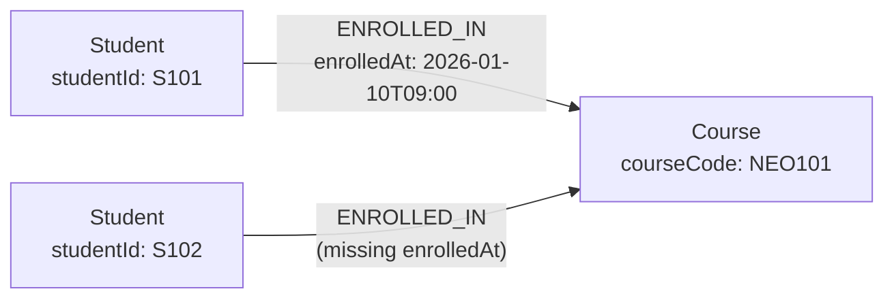

# Property Existence Constraints by Version and Edition Capabilities

## 1. Why Are Mandatory Property Constraints Needed in a Graph?

Neo4j stores data using the **property graph** model: nodes represent entities, relationships connect entities, and properties hold information on each node or relationship. One advantage of this model is that nodes with the same label are not forced to share the exact same set of properties. However, that flexibility becomes a risk when business rules specify that **a certain property must always be present**.

Consider a course management system:

```cypher
CREATE (:Course {courseCode: 'NEO101', title: 'Introduction to Neo4j'});
CREATE (:Course {title: 'Course without a code'});
```

Without an additional rule, Neo4j can store both nodes. When the application looks up a course by `courseCode`, the second node is difficult to identify reliably. Similarly, an `:ENROLLED_IN` relationship missing `enrolledAt` leaves the system unable to determine when the enrollment occurred.

A **property existence constraint** requires every node with a given label, or every relationship of a given type, to have a **non-`null`** value for the specified property. When the database supports this constraint type, Neo4j enforces the rule at the storage layer: any write operation that leaves the entity missing the mandatory property is rejected.

This is a key component of **data constraints** in Neo4j, alongside uniqueness constraints, node/relationship keys, property type constraints, and business-level checks in Java Driver or Spring Data Neo4j applications.

Lesson objectives:

- Explain accurately what "existence" means for a property in Neo4j.
- Verify the **version and edition** before using property existence constraints.
- Write Cypher for both nodes and relationships, and recognize operations that trigger errors.
- Prepare legacy data and run controlled schema migrations.
- Distinguish database constraints from application validation, and choose an approach when an edition does not support existence constraints.

## 2. What Does It Mean for a Property to Exist?

In Neo4j, a property with no value is represented by `null`; at the storage level, setting a property to `null` is equivalent to removing that property. For example:

```cypher
CREATE (c:Course {courseCode: 'NEO101', title: 'Cypher Basics'});

// The operation below removes the courseCode property unless blocked by a constraint.
MATCH (c:Course {courseCode: 'NEO101'})
SET c.courseCode = null;
```

Without an existence constraint, the node after this operation will no longer have `courseCode`. With a constraint requiring `courseCode`, the `SET ... = null` operation is rejected.

Distinguish the following values:

| Property Value | Satisfies Existence (`IS NOT NULL`)? | Guaranteed Valid by Business Rules? |
| --- | --- | --- |
| Property absent | **No** | No. |
| `null` | **No** | No. |
| `''` (empty string) | **Yes** | Not necessarily; an empty course code is still usually invalid data. |
| `'   '` (whitespace only) | **Yes** | Not necessarily; needs trimming and content validation. |
| `0` | **Yes** | Depends on the allowed value range. |
| `false` | **Yes** | Depends on business rules. |
| `'NEO101'` | **Yes** | Still needs format and uniqueness checks if required by business rules. |

Therefore, **"required to exist" is different from "valid format", "correct type", and "unique"**. An existence constraint does not automatically trim whitespace, check regex patterns, restrict value ranges, or assign default codes.

### Scope of the Constraint

An existence constraint does not apply to every node in the database unless declared that way. It is bound to a **label** on nodes or a **relationship type**:



If there is a constraint on `:Course(courseCode)`, every node with the `Course` label must have `courseCode`, including multi-label nodes such as `:Course:Published`. If there is a constraint on `:ENROLLED_IN(enrolledAt)`, **every relationship of type `ENROLLED_IN`** must have `enrolledAt`, regardless of the endpoint node types. Requiring a property on a relationship **does not** automatically constrain the node labels at its endpoints.

## 3. Checking Support by Version and Edition

Never take a Cypher command from documentation and assume it runs on every Neo4j release. **Syntax and availability for each constraint type can vary by version, edition, and deployment offering.**

In **Neo4j 5.x releases**, property existence constraints for nodes and relationships are an **Enterprise Edition** feature. Neo4j Community Edition supports other constraint types, such as uniqueness, but **does not provide schema-level property existence constraints** like the ones shown here. Releases with newer numbering schemes should be checked against their corresponding documentation; when using Neo4j Aura, also check the service tier and database features provisioned.

### 3.1. Checking the Actual Version and Edition

In Neo4j Browser or Cypher Shell, run:

```cypher
CALL dbms.components()
YIELD name, versions, edition
RETURN name, versions, edition;
```

The output shows the DBMS component, version list, and running edition (the shape of this information can vary across release generations). Do not confuse the **Neo4j Java Driver version** with the **Neo4j DBMS version**: constraint support is determined by the **database**.

Once you know the version, consult **Constraints -> Property existence constraints** in the official documentation for that exact deployment version. If the output shows Community or an unsupported environment, the constraint creation commands below are not directly compatible.

### 3.2. Choosing Syntax Matching the Release Generation

| Environment | Syntax/Capability to Note |
| --- | --- |
| Neo4j 5.x Enterprise and newer versions supporting the syntax | Use `CREATE CONSTRAINT ... FOR ... REQUIRE property IS NOT NULL`. |
| Neo4j 5.x Community | Property existence constraints are unavailable; uniqueness does not automatically require the property to exist. |
| Some older 3.x/4.x versions | Used `ON ... ASSERT exists(...)` syntax for existence constraints in supported editions; that legacy syntax does not work verbatim on Neo4j 5.x. |
| Transitional releases or managed services | Check the exact documentation for the running version; do not assume support merely because a Cypher example appears in another version's docs. |

The hands-on examples that follow use **Neo4j 5.x syntax**, assuming the database supports this constraint type. They are learning examples; do not run them directly against production data without auditing the data and planning a migration.

## 4. Creating a Node Property Existence Constraint

Suppose every course must have a `courseCode`. On a supported database:

```cypher
CREATE CONSTRAINT course_code_required IF NOT EXISTS
FOR (c:Course)
REQUIRE c.courseCode IS NOT NULL;
```

Explanation:

- `CREATE CONSTRAINT course_code_required` creates a named constraint for administration.
- `IF NOT EXISTS` allows migration scripts to be re-run when a matching constraint already exists; it **does not upgrade the edition**, fix data, or replace verifying the actual schema.
- `FOR (c:Course)` specifies the node label governed by the constraint.
- `REQUIRE c.courseCode IS NOT NULL` requires this property to exist.

Once created:

```cypher
// Valid: courseCode is present.
CREATE (:Course {
  courseCode: 'NEO101',
  title: 'Introduction to Neo4j'
});

// Invalid when course_code_required is active.
CREATE (:Course {
  title: 'Course missing code'
});
```

The constraint also blocks ways of removing the property from an existing node:

```cypher
// Assume Course NEO101 already exists.
MATCH (c:Course {courseCode: 'NEO101'})
REMOVE c.courseCode;

// Equivalent effect of removing the property:
MATCH (c:Course {courseCode: 'NEO101'})
SET c.courseCode = null;
```

Each statement above is **an independent example of a violation**. Do not run them consecutively to test against real data.

### 4.1. Indirect Changes Can Also Violate the Constraint

It is not only `CREATE` or `REMOVE`. Consider:

```cypher
// Replaces the entire property set; risks removing courseCode.
MATCH (c:Course {courseCode: 'NEO101'})
SET c = {title: 'Course title only'};
```

Neo4j will reject the operation if it strips `courseCode` from a `:Course` node. Updating with `SET c += $props` normally preserves unlisted properties, though you must still guard against incoming data containing `null` for a mandatory property.

**Adding the `Course` label** to a node that lacks `courseCode` can also be blocked:

```cypher
CREATE (n:Draft {title: 'Unassigned draft'});

// If the existence constraint on :Course is active, the next statement is rejected.
MATCH (n:Draft {title: 'Unassigned draft'})
SET n:Course;
```

Conversely, a node without the `Course` label lies **outside** that constraint's scope. Labeling rules must therefore be designed consistently, especially when data flows through multiple services or import batches.

## 5. Creating a Relationship Property Existence Constraint

In a property graph, relationships have their own properties as well. For example, `:ENROLLED_IN` can store when the student enrolled:

```cypher
CREATE CONSTRAINT enrollment_time_required IF NOT EXISTS
FOR ()-[r:ENROLLED_IN]-()
REQUIRE r.enrolledAt IS NOT NULL;
```

Unlike node constraints, `FOR ()-[r:ENROLLED_IN]-()` selects a **relationship type**. This schema syntax does not require specifying an arrow direction; the constraint applies to every relationship of type `ENROLLED_IN`.

Valid enrollment example:

```cypher
MATCH (s:Student {studentId: $studentId})
MATCH (c:Course {courseCode: $courseCode})
CREATE (s)-[r:ENROLLED_IN {
    enrolledAt: datetime(),
    status: 'ACTIVE'
}]->(c)
RETURN elementId(r) AS enrollmentElementId;
```

The query uses parameters `$studentId` and `$courseCode` passed by the application. If either the student or course is not found, the `MATCH` clauses produce zero rows and no relationship is created; the application must handle the empty-result case. If a relationship is created without `enrolledAt`, the constraint rejects it:

```cypher
// Illustrates a violation against data containing the corresponding Student and Course.
MATCH (s:Student {studentId: 'S101'})
MATCH (c:Course {courseCode: 'NEO101'})
CREATE (s)-[:ENROLLED_IN {status: 'ACTIVE'}]->(c);
```

Several related rules remain **outside the scope** of an existence constraint: whether `ENROLLED_IN` must connect a `Student` to a `Course`, whether a student can enroll in the same course twice, and whether `enrolledAt` falls within a valid registration window. Those invariants must be expressed via appropriate keys, model design, and transactions/business logic.

## 6. Distinguishing Existence, Uniqueness, Node Key, Property Type, and Index

For example, if every `:Course` node must have a `courseCode` that is **both present and unique**, multiple mechanisms are available depending on edition:

| Mechanism | Guarantees | What It Does Not Automatically Guarantee |
| --- | --- | --- |
| **Property existence** | Every `Course` has a non-`null` `courseCode`. | Does not forbid two courses from sharing the same code. |
| **Property uniqueness** | `Course` nodes with a declared code do not duplicate one another. | Does not require every `Course` to have a code. |
| **Node key** | The code must exist **and** be unique within the label scope. | Does not validate format/semantics of the code. |
| **Property type** | The code value, when present, matches a declared type such as `STRING`. | Does not require existence or uniqueness via the type constraint alone. |
| **Regular index** | Accelerates lookup queries on the property. | Does not prevent missing or duplicate codes. |

To enforce uniqueness only, create a uniqueness constraint:

```cypher
CREATE CONSTRAINT course_code_unique IF NOT EXISTS
FOR (c:Course)
REQUIRE c.courseCode IS UNIQUE;
```

If your Neo4j version supports both existence and uniqueness, you can use **two constraints with distinct purposes**:

```cypher
// Mandatory code.
CREATE CONSTRAINT course_code_required IF NOT EXISTS
FOR (c:Course)
REQUIRE c.courseCode IS NOT NULL;

// Code must not be duplicated.
CREATE CONSTRAINT course_code_unique IF NOT EXISTS
FOR (c:Course)
REQUIRE c.courseCode IS UNIQUE;
```

Or consider a **node key**, which expresses both invariants together:

```cypher
CREATE CONSTRAINT course_code_key IF NOT EXISTS
FOR (c:Course)
REQUIRE c.courseCode IS NODE KEY;
```

These are **intentional alternative or combined design options**, not a requirement to stack all examples onto the same schema. Node keys also carry edition requirements; they cannot be used as a workaround for Community Edition limitations.

If you need to ensure the property is a string, versions supporting property type constraints can add:

```cypher
CREATE CONSTRAINT course_code_string IF NOT EXISTS
FOR (c:Course)
REQUIRE c.courseCode IS :: STRING;
```

Even with both type and existence constraints in place, `''` remains a valid existing string. Rules like "non-empty", "no whitespace", or "matches code pattern" must be enforced by business logic or another appropriate mechanism.

### Does Existence Automatically Create an Index?

**Do not assume an existence constraint creates an index to speed up lookups.** Its purpose is to protect property completeness. If you need efficient queries by `courseCode`, evaluate a separate index or uniqueness/node key according to your design, and inspect `SHOW INDEXES` alongside `EXPLAIN` plans. Uniqueness and key constraints are backed by indexes, whereas existence alone is not a substitute for query optimization.

## 7. Why Adding an Existence Constraint to Legacy Data Can Fail

Neo4j must check **existing** nodes or relationships when creating the constraint. If any entity in scope is missing the mandatory property, constraint creation is rejected. The schema does not auto-fill codes, generate enrollment timestamps, or repair incomplete records.

Suppose the database already contains:

```cypher
CREATE (:Course {courseCode: 'NEO101', title: 'Cypher Basics'});
CREATE (:Course {title: 'Course not yet assigned a code'});
```

`CREATE CONSTRAINT course_code_required ...` will fail until the `Course` node missing `courseCode` is resolved.

### 7.1. Finding Nodes Missing the Property

```cypher
MATCH (c:Course)
WHERE c.courseCode IS NULL
RETURN elementId(c) AS nodeElementId,
       c.title AS title
LIMIT 50;
```

Count total records needing remediation:

```cypher
MATCH (c:Course)
WHERE c.courseCode IS NULL
RETURN count(c) AS missingCourseCodes;
```

To catch codes that are "present but unusable", run deeper checks per your formatting policy. For instance, if codes are always strings:

```cypher
MATCH (c:Course)
WHERE c.courseCode IS NOT NULL
  AND c.courseCode = ''
RETURN elementId(c) AS nodeElementId, c.title AS title
LIMIT 50;
```

If real-world data contains codes stored with the wrong type, fix the types before calling string functions or adding a type constraint. `elementId()` results should only be used to aid diagnostics/record selection in the current environment; it is **not a stable business ID** for external systems.

### 7.2. Finding Relationships Missing the Property

```cypher
MATCH (s)-[r:ENROLLED_IN]->(c)
WHERE r.enrolledAt IS NULL
RETURN elementId(r) AS relationshipElementId,
       labels(s) AS sourceLabels,
       labels(c) AS targetLabels
LIMIT 50;
```

This query intentionally uses a **directed** pattern so each relationship is read once along its stored direction and endpoints can be audited. If the system defines `ENROLLED_IN` only from `Student` to `Course`, you can add labels to targeted checks. However, to avoid missing violating relationships with unexpected endpoints, an overall audit should not restrict labels upfront.

### 7.3. Fixing Data According to Business Meaning

Do not assign a single dummy code such as `'UNKNOWN'` to every course missing a code: an existence constraint may accept that string, but the application will struggle to tell entities apart, and if uniqueness is also present, repeated dummy codes will violate it. For `enrolledAt`, arbitrarily assigning `datetime()` to old enrollments corrupts historical records.

A sound remediation process identifies the authoritative source of truth, categorizes records that can be backfilled, records that should be merged/canceled, and records that must be retained for history. For nodes with relationships, any edits or deletions must evaluate impact on graph paths—never run bulk `DETACH DELETE` merely to make audit counts clean.

## 8. Safe Constraint Deployment Workflow

Follow a verifiable workflow:

1. **Confirm the DBMS:** verify version/edition and DDL permissions; read documentation for that exact version.
2. **Lock down business requirements:** which properties are mandatory, on which labels/relationship types, and whether uniqueness and type constraints are also needed.
3. **Audit existing data:** locate nodes/relationships missing the property, check for empty strings, wrong types, and import artifacts.
4. **Fix write sources and legacy data:** ensure applications, batch imports, and sync jobs provide valid values; then remediate existing data.
5. **Create constraints via migrations:** execute syntax matching the DBMS; schedule deployment appropriately because the database may need to scan data to verify compliance.
6. **Verify schema and test writes:** confirm the constraint exists and test valid/violating cases in a staging/test environment.

### Inspecting Constraints After Creation

```cypher
SHOW CONSTRAINTS;
```

Or project the relevant fields (on versions supporting these `YIELD` columns):

```cypher
SHOW CONSTRAINTS
YIELD name, type, entityType, labelsOrTypes, properties
RETURN name, type, entityType, labelsOrTypes, properties
ORDER BY name;
```

Verify **name, type, label/relationship type, and property**. `IF NOT EXISTS` does not by itself prove the schema matches what the migration intended. If the statement failed due to missing data or an unsupported edition, do not proceed under the assumption that the constraint is in place.

When an old constraint must be removed:

```cypher
DROP CONSTRAINT course_code_required IF EXISTS;
```

Execute only after reviewing write flows that depend on that constraint. Dropping a constraint removes the safeguard for future writes.

## 9. Integrating with the Java Driver and Spring Data Neo4j

Some requirements can be checked right at the API boundary, yet **the database layer still needs its own constraints** to protect all write paths.

### 9.1. Java Driver: Input Validation and Parameterized Writes

Example using Java Driver 5.x:

```java
import org.neo4j.driver.Driver;
import org.neo4j.driver.Session;
import java.util.Map;

public class CourseRepository {
    private final Driver driver;

    public CourseRepository(Driver driver) {
        this.driver = driver;
    }

    public void createCourse(String courseCode, String title) {
        if (courseCode == null || courseCode.isBlank()) {
            throw new IllegalArgumentException(
                "Course code must not be blank");
        }
        if (title == null || title.isBlank()) {
            throw new IllegalArgumentException(
                "Course title must not be blank");
        }

        String cypher = """
            CREATE (c:Course {
                courseCode: $courseCode,
                title: $title
            })
            RETURN c.courseCode AS code
            """;

        try (Session session = driver.session()) {
            session.executeWrite(tx -> {
                tx.run(cypher, Map.of(
                    "courseCode", courseCode,
                    "title", title
                )).single();
                return null;
            });
        }
    }
}
```

This validation produces clear errors before sending a query, and the parameterized query avoids string concatenation in Cypher. Even so, an external Cypher script or another service can still create a `:Course` without `courseCode` **if the database has no constraint**. When a property existence constraint is active, invalid writes are rejected regardless of which application issues them.

If the database rejects a write due to a constraint, the application must catch the driver exception appropriately, recognize that the transaction failed, and translate it into a business response. Never swallow the error and report that course creation succeeded. For multi-node/relationship operations, use transactions so partial updates are not left behind when a later step fails.

### 9.2. Spring Data Neo4j: Annotations and Schema Are Two Separate Layers

With Spring Data Neo4j, `@Node` and `@Relationship` declare entity mappings; validation annotations like `@NotNull` or `@NotBlank` belong to Java-side validation when properly triggered in the application flow. **They are not automatically equivalent to an active property existence constraint in Neo4j.** `@Id` defines persistence identity and likewise does not guarantee that every write path into the database enforces mandatory presence for another business property.

If `courseCode` is a mandatory property, combine validation at the API/DTO boundary, checks in the service layer, and Cypher schema migrations on a database that supports them. In multi-service architectures or systems with periodic imports, schema constraints play an especially crucial role because all writers share one data store.

## 10. Using Community Edition or Unsupported Environments

You cannot enable a constraint type merely by renaming a command or adding `IF NOT EXISTS` if your edition does not support it. Nor should you treat uniqueness as a "stand-in" for existence:

```cypher
// Uniqueness is used to prevent duplicate codes,
// but it can still allow multiple Course nodes without courseCode.
CREATE CONSTRAINT course_code_unique IF NOT EXISTS
FOR (c:Course)
REQUIRE c.courseCode IS UNIQUE;
```

In Community Edition systems, practical measures include API input validation, service-layer checks, enforcing data contracts on import jobs, monitoring queries that detect nodes/relationships missing properties, and restricting write access via authorization. These measures **reduce risk**, but they do not provide a schema guarantee equivalent to a property existence constraint when multiple actors can write.

If the business requires **mandatory database-level integrity** across all write sources, select a version/edition or service tier that genuinely supports property existence (or appropriate key constraints) after evaluating operational cost and migration plans.

## 11. Common Misconceptions

| Misconception | Accurate Understanding |
| --- | --- |
| "Nodes have flexible properties, so constraints aren't needed." | Flexibility is useful for optional attributes; identifiers and mandatory data still require clear policies. |
| "`IS UNIQUE` implies `IS NOT NULL`." | Uniqueness prevents duplicates among existing values; it does not require every node to have the property. |
| "`IS NOT NULL` forbids empty strings." | An empty string is still a non-`null` value; additional validation is required. |
| "Adding a constraint automatically backfills missing data." | Neo4j validates existing data; if any record violates the rule, constraint creation fails. |
| "A relationship constraint ensures both endpoints have the right labels." | Existence only checks the property on the specified relationship type. |
| "Community can use a node key instead of existence." | Node keys also have edition requirements; check actual support. |
| "Having `WHERE x.prop IS NOT NULL` in queries is enough." | `WHERE` only filters that query's results; it does not prevent other writers from storing incomplete data. |
| "If the app has `@NotNull`, the database automatically has a constraint." | Java validation and Neo4j constraints are two separate mechanisms. |

## 12. Hands-On Self-Check Exercise

On a **test database that supports property existence constraints**:

1. Create several `:Course` nodes with valid `courseCode` values and run a query checking for missing properties.
2. Attempt to create a `:Course` node without `courseCode` before adding the constraint, observe the outcome, and fix the record to comply.
3. Create the `course_code_required` constraint and verify it with `SHOW CONSTRAINTS`.
4. Test each in turn: creating a node without the code, setting the code to `null`, `REMOVE`ing the code, and adding the `Course` label to a node missing the code. Record which operations are rejected.
5. Test an empty code `''`, then add "non-blank" validation in the application; explain why an existence constraint alone is still not enough.
6. Repeat the same creation and verification steps for the `:ENROLLED_IN` relationship with property `enrolledAt`.

If you are using Community Edition, replace the unsupported DDL exercises with **checking version/edition**, confirming the limitation, and writing queries to detect nodes/relationships missing the property. There is no need to repeatedly run DDL statements that the edition rejects.

## 13. Conclusion

A property existence constraint protects a small yet essential invariant: **every node of a designated label or relationship of a designated type must carry the mandatory property**. This invariant lets Neo4j relationship and path queries rely on entities with complete foundational data while reducing drift when multiple services write to the graph.

To use it properly, confirm **Neo4j version + edition**, choose compatible syntax, audit data before migration, and clearly distinguish value existence from uniqueness, type, and business validity. When the database does not support it, Java/Spring validation and periodic data audits remain helpful, though they do not replace schema-level existence guarantees; your system's integrity requirements determine the right deployment choice.
