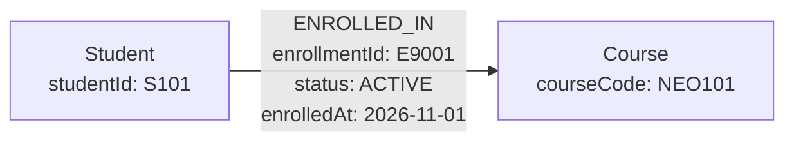

# Relationship Constraints by Version and Edition

## 1. Why Do Relationships Also Need Data Constraints?

Neo4j uses the **property graph** model, where **nodes** represent entities and **relationships** describe how entities connect to one another. A relationship has a **type**, a **direction**, a **start node**, an **end node**, and can carry its own **properties**. For example, a learning system stores a student's course enrollment using an `:ENROLLED_IN` relationship:



If data is missing `enrollmentId`, it can be hard to pinpoint a specific enrollment to update or synchronize. If two relationships share a duplicate `enrollmentId`, an ID lookup query can return multiple rows. If `attempt` is sometimes an integer and sometimes a string, retake-count reports can hit type errors. **Relationship constraints** are designed to enforce invariants on **relationship properties** directly at the database layer.

This topic belongs to the **Data Constraints** chapter in the Neo4j module. Learners need to understand not only Cypher statements such as `CREATE CONSTRAINT` and `SHOW CONSTRAINTS`, but also **which constraint types exist in their running version/edition**. This is especially important when building Java Driver or Spring Data Neo4j services, ingestion jobs, or systems with multiple writers updating the graph.

After this lesson, you will be able to:

- Distinguish **structural relationship integrity** from **property** constraints and **business** rules.
- Create relationship property **existence**, **uniqueness**, **key**, and **type** constraints where supported.
- Identify key differences across Neo4j 4.4, Neo4j 5.x, and schema extensions via **Graph Types** in newer releases.
- Understand why relationship keys/uniqueness do not automatically forbid multiple edges between two nodes.
- Audit violating data, run migrations, verify schemas, and handle errors in Java/Spring.

## 2. How Much Does Neo4j Protect Relationships Out of the Box?

Neo4j guarantees that a stored relationship connects **two existing nodes**. You cannot create a completely "orphan" relationship without start and end nodes. When deleting a node that still has relationships, a plain `DELETE` is rejected; `DETACH DELETE` deletes the attached relationships as well according to command semantics.

However, the following are **business rules** that must be explicitly defined:

- An `ENROLLED_IN` relationship must connect a `Student` to a `Course`.
- Each student may have only **one** enrollment per course in each term.
- An `ENROLLED_IN` relationship must have `enrollmentId`, `enrolledAt`, and `status`.
- `status` values must belong only to `ACTIVE`, `CANCELLED`, or `COMPLETED`.
- `DEPENDS_ON` relationships must not form a cycle.

Traditional property constraints using `CREATE CONSTRAINT ... FOR ()-[r:TYPE]-() REQUIRE ...` only control properties across **all relationships of the declared type**. They **do not automatically enforce** endpoint node labels, limit the number of relationships between two nodes, check enum sets, or detect cycles. Newer Neo4j versions featuring **Graph Types** for Cypher 25 add the ability to constrain start/end node labels; that distinction is covered in Section 9.

| Protection Layer | Example | Where the Guarantee Comes From |
| --- | --- | --- |
| Storage structure | A relationship has two existing endpoint nodes. | Neo4j's data model. |
| Relationship properties | `enrollmentId` unique, `enrolledAt` mandatory. | Schema constraints supported by the version/edition. |
| Property types | `attempt` must be `INTEGER`. | Property type constraint if supported. |
| Endpoint node labels | `ENROLLED_IN` must go from `Student` to `Course`. | Query/application checks; or Graph Types on supported versions. |
| Cross-node / multi-edge rules | No duplicate enrollment for one course/term, no cycles. | Key/model design, transactions, business checks; not guaranteed by property constraints alone. |

## 3. Version and Edition Matrix You Must Know

**Never infer database capabilities from syntax found online or from the Java Driver version.** Constraint support is governed by the **Neo4j DBMS**, Cypher version, and edition/deployment tier.

### 3.1. Key Milestones

| Relationship Constraint Type | Neo4j 4.4 | Neo4j 5.x | Edition to Note |
| --- | --- | --- | --- |
| **Property existence** | Available in Enterprise, using 4.x-era schema syntax. | Available, using `REQUIRE r.prop IS NOT NULL`. | **Enterprise**. |
| **Property uniqueness** | No relationship uniqueness constraint in 5.7 syntax. | **From 5.7**, using `REQUIRE r.prop IS UNIQUE`. | **Community and Enterprise** on supported versions. |
| **Relationship key** | No relationship key constraint in 5.7 syntax. | **From 5.7**, using `REQUIRE r.prop IS RELATIONSHIP KEY`. | **Enterprise**. |
| **Property type** | No 5.9-style type constraint. | **From 5.9**, using `REQUIRE r.prop IS :: TYPE`. | **Enterprise**. |

These milestones describe the **Neo4j 5.x series**. For calendar-versioned Neo4j releases (such as the 2025/2026 series), consult the documentation for that exact release. A feature introduced in one release does not mean older releases understand that syntax.

### 3.2. Checking the Running Neo4j Version

```cypher
CALL dbms.components()
YIELD name, versions, edition
RETURN name, versions, edition;
```

Then inspect the existing schema:

```cypher
SHOW CONSTRAINTS;
```

If you are using Neo4j Aura, also check the capabilities of your **actual service tier**. Never assume every managed tier includes all features of self-managed Enterprise.

### 3.3. Rules for Selecting an Edition-Appropriate Approach

- **Neo4j 5.7+ Community:** you can use relationship property uniqueness; it **cannot** replace property existence/key/type when those are unsupported by the edition.
- **Neo4j 5.7–5.8 Enterprise:** you can use uniqueness, existence, and relationship keys; property type constraints introduced in 5.9 are **not yet available**.
- **Neo4j 5.9+ Enterprise:** you can combine all four constraint types, subject to the property types supported by the specific version.
- **Neo4j older than 5.7:** you may need a different design or an upgrade to use relationship uniqueness/keys; verify syntax and edition against your running version's documentation.

The Cypher examples below use **Neo4j 5.x syntax**, and each snippet demonstrates a distinct invariant. You do not necessarily run every constraint on the same schema if they overlap or conflict with business rules.

## 4. Relationship Property Existence: Mandatory Properties

If every enrollment must record an `enrolledAt` timestamp, on a supported release create:

```cypher
CREATE CONSTRAINT enrolled_at_required IF NOT EXISTS
FOR ()-[r:ENROLLED_IN]-()
REQUIRE r.enrolledAt IS NOT NULL;
```

Breakdown:

- `FOR ()-[r:ENROLLED_IN]-()` selects **all relationships of type `ENROLLED_IN`**. Schema syntax does not distinguish arrow direction.
- `REQUIRE r.enrolledAt IS NOT NULL` requires `enrolledAt` to be present with a non-`null` value.
- `IF NOT EXISTS` supports repeatable migrations, but does not unlock features outside your edition or fix legacy data.

Once created, the following is **valid** assuming the matching student and course exist:

```cypher
MATCH (s:Student {studentId: 'S101'})
MATCH (c:Course {courseCode: 'NEO101'})
CREATE (s)-[r:ENROLLED_IN {
    enrollmentId: 'E9001',
    enrolledAt: datetime(),
    status: 'ACTIVE'
}]->(c)
RETURN r.enrolledAt AS enrolledAt;
```

Conversely, intentionally **omitting `enrolledAt`** will be rejected:

```cypher
// VIOLATION example to run separately in a test database.
MATCH (s:Student {studentId: 'S101'})
MATCH (c:Course {courseCode: 'NEO101'})
CREATE (s)-[:ENROLLED_IN {
    enrollmentId: 'E9002',
    status: 'ACTIVE'
}]->(c);
```

An existing relationship is also not allowed to lose its mandatory property:

```cypher
// VIOLATION example; do not run on production data.
MATCH ()-[r:ENROLLED_IN {enrollmentId: 'E9001'}]->()
REMOVE r.enrolledAt;
```

`SET r.enrolledAt = null` likewise removes the property and triggers a violation. When using `SET r = $properties` to replace all properties, make sure the new property map still includes `enrolledAt`.

### `null`, Empty Strings, and Synthetic Data

In Neo4j, setting a property to `null` deletes it. An existence constraint forbids the missing-property state, whereas an empty string `''` is still treated as a **present** value. For temporal data, do not assign the current timestamp to all old records missing a date just to "get through the migration" if that falsifies history. Business validity must be handled separately.

## 5. Relationship Property Uniqueness: Preventing Duplicate Values

If `enrollmentId` is a unique code for each enrollment, on Neo4j 5.7+ you can create:

```cypher
CREATE CONSTRAINT enrollment_id_unique IF NOT EXISTS
FOR ()-[r:ENROLLED_IN]-()
REQUIRE r.enrollmentId IS UNIQUE;
```

With this constraint, two `ENROLLED_IN` relationships **cannot share the same `enrollmentId` value when the property is present**. Uniqueness spans **the entire relationship type**, not just relationships from one student or to one specific course.

```cypher
// Assume an ENROLLED_IN relationship with enrollmentId E9001 already exists.
// A subsequent creation with the same ID will be rejected.
MATCH (s:Student {studentId: 'S102'})
MATCH (c:Course {courseCode: 'NEO101'})
CREATE (s)-[:ENROLLED_IN {enrollmentId: 'E9001'}]->(c);
```

However, **uniqueness does not require the property to exist**. With only `IS UNIQUE`, you can still create multiple `ENROLLED_IN` relationships **without `enrollmentId`**, because relationships missing the property are excluded from duplicate-ID checks.

### 5.1. Uniqueness Across Multiple Properties

If a multi-tenant system lets each tenant maintain its own `enrollmentId` sequence, the identity can be the `(tenantId, enrollmentId)` pair:

```cypher
CREATE CONSTRAINT enrollment_tenant_id_unique IF NOT EXISTS
FOR ()-[r:ENROLLED_IN]-()
REQUIRE (r.tenantId, r.enrollmentId) IS UNIQUE;
```

| New Relationship | With Composite Constraint `(tenantId, enrollmentId)` |
| --- | --- |
| `{tenantId:'T1', enrollmentId:'E001'}` | Valid if this pair does not yet exist. |
| `{tenantId:'T2', enrollmentId:'E001'}` | Valid if this pair does not yet exist; different tenant. |
| Adding another `{tenantId:'T1', enrollmentId:'E001'}` | Rejected because **both** values match. |
| `{tenantId:'T1'}` | Not blocked by **uniqueness alone** because one component is missing. |

Uniqueness of the **tuple** does not mean each individual property must be unique on its own. If business rules require both properties to be present, consider a relationship key on a supported edition.

## 6. Relationship Key: Present and Unique in One Rule

A **relationship key** combines two conditions: every relationship of the specified type must have the key properties, and the tuple of key values must be unique. Example on Neo4j 5.7+ Enterprise:

```cypher
CREATE CONSTRAINT enrollment_id_key IF NOT EXISTS
FOR ()-[r:ENROLLED_IN]-()
REQUIRE r.enrollmentId IS RELATIONSHIP KEY;
```

Unlike `IS UNIQUE`, a key rejects any relationship **missing `enrollmentId`**. It also rejects a relationship whose ID already belongs to another relationship of the same type.

For multi-tenant identity:

```cypher
CREATE CONSTRAINT enrollment_tenant_key IF NOT EXISTS
FOR ()-[r:ENROLLED_IN]-()
REQUIRE (r.tenantId, r.enrollmentId) IS RELATIONSHIP KEY;
```

In this case, every `ENROLLED_IN` must have both `tenantId` **and** `enrollmentId`; no value pair may repeat. Two tenants can share code `E001` because the full key tuple differs.

**Design note:** if business rules allow both `T1/E001` and `T2/E001`, a single-property relationship key on `enrollmentId` is overly strict. Conversely, if IDs must be globally unique, a composite key is too permissive and allows duplicate `enrollmentId` values across tenants. Choose the key based on your identity rules before creating the schema.

### 6.1. Keys Do Not Constrain Start/End Node Pairs

Suppose the graph already has:

```text
(Student S101)-[:ENROLLED_IN {enrollmentId:'E001'}]->(Course NEO101)
(Student S101)-[:ENROLLED_IN {enrollmentId:'E002'}]->(Course NEO101)
```

These two relationships have different IDs, so they **do not violate a relationship key on `enrollmentId`**, even though they connect the exact same pair of nodes. If the requirement is that each student may enroll only once per course, you need an identity mechanism tied to the student–course pair, or pair plus term. You can model an enrollment as an **`:Enrollment` node** with a composite node key, creating the associated relationships inside a transaction.


With an `Enrollment` node model, the identity of an enrollment can be `(studentId, courseCode, term)`. Still, this node key **does not automatically verify** that the properties inside `Enrollment` match the two endpoint nodes of its relationships; enforce that via write logic, supported Graph Types, or appropriate data checks.

## 7. Relationship Property Type Constraints: Data Type Consistency

If `ENROLLED_IN` has an integer `attempt` and a string `status`, on Neo4j 5.9+ Enterprise you can create:

```cypher
CREATE CONSTRAINT enrollment_attempt_integer IF NOT EXISTS
FOR ()-[r:ENROLLED_IN]-()
REQUIRE r.attempt IS :: INTEGER;

CREATE CONSTRAINT enrollment_status_string IF NOT EXISTS
FOR ()-[r:ENROLLED_IN]-()
REQUIRE r.status IS :: STRING;
```

If `enrolledAt` is stored with `datetime()` and the environment supports this type:

```cypher
CREATE CONSTRAINT enrollment_time_datetime IF NOT EXISTS
FOR ()-[r:ENROLLED_IN]-()
REQUIRE r.enrolledAt IS :: ZONED DATETIME;
```

These type constraints validate **the property's type when present**. They do not automatically require a relationship to have `attempt`, `status`, or `enrolledAt`; existence requirements must be declared separately if needed.

| `attempt` Value | With Type Constraint `IS :: INTEGER` | Explanation |
| --- | --- | --- |
| `1` | Valid. | Integer. |
| `0` | Valid by type. | Domain rules might forbid 0, but type constraints do not know that. |
| `-1` | Valid by type. | Negative integers are still integers. |
| `'1'` | Rejected. | This is a string. |
| `1.0` | Rejected if stored as `FLOAT`. | Underlying type is not `INTEGER`. |
| Missing `attempt` | Not rejected by a type constraint **alone**. | Property is not present for type checking. |

**A type constraint is not an enum constraint.** `status IS :: STRING` still accepts `'WHATEVER'`, even if business rules only allow `ACTIVE`, `CANCELLED`, or `COMPLETED`. Allowed-value validation must be implemented in the application or another schema mechanism that actually supports that requirement.

In the Java Driver, sending `"2"` (String) versus `2` (Integer/Long) makes a difference; the database will not auto-convert strings to integers simply because a constraint requires `INTEGER`.

## 8. What Traditional Constraints Do Not Guarantee

The examples above use **traditional property constraints** from Cypher 5.x. They are not equivalent to integrity rules over the entire connection schema.

| Rule to Guarantee | Are Relationship Existence / Uniqueness / Key / Type Enough? | Solution to Consider |
| --- | --- | --- |
| Every `ENROLLED_IN` has an `enrollmentId` | Yes, with existence or relationship key. | Use the constraint when supported by your edition. |
| `enrollmentId` is not duplicated within the same relationship type | Yes, with uniqueness or key. | Choose global vs. tenant scope properly. |
| `attempt` is always an integer | Yes, with property type if supported. | Add value-range validation. |
| `ENROLLED_IN` connects `Student` -> `Course` | **No** via property `CREATE CONSTRAINT` statements alone. | Cypher queries checking endpoints; or Graph Types with endpoint label constraints on supported versions. |
| A student has at most one `ENROLLED_IN` to a course per term | **No** if only `enrollmentId` is keyed. | Stable identity per pair/term, an `Enrollment` node, or appropriate transactions. |
| Relationships do not form cycles in a dependency graph | **No**. | Path-checking queries and business rules inside appropriate transactions. |
| Relationship connects two nodes in valid business states | **No**. | Validation, authorization, and state checks on both endpoints. |

When a rule involves **multiple nodes, multiple edges, paths, or domain value conditions**, revisit the model design; do not try to solve every problem by making `enrollmentId` unique.

## 9. What's New: Graph Types in Neo4j 2026.02+ and Cypher 25

Recent Neo4j documentation introduces **Graph Types**: a way to define a graph schema more broadly than individual property constraints. According to official documentation, this capability was introduced in **Neo4j 2026.02**, requiring **Cypher 25** and **Enterprise Edition**.

A **relationship element type** in Graph Types can declare **source/target node labels** and the relationship type—conceptually `(:Student)-[:ENROLLED_IN]->(:Course)`. That schema can create **relationship source/target label constraints**, which traditional `CREATE CONSTRAINT ... REQUIRE r.property ...` statements **cannot create**.

This is an essential distinction when answering "Can Neo4j enforce that a relationship connects the right endpoint labels?":

- **With Cypher 5 and traditional property constraints:** there is no `CREATE CONSTRAINT` syntax equivalent to a foreign key on endpoint labels; you must control this at the write layer or choose a different modeling pattern.
- **With Graph Types on Cypher 25 Enterprise:** you can declare relationship element types with endpoint labels, provided your model and running version support it.

**Operational warning:** the `ALTER CURRENT GRAPH TYPE SET` command used to configure a Graph Type can **replace the entire previously defined Graph Type/constraints**. This is a broad schema change; never copy a small snippet and run it against an existing database. Design the **complete target schema**, check version and existing data, prepare migrations, and assess impact before applying.

Graph Types add endpoint structural controls, but **do not automatically imply every cardinality or acyclicity rule**. Invariants such as "at most one enrollment per person per course per term" still require appropriate design and verification.

For this lesson focused on relationship property constraints, the hands-on examples continue using Neo4j 5.x `CREATE CONSTRAINT` syntax to make version/edition comparisons clear.

## 10. Auditing Data Before Creating Relationship Constraints

When creating a constraint, Neo4j must check **existing data**. If any relationship violates it (missing mandatory property, duplicate key, wrong type), constraint creation can fail. The database **does not automatically backfill properties or repair data**.

### 10.1. Finding Relationships Missing Mandatory Properties

```cypher
MATCH ()-[r:ENROLLED_IN]->()
WHERE r.enrollmentId IS NULL
RETURN elementId(r) AS relationshipElementId,
       properties(r) AS currentProperties
LIMIT 50;
```

Find relationships missing an enrollment timestamp:

```cypher
MATCH ()-[r:ENROLLED_IN]->()
WHERE r.enrolledAt IS NULL
RETURN elementId(r) AS relationshipElementId,
       startNode(r).studentId AS studentId,
       endNode(r).courseCode AS courseCode
LIMIT 50;
```

`elementId(r)` is suitable for **diagnostics**; do not store it as a durable business code in external systems. Reading `studentId` and `courseCode` from both endpoints illustrates the expected connection types; if the data contains relationships attached to wrong node labels, those columns may return `null`.

### 10.2. Finding Duplicate IDs

```cypher
MATCH ()-[r:ENROLLED_IN]->()
WHERE r.enrollmentId IS NOT NULL
WITH r.enrollmentId AS enrollmentId,
     count(*) AS total,
     collect(elementId(r)) AS relationshipIds
WHERE total > 1
RETURN enrollmentId, total, relationshipIds
ORDER BY total DESC
LIMIT 50;
```

For composite uniqueness/keys, group by **the entire key tuple** rather than a single property:

```cypher
MATCH ()-[r:ENROLLED_IN]->()
WHERE r.tenantId IS NOT NULL
  AND r.enrollmentId IS NOT NULL
WITH r.tenantId AS tenantId,
     r.enrollmentId AS enrollmentId,
     count(*) AS total
WHERE total > 1
RETURN tenantId, enrollmentId, total
ORDER BY total DESC
LIMIT 50;
```

On large systems, `collect(elementId(r))` across every group can consume significant memory; fetch summary counts first, then retrieve details only for the specific groups needing remediation.

### 10.3. Finding Wrong-Type Properties

On Neo4j versions supporting the corresponding type predicate, check `attempt`:

```cypher
MATCH ()-[r:ENROLLED_IN]->()
WHERE r.attempt IS NOT NULL
  AND NOT (r.attempt IS :: INTEGER)
RETURN elementId(r) AS relationshipElementId,
       r.attempt AS invalidAttempt
LIMIT 50;
```

If the DBMS does not understand `IS :: INTEGER`, use a version-compatible inspection method or an export/import check. Never treat a syntax error from an older version as proof that the data is valid or invalid.

### 10.4. Classifying and Fixing Violations

Before adding constraints:

1. Determine the **true** identity of each enrollment, including re-enrollments.
2. For relationships missing an ID, trace the source creating those records and establish a valid ID-generation rule.
3. For relationships with duplicate IDs, identify which event is authoritative, what history must be kept, and what linked data might be affected.
4. For wrong-type values, convert with verification; do not blindly turn every invalid string into `0`.
5. Fix the Java/CSV import pipeline producing bad data **before** locking the schema so errors do not recur.

Never bulk-delete relationships just to make `CREATE CONSTRAINT` succeed: deleting a relationship can erase history and alter path query results.

## 11. Creating Schema and Verifying After Migration

A safe deployment workflow:

1. Check DBMS version, edition, and schema administration privileges.
2. Define rules: which properties are mandatory, unique, and typed; whether tenant scoping is needed.
3. Audit and remediate violating data using the queries in Section 10.
4. Choose **an appropriate constraint set** matching your rules and edition; for example, a relationship key can replace expressing separate uniqueness + existence on the same key.
5. Run controlled migrations; creating constraints on large datasets may scan existing data and consume time/resources.
6. Re-read the schema, test valid/violating write scenarios, and monitor application errors.

Inspect constraint details on versions supporting these columns:

```cypher
SHOW CONSTRAINTS
YIELD name, type, entityType, labelsOrTypes, properties
RETURN name, type, entityType, labelsOrTypes, properties
ORDER BY name;
```

Confirm that `entityType` is relationship, `labelsOrTypes` contains `ENROLLED_IN`, and `type` and `properties` are exact. If you use `IF NOT EXISTS` without checking afterward, a migration may skip over an already-existing constraint that **does not match application expectations**.

Uniqueness and key constraints are backed by an associated **range index**, which can help key lookups. When a constraint is dropped, its backing index is also removed; if your only goal is query optimization, a plain range index does not replace a uniqueness rule.

```cypher
// Run only after assessing the impact on the actual schema.
DROP CONSTRAINT enrollment_id_unique IF EXISTS;
```

Do not drop a constraint in a live environment to "temporarily allow duplicate writes"; doing so can introduce violations that cause re-creating the constraint to fail later.

## 12. Writing Relationships Properly from the Java Driver and Spring Data Neo4j

### 12.1. Java Driver: Validation, Transactions, and Error Handling

Illustrative Java Driver 5.x example, assuming the database has `Student` and `Course` with unique codes, plus a relationship key on `ENROLLED_IN(enrollmentId)`:

```java
import org.neo4j.driver.Driver;
import org.neo4j.driver.Session;
import java.util.Map;

public class EnrollmentRepository {
    private final Driver driver;

    public EnrollmentRepository(Driver driver) {
        this.driver = driver;
    }

    public String enroll(
            String studentId,
            String courseCode,
            String enrollmentId) {

        if (studentId == null || studentId.isBlank()
                || courseCode == null || courseCode.isBlank()
                || enrollmentId == null || enrollmentId.isBlank()) {
            throw new IllegalArgumentException("Missing enrollment identifier");
        }

        String cypher = """
            MATCH (s:Student {studentId: $studentId})
            MATCH (c:Course {courseCode: $courseCode})
            CREATE (s)-[r:ENROLLED_IN {
                enrollmentId: $enrollmentId,
                enrolledAt: datetime(),
                status: 'ACTIVE',
                attempt: 1
            }]->(c)
            RETURN r.enrollmentId AS enrollmentId
            """;

        try (Session session = driver.session()) {
            return session.executeWrite(tx -> tx.run(cypher, Map.of(
                    "studentId", studentId,
                    "courseCode", courseCode,
                    "enrollmentId", enrollmentId
            )).single().get("enrollmentId").asString());
        }
    }
}
```

`MATCH` ensures the relationship is created only when **both the student and course exist**. If either endpoint is missing, there are no output rows and `single()` throws; the application service should translate that into a "not found" response. If `enrollmentId` already exists, the corresponding key/uniqueness constraint blocks the new write.

Note: this example does not yet limit a student to **one enrollment per course**. Each request passing a different `enrollmentId` can still create a new relationship between the same two nodes. That rule must be designed separately around business identity.

In the Java service layer, distinguish error categories:

- Missing or malformed input: fail fast with validation before executing the query.
- `MATCH` finds no node: return an appropriate "not found" result.
- Constraint violation: detect the database error and report a data conflict or invalid input; never report success.
- Transient error on concurrent writes: apply a retry policy suited to the error type and business idempotency.

Multi-step operations must execute inside an appropriate transaction so that when one step is rejected by a constraint, related changes are not left partially committed.

### 12.2. Spring Data Neo4j Does Not Automatically Replace Constraints

In Spring Data Neo4j, annotations like `@Node`, `@Relationship`, `@Id`, and `@Property` describe data mapping. Java validation rules such as `@NotNull`, `@NotBlank`, or enum checks only take effect when invoked in the application flow. **They do not mean Neo4j has created a relationship key, existence, or type constraint.**

For relationship write workflows, the service should resolve the exact start/end nodes, write the relationship only after verifying business preconditions, and use transactions to keep related changes atomic. Database constraints act as an additional safeguard for every write path, including Cypher scripts, CSV imports, and sync jobs bypassing that Java service.

## 13. When Your Environment Does Not Support the Needed Constraints

Suppose a system runs a Neo4j Community release that does not support relationship keys, existence, or type constraints:

- On **Neo4j 5.7+**, you can use relationship **uniqueness** to forbid duplicate values, though relationships can still omit the property.
- When a mandatory property is required, validate in the API/service, standardize import pipelines, periodically monitor for relationships missing the property, and restrict direct write paths.
- When type checking is required, parse into the proper type before sending to the DBMS and place data quality checks at service/import boundaries.
- If relationships must have mandatory identity at the **database layer** across multiple writers, evaluate a supported edition/service or adjust the data model and write architecture accordingly.

Never claim that application-side checks provide guarantees equivalent to database constraints when multiple actors have write access.

## 14. Hands-On Exercise: Predicting Relationship Constraint Outcomes

Suppose a **Neo4j 5.9+ Enterprise** test database has this schema:

```cypher
CREATE CONSTRAINT enrollment_identity IF NOT EXISTS
FOR ()-[r:ENROLLED_IN]-()
REQUIRE r.enrollmentId IS RELATIONSHIP KEY;

CREATE CONSTRAINT enrollment_attempt_type IF NOT EXISTS
FOR ()-[r:ENROLLED_IN]-()
REQUIRE r.attempt IS :: INTEGER;
```

Predict the result when creating each `ENROLLED_IN` relationship independently:

| Case | Result If That ID Does Not Yet Exist |
| --- | --- |
| `{enrollmentId:'E001', attempt:1}` | Succeeds. |
| Adding a second relationship with `enrollmentId:'E001'` | Rejected by the relationship key. |
| `{attempt:1}`, missing `enrollmentId` | Rejected by the relationship key. |
| `{enrollmentId:'E002', attempt:'1'}` | Rejected by the type constraint. |
| `{enrollmentId:'E003', attempt:-1}` | Succeeds against both constraints; domain range may still treat it as invalid. |
| `{enrollmentId:'E004'}`, without `attempt` | Succeeds against both constraints because type does not require property existence. |
| A `VIEWED` relationship with ID `E001` | Not governed by constraints on `ENROLLED_IN`. |
| Two `ENROLLED_IN` relationships on the same node pair with different `enrollmentId` values | Not rejected solely for duplicating endpoint pairs. |

On **Neo4j 5.7+ Community**, test using only `IS UNIQUE` and explain why relationships missing `enrollmentId` are not rejected. On unsupported versions, inspect version/edition and predict behavior without repeatedly attempting DDL outside the DBMS's capabilities.

## 15. Common Misconceptions

1. **"If a relationship exists, its relational data must be business-valid."** Neo4j guarantees endpoints exist, not that endpoint labels or connection types satisfy business domain rules.
2. **"Uniqueness also makes the property mandatory."** False: `IS UNIQUE` checks only present values; keys/existence enforce mandatory presence.
3. **"A relationship key forbids two edges connecting the same pair of nodes."** False if the two edges carry different IDs.
4. **"A type constraint auto-converts strings into numbers."** False: the database rejects wrong-type values when the property is present.
5. **"A constraint on `ENROLLED_IN` also applies to `VIEWED`."** False: scope is bound to the relationship type.
6. **"Every Neo4j 5.x release supports relationship type constraints."** False: property type constraints were introduced in 5.9 and require a supported edition.
7. **"No Neo4j version can check start/end node labels at the schema layer."** That statement is no longer true with Graph Types in Cypher 25 on supporting Neo4j releases; distinguish them from traditional property constraints.
8. **"`IF NOT EXISTS` guarantees the migration is right."** It does not replace verifying the schema after deployment.

## 16. Official Documentation References

- [Neo4j 5 — Constraints: overview](https://neo4j.com/docs/cypher-manual/5/constraints/).
- [Neo4j 5 — Constraint syntax by version](https://neo4j.com/docs/cypher-manual/5/constraints/syntax/).
- [Neo4j 5 — Create property uniqueness, existence, type, and key constraints](https://neo4j.com/docs/cypher-manual/5/constraints/create-constraints/).
- [Current Neo4j — Differences between Community and Enterprise](https://neo4j.com/docs/cypher-manual/current/introduction/cypher-neo4j/).
- [Current Neo4j — Graph Types and relationship endpoint label constraints](https://neo4j.com/docs/cypher-manual/current/schema/graph-types/set-graph-types/).

## 17. Conclusion

Relationship constraints are an important tool for safeguarding connected data integrity: **existence** requires a property to be present; **uniqueness** prevents duplicate values; **relationship keys** combine both; and **property type constraints** enforce the stored data type. Their scope is the **relationship type**, and they do not automatically cover all rules regarding endpoint labels, cardinality, or graph paths.

When designing for Neo4j, start from business invariants, check **version/edition**, select appropriate constraints, clean data before migration, and re-verify the schema. On newer releases supporting **Graph Types**, also evaluate endpoint structural constraints alongside the operational impact of modifying a Graph Type. Combining Cypher, transactions, and validation in the Java Driver/Spring Data Neo4j keeps the graph both flexible and reliable in production.
