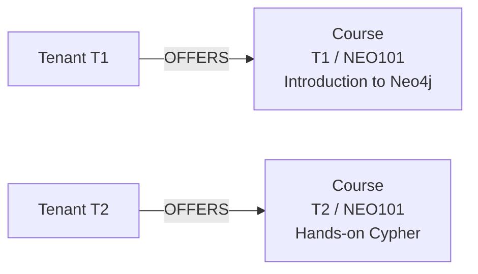

# Composite Multi-Property Constraints and Choosing the Right Key

## 1. Why Are Composite Constraints Needed?

In Neo4j's **property graph**, nodes represent entities, relationships express connections, and properties hold descriptive or identifying data. Many entities cannot be uniquely identified by a single property alone.

For example, a **multi-tenant** learning platform stores `:Course` nodes. Both organization `T1` and organization `T2` may offer a course with code `NEO101`. This code is **unique only within each organization**, not globally across the system:



These two `Course` nodes share the same `courseCode` but have **different `tenantId` values**, so they must be allowed to coexist. Conversely, two nodes with the same `tenantId: 'T1'` and `courseCode: 'NEO101'` represent duplicate business identities: querying and creating relationships to the course would become ambiguous.

A **composite uniqueness constraint** treats the **entire tuple of values** as a key. A **composite node key** additionally requires every component of the key tuple to be present. Choosing between the two depends on business requirements, Neo4j version, and edition.

After this lesson, you will be able to:

- Distinguish single-property uniqueness from **property-combination** uniqueness.
- Understand the differences among composite uniqueness, composite node keys, relationship keys, and composite indexes.
- Choose keys scoped globally, by tenant, by term, or via an intermediate entity.
- Design `MATCH`/`MERGE` queries around stable keys and avoid duplicate errors under concurrent writes.
- Audit legacy data, normalize keys, deploy constraints, and verify outcomes.
- Integrate identity rules with the Neo4j Java Driver and Spring Data Neo4j.

## 2. Thinking About Keys: Single Property or Tuple of Properties?

Suppose there are three courses:

| Node | `tenantId` | `courseCode` | Duplicates Another Node? |
| --- | --- | --- | --- |
| A | `T1` | `NEO101` | Does not duplicate B or C on the **key pair** |
| B | `T2` | `NEO101` | Differs from A on tenant |
| C | `T1` | `NEO102` | Differs from A on course code |

If you apply **uniqueness to `courseCode` alone**, A and B conflict even though they belong to different tenants. If you apply **uniqueness to `tenantId` alone**, A and C conflict even though each tenant naturally manages multiple courses.

The right constraint here is uniqueness on the **`(tenantId, courseCode)` pair**.

```text
Single key:
    courseCode = NEO101
    -> not enough to identify a single Course system-wide

Composite key:
    (tenantId, courseCode) = (T1, NEO101)
    -> identifies a single Course in the chosen model
```

Key takeaway: **uniqueness on a pair does not mean each component must be unique**. Uniqueness is evaluated across the **entire tuple** within the declared label scope.

### Label Scope Is Always Part of the Design

A constraint applies to nodes carrying the declared label, such as `:Course`. A `:LearningResource` node can hold the same pair of values without violating the `:Course` constraint, unless that node also carries the `Course` label.

For multi-label nodes, as long as **one of the labels** is `Course`, the `:Course` constraint is in effect. Adding the `Course` label to an existing node can also be rejected if its key matches an existing course.

## 3. Creating a Composite Uniqueness Constraint with Cypher

If courses may be created in a draft state without a full code, yet **once all components are present the pair must not be duplicated**, choose composite uniqueness:

```cypher
CREATE CONSTRAINT course_tenant_code_unique IF NOT EXISTS
FOR (c:Course)
REQUIRE (c.tenantId, c.courseCode) IS UNIQUE;
```

Components:

- `CREATE CONSTRAINT course_tenant_code_unique`: names the constraint for inspection and management.
- `IF NOT EXISTS`: supports re-running migrations when a matching constraint already exists; it does not guarantee the schema matches expectations unless you inspect it.
- `FOR (c:Course)`: scopes the constraint to nodes carrying the `Course` label.
- `REQUIRE (c.tenantId, c.courseCode) IS UNIQUE`: forbids two nodes from sharing **both values when the full property tuple is supplied**.

On a test database with the constraint created, consider these independent cases:

```cypher
// Succeeds if the key pair does not yet exist.
CREATE (:Course {
  tenantId: 'T1',
  courseCode: 'NEO101',
  title: 'Introduction to Neo4j'
});

// Succeeds: same code, different tenant.
CREATE (:Course {
  tenantId: 'T2',
  courseCode: 'NEO101',
  title: 'Hands-on Cypher'
});

// Succeeds: same tenant, different code.
CREATE (:Course {
  tenantId: 'T1',
  courseCode: 'NEO102',
  title: 'Query Optimization'
});

// Rejected: pair (T1, NEO101) already exists.
CREATE (:Course {
  tenantId: 'T1',
  courseCode: 'NEO101',
  title: 'Invalid duplicate'
});
```

The constraint also checks updates. If a `Course` node has its `courseCode` or `tenantId` changed so that the tuple matches another node, the `SET` operation is rejected.

### 3.1. Rules for `null` and Missing Components

**Composite uniqueness does not require every key component to exist.** With **only** the constraint above, the following nodes are not rejected merely for missing `courseCode`:

```cypher
CREATE (:Course {tenantId: 'T1', title: 'Draft 1'});
CREATE (:Course {tenantId: 'T1', title: 'Draft 2'});
```

Reason: composite uniqueness checks only nodes that have **all properties participating in the key tuple**. If any component is missing, there is no complete tuple to compare. Likewise, multiple nodes missing `tenantId` can coexist even if they all have `courseCode: 'NEO101'`.

In Neo4j, setting a property to `null` is equivalent to omitting that property; there is no storing a `null` value as a valid key component. Meanwhile, an empty string `''` is **not `null`**: it is present and participates in uniqueness comparisons. If blank codes are invalid per business rules, add separate validation.

### 3.2. Composite Uniqueness Differs from Two Separate Uniqueness Constraints

Do not replace a composite constraint with these two constraints if each tenant can have multiple courses and tenants may reuse codes:

```cypher
// NOT suitable for a (tenantId, courseCode) key where individual components may repeat.
CREATE CONSTRAINT tenant_unique IF NOT EXISTS
FOR (c:Course)
REQUIRE c.tenantId IS UNIQUE;

CREATE CONSTRAINT course_code_global_unique IF NOT EXISTS
FOR (c:Course)
REQUIRE c.courseCode IS UNIQUE;
```

Those two constraints forbid two courses in the same tenant and forbid two tenants from using the same code, respectively. They express **two completely different invariants** from tuple uniqueness.

## 4. When Every Key Component Is Mandatory: Composite Node Key

If business rules require **every `:Course` to have both `tenantId` and `courseCode`, and each pair to be unique**, a **composite node key** expresses this completely:

```cypher
CREATE CONSTRAINT course_tenant_code_key IF NOT EXISTS
FOR (c:Course)
REQUIRE (c.tenantId, c.courseCode) IS NODE KEY;
```

A node key enforces **two conditions simultaneously**:

1. Both `tenantId` and `courseCode` must have non-`null` values.
2. The `(tenantId, courseCode)` tuple cannot repeat across nodes carrying the `Course` label.

| Test `:Course` Data | Composite Uniqueness | Composite Node Key |
| --- | --- | --- |
| New `T1/NEO101` pair | Accepted | Accepted |
| Existing `T1/NEO101` pair | Rejected | Rejected |
| `{tenantId:'T1'}`, missing `courseCode` | Accepted by uniqueness | **Rejected** due to missing key component |
| `{courseCode:'NEO101'}`, missing `tenantId` | Accepted by uniqueness | **Rejected** due to missing key component |
| New `T2/NEO101` pair | Accepted | Accepted |
| `{tenantId:'T1', courseCode:''}` | May be accepted if tuple does not collide | May be accepted if tuple does not collide; validate blank codes separately |

In the **Neo4j 5.x** series, node keys require **Enterprise Edition**. Composite uniqueness can be used on Community Edition releases that support that constraint type, though it **does not automatically enforce mandatory presence**. On versions/editions with property existence constraints, another option is combining uniqueness with existence on each key component. When using a node key, do not create redundant constraints with the same meaning just to restate the same invariant.

The `IS UNIQUE` and `IS NODE KEY` examples in the two sections above are **alternative design choices** for the same property tuple. In practice, choose the one matching your requirements, data, and edition.

### 4.1. Distinguishing Identity from Type and Value Domain

A node key does not require `tenantId` or `courseCode` to be strings, nor does it know whether the code matches a pattern. If your Neo4j version supports property type constraints, you can add type rules:

```cypher
CREATE CONSTRAINT course_tenant_type IF NOT EXISTS
FOR (c:Course)
REQUIRE c.tenantId IS :: STRING;

CREATE CONSTRAINT course_code_type IF NOT EXISTS
FOR (c:Course)
REQUIRE c.courseCode IS :: STRING;
```

Type constraints do not automatically check length, `trim()`, letter case, or a pattern like `NEO\d+`. A solid key design needs a consistent **normalization and validation policy**, paired with the right database constraints to protect uniqueness/existence.

## 5. Choosing the Right Key for the Business Domain

A key can be a single property or span multiple properties; it can be a business code, a technical ID, or a hybrid. Before writing Cypher, answer these five questions:

| Design Question | Why Answer It? | Example |
| --- | --- | --- |
| **Unique within what scope?** | Avoid making the key too strict or too loose. | `courseCode` unique per `tenantId`, not system-wide. |
| **Does every record have the key?** | Determines uniqueness vs. key/existence. | Published courses must have a code; drafts might not yet have one. |
| **Are values stable over time?** | Frequently changing keys complicate links and sync. | Course titles can change; `courseCode` is relatively stable. |
| **Is there a time or partition dimension?** | Identity may need term, branch, or version added. | `(tenantId, studentId, courseCode, term)`. |
| **Where is the key used?** | Shapes API contracts, imports, queries, and change cost. | Every service must pass `tenantId` when looking up a course. |

### 5.1. Scenario-Based Key Selection Examples

| Problem | Recommended Key | Typical Constraint |
| --- | --- | --- |
| Every user has a system-wide UUID | `userId` | Uniqueness, or node key if mandatory presence is required. |
| Course code is unique only per tenant | `(tenantId, courseCode)` | Composite node key if both are always mandatory. |
| Each course has multiple offerings across terms | `(tenantId, courseCode, term)` on a `CourseOffering` node | Composite node key, keeping `Course` as the general concept if needed. |
| Students have codes per school | `(schoolId, studentCode)` | Composite key scoped by school. |
| Request tickets are numbered per branch and fiscal year | `(branchId, fiscalYear, requestNo)` | Composite key when all three components are present. |
| Course title or person name | Should not be a unique key just for display convenience | Use a stable ID; names often collide and change. |

"More components is always better" is not true. Keys with too few components collide across scopes; keys with too many components break easily when business rules shift, lengthen `MATCH`/`MERGE` queries, and add indexing, parameter-passing, and synchronization overhead.

### 5.2. Business Key or Technical ID?

A **business key** is an identity meaningful in the domain, such as `(tenantId, courseCode)`. A **technical ID** such as a UUID can be generated to stay stable even when business codes change.

Two common designs:

**Design A — Use the business key as the primary identity.** Fits when codes are clear, always present, rarely changed, and issued consistently across all systems. Queries typically use the tuple:

```cypher
MATCH (c:Course {tenantId: $tenantId, courseCode: $courseCode})
RETURN c.title AS title;
```

**Design B — Use a stable technical ID and additionally protect the business key.** Fits when business codes can change, are assigned late, or carry replacement history:

```cypher
// Unique, mandatory technical key when NODE KEY is supported.
CREATE CONSTRAINT course_uuid_key IF NOT EXISTS
FOR (c:Course)
REQUIRE c.courseId IS NODE KEY;

// Prevent duplicate complete business keys within each tenant.
CREATE CONSTRAINT course_business_key_unique IF NOT EXISTS
FOR (c:Course)
REQUIRE (c.tenantId, c.courseCode) IS UNIQUE;
```

In Design B, `courseId` is the stable identifier for integrations; `tenantId` and `courseCode` are still protected so two courses cannot share the same code. If the business key must also be present, require existence or a node key where supported by your edition. Never substitute Neo4j's `elementId()` for a durable business/technical ID stored in external systems.

**Invariants must reflect real lifecycle states.** If drafts are genuinely allowed to lack a code, do not put a mandatory code node key on the same `Course` label and fake it with `'UNKNOWN'`. Design a separate lifecycle/label for drafts, or use uniqueness when the code is present and manage draft state via business logic.

### 5.3. Normalizing Values Before Comparison

Neo4j compares **the stored values**. `'neo101'`, `'NEO101'`, and `' NEO101 '` are distinct strings, even if users consider them the same code.

Example convention:

```text
Input         Stored value after normalization
" neo101 "    "NEO101"
"NEO101"      "NEO101"
"neo101"      "NEO101"
```

Code-issuing and ingestion workflows must apply the same normalization across APIs, the Java Driver, batch imports, and migrations. In multi-tenant systems, `tenantId` must follow the same convention too; if `T1` and `t1` refer to the same organization but are stored differently, a tuple constraint will not treat them as equal. Do not change case-folding or Unicode normalization policies automatically without business confirmation of matching rules.

## 6. Composite Constraints on Relationships: Same Principle, Different Scope

Relationships also carry identifying properties. Suppose `:ENROLLED_IN` stores `tenantId` and `enrollmentId`; an enrollment is identified by that **pair**:


On Neo4j **5.7 and later** supporting relationship uniqueness:

```cypher
CREATE CONSTRAINT enrollment_tenant_unique IF NOT EXISTS
FOR ()-[r:ENROLLED_IN]-()
REQUIRE (r.tenantId, r.enrollmentId) IS UNIQUE;
```

If your version/edition supports **relationship keys** (such as Neo4j 5.7+ Enterprise):

```cypher
CREATE CONSTRAINT enrollment_tenant_key IF NOT EXISTS
FOR ()-[r:ENROLLED_IN]-()
REQUIRE (r.tenantId, r.enrollmentId) IS RELATIONSHIP KEY;
```

Semantically, a relationship key requires both `tenantId` and `enrollmentId` and forbids two `ENROLLED_IN` relationships from duplicating the pair. Composite relationship uniqueness forbids duplicates only when **all properties in the tuple** are present. Again, these are alternative options to choose based on requirements—do not create both by default.

Relationship constraints are scoped to **type `ENROLLED_IN`**. Relationships of other types, such as `:COMPLETED` or `:VIEWED`, are not governed by this constraint.

### A Relationship Key Does Not Imply Endpoint Uniqueness

Two relationships with different IDs connecting the same `Student`–`Course` pair **do not violate** a key on `(tenantId, enrollmentId)`:

```text
(Student S101)-[:ENROLLED_IN {tenantId:'T1', enrollmentId:'E001'}]->(Course NEO101)
(Student S101)-[:ENROLLED_IN {tenantId:'T1', enrollmentId:'E002'}]->(Course NEO101)
```

If business rules require **at most one enrollment per student, course, and term**, one modeling approach is to reify the enrollment as an **`:Enrollment` node** with a composite business key:

```cypher
CREATE CONSTRAINT enrollment_business_key IF NOT EXISTS
FOR (e:Enrollment)
REQUIRE (
  e.tenantId,
  e.studentId,
  e.courseCode,
  e.term
) IS NODE KEY;
```


The tuple `(tenantId, studentId, courseCode, term)` forbids two `Enrollment` **nodes** with the same combination. If re-enrollment within the same term with multi-attempt history is allowed, you may need to add `attempt` or an event ID. If `studentId` is assigned per tenant, omitting `tenantId` from the key tuple could mistakenly conflate students from two organizations.

Note: a node key on `Enrollment` **does not automatically verify** that `e.studentId` and `e.courseCode` match the connected `Student` and `Course` nodes. Create and verify those relationships inside a transaction; releases supporting extended graph schemas may offer additional mechanisms that must be verified separately.

## 7. `MERGE` on Composite Keys and Handling Concurrent Writes

When you want "find if it already exists, create if it does not", use **the exact properties participating in identity** inside the `MERGE` pattern:

```cypher
MERGE (c:Course {
    tenantId: $tenantId,
    courseCode: $courseCode
})
ON CREATE SET
    c.title = $title,
    c.createdAt = datetime()
RETURN c.tenantId AS tenantId,
       c.courseCode AS courseCode,
       c.title AS title;
```

With an appropriate node key/uniqueness constraint, the database will not allow **two nodes with the same complete key tuple** to commit. `MERGE` allows matching or creating by pattern, though the application still needs to handle concurrency errors and retries when appropriate.

### 7.1. Why Should `title` Not Be Included in the `MERGE` Key?

```cypher
// Prone to conflicts if title is a descriptive attribute that changes over time.
MERGE (c:Course {
    tenantId: $tenantId,
    courseCode: $courseCode,
    title: $title
})
RETURN c;
```

Suppose node `T1/NEO101` already exists with `title: 'Neo4j Basics'`. A new request sends the same key with `title: 'Neo4j from Scratch'`. The full three-property pattern **no longer matches**; `MERGE` may attempt to create a new node with the same `(tenantId, courseCode)` and get blocked by the constraint.

The right approach is to `MERGE` on the key tuple, then intentionally update descriptive attributes:

```cypher
MERGE (c:Course {
    tenantId: $tenantId,
    courseCode: $courseCode
})
ON CREATE SET c.createdAt = datetime()
SET c.title = $title
RETURN c;
```

In this example, `SET c.title` runs for both new and existing nodes. If policy specifies **not overwriting the title on match**, use `ON CREATE SET c.title = $title` instead of an unconditional `SET`. Choosing how descriptive data updates is a business decision.

### 7.2. `null` Errors in `MERGE` Patterns

You cannot ask `MERGE` to create or match a pattern on a property whose value is `null`:

```cypher
// Parameter $courseCode = null causes an error with a MERGE pattern containing this property.
MERGE (c:Course {
    tenantId: $tenantId,
    courseCode: $courseCode
})
RETURN c;
```

The application must **validate input parameters** before executing the query. If the business genuinely supports a draft state without a code, design a dedicated draft write flow; never run `MERGE` with an undefined key value to "auto-generate a code."

### 7.3. `MATCH` Followed by `CREATE` Does Not Replace Constraints

A common pattern:

```cypher
OPTIONAL MATCH (c:Course {
    tenantId: $tenantId,
    courseCode: $courseCode
})
RETURN c;
```

After seeing no result, the client sends `CREATE`. Two clients can **both observe no existing node** and then both create records. Without a database uniqueness/key constraint, duplicate data can be persisted. Therefore, the design needs appropriate database-level constraints alongside pre-write checks and proper transactions.

Uniqueness/keys are the guardrail ensuring duplicate tuples cannot commit; they do not automatically make every competing request succeed. One request may fail or need conditional retry. For operations with external side effects, retries must align with operation idempotency.

## 8. How Do the Java Driver and Spring Data Neo4j Use Composite Keys?

### 8.1. Java Driver: Parameterization and Value Validation

Java Driver 5.x example: pass the `(tenantId, courseCode)` tuple as parameters, avoiding Cypher string concatenation from input:

```java
import org.neo4j.driver.Driver;
import org.neo4j.driver.Session;
import java.util.Map;

public final class CourseService {
    private final Driver driver;

    public CourseService(Driver driver) {
        this.driver = driver;
    }

    public String upsertCourse(
            String tenantId, String courseCode, String title) {
        if (tenantId == null || tenantId.isBlank()
                || courseCode == null || courseCode.isBlank()) {
            throw new IllegalArgumentException(
                "Missing tenantId or courseCode");
        }
        if (title == null || title.isBlank()) {
            throw new IllegalArgumentException(
                "Course title must not be blank");
        }

        String cypher = """
            MERGE (c:Course {
                tenantId: $tenantId,
                courseCode: $courseCode
            })
            ON CREATE SET c.title = $title,
                          c.createdAt = datetime()
            RETURN c.courseCode AS courseCode
            """;

        try (Session session = driver.session()) {
            return session.executeWrite(tx ->
                tx.run(cypher, Map.of(
                    "tenantId", tenantId,
                    "courseCode", courseCode,
                    "title", title
                )).single().get("courseCode").asString()
            );
        }
    }
}
```

This example assumes `Driver` is configured and the database has constraints matching the model. Java validation provides fast feedback for missing inputs. **Database constraints protect all write paths** into the same database, including import jobs, manual Cypher tools, and other services.

If `MERGE` encounters a constraint conflict, the application must classify the error and handle it appropriately; never catch all database errors blindly and report success. When business logic needs to distinguish "created" from "already existed", design the return projection or query structure accordingly rather than assuming `MERGE` always means creation.

### 8.2. Spring Data Neo4j: `@Id` Does Not Express Every Business Key

In Spring Data Neo4j, `@Node` and `@Relationship` describe graph mapping, while `@Id` defines the persistence identifier of the entity. An entity may use a UUID `courseId` as its technical ID while the business key remains `(tenantId, courseCode)`.

Annotating one field with `@Id` **does not automatically create** a composite node key on two business fields in Neo4j. Similarly, `@NotNull` and `@NotBlank` help only when the application actively invokes validation; they do not enforce compliance for non-Java write sources.

Manage required constraints via version/edition-compatible schema migrations; let APIs/services validate input, resolve the right tenant, run related changes in transactions, and translate constraint errors into appropriate business responses.

## 9. Auditing Data Before Creating Constraints

When creating uniqueness/key constraints, Neo4j must verify existing data. If two nodes already share the same complete tuple, constraint creation fails. With a **node key**, any `:Course` node missing a key component also causes the statement to fail.

### 9.1. Finding Nodes Missing Key Components

```cypher
MATCH (c:Course)
WHERE c.tenantId IS NULL OR c.courseCode IS NULL
RETURN elementId(c) AS nodeElementId,
       c.tenantId AS tenantId,
       c.courseCode AS courseCode,
       c.title AS title
LIMIT 50;
```

Count nodes with incomplete keys:

```cypher
MATCH (c:Course)
WHERE c.tenantId IS NULL OR c.courseCode IS NULL
RETURN count(c) AS missingKeyCount;
```

With **uniqueness alone**, these nodes might still be accepted; with a **node key**, you must have a plan to backfill or convert them per business rules.

### 9.2. Finding Duplicate Tuples

```cypher
MATCH (c:Course)
WHERE c.tenantId IS NOT NULL AND c.courseCode IS NOT NULL
WITH c.tenantId AS tenantId,
     c.courseCode AS courseCode,
     count(*) AS total,
     collect(elementId(c)) AS nodeIds
WHERE total > 1
RETURN tenantId, courseCode, total, nodeIds
ORDER BY total DESC
LIMIT 50;
```

`elementId(c)` can help pinpoint records during cleanup, but should not be used as a durable business ID in external systems. For very large duplicate groups, `collect()` can consume substantial memory; query counts first, then fetch details group by group.

When remediating duplicate nodes, determine the canonical node, inspect relationships attached to each copy, and decide how to move or merge them. **Do not delete duplicate nodes mechanically**, as doing so can lose enrollments, history, or related links.

### 9.3. Finding Duplicates After Normalization

Key pairs stored as `'neo101'`, `'NEO101'`, and `' NEO101 '` may not be flagged by Neo4j as duplicates based on raw strings. If business rules specify uppercase codes with no leading/trailing spaces, audit on the **expected normalized form** before fixing:

```cypher
MATCH (c:Course)
WHERE c.tenantId IS NOT NULL
  AND c.courseCode IS NOT NULL
  AND c.tenantId IS :: STRING
  AND c.courseCode IS :: STRING
WITH toUpper(trim(c.tenantId)) AS normalizedTenant,
     toUpper(trim(c.courseCode)) AS normalizedCode,
     count(*) AS total
WHERE total > 1
RETURN normalizedTenant, normalizedCode, total
ORDER BY total DESC
LIMIT 50;
```

The example above uses the **`IS :: STRING` type predicate** on Neo4j versions supporting this syntax. If an older version does not support type predicates, check types via a compatible mechanism before calling string functions. Never automatically normalize emails or Unicode strings under a rule not yet confirmed by the business.

### 9.4. Process for Applying to Existing Data

1. Define the authoritative identity and scope: global, tenant, term, or branch.
2. Audit nodes for missing keys, duplicate tuples, wrong types, and normalization mismatches.
3. Fix data-producing systems first: APIs, Java Driver, Spring Data Neo4j, batch imports, and sync jobs.
4. Merge/clean legacy records with verification, preserving essential relationships.
5. On a database with a supporting edition, create composite uniqueness or composite keys via migrations.
6. Re-read the schema and test valid creation, duplicate keys, missing keys, and concurrent writes in a test environment.

Creating a constraint can scan existing data and consume significant resources; schedule deployment appropriately for your database size and production load.

## 10. Inspecting Schema, Indexes, and Constraint Lifecycle

After deployment:

```cypher
SHOW CONSTRAINTS;
```

You can inspect descriptive columns:

```cypher
SHOW CONSTRAINTS
YIELD name, type, entityType, labelsOrTypes, properties
RETURN name, type, entityType, labelsOrTypes, properties
ORDER BY name;
```

Verify that `labelsOrTypes` contains `Course`, `properties` contains **both `tenantId` and `courseCode`**, and `type` reflects uniqueness or node key as designed. `IF NOT EXISTS` does not substitute for this verification step.

**Uniqueness and key constraints are backed by an associated index in Neo4j.** That index can serve lookups by the key tuple when the optimizer chooses it. However, **a regular range index does not prevent duplicate data**; never replace a constraint with a plain index when the goal is protecting identity.

List indexes:

```cypher
SHOW INDEXES;
```

Check how a query uses indexes with:

```cypher
EXPLAIN
MATCH (c:Course {
    tenantId: $tenantId,
    courseCode: $courseCode
})
RETURN c;
```

`EXPLAIN` shows the plan **without executing the query**. Having a backing index does not guarantee every query will use it; the planner weighs selectivity, statistics, and query structure.

When identity rules change, drop a constraint by name:

```cypher
DROP CONSTRAINT course_tenant_code_unique IF EXISTS;
```

This is an administrative syntax example; drop a constraint only after reviewing the existing schema and data impact. Dropping a constraint means subsequent writes are no longer protected by that rule, and the constraint-created backing index may also be removed. When migrating from a single key to a composite key, prepare data and adjust queries before removing the old guardrail.

## 11. Self-Check: Choosing the Right Key for Each Requirement

Suppose you are designing a multi-tenant course management database. For each scenario, determine the right key tuple and constraint type.

| Requirement | Design Suggestion | Explanation |
| --- | --- | --- |
| `courseCode` unique per tenant, though drafts may lack it initially | Composite uniqueness on `(tenantId, courseCode)` | Blocks duplicate full tuples while allowing missing components. |
| Every course must have `tenantId` and `courseCode`, pair never duplicated | Composite node key | Forbids both missing components and duplicate tuples; requires supporting edition. |
| A user has a globally unique UUID | Single key on `userId` if mandatory | No need to include tenant if UUID is already global. |
| Each course has multiple offerings per term | `CourseOffering` node with `(tenantId, courseCode, term)` | Include `term` because each offering is its own entity. |
| Each `ENROLLED_IN` has a unique `enrollmentId` per tenant | Relationship key or composite uniqueness on `(tenantId, enrollmentId)` | Prefer key if properties are mandatory and DBMS supports it. |
| Only one enrollment per student/course/term | `Enrollment` node with domain composite key | A key on `enrollmentId` alone does not constrain endpoint pairs. |

Minimum test cases in a staging database:

1. Create two courses `T1/NEO101` and `T2/NEO101`; can they coexist?
2. Create another `T1/NEO101`; does the constraint reject it?
3. Create `:Course` with only `tenantId`; do uniqueness and node key behave differently?
4. Change a node's `courseCode` to a duplicate value; is the `SET` rejected?
5. Call `MERGE` twice with the same tuple but different titles; what happens if `title` is put into the `MERGE` pattern?
6. Create two relationships between the same endpoints with different IDs; why does an ID-based relationship key not block them?
7. Test concurrent writes to the same tuple; verify final state and application error handling.

## 12. Misconceptions to Avoid

- **"Combining two properties means each property is also unique."** False: only the **complete tuple** must be distinct.
- **"Composite uniqueness requires all key components to be present."** False: you need a node/relationship key or combined existence constraints.
- **"Keys with more fields are always safer."** Not necessarily: adding non-identifying fields can allow business duplicates or shift identity whenever descriptive attributes change.
- **"`MERGE` prevents duplicates in all situations."** No: constraints are needed to guard concurrent writes, and `MERGE` patterns must use the exact identifying tuple.
- **"A constraint on `enrollmentId` forbids multiple edges between two nodes."** False: edges with different IDs can still connect the same node pair.
- **"Node keys always work in Community Edition."** False in Neo4j 5.x; verify version, edition, and supported constraint types.
- **"With an index already created, uniqueness isn't needed."** False: regular indexes serve queries; constraints protect integrity.
- **"String keys are compared the way humans read them."** False: normalize intentionally before saving and prior to migration.

## 13. Conclusion

Composite multi-property constraints express **context-dependent identity** in a property graph. With `(tenantId, courseCode)`, Neo4j distinguishes courses sharing a code across different tenants while preventing duplicates within the same tenant. **Composite uniqueness** guards uniqueness only when the full key is present; **composite node/relationship keys** also require key components to exist on supporting versions and editions.

What matters most is not how long the `CREATE CONSTRAINT` statement is, but **choosing the right entity and key scope**: tenant, term, enrollment, or stable technical ID. When data is normalized consistently, `MATCH`/`MERGE` uses the right key tuple, migrations are verified, and the Java Driver/Spring Data Neo4j coordinates with database constraints, the graph avoids ambiguous identities and keeps Cypher relationship and path queries reliable.
