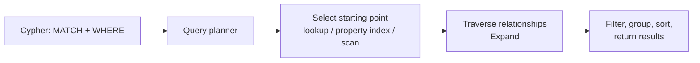
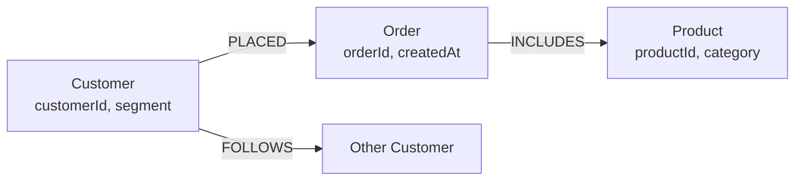

# Indexes Solve the Cost of Finding Query Starting Points

In Neo4j, graph queries typically consist of two distinct tasks: **finding the initial nodes or relationships** that match the criteria, and **traversing relationships** from those starting points to match path patterns. If a query starts from too many nodes, traversal costs can grow sharply even when the Cypher pattern is only a few hops long. An *index* helps the *query planner* locate suitable starting points and reduce the amount of data that must be inspected.

This lesson belongs to the **Lookup Indexes** chapter of the `DATABASE_ENGINE_GRAPH_NEO4J` module, focusing on **lookup indexes** for *node labels* and *relationship types*, while explaining the boundary between lookup indexes and property indexes. This is foundational knowledge for using `MATCH`, `WHERE`, `EXPLAIN`, `PROFILE`, and tuning Cypher queries on the *property graph* model. Examples use Neo4j 5.x syntax; actual execution plans may vary depending on database version, data, and statistics.

## 1. Why Can Finding Starting Points Be Expensive?

Suppose an e-commerce system stores millions of customer, order, and product nodes along with the relationships between them:

```cypher
MATCH (c:Customer)-[:PLACED]->(o:Order)
WHERE c.customerId = 'C01'
RETURN o.orderId;
```

The business meaning is straightforward: find all orders placed by customer `C01`. However, to execute this, Neo4j must choose **how to find customer `C01`**:

- Scan many nodes to find the `Customer` label and then check `customerId`.
- Use a property index on `Customer.customerId` to directly find the matching customers.
- In another query, start from the `Order` side if the filter on orders is more selective, and then traverse the `PLACED` relationship in reverse.

Once the starting node is located, the relationship expansion operator (*expand*) follows `PLACED` to retrieve the orders. Therefore, optimizing the **starting point** and optimizing the **relationship traversal** are related, yet they are not the same problem.



A conceptual way to visualize cost—not an exact timing formula—is:

```text
Query cost ≈ cost of finding starting points
           + cost of expanding relevant relationships
           + cost of filtering, aggregating, and processing results
```

If the input condition matches only one customer, the number of edges to traverse is usually much smaller than matching millions of customers and following each person's relationships. However, the actual savings depend on **selectivity**, **node degree**, and **the number of intermediate rows**.

## 2. What Is a Lookup Index in Neo4j?

A **lookup index** is an index used to identify entities by the **structural tokens** of the graph:

- **Node label lookup index:** helps find nodes carrying a label such as `:Customer`, `:Order`, or `:Product`.
- **Relationship type lookup index:** helps find relationships of a type such as `:PLACED`, `:FOLLOWS`, or `:INCLUDES`.

A lookup index **does not index property values** such as `customerId = 'C01'`, `createdAt >= date(...)`, or `price > 100`. That is the domain of property indexes, such as a **range index**.

| Index Type / Mechanism | Data Used for Lookup | Example Condition | Supported Scope |
| --- | --- | --- | --- |
| **Node label lookup** | Node label | `MATCH (c:Customer)` | Identifies the set of nodes carrying the `Customer` label |
| **Relationship type lookup** | Relationship type | `MATCH ()-[r:PLACED]->()` | Identifies the set of relationships of type `PLACED` |
| **Range index on node properties** | Label and property values | `c.customerId = 'C01'`, date/numeric comparisons | Narrows the node set by property values |
| **Range index on relationship properties** | Relationship type and property values | `r.since >= date(...)` | Narrows the relationship set by property values |
| **Text / full-text / vector index** | Text content or vectors, via dedicated mechanisms | Text search, similarity search | Specialized search use cases; does not replace lookup indexes |

**Common confusion:** Although the chapter is titled *Lookup Indexes*, in Neo4j `lookup index` specifically refers to a **node label or relationship type index**. It does not mean that every property lookup uses a lookup index.

### 2.1. Which Queries Does a Lookup Index Affect?

Querying by label:

```cypher
MATCH (c:Customer)
RETURN c.customerId AS customerId, c.name AS name;
```

One possible plan uses the `NodeByLabelScan` operator to retrieve nodes carrying the `Customer` label. The word "Scan" in the operator name does not necessarily mean Neo4j is scanning **every** node in the database: when a node label lookup index is present, this operation can use the label lookup structure.

Querying by relationship type:

```cypher
MATCH (a)-[r:PLACED]->(b)
RETURN elementId(r) AS relationshipId, elementId(a) AS fromId,
       elementId(b) AS toId;
```

The planner may use a relationship-type scan operator, such as `DirectedRelationshipTypeScan`, to retrieve `PLACED` edges. Operator names can vary by version and relationship pattern direction. If the query has a highly selective starting node, the planner may also choose to find the node first and expand relationships from it.

### 2.2. What Does a Lookup Index Not Solve?

Consider the query:

```cypher
MATCH (c:Customer)
WHERE c.segment = 'Retail'
RETURN c.customerId;
```

A lookup index can find the set of `Customer` nodes, but it **cannot directly look up the value `segment = 'Retail'`**. Without a suitable index on `Customer.segment`, Neo4j may iterate over the `Customer` nodes and filter each one by its `segment` property.

Therefore, it is important to distinguish:

1. **Label / relationship type present:** uses token lookup.
2. **Specific property value present:** consider an appropriate property index.
3. **Relationship pattern present:** must evaluate traversal (*expansion*) cost and the number of paths generated.

## 3. Practice Dataset

Use a learning database or test environment because the following statements create nodes and relationships. They are written with `MERGE` so they can be re-run on an unmodified dataset, though this does not replace unique constraints in systems with concurrent writes.



```cypher
MERGE (an:Customer {customerId: 'C01'})
SET an.name = 'An', an.segment = 'Retail'
MERGE (binh:Customer {customerId: 'C02'})
SET binh.name = 'Bình', binh.segment = 'Retail'
MERGE (chi:Customer {customerId: 'C03'})
SET chi.name = 'Chi', chi.segment = 'SMB'
MERGE (dung:Customer {customerId: 'C04'})
SET dung.name = 'Dũng', dung.segment = 'Enterprise'

MERGE (o1:Order {orderId: 'O01'})
SET o1.createdAt = date('2026-10-10')
MERGE (o2:Order {orderId: 'O02'})
SET o2.createdAt = date('2026-11-01')
MERGE (o3:Order {orderId: 'O03'})
SET o3.createdAt = date('2026-11-05')

MERGE (p1:Product {productId: 'P01'})
SET p1.category = 'Food'
MERGE (p2:Product {productId: 'P02'})
SET p2.category = 'Books'

MERGE (an)-[:PLACED]->(o1)
MERGE (an)-[:PLACED]->(o2)
MERGE (binh)-[:PLACED]->(o3)

MERGE (an)-[:FOLLOWS]->(binh)
MERGE (chi)-[:FOLLOWS]->(an)

MERGE (o1)-[l1:INCLUDES]->(p1)
SET l1.quantity = 2
MERGE (o1)-[l2:INCLUDES]->(p2)
SET l2.quantity = 1
MERGE (o2)-[l3:INCLUDES]->(p1)
SET l3.quantity = 3
MERGE (o3)-[l4:INCLUDES]->(p2)
SET l4.quantity = 1;
```

The sample dataset contains **4 Customers**, **3 Orders**, **2 Products**, **3 `PLACED` relationships**, **2 `FOLLOWS` relationships**, and **4 `INCLUDES` relationships**. Customers `C03` and `C04` have not placed any orders; customer `C01` has two orders.

To look up customers by name, relationship type, or product category, Neo4j must decide whether to start at a single node, a set of nodes by label, or relationships by type.

## 4. Inspecting and Creating Lookup Indexes

### 4.1. Viewing Existing Lookup Indexes

Neo4j 5.x typically creates one node label lookup index and one relationship type lookup index by default when initializing a database. Before creating any, inspect the actual state:

```cypher
SHOW LOOKUP INDEXES
YIELD name, entityType, state, populationPercent
RETURN name, entityType, state, populationPercent
ORDER BY entityType, name;
```

Key fields to observe:

- `name`: index name for administration.
- `entityType`: `NODE` or `RELATIONSHIP`.
- `state`: `ONLINE` means the index is ready to serve queries.
- `populationPercent`: index build progress; typically `100.0` when complete.

Actual index names may differ across databases. In Neo4j versions supporting this syntax, `SHOW INDEXES` displays all indexes; `SHOW LOOKUP INDEXES` restricts the output to lookup indexes.

### 4.2. Creating Lookup Indexes When Missing

Statement for node labels:

```cypher
CREATE LOOKUP INDEX node_label_lookup_index IF NOT EXISTS
FOR (n) ON EACH labels(n);
```

Statement for relationship types:

```cypher
CREATE LOOKUP INDEX rel_type_lookup_index IF NOT EXISTS
FOR ()-[r]-() ON EACH type(r);
```

In the syntax above:

- `FOR (n)` specifies an index on **nodes**; `labels(n)` is the label token expression to index.
- `FOR ()-[r]-()` specifies an index on **relationships**; `type(r)` is the relationship type token expression.
- `ON EACH` is part of the lookup index declaration syntax.
- `IF NOT EXISTS` prevents an error if the corresponding index already exists.

Each Neo4j database needs at most **one node label lookup index** and **one relationship type lookup index**. Do not create one lookup index for `Customer` and another for `Order`; a single label token index serves lookups across multiple labels. If the system has already created them by default, there is no need to create additional ones.

> **Operational administration:** Do not drop a lookup index serving a live workload merely to demonstrate performance differences. Missing a lookup index can force many queries onto less efficient scan plans. Perform index creation/deletion in an appropriate environment and observe the `ONLINE` state before comparing.

## 5. From Cypher to Execution Plan: Finding Starting Points by Label

Consider a query finding customers in the Retail segment:

```cypher
EXPLAIN
MATCH (c:Customer)
WHERE c.segment = 'Retail'
RETURN c.customerId AS customerId, c.name AS name;
```

`EXPLAIN` builds the execution plan without running the data-reading portion of the query. A common plan when **no index exists on `Customer.segment`** includes these logical steps:

1. Find the set of nodes with the `Customer` label, potentially using `NodeByLabelScan` backed by the label lookup index.
2. Filter properties by `c.segment = 'Retail'`.
3. Project the properties to return.

If the database has 1 million `Customer` nodes and only a few dozen `Retail` nodes, filtering properties after fetching by label can still be costly. **The lookup index eliminates the need to find labels by scanning all node types, but it does not narrow the node set by the `segment` value.**

Inspect row counts and data access counts using:

```cypher
PROFILE
MATCH (c:Customer)
WHERE c.segment = 'Retail'
RETURN c.customerId AS customerId, c.name AS name;
```

`PROFILE` **executes the query** and then displays the number of rows flowing through each operator, data access counts (*DB Hits*), and other execution details. With a small dataset, elapsed time is insufficient to conclude which index is faster at scale.

### Expected Results with the Sample Dataset

| customerId | name |
| --- | --- |
| C01 | An |
| C02 | Bình |

If the database contains additional data beyond the sample set, the result may include extra rows.

## 6. Finding Starting Points by Relationship Type

In a graph with many edge types, a query might need to find all `PLACED` relationships without knowing in advance which customers created them:

```cypher
EXPLAIN
MATCH (c:Customer)-[r:PLACED]->(o:Order)
RETURN c.customerId AS customerId,
       o.orderId AS orderId,
       type(r) AS relationshipType;
```

When starting from the **relationship type**, the relationship type lookup index can help Neo4j retrieve `PLACED` edges directly, then access the two endpoint nodes and verify the required labels. A possible plan includes the `DirectedRelationshipTypeScan` operator. The planner may also choose to start from `Customer` or `Order` nodes if estimated to be cheaper.

The pattern above returns the three `PLACED` relationships in the dataset:

| customerId | orderId | relationshipType |
| --- | --- | --- |
| C01 | O01 | PLACED |
| C01 | O02 | PLACED |
| C02 | O03 | PLACED |

If `customerId` is known beforehand, the problem changes:

```cypher
MATCH (c:Customer {customerId: 'C01'})-[:PLACED]->(o:Order)
RETURN o.orderId AS orderId
ORDER BY orderId;
```

The query planner can optimize further by **finding the exact customer node** and then following the `PLACED` edges originating from that node. Scanning all `PLACED` relationships is not necessarily the best choice. This is why **you cannot predict which index will be used merely from the appearance of `:PLACED` in Cypher**: the planner chooses a plan for the query as a whole.

## 7. When a Property Index Is Needed to Dramatically Reduce the Input Set

Lookup indexes help look up labels; to locate a specific customer by `customerId`, use a **range index** or a **unique constraint** backed by an index.

### 7.1. Creating a Range Index on a Lookup Key

```cypher
CREATE RANGE INDEX customer_id_range_idx IF NOT EXISTS
FOR (c:Customer) ON (c.customerId);
```

Once the index is in the `ONLINE` state, check the plan:

```cypher
EXPLAIN
MATCH (c:Customer)
WHERE c.customerId = 'C01'
RETURN c.customerId AS customerId, c.name AS name;
```

If the planner selects this index, you may see a `NodeIndexSeek` operator (or an equivalent variant) instead of fetching many `Customer` nodes and filtering them. Property indexes are usually most beneficial when the condition is selective, such as a unique customer ID.

In production systems, if `customerId` must be unique, the following constraint both enforces integrity and provides a backing index:

```cypher
CREATE CONSTRAINT customer_id_unique IF NOT EXISTS
FOR (c:Customer) REQUIRE c.customerId IS UNIQUE;
```

There is no need to create **both** a standalone index and a unique constraint for the same purpose if the constraint already satisfies the lookup requirement. A unique constraint will fail if duplicate IDs exist in the data; inspect and clean the data before applying it in a live system.

> With a dataset of only four customers, the planner is **not forced** to choose `NodeIndexSeek` even when the index exists; scanning a very small set may be estimated as cheaper. The presence of an index does not guarantee it will appear in every plan.

### 7.2. Indexes Can Change the Starting Direction of Graph Traversal

Consider the requirement: list customers who have orders in November 2026.

```cypher
MATCH (c:Customer)-[:PLACED]->(o:Order)
WHERE o.createdAt >= date('2026-11-01')
  AND o.createdAt < date('2026-12-01')
RETURN c.customerId AS customerId,
       o.orderId AS orderId
ORDER BY customerId, orderId;
```

Because the property filter is on `Order`, Neo4j can start from the orders matching the date range and then **traverse `PLACED` in reverse** to reach the customers. To support this strategy, you can create a range index:

```cypher
CREATE RANGE INDEX order_created_at_idx IF NOT EXISTS
FOR (o:Order) ON (o.createdAt);
```

With an appropriate index, the query planner may choose a `NodeIndexSeekByRange` or an equivalent index seek operator on `Order.createdAt`. **The arrow direction in a Cypher pattern expresses the direction of the relationship in the data, not an obligation for the planner to start execution from the node on the left.**

Sample output:

| customerId | orderId |
| --- | --- |
| C01 | O02 |
| C02 | O03 |

Although the November filter returns only two orders, you cannot conclude that the index will be faster on a small database. Comparisons are more meaningful when data volume and value distribution reflect a realistic workload.

## 8. When the Starting Point Is Good, Yet the Query Is Still Slow

Indexes solve **finding the initial entities**; afterward, the graph query still needs to traverse relationships. For example, finding products in `C01`'s orders:

```cypher
MATCH (c:Customer {customerId: 'C01'})
      -[:PLACED]->(o:Order)
      -[line:INCLUDES]->(p:Product)
RETURN o.orderId AS orderId,
       p.productId AS productId,
       p.category AS category,
       line.quantity AS quantity
ORDER BY orderId, productId;
```

A reasonable plan may include:

1. **NodeIndexSeek:** locate customer `C01` by property (if an appropriate range index exists and the planner chooses it).
2. **Expand:** find orders via `PLACED`.
3. **Expand:** find products via `INCLUDES`.
4. **Projection / Sort:** extract the properties and sort the results.

The results are `O01/P01/2`, `O01/P02/1`, and `O02/P01/3`. The index on `Customer.customerId` narrows the initial input down to a single customer, but it does not eliminate the cost of traversing the order line items.

If a customer has hundreds of thousands of `PLACED` relationships, the query can still be expensive. In that case, you need to consider time bounds, pagination, data modeling, traversal depth, filters on each side of the relationship, and the returned structure.

### 8.1. Understanding Selectivity and Intermediate Row Counts

Selectivity is the degree to which a predicate narrows down the entity set. Conditions like `customerId = 'C01'` are typically far more selective than `segment = 'Retail'` when `Retail` accounts for the majority of customers.

| Scenario | Starting Point to Consider | Reason |
| --- | --- | --- |
| All customers | `:Customer` label | No property condition; a lookup index is appropriate |
| A single customer ID | `Customer.customerId` | Value-based index can narrow down to one node |
| All `:PLACED` edges | `PLACED` relationship type | Relationship type lookup may be useful |
| Orders in a narrow date range | `Order.createdAt` | Range index can narrow the order set before traversal |
| Multiple hops through high-degree nodes | Choose a selective input and control expansion | An initial index alone is insufficient if path count explodes |

Do not interpret these suggestions as rigid rules forcing the planner to use a fixed operator. Neo4j combines statistics, index applicability, and characteristics of the entire query to select a plan.

### 8.2. Avoiding Unnecessary Cartesian Products

Two disconnected `MATCH` patterns can produce a row count equal to the product of the two node sets:

```cypher
// Generates Customer × Product pairs; only appropriate when all pairs are actually needed
MATCH (c:Customer), (p:Product)
RETURN c.customerId, p.productId;
```

To retrieve purchased products, connect them along the business path:

```cypher
MATCH (c:Customer)-[:PLACED]->(:Order)-[:INCLUDES]->(p:Product)
RETURN DISTINCT c.customerId AS customerId,
       p.productId AS productId;
```

A lookup index will not automatically fix a query model missing connecting relationships. Check for the `CartesianProduct` operator, surging row counts, and whether `DISTINCT` is needed based on the desired result definition.

## 9. Analysis Workflow Using EXPLAIN and PROFILE

A practical workflow when a slow Cypher query is detected:

1. **Identify input-filtering conditions:** labels, relationship types, identifiers, date ranges, and filter properties. Assess which condition is likely the most selective.
2. **Inspect existing indexes:** use `SHOW LOOKUP INDEXES` for token lookups and `SHOW INDEXES` for all indexes; confirm `state = 'ONLINE'`.
3. **Run `EXPLAIN`:** check whether the query starts with `NodeByLabelScan`, `NodeIndexSeek`, a relationship type scan, or another operator; follow the relationship expansion order.
4. **Run `PROFILE` on a safe read query:** compare row counts and `DB Hits` across operators, watching for filter steps processing many records or expansions generating many paths.
5. **Choose an informed adjustment:** consider adding a range index on a selective filter property, restructuring the query, or reducing the amount of data traversed.
6. **Re-measure on a realistic workload:** use the same parameters, dataset, and comparable load conditions; avoid drawing conclusions from a few test records or a single run with different cache states.

Key signals to watch for:

| Signal in the Plan | Interpretation | What to Check |
| --- | --- | --- |
| `NodeByLabelScan` → `Filter` with very high row counts | Likely filtering properties after fetching the entire label | Property index matching the `WHERE` predicate, selectivity |
| `DirectedRelationshipTypeScan` on a very common type | Having to inspect many edges of one type | Can execution start from a node with a more selective filter? |
| `NodeIndexSeek` followed by `Expand` generating huge row counts | Good starting point found, but path fan-out is large | Node degree, hop count, business bounds |
| Unexpected `CartesianProduct` | Two pattern sets are disconnected, inflating results | Fix the Cypher pattern and connecting variables |
| `Sort` / `Aggregation` processing large row counts | Cost lies after the lookup stage | Reduce input rows, return only needed properties |

**Observation caveat:** `DB Hits` reflects data access activity as measured by Neo4j, not milliseconds. Execution time is affected by memory, cache, system load, network, and the volume of data returned to the application.

## 10. Application Usage from Java Driver and Spring Data Neo4j

Whether a query runs in Neo4j Browser, through the **Neo4j Java Driver**, or is generated by Spring Data Neo4j, **choosing starting points and using indexes is the responsibility of the Neo4j query planner**. Java code should pass parameters, keep Cypher statements clear, and avoid loading unnecessary graph data.

Example with the Neo4j Java Driver (assuming a `Driver driver` instance is already available):

```java
import java.util.Map;
import org.neo4j.driver.Driver;

public class CustomerLookup {
    public static String findName(Driver driver, String customerId) {
        try (var session = driver.session()) {
            return session.executeRead(tx ->
                tx.run(
                    "MATCH (c:Customer {customerId: $id}) " +
                    "RETURN c.name AS name",
                    Map.of("id", customerId)
                ).single().get("name").asString()
            );
        }
    }
}
```

Parameterized queries support consistent execution and avoid concatenating values directly into Cypher. If `Customer.customerId` has an appropriate index, the server can select an efficient access path such as `NodeIndexSeek`. The example assumes exactly one matching customer exists; real applications must handle cases where no record is found.

In **Spring Data Neo4j**, repository methods that query by property or `@Query` queries also benefit from appropriate schema indexes. Use `EXPLAIN` with the actual generated or declared Cypher to verify; repository method names alone do not guarantee the server uses an index.

## 11. Common Misconceptions

**"Having a lookup index makes filtering on any property fast."** False. A lookup index looks up label or relationship type tokens, not property values like `customerId` or `createdAt`. To narrow by value, consider an appropriate property index or constraint.

**"`NodeByLabelScan` means scanning the entire database."** Not necessarily. The operator indicates that the query fetches nodes by label. When the node label lookup index is active, label lookup can use the token index.

**"Whenever `:PLACED` appears, the relationship type lookup index is used."** False. The planner may locate the customer via an index and then expand `PLACED`; this approach is typically suitable when there is a single customer.

**"Indexes automatically make multi-hop traversals cheap."** False. Indexes typically help find the starting point; the number of edges and paths expanded afterward remains the deciding factor.

**"Creating many lookup indexes—one per label—is better."** False. A label lookup index is a single structure covering multiple labels in the database; you do not need a separate lookup index for each label.

**"A newly created index is immediately used in every query."** False. The index must be in the `ONLINE` state; the planner also evaluates selectivity and estimated cost. For small sets, a scan can be cheaper than a seek.

## 12. Practice Exercises and Reference Answers

**Exercise 1 — Distinguish between lookup indexes and range indexes.** For the query below, identify which parts can benefit from a lookup index and which part needs a range index if the dataset is large enough:

```cypher
MATCH (c:Customer)-[:PLACED]->(o:Order)
WHERE c.customerId = 'C01'
RETURN o.orderId;
```

*Hint:* `:Customer` and `:PLACED` are a label and a relationship type; `c.customerId = 'C01'` is a property predicate. Starting from a specific `Customer` is typically well supported by a range index on `Customer.customerId`.

**Exercise 2 — Inspect relationship types.** Use `SHOW LOOKUP INDEXES` to view existing token indexes, then run `EXPLAIN` on a query fetching all `:INCLUDES` edges:

```cypher
EXPLAIN
MATCH ()-[r:INCLUDES]->()
RETURN elementId(r) AS relationshipId;
```

*Hint:* check whether the planner chooses a relationship-type scan operator. In the sample dataset, there are **4 `INCLUDES` edges**.

**Exercise 3 — Find the best starting point.** You need to retrieve orders placed in November 2026 along with the customer who placed each order. Write the query and evaluate two strategies: starting from `Customer` and traversing `PLACED`, or finding `Order` by `createdAt` and traversing in reverse.

*Reference answer:* on the sample dataset, the results are order `O02` for `C01` and order `O03` for `C02`. On a large database with many historical orders and few orders in the period, a range index on `Order.createdAt` can significantly reduce the initial input size.

**Exercise 4 — Find causes beyond indexes.** After adding an index on `Customer.customerId`, a query starting from one customer is still slow when traversing three or four hops. Open `PROFILE` and locate the operators producing high row counts at the `Expand` step; propose bounding the path scope or adding appropriate business filters.

### Key Takeaways

Neo4j's lookup indexes solve **finding nodes by label** and **finding relationships by type**. They are a key part of locating query starting points, but they **do not replace property indexes** when filtering by identifiers, dates, or other values. When tuning Cypher, examine **the initial access path, filter selectivity, traversed edges, and intermediate row counts** using `EXPLAIN`/`PROFILE`. An effective index is one that reduces the actual work of the entire query, not merely one that causes an isolated operator to be named "Seek".
