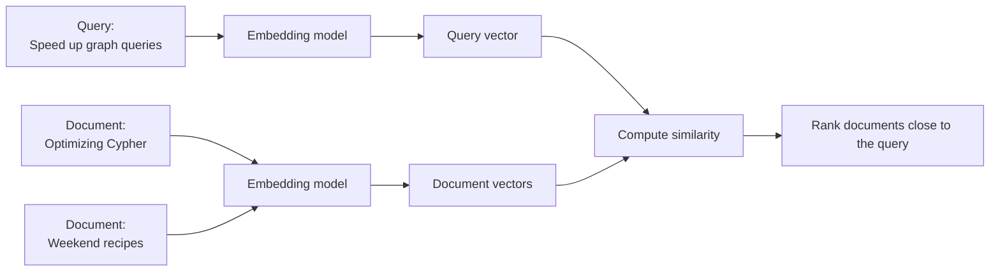
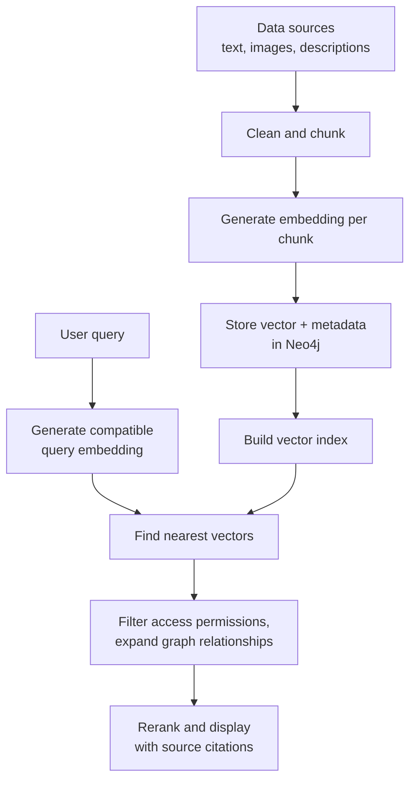

# Representing Data as Vectors and the Meaning of Similarity

In many systems, users do not know the exact keywords stored in the data. They might ask "How can I make queries faster when the graph is large?" while the document is saved with the title "Optimizing Cypher Queries". Simple string matching can miss documents with relevant content phrased differently. **Vector representation** (or *embedding*) is a way of turning content into a sequence of numbers so computers can estimate how close objects are to one another.

In Neo4j, vectors and similarity complement the **property graph** model: vectors help find nodes whose content is close to a query, while **nodes**, **relationships**, and **Cypher** queries traverse from those results to related business information. This lesson belongs to the **Advanced Search** chapter of the `DATABASE_ENGINE_GRAPH_NEO4J` module and focuses on the meaning of vectors, similarity metrics, how vectors are stored and queried in Neo4j, and the limitations of putting similarity into production.

## 1. Why Represent Data as Vectors?

Traditional databases and Cypher queries handle deterministic conditions well:

- "Find the customer with `customerId = 'C01'`."
- "Find orders created after 01/11."
- "Find all documents belonging to the Neo4j topic via `:ABOUT` relationships."

However, questions like "Which document expresses a similar idea?" or "Which product has a similar description?" are hard to express with string equality. An **embedding model** converts text, images, or other supported data types into a fixed-dimension vector of real numbers. A model trained for semantic search typically places related representations close together in a vector space.

Conceptual example:



The model does not "understand" data in the human sense, and vector proximity **does not prove** that two documents have the same content, are factually true, or match access permissions. Similarity is only a **ranking signal** defined by the model and metric.

### 1.1. From Properties to Vectors

A node in Neo4j can store both structured metadata and a vector:

```cypher
(:SearchDocument {
  docId: 'D001',
  title: 'Neo4j Overview',
  category: 'Graph',
  language: 'vi',
  embedding: [1.0, 0.0, 0.0]
})
```

Here:

| Property | Role | Usage |
| --- | --- | --- |
| `docId` | Unique business key | Exact lookup, updates, linking |
| `title` | Human-readable content | Display, keyword search |
| `category` | Business category | Filtering, authorization, or aggregation |
| `language` | Language | Grouping, choosing the right model |
| `embedding` | Numeric vector | Distance comparison, nearest-neighbor search |

The three numbers in `embedding` above are merely an easy-to-compute geometric illustration, **not the output of a language embedding model**. Real vectors often have hundreds or thousands of dimensions; individual coordinates usually do not carry simple meanings such as "the first dimension is the graph topic".

### 1.2. How Do Vectors Differ from Graph Relationships?

- **A `(:Document)-[:ABOUT]->(:Topic)` relationship** is an explicit link stored in the data representing a verifiable business assertion.
- **A `Document` vector** helps estimate content proximity or features learned from data.
- Two nodes with **no direct connecting edge** can still have similar vectors; two nodes connected by an edge do not necessarily have similar content.

In a search product, you can retrieve nodes by vector first, then traverse relationships to find subject-matter experts, source documents, products, customers, or related entities.

## 2. Vector Space, Dimensions, and Magnitude

A `d`-dimensional vector has the form:

\[
\mathbf{x} = (x_1, x_2, \ldots, x_d)
\]

For example, the three-dimensional vector `[1.0, 0.0, 0.0]` is a point in three-dimensional space; `[0.8, 0.6, 0.0]` is another point. **Dimension** is the number of coordinates, not the number of documents or graph labels.

The length, or **Euclidean norm**, of a vector is:

\[
\|\mathbf{x}\|_2 = \sqrt{\sum_{i=1}^{d} x_i^2}
\]

For instance, `[0.8, 0.6, 0.0]` has length:

\[
\sqrt{0.8^2 + 0.6^2 + 0^2} = 1
\]

A vector with norm equal to `1` is called a **unit vector**. L2 normalization converts a non-zero vector into a unit vector:

\[
\hat{\mathbf{x}}=\frac{\mathbf{x}}{\|\mathbf{x}\|_2}
\]

Normalization is useful when you want to compare the **direction** of vectors rather than their magnitude. However, whether to normalize depends on the embedding model and similarity metric; do not arbitrarily alter the workflow recommended by the model.

### 2.1. Crucial Rule About Dimensions

To compare two vectors, they must lie in the **same representation space**: identical dimensionality, compatible generation process, and compatible coordinate semantics. Two vectors that both have `1536` dimensions generated by **two completely different models** are still not semantically comparable.

Suppose a system switches from embedding model A to model B:

1. Query vectors from model B generally cannot be compared arbitrarily against document vectors created by A.
2. If B changes the dimensionality, queries against the old index may be rejected.
3. If B happens to have the same dimensionality, results can be wrong **without raising any technical error**, because the semantic space has changed.

Therefore, managing `modelId`, model version, dimensionality, preprocessing steps, and embedding generation timestamps is part of search data governance.

## 3. What Is Similarity?

**Similarity** indicates how close two vectors are according to a measurement rule. **Distance** represents how far apart they are. They can produce corresponding rankings under certain conditions, but they are not identical and can yield different rankings when data or normalization changes.

Three concepts to distinguish are **cosine similarity**, **Euclidean distance**, and **dot product**.

### 3.1. Cosine Similarity: Comparing Direction

Cosine similarity measures the cosine of the angle between two non-zero vectors:

\[
\operatorname{cosSim}(\mathbf{x}, \mathbf{y}) =
\frac{\mathbf{x}\cdot\mathbf{y}}
{\|\mathbf{x}\|_2\|\mathbf{y}\|_2}
=
\frac{\sum_{i=1}^{d}x_i y_i}
{\sqrt{\sum_{i=1}^{d}x_i^2}\sqrt{\sum_{i=1}^{d}y_i^2}}
\]

Mathematical values lie in the range **[-1, 1]**:

- Near `1`: two vectors point in nearly the same direction.
- Near `0`: two vectors are nearly orthogonal.
- Near `-1`: two vectors point in nearly opposite directions.

Cosine **does not change when a vector is scaled by a positive factor**. For example, `[1, 0]` and `[100, 0]` have a cosine of `1` despite different magnitudes.

> **Do not over-interpret:** A cosine near `1` does not mean "two sentences are 100% identical", does not represent the probability of a correct answer, and does not prove identical meaning in every context. It is a geometric measurement in the space produced by the model.

### 3.2. Euclidean Distance: Measuring Straight-Line Distance Between Points

Euclidean distance:

\[
d_2(\mathbf{x},\mathbf{y}) =
\sqrt{\sum_{i=1}^{d}(x_i-y_i)^2}
\]

**Smaller distance means closer points**. Euclidean distance is sensitive to vector **magnitude**. For example, `[1, 0]` and `[100, 0]` point in the same direction yet are `99` units apart.

For L2-normalized vectors, cosine similarity and Euclidean distance are directly related:

\[
\|\hat{\mathbf{x}}-\hat{\mathbf{y}}\|_2^2 =
2-2\,\operatorname{cosSim}(\hat{\mathbf{x}},\hat{\mathbf{y}})
\]

Thus, **for unit vectors**, sorting by descending cosine similarity is equivalent to sorting by ascending Euclidean distance. This does **not automatically hold** for unnormalized vectors.

### 3.3. Dot Product: Inner Product

Dot product:

\[
\mathbf{x}\cdot\mathbf{y} = \sum_{i=1}^{d}x_i y_i
\]

The dot product reflects both **direction and magnitude**. It is not bounded to `[-1, 1]` when vectors are unnormalized. For L2-normalized vectors, the dot product equals cosine similarity.

Different retrieval models may use cosine, dot product, or other variants. **The metric used in the index and the metric the model was trained to optimize should be compatible**; picking cosine out of habit does not guarantee the best ranking for every model.

## 4. Computing a Three-Dimensional Example by Hand

Suppose a query and three documents are represented by these illustrative vectors:

| Object | Vector | Illustrative Content |
| --- | --- | --- |
| Query `Q` | `[1.0, 0.0, 0.0]` | "Find documents about Neo4j" |
| Document `D001` | `[1.0, 0.0, 0.0]` | "Neo4j Overview" |
| Document `D002` | `[0.8, 0.6, 0.0]` | "Optimizing Cypher" |
| Document `D003` | `[0.0, 1.0, 0.0]` | "Healthy Menu" |

All vectors have length `1`. These are **coordinates chosen for this lesson** to clarify the math; do not treat them as a benchmark for any language model.

| Comparison | Cosine Similarity | Euclidean Distance | Meaning in Example |
| --- | ---: | ---: | --- |
| `Q` vs. `D001` | `1.0` | `0.000` | Closest |
| `Q` vs. `D002` | `0.8` | `0.632` | Relatively close |
| `Q` vs. `D003` | `0.0` | `1.414` | Farthest |

Calculation for `D002`:

\[
\operatorname{cosSim}(Q,D002) =
\frac{1(0.8)+0(0.6)+0(0)}{1\cdot1} = 0.8
\]

\[
d_2(Q,D002) = \sqrt{(1-0.8)^2+(0-0.6)^2+0^2}
=\sqrt{0.40}\approx0.632
\]

For these three vectors, ranking by descending cosine and ascending Euclidean distance both yield **D001 → D002 → D003**.

**Key takeaway:** In a vector search system, the input is a **query vector**, and the output is typically **nearest neighbors** along with ranking scores. The system does not automatically explain "why the semantics are similar"; explaining results requires pairing them with metadata, source text, and business relationships.

## 5. How Are Embeddings Generated and Maintained?

A typical semantic search pipeline:



### 5.1. Generating Vectors from Content

An application can obtain embeddings from a local model, a model service, or an ETL pipeline. Neo4j stores and indexes vectors, but **vectors do not appear automatically just because a vector index was created**. There must be a step that generates embeddings using a specific model and writes them to the indexed property.

For long documents, consider splitting them into meaningful *chunks*:

```text
(:Document {docId: "DOC-01"})
    -[:HAS_CHUNK]->
(:Chunk {chunkId: "DOC-01-01", text: "...", embedding: [...]})
    -[:MENTIONS]->
(:Topic {name: "Neo4j"})
```

Benefits of chunking:

- A chunk vector usually focuses on a single idea better than one vector for an overly long document.
- Results can point directly to the **relevant passage** instead of only returning a document title.
- You can traverse back `Chunk → Document` to show full provenance and continue navigating relationships such as `MENTIONS`, `AUTHOR`, or `BELONGS_TO`.

Conversely, chunks that are too small can lose context; chunks that are too large can dilute topics. Evaluate chunk size against real queries.

### 5.2. Keeping Data and Queries Consistent

At search time, the system must represent the **query** in the same vector space as the documents. Some models specify distinct *prompts* or encoders for *query* versus *document*; always use the exact pairing designed by the model.

Pre-write / pre-query checks:

1. `embedding` is a list of finite numbers with the exact configured dimensionality.
2. Vectors are valid for the similarity metric; for cosine, avoid all-zero vectors.
3. Never mix embeddings from incompatible versions or models.
4. When updating text/chunks, regenerate the corresponding embedding and version metadata.
5. Ensure data sent to external embedding models complies with security and access-control policies.

These checks prevent both explicit errors like **dimension mismatch** and silent failures like incorrect rankings caused by mixing embedding spaces.

## 6. Hands-On: Storing Vectors in Neo4j

The examples below use Neo4j 5.x with **vector index** support and the `db.index.vector.queryNodes` procedure. Syntax and APIs can vary across versions; consult the documentation for your running Neo4j version. Run these in a **test database**, as the code creates data and indexes.

### 6.1. Creating Sample Data

First, protect the document business key:

```cypher
CREATE CONSTRAINT search_document_id IF NOT EXISTS
FOR (d:SearchDocument)
REQUIRE d.docId IS UNIQUE;
```

Then create three documents with the 3-dimensional vectors used in the calculation section:

```cypher
MERGE (d1:SearchDocument {docId: 'D001'})
SET d1.title = 'Neo4j Overview',
    d1.category = 'Graph',
    d1.language = 'vi',
    d1.embedding = [1.0, 0.0, 0.0]

MERGE (d2:SearchDocument {docId: 'D002'})
SET d2.title = 'Optimizing Cypher',
    d2.category = 'Graph',
    d2.language = 'vi',
    d2.embedding = [0.8, 0.6, 0.0]

MERGE (d3:SearchDocument {docId: 'D003'})
SET d3.title = 'Healthy Menu',
    d3.category = 'Lifestyle',
    d3.language = 'vi',
    d3.embedding = [0.0, 1.0, 0.0]

MERGE (t:Topic {topicId: 'T-GRAPH'})
SET t.name = 'Graph Databases'
MERGE (d1)-[:ABOUT]->(t)
MERGE (d2)-[:ABOUT]->(t);
```

Each `SearchDocument` has a vector in its `embedding` property; the two graph documents have `:ABOUT` relationships to the same `Topic`. `D003` has no such relationship, yet remains a candidate for vector search because it has an `embedding` property.

> **Data modeling note:** `MERGE` is used to make this example repeatable on sample data; in a system with concurrent writes, add uniqueness constraints on the business keys of every node type you want to protect. This example omits a constraint on `Topic.topicId` because it only creates one illustrative topic.

### 6.2. Creating a Vector Index

A vector index on node label `:SearchDocument` and property `embedding`:

```cypher
CREATE VECTOR INDEX search_document_embedding IF NOT EXISTS
FOR (d:SearchDocument) ON (d.embedding)
OPTIONS {
  indexConfig: {
    `vector.dimensions`: 3,
    `vector.similarity_function`: 'cosine'
  }
};
```

Here:

| Configuration Part | Meaning |
| --- | --- |
| `FOR (d:SearchDocument) ON (d.embedding)` | Indexes vectors on the `embedding` property of `SearchDocument` nodes |
| `vector.dimensions: 3` | Indexed vectors must have 3 dimensions; in practice, match your model's dimensionality |
| `vector.similarity_function: 'cosine'` | Uses cosine similarity to find nearest candidates |
| `IF NOT EXISTS` | Avoids an error when a matching index already exists |

Backticks around `vector.dimensions` and `vector.similarity_function` are required in Cypher configuration maps because the keys contain dots. In real systems, dimensionality is typically much larger than `3`; choose the exact value from your embedding model.

### 6.3. Checking Index Status

```cypher
SHOW VECTOR INDEXES
YIELD name, state, populationPercent
RETURN name, state, populationPercent
ORDER BY name;
```

Wait until `search_document_embedding` reaches `state = 'ONLINE'` before querying it. An index in `POPULATING` state may not be ready yet. `populationPercent` shows ingestion progress.

**Do not confuse index types:**

- **Lookup index**: looks up node labels and relationship types.
- **Range index / constraint index**: accelerates filtering on structured properties such as `docId`, dates, and numbers.
- **Full-text index**: searches words/phrases in text via tokenization.
- **Vector index**: finds candidates by proximity in vector space.

Each type serves a distinct kind of predicate; a real search query may combine several types.

### 6.4. Finding Nearest Neighbors with Cypher

With a simulated query vector `[1.0, 0.0, 0.0]`:

```cypher
CALL db.index.vector.queryNodes(
  'search_document_embedding',
  3,
  [1.0, 0.0, 0.0]
)
YIELD node, score
RETURN node.docId AS docId,
       node.title AS title,
       score
ORDER BY score DESC;
```

The second argument is **`k`**, the number of nearest candidates requested; the third argument is the query vector. The procedure returns candidate nodes and a `score` for ranking; in this usage, **higher scores indicate closer matches**.

For the sample dataset, the expected order is **D001 → D002 → D003**, matching the geometric calculation in Section 4. The `score` value returned by the index API **must not be assumed to equal the exact raw mathematical cosine value or relevance probability**. When deploying to production, verify how your specific Neo4j version and similarity function define `score`.

On large datasets, vector indexes typically use **approximate nearest neighbor** (ANN) algorithms, such as HNSW-based structures. Thus, `k = 3` requests up to three nearest candidates found by the index search, **not an absolute guarantee** that they are the exact three closest vectors across the entire set under brute-force comparison.

### 6.5. Parameterized Queries

In an application, the query vector is produced by the embedding model and passed into Cypher via a parameter:

```cypher
CALL db.index.vector.queryNodes(
  'search_document_embedding',
  $topK,
  $queryEmbedding
)
YIELD node, score
RETURN node.docId AS docId,
       node.title AS title,
       node.category AS category,
       score
ORDER BY score DESC;
```

Example parameters:

```json
{
  "topK": 3,
  "queryEmbedding": [1.0, 0.0, 0.0]
}
```

Separating parameters from the Cypher query lets applications reuse query plans and prevents interpolating raw user strings into query syntax. For real data, `queryEmbedding` must match the index's dimensionality and generation pipeline.

## 7. Combining Vector Search with Graph Relationships

A key differentiator of Neo4j is that once the vector index returns a node, you can **traverse stored edges** to retrieve context, provenance, and related entities.

Example: after finding documents close to the query, fetch the topics each document mentions:

```cypher
CALL db.index.vector.queryNodes(
  'search_document_embedding', $topK, $queryEmbedding
)
YIELD node, score
OPTIONAL MATCH (node)-[:ABOUT]->(t:Topic)
WITH node, score, collect(DISTINCT t.name) AS topics
RETURN node.docId AS docId,
       node.title AS title,
       node.category AS category,
       topics,
       score
ORDER BY score DESC;
```

With `$topK = 3` and the sample query vector:

- **D001** and **D002** have a topics list containing `Graph Databases`.
- **D003** has an empty `topics` list because it has no `:ABOUT` edge.
- `OPTIONAL MATCH` keeps **D003** in the results even when no matching relationship exists.

This allows displaying both **vector proximity** and **explicitly defined business links**, making it clear which document the user is viewing and which topic it belongs to.

### 7.1. Filtering by Metadata After Vector Search

Suppose the application only wants to show documents in the `Graph` category:

```cypher
CALL db.index.vector.queryNodes(
  'search_document_embedding', $candidateK, $queryEmbedding
)
YIELD node, score
WHERE node.category = 'Graph'
RETURN node.docId AS docId,
       node.title AS title,
       score
ORDER BY score DESC;
```

An important point about **execution order**:

1. The vector index retrieves at most `$candidateK` candidates from the indexed set.
2. `WHERE` filters those retrieved candidates by `category`.
3. The output may contain **fewer than `$candidateK` rows**, even if the database holds many more `Graph` documents close to the query.

Therefore, **post-filtering** ANN results is not equivalent to an exact "top-k **within the Graph category only**" query. You can increase `candidateK`, design partitioned indexes according to your Neo4j version's capabilities, or use a different retrieval strategy when filters are highly selective.

For **access-control** rules, applications must guarantee only authorized data is returned. `WHERE` in Cypher is one enforcement layer, but secure design must also consider database roles, tenant isolation, API access, and cases where filtering drops candidates. Never mistake a high `score` for permission to view a result.

### 7.2. Combining with Keyword Search

Vector search often excels when queries and documents use different wording with similar meanings. Keyword or full-text search can be better when users provide **product codes**, **Cypher function names**, **error codes**, or strings requiring exact matching.

Example creating a full-text index on document titles:

```cypher
CREATE FULLTEXT INDEX search_document_title IF NOT EXISTS
FOR (d:SearchDocument)
ON EACH [d.title];
```

Keyword query:

```cypher
CALL db.index.fulltext.queryNodes('search_document_title', 'Cypher')
YIELD node, score
RETURN node.docId AS docId, node.title AS title, score
ORDER BY score DESC;
```

A **hybrid search** system can retrieve candidates from both full-text and vector indexes, then merge rankings using rules such as *reciprocal rank fusion* (RRF) or a reranker model. Do not add raw full-text `score` and vector `score` directly without calibration, because **the two scores have different scales and meanings**.

## 8. Business Meaning of "Similarity"

Geometric similarity is only useful when tied to a **search goal**.

| Problem | What Needs to Be Close? | What Must Supplement Vectors |
| --- | --- | --- |
| Finding documents that answer a question | Meaning of query and passage | Language, read permissions, freshness, citation source |
| Finding substitute products | Function, description, key attributes | Category, price, inventory, compatibility constraints |
| Finding past incidents | Error description, logs, symptoms | Software version, environment, severity |
| Recommending subject-matter experts | Skill or topic descriptions | Reporting/team relationships, permissions, up-to-date status |
| Finding similar images | Visual or multimodal features | Licensing, image quality, usage context |

For example, "12V battery" and "9V battery" may be close in language description, yet they are not interchangeable. The application must filter by **exact conditions** on voltage, model type, or technical compatibility before recommending substitutes. Vector similarity does not validate business constraints.

Also keep these concepts distinct:

- **Semantically close:** related phrasing or shared topic.
- **Identical:** same entity, same identifier, or same data.
- **Business-related:** two entities connected by an explicit edge.
- **Suitable for answering:** content with reliable evidence, within scope and access permissions.

These concepts may overlap, but they are **not equivalent**.

## 9. Evaluating Vector Search Quality

Creating an index and receiving results does not prove search quality is good. Assemble a representative query set and evaluate real outputs.

### 9.1. Core Metrics

| Metric | Meaning | When to Use |
| --- | --- | --- |
| **Precision@k** | Fraction of relevant results in the top `k` results | Want to reduce noisy results |
| **Recall@k** | Fraction of relevant items found in the top `k` | Want to avoid missing important documents |
| **MRR** | Mean reciprocal rank of the first relevant result | Users mainly need one good result |
| **nDCG@k** | Ranking quality accounting for relevance grades and positions | Documents have multiple relevance levels |
| **ANN recall@k** | Overlap with exact brute-force top-k across all vectors | Measure error introduced by approximate indexing |
| **Latency** | Retrieval time at percentiles like p50/p95 | Assess user experience and system load |

Distinguish **ANN recall@k** (match rate against exact mathematical nearest neighbors) from **business recall@k** (finding enough genuinely relevant documents). An index with high ANN recall can still return unhelpful documents if the embedding model is poorly suited.

### 9.2. Building an Evaluation Dataset

A minimal evaluation set should include:

1. Realistic queries: short queries, long questions, typos, technical jargon, and code/identifier names.
2. Ground-truth relevant documents, ideally with graded relevance and independent reviewers.
3. Slices by language, topic, tenant, or access permissions if required by the product.
4. Comparisons across variants: embedding model, chunk size, similarity metric, `k`, filters, and rerankers.
5. Measurements of **both quality and operational cost**, not just picking the configuration with the highest retrieval score.

In particular, test pairs that are "lexically close yet opposite in business effect", such as "grant view permission" versus "revoke view permission". Embedding models may place both close together due to shared topic words, even though the actions are opposite.

## 10. Performance and Operational Limits

### 10.1. Approximate Search and Latency Trade-Offs

On large datasets, comparing a query vector against **every** stored vector is resource-intensive. Vector indexes use approximate nearest-neighbor structures to reduce the candidate pool inspected. Common trade-offs:

- **Lower latency**, at the cost of potentially missing some exact nearest neighbors.
- Additional RAM and disk storage required for the index.
- Inserting/updating vectors modifies indexed data; monitor ingestion throughput and index readiness.
- Index configuration parameters, query strategies, and filter support can vary across Neo4j versions.

There is no single `k` that fits every system. When combining search with metadata filters or a reranker, the initial candidate count is usually larger than the final number of displayed results.

### 10.2. Avoiding Score Misinterpretation

**Wrong:** "`score = 0.92` means the document is 92% accurate."

**Right:** `score` is a number produced by the retrieval mechanism to **rank candidates within the context of that index and metric**. Converting it into confidence requires an independent calibration and evaluation pipeline.

Moreover, comparing raw scores across two **embedding models**, two differently configured indexes, or two system versions can be meaningless even when both return floating-point numbers.

### 10.3. Stale Data Risk

If document content changes without updating `embedding`, the vector reflects the **old version**. Maintain an update pipeline:

```text
Document changes
    → identify affected chunks
    → regenerate embeddings with current model
    → update vector property + modelVersion + updatedAt
    → verify index is ONLINE and check query quality
```

Similarly, if you change the embedding model or dimensionality, plan a vector regeneration and compatible index migration; never mix old and new embeddings without validation.

### 10.4. Sensitive Data and Multi-Tenancy

Embeddings can reflect source content derived from internal data. When using external embedding services, govern what data is transmitted, stored, and accessed according to organizational policy.

In multi-tenant applications, **never rely on similarity scores for authorization**. Security constraints must be enforced before displaying, exporting, or feeding documents into downstream tasks. If you need guaranteed top-k results per tenant, design retrieval and indexing around tenant boundaries rather than merely truncating results after a global top-k search.

## 11. Connecting a Java Application to Vector Queries

In a Java application, the embedding model is usually called in a separate step; the **Neo4j Java Driver** accepts a `List<Double>` representing the vector and passes it as a Cypher parameter. Minimal example with Neo4j 5.x driver (assuming the index is `ONLINE`):

```java
import java.util.List;
import java.util.Map;
import org.neo4j.driver.Driver;

public class VectorSearchService {
    public static void search(Driver driver, List<Double> queryEmbedding) {
        var result = driver.executableQuery("""
            CALL db.index.vector.queryNodes(
              'search_document_embedding', $topK, $queryEmbedding
            )
            YIELD node, score
            RETURN node.docId AS docId,
                   node.title AS title,
                   score
            ORDER BY score DESC
            """)
            .withParameters(Map.of(
                "topK", 3,
                "queryEmbedding", queryEmbedding
            ))
            .execute();

        result.records().forEach(row -> {
            System.out.println(row.get("docId").asString()
                + ": " + row.get("title").asString()
                + " (score=" + row.get("score").asDouble() + ")");
        });
    }
}
```

Test invocation:

```java
VectorSearchService.search(
    driver,
    List.of(1.0, 0.0, 0.0)
);
```

In a real application, `queryEmbedding` must come from an embedding step compatible with the model used for the data; verify dimensionality and numeric validity before calling Neo4j. If using **Spring Data Neo4j**, you can run a dedicated Cypher query via a repository or `Neo4jClient` depending on your design; the vector index and approximate search still execute inside Neo4j.

## 12. Common Errors and How to Diagnose Them

| Symptom | Common Cause | Fix |
| --- | --- | --- |
| Query vector rejected | Wrong dimensionality, invalid values, index config mismatch | Check model, numeric list, and `vector.dimensions` |
| Index cannot be queried yet | `POPULATING` or not `ONLINE` | Inspect `SHOW VECTOR INDEXES` |
| Strange results despite matching dimensions | Mixed models/versions or mismatched preprocessing | Regenerate compatible embeddings and check `modelId` |
| Semantically close but wrong for business | Lexical/semantic similarity does not equal compatibility | Add hard filters, metadata, graph traversal, and a reranker |
| Very few results remain after filtering | Filter applied after ANN top-k | Increase `candidateK` and design filtered retrieval |
| Results return but slowly | Too many candidates, wide graph traversal, slow model call | `PROFILE` Cypher and measure embedding/index/traversal times separately |
| New or updated documents rank poorly | Stale or missing embeddings | Synchronize ingest and re-embedding pipelines |
| High score interpreted as accuracy probability | Uncalibrated score scale | Use task evaluation; never treat `score` as probability |

## 13. Practice Exercises

**Exercise 1 — Compute similarity.** Given `Q = [1, 0, 0]` and `B = [0.6, 0.8, 0]`, compute cosine similarity and Euclidean distance. Then multiply `B` by `10` and explain why cosine stays unchanged while Euclidean distance changes.

*Check:* initial cosine equals `0.6`; initial distance is `sqrt(0.8) ≈ 0.894`. After multiplying by `10`, cosine remains `0.6` while distance to `Q` increases to `sqrt(89) ≈ 9.434`.

**Exercise 2 — Verify the index.** Create the three `SearchDocument` nodes and the vector index as in Section 6. Run `SHOW VECTOR INDEXES` and query top-2 with `[1.0, 0.0, 0.0]`. Explain why `D001` and `D002` are expected to rank above `D003`.

**Exercise 3 — Combine vector search with the graph.** Write a vector query returning top-3 documents along with their topics via `:ABOUT`. Ensure `D003` is not dropped when it lacks edges by using `OPTIONAL MATCH`.

**Exercise 4 — Analyze post-filtering.** With the sample vector, query top-1 and then filter `category = 'Lifestyle'`. Why might you get **0** results even though `D003` exists? Adjust `candidateK` and explain why this still does not guarantee conditional top-k results in a large system.

**Exercise 5 — Choose the right techniques.** Design a support documentation search feature handling both natural-language questions and exact error codes. State the respective roles of full-text indexes, vector indexes, metadata filtering, graph traversal, and evaluating `Precision@k`/`Recall@k`.

## Remember

**Embeddings** represent content as vectors so computers can measure proximity in a space learned by a model. **Cosine similarity** compares direction, **Euclidean distance** compares separation, and **dot product** depends on both direction and magnitude when vectors are unnormalized. In Neo4j, a **vector index** retrieves candidates close to the query content, while the **property graph** connects those candidates to topics, source documents, and business entities via Cypher.

A result with a close vector is **not automatically** accurate, safe, authorized, or suitable for the business task. Search quality depends on the embedding model, input data, similarity metric, filtering pipeline, graph traversal, index maintenance, and evaluation on realistic queries.
