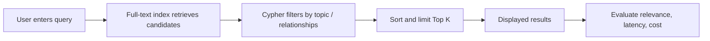

# Evaluating Result Quality, Latency, and Resource Cost

## 1. Why Evaluate Search Across Three Dimensions?

In Neo4j, applications can find documents, products, users, or paths in a **property graph** using Cypher, property indexes, **full-text indexes**, **vector indexes**, or a combination of retrieval methods. A query that runs and returns data is not enough to prove that the search system works well.

For example, a technical documentation search feature may encounter situations such as:

- Returning results very quickly, yet placing the key article outside the top ten positions.
- Finding many relevant articles, yet experiencing `p95` latency spikes under high user concurrency.
- Improving relevance by expanding thousands of nodes and relationships, at the expense of high `DB Hits`, CPU, memory, and disk reads.

Therefore, you must evaluate **all three dimensions**:

| Dimension | Question | Typical Metrics |
|---|---|---|
| **Result quality** | Does it find relevant documents and rank them in the right order? | `Precision@K`, `Recall@K`, `MRR`, `nDCG@K`, zero-result rate |
| **Latency and serving capacity** | How long do users wait, especially at high percentiles and under load? | `p50`, `p95`, `p99`, queries per second (QPS), error rate, timeouts |
| **Resource cost** | How much does each request and the whole system consume? | `DB Hits`, rows, CPU, heap/GC, page-cache misses, I/O, index storage |

This lesson belongs to the **Advanced Search** section of the `DATABASE_ENGINE_GRAPH_NEO4J` module. We will use real node/relationship data, full-text indexes, Cypher, and Java Driver examples to measure all three aspects, while showing when to use `EXPLAIN`, `PROFILE`, and application-side timing.

### Learning Objectives

After this lesson, you will be able to:

1. Build an evaluation query set with *relevance judgments*.
2. Compute and interpret `Precision@K`, `Recall@K`, `MRR`, and `nDCG@K`.
3. Separate **Neo4j query execution time** from **end-to-end latency** and measure percentiles under representative load.
4. Combine `EXPLAIN`/`PROFILE` with system metrics to locate resource bottlenecks.
5. Compare two search approaches under controlled conditions and decide using quality thresholds and latency budgets.

## 2. Building a Repeatable Dataset and Search Queries

Suppose a learning portal needs to search articles about Neo4j, Cypher, Java, and databases. Each document is an `AS007Doc` node with `id`, `title`, `body`, and `topic`. The `AS007_ABOUT` relationship links documents to topics, illustrating graph filtering after text search.



### 2.1. Creating Eight Sample Documents

Labels and index names prefixed with `AS007` are dedicated to this lesson. **Run only in a practice database**; `MERGE` prevents duplicate nodes with the same `id` when re-run.

```cypher
UNWIND [
  {id: 'd01', title: 'Neo4j Graph Modeling',
   body: 'Model nodes, relationships and property graph schema',
   topic: 'graph'},
  {id: 'd02', title: 'Cypher Path Queries',
   body: 'Find shortest paths and traversals in Neo4j',
   topic: 'graph'},
  {id: 'd03', title: 'Spring Data Neo4j',
   body: 'Map Java entities and Neo4j repositories',
   topic: 'java'},
  {id: 'd04', title: 'Graph Search Techniques',
   body: 'Full text retrieval, graph ranking and search evaluation',
   topic: 'graph'},
  {id: 'd05', title: 'Relational Database Indexes',
   body: 'B-tree indexes and SQL execution plans',
   topic: 'relational'},
  {id: 'd06', title: 'Neo4j Full Text Index',
   body: 'Search documents with text indexing in Neo4j',
   topic: 'graph'},
  {id: 'd07', title: 'Graph Theory Basics',
   body: 'Graph vertices, edges and algorithms',
   topic: 'graph'},
  {id: 'd08', title: 'Java Logging Basics',
   body: 'Configure logs and observe application latency',
   topic: 'java'}
] AS row
MERGE (d:AS007Doc {id: row.id})
SET d.title = row.title,
    d.body  = row.body,
    d.topic = row.topic;
```

Create relationships between documents and topics:

```cypher
MATCH (d:AS007Doc)
MERGE (t:AS007Topic {name: d.topic})
MERGE (d)-[:AS007_ABOUT]->(t);
```

Verify the data:

```cypher
MATCH (d:AS007Doc)-[:AS007_ABOUT]->(t:AS007Topic)
RETURN d.id AS docId, d.title AS title, t.name AS topic
ORDER BY docId;
```

If only the lesson sample data exists, expect **8 rows**, one per document. This small dataset teaches how to measure and verify results; **never use eight nodes to draw conclusions about production performance**.

### 2.2. Creating the Full-Text Index and Checking Status

In Neo4j 5.x, a full-text index uses a text analyzer to index tokens and supports Lucene query syntax. It differs from a `TEXT` index used for Cypher string predicates such as `CONTAINS` and `ENDS WITH`.

```cypher
CREATE FULLTEXT INDEX as007_doc_fts IF NOT EXISTS
FOR (d:AS007Doc)
ON EACH [d.title, d.body];
```

```cypher
SHOW FULLTEXT INDEXES
YIELD name, type, state, populationPercent, labelsOrTypes, properties
WHERE name = 'as007_doc_fts'
RETURN name, type, state, populationPercent, labelsOrTypes, properties;
```

Before measuring, confirm the index exists, covers `AS007Doc(title, body)`, and has `state = 'ONLINE'`. If it is still `POPULATING` or an index with the same name has a different schema, measurements are unreliable. Index building takes time and resources; do not lump index-build cost into steady-state query latency when evaluating normal search traffic.

### 2.3. Running the Baseline Search

```cypher
CALL db.index.fulltext.queryNodes('as007_doc_fts', 'graph')
YIELD node, score
RETURN node.id AS docId, node.title AS title, score
ORDER BY score DESC, docId
LIMIT 5;
```

`score` is a ranking value generated by the full-text engine, **not a probability of correctness**, and should not be compared directly with vector scores or another index's scores. Tied scores are ordered by `docId` for deterministic output. Analyzers can change candidate counts and ordering; therefore, **record actual observed outputs** rather than assuming a fixed order across versions or configurations.

A graph-combined variant returning only documents under the `graph` topic:

```cypher
CALL db.index.fulltext.queryNodes('as007_doc_fts', 'graph')
YIELD node, score
MATCH (node)-[:AS007_ABOUT]->(:AS007Topic {name: 'graph'})
RETURN node.id AS docId, node.title AS title, score
ORDER BY score DESC, docId
LIMIT 5;
```

This is a common pattern: the index produces candidates, Cypher verifies graph context, and then results are ranked. **Applying `LIMIT` too early before `MATCH` can drop qualifying documents**; filtering relationships after generating too many candidates can inflate cost. Both quality and performance must be measured across **the entire pipeline**.

## 3. Evaluating Quality with Relevance Labels

Simply checking that a query executes is not enough. You need a set of user queries and ground-truth judgments (*golden set*, *qrels*) labeled independently of the system under test.

For example, an assessor scores the query `graph` as follows:

| `docId` | Content | Relevance |
|---|---|---:|
| `d01` | Neo4j Graph Modeling | 3 — highly relevant |
| `d04` | Graph Search Techniques | 2 — relevant |
| `d07` | Graph Theory Basics | 1 — partially relevant |
| `d02` | Cypher Path Queries | 1 — indirectly relevant |
| `d03`, `d05`, `d06`, `d08` | Remaining documents | 0 — not relevant to this specific intent |

These labels are **hypothetical judgments for the exercise**, not universal truth. Depending on search intent (learning graph theory, designing a Neo4j schema, or tuning queries), the same document may be scored differently.

A reliable process for building `qrels`:

1. **Select representative queries** from real intents: document navigation, Cypher error troubleshooting, conceptual questions, product names, long Vietnamese queries, and misspelled keywords.
2. **Pool candidates from multiple methods** (full-text, property search, vector/hybrid, manual lookup) to avoid labeling only what a single system returns.
3. **Define the grading scale upfront** (e.g., 0–3); use multiple independent assessors and resolve disagreements with a consistent rule.
4. **Separate development and test sets**; do not tune weights to overfit the exact queries used for final reporting.
5. **Refresh over time** as content, language, and user goals evolve; version both datasets and label sets so comparisons stay valid.

Labels may be missing for documents never reviewed. **Never assume every unjudged document is irrelevant** when calculating recall; that skews the metric. Document how *unjudged documents* are handled or expand labeling coverage.

### 3.1. Precision@K — Accuracy Within the Top K Results

With the convention that `relevant` means a label **greater than 0**:

```text
Precision@K = count of relevant documents in Top K / K
```

Suppose an **illustrative** ranking method (not Neo4j's default output) produces:

| Rank | Document | Label |
|---:|---|---:|
| 1 | d05 | 0 |
| 2 | d04 | 2 |
| 3 | d01 | 3 |
| 4 | d07 | 1 |
| 5 | d08 | 0 |

The top 3 contain two relevant documents, so `Precision@3 = 2/3 ≈ 0.667`. Precision is especially useful when the UI displays only one page of results, though it does not show how many good documents were missed.

### 3.2. Recall@K — Coverage of Relevant Documents

```text
Recall@K = count of relevant documents in Top K
           / total relevant documents in the evaluation set
```

With four documents considered relevant (`d01`, `d02`, `d04`, `d07`), the top 3 retrieve two, giving `Recall@3 = 2/4 = 0.5`. Recall matters for knowledge discovery, compliance/document review, or tasks where missing items is costly.

A Cypher snippet verifying both calculations on the **hypothetical ranking**:

```cypher
WITH ['d05', 'd04', 'd01'] AS top3,
     ['d01', 'd02', 'd04', 'd07'] AS relevantIds
WITH top3, relevantIds,
     size([id IN top3 WHERE id IN relevantIds]) AS hits
RETURN toFloat(hits) / size(top3) AS precisionAt3,
       toFloat(hits) / size(relevantIds) AS recallAt3;
```

Expected output: `precisionAt3 ≈ 0.6667`, `recallAt3 = 0.5`. In a real system, **each query must have its own ground-truth list**, never a single hardcoded `relevantIds` shared across all queries.

### 3.3. MRR — Rewarding Early Placement of Relevant Results

For a single query, **Reciprocal Rank (RR)** is the reciprocal of the rank of the **first relevant document**:

```text
RR(query) = 1 / rank of the first relevant result
MRR = mean of RR across all evaluation queries
```

In the example, the first relevant result sits at rank `2`, so `RR = 1/2 = 0.5`. If a query has no relevant results within the evaluated cutoff, set `RR = 0`. `MRR` is especially fitting for **navigational** queries where users mostly need one target document quickly; it does not directly measure list quality beyond the first hit.

### 3.4. nDCG@K — Evaluating Ranking with Graded Relevance

`nDCG@K` uses graded labels `0–3` instead of binary relevant/irrelevant judgments. Under the common formulation:

```text
DCG@K  = sum over i = 1..K of (2^rel_i - 1) / log2(i + 1)
IDCG@K = DCG@K of the ideal ordering sorted by descending label
nDCG@K = DCG@K / IDCG@K   (when IDCG@K > 0)
```

For the illustrative top 3 with labels `[0, 2, 3]`:

```text
DCG@3  = 0/1 + 3/log2(3) + 7/log2(4) ≈ 5.393
IDCG@3 = 7/1 + 3/log2(3) + 1/log2(4) ≈ 9.393
nDCG@3 ≈ 5.393 / 9.393 ≈ 0.574
```

A better ranking places `d01` (label 3) ahead of `d04` (label 2), followed by label-1 documents. Generally, nDCG falls in `0–1` for non-negative labels, where `1` represents the ideal ordering within the evaluated cutoff. For queries with no positively labeled documents, establish a **clear convention** (such as excluding them from the average or assigning 0) and avoid dividing by `IDCG = 0`.

### 3.5. Choosing Metrics by Intent

| Scenario | Priority Metrics | Reason |
|---|---|---|
| User wants a specific named document | `MRR`, `Success@1` | Position of the first result matters |
| Top 10 results page | `Precision@10`, `nDCG@10` | First-page quality and ordering |
| Research/lookup where omissions are unacceptable | `Recall@K` | High coverage of relevant documents |
| Results vary across relevance grades | `nDCG@K` | Distinguishes "exact fit" from "marginally relevant" |
| Search spanning diverse query groups | Per-group metrics + overall average | Prevents common queries from masking hard segments |

In practice, report metrics **by intent group** as well as slices by language, word count, and popularity. A single overall average can hide sharp drops on rare queries or accented Vietnamese queries.

## 4. Measuring Latency from User to Neo4j

**End-to-end latency** is the elapsed time from when the application receives a request until a usable response is ready. In a Java / Spring Data Neo4j application, this can include:

```text
HTTP/API → authentication → acquire Driver session
         → send Cypher over network → Neo4j planning/execution
         → stream and decode records → map DTOs → API response
```

Neo4j's `PROFILE` describes work **inside the query**. It does not capture HTTP overhead, network round-trips, deserialization, UI rendering, or thread queuing. Thus, **two measurement layers are needed**: end-to-end timing in the application and internal diagnostics in the database.

### 4.1. p50, p95, p99, and QPS

| Metric | Interpretation |
|---|---|
| `p50` | 50% of requests finish at or below this latency (per chosen percentile estimator) |
| `p95` | Roughly 95% of requests finish at or below this latency; tracks slow-request tail |
| `p99` | Roughly the slowest 1% of requests; sensitive to load spikes |
| `QPS` | Queries completed per second; always report alongside concurrency, error rate, and latency |
| `Timeout/error rate` | Percentage of timed-out or failed requests; must be included when reporting service quality |

Example measuring ten runs with hypothetical latencies in ms:

```cypher
UNWIND [18, 20, 21, 23, 24, 25, 28, 30, 45, 95] AS latencyMs
RETURN round(avg(latencyMs), 1) AS meanMs,
       percentileCont(latencyMs, 0.50) AS p50Ms,
       percentileCont(latencyMs, 0.95) AS p95Ms;
```

Using linear interpolation in `percentileCont`: `meanMs = 32.9`, `p50Ms = 24.5`, `p95Ms = 72.5`. **Ten samples only illustrate the calculation** and are far too few for reliable p95/p99 reporting. Proper benchmarks require adequate sample counts covering fast, slow, zero-result, and error cases.

High p95 alongside good p50 often points to difficult query subsets, cache misses, resource contention, GC pauses, or concurrency bottlenecks. Two percentile numbers alone cannot pinpoint the root cause.

### 4.2. Measuring Execution Time in the Java Driver

Time both the query call **and result consumption**; timing only until a lazy cursor is obtained misses record streaming time.

```java
String cypher = """
    CALL db.index.fulltext.queryNodes('as007_doc_fts', $q)
    YIELD node, score
    RETURN node.id AS docId, node.title AS title, score
    ORDER BY score DESC, docId
    LIMIT $k
    """;

long startNs = System.nanoTime();
try (var session = driver.session()) {
    var rows = session.executeRead(tx ->
        tx.run(cypher, java.util.Map.of("q", "graph", "k", 5)).list()
    );
    long elapsedNs = System.nanoTime() - startNs;
    double elapsedMs = elapsedNs / 1_000_000.0;
    System.out.printf("rows=%d latencyMs=%.2f%n", rows.size(), elapsedMs);
}
```

Here `driver` is a configured `org.neo4j.driver.Driver`; the snippet demonstrates application-side timing rather than a full benchmark harness. The timer measures **opening the session, running the read transaction, and materializing the list**. To measure an endpoint, place timers at the HTTP/API layer and track mapping/serialization time separately. Avoid logging full result payloads on the hot path because logging skews measurements.

### 4.3. Designing a Load Benchmark

A minimal latency benchmark procedure:

1. **Fix the environment:** Neo4j version, memory settings, CPU count, dataset size, `ONLINE` index state, schema version, Java Driver version, and hardware profile.
2. **Run a warm-up:** prime connection pools, query planner caches, and page cache; measure *cold* and *warm* separately if needed rather than mixing them silently.
3. **Mix realistic queries:** combine common/rare keywords, multi-token queries, typos, relationship filters, zero-result queries, and varied `K` values.
4. **Ramp concurrency in controlled steps:** record concurrent clients, QPS, timeouts, p50/p95/p99 latencies, and error rates at each load level; do not report peak QPS alone.
5. **Repeat and cross-check:** collect sufficient samples over time, alternate A/B test order while holding other factors constant, and inspect variance across runs instead of trusting one run.
6. **Test under concurrent writes:** if production indexes/updates documents alongside searches, measure both search latency and index update overhead.

**Illustrative SLO example** (must be tailored to your product, not a Neo4j standard): at `100 QPS`, `p95 < 250 ms`, error rate `< 0.1%`, `nDCG@10 ≥ 0.85`. An option that meets p95 while sharply degrading recall is not an improvement.

## 5. Evaluating Resource Cost in Neo4j

### 5.1. What Do EXPLAIN and PROFILE Answer?

`EXPLAIN` generates a query plan **without executing** it; use it to inspect index access paths, relationship expansions, sorts, and aggregations. `PROFILE` **executes the query** and collects runtime statistics (depending on version and runtime), notably:

- **Rows:** rows flowing through each operator; sudden spikes after `Expand` or `MATCH` usually drive high cost.
- **DB Hits:** storage engine access requests per operator; a proxy for database work, **not milliseconds** and not equivalent to disk reads.
- **Memory:** memory used or estimated by operators when supported, especially `Sort`, aggregations, and joins.
- **Page cache hits/misses:** when available in profiling/monitoring, shows whether data was served from cache or fetched from disk.

Examples:

```cypher
EXPLAIN
CALL db.index.fulltext.queryNodes('as007_doc_fts', 'graph')
YIELD node, score
MATCH (node)-[:AS007_ABOUT]->(:AS007Topic {name: 'graph'})
RETURN node.id AS docId, score
ORDER BY score DESC, docId
LIMIT 5;
```

```cypher
PROFILE
CALL db.index.fulltext.queryNodes('as007_doc_fts', 'graph')
YIELD node, score
MATCH (node)-[:AS007_ABOUT]->(:AS007Topic {name: 'graph'})
RETURN node.id AS docId, score
ORDER BY score DESC, docId
LIMIT 5;
```

When reading the plan, locate the full-text `ProcedureCall`, relationship traversal steps, `Topic` filtering, sorting, and limiting. Exact operator names vary across versions and runtimes. **Low DB Hits do not guarantee fast responses** if the application transfers huge records over the network or spends heavy CPU in Lucene/vector processing.

### 5.2. Reading System Metrics and Balancing Resources

| Metric Source | What to Monitor | Warning Signs to Investigate |
|---|---|---|
| Query plan / `PROFILE` | Rows, DB Hits, sort, aggregation | Row explosion after relationship expansion; late filtering |
| Neo4j metrics / monitoring | CPU, heap, GC, page cache, disk I/O | Rising cache misses, GC pauses, CPU saturation |
| OS / container | RSS, CPU/memory limits, I/O, disk | Throttling, swapping, disk exhaustion |
| Application / Driver | Connection pool, wait time, retries, timeouts | Pool queuing, repeated retries, stalled requests |
| Index operations | Index size, population time, write cost | Extra indexes slowing writes and growing storage |

A full-text query with good relevance can still be very expensive if it generates thousands of candidates and then runs multi-hop `MATCH` traversals for each one. Track **candidate counts before and after every stage**. When adding a vector index, account for embedding storage, index build cost, ANN memory, and re-indexing writes—not just warm query latency.

**Cost per useful result** can also be tracked—for instance, CPU-ms/request or DB Hits/query alongside `Precision@10`. Do not replace standard metrics with a single ad-hoc ratio; track quality, latency, and resource consumption together to understand trade-offs.

## 6. Comparing Search Approaches Fairly

Suppose an engineering team evaluates three pipelines:

| Approach | How It Works | Strengths | Risks to Measure |
|---|---|---|---|
| A — Text predicate | `MATCH ... WHERE title CONTAINS $q` | Simple, suited to exact substring checks | No relevance ranking; different semantics from tokenization |
| B — Full-text | `db.index.fulltext.queryNodes`, Top K | Keyword ranking and text query syntax | Misses synonymous phrasing; analyzer-dependent |
| C — Hybrid | Full-text + vector, rank-merged | Can improve both semantic and keyword coverage | Additional index, latency, embedding cost, and fusion tuning |

Pipeline A can be accelerated with a **TEXT index** for `CONTAINS`; Pipeline B uses a **FULLTEXT index**. Because these represent two search types with different semantics, compare them on the same user need, not merely the same input string.

### 6.1. Combining Full-Text and Vector Search: Avoid Raw Score Mixing

Full-text scores and vector scores typically live on different scales. Avoid formulas like `0.5 * fulltextScore + 0.5 * vectorScore` without calibration or normalization, because the raw numbers are not directly comparable. A simple alternative is **Reciprocal Rank Fusion (RRF)**:

```text
RRF(doc) = sum over retrieval lists [ 1 / (c + rank_list(doc)) ]
```

Where `rank_list(doc)` is the document's rank in each list and `c` is a smoothing constant chosen by the team (e.g., `60`). Documents absent from a list receive no contribution from that list. RRF uses **ranks**, not raw scores; you must still re-evaluate `Recall@K` and `nDCG@K`, as fusion does not automatically improve every query type.

For graph search, after retrieving candidates you can add signals from relationships to topics, authors, or permissions. Any multi-hop scoring boost must be profiled for added `DB Hits`/rows and verified against row multiplication; ranking must always respect access-control rules.

### 6.2. Presenting Trade-Offs in a Decision Matrix

The following **hypothetical** numbers illustrate how to present results after testing on the same dataset and workload:

| Metric | A: Substring | B: Full-text | C: Hybrid |
|---|---:|---:|---:|
| `nDCG@10` (higher is better) | 0.61 | 0.79 | 0.86 |
| `Recall@10` (higher is better) | 0.56 | 0.74 | 0.84 |
| End-to-end `p95` (ms, lower is better) | 95 | 130 | 230 |
| CPU-ms / request (lower is better) | 8 | 14 | 35 |
| Error rate (%) | 0.0 | 0.0 | 0.2 |

If the SLO requires `p95 < 200 ms` and errors `< 0.1%`, C fails to qualify despite having the highest quality. The team can pick B, or optimize C and benchmark again. When deciding, examine **per-query-group** breakdowns, index storage, and write-path impact as well.

A pragmatic decision rule is to **define non-negotiable guardrails before optimizing**: minimum quality, maximum latency, error ceiling, and infrastructure budget. Then compare only options that meet all guardrails; in multi-objective problems, never optimize blindly for a single number.

## 7. Evaluation Workflow from Lab to Production

A team deploying search on Neo4j can follow this cycle:

1. **Define intents and query set.** Cover navigation, short keywords, natural language phrasing, accented/unaccented Vietnamese queries, and zero-result queries.
2. **Freeze dataset and qrels.** Every approach is tested against the same snapshot, same queries, and same labeling rules.
3. **Measure offline quality.** Report `Precision@K`, `Recall@K`, `MRR`, and `nDCG@K`; save per-query outputs for error analysis.
4. **Measure latency and resources.** Across concurrency levels, capture `p50/p95/p99`, QPS, errors, CPU, page cache, heap, and index sizes; inspect `EXPLAIN/PROFILE` on slow queries.
5. **Compare and select.** Hold data and load constant, run enough repetitions, and apply agreed thresholds.
6. **Monitor post-deployment.** Track clicks, time-to-useful-result, zero-result queries, p95, errors, and resources; use user feedback to refresh qrels and detect *quality drift*.

**Note on behavioral data:** click-through rate (CTR) is only an indirect signal influenced by rank position, UI layout, visual prominence, and user habits. Never conclude a document is right solely because it was clicked. When validating a new release, run controlled A/B tests while ensuring telemetry does not expose sensitive data from user queries.

### Practice Exercises

1. **Build a golden set.** Add at least five queries (`neo4j`, `cypher`, `graph`, `spring`, `sql`), assign grades 0–3 across the eight documents, and document the user intent for each.
2. **Evaluate retrieval.** For each query, run full-text search, take Top 5, and compute `Precision@3`, `Recall@3`, and `MRR` in a spreadsheet or Cypher; explain a case where rank 1 is wrong but later results are right.
3. **Evaluate ranking.** Swap `d05` and `d01` in the Section 3 table; recompute `nDCG@3` and explain why it increases even though the number of relevant documents in Top 3 stays the same.
4. **Measure latency.** Write a Java Driver program running repeated iterations with varying keywords and `K`; record elapsed time after calling `list()`, compute p50/p95, and note any timeouts.
5. **Evaluate execution plans.** Compare `EXPLAIN`/`PROFILE` of plain full-text search against the query adding `AS007_ABOUT`; comment on the impact on rows, DB Hits, and Java-measured latency.
6. **Make a decision.** Assume targets require `nDCG@10 ≥ 0.75`, `p95 < 180 ms`, and errors `< 0.1%` in the Section 6 hypothetical table; choose the winning option and state which criteria eliminate the others.

### Cleaning Up Sample Data

These commands are **only for the practice database**; `DETACH DELETE` removes relationships attached to the sample nodes.

```cypher
DROP INDEX as007_doc_fts IF EXISTS;
```

```cypher
MATCH (d:AS007Doc)
DETACH DELETE d;
```

```cypher
MATCH (t:AS007Topic)
DETACH DELETE t;
```

### Checklist Before Shipping a Search Improvement

- Have a representative **relevance judgment set** separated from tuning data.
- Track **quality metrics by intent group**, not just a single global average.
- Measure **p50, p95, p99**, QPS, and error rate under realistic load, with fixed configuration versions and `ONLINE` indexes.
- Inspect **PROFILE of slow queries**, CPU/memory/cache/I/O metrics, and index storage/update costs.
- Define **clear acceptance thresholds** and verify the new approach meets quality, speed, and resource budgets simultaneously.

**Conclusion:** Search in Neo4j must be evaluated as a multi-layer system: indexes retrieve candidates, Cypher traverses and filters the graph, ranking orders results, and the Java Driver delivers data to the application. An improvement is truly valuable only when results are more useful **and** meet latency, error, and resource budgets under real operating conditions.

## References

- [Neo4j Cypher Manual — Full-text indexes](https://neo4j.com/docs/cypher-manual/current/indexes/semantic-indexes/full-text-indexes/): creating and querying full-text indexes.
- [Neo4j Cypher Manual — Execution plans](https://neo4j.com/docs/cypher-manual/current/planning-and-tuning/execution-plans/): `EXPLAIN`/`PROFILE`, rows, and DB Hits.
- [Neo4j Operations Manual — Monitoring](https://neo4j.com/docs/operations-manual/current/monitoring/): monitoring resources, page cache, and operational metrics.
- [Neo4j Java Driver Manual](https://neo4j.com/docs/java-manual/current/): read transactions, parameters, and consuming results in applications.
