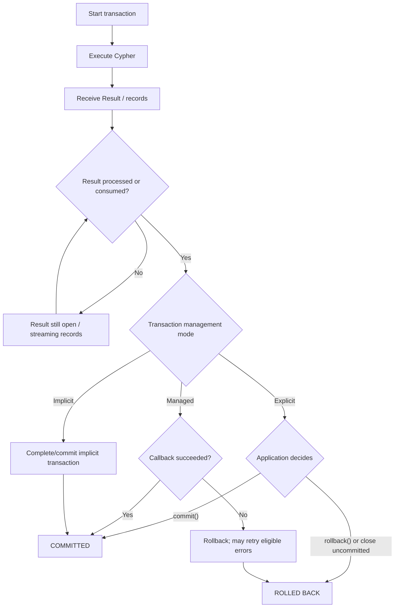
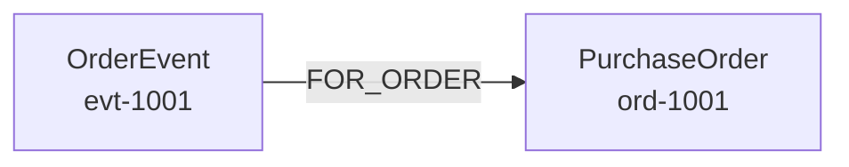
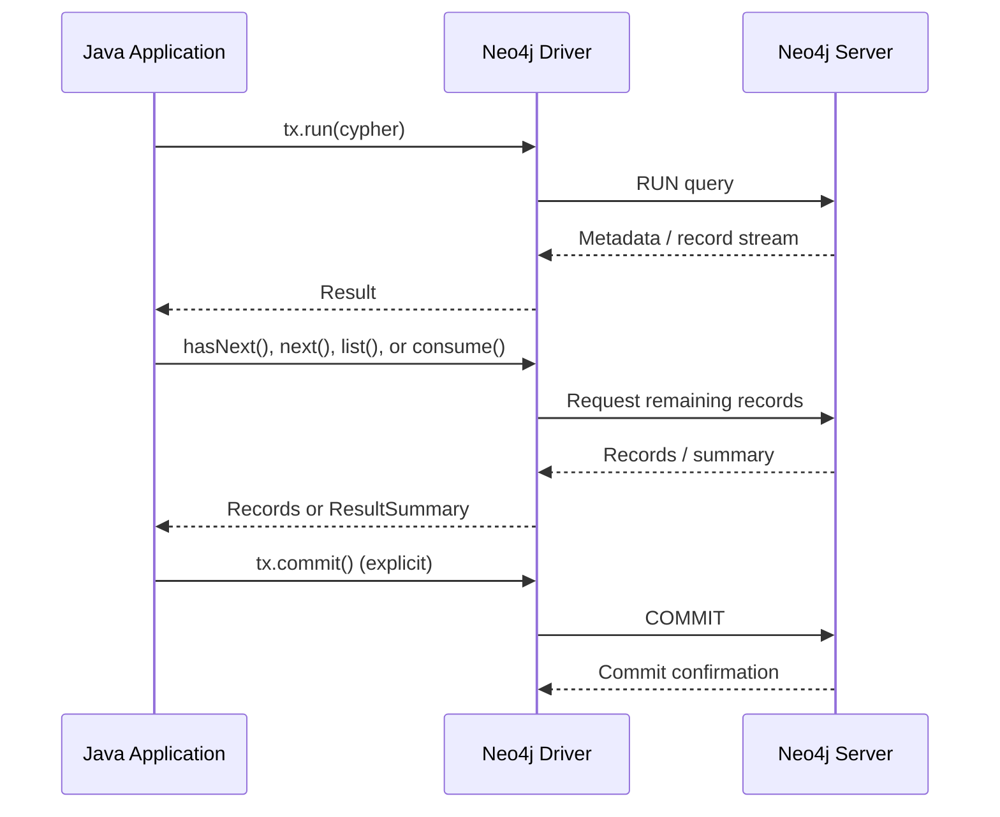

# Commit Boundaries, Rollback, and Query Result Lifecycle in Neo4j

When an application runs a Cypher statement, three questions must be answered clearly: **which transaction the operation belongs to**, **when changes are actually committed or rolled back**, and **when the query result has finished being read**. Confusing these three moments easily leads to half-finished data states, returning an invalid `Result`, duplicate writes during retries, or reporting success before a transaction has finished.

This lesson belongs to the Neo4j **Transactions** chapter, covering the **property graph** model, Cypher, the Neo4j Java Driver, and Spring Data Neo4j. We will move from transaction semantics to Java examples, focusing on **commit/rollback** boundaries and the **query result** lifecycle.

## 1. What Is a Transaction Boundary?

A **transaction** is an execution unit comprising one or more read/write operations that the database management system handles under a shared boundary.

- **Begin transaction**: opens an operation scope; statements inside that scope are not yet durably confirmed by default.
- **Commit**: instructs Neo4j to confirm the transaction's changes as a single successful unit.
- **Rollback**: discards **uncommitted** changes made by that transaction.
- **End transaction**: after commit or rollback, no further statements can be run in that same transaction.
- **Consume results**: processes records returned from a Cypher statement; this behavior affects when an **implicit transaction** completes, but does not replace `commit()` in an **explicit transaction**.

In a multi-statement transaction, **atomicity** means all changes in the transaction are committed together or rolled back together if not yet committed. Neo4j does not turn actions outside the database—such as sending emails or making HTTP calls—into part of the transaction just because they live in the same Java method.

Example:

1. Create a `(:PurchaseOrder)` node.
2. Create an `(:OrderEvent)` node and a `:FOR_ORDER` relationship.
3. Consider the order successfully created only when **both** operations are valid.

If step 2 errors before commit, step 1 can also be rolled back. If the two statements run as two separate transactions and step 1 has already committed, rolling back step 2 does **not** automatically undo step 1.

## 2. Three Common Ways to Execute Transactions

In the **Neo4j Java Driver**, the API call determines who manages the transaction boundary:

| Call | Transaction type | Who decides commit/rollback? | When to use? |
| --- | --- | --- | --- |
| `session.run(cypher, parameters)` | **Implicit/auto-commit** | Driver/server completes the statement's transaction once results finish processing; requires `Result.consume()` to wait explicitly for completion | A single standalone Cypher statement |
| `session.beginTransaction()` → `tx.run(...)` | **Explicit/unmanaged** | Application calls `tx.commit()` or `tx.rollback()`; closing an uncommitted transaction rolls back | Multiple statements needing a shared boundary with manual control |
| `session.executeWrite(work)` / `executeRead(work)` | **Managed** | Driver manages the transaction around a callback; commits on success, rolls back on error, and may retry if retryable | Most business operations using the Java Driver |

With **Spring Data Neo4j** applications, a `@Transactional` method can define the boundary at the service layer when paired with the appropriate Spring transaction manager. Avoid mixing operations using Spring-managed transactions with a separately created `driver.session()` while assuming they share the same transaction.

> **Key distinction:** `session.run()` creates an implicit transaction for that statement, not an explicit transaction shared across multiple consecutive `session.run()` calls. They are not automatically combined into one business transaction.

## 3. Transaction and Result Lifecycle Diagram



The diagram illustrates the **success path**. Query errors, network failures, or commit failures can happen at multiple points; in particular, losing the connection while waiting for a commit response can leave the application **uncertain** whether the transaction committed.

In an explicit transaction, **reading all results does not commit automatically**. In an implicit transaction, **merely holding a `Result` object does not prove the commit has finished**.

## 4. Setting Up the Hands-On Property Graph Model

Use two node types:

- `(:PurchaseOrder {id, status})`: purchase order.
- `(:OrderEvent {id, kind, createdAt})`: business event connected to an order via `(:OrderEvent)-[:FOR_ORDER]->(:PurchaseOrder)`.

Diagram:



On a **test** database, create constraints to help prevent duplicate identifiers:

```cypher
CREATE CONSTRAINT purchase_order_id_unique IF NOT EXISTS
FOR (o:PurchaseOrder)
REQUIRE o.id IS UNIQUE;
```

```cypher
CREATE CONSTRAINT order_event_id_unique IF NOT EXISTS
FOR (e:OrderEvent)
REQUIRE e.id IS UNIQUE;
```

The two `CREATE CONSTRAINT` statements are separate preparation steps. They do not need to run in the same transaction as placing an order. The next section shows how an application explicitly groups **two data-write statements** into the same transaction.

## 5. Explicit Transaction: Committing After Statements Complete

Using the Neo4j Java Driver, assuming `driver` is configured and validly connected:

```java
import org.neo4j.driver.Driver;
import org.neo4j.driver.Session;
import org.neo4j.driver.SessionConfig;
import org.neo4j.driver.Transaction;

import static org.neo4j.driver.Values.parameters;

public void placeOrder(Driver driver, String orderId, String eventId) {
    try (Session session =
             driver.session(SessionConfig.forDatabase("neo4j"))) {

        try (Transaction tx = session.beginTransaction()) {
            tx.run("""
                MERGE (o:PurchaseOrder {id: $orderId})
                SET o.status = 'CREATED'
                """, parameters("orderId", orderId)
            ).consume();

            tx.run("""
                MATCH (o:PurchaseOrder {id: $orderId})
                MERGE (e:OrderEvent {id: $eventId})
                ON CREATE SET
                    e.kind = 'CREATED',
                    e.createdAt = datetime()
                MERGE (e)-[:FOR_ORDER]->(o)
                """, parameters(
                    "orderId", orderId,
                    "eventId", eventId)
            ).consume();

            // Commit only when both statements have completed successfully.
            tx.commit();
        }
    }
}
```

Meaning of each milestone:

1. `session.beginTransaction()` opens a transaction whose boundary is controlled by the application.
2. Each `tx.run(...)` runs a Cypher statement in the **same transaction**.
3. `consume()` reads/completes the result stream of that statement; it does **not commit** the explicit transaction.
4. `tx.commit()` is the boundary confirming all changes from both statements.
5. `try-with-resources` ensures resources are released. If the transaction exits scope **uncommitted**, closing it rolls back all unconfirmed changes.

If the second statement throws an exception before `tx.commit()` is called, Java control flow leaves the block and the uncommitted transaction is closed/rolled back; the order node created in that same transaction does not become committed state.

**Caution:** `MERGE` and indexes/constraints help handle duplicate records in this example, but they **do not replace** business integrity checks. For example, if `eventId` is already attached to a different order, production code must verify whether that relationship is valid. A Cypher statement returning **0 records** is not necessarily an error; the application itself must check required business preconditions before committing.

### Explicitly Rolling Back When Business Rules Forbid Commit

If the application detects a cancellation condition before committing, it can call `rollback()` explicitly:

```java
try (Session session = driver.session();
     Transaction tx = session.beginTransaction()) {

    tx.run("""
        MERGE (o:PurchaseOrder {id: $orderId})
        SET o.status = 'DRAFT'
        """, parameters("orderId", "ord-cancel-demo")
    ).consume();

    boolean approved = false; // Illustrates a business decision.
    if (!approved) {
        tx.rollback();
    } else {
        tx.commit();
    }
}
```

After `rollback()`, the new node or status update from this transaction is **not committed**. Rolling back in this example does not permanently delete all older `PurchaseOrder` data: it only undoes **the changes created by that transaction**.

Do not attempt to use `tx` after `commit()` or `rollback()`. If the commit call is sent to the server and the connection drops before receiving confirmation, you cannot be sure whether the commit succeeded; never assume a rollback can rescue a transaction that may already have committed.

## 6. Implicit Transaction: The `session.run()` Lifecycle

This is the easiest situation to misunderstand:

```java
try (Session session = driver.session()) {
    var result = session.run("""
        CREATE (t:Task {id: $id})
        RETURN t.id AS id
        """, parameters("id", "task-1001")
    );

    // Having a Result does not mean the server has finished committing.
    String id = result.single().get("id").asString();

    // Consume remaining results and retrieve the completion summary.
    result.consume();

    System.out.println(id);
}
```

`session.run()` uses an **implicit transaction**. Results are returned by the driver via streaming/buffering; returning from the Java `session.run()` call does not guarantee that all records have been read or that the transaction has committed.

`Result.consume()` instructs the driver to fetch or discard any remaining results and wait for query completion details. In a normal implicit transaction, this is how you explicitly ensure the query has finished and the commit is confirmed before the application relies on it.

If you do not explicitly consume the result, the implicit transaction is managed by the driver and finalized at the latest when the session closes; failing to inspect the result/summary obscures where errors occur and when commit confirmation happens. For important writes, call `consume()` before reporting success to the user.

> **Not equivalent:** `Result.consume()` finishes an **implicit transaction**, whereas in an **explicit transaction** it only finishes the **result stream**. Confirming an explicit transaction still requires `tx.commit()`.

### When No Returned Records Are Needed

A write statement can use `consume()` to finish and retrieve statistics:

```java
try (Session session = driver.session()) {
    var summary = session.run("""
        CREATE (:AuditMark {id: $id})
        """, parameters("id", "mark-1001")
    ).consume();

    System.out.println(
        "Nodes created: " + summary.counters().nodesCreated()
    );
}
```

`summary.counters()` provides query statistics. It is **not** a substitute for business result validation or duplicate-write prevention in production systems.

## 7. `Result` Lifecycle: Streaming, Materialization, and Summary

A `Result` returned by the Java Driver represents a **result stream** for a query, not necessarily a full list of records already loaded in Java memory.

Think of it as follows:



The driver may **prefetch/buffer** some records, so the actual sequence of network calls can differ from the diagram. What matters is that the application clearly knows when it **has retrieved all needed data** and when **the transaction has ended**.

| API/technique | Purpose | Notes |
| --- | --- | --- |
| `result.hasNext()` / `result.next()` | Iterate records sequentially | May trigger additional network fetches as needed |
| `result.single()` | Retrieve exactly one record | Throws an error if the record count is not exactly one |
| `result.list()` | Load records into a list | Convenient, but can consume significant memory |
| `result.consume()` | Consume/discard unread records and get `ResultSummary` | Cannot continue reading records from the same `Result` afterward |
| `tx.commit()` | Confirm an explicit transaction | Distinct from `consume()` |
| `tx.rollback()` | Undo uncommitted changes | Do not reuse `tx` after rollback |

### Streaming Results Example

```java
try (Session session = driver.session()) {
    var result = session.run("""
        MATCH (t:Task)
        RETURN t.id AS taskId
        ORDER BY taskId
        LIMIT 100
        """);

    while (result.hasNext()) {
        var record = result.next();
        System.out.println(record.get("taskId").asString());
    }

    var summary = result.consume();
    // At this point the Result stream is complete.
}
```

For large datasets, sequential iteration generally avoids loading the **entire** result set into a `List`. However, this does not mean memory usage is zero: the driver maintains buffers and the application incurs per-record processing overhead.

### Never Return `Result` Outside a Closed Transaction

**Incorrect** example:

```java
public org.neo4j.driver.Result findTasksBad(Driver driver) {
    try (Session session = driver.session()) {
        return session.run("MATCH (t:Task) RETURN t.id AS taskId");
    } // session closes; Result is no longer within a safe scope.
}
```

**Correct** example: convert records into plain data while the session/transaction is still open.

```java
public java.util.List<String> findTaskIds(Driver driver) {
    try (Session session = driver.session()) {
        return session.executeRead(tx -> {
            var result = tx.run("""
                MATCH (t:Task)
                RETURN t.id AS taskId
                ORDER BY taskId
                """);

            return result.list(
                record -> record.get("taskId").asString()
            );
        });
    }
}
```

The callback returns a `List<String>` already materialized inside the transaction. If results are very large, add filtering/pagination or process in appropriate batches rather than accumulating the entire result set.

## 8. Managed Transactions: Commit Only When the Callback Succeeds

The Java Driver's `executeWrite` and `executeRead` APIs manage transactions on behalf of the application:

```java
try (Session session =
         driver.session(SessionConfig.forDatabase("neo4j"))) {

    String createdId = session.executeWrite(tx -> {
        var result = tx.run("""
            MERGE (o:PurchaseOrder {id: $orderId})
            SET o.status = 'READY'
            RETURN o.id AS id
            """, parameters("orderId", "ord-2001")
        );

        // Return materialized data, do not return Result.
        return result.single().get("id").asString();
    });

    System.out.println("Order: " + createdId);
}
```

On the normal path:

1. The Driver opens a transaction.
2. The callback executes and returns a plain Java value.
3. The Driver commits the transaction.
4. `executeWrite(...)` returns the result to the caller once the transaction has finished successfully.

If the callback throws an exception, the driver handles rollback. For certain **retryable/transient** errors, the driver may **re-run the callback** according to its retry policy. Therefore, callbacks should be designed to be safe on re-execution.

**Do not place side effects outside Neo4j inside a retryable callback** unless there is an exactly-once guarantee, for example:

```java
// Avoid:
// session.executeWrite(tx -> {
//     tx.run("CREATE ...");
//     emailService.sendConfirmation(); // May be called multiple times on retry.
//     return null;
// });
```

Instead, record the **intent to emit an event** in the database within the same transaction (for example, an outbox/event node), then let another worker publish the message after commit with identifier-based deduplication. This design does not automatically guarantee "exactly once" for external systems; duplicate handling rules are still required.

### When to Choose Explicit vs. Managed?

- **Managed:** a sensible default for most application operations; the driver handles commit/rollback and retries eligible errors.
- **Explicit:** use when you need explicit control over commit/rollback timing or complex control-flow coordination across multiple operations.
- **Implicit:** use for a single standalone statement; read everything/`consume()` to know when the query and transaction have finished.

## 9. Distinguishing Three Error Scenarios

| Scenario | What can be confirmed | Appropriate action |
| --- | --- | --- |
| Error in the second statement **before commit** inside an explicit transaction | Transaction has not committed; rollback can undo changes from earlier statements in that transaction | Close/roll back the transaction, return error |
| `executeWrite` callback receives a retryable error | Driver may roll back and re-run the entire callback | Write retry-safe callbacks, use business keys/idempotency |
| Connection drops **while waiting for commit confirmation** | You may **not know for sure** whether Neo4j committed | Reconcile state using business identifiers before retrying creation |

A Cypher query returning an empty result is also a **technically successful result**, for example:

```cypher
MATCH (o:PurchaseOrder {id: 'does-not-exist'})
SET o.status = 'PAID'
RETURN o.id;
```

This statement can return **0 records** and modify no nodes, yet matching zero nodes does not throw an error by default. The application must check the record count or business condition if the node is required to exist before committing.

## 10. Special Commit Boundary: `CALL { ... } IN TRANSACTIONS`

Neo4j provides syntax to execute a subquery across **multiple internal transactions** to handle large datasets. Example:

```cypher
UNWIND range(1, 1000) AS i
CALL (i) {
    CREATE (:ImportItem {itemNo: i})
} IN TRANSACTIONS OF 100 ROWS;
```

The right mental model here differs from a regular explicit transaction:

- Each batch of 100 rows is processed inside an **internal transaction**.
- Already-committed batches may still persist if a later batch errors, depending on the error handling mode used.
- This is **not** an "all 1,000 rows or nothing" operation on a single transaction.
- `CALL { ... } IN TRANSACTIONS` must be run inside an **implicit transaction**; do not place it inside an application-opened explicit/managed transaction.

If the application sends this query through the Java Driver, use `session.run(...)` and `consume()` to confirm the final outcome. If running in Neo4j Browser, how the UI wraps transactions can affect whether the statement is accepted; use an execution mode compatible with implicit transactions.

> **Version-dependent syntax:** The `CALL (i) { ... }` example uses the variable scope clause from newer Neo4j Cypher versions. In older environments, the syntax for passing variables into a subquery may differ; consult documentation for your exact version.

## 11. Spring Data Neo4j Integration: `@Transactional` Scope

With Spring Data Neo4j and a properly configured transaction manager, a `@Transactional` service method can serve as the business boundary for multiple repository/`Neo4jClient` operations.

```java
import org.springframework.stereotype.Service;
import org.springframework.transaction.annotation.Transactional;

@Service
public class OrderApplicationService {

    private final OrderRepository orderRepository;
    private final OrderEventRepository eventRepository;

    public OrderApplicationService(
            OrderRepository orderRepository,
            OrderEventRepository eventRepository) {
        this.orderRepository = orderRepository;
        this.eventRepository = eventRepository;
    }

    @Transactional
    public void placeOrder(PurchaseOrder order, OrderEvent event) {
        orderRepository.save(order);
        eventRepository.save(event);
        // Spring commits when the method completes per the
        // transaction manager's rules; eligible errors trigger rollback.
    }
}
```

This example illustrates the **service boundary**, not the full repository/entity definitions. In a real project, mappings between `OrderEvent` and `PurchaseOrder` must be declared properly to persist the right relationships.

Keep in mind:

- Spring applies `@Transactional` when the call passes through the appropriate transaction management mechanism; for instance, **self-invocation** within the same class may not trigger the transaction proxy as expected.
- Spring's default rollback rules typically apply to `RuntimeException` and `Error`; to roll back on checked exceptions, configure attributes such as `rollbackFor`.
- If you return a streaming/lazy result outside the transaction scope and read it afterward, you may attempt to access data after the transaction has closed. Process/materialize within the right scope, or design streaming with an explicitly managed transaction lifetime.
- If you open a separate `Driver Session` inside a `@Transactional` method, that session does not automatically participate in the Spring-managed transaction. Avoid assuming operations will roll back together when they use two separate transaction mechanisms.

## 12. Transaction Design Checklist for Graph Systems

Before implementing a flow that creates or modifies nodes and relationships with Cypher from Java, ask yourself:

1. **What is the business unit?** A single query, multiple queries, or multiple data ingestion batches?
2. **Who owns the transaction?** `session.run`, `beginTransaction`, `executeWrite`, or Spring `@Transactional`?
3. **What is the success milestone?** Finished reading `Result`, received `ResultSummary`, or received `commit` confirmation?
4. **Is any result used after closing the session/transaction?** If so, materialize into DTOs/value records before closing.
5. **Can any query return 0 rows when business logic requires an error?** If so, explicitly check record counts, counters, or conditions.
6. **Are retries involved?** If so, protect with constraints, business keys, idempotency keys, and state checks before recreating.
7. **Are there operations outside Neo4j?** Do not expect `rollback` to undo sent emails, HTTP requests, or published messages.
8. **Are you batch writing with `CALL { ... } IN TRANSACTIONS`?** Accept and handle the possibility that some batches committed before the rest failed.
9. **Are you loading too many records into `list()`?** Limit result size and avoid keeping transactions open unnecessarily long.

For performance investigations, include query metrics, error logs, and application telemetry. Transactions hold resources and locks while active, so do not open transactions too early or keep them open across non-database processing.

## 13. Self-Check Exercises

**Question 1.** Two consecutive `session.run()` calls create a `PurchaseOrder` and an `OrderEvent`. If the second statement fails, will the first always roll back?

<details>
<summary>Suggested Answer</summary>

No. Each ordinary `session.run()` call runs in its own implicit transaction. If the first statement has already been consumed/committed, a failure in the second statement does not undo the earlier transaction. To commit or roll back everything together, place the operations inside the same explicit or managed transaction.

</details>

**Question 2.** Inside `beginTransaction()`, a developer calls `tx.run(...).consume()` and exits the block without calling `tx.commit()`. Can the data be considered successfully saved?

<details>
<summary>Suggested Answer</summary>

No. `consume()` only completes the query's result stream. The explicit transaction has not committed; closing it uncommitted rolls back the transaction's changes.

</details>

**Question 3.** Why shouldn't you return a `Result` from `executeRead(tx -> tx.run(...))` and iterate over it after the callback finishes?

<details>
<summary>Suggested Answer</summary>

The transaction managed by the callback may already be closed when external code begins iterating over `Result`. A result is a stream tied to the query/transaction scope; convert it into the required data (such as `List<String>` or DTOs) right inside the callback.

</details>

**Question 4.** The Driver automatically retries an `executeWrite` callback. Why does sending an email directly inside the callback risk sending duplicates?

<details>
<summary>Suggested Answer</summary>

The callback can be invoked multiple times when encountering retryable errors; an email sent on the first attempt is not rolled back along with Neo4j. Move external side effects outside the callback and handle them with appropriate idempotency/outbox patterns.

</details>

**Question 5.** A `CALL { ... } IN TRANSACTIONS OF 100 ROWS` query processes 1,000 rows but fails on the eighth batch. Can you assume all previous batches rolled back?

<details>
<summary>Suggested Answer</summary>

No. This mechanism uses multiple internal transactions. Already-committed batches may still exist when a later batch errors. Data ingestion workflows need safe rerunnability or handling for already-committed batches.

</details>

## Key Takeaways

- **Commit/rollback boundaries** define the scope of confirmed or undone changes; they are not the same as the boundary of a single query or a `Result` object.
- **Implicit `session.run()`:** explicitly call `consume()` to complete the stream and receive the statement's completion/commit signal.
- **Explicit `beginTransaction()`:** `consume()` does not commit; you must call `tx.commit()`, or roll back/close the uncommitted transaction.
- **Managed `executeWrite`/`executeRead`:** the driver manages commit/rollback and may retry the callback; avoid non-idempotent side effects inside callbacks.
- **`Result` is bound to transaction/session lifetime:** read or materialize within a valid scope; do not return a lazy stream after the transaction has closed.
- **Batch transactions** such as `CALL { ... } IN TRANSACTIONS` have multiple commit points; designs must account for partial success.

### References

- [Neo4j Java Driver Manual — Transactions](https://neo4j.com/docs/java-manual/current/transactions/)
- [Neo4j Java Driver Manual — Run your own transactions](https://neo4j.com/docs/java-manual/current/transactions/#java-manual-transactions-explicit)
- [Neo4j Cypher Manual — CALL subqueries in transactions](https://neo4j.com/docs/cypher-manual/current/subqueries/subqueries-in-transactions/)
- [Spring Data Neo4j Reference](https://docs.spring.io/spring-data/neo4j/reference/)
