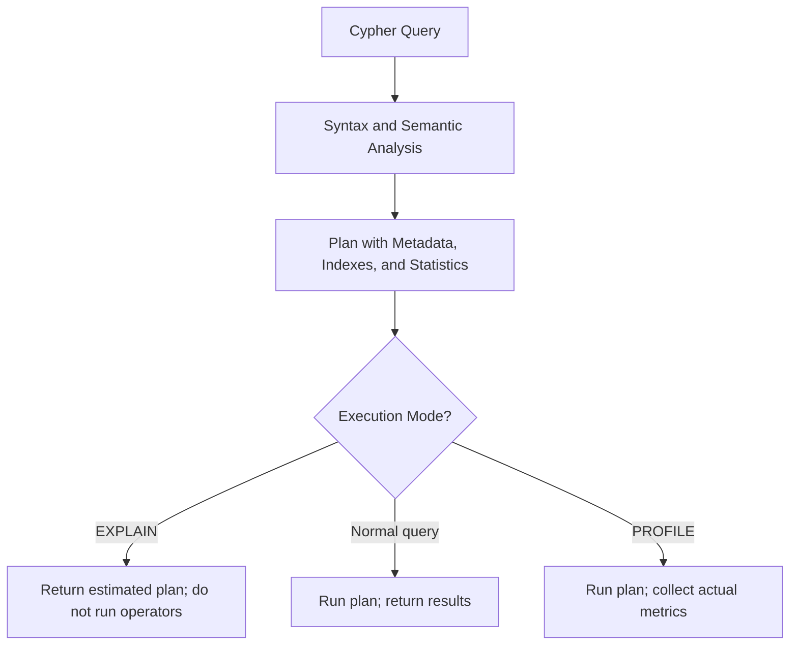

# EXPLAIN to View the Plan Without Executing the Query in Neo4j

When a Cypher query has multiple `MATCH` clauses, filtering with `WHERE`, relationship expansions, and result sorting, Neo4j must choose **how to find and combine the data** before executing. The same question can be handled by scanning all nodes, looking up indexes, traversing relationships in various directions, and then filtering or aggregating. This chosen strategy is described in an **execution plan**.

In Neo4j, place the **`EXPLAIN` keyword at the beginning of the query** to instruct the system to **build and display the plan without executing the query's operations**:

```cypher
EXPLAIN
MATCH (p:Person)
WHERE p.email = 'an@example.com'
RETURN p.name;
```

`EXPLAIN` helps answer "What does Neo4j **intend** to do to run this query?"; it cannot by itself answer "How much time **did** the query take, how many records did it read, or how many results did it return?". Those actual numbers require `PROFILE` or separate measurements.

This lesson belongs to the **Execution Plans** chapter in the `DATABASE_ENGINE_GRAPH_NEO4J` module, connecting knowledge of property graphs, nodes/relationships, indexes, Cypher, query optimization, and how to invoke queries from the Neo4j Java Driver or Spring Data Neo4j.

## 1. Where Does EXPLAIN Sit in a Cypher Query Lifecycle?

Upon receiving a Cypher query, Neo4j validates syntax, performs semantic analysis, inspects relevant schema/indexes and statistics, and then builds a plan consisting of multiple **operators** (execution operators). Only when the execution step runs do the operators actually read, filter, join, or write data.



Key points to understand accurately:

- `EXPLAIN` **still parses and plans the query**. The Cypher query must be valid and is analyzed within the context of the current database.
- It **does not traverse data rows using that plan**, does not return records that would come from `RETURN`, and does not apply changes from `CREATE`, `SET`, or `DELETE` in the explained statement.
- The plan is built according to the **schema, indexes, statistics, Neo4j version, configuration, and query conditions** at planning time. Re-running after creating an index or updating data may produce a different strategy.
- `EXPLAIN` provides **estimates**, not proof of how many rows a branch actually has or what speed was achieved.

> **Summary:** `EXPLAIN` is "preview how it will execute", while `PROFILE` is "execute and measure". Both help study the execution plan, but only `PROFILE` runs the specified query.

## 2. Syntax and How to Retrieve the Plan

General syntax:

```cypher
EXPLAIN
<cypher-query>
```

Example read query:

```cypher
EXPLAIN
MATCH (p:Person)-[:FRIEND_OF]->(friend:Person)
WHERE p.email = 'an@example.com'
RETURN friend.name AS friendName
ORDER BY friendName
LIMIT 10;
```

In Neo4j Browser, the `EXPLAIN` result is typically viewed in **Plan** mode, allowing you to expand each operator and its estimated statistics. In the Neo4j Java Driver, the plan resides in the **result summary**, so you should not try to read it as a list of records from `RETURN`. Presentation formats differ across Browser, Desktop, CLI, and drivers; the purpose of `EXPLAIN` remains the same.

`EXPLAIN` is placed before the **entire query**, not before each individual `MATCH`:

```cypher
// Correct: only one EXPLAIN for the entire query
EXPLAIN
MATCH (p:Person)
WHERE p.active = true
WITH p
MATCH (p)-[:ENROLLED_IN]->(c:Course)
RETURN p.name, c.code;
```

For a query with parameters such as `$email` to be planned, pass the appropriate parameters through your Cypher runner or Driver. Some expressions or optimization strategies may depend on the input data types.

## 3. Preparing a Small Graph to Practice Reading Plans

Run the following data creation script **once on a test database**. Labels and relationship types prefixed with `PlanDemo` separate the example from application data. If the database already contains these records, use a fresh test database instead of running `CREATE` again.

```cypher
CREATE
  (an:PlanDemoPerson {
    code: 'P01', name: 'An', email: 'an@example.com', active: true
  }),
  (binh:PlanDemoPerson {
    code: 'P02', name: 'Bình', email: 'binh@example.com', active: true
  }),
  (chi:PlanDemoPerson {
    code: 'P03', name: 'Chi', email: 'chi@example.com', active: false
  }),
  (cypher:PlanDemoCourse {code: 'CYP-101', title: 'Cypher Basics'}),
  (graph:PlanDemoCourse {code: 'GRA-201', title: 'Graph Modeling'}),
  (an)-[:PLAN_DEMO_ENROLLED_IN]->(cypher),
  (an)-[:PLAN_DEMO_ENROLLED_IN]->(graph),
  (binh)-[:PLAN_DEMO_ENROLLED_IN]->(cypher);
```

Data diagram:

```text
An   ──ENROLLED_IN──► CYP-101
 └───ENROLLED_IN──► GRA-201
Bình ─ENROLLED_IN──► CYP-101
Chi  (not enrolled in any course)
```

There are **3 people**, **2 courses**, and **3 enrollment relationships**. These numbers are only for understanding the result semantics when running a normal query; **`EXPLAIN` will not return those rows**.

### 3.1. First Time Using EXPLAIN

```cypher
EXPLAIN
MATCH (p:PlanDemoPerson)
WHERE p.active = true
RETURN p.code AS code, p.name AS name
ORDER BY name;
```

An execution plan may contain operators equivalent to:

```text
ProduceResults
└── Sort
    └── Projection
        └── Filter (p.active = true)
            └── NodeByLabelScan (p:PlanDemoPerson)
```

This is a **conceptual diagram**, not guaranteed output from Neo4j. Operator names and how they are fused depend on version, planner, runtime, indexes, and statistics. For example, `Filter` or `Projection` may be merged into another operator. Do not treat a displayed plan that differs from the illustration as an error.

Read along the data flow from **input-producing operators** (usually at the bottom/leaves of the tree) toward **result-producing operators**. A `NodeByLabelScan` finds nodes by label, `Filter` keeps rows matching the condition, `Sort` orders them, and `ProduceResults` outputs the results. When a plan has multiple branches or apply/join operators, trace each branch rather than reading only a single straight line.

## 4. Plan Fields: Which Ones Are Estimates?

Neo4j interfaces typically display the following information (depending on version and tool):

| Field / Information | Present in `EXPLAIN` | How to Interpret |
| --- | --- | --- |
| **Operator** | Yes | Planned operation, such as label scan, index lookup, relationship expansion, filter |
| **Estimated Rows** | Yes | **Estimated** number of rows passing through / output by the operator; not counted data |
| **Identifiers** / variables | May be present | Which variables are available at the operator, such as `p`, `c` |
| **Details** | Yes | Index, filter predicate, relationship type, sort keys, etc. |
| **Order** / ordered by | May be present | Guaranteed or known output ordering at a part of the plan |
| **Actual Rows** | Not measured | Actual row counts are only available when running with `PROFILE` |
| **DB Hits**, **Time**, actual **Memory** | Not measured via execution | Execution metrics appear in `PROFILE` depending on runtime/UI |

Do not confuse **`Estimated Rows`** with `Rows` from `PROFILE`. For example, a plan may predict an expansion produces 100 rows, while an actual run yields 2, 500, or 0 because statistics only reflect distribution at an estimated level.

Typically, the planner infers cardinality from node counts per label, relationship counts per type, index properties, and selectivity statistics. If data is heavily skewed (one person has millions of relationships while most others have only a few), average estimates can differ significantly from a specific case.

## 5. Checking Whether a Filter Condition Can Use an Index

Suppose the application looks up a person by `email`. Run `EXPLAIN` before creating an index to see the current strategy:

```cypher
EXPLAIN
MATCH (p:PlanDemoPerson)
WHERE p.email = 'an@example.com'
RETURN p.code AS code, p.name AS name;
```

If no helpful index exists yet, the plan may contain an operation that scans `PlanDemoPerson` and filters on email. Now create a **range index** in the test environment:

```cypher
CREATE RANGE INDEX plan_demo_person_email IF NOT EXISTS
FOR (p:PlanDemoPerson)
ON (p.email);
```

Note: **this `CREATE RANGE INDEX` command actually modifies the schema**. It is a test setup step, not an `EXPLAIN` query. Wait for the index to be ready before comparing:

```cypher
SHOW INDEXES
YIELD name, type, state, labelsOrTypes, properties
WHERE name = 'plan_demo_person_email'
RETURN name, type, state, labelsOrTypes, properties;
```

Only when the state is `ONLINE` should you expect the index to be used in queries. Then re-run the **same `EXPLAIN` query**.

An appropriate execution strategy when using the index is `NodeIndexSeek` on `PlanDemoPerson(email)` instead of scanning the entire label. However, **Neo4j is not forced to choose an index just because it exists**: on a tiny set of three people, the planner may decide a label scan is cheaper; the choice is also influenced by selectivity, statistics, and predicate eligibility. Therefore:

- Inspect the **actual operator and index name appearing in the plan**, rather than concluding based solely on the `CREATE INDEX` statement.
- On large datasets, if queries frequently filter by email, an appropriate index usually reduces the amount of data examined.
- If the index does not appear, check its **ONLINE state**, label, property name, data type, and `WHERE` expression before examining the planner and statistics.

### 5.1. Expressions That Can Prevent Index Usage

Compare:

```cypher
// Likely able to use the range index on email
EXPLAIN
MATCH (p:PlanDemoPerson)
WHERE p.email = 'an@example.com'
RETURN p.code;
```

```cypher
// Transforming the property in the condition: may prevent direct index seek
EXPLAIN
MATCH (p:PlanDemoPerson)
WHERE toLower(p.email) = 'an@example.com'
RETURN p.code;
```

The two queries have **different matching semantics**. The second query applies a function to every email value, so an index on the raw `p.email` value does not necessarily support that filter directly. If normalized matching is needed frequently, consider storing a normalized key with a dedicated index or choosing an appropriate search solution.

Do not alter a Cypher query solely to force index usage if doing so changes the business meaning of the result.

## 6. Notable Operators When Reading EXPLAIN

Operator names may vary between versions or runtimes; the following table summarizes common roles:

| Category | Example Operators | Questions to Ask |
| --- | --- | --- |
| Starting from nodes | `AllNodesScan`, `NodeByLabelScan` | How many nodes are being scanned? Can we narrow the label or use an index? |
| Index lookup | `NodeIndexSeek`, `NodeIndexScan`, `NodeUniqueIndexSeek` | Which index? Is the predicate highly selective? |
| Graph traversal | `Expand(All)`, `Expand(Into)`, `VarLengthExpand(All)` | How many relationships/paths can each input row expand into? |
| Filtering | `Filter` | Is the condition applied early or after generating many rows? |
| Branch combination | `Apply`, `CartesianProduct`, join variants | Do the branches have an actual linking condition? Is there combinatorial multiplication? |
| Grouping | `Aggregation`, `OrderedAggregation`, `Distinct` | Are many rows being produced only to be aggregated down? |
| Sorting/slicing | `Sort`, `Top`, `Limit` | Does the query have to sort a large set before returning a few rows? |
| Read/write boundary | `Eager`, write operators | Must rows be materialized before continuing to write/read? |
| Result output | `ProduceResults` | Which expressions make up the final output stream? |

A `NodeByLabelScan` operator is **not inherently bad**: scanning 20 nodes in a small label can be a good choice. Conversely, a `NodeIndexSeek` does not guarantee a fast query if it returns millions of nodes that then must expand many relationships. Evaluate **the entire chain of operators**, the expected volume of data flowing through, and the actual goal of the query.

## 7. Identifying Row Growth When Combining Multiple Patterns

Neo4j is a property graph. From one person, traversal can reach multiple courses; each expansion result produces another binding combination. `EXPLAIN` helps reveal where the planner intends to expand relationships.

```cypher
EXPLAIN
MATCH (p:PlanDemoPerson)-[:PLAN_DEMO_ENROLLED_IN]->(c:PlanDemoCourse)
WHERE p.active = true
RETURN p.name AS person, c.code AS course
ORDER BY person, course;
```

If run as a normal query on the sample data, there would be three enrollment pairs: An–CYP-101, An–GRA-201, Bình–CYP-101. However, **when using `EXPLAIN`, those three data rows are not generated**; you only see how the planner intends to find the pairs.

A plan might choose to start from `PlanDemoPerson`, filter active people, and then `Expand(All)` along `PLAN_DEMO_ENROLLED_IN` to courses. It could also start from the course side if the planner estimates that to be cheaper. The logical order written in Cypher **does not guarantee** the physical order chosen by the planner.

### 7.1. Detecting Cartesian Products

Two disconnected patterns can produce all pairs:

```cypher
EXPLAIN
MATCH (p:PlanDemoPerson), (c:PlanDemoCourse)
RETURN p.code AS person, c.code AS course;
```

Semantically, if executed on the sample data, the query produces `3 × 2 = 6` rows. Because the two patterns are independent, the execution plan may contain a `CartesianProduct` or an equivalent combining operator. This may be **intentional** if you genuinely need every combination; otherwise, connect them with an appropriate relationship or condition:

```cypher
EXPLAIN
MATCH (p:PlanDemoPerson)-[:PLAN_DEMO_ENROLLED_IN]->(c:PlanDemoCourse)
RETURN p.code AS person, c.code AS course;
```

The second query only considers existing enrollment relationships. From `EXPLAIN`, we learn the shape of the intended execution path, but to conclude how many rows **were** actually produced and how much work was spent, you must switch to `PROFILE` on a read query when appropriate.

### 7.2. Variable-Length Paths

```cypher
EXPLAIN
MATCH path = (start:PlanDemoPerson)-[:PLAN_DEMO_ENROLLED_IN*1..3]->(end)
RETURN path
LIMIT 10;
```

The `*1..3` expansion may need to explore many branches. The number of intermediate paths can grow sharply in dense graphs, even when `LIMIT 10` caps the final result count. `EXPLAIN` can show path-expansion operators and row estimates, but it cannot be used as proof of exactly how many relationships were traversed.

**Version note:** the `*1..3` variable-length relationship syntax is familiar Cypher in Neo4j 5; in Cypher 25, quantified path patterns / quantified relationships are the current syntax direction. If your environment requires pure Cypher 25, verify the appropriate path pattern syntax before running the example.

## 8. EXPLAIN on Write Queries: Previewing Without Mutating the Graph

A major advantage of `EXPLAIN` is that **it can plan a query containing write operations** without creating, modifying, or deleting data.

```cypher
EXPLAIN
CREATE (probe:PlanDemoProbe {code: 'EXPLAIN-ONLY'})
RETURN probe.code AS code;
```

If this is run with `EXPLAIN`, the `PlanDemoProbe` node is **not created**. You can observe this separately with the following read query:

```cypher
MATCH (probe:PlanDemoProbe {code: 'EXPLAIN-ONLY'})
RETURN count(probe) AS createdCount;
```

On the sample database without such a node, `createdCount = 0`. This `MATCH` check **actually executes** and is only meant to verify the effect on the test graph. It is not output returned by `EXPLAIN`.

Similarly, the following statements are only **planned** and do not update data when prefixed with `EXPLAIN`:

```cypher
EXPLAIN
MATCH (p:PlanDemoPerson {code: 'P01'})
SET p.active = false
RETURN p.code, p.active;
```

```cypher
EXPLAIN
MATCH (p:PlanDemoPerson {code: 'P03'})
DELETE p;
```

In complex write queries, the plan may reveal `Eager` operations, node lookups, and relationship expansions prior to updating. This is useful for predicting where resources might be heavily consumed or over-expanded. However, `EXPLAIN` **does not prove a write statement will succeed**: it does not check all existing data, constraint conflicts, lock contention, or runtime-only errors.

Distinguish carefully:

- `EXPLAIN CREATE ...`: inspect the node-creation plan; **does not create nodes**.
- `CREATE ...`: executes for real; **can create nodes**.
- `PROFILE CREATE ...`: **still executes and creates nodes**, while also collecting metrics.

Therefore, before running update or delete queries in production, `EXPLAIN` is a helpful analytical step, but controlled testing and proper deployment procedures are still required.

## 9. How Do EXPLAIN, PROFILE, and Normal Execution Differ?

| Mode | Executes query operations? | Returns records from `RETURN`? | Includes plan? | Includes actual metrics? | Can modify data if query writes? |
| --- | --- | --- | --- | --- | --- |
| `EXPLAIN` | **No** | No | Yes | No | **No** |
| `PROFILE` | **Yes** | Yes | Yes, with measurements | Yes | **Yes** |
| No prefix | **Yes** | Yes | Summary info may be viewable via tools | Depends on measurement tool | **Yes** |

Example using the same read query:

```cypher
// 1. Plan only, without reading result rows
EXPLAIN
MATCH (p:PlanDemoPerson)
WHERE p.active = true
RETURN p.name;
```

```cypher
// 2. Execute and measure DB Hits / Rows (depends on runtime)
PROFILE
MATCH (p:PlanDemoPerson)
WHERE p.active = true
RETURN p.name;
```

```cypher
// 3. Execute normally and return data needed by the application
MATCH (p:PlanDemoPerson)
WHERE p.active = true
RETURN p.name;
```

Use `EXPLAIN` first to spot suspicious **plan shapes** such as full scans, Cartesian products, relationship expansions over too many rows, or early sorting. Use `PROFILE` on read queries permitted to execute when you need **Rows**, **DB Hits**, and measured metrics; only then evaluate whether to add indexes, rewrite predicates, or change traversal direction.

### Why Is EXPLAIN Not Enough to Claim Fast or Slow?

Suppose a plan estimates scanning 1,000 nodes. Two environments with the same node count can still differ in cache hit ratio, I/O, runtime configuration, network latency, and concurrency level. `EXPLAIN` performs none of these operations, so it has no real measured latency. Moreover, **Estimated Rows** can be inaccurate when data changes or statistics do not reflect the distribution well.

Accordingly, `EXPLAIN` is suited for **diagnosing query structure** and testing alternatives without running expensive work. To conclude that an optimization improved performance, measure on representative data across controlled runs when necessary.

## 10. Analyzing a Query from Authoring to Optimization Decision

Suppose a user wants to find **the courses that the person named An is enrolled in**.

Initial query:

```cypher
EXPLAIN
MATCH (p:PlanDemoPerson)-[:PLAN_DEMO_ENROLLED_IN]->(c:PlanDemoCourse)
WHERE p.name = 'An'
RETURN c.code AS courseCode, c.title AS courseTitle
ORDER BY courseCode;
```

Observation steps:

1. **Starting source:** Does Neo4j intend to scan `PlanDemoPerson` or use an index on `name`? Searching by name may not be unique; in a real system, prefer a business key if available.
2. **Filter condition:** Where is `p.name = 'An'` applied? Can it filter early before expanding relationships?
3. **Relationship expansion:** Which operator follows `PLAN_DEMO_ENROLLED_IN`? How does the estimated row count grow?
4. **Sorting:** Is there a `Sort`/`Top`? Can sorting a large set be avoided if business requirements change?
5. **Results:** Are the returned fields genuinely needed, or are they pulling unused data?

An alternative using a business key:

```cypher
EXPLAIN
MATCH (p:PlanDemoPerson {code: 'P01'})
      -[:PLAN_DEMO_ENROLLED_IN]->
      (c:PlanDemoCourse)
RETURN c.code AS courseCode, c.title AS courseTitle
ORDER BY courseCode;
```

If `code` is a person's unique identifier in the system, creating an appropriate uniqueness constraint/index gives the planner a selective lookup strategy and enforces data integrity. **Do not add constraints automatically just because a plan has a scan**: review the data model, true uniqueness, and data-cleansing processes before modifying the schema.

After changing conditions or creating an index in a test environment, re-run `EXPLAIN` to compare the **chosen operators**, **Estimated Rows**, and execution strategy. If the projected plan looks reasonable, you can run `PROFILE` on the read query to measure actual performance.

## 11. Reading EXPLAIN from the Neo4j Java Driver

With the Neo4j Java Driver, a Cypher statement can be prefixed with `EXPLAIN` just like in Browser. The plan is located in **`ResultSummary.plan()`**, not in the `RETURN` records.

Java example (assuming an already configured `Driver driver`):

```java
import java.util.Map;
import org.neo4j.driver.Result;
import org.neo4j.driver.Session;
import org.neo4j.driver.summary.Plan;
import org.neo4j.driver.summary.ResultSummary;

// driver has been created and will be closed in the application lifecycle
try (Session session = driver.session()) {
    Result result = session.run(
        "EXPLAIN MATCH (p:PlanDemoPerson) " +
        "WHERE p.email = $email " +
        "RETURN p.code AS code",
        Map.of("email", "an@example.com")
    );

    ResultSummary summary = result.consume();
    Plan plan = summary.plan();
    System.out.println(plan.operatorType());
}
```

To inspect deeper, traverse `plan.children()` and read `arguments()` and `identifiers()` for each operator according to the Driver API. Check whether `plan` is present before accessing it if a shared application method is also used to run normal queries.

In **Spring Data Neo4j**, Cypher can be used via `@Query` for business queries, but an `EXPLAIN` statement does not return entities/projections like a normal read query. Therefore, treat it as a **diagnostic operation** through an API that receives the plan/summary, rather than mapping it expecting a list of entities.

In both environments, use **parameter binding** (`$email`) for input values; never concatenate user-supplied strings directly into Cypher statements. A plan inspected in the Java Driver should be evaluated against the same database, schema, and Cypher version as the application being optimized.

## 12. Common Mistakes When Looking Only at EXPLAIN

| Misconception | Correct Understanding |
| --- | --- |
| “EXPLAIN returned 0 rows, so the data didn't match.” | `EXPLAIN` does not run the query to return data rows. |
| “Estimated Rows = 100 means exactly 100 rows were read.” | This is the planner's estimate; `PROFILE` is needed to see actual row counts. |
| “An index exists, so Neo4j will definitely use it.” | The planner also relies on predicates, statistics, cost, and index state; check the actual operator. |
| “The plan has a scan, so the query is definitely slow.” | A scan can be cheap on small datasets or appropriate scopes. |
| “EXPLAIN CREATE succeeded, so a real CREATE cannot fail.” | `EXPLAIN` has not performed the write operation or all runtime validation checks. |
| “PROFILE DELETE is just as safe as EXPLAIN DELETE.” | `PROFILE` executes the query and can delete data. |
| “Whichever MATCH is written first in Cypher must read that node first.” | The planner can reorder or choose a different execution path based on cost. |
| “A test plan on 3 nodes applies identically to production.” | Plans depend on schema, statistics, data, and version; larger environments may choose differently. |

## 13. Workflow for Using EXPLAIN in Real Work

When optimizing a query on a graph system, follow this sequence:

1. **Record the Cypher query and output goal:** Do you need nodes, relationships, one row per object, or all paths? Separate data-correctness requirements from speed requirements.
2. **Run `EXPLAIN` against the appropriate database:** Verify syntax and inspect operators, Estimated Rows, indexes, relationship expansion directions, and the presence of Cartesian products/Sort/Eager.
3. **Isolate potential cost hotspots:** Predict where row counts could explode, where filters apply late, where the wrong index is picked, or where patterns are unnecessarily joined.
4. **Test one intentional change:** Rewrite predicates, connect patterns via relationships, use business keys, add a valid index, or reduce the volume of returned data.
5. **Re-compare `EXPLAIN`:** How did the new plan change? Do the differences in operators and estimated cardinality align with your hypothesis?
6. **Measure when permitted:** Run `PROFILE` on read queries in an environment with representative data. For write queries, test in a controlled environment with proper transaction procedures; never run `PROFILE` on production just to “try it out”.
7. **Verify correctness:** An optimization is only successful when business results remain unchanged and improvement is confirmed by appropriate metrics.

### Self-Check Questions

1. If you write `EXPLAIN MATCH (p:Person) RETURN p`, can the result be used to count how many people currently exist?
2. When seeing a very large `Estimated Rows` at `Expand(All)`, what issues should you investigate?
3. After adding an index, why might a plan still use `NodeByLabelScan`?
4. Does `PROFILE CREATE (n:Temp)` create a node?
5. When a Java application receives an `EXPLAIN` response, is the plan in the `RETURN` records or in the summary?
6. Why should `EXPLAIN` not be used as a measurement of actual execution time?

**Suggested Answers:** (1) No, because no data query is executed. (2) Relationship branching factor, cardinality, filter conditions, and join patterns. (3) The index may not be online yet, the predicate may not be eligible, or the planner estimates a scan to be cheaper. (4) Yes, because `PROFILE` executes the query. (5) In the result summary. (6) `EXPLAIN` only plans the query; it does not measure I/O, DB Hits, or actual execution time.

## 14. References

- [Neo4j Cypher Manual — Execution plans](https://neo4j.com/docs/cypher-manual/current/planning-and-tuning/execution-plans/): how to read operators and the difference between `EXPLAIN` and `PROFILE`.
- [Neo4j Cypher Manual — The impact of indexes on query performance](https://neo4j.com/docs/cypher-manual/current/indexes/performance-indexes/using-indexes/): how indexes affect execution plan selection.
- [Neo4j Java Driver Manual](https://neo4j.com/docs/java-manual/current/): executing Cypher, using parameters, and reading the result summary.

**Key Takeaway:** `EXPLAIN` helps you understand **the plan Neo4j intends to run** without **executing the query**. It is a safe and useful step for spotting queries at risk of scanning too many nodes, multiplying rows, or missing indexes; concluding on actual performance requires `PROFILE` and appropriate measurements.
