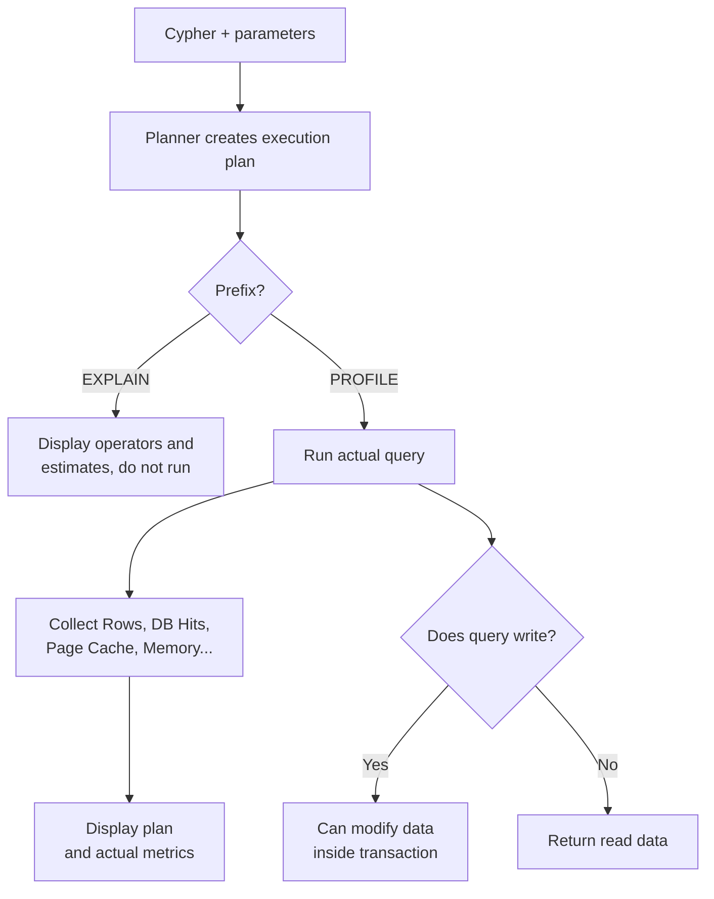
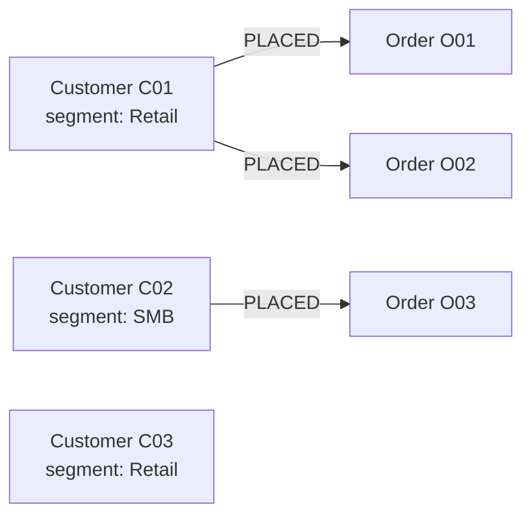

# PROFILE to Measure Execution and Precautions for Write Queries

When a Cypher query is slow, just looking at the statement is not enough to tell which step Neo4j is spending time on. The query might incur high cost finding starting nodes, traversing high-degree relationships, generating too many intermediate rows, sorting results, or updating data. **`PROFILE`** lets you execute the query and inspect the metrics attached to each operator in the **execution plan**.

In the **DATABASE_ENGINE_GRAPH_NEO4J** module, under the **Execution Plans** chapter, this lesson focuses on how to use `PROFILE` to measure Cypher queries on the *property graph* model, interpret actual metrics, compare before and after optimization, and especially **warnings when applying `PROFILE` to write queries**. The knowledge applies when working in Neo4j Browser, the Java Driver, or Spring Data Neo4j; operator names and the set of displayed metrics may vary by Neo4j version and query runtime.

> **Rule to remember immediately:** `EXPLAIN` plans the query **without executing it**. `PROFILE` **executes the query** to collect metrics. If the Cypher contains `CREATE`, `MERGE`, `SET`, `DELETE`, or `REMOVE`, placing `PROFILE` in front still **actually creates, updates, or deletes data**.

## 1. Distinguishing EXPLAIN and PROFILE

Both prefixes are placed before the Cypher query to analyze:

```cypher
EXPLAIN
MATCH (c:Customer)-[:PLACED]->(o:Order)
WHERE c.customerId = 'C01'
RETURN o.orderId AS orderId;
```

```cypher
PROFILE
MATCH (c:Customer)-[:PLACED]->(o:Order)
WHERE c.customerId = 'C01'
RETURN o.orderId AS orderId;
```

| Criterion | `EXPLAIN` | `PROFILE` |
| --- | --- | --- |
| Does it run the query? | Does not execute the query's read/write operations | Yes, runs the query to measure |
| Does it produce actual data results? | No | Can return results like a normal query |
| Does it include the plan diagram/operators? | Yes | Yes |
| Does it include *Estimated Rows*? | Yes, when provided by the plan | May be included for comparison with actual rows |
| Does it include actual *Rows* and `DB Hits`? | No query execution metrics | Includes execution metrics when supported by the runtime |
| Does it cause write side effects if the Cypher writes data? | No | **Yes** |
| When to use? | See what the planner intends to do without running | Verify how much data the planner actually processes |

`EXPLAIN` should not be treated as a speed measurement. It relies on estimates generated by the planner. Conversely, `PROFILE` provides measurements from **one specific execution**, not a guarantee that every subsequent run will have the same latency.

### 1.1. High-Level Execution Diagram



For read queries, `PROFILE` mainly adds measurement overhead. For write queries, it also affects records, indexes, transaction logs, locks, and related write work. Separate the **analysis goal** from **how to control the impact of the measurement run**.

## 2. Preparing the Test Dataset

Practice in a **test database**. This section creates customers, orders, and `PLACED` relationships so you can read and observe a consistent execution plan.

### 2.1. Data Model



`Customer` has properties `customerId`, `name`, and `segment`. `Order` has `orderId` and `createdAt`. The `PLACED` relationship is directed from customer to order.

### 2.2. Initialization

The following statements modify schema and data; run them only in an environment dedicated to practice.

```cypher
CREATE CONSTRAINT customer_id_unique IF NOT EXISTS
FOR (c:Customer) REQUIRE c.customerId IS UNIQUE;

CREATE CONSTRAINT order_id_unique IF NOT EXISTS
FOR (o:Order) REQUIRE o.orderId IS UNIQUE;
```

```cypher
MERGE (c1:Customer {customerId: 'C01'})
SET c1.name = 'An', c1.segment = 'Retail'
MERGE (c2:Customer {customerId: 'C02'})
SET c2.name = 'Bình', c2.segment = 'SMB'
MERGE (c3:Customer {customerId: 'C03'})
SET c3.name = 'Chi', c3.segment = 'Retail'

MERGE (o1:Order {orderId: 'O01'})
SET o1.createdAt = date('2026-10-01')
MERGE (o2:Order {orderId: 'O02'})
SET o2.createdAt = date('2026-11-05')
MERGE (o3:Order {orderId: 'O03'})
SET o3.createdAt = date('2026-11-10')

MERGE (c1)-[:PLACED]->(o1)
MERGE (c1)-[:PLACED]->(o2)
MERGE (c2)-[:PLACED]->(o3);
```

In a database containing only this sample dataset, the query:

```cypher
MATCH (c:Customer)
RETURN c.customerId AS customerId
ORDER BY customerId;
```

returns three customers: `C01`, `C02`, and `C03`. If using a database with other data, the overall result will differ. When evaluating real performance, use a dataset that reflects the scale, node degrees, and property distribution of the expected workload.

## 3. Reading a PROFILE Plan Bottom-Up

Run:

```cypher
PROFILE
MATCH (c:Customer {customerId: 'C01'})
      -[:PLACED]->(o:Order)
RETURN o.orderId AS orderId
ORDER BY orderId;
```

The sample data results are `O01` and `O02`. In the plan view, Neo4j displays an **operator tree**. It may contain operators with the following meanings:

| Common Operator | Work Performed |
| --- | --- |
| `NodeUniqueIndexSeek` | Look up nodes using an index backing a uniqueness constraint |
| `NodeIndexSeek` | Look up nodes using a property index if chosen by the planner |
| `NodeByLabelScan` | Retrieve nodes by label, which may then be filtered further |
| `Expand(All)` | Expand from existing nodes to relationships and adjacent nodes |
| `Expand(Into)` | Check relationship connections between two already-known nodes |
| `Filter` | Discard rows that do not satisfy a condition |
| `Sort` | Sort according to `ORDER BY` |
| `ProduceResults` | Produce the output columns returned to the caller |

With a uniqueness constraint on `Customer.customerId`, one **possible** plan is: find `C01` via `NodeUniqueIndexSeek`, traverse `PLACED` to get orders, read `orderId`, sort, and return two rows. On another system or version, the planner may choose different operator variants.

**How to read:** trace the operators that feed data into the operator above them. Many UIs show results at the top and data sources at the bottom; a plan tree does not always execute in a single linear list order. For operators with multiple inputs, inspect both branches to understand how rows are produced.

### 3.1. Rows Are Intermediate Row Counts, Not Database Node Counts

`Rows` on each operator represents **the number of data rows produced by that operator during execution**. A row can contain one or more Cypher variables.

For example, in the query above:

- The query finds one customer `C01` at the starting point.
- Expanding the `PLACED` relationship produces two rows corresponding to `O01` and `O02`.
- `ProduceResults` returns the final two rows.

Do not infer that `Rows = 2` means the database contains exactly two nodes. It is only the two rows processed or produced by that **specific operator**.

### 3.2. Estimated Rows Differ from Actual Rows

`Estimated Rows` is the planner's **estimate** prior to execution based on statistics and the cost model. `Rows` is the observed count when the query runs.

| Situation | How to Interpret |
| --- | --- |
| Estimate and actual are relatively close | The planner predicted the row count fairly accurately at that step |
| Estimated 10, actual 10,000 | Expansion fan-out, correlation, or data skew may be underestimated |
| Estimated 100,000, actual 2 | Row count at a filter or traversal branch may be overestimated |
| Rows jump hundreds of times after `Expand` | High-degree relationships or paths generating many combinations |
| Rows grow due to `CartesianProduct` | There may be two disconnected patterns; verify query intent |

Not every discrepancy is a bug; estimates are only approximations. However, huge discrepancies can explain why the planner chose an inefficient execution order.

## 4. Important PROFILE Metrics

Depending on the query runtime and version, the profile screen may show `Rows`, `Estimated Rows`, `DB Hits`, `Page Cache Hits`, `Page Cache Misses`, `Memory (Bytes)`, `Time (ms)`, or other columns.

### 4.1. DB Hits: Measuring Internal Accesses

`DB Hits` indicates the amount of internal data-access work Neo4j records for operators. It often helps identify:

- An operator inspecting too many nodes or relationships.
- Property filters occurring after pulling a large set of nodes.
- A relationship expansion step repeated many times.
- Property reads, index usage, and graph traversals creating substantial cost.

**Do not equate `DB Hits` with physical disk reads.** A DB hit can be served from memory or the page cache; you cannot convert one hit into a fixed number of milliseconds. When comparing two equivalent alternatives, a sharp reduction in `DB Hits` on redundant work is usually a good sign, though you must still measure execution time and verify the returned results.

### 4.2. Page Cache Hits and Page Cache Misses

Neo4j uses a **page cache** to manage data pages. When a needed page is already in cache, the engine can record a cache hit; when it is not, a miss can be recorded. These metrics help show how much cost comes from warming up the cache.

For example:

- The first run on data not yet in cache may record many misses.
- Subsequent runs may have more hits and lower latency.
- Under different system load, cache and memory contention from concurrent queries can change the results.

**Do not compare two queries under vastly different cache conditions and conclude that index A is definitely better than index B.** Pay attention to the workload, whether data is already loaded in cache, and whether other tasks are running concurrently.

### 4.3. Memory and Buffering Operators

Some operators such as `Sort`, `Aggregation`, `Distinct`, or `Eager` may need to buffer substantial intermediate data. If the profile reports memory metrics, use them to spot steps putting pressure on resources.

`Memory (Bytes)` does not necessarily represent all memory used by the server or JVM. It reflects the scope of memory the runtime can report for the plan. Combine row counts and operator characteristics when interpreting it.

### 4.4. Time Does Not Equal Total Perceived User Latency

If the runtime reports execution time or per-operator time, that is a useful perspective. However, end-user latency also includes:

- Acquiring a connection and sending the request over the network.
- Compiling/planning the query.
- Server-side execution.
- Transmitting and decoding results.
- Rendering thousands of rows in Neo4j Browser or constructing objects in the application.

Therefore, measure **server execution** and **end-to-end latency** separately when optimizing production workloads.

## 5. An Example: Filtering Many Nodes Before Returning Results

Query to find customers in the Retail segment:

```cypher
PROFILE
MATCH (c:Customer)
WHERE c.segment = 'Retail'
RETURN c.customerId AS customerId
ORDER BY customerId;
```

The result on the sample dataset is `C01` and `C03`.

Without a suitable index on `Customer.segment`, the planner may use `NodeByLabelScan` to fetch nodes labeled `Customer`, then `Filter` to keep rows where `segment = 'Retail'`. In a large database, the number of rows passing through `Filter` and the `DB Hits` count can be high if many customers must be inspected before selecting a small subset.

### 5.1. Testing with a Range Index

In the test database, you can create:

```cypher
CREATE RANGE INDEX customer_segment_idx IF NOT EXISTS
FOR (c:Customer) ON (c.segment);
```

Verify the index is ready:

```cypher
SHOW INDEXES
YIELD name, type, state
WHERE name = 'customer_segment_idx'
RETURN name, type, state;
```

Once `state = 'ONLINE'`, re-run `EXPLAIN` and `PROFILE` for the same read query. The planner **may** use `NodeIndexSeek` if the predicate is selective enough, instead of scanning many nodes and filtering properties.

On a sample set of three customers, the index might **not be chosen** because the row count is tiny and the setup/lookup cost of an index may not pay off. Do not treat an operator name as an absolute optimization target: the goal is reducing work and latency on the real workload.

### 5.2. Evidence-Based Comparison

Using the same parameters and data, record:

| Factor | Before Tuning | After Tuning |
| --- | --- | --- |
| Business result | Customer IDs and row count | Must remain unchanged per requirements |
| Starting-point operator | Label scan or planner-chosen strategy | Re-verify with `EXPLAIN` |
| Rows before filter | From actual profile | From actual profile |
| `DB Hits` | Record actual measured count | Record actual measured count |
| Page cache / memory | Record per run | Record per run |
| Application latency | Measure end-to-end | Measure end-to-end |

Do not invent `DB Hits` or timing figures for an exercise. They depend on Neo4j version, data, indexes, page cache, and query runtime. This table is a **recording template** for real environments.

## 6. Checking Row Explosion During Relationship Traversal

Even when the customer lookup step is highly efficient, the number of relationships originating from a customer can be huge. For example:

```cypher
PROFILE
MATCH (c:Customer {customerId: 'C01'})
      -[:PLACED]->(o:Order)
RETURN o.orderId AS orderId;
```

The starting point may be only **one customer**, but `Expand(All)` must traverse every matching `PLACED` relationship from that customer. On the sample dataset there are two orders; in a real system, a customer or enterprise account can have far more relationships.

Across multiple hops, row counts can grow rapidly:

```cypher
PROFILE
MATCH (c:Customer {customerId: 'C01'})
      -[:PLACED]->(o:Order)
      -[:INCLUDES]->(p:Product)
RETURN c.customerId AS customerId,
       o.orderId AS orderId,
       p.productId AS productId;
```

This query only returns results if the database has `INCLUDES` relationships and matching `Product` nodes; the test dataset in section 2 has not created those relationships. The plan still helps observe the expansion process. If an order has many product line items, each order can produce many result rows. **A good index at the starting point does not eliminate the fan-out cost of relationship traversal.**

Another mistake is combining two patterns with no connecting path:

```cypher
PROFILE
MATCH (c:Customer), (o:Order)
RETURN c.customerId AS customerId,
       o.orderId AS orderId;
```

With 3 customers and 3 orders, the query produces **9 pairs** (Cartesian product), not the list of orders placed by each customer. Connect them with the business pattern:

```cypher
PROFILE
MATCH (c:Customer)-[:PLACED]->(o:Order)
RETURN c.customerId AS customerId,
       o.orderId AS orderId;
```

On the sample dataset, this query returns **3 pairs matching actual relationships**. In the profile, watch for an unexpected `CartesianProduct` operator or a sudden jump in `Rows`; that is usually a sign to review the pattern structure.

## 7. Key Point: PROFILE on Write Queries

### 7.1. PROFILE Does Not Turn a Write Statement into a Read Statement

Consider these two queries:

```cypher
EXPLAIN
MATCH (c:Customer {customerId: 'C01'})
SET c.reviewCount = coalesce(c.reviewCount, 0) + 1
RETURN c.customerId AS customerId;
```

```cypher
PROFILE
MATCH (c:Customer {customerId: 'C01'})
SET c.reviewCount = coalesce(c.reviewCount, 0) + 1
RETURN c.customerId AS customerId;
```

- `EXPLAIN` returns the projected plan **without incrementing** `reviewCount`.
- `PROFILE` **actually increments** `C01`'s `reviewCount` within the transaction. If run in auto-commit mode and the query completes successfully, the change is persisted.
- Running `PROFILE` a second time can increment `reviewCount` again. Results and write cost can also change because the data state has changed.

This is a critical distinction when analyzing `MERGE`, `CREATE`, `SET`, `DELETE`, `DETACH DELETE`, label modifications, or relationship updates. **Do not try `PROFILE` on a write query in a production database just to inspect the plan without a strategy to control its impact.**

### 7.2. For Write Queries, Measure Update Counts as Well

A write plan may include operators such as `Create`, `Merge`, `SetProperty`, `Delete`, or `Eager`, depending on Cypher and runtime. In addition to `Rows` and `DB Hits`, inspect the query's update statistics, such as:

| Update Metric Group | Question to Answer |
| --- | --- |
| Nodes created | How many nodes were actually created? |
| Relationships created | How many new relationships? |
| Properties set | How many properties were set/updated? |
| Labels added / removed | Were there any unintended label changes? |
| Nodes / relationships deleted | Were only the intended target objects deleted? |
| DB Hits and Rows in the search branch | Did locating entities to write require an overly broad scan? |
| `Eager`, `Sort`, `Aggregation`, and Memory | Is there a step buffering all or many intermediate rows? |

**Note:** *Query update counters* and per-operator metrics in `PROFILE` are two different views. The number of updated nodes/relationships cannot be inferred directly from `Rows` at `ProduceResults`. A write query can return zero rows and still create or modify data.

### 7.3. Be Careful with MERGE and Data State

`MERGE` matches existing patterns or creates missing parts, so cost and update counts depend on database state:

```cypher
PROFILE
MERGE (c:Customer {customerId: 'C99'})
ON CREATE SET c.name = 'Hà', c.segment = 'Retail'
RETURN c.customerId AS customerId;
```

The first time on the sample dataset, `C99` does not exist and `MERGE` can create a new node. The next time, `C99` already exists; the exact same statement takes the branch matching existing data. Two `PROFILE` runs therefore **do not measure the same condition**.

If the goal is to compare the performance of the “create new” vs. “match existing” branches, create independent scenarios with comparable input data. Use business keys with appropriate uniqueness constraints to avoid duplicate creation under concurrent writes.

### 7.4. LIMIT in Write Queries Must Be Placed Correctly

Compare these two patterns:

```cypher
// Take at most 2 customers before updating
MATCH (c:Customer)
WITH c ORDER BY c.customerId LIMIT 2
SET c.reviewedAt = datetime()
RETURN c.customerId;
```

```cypher
// Do not use RETURN LIMIT as a guard limiting the number of nodes updated by SET
MATCH (c:Customer)
SET c.reviewedAt = datetime()
RETURN c.customerId
LIMIT 2;
```

In the first pattern, `LIMIT 2` is applied **before** `SET`, so at most two `c` rows enter the update step (assuming each customer matches one row). In the second pattern, `SET` appears **before** `RETURN ... LIMIT 2`, so viewing only two result rows **does not guarantee** limiting updates to two nodes. Neo4j may have to process updates semantically across the entire preceding write clause.

Even when the limit is placed correctly, this is still an **actual write query**. Running `PROFILE` on it will execute those updates.

## 8. How to Measure Write Queries in a Controlled Way

### 8.1. A Safe and Repeatable Workflow

For a write query, follow this sequence:

1. **Copy necessary data into a test/staging environment** or prepare a small dataset with similar constraints and relationship structures.
2. **Run `EXPLAIN` first** to check where data is located, expansion steps, and projected write operators.
3. **Verify the target record set using an equivalent read-only query**, checking counts, filter conditions, labels/relationship types, and the possibility of multiple match paths.
4. **Execute `PROFILE` inside an explicit rollbackable transaction**, if supported by the query type and runner, to collect metrics without persisting final changes.
5. **Consume the full result/summary** to ensure the query has run and the profile is collected before rolling back.
6. **Compare results against expectations and re-measure on equivalent data state**. To measure commit overhead, index updates, transaction log, or lock contention under real load, use a dedicated test environment and benchmark procedure.

Rollback restores data changes **belonging to that Neo4j transaction**, but it is not free: the run still performs internal reads/writes, acquires locks, consumes memory, and affects resources. Nor does it guarantee reverting effects **outside the database** caused by procedures or integrations with side effects. Queries with subtransactions or special batching such as `CALL { ... } IN TRANSACTIONS` have their own rules and **cannot be treated as an ordinary write statement wrapped in an explicit transaction and rolled back as a whole**.

### 8.2. Example with Neo4j Java Driver: PROFILE and Rollback

The snippet below assumes an `org.neo4j.driver.Driver driver` connected to a test database using Neo4j Java Driver 5.x. The code starts an **explicit write transaction**, runs a `PROFILE` query, retrieves `ResultSummary`, and calls `rollback()`.

```java
import java.util.Map;
import org.neo4j.driver.Driver;
import org.neo4j.driver.Session;
import org.neo4j.driver.Transaction;
import org.neo4j.driver.summary.ResultSummary;

public class WriteQueryProfiling {
    public static void inspectAndRollback(Driver driver) {
        try (Session session = driver.session();
             Transaction tx = session.beginTransaction()) {

            ResultSummary summary = tx.run("""
                PROFILE
                MATCH (c:Customer {customerId: $id})
                SET c.reviewCount = coalesce(c.reviewCount, 0) + 1
                RETURN c.customerId AS customerId
                """, Map.of("id", "C01")).consume();

            if (summary.hasProfile()) {
                var profile = summary.profile();
                System.out.println("DB hits (root): " + profile.dbHits());
                System.out.println("Rows (root): " + profile.records());
            }

            System.out.println(
                "Properties set: " + summary.counters().propertiesSet()
            );

            // Test transaction: do not persist changes.
            tx.rollback();
        }
    }
}
```

`ResultSummary` is where you obtain the `PROFILE` plan and update counters on the driver side. `consume()` ensures the driver reads all query results and receives the summary before rollback. The `dbHits()` and `records()` of the **root node in the profile tree** do not replace inspecting child operators' metrics when hunting bottlenecks. Closing an uncommitted transaction is also a standard safeguard; calling `rollback()` explicitly clearly expresses the measurement intent.

**Do not use this pattern for procedures with external side effects or batching queries with subtransactions** without fully understanding transaction boundaries. In a Spring Data Neo4j environment, you can rely on Spring's transaction management, provided the executed Cypher actually includes `PROFILE` and the summary/rollback are handled properly for the client API in use.

### 8.3. Test Data and State Must Be Equivalent

If you simultaneously add an index, increase record counts, replace `MERGE` with `CREATE`, and then compare timings, you will not know which factor caused the difference. When benchmarking write queries:

- Keep node/relationship counts and distributions close across runs.
- Separate scenarios for creating new records, updating existing records, and no-ops.
- Keep index state, constraints, cache warmth, and concurrent write load comparable.
- Measure the cost of locating target records separately from the cost of modifying data.
- Run multiple iterations in an appropriate environment; compare latency percentiles, not a single measurement.
- Verify affected record counts and post-write contents if the benchmark commits in a test environment.

## 9. The Eager Operator and Write-Specific Issues

Neo4j may insert an **`Eager`** operator into the plan to materialize intermediate data before subsequent operations read or write a data region that could interfere with each other. This is a mechanism to preserve query semantics when necessary, not automatically a sign of an error.

Example illustrating an interaction between reading and writing:

```cypher
EXPLAIN
MATCH (c:Customer)
WHERE c.segment = 'Retail'
SET c.segment = 'Preferred'
RETURN c.customerId AS customerId;
```

The query modifies the very `segment` property used in the search condition. Depending on the plan, indexes, and runtime, the planner may need a mechanism to prevent data mutations from affecting an ongoing scan or lookup. `Eager` is an operator you may encounter in certain plan shapes to resolve read/write conflicts or preserve correctness.

Do not conclude that simply “removing `Eager`” will make the query fast. Instead, determine:

- Is the query finding data and modifying that exact same data slice?
- Are there many unnecessary intermediate rows before writing?
- Should target identification be separated from updating in a controlled design?
- Can batching by identifier keys reduce memory usage and lock hold time?
- Is there an appropriate property index to locate the nodes to write?

When updating millions of nodes, index maintenance, transaction logs, locks, and page cache overhead can also account for a large share of cost. `PROFILE` is just one source of evidence; combine database and application metrics to evaluate write load.

## 10. Mistakes That Cause PROFILE Metrics to Be Misinterpreted

| Mistake | Why It Is Wrong | How to Handle |
| --- | --- | --- |
| “`PROFILE` only inspects the plan” | It executes both read and write queries | Use `EXPLAIN` if you only need plan prediction |
| “`DB Hits = physical disk reads`” | DB hits are internal access counters; cache affects I/O | Also inspect page cache and execution time |
| “Plan `Rows` equals total nodes in the database” | Rows are intermediate rows per operator | Track input/output variables and expansions |
| “A plan with `IndexSeek` is always faster than `Scan`” | Selectivity, index overhead, and data size vary | Compare actual performance on representative data |
| “`RETURN ... LIMIT 10` definitely limits updated records” | `LIMIT` applies at its position in the query pipeline | Limit the input set before `SET` |
| “Re-running `PROFILE MERGE` measures the exact same workload” | First run may create; subsequent runs match existing records | Reset or prepare equivalent test state |
| “Rollback makes the test completely impact-free” | Resources, locks, and internal operations still ran; external side effects may not roll back | Measure writes in an isolated environment |
| “One measurement is enough” | Cache, concurrency, parameters, planner, and environment vary | Measure in a controlled, repeatable way on the same dataset |
| “Looking only at total time” | Cannot tell which operator caused slowness or whether results are right | Inspect `Rows`, `DB Hits`, the plan, and business results |

## 11. Practice with Business Scenarios

### Exercise 1 — Compare EXPLAIN and PROFILE

Use the test dataset from section 2. Run `EXPLAIN` and `PROFILE` for the query:

```cypher
MATCH (c:Customer {customerId: 'C01'})-[:PLACED]->(o:Order)
RETURN o.orderId AS orderId
ORDER BY orderId;
```

Explain why both can display a plan tree while only `PROFILE` includes execution metrics. The actual data result when executed must include `O01` and `O02`.

### Exercise 2 — Reading Multiplied Rows

Compare:

```cypher
PROFILE
MATCH (c:Customer), (o:Order)
RETURN count(*) AS pairs;
```

and:

```cypher
PROFILE
MATCH (c:Customer)-[:PLACED]->(o:Order)
RETURN count(*) AS pairs;
```

In a database with only the sample dataset, the first returns `pairs = 9` and the second returns `pairs = 3`. Locate the operator creating the Cartesian product and compare `Rows` across branches. The final `count(*)` produces **one aggregated row**, so do not rely solely on `Rows` at `ProduceResults` to judge upstream row inflation.

### Exercise 3 — Analyzing a Filtered Scenario

Run `PROFILE` on the query fetching customers with `segment = 'Retail'`, saving the operator, `Estimated Rows`, `Rows`, and `DB Hits` columns. Then create a range index on `Customer.segment` and re-run once the index is `ONLINE`. Explain why metrics on three customers are insufficient to draw conclusions about performance on one million customers.

### Exercise 4 — What Happens When Profiling a Write Query?

In a test environment, deduce the result after **two** runs:

```cypher
PROFILE
MATCH (c:Customer {customerId: 'C01'})
SET c.reviewCount = coalesce(c.reviewCount, 0) + 1
RETURN c.reviewCount AS reviewCount;
```

If `reviewCount` initially does not exist, after the first run it is `1` and after the second run it is `2` (when each run commits successfully). Then describe how to use an explicit transaction and rollback to inspect the profile without keeping the measurement's changes.

### Exercise 5 — Explaining LIMIT Placement

How do the two Cypher snippets in section 7.4 differ in the number of nodes updated? Write a read query confirming the count of target customers, and use only `EXPLAIN` if you are in an environment where data mutations cannot be accepted.

### Exercise 6 — Diagnosing a Write Plan

Suppose `PROFILE` for a `MERGE` on a large database shows `NodeByLabelScan` with very high `Rows`, followed by `Merge` and `SetProperty`. Propose an improvement plan: check business keys, uniqueness constraints/indexes, search predicate selectivity, input data duplicates, and actual update counts. Specify how to re-measure safely.

## 12. Checklist When Using PROFILE

Before running `PROFILE`, answer:

1. **Is the query read-only or does it write?** Does it contain `CREATE`/`MERGE`/`SET`/`DELETE`, write procedures, or subtransactions?
2. **Which database is connected?** Is this an appropriate environment to execute the real query?
3. **What is the expected business outcome?** Have node/relationship counts, row counts, and update scope been defined?
4. **Where is the suspected bottleneck?** Finding starting nodes, relationship traversal, filtering, sorting, aggregation, or writing?
5. **Which metrics will be compared?** `Rows`, `Estimated Rows`, `DB Hits`, cache, memory, and end-to-end latency.
6. **Is the measurement environment stable?** Are indexes `ONLINE`, parameters, data, cache, and concurrent load comparable?
7. **If it writes, can it be rolled back?** Are the explicit transaction and current tooling suitable; are there any external side effects or independent batching?

### Key Takeaways

**`EXPLAIN` predicts; `PROFILE` measures by executing.** Read a plan along the steps of finding starting points, traversing relationships, and processing results; use `Rows` to spot sudden jumps in intermediate data, `DB Hits` to observe internal access cost, and cache/memory metrics for additional context. An operator named “Seek” is not enough to conclude an entire query is optimal.

For **write queries**, `PROFILE` performs real data mutations. Inspect both update counters and read/write operators, test on controlled data, use `EXPLAIN` when you only need to view the plan, and use an explicit transaction with rollback when measuring a standard write without persisting changes. This enables optimizing Cypher queries on Neo4j while preserving business semantics and minimizing unintended impact.
