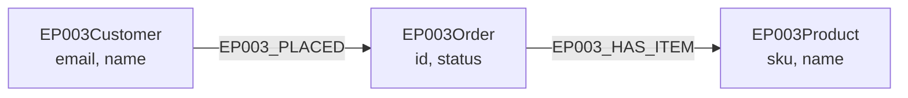

# Reading the Operator Tree, Data Flow Direction, and Query Starting Points

## 1. Why Learn to Read an Execution Plan Tree?

Cypher describes **the graph pattern and desired results**, without dictating which node Neo4j must visit first. For the same `MATCH` statement, the query *planner* may choose to find nodes via an index, scan by label, traverse relationships left-to-right or right-to-left, and only then filter and aggregate. That decision produces an **execution plan** composed of operators connected into a tree.

In Neo4j's **property graph** model, every node and relationship can carry properties; a single relationship expansion step can turn one input row into hundreds of rows. Knowing how to read a plan therefore answers essential questions:

- **Where does Neo4j start finding data**: an index seek, node scan, or relationship scan?
- From that starting point, which operators do data rows pass through to produce the result?
- At which operator do row counts spike, get heavily filtered, get sorted, or get buffered in memory?
- Does the actual plan match your assumptions about indexes, selectivity, and graph traversal direction?

This topic belongs to the **Execution Plans** chapter of the `DATABASE_ENGINE_GRAPH_NEO4J` module. The knowledge applies to Cypher queries using indexes/constraints, path and relationship queries, as well as queries invoked from the Java Driver or Spring Data Neo4j.

**After this lesson, you will be able to**:

1. Read a plan tree **from leaves to root**, distinguishing root, leaf, unary, and binary operators.
2. Read the `Operator`, `Details`, `Estimated Rows`, `Rows`, `DB Hits` columns, and pipeline indicators.
3. Identify the true starting point via `NodeIndexSeek`/`NodeUniqueIndexSeek`/`NodeByLabelScan`, rather than inferring it from `MATCH` ordering.
4. Interpret row flow across `Expand(All)`, `Filter`, `Apply`, `Sort`, and `ProduceResults`.
5. Use `EXPLAIN` and `PROFILE` to verify hypotheses about row counts, bottlenecks, and cost.

## 2. Mental Model: Operator Tree and Data Rows

Each operator takes **zero, one, or two input row streams** and emits output rows. A row can hold bound variables, such as `{c, o, p}` where `c` is customer, `o` is order, and `p` is product.

An **illustrative** tree, not a snapshot from a specific Neo4j version:

```text
                  +------------------+
                  | ProduceResults   |  (root: return results)
                  +------------------+
                           ^
                       +--------+
                       | Sort   |       (sort)
                       +--------+
                           ^
                   +----------------+
                   | Expand(All)    |   (order -> product)
                   +----------------+
                           ^
                     +----------+
                     | Filter   |     (only PAID orders)
                     +----------+
                           ^
                   +----------------+
                   | Expand(All)    |   (customer -> order)
                   +----------------+
                           ^
                +---------------------+
                | NodeUniqueIndexSeek | (leaf: find customer)
                +---------------------+
```

**Important rule:** In the plan table displayed by `EXPLAIN`/`PROFILE`, **the root is at the top and the leaves are at the bottom; read data flow from the leaves up to the root**. Look at the bottom-most operators first to understand the initial set of nodes/relationships, then trace upward through parent operators to see how rows are transformed. `ProduceResults` sits at or near the root and is responsible for emitting the final results.

| Operator Type | Child Branches | Role |
|---|---:|---|
| **Leaf** | 0 | Initializes data from an index, scan, parameters/context; may be the graph-access starting point |
| **Unary** | 1 | Filters, projects columns, expands relationships, sorts, or aggregates a single stream |
| **Binary** | 2 | Combines two streams, e.g., `Apply`, `NodeHashJoin`, `CartesianProduct` |
| **Root** | Usually 1 | Finalizes and delivers results to the application, typically `ProduceResults` |

**Reading bottom-up** reflects data dependency, **not an assertion that every operator always finishes sequentially one after another in wall-clock time**. Neo4j has pipelined and parallel runtimes; multiple operators can run interleaved or be fused into pipelines. Blocking operators such as `Sort` may need to consume many rows before emitting results.

## 3. Preparing a Small Graph to Practice Reading Plans

We use three node labels and two relationship types:



To avoid colliding with other data, labels and relationships in this lesson are prefixed with `EP003`. Practice only on a test database.

### 3.1. Create Nodes

```cypher
UNWIND [
  {id: 'an', name: 'An', email: 'an@example.test'},
  {id: 'binh', name: 'Bình', email: 'binh@example.test'},
  {id: 'chi', name: 'Chi', email: 'chi@example.test'}
] AS row
MERGE (c:EP003Customer {id: row.id})
SET c.name = row.name, c.email = row.email;
```

```cypher
UNWIND [
  {id: 'o101', status: 'PAID'},
  {id: 'o102', status: 'PENDING'},
  {id: 'o103', status: 'PAID'}
] AS row
MERGE (o:EP003Order {id: row.id})
SET o.status = row.status;
```

```cypher
UNWIND [
  {sku: 'KB', name: 'Keyboard'},
  {sku: 'MOUSE', name: 'Mouse'},
  {sku: 'BOOK', name: 'Book'}
] AS row
MERGE (p:EP003Product {sku: row.sku})
SET p.name = row.name;
```

### 3.2. Create Directed Relationships

```cypher
MATCH (an:EP003Customer {id: 'an'})
MATCH (a:EP003Order {id: 'o101'})
MATCH (b:EP003Order {id: 'o102'})
MERGE (an)-[:EP003_PLACED]->(a)
MERGE (an)-[:EP003_PLACED]->(b);
```

```cypher
MATCH (binh:EP003Customer {id: 'binh'})
MATCH (o:EP003Order {id: 'o103'})
MERGE (binh)-[:EP003_PLACED]->(o);
```

```cypher
MATCH (o1:EP003Order {id: 'o101'})
MATCH (o2:EP003Order {id: 'o102'})
MATCH (o3:EP003Order {id: 'o103'})
MATCH (keyboard:EP003Product {sku: 'KB'})
MATCH (mouse:EP003Product {sku: 'MOUSE'})
MATCH (book:EP003Product {sku: 'BOOK'})
MERGE (o1)-[:EP003_HAS_ITEM]->(keyboard)
MERGE (o1)-[:EP003_HAS_ITEM]->(mouse)
MERGE (o2)-[:EP003_HAS_ITEM]->(book)
MERGE (o3)-[:EP003_HAS_ITEM]->(mouse)
MERGE (o3)-[:EP003_HAS_ITEM]->(book);
```

Verify the connections:

```cypher
MATCH (c:EP003Customer)-[:EP003_PLACED]->(o:EP003Order)
      -[:EP003_HAS_ITEM]->(p:EP003Product)
RETURN c.id AS customer, o.id AS orderId,
       o.status AS status, p.sku AS sku
ORDER BY customer, orderId, sku;
```

Expect **5 rows**: An has two items in `o101` and one item in `o102`; Bình has two items in `o103`; Chi has no orders and therefore does not appear in a mandatory `MATCH`.

### 3.3. Declare Indexes for a Selective Starting Point

```cypher
CREATE CONSTRAINT ep003_customer_email IF NOT EXISTS
FOR (c:EP003Customer)
REQUIRE c.email IS UNIQUE;
```

```cypher
CREATE CONSTRAINT ep003_product_sku IF NOT EXISTS
FOR (p:EP003Product)
REQUIRE p.sku IS UNIQUE;
```

In Neo4j, these two uniqueness constraints create backing indexes for exact lookups. When a plan uses a unique index, the operator may be `NodeUniqueIndexSeek`. Check status:

```cypher
SHOW INDEXES
YIELD name, type, state, labelsOrTypes, properties
WHERE name IN ['ep003_customer_email', 'ep003_product_sku']
RETURN name, type, state, labelsOrTypes, properties
ORDER BY name;
```

Before comparing plans, indexes need to reach the `ONLINE` state. Because the test dataset is very small, the planner **may still choose a scan even when indexes exist**; the purpose of the example is practicing plan reading, not proving production performance benchmarks.

## 4. Reading an Execution Plan Operator by Operator

Business query: find the items belonging to **An's paid orders**.

```cypher
MATCH (c:EP003Customer {email: 'an@example.test'})
      -[:EP003_PLACED]->(o:EP003Order)
      -[:EP003_HAS_ITEM]->(p:EP003Product)
WHERE o.status = 'PAID'
RETURN c.name AS customer, o.id AS orderId,
       p.sku AS sku, p.name AS product
ORDER BY sku;
```

Correct data result:

| customer | orderId | sku | product |
|---|---|---|---|
| An | o101 | KB | Keyboard |
| An | o101 | MOUSE | Mouse |

### 4.1. View the Plan Without Running the Query

```cypher
EXPLAIN
MATCH (c:EP003Customer {email: 'an@example.test'})
      -[:EP003_PLACED]->(o:EP003Order)
      -[:EP003_HAS_ITEM]->(p:EP003Product)
WHERE o.status = 'PAID'
RETURN c.name AS customer, o.id AS orderId,
       p.sku AS sku, p.name AS product
ORDER BY sku;
```

`EXPLAIN` shows the **projected plan**; it does not execute the read query and has no actual `Rows` or `DB Hits`. One operator chain that **may** appear is:

```text
ProduceResults
  ↑
Sort / Projection         sort and select returned columns
  ↑
Expand(All)               from order to products
  ↑
Filter                    keep only orders with status = 'PAID'
  ↑
Expand(All)               from customer to orders
  ↑
NodeUniqueIndexSeek       find c.email = 'an@example.test'
```

This is a **conceptual diagram**, not a guaranteed output capture. Neo4j may reverse traversal direction, fuse `Filter` into another operator, replace `Sort` with `Top` when `LIMIT` is present, or organize operators differently depending on data statistics and runtime.

### 4.2. Run PROFILE to Observe Actual Rows and Work

```cypher
PROFILE
MATCH (c:EP003Customer {email: 'an@example.test'})
      -[:EP003_PLACED]->(o:EP003Order)
      -[:EP003_HAS_ITEM]->(p:EP003Product)
WHERE o.status = 'PAID'
RETURN c.name AS customer, o.id AS orderId,
       p.sku AS sku, p.name AS product
ORDER BY sku;
```

If the planner follows the branch starting from the customer as in the diagram, the **row milestones derivable from the fixture** are:

| Logical Block | Rows Received | Explanation |
|---|---:|---|
| Find customer by email | 1 | An is one customer |
| Expand `EP003_PLACED` | 2 | An has two orders `o101`, `o102` |
| Filter `PAID` orders | 1 | Only `o101` is kept |
| Expand `EP003_HAS_ITEM` | 2 | `o101` has two products |
| Project and sort | 2 | Two final result rows |

The numbers in this table express **expected cardinality for this traversal strategy**, not mandatory `Rows` per Neo4j operator because the optimizer may choose another strategy. What matters is interpreting the causal chain: **one customer → two orders → one valid order → two products**.

### 4.3. Columns to Read in a Plan

| Column | Meaning | Useful Reading Tip |
|---|---|---|
| `Operator` | Operator name in the tree | Check index/scan, relationship expansion, join, sort, etc. |
| `Id` | Operator identifier in the current plan | Internal reference ID, not execution order |
| `Details` | Variables, labels, relationship types, predicates, indexes | Shows what is being looked up, filtered, or expanded |
| `Estimated Rows` | Planner's **estimate** of rows to emit | Used to analyze plan choice; may diverge from actuals |
| `Rows` | **Actual** rows emitted by the operator | Only in `PROFILE`; find where rows grow or drop |
| `DB Hits` | Units of storage engine access work | Only in `PROFILE`; **not** equal to disk reads |
| `Memory (Bytes)` | Operator's peak memory if reported | Watch `Sort`, joins, aggregations |
| `Time (ms)` / `Pipeline` | Time or runtime operator group | May be measured at a fused pipeline level, not per operator |

Depending on version, runtime, and edition, `Ordered by`, `Page Cache Hits/Misses`, and `Indexes Used` may also appear. Some rows lack separate metrics, or metrics are aggregated per pipeline. `EXPLAIN` mainly clarifies **intent**, while `PROFILE` lets you compare **estimates against actual measurements**.

## 5. Identifying Common Operators

### 5.1. Data-Access Leaves: Starting Points

| Common Operator | Meaning | When to Pay Attention |
|---|---|---|
| `NodeIndexSeek` | Look up nodes via an index using a matching predicate | An index exists and the condition is selective |
| `NodeUniqueIndexSeek` | Look up via a unique index | Keys like email/sku have a uniqueness constraint |
| `NodeIndexScan` | Scan matching entries across an index | Check selectivity and which index is used |
| `NodeByLabelScan` | Scan nodes by label | Can suit small sets; expensive if there are very many nodes |
| `AllNodesScan` | Scan all nodes | Red flag to investigate for queries that have labels or keys |
| `Argument` | Pass already-bound variables into a dependent query branch | A leaf inside an `Apply` branch; **does not search storage itself** |

**Do not equate every leaf with a storage access point**: `Argument` can be a leaf of a sub-branch, yet it merely forwards values already bound in another branch. When identifying the "starting point", point specifically to the **leaf that searches for nodes/relationships** along with its predicate and index (if any).

### 5.2. Operators That Transform and Combine Streams

| Operator | Behavior | Potential Impact on `Rows` |
|---|---|---|
| `Expand(All)` | From a known node, traverse relationships to new nodes | One row can multiply into many rows |
| `Expand(Into)` | Check relationships between **two already-known endpoints** | Verifies connections instead of discovering new endpoint nodes |
| `Filter` | Keep rows satisfying conditions | Row count does not increase |
| `Projection` | Compute or select returned columns | Usually preserves row count |
| `Aggregation` / `EagerAggregation` | Group rows by grouping keys, compute `count/sum/avg` | Usually reduces rows; may need to buffer state |
| `Sort` / `Top` | Sort or pick ordered top results | Consumes CPU/memory, depending on size and `LIMIT` |
| `Apply` | For each row from the left branch, run the variable-dependent right branch | Right-branch cost can repeat many times |
| `NodeHashJoin` | Join two streams on a node key | Emits matching rows; incurs hash-table build cost |
| `CartesianProduct` | Pair every row from the left branch with every row from the right | Can explode row count if both branches are large |
| `Eager` | Collect rows before letting downstream operators proceed | Pipeline-blocking point and memory consumer |
| `ProduceResults` | Deliver final rows to the client | Common root of read queries |

Operator names can differ across versions or how the planner represents patterns. **Reading `Details` alongside `Rows`** matters more than memorizing a list of names.

## 6. Binary Trees: Display Order and Apply Branches

Plans are not always a single-column chain. For example, with correlated subqueries, the planner may use `Apply` to supply bound variables from one part of the tree to another.

An **illustrative branch-relationship diagram**, not a fixed representation for every subquery:

```text
+ProduceResults
|
+Projection
|
+Apply                     receives outputs from LHS and RHS
|\
| +Expand(All)             RHS: uses variable c to traverse orders
| |
| +Argument                RHS: receives already-bound variable c
|
+NodeUniqueIndexSeek       LHS: finds c by email
```

In Neo4j's plan table layout, **the right-hand side (RHS) is displayed above and indented deeper**, while **the left-hand side (LHS) is displayed below at the same indentation level as the parent operator**. For a nested-loop-style `Apply`, interpret the logic as:

1. The left branch emits a row carrying variable `c`.
2. The right branch receives `c` via `Argument` and is evaluated for that row.
3. `Apply` combines rows from both branches for the operator above.
4. If the LHS emits many rows, the RHS branch may have to execute **repeatedly** in proportion.

Do not read "RHS displayed higher" as meaning the entire RHS runs on its own before LHS. With `Apply`, **LHS supplies data first**, and RHS is driven per LHS row. For `NodeHashJoin` or `CartesianProduct`, the rules for combining two inputs differ; do not force a nested-loop mental model onto every binary operator.

**Performance warning:** When LHS produces 100,000 rows and RHS performs an expensive traversal per row, total cost can be huge even if the RHS looks small in isolation. Inspect `Rows` and `DB Hits` across the entire tree, not just the first row or the index seek.

## 7. The Starting Point Is Not Necessarily the First Node Written in MATCH

Cypher queries are declarative. In the pattern:

```cypher
MATCH (c:EP003Customer)-[:EP003_PLACED]->(o:EP003Order)
      -[:EP003_HAS_ITEM]->(p:EP003Product)
WHERE p.sku = 'MOUSE' AND o.status = 'PAID'
RETURN c.id AS customerId, o.id AS orderId, p.sku AS sku
ORDER BY customerId;
```

Readers often picture Neo4j going `c → o → p` because `c` is written first. However, `p.sku = 'MOUSE'` has a **unique index** and may be far more selective than scanning all customers. The planner **can start from `p`**, then traverse relationships **against the pattern arrow direction** to find `o` and `c`.

**Arrows in Cypher express allowed relationship direction to match, not a mandate on traversal direction from the starting point.** A relationship stored as `(o)-[:EP003_HAS_ITEM]->(p)` can still be traversed backward from `p` to `o` when chosen by the planner.

Valid results on the fixture:

| customerId | orderId | sku |
|---|---|---|
| an | o101 | MOUSE |
| binh | o103 | MOUSE |

Compare the plan for the same query:

```cypher
EXPLAIN
MATCH (c:EP003Customer)-[:EP003_PLACED]->(o:EP003Order)
      -[:EP003_HAS_ITEM]->(p:EP003Product)
WHERE p.sku = 'MOUSE' AND o.status = 'PAID'
RETURN c.id AS customerId, o.id AS orderId, p.sku AS sku
ORDER BY customerId;
```

In `Details`, if the leaf uses `p:EP003Product(sku)`, that is evidence the planner started from the product. If the leaf is `NodeByLabelScan` or starts from customer, note the **actual** plan: the test dataset is tiny, and statistics or runtime can lead to a different decision.

### 7.1. Two Data-Access Points and a Join

For example, when finding both a **customer by email** and a **product by SKU**:

```cypher
MATCH (c:EP003Customer {email: 'an@example.test'})
MATCH (p:EP003Product {sku: 'MOUSE'})
MATCH (c)-[:EP003_PLACED]->(o:EP003Order)
      -[:EP003_HAS_ITEM]->(p)
WHERE o.status = 'PAID'
RETURN c.id AS customerId, o.id AS orderId, p.sku AS sku;
```

The result is one row: `an, o101, MOUSE`. The planner may use one or **both index seeks**, then join or verify relationships between the bound nodes. When you see multiple leaves, identify **what candidate set each leaf supplies**, then trace up to the binary operator or expansion where the streams meet.

**Do not interpret a plan from the textual order of `MATCH` clauses.** The reliable method is reading `Details` on the leaf operators and tracing paths from leaves to root in `EXPLAIN`/`PROFILE` output.

### 7.2. Cardinality Governs Expansion Cost

Let `N` be the number of rows before traversing a relationship, and `d` be the average number of matching relationships per starting node. Before filtering, the row count **can be roughly approximated** as `N × d` if each relationship emits one row; that is a simple reasoning model, not an exact prediction formula for every plan.

With the fixture: starting at An (`N = 1`), `EP003_PLACED` creates 2 rows, filtering `PAID` leaves 1, and `EP003_HAS_ITEM` creates 2. If products are expanded **before** filtering order status, intermediate rows can be higher: 2 orders generate 3 item rows, leaving 2 after filtering. On large datasets with many relationships, the difference can be substantial.

A `CartesianProduct` joining two **unrelated** pattern parts can multiply row count to the product of both set sizes. It is not always wrong, though it is usually a warning sign to inspect when business logic actually requires a relationship between the two sets.

## 8. Planner Estimates vs. Actual PROFILE Metrics

Read the two columns side by side:

```text
Estimated Rows = planner's forecast before execution
Rows           = actual rows observed when PROFILE runs
```

For example, an `Expand(All)` operator estimated at `10` rows that actually emits `10,000` rows indicates a **major cardinality skew**. The planner may have chosen a suboptimal join/expand order for the real data; examine relationship degree distribution, popular values, index statistics, and how predicates are applied.

However:

- `Rows` on an operator is the **number of rows it emits**, not the count of distinct nodes. One node can appear in multiple rows due to multiple paths or relationships.
- `DB Hits` measures **storage engine access work**, not disk reads, CPU time, or row counts.
- `Memory (Bytes)` across two operators is each **operator's individual peak memory**, not directly summable into query-wide peak memory. Check the total memory summary in the footer if available.
- `Time (ms)` may be reported at a **fused pipeline level**, especially in pipelined/parallel runtimes, so do not assume every time shown next to an operator is its isolated exclusive time.
- `PROFILE` adds instrumentation work; displayed time should not be treated as end-to-end latency from a Java application or browser.

### 8.1. Impact of Filtering and Ordering

Try changing the output of the same query:

```cypher
PROFILE
MATCH (c:EP003Customer {email: 'an@example.test'})
      -[:EP003_PLACED]->(o:EP003Order)
      -[:EP003_HAS_ITEM]->(p:EP003Product)
WHERE o.status = 'PAID'
RETURN p.sku AS sku
ORDER BY sku
LIMIT 1;
```

Expect only one row: `KB`. To preserve ordering with `LIMIT`, the planner may use `Top` or an equivalent operator instead of materializing and sorting the entire output. **A single final row does not mean underlying operators processed only one row**. Read `Rows` on each operator to see whether `LIMIT` actually curtailed work in the graph-access branch.

### 8.2. When Is an Index Not the Whole Answer?

An index seek can shrink the initial candidate set, yet the overall query can still be expensive if:

1. After the seek, a node connects to **very many relationships** and `Expand(All)` emits a massive number of rows.
2. `Sort` or aggregation runs over a large number of rows before `LIMIT`.
3. `Apply` repeatedly executes an expensive branch for each input row.
4. Hot vs. cold page cache state differs during measurement.
5. The query returns hundreds of thousands of columns/records over the network even though node lookup is very fast.

Therefore, read **the entire tree from leaf to root** rather than concluding "it has `NodeIndexSeek` = the query is already optimal".

## 9. A Repeatable Plan-Reading Workflow

| Step | Action | Question to Answer |
|---|---|---|
| 1 | Confirm query and expected result | What does each output row represent? |
| 2 | Run `EXPLAIN` | Which leaves/indexes/scans did the planner pick? |
| 3 | Locate **data-access leaves** and `Details` | Which nodes/relationships are the starting point? Which predicates are applied? |
| 4 | Trace branches **bottom-up** | Where do `Expand`, `Filter`, `Join`, `Sort` change row counts? |
| 5 | For binary trees, distinguish LHS/RHS | Is `Apply` repeating a dependent branch, or is it a `Join`/`CartesianProduct`? |
| 6 | Run `PROFILE` for read queries on representative data | How do `Rows`, `DB Hits`, memory, and cache behave? |
| 7 | Compare `Estimated Rows` with `Rows` | Where did the planner misjudge selectivity? |
| 8 | Fix the root cause and re-measure | Did result accuracy, work cost, and latency improve? |

**Do not run `PROFILE` recklessly on write queries:** it **executes** `CREATE`, `SET`, and `DELETE` when the query contains writes. Examples in this lesson only `PROFILE` read statements. `EXPLAIN` is more appropriate for inspecting a plan before deciding to run a data-mutating query.

### 9.1. Mistake Example: Omitting the Connecting Relationship Between Two Node Sets

```cypher
EXPLAIN
MATCH (c:EP003Customer), (p:EP003Product)
RETURN c.id AS customerId, p.sku AS sku;
```

On the sample data with 3 customers and 3 products, the query returns **9 pairs** if executed. `CartesianProduct` may appear because the two patterns are not linked by a relationship or join condition. If the business question is actually "which products each customer purchased", write the proper relationship pattern:

```cypher
MATCH (c:EP003Customer)-[:EP003_PLACED]->(:EP003Order)
      -[:EP003_HAS_ITEM]->(p:EP003Product)
RETURN DISTINCT c.id AS customerId, p.sku AS sku
ORDER BY customerId, sku;
```

The relationship-accurate result is five pairs: An – KB, MOUSE, BOOK; Bình – MOUSE, BOOK; Chi has no orders. **`DISTINCT` only deduplicates rows**; it does not restore a forgotten relationship.

### 9.2. Example: Keeping Nodes Without Relationships

```cypher
MATCH (c:EP003Customer)
OPTIONAL MATCH (c)-[:EP003_PLACED]->(o:EP003Order)
RETURN c.id AS customerId, count(o) AS orderCount
ORDER BY customerId;
```

Expected: `an = 2`, `binh = 1`, `chi = 0`. `OPTIONAL MATCH` can emit nulls for unmatched columns; `count(o)` ignores nulls, so Chi is retained rather than dropped as in a mandatory `MATCH`. This is also an exercise in reading `Rows` when an unmatched branch exists, as opposed to counting only connected nodes.

## 10. Hands-On Exercises on the Operator Tree

1. **Draw the tree by hand.** For the query finding An's PAID orders, mark the 1 → 2 → 1 → 2 row milestones and draw arrows from leaf to root.
2. **Find the starting point.** Run `EXPLAIN` for two queries: finding by An's email and finding by SKU MOUSE. Record the leaf operator name and `Details` chosen by the planner; explain why a scan might appear instead of an index seek.
3. **Reorder the MATCH clause.** Rewrite the MOUSE query so `p` appears first in the pattern. Compare the plan and result; conclude why variable order in text **does not guarantee** access order.
4. **Diagnose row counts.** Run `PROFILE` with and without `WHERE o.status = 'PAID'`. Compare `Rows` before `ProduceResults` and at `Expand(All)` steps; pinpoint where filtering is needed to reduce intermediate rows.
5. **Analyze sort and limit.** Compare `ORDER BY sku` against `ORDER BY sku LIMIT 1`. Did Neo4j choose `Sort` or `Top`? Where did more than one row still have to be processed?
6. **Spot CartesianProduct.** Compare the query pairing all customers–products (9 pairs) with the query traversing relationships (5 pairs). Identify the root node, combining operator, and why cardinalities differ.
7. **Analyze Apply.** Given a plan with `Apply` (which can arise from a correlated subquery), identify the left branch, right branch, and `Argument` variable; estimate RHS iteration count from LHS `Rows`.

**Self-check criteria:** you can point out the graph-access leaf and the `ProduceResults` root; correctly explain upward arrows in the tree; avoid confusing `MATCH` syntax order with starting point; distinguish `Estimated Rows` from `Rows`; and recognize why `Expand`, `Apply`, or `CartesianProduct` can become expensive.

### Cleaning Up Lesson Data

Clean up only on the test database containing the `EP003` sample labels:

```cypher
DROP CONSTRAINT ep003_customer_email IF EXISTS;
```

```cypher
DROP CONSTRAINT ep003_product_sku IF EXISTS;
```

```cypher
MATCH (n)
WHERE n:EP003Customer OR n:EP003Order OR n:EP003Product
DETACH DELETE n;
```

## 11. References

- [Neo4j Cypher Manual — Understanding query plans](https://neo4j.com/docs/cypher-manual/current/planning-and-tuning/execution-plans/): tree structure, leaf-to-root reading order, columns in `EXPLAIN`/`PROFILE`, and binary-branch conventions.
- [Neo4j Cypher Manual — Operators](https://neo4j.com/docs/cypher-manual/current/planning-and-tuning/operators/): meanings of `NodeIndexSeek`, `Expand`, `Apply`, `CartesianProduct`, and operator categories.
- [Neo4j Cypher Manual — Indexes](https://neo4j.com/docs/cypher-manual/current/indexes/): index types and their impact on execution plans.
- [Neo4j Java Driver Manual](https://neo4j.com/docs/java-manual/current/): integrating Cypher into applications and evaluating end-to-end latency.
