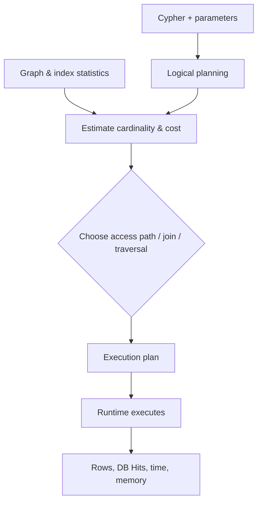
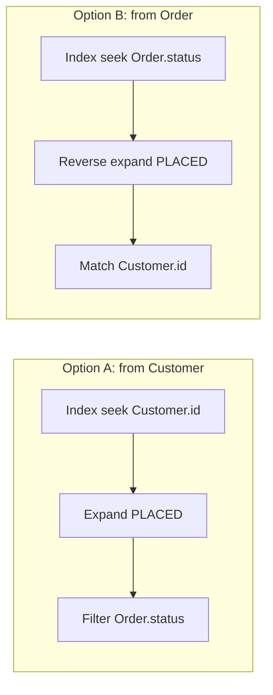
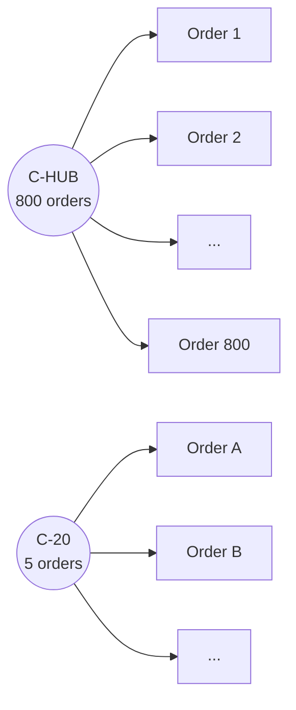

# Data Statistics, Plan Selection, and the Impact of Skewed Distributions in Neo4j

A Cypher query can return the right answer yet take seconds because Neo4j picked an unsuitable data access path. The **query planner** must estimate how many nodes, relationships, and intermediate records will be processed **before running the query**. It relies on data statistics, index metadata, Cypher structure, and a cost model to choose an **execution plan**. When data is unevenly distributed — for instance, one customer has hundreds of thousands of relationships while most customers have only a few — estimates based on averages can diverge sharply from reality.

This lesson belongs to the **Execution Plans** chapter in the **DATABASE_ENGINE_GRAPH_NEO4J** module. The knowledge applies when querying property graphs with **Cypher**, selecting indexes and constraints, tuning relationship traversals, and running queries in the **Neo4j Java Driver** or **Spring Data Neo4j**.

After this lesson, you will be able to explain:

- Which statistics help Neo4j estimate **cardinality** (row counts at each step).
- Why two plans returning identical results can have very different access costs.
- How to read gaps between **Estimated Rows** and **Rows** when using `EXPLAIN`/`PROFILE`.
- The impact of **data skew** across property values, relationship counts, and data correlation.
- How to measure and tune plans across representative data slices.

## 1. From Cypher Query to Execution Plan

Consider the query:

```cypher
MATCH (c:Customer {id: $customerId})-[:PLACED]->(o:Order)
WHERE o.status = $status
RETURN o.id AS orderId;
```

Logically, Neo4j can consider alternative ways to execute this:

1. **Start from Customer**: find the node with `id = $customerId`, traverse outgoing `:PLACED` relationships, then filter `o.status`.
2. **Start from Order**: find `Order` nodes with `status = $status`, traverse `:PLACED` in reverse to verify the customer.
3. In more complex queries, the planner must also choose the order of `MATCH` patterns, joins, filter placement, sorting, and intermediate result handling.

The syntax `(c)-[:PLACED]->(o)` specifies the **relationship direction to match**, but does not force the engine to always start execution from `c`. The planner can find `o` nodes first and walk backward along that directed relationship if doing so is cheaper.



An **execution plan** is a tree of **operators**. Each operator performs a task such as looking up nodes via an index, scanning a label, traversing relationships, filtering results, joining, or sorting. A plan is chosen based on **estimates**; actual costs and row counts are known only upon execution.

## 2. What Statistics Does Neo4j Maintain and How Are They Used?

The planner needs information about data scale and selectivity to compare plans. Depending on the Neo4j version, index types, and query shape, estimation inputs can include:

| Information Group | Example | Effect on the Planner |
| --- | --- | --- |
| Node counts by label | How many `:Customer`, `:Order` nodes exist | Estimate label scan or node filter cost |
| Relationship counts by type/pattern | How many `:PLACED` relationships, between which labels | Estimate size of relationship expansion |
| Index statistics | Which indexes exist, selectivity of indexed values | Estimate index seek/scan cost |
| Query predicate characteristics | `=`, range conditions, `AND`/`OR` combinations, `LIMIT`, `ORDER BY` | Estimate remaining filtered rows and operator costs |
| Data constraints | Whether `id` has a `UNIQUE` constraint | Bound expected cardinality of identifier lookups |

Neo4j maintains these statistics for planning. **Do not assume identical statistics mechanisms or granularity as PostgreSQL/Oracle**; Neo4j does not necessarily keep a separate histogram table for every property combination or for individual high-degree nodes. Field names, statistic visibility, and replanning rules also depend on the Neo4j version.

### Cardinality and Selectivity

- **Cardinality**: the number of records/rows passing through an operator. One node combined with many relationships can yield many rows.
- **Estimated Rows**: the cardinality **predicted** by the planner before execution.
- **Rows** in `PROFILE`: the number of rows the operator **processed or emitted during execution**, as displayed by the plan.
- **Selectivity**: the fraction of data matching a predicate. For example, 10 out of 1,000 `Order` nodes have `status = 'FAILED'` → actual selectivity is 1%.

A filter changes row counts intuitively:

```text
1,000 Order
    │ WHERE status = 'FAILED'  (10 orders)
    ▼
10 Order                       → selectivity = 10 / 1,000 = 1%
```

However, a **1% graph-wide estimate** may not hold for a specific customer, region, or account tier. This is a major cause of suboptimal plan selection.

## 3. The Planner Compares Plans Using Cost Estimates

For the query `Customer → PLACED → Order`, suppose:

- Finding one `Customer` by index/constraint takes very little work.
- A typical customer has 5 orders.
- A special customer has 800 orders.
- Across the whole graph, only 10 out of 1,000 orders have status `FAILED`.

Two strategies have different shapes:



If the customer has **5** orders, Option A can be very cheap. If the customer has **800** orders yet we only want `FAILED` (rare across the whole graph), Option B may inspect fewer candidates. The planner weighs the information it has; there is no rule that Option A or Option B is **always** faster.

### Why Can Averages Mislead?

With 41 customers and 1,000 orders, the **average degree** of a customer along `PLACED` is roughly:

```text
1,000 / 41 ≈ 24.4 orders/customer
```

This number differs dramatically from:

- Customer `C-HUB`: **800** orders.
- Each customer `C-1` through `C-40`: **5** orders.

When traversing from a customer to orders, an average-based estimate can underestimate `C-HUB` by roughly **33x**. This illustrates how aggregate statistics can mask a **high-degree hub**; it does not claim Neo4j always uses that exact division in every execution plan.

## 4. Hands-On: Creating a Graph with Clear Skew

Run the following examples only in a **practice database**. We use labels `PlanCustomer` and `PlanOrder` to isolate the dataset. There are 41 customers and 1,000 orders; one customer owns 80% of all orders.

### 4.1. Creating Constraints and Indexes

```cypher
CREATE CONSTRAINT plan_customer_id_unique IF NOT EXISTS
FOR (c:PlanCustomer)
REQUIRE c.id IS UNIQUE;
```

```cypher
CREATE CONSTRAINT plan_order_id_unique IF NOT EXISTS
FOR (o:PlanOrder)
REQUIRE o.id IS UNIQUE;
```

```cypher
CREATE RANGE INDEX plan_order_status IF NOT EXISTS
FOR (o:PlanOrder)
ON (o.status);
```

The uniqueness constraint on `PlanCustomer.id` enables unique identifier lookup; the `plan_order_status` index provides a separate access path via order status. Having both access paths makes comparing starting directions meaningful.

To check index status:

```cypher
SHOW INDEXES
YIELD name, type, labelsOrTypes, properties, state
WHERE 'PlanCustomer' IN labelsOrTypes
   OR 'PlanOrder' IN labelsOrTypes
RETURN name, type, properties, state
ORDER BY name;
```

If a new index is `POPULATING`, wait until it is `ONLINE` before evaluating its impact.

### 4.2. Creating 1,000 Orders Linked to 41 Customers

```cypher
UNWIND range(1, 1000) AS i
WITH i,
     CASE
       WHEN i <= 800 THEN 'C-HUB'
       ELSE 'C-' + toString(toInteger((i - 801) / 5) + 1)
     END AS customerId
MERGE (c:PlanCustomer {id: customerId})
MERGE (o:PlanOrder {id: 'O-' + toString(i)})
SET o.status =
    CASE WHEN i % 100 = 0 THEN 'FAILED'
         ELSE 'OPEN'
    END
MERGE (c)-[:PLACED_ORDER]->(o);
```

Data profile after creation:

| Group | Customers | Total Orders | Orders per Customer |
| --- | ---: | ---: | ---: |
| `C-HUB` | 1 | 800 | 800 |
| `C-1` to `C-40` | 40 | 200 | 5 |
| **Total** | **41** | **1,000** | **Average approx. 24.4** |

Among the 1,000 orders, one in every 100 is `FAILED`, so status counts are **990 OPEN, 10 FAILED**. Inside `C-HUB` there are **792 OPEN, 8 FAILED**; inside `C-20` (orders 896–900) there are **4 OPEN, 1 FAILED**.

`MERGE` ensures re-running the example with the same identifiers does not recreate duplicate nodes or relationships. If prior practice data with the same labels and a different structure already exists, statistical counts may differ from the table above; use a clean test database for exact figures.

### 4.3. Measuring Actual Distribution

Count orders per customer:

```cypher
MATCH (c:PlanCustomer)-[:PLACED_ORDER]->(o:PlanOrder)
RETURN c.id AS customerId, count(o) AS orderCount
ORDER BY orderCount DESC, customerId
LIMIT 10;
```

The first result is `C-HUB` with **800**. The remaining customers each have **5**.

Count by status:

```cypher
MATCH (o:PlanOrder)
RETURN o.status AS status, count(*) AS orderCount
ORDER BY orderCount DESC;
```

Expected result:

| status | orderCount |
| --- | ---: |
| `OPEN` | 990 |
| `FAILED` | 10 |

These two metrics show two types of skew:

1. **Degree skew:** most relationships concentrate on `C-HUB`.
2. **Property-value skew:** `OPEN` is common, while `FAILED` is rare.

## 5. Comparing Plans for the Same Query Pattern

### 5.1. Query Filtering by Customer and Status

```cypher
EXPLAIN
MATCH (c:PlanCustomer {id: 'C-HUB'})
      -[:PLACED_ORDER]->(o:PlanOrder)
WHERE o.status = 'OPEN'
RETURN o.id AS orderId;
```

`EXPLAIN` only plans; it **does not execute the query**. To see actual row counts:

```cypher
PROFILE
MATCH (c:PlanCustomer {id: 'C-HUB'})
      -[:PLACED_ORDER]->(o:PlanOrder)
WHERE o.status = 'OPEN'
RETURN o.id AS orderId;
```

The logical result is **792 orders**. Try a query with a rare filter:

```cypher
PROFILE
MATCH (c:PlanCustomer {id: 'C-HUB'})
      -[:PLACED_ORDER]->(o:PlanOrder)
WHERE o.status = 'FAILED'
RETURN o.id AS orderId;
```

The logical result is **8 orders**. Then try a small customer:

```cypher
PROFILE
MATCH (c:PlanCustomer {id: 'C-20'})
      -[:PLACED_ORDER]->(o:PlanOrder)
WHERE o.status = 'FAILED'
RETURN o.id AS orderId;
```

The logical result is **1 order**.

Four factors worth observing when comparing runs are **starting point**, **relationship expansion direction**, **intermediate row counts**, and **filtering/sorting operations**. Neo4j may pick the exact same plan for all three queries on this tiny dataset; that is not an error. The goal is understanding why **actual** efficiency can diverge despite identical query shapes.

### 5.2. Reading Common Operators

| Operator or Group | How to Understand | Signals to Check |
| --- | --- | --- |
| `NodeIndexSeek`, `NodeUniqueIndexSeek` | Look up nodes via index/constraint | Are candidates few, and is it starting from the right side? |
| `NodeByLabelScan` | Scan nodes by label | Are too many nodes scanned before filtering? |
| `Expand(All)` / `Expand(Into)` | Traverse relationships matching the pattern | Is a hub producing unexpectedly large row counts? |
| `Filter` | Drop rows failing predicates | Are thousands of rows processed before discarding most of them? |
| `NodeHashJoin`, `Apply` | Combine plan branches/segments | Are intermediate sets and join costs high? |
| `Sort`, `Top`, `EagerAggregation` | Sort, take ordered top, or group rows | Are many rows buffered in memory? |
| `Eager` | Materialize intermediate data at a dependency boundary | Does it incur substantial memory overhead? |

Not every Neo4j version shows the exact same operator names, columns, or execution order. Read the **actual plan tree** in Neo4j Browser or your `PROFILE` output.

### 5.3. Reading `Estimated Rows` and `Rows` Where Divergence Begins

Suppose a plan starts at customer and expands relationships. A **hypothetical illustrative table**, not fixed Neo4j output, might look like:

| Operator | Estimated Rows | Actual Rows | Interpretation |
| --- | ---: | ---: | --- |
| `NodeUniqueIndexSeek` — find `C-HUB` | 1 | 1 | Correctly locates one customer |
| `Expand(All)` — traverse `PLACED_ORDER` | 25 | 800 | Customer degree estimate is far lower than reality |
| `Filter` — `status = 'FAILED'` | 1 | 8 | Post-filter result is small, yet 800 relationships were traversed |

The first divergence appears at **Expand**. Looking only at the final returned row count (8), you could miss the cost of traversing **800** relationships. This is a key approach when investigating slow queries: find **the first operator** where actual rows diverge sharply from estimates, then trace the cause.

**There is no absolute threshold** like “more than 10x off is always a bug”. An operator off by 100x that processes only 100 rows can still be cheap. Conversely, a 2x underestimate on tens of millions of rows can cause severe problems.

## 6. Using `DB Hits`, Memory, and Time Properly

In `PROFILE`, you can typically observe:

- **Rows**: data volume at an operator.
- **Estimated Rows**: volume predicted during planning.
- **DB Hits**: data accesses by the operator under the engine's internal accounting; not equal to disk reads or network round-trips.
- **Memory**: some operators and runtimes report memory usage.
- **Page cache hits/misses**, **time**, or runtime metadata: depends on tooling, version, and plan type.

For instance, a `Filter` receiving 800 rows and outputting 8 can do more work than an index producing 10 candidates upfront before checking the customer. However, never draw conclusions from total `DB Hits` in a single run: caching, small data sizes, and per-operator costs vary.

When comparing two plans, keep constant:

1. Same data, same version, and same runtime configuration.
2. Same query objective; **do not** drop necessary predicates just to make a plan look faster.
3. Same parameter-passing style, result size, and roughly comparable cache warmth.
4. Measure multiple times on sufficiently large data while watching both latency and resource usage.

`PROFILE` **executes** the query. For write statements, this can actually create, modify, or delete graph elements; use a test database or read-only queries when exploring plans.

## 7. Three Types of Skewed Distribution That Cause Misestimation

### 7.1. Value-Frequency Skew

Suppose `Order.status` is distributed as:

```text
OPEN    ████████████████████████████████████ 99%
FAILED  ▏                                      1%
```

An index on `status` does not automatically make `status = 'OPEN'` fast. For a common value, the index can still return nearly the entire dataset; a label scan or another plan may be cheaper. For `FAILED`, an index seek can be highly beneficial when the value is rare.

Similarly, a `country` property might hold 95% of records in one country and 5% split across dozens of others. Do not use “how many distinct values exist” as the sole proxy for query cost.

### 7.2. Relationship-Degree Skew

Graphs often contain **hubs**: nodes with vastly more relationships than the rest, such as popular users, large enterprise accounts, or products with millions of interactions.



Even though `Customer.id` is unique, locating one customer **does not mean the whole query yields one row**. `Expand` multiplies rows by that node's degree. In multi-hop queries, misestimates can compound across multiple expansions.

### 7.3. Skew from Correlation Across Properties or Data Groups

Suppose `status = 'FAILED'` is rare system-wide yet concentrated in certain tenants, or VIP customers' `:Order` nodes fall mostly within a specific date window. Global averages fail to describe proportions **within a subgroup**.

Illustrative example:

| Group | Total Orders | FAILED | FAILED Rate |
| --- | ---: | ---: | ---: |
| Tenant A | 1,000 | 1 | 0.1% |
| Tenant B | 1,000 | 400 | 40% |
| **System-wide** | **2,000** | **401** | **20.05%** |

If a simple estimate assumes `tenantId` and `status` predicates are roughly independent, predictions for individual tenants can be badly wrong. This is solely an **illustration of marginal statistics and correlation**; Neo4j is not claimed to always apply that exact independence formula. This pattern arises frequently in multi-tenant systems and data segmented by region, time, or user activity level.

## 8. Why Can Statistics and Plans Change?

A plan that worked well last week might not work well today when:

- One tenant grows from a few thousand to millions of relationships.
- The `OPEN`/`FAILED` ratio shifts after an incident or promotion.
- New data clusters into a particular month, region, or community.
- Indexes or constraints are added/dropped, changing property availability or layout.
- You upgrade Neo4j, change runtime settings, or alter query patterns.

Neo4j manages statistics and plan caching internally. Statistics updates, replanning decisions, and cache invalidation **should not be assumed to happen instantaneously after every write**. Do not blame every `Estimated Rows`/`Rows` gap on “stale statistics”; it can also stem from data shapes that aggregate summaries cannot easily capture, especially hubs and correlated values.

### Parameterized Queries and Skewed Data

In the Java Driver, two calls may run the same Cypher template:

```cypher
MATCH (c:PlanCustomer {id: $customerId})
      -[:PLACED_ORDER]->(o:PlanOrder)
WHERE o.status = $status
RETURN o.id AS orderId;
```

Yet parameter combinations can differ starkly:

| Parameters | Candidates After Filter on Sample Data |
| --- | ---: |
| `C-HUB` + `OPEN` | 792 |
| `C-HUB` + `FAILED` | 8 |
| `C-20` + `OPEN` | 4 |
| `C-20` + `FAILED` | 1 |

Identical **query structure** does not mean identical workload. A query plan can be reused across runs with different parameters; do not assume the planner automatically specializes a plan for **every** parameter value. Benchmark common values, rare values, and hubs when testing application performance.

## 9. Practical Workflow for Investigating an Inefficient Plan

### Step 1 — Confirm the Slow Query and Parameter Group

Collect the Cypher template, label/relationship names, `WHERE` predicates, `ORDER BY`, `LIMIT`, and parameter groups. In multi-tenant systems, test large tenants, small tenants, common statuses, and rare statuses separately.

Never rely solely on one measurement with tiny data or easy parameters.

### Step 2 — Inspect Data and Indexes

Use `SHOW INDEXES` to verify indexes are `ONLINE` and cover the right labels/properties. Measure actual distribution with scoped `count()` queries like in the hands-on section; on large datasets, whole-graph counts can be resource-heavy, so run them in an appropriate environment.

Specifically check:

- Predicate selectivity before and after subgroup filtering.
- The gap between average degree and hot-node degree.
- Correlations across `tenantId`, `status`, `createdAt`, and other fields.
- Missing/`NULL` fields or inconsistent data types.

### Step 3 — Run `EXPLAIN`, Then `PROFILE`

```cypher
EXPLAIN
MATCH (c:PlanCustomer {id: 'C-HUB'})
      -[:PLACED_ORDER]->(o:PlanOrder)
WHERE o.status = 'FAILED'
RETURN o.id AS orderId;
```

```cypher
PROFILE
MATCH (c:PlanCustomer {id: 'C-HUB'})
      -[:PLACED_ORDER]->(o:PlanOrder)
WHERE o.status = 'FAILED'
RETURN o.id AS orderId;
```

Read the plan **from the operators that supply initial data** up to the output. Note where `Rows` begins diverging from `Estimated Rows`, then trace its downstream impact on `Expand`, `Filter`, joins, sorting, and memory.

### Step 4 — Propose Reasoned Changes

Depending on the root cause, consider:

- Creating an index suited to the query's **selective starting point**, e.g., an index on `Order.status` when a rare status is a major filter.
- Creating a **composite index** aligned with frequent equality/range predicates; avoid creating countless overlapping indexes unnecessarily.
- Specifying exact labels and relationship types in `MATCH` to avoid traversing more relationship types than needed.
- Placing early-applicable filter predicates in the query and verifying whether the planner pushes them down.
- Reducing intermediate rows when business logic allows; trailing `LIMIT` does not guarantee avoiding large traversals or sorts.
- For massive hubs, consider data-model adjustments or splitting queries along **real business boundaries**, rather than arbitrarily fragmenting the graph just for pretty benchmarks.

No single `WHERE` or `ORDER BY` “trick” guarantees Neo4j will pick the optimal plan. Every proposal must be verified with plans and measurements.

### Step 5 — Consider Index Hints Only After Measuring

If the planner skips an index while experiments prove that index works better, you can test a hint:

```cypher
PROFILE
MATCH (c:PlanCustomer {id: 'C-HUB'})
      -[:PLACED_ORDER]->(o:PlanOrder)
USING INDEX o:PlanOrder(status)
WHERE o.status = 'FAILED'
RETURN o.id AS orderId;
```

`USING INDEX` directs the planner when a matching index exists. It **does not** alter logical results, nor does it guarantee better performance. Compare against the unhinted plan using the same parameters and data; weigh the risk of hardcoding a choice that could degrade as data distribution evolves.

### Step 6 — Re-Test Opposite Cases

After improving `C-HUB + FAILED`, also test `C-20 + OPEN`, `C-HUB + OPEN`, and similar groups. An index or hint that helps a rare value can hurt a common value.

Evaluate write-time index maintenance cost, multi-percentile latency (if available), returned data volume, and plan stability over time.

## 10. Connecting to the Java Driver and Spring Data Neo4j

Java applications typically use **parameters** to reuse Cypher statements and avoid string concatenation of input values. Example with the Neo4j Java Driver:

```java
import org.neo4j.driver.Driver;
import org.neo4j.driver.Session;
import org.neo4j.driver.Values;

import java.util.List;

public List<String> findOrderIds(
        Driver driver, String customerId, String status) {
    try (Session session = driver.session()) {
        return session.executeRead(tx -> tx.run("""
            MATCH (c:PlanCustomer {id: $customerId})
                  -[:PLACED_ORDER]->(o:PlanOrder)
            WHERE o.status = $status
            RETURN o.id AS orderId
            ORDER BY orderId
            LIMIT 50
            """, Values.parameters(
                "customerId", customerId,
                "status", status
            )).list(record ->
                record.get("orderId").asString()
            )
        );
    }
}
```

`LIMIT 50` caps the rows **returned to Java**; if the engine still must traverse hundreds of thousands of relationships or sort many records beforehand, query latency can remain high. `ORDER BY orderId` gives deterministic ordering for the example yet may also introduce a sort operator. In production, design queries and indexes around concrete read patterns.

With **Spring Data Neo4j**, repository or `Neo4jClient` calls still execute Cypher and are governed by the planner. A repository method name does not determine whether a query gets an index seek or avoids hub traversal. When slow, capture the generated query and analyze it with `EXPLAIN`/`PROFILE` in a suitable environment.

For dashboards or multi-tenant APIs, track latency by **tenant group/graph size and predicate values**, because a system-wide average can hide extremely slow requests for skewed tenants.

## 11. Quick Symptom Identification Table

| Observed Symptom | Possible Cause | Verification Step |
| --- | --- | --- |
| `Estimated Rows = 25` yet `Expand` returns 800 | Hub node, higher degree than average distribution | Count node degree, inspect traversal operator |
| `NodeIndexSeek` present yet query is still slow | Index seek yields too many candidates or later steps are expensive | Check `Rows`/`DB Hits` after seek, filter, and sort |
| `status = FAILED` fast, `status = OPEN` slow | Property-value skew | Count per status, compare plans for both cases |
| Small tenant fast, large tenant slow for same query | Tenant or relationship-degree skew | Compare parameter groups and intermediate row counts |
| After large import, plan changed | Scale, distribution, statistics, or indexes changed | Check current data, indexes, and `EXPLAIN`/`PROFILE` |
| Query with `LIMIT 20` still takes heavy work | Large set traversed/sorted before limiting | Inspect `Expand`, `Sort`/`Top`, and operator order |

These are **hypotheses to investigate**, not automatic diagnoses from a single symptom.

## 12. Self-Check Questions

**Question 1.** In the practice dataset, why can looking up a single `PlanCustomer` by unique `id` still generate 800 intermediate rows?

<details>
<summary>Suggested Answer</summary>

Because the index/constraint locates **one customer node**, while `Expand` from that node along `:PLACED_ORDER` emits one row per matching relationship. `C-HUB` has 800 orders, so cardinality jumps sharply at the traversal step.

</details>

**Question 2.** `PROFILE` reports `Estimated Rows = 25` and `Rows = 800` at `Expand(All)`. What signals should you inspect next?

<details>
<summary>Suggested Answer</summary>

Measure the source node's degree and check whether a downstream `Filter`, join, or sort after `Expand` must process all 800 rows. Observe `DB Hits`, divergence in subsequent operators, and latency on representative data. Divergence is a clue to investigate, not proof by itself of a planner bug.

</details>

**Question 3.** Why might an index on `PlanOrder(status)` help a `FAILED` query yet not necessarily help an `OPEN` query?

<details>
<summary>Suggested Answer</summary>

Only 10 out of 1,000 orders are `FAILED`, whereas 990 out of 1,000 are `OPEN`. The index narrows candidates sharply for the rare value, while for the common value it still returns nearly the entire dataset, making an index seek not necessarily better than another access path.

</details>

**Question 4.** A developer measures a query only on a customer with 5 orders and concludes latency is always low. What is wrong with this benchmark?

<details>
<summary>Suggested Answer</summary>

The parameter sample does not represent the data distribution. You must include hub customers as well as common and rare predicates, measuring `PROFILE` and latency accordingly. Plans and caches may be reused, while work volume shifts dramatically across data segments.

</details>

**Question 5.** Why shouldn't `USING INDEX` be applied to every slow query right away?

<details>
<summary>Suggested Answer</summary>

An index can perform poorly if the predicate is too common or if the bulk of cost lies in downstream traversal, sorting, or joins. A hint requires a valid index and verification that it outperforms the default plan; it can also become suboptimal as data evolves.

</details>

## Key Takeaways

- **The planner chooses an execution plan before running**, based on statistics and cost estimates; a correct final result does not imply an efficient plan.
- **Cardinality** is intermediate row count. Gaps between **Estimated Rows** and **Rows** reveal where estimates diverge from real data.
- **Data skew** can stem from very common/rare property values, high-degree hub nodes, or conditions correlated with tenant, region, or time.
- **An index seek does not guarantee a fast query** if it returns too many candidates or downstream `Expand`/`Filter`/`Sort` steps process large sets.
- **EXPLAIN** previews the projected plan; **PROFILE** executes the query and supplies observed metrics for comparison.
- **Test with representative parameters**, including skewed cases; optimize for your workload and monitor as data grows.

### References

- [Neo4j Cypher Manual — Query tuning](https://neo4j.com/docs/cypher-manual/current/planning-and-tuning/query-tuning/)
- [Neo4j Cypher Manual — Execution plans](https://neo4j.com/docs/cypher-manual/current/planning-and-tuning/execution-plans/)
- [Neo4j Cypher Manual — Search-performance indexes](https://neo4j.com/docs/cypher-manual/current/indexes/search-performance-indexes/overview/)
- [Neo4j Java Driver Manual — Run your queries](https://neo4j.com/docs/java-manual/current/query-simple/)
