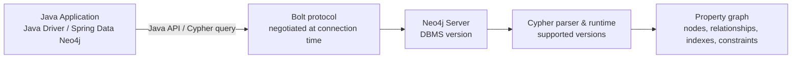

# Distinguishing Neo4j Server, Cypher Language, and Java Driver Versions

## 1. Three Versions That Commonly Appear in the Same Application

When building a Java application that stores and queries connected data using the **property graph** model, we commonly encounter three similar-looking pieces of information: the Neo4j server version, the Cypher language version, and the Neo4j Java Driver version. They are related, but they are **not three names for the same version**.

For example, an application might be:

- Connecting to **Neo4j Server 5.x**, where nodes, relationships, properties, indexes, and constraints are stored.
- Sending queries written in **Cypher 5**, a syntax and semantics version understood by the server.
- Using the **Neo4j Java Driver 5.x (or another confirmed compatible version)** library—the application-side Java code responsible for opening connections, running transactions, and receiving results.

These three numbers do not have to match. Upgrading the Java Driver does not automatically upgrade the database; upgrading Neo4j Server does not automatically rewrite Cypher syntax in your source code; choosing a Cypher version does not change the packaged Java library version.

| Component | Where does it live? | What does it govern? | How to determine it |
|---|---|---|---|
| **Neo4j Server / DBMS** | Server or container running Neo4j | Capabilities of the graph DBMS, query engine, storage, database administration, index/constraint features, and supported protocols | Run `CALL dbms.components()` on the target server |
| **Cypher language version** | Server-side query parser and runtime | Cypher syntax, features, and semantics usable within a query | Server version docs; test queries prefixed with `CYPHER 5` or `CYPHER 25` when supported by the server |
| **Neo4j Java Driver version** | Dependency running inside the Java application | Java API, connection handling, sessions, transactions, Bolt communication, and Java runtime requirements | Maven/Gradle dependency tree, dependency lockfile, or built artifact inspection |

**Learning goal:** After this lesson, you will be able to read each version type accurately, pinpoint which component needs upgrading when errors occur, and select compatible combinations when using the Java Driver or Spring Data Neo4j.

## 2. Neo4j Server Version: The Graph DBMS Actually Running

Neo4j Server is where data resides and where Cypher queries are compiled, planned, and executed. The server version governs graph database capabilities, security, operations, and the range of supported Cypher versions.

You may see Neo4j release numbering such as **5.x** as well as calendar-versioned releases like **2025.xx**. These are **Neo4j product versions**, not Java Driver versions or Cypher statements. Always check the release notes and documentation for the specific release when verifying available features; never infer capabilities from a larger/smaller number alone.

### 2.1. Checking the server version directly

Connect to the exact instance your application will use (Neo4j Browser, Cypher Shell, or an equivalent client) and run:

```cypher
CALL dbms.components()
YIELD name, versions, edition
RETURN name, versions, edition;
```

An **illustrative** output might look like:

| name | versions | edition |
|---|---|---|
| Neo4j Kernel | ["5.26.0"] | community |

Here `versions` indicates the **server-side** component version. Actual results depend on the connected server; an environment may return multiple components or restrict administrative metadata privileges.

If using Cypher Shell, connect interactively and run the command above:

```bash
cypher-shell -a bolt://localhost:7687 -u neo4j
```

Cypher Shell will prompt for credentials matching the configuration. `localhost:7687` is only an example: in Docker, Kubernetes, or remote deployments, use the exact endpoint your application actually connects to.

**Spot a common trap:** `cypher-shell --version` reports the **Cypher Shell CLI tool version**, not direct proof of the DBMS version on the other end of the connection. Similarly, a Docker tag shows the requested image; verify against the running instance itself.

### 2.2. Why knowing the exact target server matters

Suppose your dev machine runs server 5.x while staging runs a 2025.xx release. The exact same Java project and the exact same query can behave differently if default language settings, supported features, or query planning differ. When investigating, record **environment + endpoint/database + server version** rather than merely saying "the app uses Neo4j 5."

## 3. Cypher Version: Query Syntax and Semantics

**Cypher** is a declarative language for describing graph patterns, matching nodes/relationships, filtering, aggregating, and creating or updating data. For example:

```cypher
MATCH (person:Person)-[:WORKS_AT]->(company:Company)
WHERE company.name = 'Acme'
RETURN person.name AS employee
ORDER BY employee;
```

The Cypher version determines which language ruleset parses and executes the query. You will encounter **Cypher 5** and **Cypher 25** in documentation for the respective Neo4j generations. The number **25** here belongs to the **language version name**—it does not mean the Java Driver must be 25.x, nor does it mean every 2025-labeled server automatically supports every Cypher 25 feature.

### 3.1. Specifying the language per query

On a server supporting the corresponding version, you can place a language directive at the start of a query:

```cypher
CYPHER 5
MATCH (person:Person)
RETURN person.name AS name
LIMIT 10;
```

When the **target server supports Cypher 25**, you can test:

```cypher
CYPHER 25
RETURN 1 AS language_check;
```

If the second statement is rejected because the server does not recognize the language version, that reflects **server capability**, not necessarily that the Java Driver is too old. Conversely, when testing a specific Cypher feature, `RETURN 1` succeeding only confirms a trivial statement—it does not validate that specific syntax or feature.

Without a `CYPHER ...` prefix, the query runs under the **default language version determined by the server and that release's configuration**. Never guess the default across environment switches or upgrades; verify the documentation and configuration of that specific server.

### 3.2. What the Cypher version does not determine

- It does **not** tell you which version the server was upgraded from, or what store format the data uses.
- It does **not** install or upgrade the `org.neo4j.driver` library in your Java project.
- It does **not** guarantee a query runs fast: performance still depends on data volume, indexes, statistics, and execution plans. Use `EXPLAIN`/`PROFILE` to verify on an appropriate server and dataset.

Explicit language directives help control syntax transitions, but they only work if the running Neo4j server supports that directive.

## 4. Neo4j Java Driver Version: Application-Side Library

The Neo4j Java Driver is the client library an application uses to communicate with Neo4j over **Bolt**. Its Maven/Gradle coordinates are typically:

```text
org.neo4j.driver:neo4j-java-driver
```

The Java Driver provides APIs such as `GraphDatabase.driver(...)`, `Driver`, `Session`, `Transaction`, and `Result`. The library version affects API signatures, connection features, transaction handling, Java version requirements, and server Bolt compatibility.

The **Bolt protocol** is the transport layer between client and server, negotiating a protocol version when establishing a connection. The Bolt version is also **distinct** from the DBMS, Cypher, and Java Driver versions. The Driver does not need the same version number as the server, but the **driver–server pair must fall within the actual supported compatibility range**.

### 4.1. Determining the driver version actually loaded

For **Gradle** projects, inspect the dependency resolved at runtime:

```bash
./gradlew dependencyInsight --dependency neo4j-java-driver --configuration runtimeClasspath
```

On Windows PowerShell, use the corresponding wrapper:

```powershell
.\gradlew.bat dependencyInsight --dependency neo4j-java-driver --configuration runtimeClasspath
```

For **Maven**:

```bash
mvn dependency:tree -Dincludes=org.neo4j.driver:neo4j-java-driver
```

Note: A directly declared dependency is not always the version actually used if dependency management, a BOM, transitive resolution, or dependency overrides are present. Always check the **resolved runtime dependency** and the deployed artifact contents when debugging.

### 4.2. Running a connection check in Java

The example below illustrates a verification flow using standard Java Driver APIs. The program reads environment variables instead of hardcoding passwords in source code:

```java
import org.neo4j.driver.AuthTokens;
import org.neo4j.driver.Driver;
import org.neo4j.driver.GraphDatabase;
import org.neo4j.driver.Record;
import org.neo4j.driver.Session;
import org.neo4j.driver.SessionConfig;

public class Neo4jVersionCheck {
    public static void main(String[] args) {
        String uri = System.getenv().getOrDefault(
                "NEO4J_URI", "bolt://localhost:7687");
        String username = System.getenv().getOrDefault(
                "NEO4J_USER", "neo4j");
        String password = System.getenv("NEO4J_PASSWORD");
        String database = System.getenv().getOrDefault(
                "NEO4J_DATABASE", "neo4j");

        if (password == null || password.isBlank()) {
            throw new IllegalArgumentException(
                    "Missing NEO4J_PASSWORD environment variable");
        }

        try (Driver driver = GraphDatabase.driver(
                uri, AuthTokens.basic(username, password))) {
            // Verify connectivity to Neo4j.
            driver.verifyConnectivity();

            try (Session session = driver.session(
                    SessionConfig.forDatabase(database))) {
                // Returned version is the server's, not the Java Driver's.
                for (Record record : session.run(
                        "CALL dbms.components() " +
                        "YIELD name, versions, edition " +
                        "RETURN name, versions, edition").list()) {
                    System.out.println(record.asMap());
                }

                int result = session.run(
                        "CYPHER 5 RETURN 1 AS ok")
                        .single()
                        .get("ok")
                        .asInt();
                System.out.println("Cypher 5 smoke test: " + result);
            }
        }
    }
}
```

The program must be compiled against the Java Driver version appropriate for your project; checking the classpath as in Section 4.1 remains how you verify the **driver version**. `verifyConnectivity()` primarily confirms connectivity; the Cypher check further verifies that the server accepts statements. If the account lacks permission to call `dbms.components()`, the metadata step may fail even though connectivity and ordinary queries work.

**Do not over-extrapolate:** one successful `verifyConnectivity()` or `RETURN 1` does not guarantee that all Cypher features, transactions, routing, TLS, performance, and plugins are compatible.

### 4.3. When using Spring Data Neo4j

With **Spring Data Neo4j**, applications typically introduce additional versions:

- **Spring Boot** and **Spring Data Neo4j**: provide auto-configuration, repositories, node/relationship mapping, and transaction integration.
- **Neo4j Java Driver**: still serves as the underlying database connection layer; its version may be managed by Spring Boot's BOM/dependency management.
- **Neo4j Server**: runs independently from the application and executes Cypher.

Therefore, you cannot look at "Spring Boot 3.x" and conclude whether Java Driver 5.x or 6.x is used; nor can you look at the Spring Data Neo4j dependency to know which Neo4j Server version is running. Inspect resolved dependencies and query metadata on the server.

Avoid forcing a Java Driver version different from the BOM without verifying the support range of your Spring Data Neo4j and Spring Boot versions. APIs across the driver, SDN, and JDK can also change across major versions.

## 5. Compatibility Relationships: How the Layers Connect



The diagram shows two distinct constraints to verify:

1. **Driver ↔ Server:** Both sides must communicate over a shared Bolt protocol version while satisfying security, runtime, and API requirements. Check the compatibility matrix for the **exact versions** of the Java Driver and Neo4j Server.
2. **Cypher ↔ Server:** The server must recognize the language version and used syntax/features. A driver successfully sending a query string does not mean the server can parse every Cypher statement inside it.

A third constraint frequently arises in Spring projects: **Spring Boot / Spring Data Neo4j ↔ Java Driver ↔ JDK**. Upgrading any single dependency requires evaluating this entire compatibility chain.

| Scenario | Correct conclusion |
|---|---|
| Server 5.x, query uses Cypher 5, Java Driver 5.x | All three contain the number "5" but represent three independent layers; still verify exact patch releases. |
| Upgrading Java Driver from one version to another | May change APIs or protocol support; does **not** change the server version or default query language. |
| Upgrading server while keeping the same Java Driver | May or may not work depending on the support matrix and Bolt; requires real testing. |
| Sending `CYPHER 25` to a server without Cypher 25 support | The server rejects the language directive; swapping the driver alone does not add a Cypher 25 parser to the server. |
| Updating Spring Data Neo4j | May pull in a different driver/mapping/API; does **not** mean the server version was updated. |

Do not invent rules of thumb like "server major = driver major" or "server 2025.xx = every release has Cypher 25." Such rules ignore the distinction between **product, language, and client library**.

## 6. Environment Verification Checklist Before Development or Upgrades

For a Java application connecting to Neo4j, build an actual version inventory table:

| Item to record | Verification source | Example entry |
|---|---|---|
| Connection target | App config variables, URI, database name | `bolt://localhost:7687` / `neo4j` (illustrative environment only) |
| Neo4j Server | `CALL dbms.components()` on target connection | `5.x` or `2025.xx`, with full version |
| Cypher in use | `CYPHER ...` directive, default config, and server docs | `Cypher 5`; `Cypher 25` if supported by server |
| Java Driver | Dependency tree or built artifact | `org.neo4j.driver:neo4j-java-driver:<resolved-version>` |
| Spring stack (if used) | BOM and dependency tree | Resolved Spring Boot / Spring Data Neo4j versions |
| Java runtime | `java -version` where the app runs | Active JDK |
| Connectivity & domain checks | Integration tests, logs, `EXPLAIN`/`PROFILE` | Connections, transactions, queries, indexes/constraints |

Recommended sequence:

1. **Identify the exact endpoint the application connects to.** Many incidents occur simply because code targets staging while the tester is looking at local Neo4j Browser.
2. **Query the running server version** via metadata query, also noting edition and target database.
3. **Check the resolved Java Driver version**, and if using Spring Boot, also check Spring Data Neo4j and the JDK.
4. **Consult official compatibility matrices** for the versions to deploy: Neo4j Server, Java Driver, Spring Data Neo4j, and Java runtime. Read release notes for major changes or new features.
5. **Select the Cypher version based on the target server**, testing queries that exercise syntax affected by changes rather than only `RETURN 1`.
6. **Run integration tests against a server matching the target environment**: create sample data, read/write, transactions, constraints/indexes, path queries, sessions, and the Bolt/TLS/routing features the app actually uses.
7. **Re-measure query plans and performance** using `EXPLAIN` or `PROFILE` on representative data if an upgrade impacts the query planner. Prepare backups, migration plans, and rollback steps before updating environments with critical data.

Testing should include at least one representative domain graph query, such as:

```cypher
MATCH (customer:Customer)-[purchase:PURCHASED]->(product:Product)
WHERE customer.id = $customerId
RETURN product.id AS productId, purchase.createdAt AS purchasedAt
ORDER BY purchasedAt DESC
LIMIT 20;
```

Here `$customerId` is a parameter passed by the Java Driver. The query tests traversal correctness and result mapping on prepared data; it does not create nodes or relationships by itself to run standalone on an empty database.

## 7. Diagnosing Errors by Version Layer

| Symptom | Layer to inspect first | Resolution direction |
|---|---|---|
| Bolt handshake failure, protocol error, or dropped connection | Driver ↔ server ↔ endpoint/network/TLS | Check URI, port, certificates, and Driver–Server matrix; verify the endpoint actually in use |
| Syntax error when using `CYPHER 25` | Cypher ↔ server | Check whether the server supports Cypher 25; test the query directly on that server |
| Java compilation fails due to missing/changed driver methods | Java Driver / app code | Inspect resolved dependencies; update code to match the selected driver version's API |
| Spring Data Neo4j repository/mapping fails after upgrade | Spring Data Neo4j / Spring Boot / driver | Check framework version alignment, dependency management, and node/relationship mapping |
| Queries run but become slow after upgrade | Server, query planner, indexes, data | Compare `EXPLAIN`/`PROFILE`, indexes, and statistics on the same dataset |
| Neo4j Browser reports server A, app logs server B | Endpoint / environment | Compare URIs, Spring profiles, Kubernetes services/containers, and database names |
| `CALL dbms.components()` is denied | Access privileges or deployment restrictions | Check roles/privileges and use an admin-supported way to inspect version; do not assume the driver is broken |

A useful technique is separating **connectivity check** (`verifyConnectivity()`), **server check** (`CALL dbms.components()`), **language check** (a Cypher query with an explicit version directive), and **domain check** (real read/write queries) into distinct steps. That way, an error message immediately tells you which layer to investigate.

## 8. Applied Exercises

**Exercise 1.** A Gradle project updated its Neo4j Java Driver dependency, yet `CALL dbms.components()` still returns the same server version. Is anything wrong?

**Answer hint:** No. The Driver is a library inside the Java process; the metadata command queries the actual server at the connected endpoint. Updating a client library does not upgrade the DBMS.

**Exercise 2.** An application connects successfully and runs `RETURN 1`, yet `CYPHER 25 RETURN 1 AS ok` fails. Can you immediately conclude "Bolt is incompatible"?

**Answer hint:** No. Success of the first query shows Bolt communication and basic Cypher execution succeeded. First check whether the server supports the **Cypher 25 language**; only investigate other causes afterward if needed.

**Exercise 3.** A team uses Spring Boot and Spring Data Neo4j. A teammate proposes upgrading `neo4j-java-driver` alone to a new major version without checking the BOM. What should you verify?

**Answer hint:** Check the resolved driver version, Spring Boot/SDN versions, JDK, target server, and compatibility matrix; then run integration tests covering connectivity, repository mapping, and transactions. Do not assume compatibility from matching major version numbers.

## 9. Key Takeaways

**Neo4j Server is the DBMS version running on the server; Cypher is the query language version the server understands; Java Driver is the client library version loaded by the Java application.** Bolt is the wire protocol between driver and server, and Spring Data Neo4j is another integration layer when using Spring.

To choose the right configuration, always verify **the actual versions at both ends of the connection**, check **the Cypher version supported by the server**, consult **the compatibility matrix for the specific releases**, and validate with realistic domain queries.
