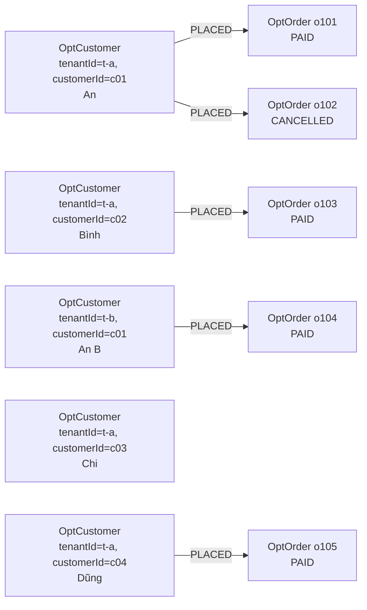

# Narrowing the Starting Point with Appropriate Labels, Properties, and Indexes in Neo4j

## 1. Why Does the Starting Point Matter When Tuning Cypher?

In **Neo4j**, the **property graph** model represents entities as *nodes*, links as *relationships*, and descriptive data as *properties*. A **Cypher** query typically has to find one or more matching nodes before traversing relationships. If it starts from a node set that is too broad, the same graph pattern can produce a huge number of intermediate rows, leading to excessive data reads, memory usage, and processing time.

The **Query Optimization** chapter of the `DATABASE_ENGINE_GRAPH_NEO4J` module focuses first on a high-impact technique: **narrowing the initial candidate set using labels, highly selective properties, and appropriate indexes**. This technique applies to routine read queries, multi-hop queries, relationship lookups in applications, and Cypher statements executed through the **Neo4j Java Driver** or **Spring Data Neo4j**.

After this lesson, you will be able to:

1. Distinguish the logical query pattern from the **actual starting point** chosen by the Cypher planner.
2. Use labels and property predicates to reduce the number of nodes inspected before expanding relationships.
3. Choose a **range index**, **unique constraint**, or **composite index** for a specific lookup requirement.
4. Identify expressions that struggle to use property indexes effectively and fix how data is stored or queried.
5. Use `EXPLAIN`, `PROFILE`, and `SHOW INDEXES` to verify optimization decisions with evidence.

> **Syntax scope:** The `CREATE RANGE INDEX`, `CREATE CONSTRAINT ... REQUIRE ... IS UNIQUE`, and `SHOW INDEXES` commands below use Neo4j 5.x+ syntax. In Neo4j 4.4 or earlier, index type names and constraint syntax may differ. Selecting a specific **plan** also depends on the Neo4j version, statistics, data volume, and existing indexes.

## 2. Starting Point, Selectivity, and Intermediate Row Count

### 2.1. What Is a "Starting Point"?

Consider the requirement: "Find the orders of a customer by identifier."

```cypher
MATCH (c:Customer)-[:PLACED]->(o:Order)
WHERE c.customerId = $customerId
RETURN o.orderId;
```

The query must locate node `c`, then follow the `PLACED` relationship to retrieve `o`. If the graph has one million customers but only one person has the requested `customerId`, **locating that customer immediately** is far better than checking every customer or traversing all relationships.

In a high-branching graph, the raw number of expansions can grow according to this illustrative expression:

\[
\text{candidate count to evaluate} \;\propto\; S \times F^d
\]

Here `S` is the number of starting nodes, `F` is the average branching factor per step, and `d` is the traversal depth. This is **not Neo4j's exact execution cost formula**; it simply illustrates why reducing `S` from hundreds of thousands of nodes to one node can drastically shrink the search space.

### 2.2. Cypher Has an Optimizer; It Does Not Necessarily Run Left to Right

Writing `MATCH (a)-[r]->(b)` **does not force** Neo4j to always find `a` before `b`. Cypher is a declarative language; the *planner* relies on predicates, indexes, statistics, and row estimates to choose the execution strategy.

For example:

```cypher
MATCH (c:Customer)-[:PLACED]->(o:Order)
WHERE o.orderId = $orderId
RETURN c.name;
```

If `Order.orderId` has a unique constraint and identifies a single node, the planner can locate **`o` first**, then traverse `PLACED` in reverse to `c`, even though `c` appears on the left side of the pattern.

Therefore, "narrowing the starting point" essentially means **giving the planner a small input node set that can be looked up efficiently**. Do not just reorder variables in the pattern and assume the query will run faster.

### 2.3. Predicate Selectivity

A predicate has **high selectivity** if only a small percentage of nodes satisfy it:

| Predicate | Typical Selectivity | Guidance |
| --- | --- | --- |
| `c.customerId = 'c01'` combined with tenant, when a unique constraint exists | Very high; usually at most one node | Good anchor for customer-based queries |
| `o.orderId = 'o101'` with a unique constraint | Very high | Good anchor when looking up a specific order |
| `o.status = 'PAID'` when most orders are already paid | Low | Having an index still might not help much |
| `o.createdAt >= $from` within the last 1 hour | Can be high if the time range is very narrow | Range index and the actual execution plan decide |
| `c.name CONTAINS 'a'` | Varies by data, can be very broad | Consider a text index if actually querying substrings |

**No field is automatically "highly selective" just because of its name.** You must examine the actual value distribution. An index matching the predicate type is a necessary condition for a good lookup, but it does not guarantee the planner will always choose an index over a scan in every case.

## 3. Practice Graph: Multi-Tenant Customers and Orders

We use dedicated labels `OptCustomer` and `OptOrder` to keep lesson data separate from real entities. Each customer belongs to a tenant; the same `customerId` can appear in two different tenants, so a customer's business key is the pair **`(tenantId, customerId)`**.



### 3.1. Constraints and Indexes Used in This Lesson

The first statement is a **composite uniqueness constraint** for customers. In Neo4j 5.x, a unique constraint is backed by a corresponding range index; **you do not need to create an additional identical range index** on the same property combination.

```cypher
CREATE CONSTRAINT opt_customer_tenant_customer_unique IF NOT EXISTS
FOR (c:OptCustomer)
REQUIRE (c.tenantId, c.customerId) IS UNIQUE;

CREATE CONSTRAINT opt_order_id_unique IF NOT EXISTS
FOR (o:OptOrder)
REQUIRE o.orderId IS UNIQUE;

CREATE RANGE INDEX opt_order_status_created IF NOT EXISTS
FOR (o:OptOrder)
ON (o.status, o.createdAt);
```

`IF NOT EXISTS` is helpful for repeatable practice, but it **does not verify that an existing index/constraint has the exact schema and type you expect** if a naming conflict exists. You should inspect `SHOW INDEXES` and `SHOW CONSTRAINTS`. A unique constraint enforces uniqueness when the full key is present; if business rules require every node to always have both properties, you must validate incoming data or consider property existence constraints depending on your version and edition.

### 3.2. Loading Data

```cypher
UNWIND [
  {tenantId: 't-a', customerId: 'c01', name: 'An'},
  {tenantId: 't-a', customerId: 'c02', name: 'Bình'},
  {tenantId: 't-a', customerId: 'c03', name: 'Chi'},
  {tenantId: 't-a', customerId: 'c04', name: 'Dũng'},
  {tenantId: 't-b', customerId: 'c01', name: 'An B'}
] AS row
MERGE (c:OptCustomer {
  tenantId: row.tenantId,
  customerId: row.customerId
})
SET c.name = row.name;
```

```cypher
UNWIND [
  {tenantId: 't-a', customerId: 'c01', orderId: 'o101',
   status: 'PAID', createdAt: '2026-10-05'},
  {tenantId: 't-a', customerId: 'c01', orderId: 'o102',
   status: 'CANCELLED', createdAt: '2026-10-07'},
  {tenantId: 't-a', customerId: 'c02', orderId: 'o103',
   status: 'PAID', createdAt: '2026-10-10'},
  {tenantId: 't-b', customerId: 'c01', orderId: 'o104',
   status: 'PAID', createdAt: '2026-09-30'},
  {tenantId: 't-a', customerId: 'c04', orderId: 'o105',
   status: 'PAID', createdAt: '2026-11-01'}
] AS row
MATCH (c:OptCustomer {
  tenantId: row.tenantId,
  customerId: row.customerId
})
MERGE (o:OptOrder {orderId: row.orderId})
SET o.status = row.status,
    o.createdAt = date(row.createdAt)
MERGE (c)-[:PLACED]->(o);
```

Using `MERGE` makes it easy to re-run the example with the same keys. The verification queries below only expect the exact row counts described when there is no stale `OptCustomer`/`OptOrder` data outside the example. In a real system, you should not place unique constraints or insert practice data into labels used by active production workloads.

## 4. Narrowing by Label: Avoid Searching the Entire Graph

### 4.1. Unlabeled Node Scan vs. Label Scan

The following query must search every node that has a matching property without **declaring a label**:

```cypher
MATCH (n)
WHERE n.customerId = 'c01'
RETURN labels(n), n.customerId;
```

The planner has no label predicate to apply the property index attached to `OptCustomer`; the execution plan typically has to inspect a very broad set of nodes. The result may also include other node types that happen to share the same property name.

When specifying the proper entity type:

```cypher
MATCH (c:OptCustomer)
WHERE c.customerId = 'c01'
RETURN c.tenantId, c.customerId, c.name;
```

The planner can at least restrict the search to `OptCustomer` nodes. In Neo4j, a **lookup index** for labels/relationship types supports token lookups, which is different from a property index. However, the `customerId` predicate alone here is not enough to guarantee an **efficient seek on the composite index `(tenantId, customerId)`**, because the tenant component is not specified.

When both key components are provided:

```cypher
MATCH (c:OptCustomer {
  tenantId: 't-a',
  customerId: 'c01'
})
RETURN c.name AS ten;
```

The expected result is only **An**. With an appropriate unique constraint, the plan can typically perform a **unique index seek** to locate that single node directly.

### 4.2. Labels in Patterns vs. Checking Labels with Functions

When the label is statically known, prefer:

```cypher
MATCH (c:OptCustomer)
RETURN count(c) AS soKhachHang;
```

over:

```cypher
MATCH (c)
WHERE 'OptCustomer' IN labels(c)
RETURN count(c) AS soKhachHang;
```

Both queries may return the same result on the sample dataset, but `(c:OptCustomer)` provides the label information directly to the planner. A query using `labels(c)` is useful when dynamic label inspection is needed, but it should not be the first choice for queries with a fixed label.

### 4.3. Multiple Labels Can Increase Selectivity, If Properly Modeled

For example, if a real application has both `:Customer` and `:ActiveAccount` on the same node:

```cypher
MATCH (c:Customer:ActiveAccount)
WHERE c.tenantId = $tenantId
RETURN c.customerId;
```

The node must carry **both labels**. This can reduce the candidate set when secondary labels are meaningful and used appropriately. However, **do not create a label for every property value** (such as a separate label for each tenant or each customer) just to try to reduce scans; doing so makes the model hard to manage. Use properties and indexes when dealing with high-cardinality data.

## 5. Narrowing by Property: Choosing Appropriate Predicates

### 5.1. Equality on Business Keys

The most common efficient case is an **equality comparison** on fields backed by an index or unique constraint:

```cypher
MATCH (c:OptCustomer)
WHERE c.tenantId = $tenantId
  AND c.customerId = $customerId
RETURN c.name AS customerName;
```

This is a good pattern for the `GET /tenants/{tenantId}/customers/{customerId}` endpoint because:

- It specifies the `OptCustomer` label.
- It filters by the full **composite key** of the customer.
- It has a constraint supporting the lookup.
- It uses **parameters** rather than concatenating user input strings into Cypher.

In the example, `tenantId = 't-a'` and `customerId = 'c01'` selects An; `tenantId = 't-b'` and `customerId = 'c01'` selects An B. **Omitting the tenant** causes the business query to fail to distinguish the two customers.

### 5.2. Filtering by Time Range

When finding orders from a specific date onward:

```cypher
MATCH (o:OptOrder)
WHERE o.status = 'PAID'
  AND o.createdAt >= date('2026-10-01')
RETURN o.orderId AS orderId,
       o.createdAt AS ngayTao
ORDER BY ngayTao;
```

In the sample dataset, the expected results are `o101`, `o103`, and `o105`. The composite range index `(status, createdAt)` supports the filter pattern **equality on the first field, range on the second field**. The planner may still choose another strategy when the dataset is small or the value distribution makes index usage unbeneficial.

Do not store date values in the graph as strings and then call conversion functions on every record during filtering; if the business logic requires time comparisons, store values using an appropriate `date`/`datetime` type and pass parameters of the matching type.

### 5.3. Avoid Wrapping Indexed Properties in Functions

For example, with an indexed email field:

```cypher
// Likely loses the opportunity for an index seek on the original email property:
MATCH (c:Customer)
WHERE toLower(c.email) = toLower($email)
RETURN c;
```

The `toLower(c.email)` part is an expression computed from the property; a regular index on `c.email` is not equivalent to an index on that transformed result. For systems needing case-insensitive email lookups, one design approach is to **store a separate normalized field**:

```cypher
MATCH (c:Customer)
WHERE c.emailNormalized = $emailNormalized
RETURN c;
```

The application normalizes input before passing `$emailNormalized` and updates the normalized field consistently whenever data changes. You should create an index or unique constraint on `Customer.emailNormalized` if required by the business logic. Normalization rules must account for Unicode data and actual business requirements; do not assume `toLower` satisfies every email comparison rule.

### 5.4. Do Not Confuse `LIMIT` with Narrowing the Starting Point

```cypher
MATCH (c:OptCustomer)-[:PLACED]->(o:OptOrder)
RETURN c.customerId, o.orderId
LIMIT 5;
```

`LIMIT 5` only caps the number of rows returned at the point where it is applied; it does not create a predicate that locates a customer. Neo4j **may** stop early if the plan permits, but `LIMIT` should not be used as a substitute for labels, indexes, and filter predicates. If `ORDER BY` or `DISTINCT` precedes `LIMIT`, the engine may need to process substantial intermediate data before selecting the final rows.

## 6. Choosing the Right Index Type

Neo4j provides several index types, each serving different query operations. The table below focuses on common use cases in modern Neo4j versions:

| Index Type | Primary Use | Suitable Example | Notes |
| --- | --- | --- | --- |
| **Lookup index** | Look up nodes by label or relationships by type | `MATCH (c:OptCustomer)` | Does not replace a property index on `customerId` |
| **Range index** | Equality, range comparisons, ordering/supported data types | `customerId = $id`, `createdAt >= $from` | Foundational index type for most property filtering |
| **Composite range index** | Multiple properties of the same node/relationship | `(tenantId, customerId)`, `(status, createdAt)` | Effectiveness depends on field order and predicate shape |
| **Text index** | String pattern matching such as `CONTAINS` or `ENDS WITH` | `name CONTAINS $fragment` | Substring search differs from exact identifier lookup |
| **Point index** | Spatial searches on point values | Finding locations within a region/coordinates | Not used for regular ID fields |
| **Full-text index** | Text keyword search, relevance scoring | Searching document descriptions | Usually invoked via dedicated procedures/search features, does not automatically replace standard `MATCH ... WHERE` |
| **Vector index** | Approximate nearest-neighbor search by vector similarity | Content recommendations via embeddings | Different problem from typical ID/property anchors |

Indexes incur **maintenance overhead on writes** and consume storage resources, so you should not create an index for every property. Identify query patterns and usage frequency before deciding.

### 6.1. Single vs. Composite Range Indexes

Example of a single-property index for queries filtering only by order creation date:

```cypher
CREATE RANGE INDEX opt_order_created_single IF NOT EXISTS
FOR (o:OptOrder)
ON (o.createdAt);
```

In a real application, **you do not necessarily need both a single and a composite index** on overlapping fields. Place both options side by side to compare against your workload:

- Primarily querying by `status = ... AND createdAt >= ...`: composite `(status, createdAt)` can be useful.
- Primarily querying all orders after a timestamp **without a status predicate**: a single index `(createdAt)` may be more appropriate.
- Primarily looking up a single `orderId`: a unique constraint on `orderId` provides a direct anchor and protects data integrity.

If you created the experimental index `opt_order_created_single`, evaluate execution plans and write overhead before deciding to keep it on production data.

### 6.2. Property Order in a Composite Index

With the `(status, createdAt)` index, a typically suitable query is:

```cypher
MATCH (o:OptOrder)
WHERE o.status = $status
  AND o.createdAt >= date($fromDate)
RETURN o.orderId;
```

A query that only specifies `o.createdAt >= date($fromDate)` **without a `status` predicate** does not necessarily have an equally **efficient seek** path when using the composite index. Field order and predicates on the **leading property** are critical; you should also verify on your actual Neo4j version.

Similarly, the unique index `(tenantId, customerId)` fits queries specifying **both** values. If the application frequently looks up customers **by `customerId` alone** across tenants, that is a different query requirement; revisit the data model and indexes, while never dropping the tenant predicate in APIs that must isolate organizational customer data.

### 6.3. Checking Index Status

```cypher
SHOW INDEXES
YIELD name, type, entityType, labelsOrTypes, properties, state
RETURN name, type, entityType, labelsOrTypes, properties, state
ORDER BY name;
```

Verify that the index has the right **type**, **label/relationship type**, **property set**, and **`ONLINE`** state before expecting the planner to use it. Newly created indexes may take time to finish populating on large datasets.

```cypher
SHOW CONSTRAINTS
YIELD name, type, entityType, labelsOrTypes, properties
RETURN name, type, entityType, labelsOrTypes, properties
ORDER BY name;
```

Administrative privileges and available columns may vary by version/edition. Do not rely on the index name alone to assume it is active or suitable for the query.

## 7. Narrowing Before Expanding Relationships

### 7.1. Overly Broad Query vs. Well-Anchored Query

**Overly broad form** for the API "An's orders in tenant t-a":

```cypher
MATCH (c)-[:PLACED]->(o)
WHERE c.customerId = 'c01'
RETURN o.orderId, o.status;
```

This query declares no label, does not distinguish tenants, and could return orders belonging to multiple customers with the same ID across different node types.

**Form aligned with the model:**

```cypher
MATCH (c:OptCustomer {
  tenantId: 't-a',
  customerId: 'c01'
})-[:PLACED]->(o:OptOrder)
RETURN o.orderId AS orderId,
       o.status AS status
ORDER BY orderId;
```

Expected results are `o101` and `o102`. The query has complete anchor predicates and only traverses `PLACED` relationships starting from the located customer node.

### 7.2. Adding Predicates on the Target Node When Useful

```cypher
MATCH (c:OptCustomer {
  tenantId: 't-a',
  customerId: 'c01'
})-[:PLACED]->(o:OptOrder)
WHERE o.status = 'PAID'
RETURN o.orderId AS paidOrder;
```

On the example data, only `o101` is returned. Note: even though the `o.status` predicate appears at the end of the pattern, the planner can choose the appropriate execution order based on cost; do not conclude "Cypher traverses first and filters afterward" merely from where `WHERE` is written. Use `PROFILE` to inspect the **actual row counts at each operator**.

### 7.3. Starting from the More Selective End When Both Ends Are Given

For the requirement "Find the customer who placed order `o101`":

```cypher
MATCH (c:OptCustomer)-[:PLACED]->(o:OptOrder {orderId: 'o101'})
RETURN c.tenantId, c.customerId, c.name;
```

The unique constraint on `OptOrder.orderId` allows locating very few `o` nodes before following the incoming relationship to `c`. This demonstrates that **the planner chooses the cheaper side**, without requiring the developer to rewrite the pattern as `(o)<-[:PLACED]-(c)`.

### 7.4. Multi-Hop Paths: A Narrow Anchor Is Necessary, Not Sufficient

```cypher
MATCH (c:OptCustomer {
  tenantId: $tenantId,
  customerId: $customerId
})
MATCH p = (c)-[:PLACED|REFERS_TO*1..3]->(target)
RETURN target, length(p) AS hops
LIMIT 20;
```

This is only an **illustrative pattern** for a graph that also has a `REFERS_TO` relationship type; the practice dataset does not create that type. A good anchor reduces the starting point, but if each node has a large number of relationships, a depth-3 traversal can still fan out into many paths. You should simultaneously **bound hop counts, relationship types, and direction**, and return only the data actually needed.

If the business requirement only needs to know whether a path exists, an existence check is usually more suitable than enumerating all paths:

```cypher
MATCH (c:OptCustomer {
  tenantId: $tenantId,
  customerId: $customerId
})
MATCH (target:OptOrder {orderId: $orderId})
RETURN EXISTS {
  MATCH (c)-[:PLACED]->(target)
} AS coDonHang;
```

## 8. Reading `EXPLAIN` and `PROFILE`: Optimization Requires Evidence

### 8.1. Starting with the Estimated Plan

`EXPLAIN` shows the **estimated execution plan** without executing the query being measured:

```cypher
EXPLAIN
MATCH (c:OptCustomer {
  tenantId: 't-a',
  customerId: 'c01'
})-[:PLACED]->(o:OptOrder)
RETURN o.orderId;
```

If the planner leverages the composite constraint/index, an operator in the **`NodeUniqueIndexSeek`** or **`NodeIndexSeek`** family typically appears for `c`. Depending on the release and plan, operator names may vary; what matters is seeing whether the engine **locates the node via an index** or is still scanning.

### 8.2. Measuring on Real Data

`PROFILE` **executes the query** and adds runtime metrics:

```cypher
PROFILE
MATCH (c:OptCustomer {
  tenantId: 't-a',
  customerId: 'c01'
})-[:PLACED]->(o:OptOrder)
RETURN o.orderId
ORDER BY o.orderId;
```

Signals to watch for:

| Common Metric / Operator | How to Interpret |
| --- | --- |
| `AllNodesScan` | May be inspecting every node; check if labels/predicates are missing |
| `NodeByLabelScan` | Narrowed to a label, but still inspects many nodes if the label is broad |
| `NodeIndexSeek` / `NodeUniqueIndexSeek` | Can locate nodes using property predicates and an index |
| `Expand(All)` / `Expand(Into)` | Indicates a relationship traversal step; check input and output row counts |
| `Filter` | Check how many rows are discarded and whether predicates can be pushed into an index |
| `Rows` and `Estimated Rows` | Compare actual rows against estimates, spotting sudden spikes |
| `DB Hits` | Amount of data access within operators; useful when comparing plans |
| `Sort`, `Distinct`, `Eager` | May need to buffer or process many rows; check for large intermediate row counts |

**Do not evaluate solely by "whether an index seek is present."** A query with an index seek that subsequently traverses a *supernode* and generates millions of paths can still be slow. You need to examine the **entire plan**, result volume, traversal depth, and execution time on a representative dataset.

### 8.3. Before-and-After Comparison Workflow

1. Identify a query and **representative parameters** reflecting production load.
2. Run `EXPLAIN` to see the initial plan and spot large scans or expansions.
3. Add labels, predicates, or indexes that genuinely serve the query's filters.
4. Verify the index is `ONLINE`, then run `PROFILE` on the **same data scope** and compare `Rows`, `DB Hits`, execution time, and returned row counts.
5. Verify that **business results are unchanged**; then re-measure across different parameter values, including both very common and very rare cases.

For example, in a tiny sample database with only ten nodes and five relationships, the planner may prefer a scan due to lower estimated cost. Therefore, do not try to force an index just to see an `IndexSeek` operator name; benefits must be verified at **target scale**.

## 9. Situations Where Indexes Do Not Help as Expected

### 9.1. Missing Labels or Compatible Predicates

A property index attached to `:OptCustomer(tenantId, customerId)` cannot be used directly on its own if the query only has `MATCH (n)` without a label, or does not supply index-compatible predicates. Declare the **correct entity label** and **sufficiently selective** predicates.

### 9.2. Filtering Only on Very Common Properties

If 98% of orders have `status = 'PAID'`, that predicate has low selectivity. A scan may be more suitable than an index seek that produces almost the entire node set. Having an index does not automatically mean lower cost.

### 9.3. Transforming Properties Inside `WHERE`

`toLower(n.email)`, `toString(n.orderId)`, `date(n.dateString)`, or other expressions applied to a property can prevent the planner from using an index built on the raw value. Consider normalizing values on write, storing the proper data type, or designing a dedicated lookup field.

### 9.4. Mismatched Parameter Data Types

If `createdAt` is stored as a `date` type but the application passes an incompatible string without conversion, the comparison can be semantically wrong or fail. Keep types consistent across stored data, parameters, and queries. For example:

```cypher
MATCH (o:OptOrder)
WHERE o.createdAt >= date($fromDate)
RETURN o.orderId;
```

Here `$fromDate` is expected to be an ISO date string convertible by `date()`; if the Java Driver passes a compatible `LocalDate` value directly, it can be compared straight against `$fromDate`.

### 9.5. Using `OR` Across Multiple Independent Properties

```cypher
MATCH (c:Customer)
WHERE c.emailNormalized = $key
   OR c.phoneNormalized = $key
RETURN c;
```

Using multiple `OR` branches can produce a different plan than a simple equality predicate. If this is a critical lookup path, test index strategies for each field, or split into targeted branches and combine results appropriately; **do not assume every `OR` expression always breaks index usage**.

### 9.6. Premature Index Hints

Cypher supports **index hints** to guide the planner in certain cases:

```cypher
MATCH (c:OptCustomer)
USING INDEX c:OptCustomer(tenantId, customerId)
WHERE c.tenantId = $tenantId
  AND c.customerId = $customerId
RETURN c.name;
```

A hint requires a compatible index and does not create one automatically. Because it can lock in a suboptimal plan when data or statistics change, **only consider it after reading `PROFILE`, understanding why the planner chose a different plan, and gathering measurements proving the benefit**. Hints are usually unnecessary for queries with a unique constraint and clear predicates.

### 9.7. Too Many Indexes and One-by-One Reads in Applications

Every index adds update cost when writing nodes/relationships; a large number of indexes increases storage footprint and maintenance time. At the same time, if an application loops over thousands of customers and runs a separate query for each one, network round-trip overhead can outweigh the benefit of a good anchor. Design queries around **batches of input keys** when needed and measure end-to-end processing time from the application.

## 10. Java Driver and Spring Data Neo4j Integration

In applications, the right place to enforce an anchor is usually inside the **Cypher query** in the repository or service layer. Avoid reading a large set from Neo4j and filtering `tenantId`/`customerId` in Java, because that still causes broad scans and excessive data transfer.

Java Driver example using a **managed read transaction** and parameters:

```java
import java.util.List;
import java.util.Map;
import org.neo4j.driver.Driver;
import org.neo4j.driver.SessionConfig;

public final class OrderLookup {
    private final Driver driver;

    public OrderLookup(Driver driver) {
        this.driver = driver;
    }

    public List<String> findOrderIds(String tenantId, String customerId) {
        try (var session = driver.session(
                SessionConfig.forDatabase("neo4j"))) {
            return session.executeRead(tx -> tx.run(
                """
                MATCH (c:OptCustomer {
                  tenantId: $tenantId,
                  customerId: $customerId
                })-[:PLACED]->(o:OptOrder)
                RETURN o.orderId AS orderId
                ORDER BY orderId
                """,
                Map.of("tenantId", tenantId,
                       "customerId", customerId)
            ).list(record -> record.get("orderId").asString()));
        }
    }
}
```

The query returns only the required field. `executeRead` is the standard API in Java Driver 5.x; for other driver versions, verify the corresponding API names and retry policies. A `Driver` can be shared across requests, whereas a `Session` should not be shared across threads. All inputs must still be **authenticated and authorized at the application layer**; the tenant predicate is part of a functionally correct query, not a standalone replacement for access control.

When using **Spring Data Neo4j**, you can put the same label, tenant, and key filtering pattern inside a repository `@Query` or an appropriate query method. Inspect node/DTO mapping, transaction boundaries, and the Cypher generated by the framework, because a simple derived method name does not guarantee the final query uses the intended anchor.

## 11. Practice Exercises with Solutions

### Exercise 1. Finding the Exact Customer When Customer IDs Repeat Across Tenants

Requirement: return the name of the customer with `customerId = 'c01'` in tenant `t-b`.

**Solution:**

```cypher
MATCH (c:OptCustomer {
  tenantId: 't-b',
  customerId: 'c01'
})
RETURN c.name AS ten;
```

Result on the sample dataset: **An B**. Omitting `tenantId` could return both An and An B, which can also break business correctness.

### Exercise 2. Finding Paid Orders After a Specific Date

Requirement: use the `opt_order_status_created` index to find `PAID` orders from `2026-10-01` onward, sorted by date ascending.

**Solution:**

```cypher
MATCH (o:OptOrder)
WHERE o.status = 'PAID'
  AND o.createdAt >= date('2026-10-01')
RETURN o.orderId AS orderId, o.createdAt AS createdAt
ORDER BY createdAt, orderId;
```

Sample results: `o101`, `o103`, `o105`. Run `EXPLAIN` to check whether the planner chooses the composite index.

### Exercise 3. Finding the Customer for an Order

Requirement: find the tenant, customer ID, and name of the customer for order `o104`. Which side of the pattern provides a more selective lookup point?

**Solution:**

```cypher
MATCH (c:OptCustomer)-[:PLACED]->(o:OptOrder {
  orderId: 'o104'
})
RETURN c.tenantId, c.customerId, c.name;
```

The `o` end has a unique constraint on `orderId`, making it a **highly selective anchor**. Result: tenant `t-b`, customer `c01`, name An B.

### Exercise 4. Diagnosing a Plan Missing an Index Seek

You have an index on `(tenantId, customerId)`, but the following query does not show `NodeUniqueIndexSeek`:

```cypher
MATCH (c:OptCustomer)
WHERE c.customerId = $customerId
RETURN c;
```

**Hint:** The query is missing a predicate on **`tenantId`**, which is part of the composite key. Confirm the business requirement and add `c.tenantId = $tenantId` when appropriate. Then check index status and compare plans. On very small datasets, even with matching predicates, the planner may still choose a scan based on cost estimates.

### Exercise 5. Evaluating Two Email Filtering Approaches

Compare `toLower(c.email) = toLower($email)` and `c.emailNormalized = $emailNormalized` when both return the same results. Why is the second approach usually advantageous if an index exists on `emailNormalized`?

**Suggested Answer:** The second approach directly compares an indexed property against a pre-normalized parameter, making an index lookup straightforward. The first approach computes an expression on the property value, which does not directly map to an index on `email`. Make sure normalized data and business outcomes are equivalent before changing the query.

## 12. Pre-Optimization Sign-Off Checklist

| Checklist Question | What to See in the Query/Plan |
| --- | --- |
| Does the entity set have a specific label? | `MATCH (n:Label)` or a pattern with appropriate labels |
| Are properties sufficiently selective? | Unique identifier, tenant + ID, sufficiently narrow range |
| Is the property queried in an index-compatible way? | Equality/range predicates or operators matching the index type |
| Does the composite index match the property order? | Compatible predicates on the leading properties |
| Is the index ready? | `SHOW INDEXES` shows `ONLINE` and the right schema |
| Does the plan use a good anchor? | `EXPLAIN`/`PROFILE` shows a seek or another justified strategy |
| Is there excessive expansion after the anchor? | Check `Rows` and `DB Hits` at relationship expansion steps |
| Are results correct across all tenants/statuses? | Run data comparisons and test with both common and rare parameters |
| Are added indexes justified? | Measure read performance alongside write and maintenance overhead |

## 13. Conclusion

To make Cypher queries fast on a property graph, start by **locating the smallest business-meaningful set of nodes**. Labels help the planner restrict entity types; selective properties pinpoint which nodes to traverse; and **appropriate indexes or unique constraints** turn search predicates into efficient lookups. For composite keys, consider **property order** and provide complete predicates. When queries expand across multiple relationships, a narrow anchor is foundational, yet you must still control fan-out and hop depth.

Finally, every optimization decision must be **verified with `SHOW INDEXES`, `EXPLAIN`, and `PROFILE`** on representative data. Neither an index's name nor adding `LIMIT` is proof that a query has actually reduced its workload.

### References

- [Neo4j Cypher Manual – Indexes for search performance](https://neo4j.com/docs/cypher-manual/current/indexes/search-performance-indexes/)
- [Neo4j Cypher Manual – Query tuning](https://neo4j.com/docs/cypher-manual/current/planning-and-tuning/)
- [Neo4j Cypher Manual – Execution plans](https://neo4j.com/docs/cypher-manual/current/planning-and-tuning/execution-plans/)
- [Neo4j Cypher Manual – Index hints](https://neo4j.com/docs/cypher-manual/current/indexes/search-performance-indexes/index-hints/)
- [Neo4j Java Driver Manual](https://neo4j.com/docs/java-manual/current/)
