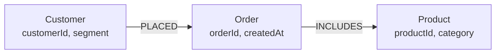
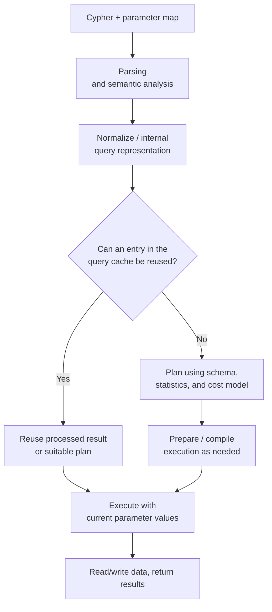

# Parameterizing Queries for Plan Reuse and Lower Compilation Overhead

In applications connected to Neo4j, many requests differ only in **the values being queried**: customer `C01` vs. `C02`, report start dates, product lists, or customer segments. If an application keeps concatenating values directly into distinct Cypher strings, query maintenance becomes harder and opportunities for **execution plan reuse** can be lost.

**Parameterization** keeps the structural query text fixed and passes variable inputs via `$name` parameters. Neo4j caches stages of query processing, including execution plans; a structurally stable query can reuse parsing and compilation work from previous runs. Under high request volume, this can reduce CPU spent on planning while keeping code maintainable and mitigating the risk of Cypher syntax injection via input data.

This lesson belongs to the **Query Optimization** chapter of the **DATABASE_ENGINE_GRAPH_NEO4J** module. It focuses on Cypher parameters, understanding **query planning / plan caching**, usage through the **Neo4j Java Driver** and **Spring Data Neo4j**, inspection with `EXPLAIN` / `PROFILE`, and cases where parameterization alone **does not** automatically improve performance.

## 1. The Problem: Same Query, Many Input Values

Suppose an e-commerce application stores customers and orders in a property graph model:



A "Customer Orders" screen might execute queries like:

```cypher
MATCH (c:Customer {customerId: 'C01'})-[:PLACED]->(o:Order)
RETURN o.orderId AS orderId
ORDER BY orderId;
```

```cypher
MATCH (c:Customer {customerId: 'C02'})-[:PLACED]->(o:Order)
RETURN o.orderId AS orderId
ORDER BY orderId;
```

They differ in customer ID yet share the **same semantics and query shape**. We can write a single template:

```cypher
MATCH (c:Customer {customerId: $customerId})-[:PLACED]->(o:Order)
RETURN o.orderId AS orderId
ORDER BY orderId;
```

The application sends that Cypher statement alongside a parameter map on each call:

```json
{"customerId": "C01"}
```

On the next call, the Cypher text stays unchanged; only the parameter varies:

```json
{"customerId": "C02"}
```

This yields three major benefits:

1. **Query logic reuse:** a single Cypher query serves many requests, making edits and testing easier.
2. **Higher plan-cache reuse:** Neo4j does not have to treat each input value from the application as a separate statement string.
3. **Separation of data and syntax:** user-provided strings are passed strictly as values, reducing the chance of data being interpreted as command syntax.

> **Important nuance:** Neo4j provides *auto-parameterization* for many literals in Cypher. Therefore, **not** every query with differing literals necessarily compiles a brand-new plan. Explicit parameterization remains the consistent way to build applications, though actual compilation savings should be verified for your Neo4j version and workload.

## 2. How Does Neo4j Process and Plan Queries?

Upon receiving Cypher, Neo4j must parse the query structure, validate semantics, select execution operators, and run them over the data. Simplified processing flow:



This is a **conceptual** model, not a version-specific internal architecture diagram. Neo4j uses multiple processing layers and caches; what gets cached, how cache keys are computed, and when replanning triggers can vary by version and configuration.

### 2.1. Parsing, Planning, and Execution

| Stage | Role | Example |
| --- | --- | --- |
| **Parsing** | Recognizes `MATCH`, `WHERE`, `RETURN`, expressions, and parameters | Identifies `$customerId` as a parameter |
| **Semantic analysis** | Checks variables, types, and valid structure | Was variable `c` declared before use? |
| **Planning** | Chooses how to locate nodes, traverse relationships, filter, and sort | `NodeUniqueIndexSeek` vs. `NodeByLabelScan` |
| **Runtime / execution** | Executes the plan with actual data and parameters | Fetches orders for `C01` |
| **Result consumption** | Streams records/summary back to the client | Java Driver reads `Record` or cursor |

When replacing `customerId = 'C01'` with `'C02'`, the processing structure stays identical: find customer by ID, traverse `PLACED`, return orders. If an appropriate index exists, the plan can perform an index lookup using the **runtime parameter value**.

### 2.2. Query Cache vs. Data Cache vs. Result Cache

These three concepts are often confused:

- **Query/plan cache:** retains parsed, planned, or compiled execution artifacts for queries; aims to reduce the cost of processing **the statement**.
- **Page cache:** retains recently accessed data/index pages; aims to reduce slow disk reads when **reading/writing data**.
- **Application-level result caching:** stores **result payloads** for specific inputs where business rules permit; not an automatic side effect of using Cypher parameters.

Reusing a plan **does not** mean returning cached results from the previous run. Queries with `$customerId = 'C01'` and `$customerId = 'C02'` can share one plan shape while reading each customer's respective orders.

### 2.3. Cache Hits Are Never Guaranteed Forever

Even with a stable query structure, Neo4j may replan because:

- Cache entries are evicted under memory management policies.
- Schema changes occur, such as creating or dropping a relevant index/constraint.
- Statistics and data distributions shift enough to favor a different plan.
- Configuration, runtime, Neo4j version, or execution context changes.
- Queries are genuinely structurally distinct, even if triggered from the same UI screen.

Therefore, **"parameterized" does not mean "the plan lives forever."** The goal is to stabilize query structure so Neo4j can manage its caches effectively.

## 3. Sample Data and Indexed Starting Points

Test inside a **learning database**, as the following statements add constraints, nodes, and relationships. `MERGE` limits duplicates when re-running the example on an unmodified sample set.

### 3.1. Creating Business-Key Constraints

```cypher
CREATE CONSTRAINT customer_id_unique IF NOT EXISTS
FOR (c:Customer) REQUIRE c.customerId IS UNIQUE;

CREATE CONSTRAINT order_id_unique IF NOT EXISTS
FOR (o:Order) REQUIRE o.orderId IS UNIQUE;
```

The uniqueness constraint on `Customer.customerId` supports single-customer lookups by ID and prevents duplicate customer IDs. On supporting Neo4j versions, this constraint creates a backing index for lookups. **Indexes speed up data access; parameters let input values vary while keeping query structure fixed.** These are two distinct optimizations that complement each other.

### 3.2. Creating Nodes and Relationships

```cypher
MERGE (an:Customer {customerId: 'C01'})
SET an.name = 'An', an.segment = 'Retail'
MERGE (binh:Customer {customerId: 'C02'})
SET binh.name = 'Bình', binh.segment = 'SMB'
MERGE (chi:Customer {customerId: 'C03'})
SET chi.name = 'Chi', chi.segment = 'Retail'

MERGE (o1:Order {orderId: 'O01'})
SET o1.createdAt = date('2026-10-10')
MERGE (o2:Order {orderId: 'O02'})
SET o2.createdAt = date('2026-11-03')
MERGE (o3:Order {orderId: 'O03'})
SET o3.createdAt = date('2026-11-08')

MERGE (an)-[:PLACED]->(o1)
MERGE (an)-[:PLACED]->(o2)
MERGE (binh)-[:PLACED]->(o3);
```

In a database with only this dataset: `C01` placed two orders, `C02` placed one order, and `C03` placed none. The parameterization examples below can be run independently once data is loaded.

## 4. Writing and Running Parameterized Cypher

### 4.1. Parameters Are Runtime Values

Parameter syntax uses a `$` prefix followed by a name, such as `$customerId`, `$segment`, `$startDate`, and `$topK`:

```cypher
MATCH (c:Customer)
WHERE c.customerId = $customerId
RETURN c.customerId AS customerId, c.name AS name;
```

In Neo4j Browser, you can set a parameter via a Browser command before running Cypher:

```text
:param customerId => 'C01'
```

This is a **Neo4j Browser command**, not a standard Cypher clause sent over the Java Driver. After setting the parameter, run the `MATCH` query above to retrieve `C01`.

Swap the parameter and run the **exact same Cypher statement**:

```text
:param customerId => 'C02'
```

The result switches to `C02`; the query text remains unchanged.

### 4.2. Parameters in Node Patterns and Filters

Both forms below consume the parameter value:

```cypher
MATCH (c:Customer {customerId: $customerId})
RETURN c.name AS name;
```

```cypher
MATCH (c:Customer)
WHERE c.customerId = $customerId
RETURN c.name AS name;
```

They differ in syntactic expression, yet both find a customer by the supplied value. The planner picks access strategies based on schema, statistics, and equivalent structure; do not conclude one form is faster simply because it is shorter.

### 4.3. Multiple Parameters in One Query

When searching orders within a date range:

```cypher
MATCH (c:Customer)-[:PLACED]->(o:Order)
WHERE c.segment = $segment
  AND o.createdAt >= $startDate
  AND o.createdAt < $endDate
RETURN c.customerId AS customerId,
       o.orderId AS orderId,
       o.createdAt AS createdAt
ORDER BY createdAt, orderId
LIMIT $limit;
```

Meaning of the four parameters:

| Parameter | Expected Type | Role |
| --- | --- | --- |
| `$segment` | String | Customer segment, e.g., `Retail` |
| `$startDate` | Date | **Inclusive** start date |
| `$endDate` | Date | **Exclusive** end date |
| `$limit` | Non-negative Integer | Cap on returned rows |

For example, passing `segment = 'Retail'`, `startDate = date('2026-11-01')`, `endDate = date('2026-12-01')`, and `limit = 10` returns **C01 / O02 / 2026-11-03** on the sample dataset. Using a half-open range **[start, end)** prevents boundary overlaps across multi-period reports.

**Check data types:** If `o.createdAt` is stored as Neo4j `DATE`, pass a matching Date parameter. The string `'2026-11-01'` is not implicitly compatible with Date in every expression; if the application only passes strings, convert explicitly with `date($startDate)` or convert to a date type in Java.

### 4.4. List Parameters and Batch Lookups

When an application needs to look up a list of customer IDs:

```cypher
MATCH (c:Customer)
WHERE c.customerId IN $customerIds
RETURN c.customerId AS customerId, c.name AS name
ORDER BY customerId;
```

With `$customerIds = ['C01', 'C03']`, the query returns two customers. This is much cleaner than generating a new `WHERE id IN ('C01', 'C03', ...)` string whenever the list changes.

Another option is `UNWIND`ing the input list into rows:

```cypher
UNWIND $customerIds AS customerId
WITH DISTINCT customerId
MATCH (c:Customer {customerId: customerId})
RETURN c.customerId AS customerId, c.name AS name
ORDER BY customerId;
```

`WITH DISTINCT` avoids duplicate results from duplicate input IDs. If business logic requires preserving duplicate occurrences or input order, adjust input handling instead of blindly deduplicating.

**Do not stuff huge lists into a single request** merely because the syntax permits it. Consider payload size, memory, index lookup counts, selectivity, and batching strategies—runtime costs that parameterization does not eliminate.

## 5. Why Does Parameterization Help Plan Reuse?

Compare two calling patterns side by side.

**Approach A — Building query strings by interpolating values:**

```text
Request 1: MATCH (c:Customer {customerId: 'C01'}) RETURN c
Request 2: MATCH (c:Customer {customerId: 'C02'}) RETURN c
Request 3: MATCH (c:Customer {customerId: 'C03'}) RETURN c
```

**Approach B — Keeping a single query template:**

```text
Cypher:    MATCH (c:Customer {customerId: $customerId}) RETURN c
Request 1: {customerId: "C01"}
Request 2: {customerId: "C02"}
Request 3: {customerId: "C03"}
```

In Approach B, the pattern structure, labels, and filter expressions are identical. Neo4j can reuse prior processing steps for the query template. The query planner can still select an appropriate index seek and supply `customerId` at runtime.

Request latency can be viewed conceptually as:

\[
T_{\text{request}} \approx
T_{\text{prepare/plan}} +
T_{\text{execute}} +
T_{\text{transfer}}
\]

When a plan is reused, `T_{\text{prepare/plan}}` can decrease. However:

- If a query is very lightweight and called **thousands of times**, preparation overhead can be noticeable.
- If a query traverses **millions of relationships**, `T_{\text{execute}}` dominates; plan reuse solves only a tiny slice.
- If `query cache` already benefited from Neo4j's auto-parameterization in Approach A, the additional cache gain from Approach B may be smaller than expected.
- If returned result payloads are huge, network transfer and object construction may be the main bottleneck.

Thus, treat parameterization as a **default design standard**, then measure its real impact on your specific workload.

### 5.1. When Query Cache Alone Cannot Help

| Situation | Why Plan Reuse Is Not Enough |
| --- | --- |
| Input customer has 500,000 relationships | Relationship expansion generates huge rows on every run |
| Property filter lacks a suitable index | Query may scan many nodes before filtering |
| `ORDER BY` sorts a massive dataset | Sorting cost still occurs |
| Independent joins produce a Cartesian product | Intermediate rows multiply drastically |
| Data or schema changes sharply | Planner may need to recompile a new plan |
| Each request passes hundreds of thousands of IDs in `$ids` | Payload and list processing still consume heavy resources |

Using a query template is important, yet **it does not replace data modeling, indexing, traversal bounds, and pagination**.

## 6. EXPLAIN and PROFILE: Inspecting Parameterized Queries

### 6.1. Viewing the Plan Before Execution

After setting the `customerId` parameter in Neo4j Browser:

```cypher
EXPLAIN
MATCH (c:Customer {customerId: $customerId})-[:PLACED]->(o:Order)
RETURN o.orderId AS orderId
ORDER BY orderId;
```

`EXPLAIN` does not read or write graph data; it shows the plan Neo4j intends to use, such as index-lookup operators, relationship expansion, sorting, and result production.

With the unique constraint in our sample dataset, the planner **may** choose `NodeUniqueIndexSeek` or an appropriate index seek operator to find the customer by ID. There is no guarantee every version or dataset picks the exact same operator, so inspect the **actual plan** instead of guessing from syntax.

### 6.2. Measuring Execution Across Different Values

```cypher
PROFILE
MATCH (c:Customer {customerId: $customerId})-[:PLACED]->(o:Order)
RETURN o.orderId AS orderId
ORDER BY orderId;
```

Repeat with:

- `$customerId = 'C01'`, returning **O01** and **O02**.
- `$customerId = 'C02'`, returning **O03**.
- `$customerId = 'C03'`, returning **0 orders**.

Even though the Cypher text is identical and the plan may be reused, **actual execution row counts still differ** because each customer has a different number of orders. This is normal: the *plan* is the execution blueprint; the *data* determines the actual operation counts.

| Profile Metric | Interpretation |
| --- | --- |
| `Estimated Rows` | Pre-execution estimate |
| `Rows` | Actual rows emitted at each operator |
| `DB Hits` | Internal storage access counts as measured by Neo4j |
| `Page Cache Hits/Misses` | Cache behavior for applicable operators/runtimes |
| `Memory` | Memory reported by the runtime for relevant steps |
| `NodeIndexSeek` / `Expand` / `Sort` operators | How the plan anchors, traverses, and orders data |

**Measurement limitation:** `PROFILE` runs the real query and collects per-operator metrics. It is not a standalone, exact profiler for **query planner parse time or plan-cache hits**. To evaluate plan-cache impact, combine version-appropriate metrics/logs with controlled benchmarks rather than comparing one `PROFILE` against one plain run and blaming compilation for the whole delta.

### 6.3. Distinguishing Plan Performance from Data Volume Performance

When one request is slower than another despite sharing the same template, ask:

1. Are input node counts and traversed relationships comparable?
2. Does one input have a much higher node degree or far more paths?
3. Are filter predicates using an appropriate index?
4. Is the data page cache equally warmed?
5. Are there differences in returned payload size, sorting, or pagination?

If `Expand` rows jump from 2 to 200,000, the reused plan can still be completely optimal while the query is far costlier to execute.

## 7. Java Driver: Standardizing Queries at the Application Layer

The Neo4j Java Driver supports sending Cypher and a parameter map separately. The example below uses the `Driver.executableQuery` API in modern Java and Java Driver versions supporting executable queries:

```java
import java.util.List;
import java.util.Map;
import org.neo4j.driver.Driver;

public final class OrderQueryService {
    private static final String FIND_ORDERS = """
        MATCH (c:Customer {customerId: $customerId})
              -[:PLACED]->(o:Order)
        RETURN o.orderId AS orderId
        ORDER BY orderId
        """;

    private final Driver driver;

    public OrderQueryService(Driver driver) {
        this.driver = driver;
    }

    public List<String> findOrderIds(String customerId) {
        var result = driver.executableQuery(FIND_ORDERS)
            .withParameters(Map.of("customerId", customerId))
            .execute();

        return result.records().stream()
            .map(record -> record.get("orderId").asString())
            .toList();
    }
}
```

Calling the same method with different values:

```java
var service = new OrderQueryService(driver);

System.out.println(service.findOrderIds("C01")); // [O01, O02]
System.out.println(service.findOrderIds("C02")); // [O03]
System.out.println(service.findOrderIds("C03")); // []
```

Key takeaways:

- `FIND_ORDERS` is a **constant Cypher string**. Parameters are passed via `withParameters`, never string concatenation.
- The driver sends both Cypher and parameter values to Neo4j; the **Neo4j server** handles planning and plan-cache management.
- `execute()` in this snippet materializes results in memory, suitable for small result sets. For very large results, consider streaming APIs and memory bounds.
- The example assumes `driver` is already initialized, connected to the target database, and data matches the described schema.
- `Map.of` in Java rejects `null` values; validate required parameters before calling or use driver-appropriate null handling.

**Do not write this:**

```java
// Do not concatenate input data directly into Cypher syntax.
String cypher = "MATCH (c:Customer {customerId: '" +
    customerId + "'}) RETURN c";
```

String concatenation makes quoting and special characters error-prone, produces distinct statement strings, and creates a syntax-injection risk if input is mishandled. Use `$customerId` and a parameter map instead.

### 7.1. Passing Temporal Parameters

When `Order.createdAt` is stored as `DATE`, the Java Driver accepts matching Java temporal types such as `java.time.LocalDate`:

```java
import java.time.LocalDate;
import java.util.Map;

var parameters = Map.of(
    "segment", "Retail",
    "startDate", LocalDate.of(2026, 11, 1),
    "endDate", LocalDate.of(2026, 12, 1),
    "limit", 10
);
```

Send this map with the Cypher from section 4.3; the server compares the corresponding date values directly. Using stable data types keeps query logic clean and avoids per-request string date parsing.

### 7.2. Avoid One Monolithic Template for Unrelated Scenarios

Do not cram every possible filter into one giant Cypher statement just to maintain "a single template." For example:

```cypher
MATCH (c:Customer)
WHERE ($customerId IS NULL OR c.customerId = $customerId)
  AND ($segment IS NULL OR c.segment = $segment)
RETURN c.customerId AS customerId;
```

This may be functionally valid, yet optional `OR` expressions and parameters can prevent the planner from picking the most optimal access path compared to targeted queries. If your workload primarily has two access patterns—"lookup by unique ID" and "filter by segment"—it is usually better to maintain **two fixed query templates**, each with its own parameters.

Plan reuse is only **one factor**; selectivity and index usability decide most major performance outcomes.

## 8. Spring Data Neo4j: Using Parameters in Repositories

In Spring Data Neo4j applications, you can use derived repository query methods or declare `@Query` with parameter placeholders. Illustrative example for a repository whose `Customer` entity is already mapped:

```java
import java.util.List;
import org.springframework.data.neo4j.repository.Neo4jRepository;
import org.springframework.data.neo4j.repository.query.Query;
import org.springframework.data.repository.query.Param;

public interface CustomerRepository
        extends Neo4jRepository<Customer, String> {

    @Query("""
        MATCH (c:Customer)
        WHERE c.segment = $segment
        RETURN c
        ORDER BY c.customerId
        """)
    List<Customer> findInSegment(@Param("segment") String segment);
}
```

With `findInSegment("Retail")`, Spring Data Neo4j passes the `segment` value into the query. The Cypher structure inside `@Query` remains identical across invocations.

Notes:

- `Customer` must be a mapped entity per project conventions, e.g., annotated with `@Node` and `@Id`; this snippet shows only the repository interface.
- In Spring Data Neo4j repositories, custom `@Query` statements must return fields/entities compatible with how the framework maps results.
- Whether using a repository or raw Java Driver, **the actual query sent to the server** determines the plan and index usage.
- If the framework generates different Cypher queries for optional conditions, measure each real workload path rather than assuming all share one plan.

## 9. Data Types, Nulls, and Logic Bugs When Parameterizing

### 9.1. Null Is Not an "Equality Match Value"

Query:

```cypher
MATCH (c:Customer)
WHERE c.customerId = $customerId
RETURN c;
```

If `$customerId = null`, this will **not** return all customers. Under Cypher's three-valued logic, comparisons with `null` generally evaluate to `null` (not `true`), so `WHERE` filters out those rows. Validate required parameters or write explicit optional logic intentionally.

To find missing properties, use:

```cypher
MATCH (c:Customer)
WHERE c.segment IS NULL
RETURN c.customerId AS customerId;
```

Do not use `c.segment = null` to check for absent properties.

### 9.2. Strings Differ from Dates and Integers

Cypher is typed; passing a parameter of the wrong type can raise errors or cause expressions to behave unexpectedly. For example:

- Passing string `"10"` for `$limit` differs from integer `10`.
- Passing string `"2026-11-01"` for `$startDate` differs from `date('2026-11-01')`.
- `$customerIds` is a list of strings; accidentally passing a single string breaks the list expectation of `IN`.

Validate API inputs, keep types explicit, and supply compatible structured values to the database.

### 9.3. An Empty List Does Not Mean "No Filter"

With:

```cypher
MATCH (c:Customer)
WHERE c.customerId IN $customerIds
RETURN c;
```

If `$customerIds = []`, the query returns zero rows. That is sensible if "empty list" means match no customers. If the business logic interprets "no list supplied" as unfiltered, distinguish those two states in the application layer or choose an appropriate query template; never assume an empty list means all records.

## 10. Not Every Cypher Construct Can Be Parameterized as a Value

Parameters hold **values**, not arbitrary text tokens substituted anywhere in Cypher grammar.

Valid example:

```cypher
MATCH (c:Customer)
WHERE c.customerId = $customerId
RETURN c
SKIP $skip
LIMIT $limit;
```

Here `$customerId`, `$skip`, and `$limit` all appear in valid value-expression positions. `SKIP` and `LIMIT` require valid non-negative integer values.

**Do not misunderstand the syntax:**

```cypher
// Invalid syntax if intending to treat $label as a static label
MATCH (n:$label)
RETURN n;
```

In newer Neo4j versions, Cypher may support **dynamic labels/types** via dedicated syntax. Availability and performance depend on your Neo4j version; it is **not equivalent** to dropping `$label` wherever a label name, relationship type, property key, or clause appears.

Certain parts must be designed as **controlled query structures**:

| Varying Element | Recommended Handling |
| --- | --- |
| IDs, dates, numbers, text values | Use `$parameter` |
| List of input IDs | Use `IN $ids` or `UNWIND $ids` |
| `LIMIT` / `SKIP` values | Use valid integer parameters |
| Dynamic node labels / relationship types | Check version-specific dynamic syntax; otherwise choose from allowed templates |
| Property names to return or sort by | Use controlled templates/expressions; never concatenate raw input |
| Structure of `MATCH` / `WHERE` / `ORDER BY` | Build explicit templates per business case |

### 10.1. Dynamic Sorting: Do Not Replace Property Names with a Value Parameter

Example:

```cypher
MATCH (c:Customer)
RETURN c.customerId AS customerId, c.name AS name
ORDER BY $sortKey;
```

If `$sortKey = 'name'`, `ORDER BY` does not become `ORDER BY c.name`. It is a **literal string value** inside the expression, sorting every row by the same constant and failing the requirement.

When the product permits two sort modes, the application layer can select one of **two fixed templates**:

```cypher
// Template A: sort by ID
MATCH (c:Customer)
RETURN c.customerId AS customerId, c.name AS name
ORDER BY c.customerId;
```

```cypher
// Template B: sort by name
MATCH (c:Customer)
RETURN c.customerId AS customerId, c.name AS name
ORDER BY c.name, c.customerId;
```

Pick the template from a server-side **allowlist**, and pass remaining **data values** as parameters. Never build Cypher by concatenating raw sort field names sent by users.

### 10.2. Parameterization and Injection Prevention

Keeping data inside the parameter map prevents user quotes or special characters from being parsed as Cypher syntax in value positions. This is an important security benefit, yet **it does not protect you if the application concatenates label names, property names, procedure names, or whole clauses from user input**.

Implementation rule: parameterize all values; for dynamic structure, use officially supported syntax, template allowlists, and least-privilege database accounts.

## 11. Performance: When Are Multiple Templates Better Than One?

Suppose a reporting endpoint serves three request modes:

1. Look up a specific customer by `customerId` — usually highly selective.
2. Fetch all customers by `segment` — may return many rows.
3. Fetch orders by date — may be more efficient starting from `Order.createdAt`.

Forcing all three into a single Cypher query with optional filters makes it harder for the query planner to estimate cardinalities and pick optimal indexes. Instead, define three templates:

```cypher
// Template 1: look up one customer
MATCH (c:Customer {customerId: $customerId})
RETURN c.customerId AS customerId, c.name AS name;
```

```cypher
// Template 2: filter by segment
MATCH (c:Customer)
WHERE c.segment = $segment
RETURN c.customerId AS customerId, c.name AS name;
```

```cypher
// Template 3: filter by order creation date
MATCH (o:Order)
WHERE o.createdAt >= $startDate
  AND o.createdAt < $endDate
RETURN o.orderId AS orderId, o.createdAt AS createdAt;
```

Each template is stable and can execute across thousands of parameter sets. At high workload, consider targeted indexes for each access path:

```cypher
CREATE RANGE INDEX customer_segment_idx IF NOT EXISTS
FOR (c:Customer) ON (c.segment);

CREATE RANGE INDEX order_created_at_idx IF NOT EXISTS
FOR (o:Order) ON (o.createdAt);
```

Create indexes only for genuine needs: indexes consume storage and add write maintenance overhead. When a constraint already backs unique ID lookups, do not create a redundant range index on the same property just to have more indexes.

## 12. Measuring Parameterization and Cache Effects in a Controlled Way

Measurement aims to separate **query preparation cost** from **data execution cost**. You cannot cleanly separate them merely by observing total latency of a single request.

### 12.1. Designing the Benchmark

A reference workflow:

1. Pick a realistic set of requests sharing the same query structure with varying inputs; e.g., hundreds of customer IDs with diverse order counts.
2. Record Neo4j version, relevant settings, schema, indexes, query runtime, and system load.
3. Prepare an explicitly parameterized template version alongside a baseline reflecting the application's current calling pattern.
4. **Keep business inputs equivalent**, including request volume, frequency, node degree distribution, and result sizes.
5. Observe planning/compilation and cache metrics if exposed by your Neo4j version; measure latency, CPU, and `PROFILE` counters separately.
6. Run enough iterations under controlled cache and load conditions; capture percentiles rather than single runs.
7. Verify both variants return **identical business results**.

When comparing literal baselines against parameterized queries, note that Neo4j may auto-parameterize literals. If the baseline already gets normalized for cache reuse, measured differences will not reflect a "recompile on every single literal" scenario.

### 12.2. Sample Measurement Table

| Metric | Baseline | Parameterized | Notes |
| --- | --- | --- | --- |
| Request count | Record actual | Keep equivalent | Same input distribution |
| Distinct Cypher templates | Record actual | Record actual | Do not infer from parameter map count |
| Planning/compilation time | From relevant metric/log | From relevant metric/log | Where supported by version |
| Cache hits/misses | From relevant metric/log | From relevant metric/log | Specify which cache is measured |
| p50/p95 latency | End-to-end | End-to-end | Includes result transfer |
| `DB Hits` / `Rows` | From `PROFILE` | From `PROFILE` | Compare for identical query & values |
| CPU / server load | Record actual | Record actual | Especially informative at high QPS |
| Business results | Verify | Must match | Never trade off correctness |

**Do not invent assumed percentages** for compilation-cost savings: actual ratios depend on query volume, caches, plan complexity, and data. On small workloads, you may see no obvious latency drop with standard timers even though the code is cleaner.

### 12.3. Common Sources of Noise

- **Warm vs. cold page cache:** first runs read different disk/memory pages than subsequent runs; that difference is not solely plan cache.
- **Varying result sizes:** a customer with 10 orders vs. 50,000 orders has completely different latency despite sharing a template.
- **Client-side measurement:** network latency, connection pooling, and deserialization can mask server planning time.
- **PROFILE overhead:** use `PROFILE` to inspect operators, not as uninstrumented production latency numbers.
- **Schema/stats shifts:** Neo4j can replan even when Cypher text stays fixed.
- **Mixing query types:** break down metrics by query template; an overall p95 hides which template is problematic.

## 13. Write Queries: Parameterization Still Helps, With Care

`$parameter` works in mutating queries as well:

```cypher
MATCH (c:Customer {customerId: $customerId})
SET c.segment = $segment
RETURN c.customerId AS customerId, c.segment AS segment;
```

Or matching/creating by business key:

```cypher
MERGE (c:Customer {customerId: $customerId})
ON CREATE SET c.name = $name, c.segment = $segment
ON MATCH SET c.segment = $segment
RETURN c.customerId AS customerId;
```

The same `MERGE` template can follow two distinct runtime paths:

- If the key does not exist, it creates a new node.
- If the key exists, it matches the existing node and executes `ON MATCH`.

Actual cost therefore varies with data state, index/constraint count, write locks, and update volume. Plan reuse **does not** mean write queries always take constant time or bypass transaction management.

**Important:** `PROFILE` also executes write queries. To inspect a plan without modifying data, use `EXPLAIN`. When profiling `MERGE` / `SET`, use a test database and an appropriate transaction/rollback strategy; running once "just to check the profile" will mutate or create data.

### 13.1. Batch Updates with UNWIND

Instead of sending thousands of concatenated `SET` statements, pass updates as a list parameter:

```cypher
UNWIND $updates AS u
MATCH (c:Customer {customerId: u.customerId})
SET c.segment = u.segment
RETURN count(c) AS matchedCustomers;
```

For example, `$updates` is:

```json
[
  {"customerId": "C01", "segment": "VIP"},
  {"customerId": "C02", "segment": "Retail"}
]
```

On the sample data, `matchedCustomers = 2` if both keys exist. The query applies two updates. If the input contains duplicate customer IDs, the same node may be updated multiple times; decide input deduplication and conflict rules before running.

Batching reduces multi-round-trip overhead, yet an oversized transaction can strain memory, locks, and transaction logs. Choose batch sizes based on benchmarks and business consistency requirements.

## 14. Common Misconceptions

| Claim | Accurate Assessment |
| --- | --- |
| "Every literal change forces Neo4j to compile a new plan." | **Not necessarily.** Neo4j uses auto-parameterization and version-dependent caching. |
| "Parameterization forces Neo4j to reuse one plan forever." | **False.** Plans can be evicted or replanned when conditions change. |
| "Parameters reduce the number of relationships traversed." | **False without proper predicates/indexes.** Parameters do not replace query design. |
| "Parameterization helps mitigate Cypher injection risk." | **True for bound values**, though dynamic query structure still requires strict controls. |
| "Neo4j treats `$sortKey` as a property name in ORDER BY." | **False.** It is a parameter value, not a syntax token. |
| "Same plan means identical Rows and DB Hits." | **False.** Different parameter values can produce vastly different result volumes. |
| "Having a plan cache removes the need for indexes." | **False.** Caching cuts planning/prep overhead; indexes cut data search work. |
| "One generic query template for all cases is always best." | **False.** Filters with different selectivity often benefit from separate templates. |
| "Use PROFILE to check MERGE without changing the database." | **False.** PROFILE executes write commands. |
| "The Driver decides whether the server uses the plan cache." | **False.** The Driver sends Cypher/parameters; the server manages planning and caching. |

## 15. Practice Exercises

### Exercise 1 — Converting Literals to Parameters

Rewrite these two queries into **one** template:

```cypher
MATCH (c:Customer {customerId: 'C01'}) RETURN c.name;
MATCH (c:Customer {customerId: 'C02'}) RETURN c.name;
```

*Suggested solution:*

```cypher
MATCH (c:Customer {customerId: $customerId})
RETURN c.name AS name;
```

Pass `{"customerId":"C01"}` or `{"customerId":"C02"}` at execution time.

### Exercise 2 — Measuring Differences in PROFILE

Run the same query template with `C01`, `C02`, and `C03`. Record `Rows` at the customer lookup operator, `PLACED` relationship expansion, and `ProduceResults`. Explain why the plan can be reused while final row counts are **2**, **1**, and **0**.

### Exercise 3 — Temporal Parameters

Find orders in the `Retail` segment during November 2026 using `$segment`, `$startDate`, `$endDate`, and `$limit`. On the sample data, the result is **O02**. Explain why a `>= start` and `< end` date range is convenient for consecutive monthly reports.

### Exercise 4 — Distinguishing Template from Data

An application supports two sort modes: `ORDER BY c.name` and `ORDER BY c.customerId`. Why can't `ORDER BY $sortKey` replace those two expressions? Design two fixed templates selected by the application via an allowlist.

### Exercise 5 — Spotting Null Parameter Risks

An API makes `customerId` optional. If `null` is passed to `c.customerId = $customerId`, does the query return all customers? Propose two designs: an endpoint requiring customer ID, or separate templates for lookup by ID vs. general listing.

### Exercise 6 — Comparing Plan vs. Execution Cost

Suppose the same template uses `NodeUniqueIndexSeek` to locate a customer, where customer A has 2 orders and customer B has 300,000 orders. Explain why lowering planning overhead does not eliminate B's processing latency; propose appropriate date filters, pagination, and output limits.

### Exercise 7 — Batch Updates and Correctness

Write an `UNWIND $updates AS u` query to update `segment` by `customerId`. Before running `PROFILE`, explain why profiling can mutate real data and how to test safely in a rollback-capable environment.

## Takeaways

**Cypher parameterization** keeps the query template stable while moving variable values into `$parameter`. It lets the Java Driver and Spring Data Neo4j send clean queries, lowers syntax-injection risk on bound values, and enables Neo4j to **reuse parsing/planning work and reduce compilation overhead** when caching applies. Neo4j also performs auto-parameterization, so you should not assume every literal triggers a cache miss.

Treat parameterization as one pillar of **query design**, paired with indexes, constraints, selective predicates, and traversal bounds. Use `EXPLAIN` to inspect plans, `PROFILE` to understand execution work, and controlled benchmarks to validate gains on real workloads.
