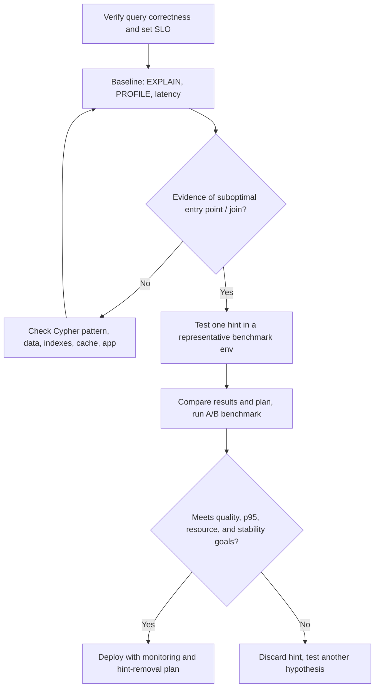

# Using Index or Planner Hints Based on Measurement Evidence

## 1. When Should You Intervene with the Cypher Planner?

Neo4j stores data as a **property graph**: nodes, relationships, and properties. A Cypher query describes the relationship pattern to match, while the *planner* chooses starting points, indexes, relationship expansion order, and how graph branches are joined. Normally, the planner picks a plan from statistics and cost estimates; developers do not need to dictate which index to use.

Occasionally, the planner makes a suboptimal choice for the **actual data distribution**: a value matches very few records while statistics overestimate it, a node has an unusually high relationship degree, or multiple filter predicates make starting-point selection unpredictable. In such cases, Neo4j allows **planner hints** such as `USING INDEX`, `USING SCAN`, and `USING JOIN`. However, a hint can make queries slower under different data versions or workload profiles.

**Core principle of this lesson:** add a hint only when metrics show the default plan causes a concrete problem, basic fixes have been checked, and A/B benchmarks prove the hint improves real targets. Hints **affect execution strategy; they must never alter Cypher semantics or result sets**.

This topic belongs to the **Query Optimization** chapter of the `DATABASE_ENGINE_GRAPH_NEO4J` module. It connects directly to indexes/constraints, reading `EXPLAIN`/`PROFILE`, relationship and path queries, and latency measurement in Java Driver or Spring Data Neo4j applications.

### Learning Outcomes

After this lesson, you will be able to:

1. Capture a query's **baseline**: correctness, execution plan, `Rows`, `DB Hits`, latency, and test environment.
2. Distinguish `USING INDEX`, `USING [RANGE | TEXT | POINT] INDEX`, `USING INDEX SEEK`, `USING SCAN`, and `USING JOIN ON`.
3. Explain why an existing index might still **not** be chosen by the planner.
4. Run controlled comparisons between default and hinted queries without **confusing small test datasets with real performance gains**.
5. Define conditions for applying, monitoring, and removing hints when data distributions or Neo4j versions change.

## 2. An Evidence-Based Decision Framework

Do not start by asking "which index should I force?" Start with a **measurable anomaly**:

| Symptom | Evidence to Collect | Hypothesis to Test |
|---|---|---|
| `p95` rises at high record counts | Percentile latency under load, `PROFILE` | Starting point accesses too many candidates |
| `Rows` spikes at `Expand(All)` | `Estimated Rows` vs. `Rows`, relationship degrees | Traversing through high-degree nodes too early |
| Plan chooses `NodeByLabelScan` | `SHOW INDEXES`, `EXPLAIN`, predicate selectivity | Index unavailable, incompatible, or scan is cheaper |
| Planner picks an unexpected index | Leaf index `Details`, per-value statistics | Starting point poorly matched to skewed data |
| Costly `NodeHashJoin` or `CartesianProduct` | Two-branch plan, row counts before/after join | Joining pattern branches inflates intermediate rows |
| Slow despite low `DB Hits` | CPU, page cache, GC, network, app, concurrency | Bottleneck lies outside storage access operations |

Recommended workflow:



**Key takeaway:** `EXPLAIN` only shows the **estimated plan** without executing the query; `PROFILE` **executes** it and collects metrics. Never `PROFILE` a write query on production data just to inspect its plan: `CREATE`, `SET`, and `DELETE` operations will take effect.

## 3. Practice Dataset: Articles, Authors, and Topics

We use a learning graph to observe **two competing starting points**: finding an author by `handle` or finding articles by `channel`. Another scenario joins two filtered endpoints through a shared article.

```text
(:QO008Article {id, title, channel, published})
      |                              |
      +--[:QO008_WRITTEN_BY]------->(:QO008Author {id, handle})
      |
      +--[:QO008_ABOUT]----------->(:QO008Topic {id, slug})
```

Labels and index names start with `QO008`/`qo008_` to avoid name collisions. Run in a **practice database**. Having 1,400 articles is sufficient only to illustrate measurement; it is **not** enough to extrapolate optimal plans for millions of nodes.

### 3.1. Creating Authors and Topics

```cypher
UNWIND range(1, 40) AS i
MERGE (au:QO008Author {id: i})
SET au.handle = 'author-' + toString(i);
```

```cypher
WITH [
  'cypher', 'neo4j', 'java', 'search',
  'security', 'operations', 'modeling'
] AS slugs
UNWIND range(1, size(slugs)) AS i
MERGE (t:QO008Topic {id: i})
SET t.slug = slugs[i - 1];
```

### 3.2. Creating Articles and Relationships

```cypher
UNWIND range(1, 1400) AS i
MERGE (a:QO008Article {id: i})
SET a.title = CASE WHEN i % 17 = 0
                   THEN 'Cypher optimization ' + toString(i)
                   ELSE 'Graph note ' + toString(i)
              END,
    a.channel = CASE WHEN i % 13 = 0
                     THEN 'featured' ELSE 'standard' END,
    a.published = (i % 8 <> 0)
WITH a, i
MATCH (au:QO008Author {id: (i - 1) % 40 + 1})
MATCH (t:QO008Topic {id: (i - 1) % 7 + 1})
MERGE (a)-[:QO008_WRITTEN_BY]->(au)
MERGE (a)-[:QO008_ABOUT]->(t);
```

Properties and relationships are generated **deterministically** for verification: each author has 35 articles; `channel = 'featured'` appears only on articles whose `id` is divisible by 13. Specifically, `author-13` has exactly **three** `featured` articles: `id = 13, 533, 1053`. Some value-pair queries can exhibit skewed distributions, which is why you must measure on realistic data.

Verify the data:

```cypher
MATCH (a:QO008Article)
WITH count(a) AS articleCount
MATCH (b:QO008Article)-[:QO008_WRITTEN_BY]->(:QO008Author)
RETURN articleCount, count(DISTINCT b) AS articlesWithAuthor;
```

With only this lesson's sample data, the result is `articleCount = 1400` and `articlesWithAuthor = 1400`. The second relationship check also detects articles missing an author; topic relationships can be checked similarly.

### 3.3. Creating Indexes and Checking Status

```cypher
CREATE RANGE INDEX qo008_author_handle IF NOT EXISTS
FOR (au:QO008Author) ON (au.handle);
```

```cypher
CREATE RANGE INDEX qo008_article_channel IF NOT EXISTS
FOR (a:QO008Article) ON (a.channel);
```

```cypher
CREATE RANGE INDEX qo008_topic_slug IF NOT EXISTS
FOR (t:QO008Topic) ON (t.slug);
```

```cypher
CREATE TEXT INDEX qo008_article_title_text IF NOT EXISTS
FOR (a:QO008Article) ON (a.title);
```

```cypher
SHOW INDEXES
YIELD name, type, state, labelsOrTypes, properties
WHERE name STARTS WITH 'qo008_'
RETURN name, type, state, labelsOrTypes, properties
ORDER BY name;
```

Before measuring, wait until all four indexes show `state = 'ONLINE'`. When needed in a **practice database**, `CALL db.awaitIndexes()` waits for indexes to finish populating. If a name was already used for a different schema, `IF NOT EXISTS` does not replace checking `labelsOrTypes` and `properties`.

## 4. Starting with the Unhinted Query

Requirement: find published `featured` articles by author `author-13`, returning `id` and title.

```cypher
MATCH (au:QO008Author)<-[:QO008_WRITTEN_BY]-(a:QO008Article)
WHERE au.handle = $handle
  AND a.channel = $channel
  AND a.published = true
RETURN a.id AS id, a.title AS title
ORDER BY id;
```

With `$handle = 'author-13'` and `$channel = 'featured'`, expected results are `13`, `533`, `1053`. Write the **unhinted** query first; record row counts, `Rows`, `DB Hits`, leaf index/scan types, and latency. Because the dataset is small, the planner may pick `NodeByLabelScan` or `NodeIndexSeek` depending on statistics and runtime.

### 4.1. EXPLAIN: Finding the Starting Point

```cypher
EXPLAIN
MATCH (au:QO008Author)<-[:QO008_WRITTEN_BY]-(a:QO008Article)
WHERE au.handle = 'author-13'
  AND a.channel = 'featured'
  AND a.published = true
RETURN a.id AS id, a.title AS title
ORDER BY id;
```

Read **from leaf to root**: the leaf might be `NodeIndexSeek` on `QO008Author(handle)` or `QO008Article(channel)`; the plan can then traverse the relationship and filter by the remaining branch. If the query uses multiple entry points, a join may appear. `EXPLAIN` shows `Estimated Rows` but **does not report executed row counts or DB Hits**.

### 4.2. PROFILE: Gathering Actual Evidence

```cypher
PROFILE
MATCH (au:QO008Author)<-[:QO008_WRITTEN_BY]-(a:QO008Article)
WHERE au.handle = 'author-13'
  AND a.channel = 'featured'
  AND a.published = true
RETURN a.id AS id, a.title AS title
ORDER BY id;
```

In the plan, record:

| Plan Attribute | How to Read |
|---|---|
| `Operator` and `Details` | Which leaf is the starting point? What index type? Which predicates go into the seek? |
| `Estimated Rows` and `Rows` | Where is estimation error largest? Is there row multiplication from relationships? |
| `DB Hits` | Relative data-access work; **not the number of disk reads** |
| `Memory (Bytes)`, `Page Cache Hits/Misses` | Memory/cache usage if reported by the runtime |
| `Time (ms)` / `Pipeline` | Time inside runtime; may be grouped per pipeline, **distinct** from API latency |

Do not substitute `DB Hits` from a single `PROFILE` run for an application benchmark. A query with low DB Hits can still be slow due to CPU, GC, network, or data serialization overhead.

## 5. Index Hints: USING INDEX and USING INDEX SEEK

Neo4j supports declaring hints **after the corresponding `MATCH`** and before its `WHERE`. Common syntax:

```cypher
MATCH (a:SomeLabel)
USING INDEX a:SomeLabel(property)
WHERE a.property = $value
RETURN a;
```

`USING INDEX` instructs the planner to pick a matching index as a starting point. `USING INDEX SEEK` is stricter: it requires an **index seek** and will not be satisfied by an index scan. If no index matches the label, property, type, or compatible predicate, the hint may fail to apply and raise a warning/error depending on configuration/version. Always inspect the planning result rather than assuming a hint always succeeds.

### 5.1. Forcing Start from the Author

```cypher
PROFILE
MATCH (au:QO008Author)<-[:QO008_WRITTEN_BY]-(a:QO008Article)
USING RANGE INDEX au:QO008Author(handle)
WHERE au.handle = 'author-13'
  AND a.channel = 'featured'
  AND a.published = true
RETURN a.id AS id, a.title AS title
ORDER BY id;
```

This query requests the `QO008Author(handle)` index, traversing roughly 35 articles from one author before filtering. This is a **cost hypothesis**, not a guarantee that the plan displays exactly 35 rows at every operator. Inspect `PROFILE` to confirm.

### 5.2. Forcing Start from the Article

```cypher
PROFILE
MATCH (au:QO008Author)<-[:QO008_WRITTEN_BY]-(a:QO008Article)
USING RANGE INDEX a:QO008Article(channel)
WHERE au.handle = 'author-13'
  AND a.channel = 'featured'
  AND a.published = true
RETURN a.id AS id, a.title AS title
ORDER BY id;
```

The `channel` index returns `featured` candidates across all articles before checking the author. In this fixture there are over 100 `featured` articles, so that starting point **may** process more rows than locating one author first. Still, the planner may combine other strategies; base decisions on `PROFILE` and benchmarks.

### 5.3. Forcing Index Seek When Verification Is Needed

```cypher
EXPLAIN
MATCH (au:QO008Author)
USING RANGE INDEX SEEK au:QO008Author(handle)
WHERE au.handle = 'author-13'
RETURN au.id, au.handle;
```

`USING RANGE INDEX SEEK` requires the plan to satisfy the lookup via a range index seek. It is helpful for distinguishing an "index scan" hypothesis from a "seek"; keep a hint in application code only after measuring real gains and knowing when to remove it.

| Index Hint | Meaning | Example Predicate |
|---|---|---|
| `USING INDEX a:Label(prop)` | Planner uses a compatible index | `=`, `STARTS WITH`… depending on index |
| `USING RANGE INDEX a:Label(prop)` | Requires a RANGE index | `a.prop = $value` |
| `USING TEXT INDEX a:Label(prop)` | Requires a TEXT index | `a.prop CONTAINS $fragment` |
| `USING POINT INDEX a:Label(prop)` | Requires a POINT index | Compatible spatial predicate |
| `USING INDEX SEEK a:Label(prop)` | Requires an index seek | Seek-solvable predicate |

**Important:** RANGE, TEXT, and POINT indexes support different predicate sets. The mere existence of an index is not enough; the planner must also verify **compatible data types and filter predicates** so the hint preserves results. The index name given in `CREATE INDEX` does not appear in `USING INDEX` syntax: hints specify the **variable, label/relationship type, and properties**, not the index name.

### 5.4. TEXT Indexes and Substring Predicates

With `qo008_article_title_text` created, we can test:

```cypher
EXPLAIN
MATCH (a:QO008Article)
USING TEXT INDEX a:QO008Article(title)
WHERE a.title CONTAINS 'Cypher'
RETURN a.id AS id, a.title AS title
ORDER BY id;
```

TEXT indexes are specifically suited for `CONTAINS` and `ENDS WITH`. For `=` or `STARTS WITH`, a RANGE index may be preferable when both exist. Do not put a TEXT hint on `toLower(a.title) CONTAINS ...` assuming the planner will use the index on the raw `title` value; transforming the property can prevent index usage.

## 6. USING SCAN: Sometimes Scanning Is Cheaper Than an Index

Not every predicate has high selectivity. If a query returns most nodes of a label, scanning by label and filtering can be cheaper than reading an index and fetching nodes for almost the entire set. The `USING SCAN` hint forces a label scan (or relationship type scan) starting point instead of an index.

```cypher
EXPLAIN
MATCH (a:QO008Article)
USING SCAN a:QO008Article
WHERE a.published = true
RETURN count(a) AS publishedCount;
```

This is a valid test query even though `published` has **no** index in the fixture. Compare with the unhinted version:

```cypher
EXPLAIN
MATCH (a:QO008Article)
WHERE a.published = true
RETURN count(a) AS publishedCount;
```

Both queries must yield the same result when run. In this dataset, most articles have `published = true`, making a scan a natural choice. **Do not assume scans are always faster:** use `PROFILE` and representative load. If the planner already picks a scan, adding `USING SCAN` brings no benefit and makes the code less adaptable as data grows.

## 7. USING JOIN ON: Forcing a Join Point When Evidence Is Clear

`USING JOIN ON variable` is an advanced hint: it instructs the planner to perform a **join at the specified node**. Rather than forcing a single starting index, it can push the planner to create **multiple starting points** and combine them via `NodeHashJoin` or an appropriate join operator. Without two selective branches, forcing a join can slow a query down dramatically.

Example finding articles by a specific author on a specific topic:

```cypher
MATCH (au:QO008Author)<-[:QO008_WRITTEN_BY]-
      (a:QO008Article)-[:QO008_ABOUT]->(t:QO008Topic)
WHERE au.handle = 'author-13' AND t.slug = 'cypher'
RETURN a.id AS id, a.title AS title
ORDER BY id;
```

On the sample data, `author-13` has **five** articles on topic `cypher`. First measure the **unhinted** version to see how the planner handles the two filter points and join step.

Only when evidence shows that two independent entry branches joined at `a` are better should you test:

```cypher
EXPLAIN
MATCH (au:QO008Author)<-[:QO008_WRITTEN_BY]-
      (a:QO008Article)-[:QO008_ABOUT]->(t:QO008Topic)
USING RANGE INDEX au:QO008Author(handle)
USING RANGE INDEX t:QO008Topic(slug)
USING JOIN ON a
WHERE au.handle = 'author-13' AND t.slug = 'cypher'
RETURN a.id AS id, a.title AS title
ORDER BY id;
```

Inspect the `QO008Author(handle)` and `QO008Topic(slug)` leaves and the join at `a`. **Re-run under `PROFILE` only in a read-test environment** to check `Rows`, `DB Hits`, and join memory. Supplying **multiple** index hints can force the planner into two entry points and an expensive join; `USING JOIN ON` should not be a default hint for arbitrary paths.

### 7.1. Distinguishing "Planner Hints" from "Runtime Selection"

- `USING INDEX`/`SCAN` controls the **access strategy** on part of a `MATCH`.
- `USING JOIN ON` affects the **join point** in a multi-branch plan.
- `CYPHER replan=force` forces **replanning** instead of reusing a valid cached plan; it does **not** guarantee the planner will choose a different or better plan.
- `CYPHER runtime=...` options select the **execution runtime**, which is a different concept from index/join hints; support depends on version and edition.

Example inspecting a fresh plan without executing the query:

```cypher
CYPHER replan=force
EXPLAIN
MATCH (au:QO008Author)
WHERE au.handle = 'author-13'
RETURN au.id;
```

As statistics and data sizes evolve, a cached plan may cease to be optimal. However, **do not force replan on every request** because planning carries its own overhead; inspect automatic replanning and query-cache behavior for your Neo4j version.

## 8. Proper Measurement Before Keeping or Dropping a Hint

### 8.1. Guaranteeing Equivalent Results

All variants must share identical `MATCH`, `WHERE`, `RETURN`, and `ORDER BY` semantics—differing only in `USING ...` lines. Outputs of both variants must be cross-checked, especially for:

- **Row sets and counts:** compare business keys rather than assuming two plans are equivalent just because both run.
- **Duplicate rows:** multi-relationship traversals can reach the same node via multiple paths; verify whether `DISTINCT` is needed.
- **Edge cases:** zero-result queries, very common values, very rare values, `null`/missing properties, unexpected parameter types.
- **Ordering:** when paginating or taking Top K, use deterministic `ORDER BY` with tie-breakers. Never rely on incidental ordering of unsorted output.

To verify the fixture independently:

```cypher
MATCH (au:QO008Author)<-[:QO008_WRITTEN_BY]-(a:QO008Article)
WHERE au.handle = 'author-13'
  AND a.channel = 'featured'
  AND a.published = true
WITH collect(DISTINCT a.id) AS ids
RETURN size(ids) = 3
   AND 13 IN ids
   AND 533 IN ids
   AND 1053 IN ids AS passed;
```

Expect `passed = true` when using the exact fixture without unrelated nodes carrying the same sample labels/values. This check only validates **the fixture's data and business question**, not hint performance.

### 8.2. Measuring Both Application Latency and Database Resources

`PROFILE` reports internal Neo4j work; end users feel **latency from the API call until all records are consumed**. With the Java Driver, measure around the read session and result materialization:

```java
String cypher = """
    MATCH (au:QO008Author)<-[:QO008_WRITTEN_BY]-
          (a:QO008Article)
    WHERE au.handle = $handle
      AND a.channel = $channel
      AND a.published = true
    RETURN a.id AS id, a.title AS title
    ORDER BY id
    """;

long started = System.nanoTime();
try (var session = driver.session()) {
    var results = session.executeRead(tx ->
        tx.run(cypher, java.util.Map.of(
            "handle", "author-13", "channel", "featured"
        )).list()
    );
    double elapsedMs = (System.nanoTime() - started) / 1_000_000.0;
    System.out.printf("rows=%d elapsedMs=%.3f%n",
        results.size(), elapsedMs);
}
```

`driver` is a configured `org.neo4j.driver.Driver`. The code above is a **single-run measurement example**: use a multi-iteration benchmark harness that records percentiles across a representative query set. In Spring Data Neo4j applications, also measure entity/DTO mapping time, HTTP overhead, pagination, serialization, and connection pooling.

A single `PROFILE` run in Neo4j Browser does **not** replace end-to-end latency testing. Run A/B variants in alternating order on the **same data snapshot**, with indexes `ONLINE` and identical version and configuration:

| Aspect | How to Measure | Why It Matters |
|---|---|---|
| Correctness | Compare row counts, keys/IDs, stable ordering | Hints must never change semantics |
| `Rows`/`DB Hits` | `PROFILE`, plan for each variant | Pinpoints where work shifts |
| `p50/p95/p99` | Many end-to-end requests | Shows tail latency and stability |
| QPS and error rate | Fixed-load benchmarks across concurrency levels | Speeding up one query can hurt overall system capacity |
| CPU, heap, GC, page cache, I/O | Monitoring over load windows | Accounts for impact beyond DB Hits |
| Write/index cost | Workload with article and index updates | Adding indexes or changing queries has operational cost |

**Benchmarking practice:** warm up first, measure cold vs. warm cache separately if truly relevant, alternate A/B execution order, include common/rare/non-matching parameters, and record metrics per query group. Also evaluate impact on concurrent workloads, because improving one query does not guarantee higher total service throughput.

### 8.3. Example: Reading an A/B Report

The table below shows **hypothetical numbers for practicing decisions**, not real Neo4j measurements from the fixture:

| Variant | `Rows` after start | Total `DB Hits` | API `p95` (ms) | QPS at equal load | Error Rate |
|---|---:|---:|---:|---:|---:|
| Default | 120 | 420 | 155 | 270 | 0% |
| Hint on `author.handle` | 35 | 130 | 108 | 285 | 0% |
| Hint on `article.channel` | 107 | 470 | 172 | 261 | 0% |
| Force label scan | 1,400 | 1,650 | 365 | 150 | 0.2% |

If repeated runs on representative data return **identical result sets**, hinting the author starting point is a candidate for staged rollout; hinting the article index or forcing a scan has no justification. Even then, inspect p95 for **authors with unusually many articles**: for that cohort, starting from the author index might generate too many candidates and invert the trade-off.

## 9. Common Mistakes When Using Hints

### 9.1. Forcing an Index Because It Exists, Not Because of the Predicate

`qo008_article_title_text` can accelerate `CONTAINS` on `a.title`, yet cannot replace `qo008_article_channel` for `a.channel = 'featured'`. An index cannot optimize properties or relationship types outside its indexed schema. Read the leaf `Details` to verify the planner uses the **right index, right property, and right predicate**.

### 9.2. Multiple Index Hints Increase Join Cost

Two starting points are not automatically faster than one. If each branch yields thousands of candidates, a `NodeHashJoin` can consume significant memory and CPU and hold many rows before filtering. Only use multiple index hints/`USING JOIN ON` when benchmarks clearly prove two entry points help.

### 9.3. Confusing `PROFILE` Cost with Application Latency

`DB Hits` is not disk reads, and `Time (ms)` may be aggregated across a runtime pipeline. A query returning massive records over the network can have low `DB Hits` yet high latency. Measure in Java Driver/Spring Data Neo4j and monitor DB, network, and application hosts together.

### 9.4. Locking in a Hint Based on Stale Statistics

As node counts, relationship degrees, value distributions, or Neo4j versions change, today's helpful hint can become tomorrow's bottleneck. Hinted queries should be periodically re-benchmarked on realistic workloads. Optimizations should include **removal criteria** and an unhinted fallback for rollback.

### 9.5. Using Hints to Hide Modeling or Correctness Bugs

If `MATCH` produces an unintended `CartesianProduct`, `OPTIONAL MATCH` drops/multiplies rows across branches, or `toLower(a.title)` hides an indexed property, fix the **query and data model** first. Hints cannot fix broken logic, replace constraints, or clean up inconsistent data.

## 10. Workflow for Introducing a Hint into an Application

1. **Record business requirements and SLO thresholds.** For example, accurate article lookup, `p95 < 180 ms`, errors `< 0.1%` at target load; never target only DB Hits reduction.
2. **Capture the baseline.** Record unhinted query, sample parameters, Neo4j version, `ONLINE` indexes, data state, `EXPLAIN`/`PROFILE`, and latency percentiles.
3. **State a concrete hypothesis.** E.g., "the planner starts from 140,000 `featured` articles, whereas the requested author has only 20"; measure actual row counts before concluding.
4. **Check simpler alternatives first.** Missing index? Incompatible predicate type? Can we filter earlier, avoid row multiplication, store normalized fields, or improve statistics without a hint?
5. **Create exactly one variant.** Add the chosen hint while keeping `WHERE`/`RETURN` intact; compare output results, `EXPLAIN`, and `PROFILE`.
6. **Run A/B benchmarks at representative load.** Cover common/rare values, large/small datasets, warm/cold cache, and concurrent reads/writes; measure latency percentiles, throughput, errors, CPU, and memory.
7. **Roll out with controls.** Put the hinted query behind a toggleable version, and monitor plan changes and p95 in production.
8. **Define rollback criteria.** If errors/timeouts spike, p95 regresses, RAM climbs, or plan failures appear after an upgrade, revert to the default query and re-investigate.

### Review Checklist Before Approving a Hint

- [ ] Measurable evidence of a **problem in the default plan**, including `PROFILE` and user-facing latency.
- [ ] Compatible index exists and is `ONLINE`, and predicates/types satisfy the hint's requirements.
- [ ] Both variants return **identical result sets** across test suites including edge cases.
- [ ] Measured p50/p95/p99 latency, throughput, error rates, and resources on representative data.
- [ ] Mechanism exists to **toggle or remove the hint**, with post-deployment monitoring and re-evaluation as data grows.

## 11. Practice Exercises

1. **Baseline.** Using the fixture, run `EXPLAIN` and `PROFILE` for `author-13` + `featured`. Fill in a table: accessed leaf, `Rows`, `DB Hits`, and returned `id` values.
2. **Comparing two index hints.** Test `USING RANGE INDEX au:QO008Author(handle)` and `USING RANGE INDEX a:QO008Article(channel)`. Compare results, plans, and resource metrics. State your conclusion based on your numbers.
3. **Testing skewed values.** Test `author-1` and `author-13`, as well as `channel = 'featured'` and `'standard'`. Does a single hint remain optimal for all parameters?
4. **Comparing hint vs. scan.** With `a.published = true`, compare the default plan against `USING SCAN a:QO008Article`. As node counts scale up, re-measure and explain how the trade-off shifts.
5. **Reading joins.** Compare plans for the author + topic query with and without `USING JOIN ON a`. Mark both starting points, the join operator, and branch row counts.
6. **Investigating another predicate.** Test `a.title CONTAINS 'Cypher'` with `USING TEXT INDEX` and without a hint; verify the index is `ONLINE` and check whether it actually helps on a small dataset.
7. **Writing a decision report.** Write a one-page summary covering baseline, hypothesis, before/after metrics, result-equivalence verification, risks as data evolves, and rollback criteria. If metrics fail to prove a gain, recommend **not shipping the hint to production**.

### Cleaning Up Practice Data

Run only on the learning database containing this lesson's `QO008` data; `DETACH DELETE` also deletes relationships attached to the sample nodes.

```cypher
DROP INDEX qo008_author_handle IF EXISTS;
```

```cypher
DROP INDEX qo008_article_channel IF EXISTS;
```

```cypher
DROP INDEX qo008_topic_slug IF EXISTS;
```

```cypher
DROP INDEX qo008_article_title_text IF EXISTS;
```

```cypher
MATCH (a:QO008Article)
DETACH DELETE a;
```

```cypher
MATCH (au:QO008Author)
DETACH DELETE au;
```

```cypher
MATCH (t:QO008Topic)
DETACH DELETE t;
```

## 12. References

- [Neo4j Cypher Manual — Index hints for the Cypher planner](https://neo4j.com/docs/cypher-manual/current/indexes/performance-indexes/index-hints/): syntax, hint satisfaction rules, and `USING INDEX`, `SCAN`, `JOIN` examples.
- [Neo4j Cypher Manual — The impact of indexes on query performance](https://neo4j.com/docs/cypher-manual/current/indexes/performance-indexes/using-indexes/): index selection for predicates and reasons an index may not be preferred.
- [Neo4j Cypher Manual — Understanding query plans](https://neo4j.com/docs/cypher-manual/current/planning-and-tuning/execution-plans/): `EXPLAIN`/`PROFILE`, `Estimated Rows`, `Rows`, `DB Hits`.
- [Neo4j Cypher Manual — Query tuning](https://neo4j.com/docs/cypher-manual/current/planning-and-tuning/query-tuning/): planner, runtime, and `replan=force`.
- [Neo4j Java Driver Manual](https://neo4j.com/docs/java-manual/current/): parameterized queries, transactions, and application-side timing measurement.
