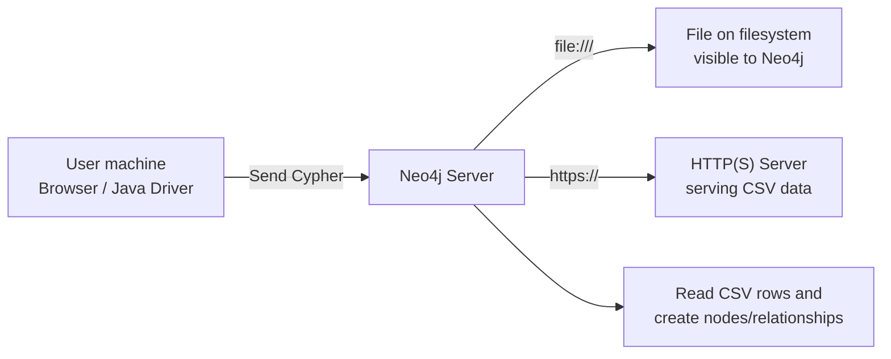
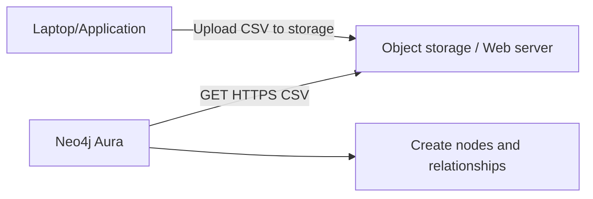

# File, URL, and Import Directory Access Permissions in Neo4j

When importing CSV data into **Neo4j**, the `LOAD CSV` statement succeeds only if the **Neo4j server** can actually read the data source. A file present on a developer's laptop is not necessarily present on the machine running Neo4j; a URL reachable in a web browser is not necessarily reachable from the server; and a file in the right folder can still be rejected due to OS permissions or security configuration.

This lesson belongs to the **Data Import** chapter of the **DATABASE_ENGINE_GRAPH_NEO4J** module. In a property graph system, CSV data can be transformed into **nodes**, **relationships**, and **properties** via Cypher. To do this safely and reliably, you must distinguish **file paths**, **URL sources**, **the import directory**, **Neo4j process permissions**, and **privileges of the Cypher-executing account**.

## 1. Who actually reads the data when executing `LOAD CSV`?

In the common setup, you open Neo4j Browser or a Java application and send Cypher to Neo4j over the network:



Key point: **`LOAD CSV` is processed on the Neo4j Server side**. The path in `FROM` does not automatically point to the machine running Neo4j Browser, IntelliJ, a Spring Boot application, or the Neo4j Java Driver.

Example:

```cypher
LOAD CSV WITH HEADERS FROM 'file:///customers.csv' AS row
RETURN row
LIMIT 3;
```

In a self-managed Neo4j installation using the default import directory, this statement looks for `customers.csv` in the **import directory on the Neo4j process's filesystem**. If you save `customers.csv` in your laptop's Downloads folder, a Neo4j instance on another server will not automatically see that file.

### Three control layers to keep distinct

| Layer | Question | Example |
| --- | --- | --- |
| **Data source location** | Does the file/URL exist and can Neo4j see it? | Is the file mounted into the container or only on the host? |
| **Configuration & system permissions** | Is Neo4j allowed to open this source? | `server.directories.import`, `dbms.security.allow_csv_import_from_file_urls`, OS read permissions |
| **Neo4j account privileges** | Is the Cypher user allowed to run `LOAD CSV` and write to the graph? | `LOAD` privilege; permissions to create/modify required nodes and relationships |

The three layers are **independent**. Editing import settings will not fix a URL returning HTTP 403; granting `LOAD` will not create a missing file inside Docker; granting OS file read permissions does not replace Neo4j graph privileges.

## 2. Two types of `LOAD CSV` sources: local files and remote URLs

```cypher
// Read a file visible to Neo4j on the filesystem.
LOAD CSV WITH HEADERS FROM 'file:///customers.csv' AS row
RETURN row
LIMIT 3;
```

```cypher
// Read CSV from an HTTP(S) endpoint returning CSV content.
LOAD CSV WITH HEADERS
FROM 'https://data.neo4j.com/importing-cypher/people.csv' AS row
RETURN row
LIMIT 3;
```

| Criterion | `file:///...` | `https://...` |
| --- | --- | --- |
| Where does the data live? | Filesystem of the **Neo4j server/container** | Remote HTTP(S) server |
| Access requirements | Path within allowed scope, OS permissions, `LOAD` privilege | Network/DNS/TLS route from Neo4j to URL, source returns data, `LOAD` privilege |
| Depends on import directory? | **Yes**, when configured to restrict | **No**, since it does not read files via `file:///` |
| Supported on Neo4j Aura? | **No** | **Yes**, if the URL is reachable from Aura and allowed |
| Typical risks | Wrong filesystem path, overly broad read permissions | Expired URL, HTTP 403, timeouts, untrusted destination |

In the HTTPS example, the server returns **raw CSV content**. A URL pointing to a login page, an HTML file viewer, or a browser download endpoint requiring cookies is **not equivalent** to a direct CSV URL. Prefer HTTPS; HTTP does not encrypt data in transit.

## 3. The import directory and how `file:///` is interpreted

On self-managed Neo4j, `server.directories.import` controls the **root directory** for file paths used with `LOAD CSV`. With a typical configuration:

```properties
# neo4j.conf (illustrative, configured by the administrator)
server.directories.import=import
dbms.security.allow_csv_import_from_file_urls=true
```

Suppose the Neo4j home directory is `/opt/neo4j` and import is located at `/opt/neo4j/import`:

```text
/opt/neo4j/
└── import/
    ├── customers.csv
    └── 2026/
        └── orders.csv
```

Corresponding statements:

```cypher
LOAD CSV WITH HEADERS FROM 'file:///customers.csv' AS row
RETURN row LIMIT 2;
```

```cypher
LOAD CSV WITH HEADERS FROM 'file:///2026/orders.csv' AS row
RETURN row LIMIT 2;
```

**Path resolution:** when import is confined to this directory, `file:///customers.csv` maps to `customers.csv` **under the import root**. You do not write `file:///opt/neo4j/import/customers.csv`, and writing the full OS path can fail or make Neo4j look in the wrong location.

### Practical rules

1. Place files in the **actual import directory** used by the Neo4j process.
2. For subdirectories, use relative paths inside import such as `file:///2026/orders.csv`.
3. Use `/` in URLs even when the server runs Windows; a URL is not an arbitrary Windows path string.
4. Special characters and spaces in URLs must be properly **URL-encoded**; for example, `my customers.csv` is referenced as `file:///my%20customers.csv`.
5. Filenames can be case-sensitive on Linux; `Customers.csv` and `customers.csv` may be two distinct files.
6. Do not rely on `../` sequences to escape the import directory; confinement settings exist to prevent accessing files outside the allowed scope.

**Do not widen the import root to the entire filesystem just to fix a path error.** If you remove or relax `server.directories.import`, the set of files Neo4j can potentially read can expand significantly. The safer approach is to move files into a dedicated, properly governed import directory.

### Settings may vary by installation version

`server.directories.import` belongs to the current Neo4j configuration naming scheme. Very old documentation may refer to `dbms.directories.import`; verify against the exact Neo4j version you run rather than copying old settings verbatim into a new version.

In environments where you have permission to inspect configuration, you can run:

```cypher
SHOW SETTINGS
YIELD name, value
WHERE name IN [
  'server.directories.import',
  'dbms.security.allow_csv_import_from_file_urls'
]
RETURN name, value
ORDER BY name;
```

`SHOW SETTINGS` requires appropriate privileges and may be restricted by managed services. Its output reveals the **effective** configuration; editing `neo4j.conf` on self-managed deployments may require a restart depending on the setting. On Neo4j Aura, do not assume you can customize system settings the way you can on self-managed deployments.

## 4. OS read permissions are not Cypher privileges

On a self-managed server, the Neo4j process runs under an **OS user/service account**. Both the import file and its parent directories must allow that account to access them.

Linux example:

```text
/var/lib/neo4j/import/customers.csv
             └────┬─────┘
     The Neo4j process must traverse these directories
     and have read permission on this file.
```

Common requirements:

- **CSV file**: the Neo4j service account has **read permission**.
- **Parent directories**: that account has **traverse/search** permission through the required directories.
- **Docker bind mount**: permissions inside the container must match the Neo4j process UID/GID; do not look only at permissions on the host.
- **Windows service**: verify NTFS/ACL permissions for the Windows account running the Neo4j service.
- **File still being written**: even with valid permissions, reading while a file is mid-creation or mid-copy can produce incomplete results.

Least-privilege principle: **Neo4j only needs read access to the CSV source** for `LOAD CSV` to ingest data; it does not need write access to the entire import directory. Graph write permission is a **separate** Neo4j account privilege controlled at the database layer.

> An OS `Permission denied` error must be fixed in file and directory permissions. Adding `GRANT WRITE` in Cypher will not fix OS file read permissions.

## 5. `LOAD` privilege and data creation privileges in Neo4j

Beyond OS permissions, Neo4j enforces **privileges** on the user executing `LOAD CSV`. In versions/editions that support fine-grained access control, **`LOAD`** governs reading data sources, while graph write privileges govern creating/modifying nodes and relationships.

Example that only reads CSV data:

```cypher
LOAD CSV WITH HEADERS FROM 'file:///customers.csv' AS row
RETURN row
LIMIT 5;
```

If `LOAD` is permitted but the user lacks permission to create `:Customer` nodes, the following statement can still fail:

```cypher
LOAD CSV WITH HEADERS FROM 'file:///customers.csv' AS row
MERGE (c:Customer {id: row.customerId})
SET c.name = row.name;
```

When using Neo4j Enterprise with appropriate administrative privileges, an example command is:

```cypher
// Example for administrators; applies only when the edition supports it.
GRANT LOAD ON ALL DATA TO csv_importer;
```

The command above grants **broad** `LOAD` scope to the `csv_importer` role, which does not automatically grant all data-write privileges. Your security model should follow **least privilege**; grant only the permissions required under your organization's governance. You can inspect privileges with a command such as:

```cypher
SHOW ROLE csv_importer PRIVILEGES AS COMMANDS;
```

Actual default privileges, edition support, and grant/revoke syntax can vary by version and service tier. Do not assume every deployment permits running the administrative commands shown above.

### Access error classes to recognize

| Symptom | Primary likelihood |
| --- | --- |
| Not permitted to execute `LOAD CSV` | Missing or denied `LOAD` privilege |
| `RETURN row` works but `MERGE`/`CREATE` fails | Graph write privilege, constraint, or data error |
| Cannot open `file:///...` | File URL config, wrong import root, missing file, or OS permission |
| `https://...` returns 403/404 | Source server rejected access or URL does not exist |
| HTTPS timeout/SSL error | DNS, firewall, egress, proxy, certificate, or source endpoint |

Use the specific error message to classify the issue rather than granting extra privileges arbitrarily.

## 6. Hands-on: importing a simple CSV into a property graph

Create `customers.csv` inside the Neo4j server's import directory:

```csv
customerId,name,city
C001,An,Ha Noi
C002,Binh,Da Nang
C003,Chi,Ho Chi Minh
```

### Step 1 — Confirm Neo4j can read the source

```cypher
LOAD CSV WITH HEADERS FROM 'file:///customers.csv' AS row
RETURN row.customerId AS customerId,
       row.name AS name,
       row.city AS city
LIMIT 3;
```

If this statement does not return the three expected rows, **do not proceed to the write step**. Check the directory, filename, permissions, and configuration first. `WITH HEADERS` treats the first row as column names; `customerId`, `name`, and `city` must match the CSV header exactly.

### Step 2 — Create an appropriate constraint for the identifier

Run on the practice database with schema admin privileges:

```cypher
CREATE CONSTRAINT customer_import_id_unique IF NOT EXISTS
FOR (c:ImportCustomer)
REQUIRE c.customerId IS UNIQUE;
```

The constraint enforces unique identifiers and supports `MERGE` lookups on the customer key. It does **not** grant additional file-opening or network-access permissions.

### Step 3 — Write data with Cypher

```cypher
LOAD CSV WITH HEADERS FROM 'file:///customers.csv' AS row
WITH row
WHERE row.customerId IS NOT NULL
  AND trim(row.customerId) <> ''
MERGE (c:ImportCustomer {customerId: trim(row.customerId)})
SET c.name = trim(row.name),
    c.city = trim(row.city);
```

Verify the result:

```cypher
MATCH (c:ImportCustomer)
RETURN c.customerId AS id, c.name AS name, c.city AS city
ORDER BY id;
```

The expected result is three `:ImportCustomer` nodes, each containing `customerId`, `name`, and `city`. Appropriate graph write privileges are required for `MERGE`/`SET` to succeed. On real data, validate CSV quality, blank columns, data types, and invalid-record handling policies.

### Step 4 — File in a subdirectory

If you move the file to `import/2026/customers.csv`, update the **URL**:

```cypher
LOAD CSV WITH HEADERS FROM 'file:///2026/customers.csv' AS row
RETURN row
LIMIT 3;
```

Moving the file does not require changing the import root scope as long as the path remains underneath it.

## 7. Running Neo4j with Docker

In Docker, Neo4j sees the **container's filesystem**, not host directories by default. Therefore, a file located at:

```text
Host:      /srv/neo4j-import/customers.csv
Container: /import/customers.csv
Cypher:    file:///customers.csv
```

must be **mounted** into the container at the right path. Example volume declaration in a Compose service (other Neo4j configuration omitted):

```yaml
services:
  neo4j:
    image: neo4j:5
    volumes:
      - ./import:/import:ro
```

- `./import`: directory on the **host** running Docker Compose.
- `/import`: directory **inside the container** for Neo4j to read.
- `:ro`: read-only mount, suitable for CSV sources ingested via `LOAD CSV`.
- `file:///customers.csv`: URL referencing the file under the configured import root inside the container, **not** directly referencing the host's `./import`.

The `neo4j:5` image tag is illustrative only; in real deployments, choose a managed version tag and configure it appropriately for your environment. If your setup changes `server.directories.import`, verify the actual root directory in use.

**Permission note:** having a mount in place is not enough; the user running Neo4j inside the container must still be able to read the file. If host file permissions exclude the container's user/UID, Neo4j can report an access error even though `docker compose` starts cleanly.

## 8. Running Neo4j Aura or a remote server

**Neo4j Aura does not support `file:///` in `LOAD CSV`.** Files on your laptop, an application container, or a backend server do not become local files inside Aura. To use `LOAD CSV`, the data must be hosted at a **URL reachable by the Aura server**, typically HTTPS.



Ways to serve the file:

- Host the CSV over HTTPS from an organization-approved source.
- Use object storage such as S3 or an equivalent service with a URL reachable from Aura; if using a **signed URL**, ensure its expiration covers the entire import run.
- Use an appropriate import tool/API, or read/parse the CSV in the application and send **parsed records** using the Neo4j Driver.

Public source test example from Neo4j documentation:

```cypher
LOAD CSV WITH HEADERS
FROM 'https://data.neo4j.com/importing-cypher/people.csv' AS row
RETURN row
LIMIT 3;
```

This is an example remote source; execution depends on connectivity and policies in your actual environment. A private URL accessible only over VPN or with browser cookies will not work from Aura if Aura lacks equivalent network/auth access.

**Do not upload sensitive data to a public URL just for a quick test.** Use a solution with proper access controls and URL lifetimes; avoid logging signed URLs containing tokens in logs, error messages, or long-lived documents.

## 9. Java Driver and Spring Data Neo4j integration

Distinguish two ways a Java application can bring CSV data into Neo4j.

### Approach A — Java sends Cypher `LOAD CSV`

```java
import org.neo4j.driver.Driver;
import org.neo4j.driver.Session;
import org.neo4j.driver.Values;

public void importCustomers(Driver driver, String sourceUrl) {
    try (Session session = driver.session()) {
        var summary = session.run("""
            LOAD CSV WITH HEADERS FROM $url AS row
            WITH row
            WHERE row.customerId IS NOT NULL
              AND trim(row.customerId) <> ''
            MERGE (c:ImportCustomer {customerId: trim(row.customerId)})
            SET c.name = row.name
            """, Values.parameters("url", sourceUrl)
        ).consume();

        System.out.println(
            "Nodes created: " + summary.counters().nodesCreated()
        );
    }
}
```

`sourceUrl` is the **URL read by the Neo4j server**, not a local path on the Java machine. `Result.consume()` ensures the implicit transaction's result finishes before the application reports success.

Because a dynamic URL is accepted, the application must **validate allowed sources**; never pass an arbitrary user-supplied URL straight into `LOAD CSV`. Even though parameterization prevents Cypher injection, parameterization **does not solve URL authorization or the risk of reading unintended sources**.

### Approach B — Java reads the CSV, then sends records via the Driver

The application can use a suitable CSV library to read a file **on the application machine**, then send batches of parsed data via an `UNWIND` parameter:

```java
import org.neo4j.driver.Driver;
import org.neo4j.driver.Session;
import org.neo4j.driver.Values;

import java.util.List;
import java.util.Map;

public void writeParsedRows(
        Driver driver, List<Map<String, Object>> batch) {

    try (Session session = driver.session()) {
        session.executeWrite(tx -> {
            tx.run("""
                UNWIND $rows AS row
                MERGE (c:ImportCustomer {customerId: row.customerId})
                SET c.name = row.name,
                    c.city = row.city
                """, Values.parameters("rows", batch)
            ).consume();

            return null;
        });
    }
}
```

In Approach B:

- Java **is responsible for reading/parsing the CSV**; Neo4j does not need to open that file via `file:///`.
- `batch` is a list of validated data maps with keys `customerId`, `name`, and `city`.
- The application still needs **connectivity to Neo4j**, graph write privileges, and appropriate retry/idempotency handling.
- Do not load an entire huge CSV into Java memory at once; split it into reasonably sized batches and use a parser library that handles commas inside quoted strings, encoding, BOM, and ragged rows.

In **Spring Data Neo4j**, saving entities through a repository/`Neo4jClient` also sends data over the Neo4j connection. If the application reads the CSV itself and saves entities, file read permissions belong to the **application process**; this is completely different from the Neo4j Server executing `LOAD CSV FROM 'file:///'`.

## 10. Diagnosing errors by symptom

| Error or symptom | Check first | Proper remediation |
| --- | --- | --- |
| File not found / cannot open `file:///...` | File location in import root, exact name/casing, URL path | Move the file into the import root or fix the relative URL |
| `Access denied` / `Permission denied` on file | OS user, file read & directory traverse permissions, Docker UID/mount | Set least-privilege ACL/permissions for the Neo4j process |
| File URLs disallowed | `dbms.security.allow_csv_import_from_file_urls`, Aura service tier | Use remote HTTPS when appropriate; enable on self-managed only if permitted |
| Missing `LOAD` privilege | Role and load privileges | Ask an administrator to grant the permitted scope |
| Cannot `CREATE`/`MERGE` despite reading CSV | Graph/constraint privileges, input data types | Check write privileges, schema, and data |
| HTTPS returns 404 | URL, object/storage path | Use the URL pointing to the actual CSV resource |
| HTTPS returns 401/403 | Endpoint policy, signed URL/token, expiration | Provision valid access, limit permissions and lifetime |
| HTTPS timeout / DNS failure | Egress, firewall, DNS, proxy, TLS | Test connectivity **from the Neo4j runtime environment** |
| Readable but wrong columns/`NULL` | Header, delimiter, encoding, BOM, response body | Inspect `RETURN row LIMIT 3`; fix CSV formatting |
| File on Docker host invisible in container | `/import` mount and actual directory inside container | Configure the bind mount/volume properly and check permissions |
| Neo4j Aura cannot read `file:///` | Deployment type | Switch to HTTPS or send batches via Driver |

### Non-destructive verification checklist

Before writing real data:

1. Identify **where Neo4j runs**: local machine, remote server, Docker, or Aura.
2. Identify **where the source lives**: host, container, server disk, or HTTPS.
3. If file-based: verify import root, OS permissions, file URL setting, and `LOAD` privilege.
4. If HTTPS-based: verify the endpoint returns **CSV**, source authorization, and network reachability from Neo4j.
5. Run `LOAD CSV ... RETURN row LIMIT 3` to verify columns and content.
6. Only once the source reads cleanly should you run `MERGE`/`CREATE` on the target database, with constraints and duplicate-handling logic.

`EXPLAIN` on a `LOAD CSV` query is no substitute for testing a **real source read**; it plans the query without guaranteeing that the path, OS permissions, or HTTP endpoint will succeed at execution time.

## 11. Securing import sources: keep read scope minimal

Reading CSVs via URLs is a data-access capability that warrants control:

- **Confine the import directory** to a dedicated area; do not turn Neo4j into a process capable of reading arbitrary system files.
- **Keep files read-only** when the task is import-only; restrict permissions on the service account and who can place files into the folder.
- **Apply appropriate Neo4j privileges**, granting `LOAD` and data-write permissions only to accounts that truly need them.
- **Prefer HTTPS**, restrict allowed domains/network destinations, and block unnecessary access to internal endpoints; a user-controlled URL can create unintended access risks to services visible to the server.
- **Do not log secrets in URLs** such as presigned query parameters, tokens, or customer identifiers.
- **Validate CSV content**: check headers, encoding, size, value types, and identifiers before creating nodes/relationships.
- **Clean up files after import** per organizational retention policy, especially when personal data is involved.
- **Separate import privileges from system admin privileges**; someone allowed to import nodes does not inherently need to edit Neo4j configuration or read sensitive OS files.

### Distinguishing `LOAD CSV` from `neo4j-admin database import`

`LOAD CSV` runs via Cypher against a **running database**, subject to the file URL scope and privileges described above. By contrast, `neo4j-admin database import` is a **CLI bulk-import tool using its own mechanism**, with different parameter formats, file locations, execution permissions, and operational conditions.

Do not assume `server.directories.import` or `file:///...` paths from `LOAD CSV` apply identically to every import tool. When importing very large volumes with `neo4j-admin`, follow the documentation for that exact command and deployment environment.

## 12. Self-check exercises

**Question 1.** A Java application running on a laptop has `D:\data\customers.csv`, while Neo4j runs on a Linux host in a data center. Why can't `LOAD CSV FROM 'file:///customers.csv'` find the laptop's file?

<details>
<summary>Suggested answer</summary>

Because `LOAD CSV` reads sources from the filesystem visible to the **Neo4j server**, not from the machine running Java. You must place the file in the Neo4j server's import directory, serve it over a reachable HTTPS source, or have Java read the file and send the data via the Driver.

</details>

**Question 2.** In Docker, the host has `./import/customers.csv` yet Neo4j reports the file does not exist. What should you check first?

<details>
<summary>Suggested answer</summary>

Verify that the host directory is bind-mounted to `/import` inside the container, which import root Neo4j is configured to use, whether the file appears with the exact expected name inside the container, and whether the OS user running Neo4j has read permission on the file. Host directories do not appear inside containers automatically without a mount.

</details>

**Question 3.** Why is granting `GRANT LOAD ON ALL DATA` not enough to guarantee a `MERGE` statement succeeds?

<details>
<summary>Suggested answer</summary>

`LOAD` governs source-loading permission; `MERGE` also requires graph write privileges, valid input data types, and no constraint violations. In addition, the file/URL must still exist and be accessible to the server.

</details>

**Question 4.** When connecting to Neo4j Aura, should you enable `dbms.security.allow_csv_import_from_file_urls=true` to use `file:///customers.csv` from a personal machine?

<details>
<summary>Suggested answer</summary>

No. Aura does not allow importing from local `file:///`. You must host the CSV at an HTTPS source reachable by Aura or read the file in the application and send records via the Driver. Do not assume permission to modify Aura's system configuration.

</details>

**Question 5.** The query `LOAD CSV ... FROM 'https://example.org/private.csv'` returns HTTP 403. Will editing `server.directories.import` solve it?

<details>
<summary>Suggested answer</summary>

No. `server.directories.import` controls **local file URL** sources, whereas HTTP 403 is a response from the remote web server (or the source's access control layer). Check URL/endpoint authorization, signed URLs, or connectivity from the Neo4j environment.

</details>

## Key takeaways

- **`LOAD CSV` reads files/URLs from the Neo4j Server side.** Files on a developer's machine do not automatically exist on the server.
- On self-managed Neo4j, `file:///customers.csv` typically points to a file beneath the import directory configured by **`server.directories.import`**.
- File access also depends on **`dbms.security.allow_csv_import_from_file_urls`**, OS permissions, and the Neo4j account's **`LOAD`** privilege.
- **Neo4j Aura does not support local file URLs**; use reachable HTTPS or send data via the Driver.
- **Docker requires proper directory mounts and read permissions**; host paths and container paths are not identical.
- Separate **path**, **OS permission**, **`LOAD` privilege**, **graph write privilege**, and **HTTP/network** errors to fix the actual root cause.
- Grant only minimal read scope and necessary privileges; test **`RETURN row LIMIT 3`** before importing for real.

### References

- [Neo4j Cypher Manual — LOAD CSV](https://neo4j.com/docs/cypher-manual/current/clauses/load-csv/)
- [Neo4j Operations Manual — Configuration settings](https://neo4j.com/docs/operations-manual/current/configuration/configuration-settings/)
- [Neo4j Operations Manual — Default file locations](https://neo4j.com/docs/operations-manual/current/configuration/file-locations/)
- [Neo4j Operations Manual — Load privileges](https://neo4j.com/docs/operations-manual/current/authentication-authorization/load-privileges/)
- [Neo4j Data Ingestion Guide — LOAD CSV](https://neo4j.com/docs/data-ingestion-guide/ingestion-methods/load-csv/)
- [Neo4j Operations Manual — Docker volumes](https://neo4j.com/docs/operations-manual/current/docker/mounting-volumes/)
