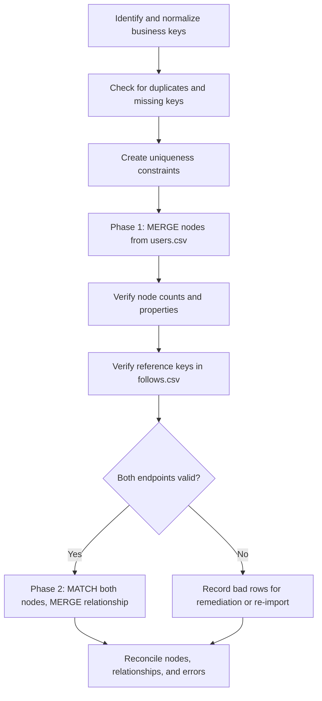

# Importing Nodes Before Relationships with Stable Business Keys

When importing data into Neo4j, the order of operations determines the consistency of the property graph. A file containing users, customers, or products is often accompanied by a file containing **links between those entities**. If you create relationships before properly identifying both endpoint nodes, the system may generate incomplete nodes, merge the wrong entities, or silently drop links whose targets cannot be found.

The foundational solution is **import nodes first, import relationships second, and use stable business keys to match entities across files**. This is part of the **Data Import** chapter in the **DATABASE_ENGINE_GRAPH_NEO4J** module, where Neo4j is used to model nodes/relationships, query with Cypher, apply indexes/constraints, tune performance, and integrate with the Java Driver or Spring Data Neo4j.

After this lesson, you will be able to:

- Design business keys used to identify nodes across repeated data imports.
- Create uniqueness constraints, import nodes with `MERGE`, and then connect relationships using `MATCH` + `MERGE`.
- Detect empty keys, duplicate records, orphan references, and inconsistent data.
- Distinguish safe re-imports from accidentally creating duplicates or overwriting data.
- Batch work, verify results, and understand transaction boundaries when using `LOAD CSV`, the Java Driver, and Spring Data Neo4j.

## 1. Why must import order be decided deliberately?

Suppose a social network has three users and follow relationships. Data exported from the source system consists of two files:

**`users.csv`**

```csv
userId,displayName
U-001,An
U-002,Binh
U-003,Chi
```

**`follows.csv`**

```csv
fromUserId,toUserId,since
U-001,U-002,2025-01-10
U-002,U-003,2025-01-15
U-001,U-003,2025-02-01
```

Target graph:

```text
(:User {userId: "U-001", displayName: "An"})
     |                              \
     | :FOLLOWS                      \ :FOLLOWS
     v                                v
(:User {userId: "U-002"}) -----> (:User {userId: "U-003"})
                             :FOLLOWS
```

Here `userId` is the **business key**: the user identifier in the source system. `fromUserId` and `toUserId` in the relationship file are **reference keys** pointing to two already-imported users.

Standard workflow:



**It is not that Neo4j forbids creating nodes and relationships in a single statement.** You can create both simultaneously in Cypher. However, when importing data from multiple sources/files, separating the two phases guarantees node identity, catches relationships with missing endpoints, and enables controlled reruns.

## 2. What is a stable business key?

A business key is a value that identifies **the same entity in the domain**, independent of CSV row order or how Neo4j stores data internally.

A good key satisfies:

| Criterion | How to apply it |
| --- | --- |
| **Unique within a defined scope** | One `userId` represents one user within a source system |
| **Stable over time** | Does not change when a user edits their display name, email, or address |
| **Present at import time** | Records lacking a key are routed to error handling |
| **Consistent type and format** | Uniform casing, whitespace, prefix, and encoding rules |
| **Reused in relationship files** | `fromUserId`, `toUserId` point accurately to `User.userId` |
| **Re-import friendly** | Rerunning the file does not create a new node for an equivalent key |

For example, `U-001` is more stable than `displayName = "An"` because display names can change and multiple people can share the same name.

### Do not use internal IDs as long-lived reference keys

Neo4j provides `id()` (numeric internal ID in some versions) and `elementId()` (string element identifier). They are convenient for certain operations within the scope of a database or transaction, but **they are not durable business keys for storing in CSVs or exchanging across systems**. Do not expect them to remain unchanged across delete/recreate cycles, re-imports, data migrations, or storage lifecycle changes.

Common mistake:

```text
users.csv:    neo4jNodeId=123, name=An
follows.csv:  fromNodeId=123, toNodeId=456
```

If nodes are recreated and receive different internal identifiers, those reference numbers no longer point to the right entities. Instead:

```text
users.csv:    userId=U-001, name=An
follows.csv:  fromUserId=U-001, toUserId=U-002
```

### Natural keys vs. application-assigned keys

- **Natural keys:** product codes, case numbers issued by the source system, or order codes with a clear uniqueness policy.
- **Application-assigned keys:** UUIDs or stable codes generated once, persisted with the entity, and reused across exports/imports.
- **Avoid choosing mutable attributes** such as name, phone number, or personal email simply because they happen to look unique today.

If a source key can change, you need an **old-code → new-code** mapping mechanism or a stable application identity. Do not treat every new key value as a brand-new entity when the business merely renamed a code.

### Keys needing scope: multi-tenant or multi-source

Two systems may both have a customer coded `C-001`. Then a standalone code is no longer globally unique. An appropriate model can be:

```cypher
CREATE CONSTRAINT customer_source_key IF NOT EXISTS
FOR (c:Customer)
REQUIRE (c.sourceSystem, c.customerCode) IS UNIQUE;
```

The node is matched by the **pair** `(sourceSystem, customerCode)`:

```cypher
MERGE (c:Customer {
  sourceSystem: $sourceSystem,
  customerCode: $customerCode
});
```

Relationship files must also include all components needed to identify endpoints. Never link a `C-001` from source A with a `C-001` from source B.

## 3. Preparing data before calling Neo4j

`LOAD CSV WITH HEADERS` reads columns by header name. Values read from CSV are fundamentally treated as **strings**; if numbers, dates, or booleans are needed, convert types deliberately.

Before importing, verify:

1. **Column names:** `userId` in `users.csv` must correspond to `fromUserId`/`toUserId` in `follows.csv`.
2. **Non-missing keys:** never accept `null`, an empty string, or whitespace-only strings as an identifier.
3. **No duplicates after normalization:** `"U-001"` and `" U-001 "` become the same key if your rule applies `trim()`.
4. **Casing rules:** only apply `toUpper()` / `toLower()` if the source guarantees codes are case-insensitive.
5. **Preserve leading zeros:** code `"00057"` is not integer `57`; do not call `toInteger()` on text identifiers.
6. **CSV encoding and formatting:** use UTF-8, escape commas/quotes per CSV standards, and standardize headers and empty-cell representations.
7. **Relationship type and direction:** `U-001 FOLLOWS U-002` is not equivalent to `U-002 FOLLOWS U-001`.
8. **Duplicate-record policy:** choose whether to raise an error, keep the latest by source timestamp, or apply an explicit merge rule.

Neo4j cannot infer whether `"u-001"` and `"U-001"` are the same user. That is a rule of the source system.

### Why you should not silently drop bad rows

A filter like `WHERE userId <> ''` can make invalid records vanish from the import without anyone noticing. In production, maintain a **reconciliation report** covering input row count, valid row count, missing keys, duplicates, unresolved endpoints, and created relationships.

The queries below intentionally illustrate basic filtering; **always combine them with validation and error logging**, especially when processing financial, identity, or operational data.

## 4. Phase 0: create a uniqueness constraint on the key

Before importing data, define the label and identifying key.

```cypher
CREATE CONSTRAINT user_business_key IF NOT EXISTS
FOR (u:User)
REQUIRE u.userId IS UNIQUE;
```

This constraint ensures **no two `:User` nodes share the same non-null `userId`** within the database. Neo4j creates an index to back key lookups and enforce the constraint. If existing data already has duplicate `userId` values, constraint creation can fail: fix duplicate records first.

**Note:** a standard uniqueness constraint does not by itself require every `:User` to have `userId`. Mandatory key presence must be enforced at import time or via an existence/node key constraint appropriate for your Neo4j edition and version.

Inspect indexes/constraints before running an import on an existing database:

```cypher
SHOW CONSTRAINTS
YIELD name, type, labelsOrTypes, properties
RETURN name, type, labelsOrTypes, properties
ORDER BY name;
```

`IF NOT EXISTS` avoids an error when a matching schema object already exists, but it **does not automatically alter** an older constraint with a different configuration. Manage schema changes through controlled migrations.

## 5. Phase 1: import nodes first with `MERGE`

Assume `users.csv` is placed in the import directory that the Neo4j server is permitted to read. Basic statement:

```cypher
LOAD CSV WITH HEADERS FROM 'file:///users.csv' AS row
WITH row, trim(row.userId) AS userId
WHERE userId IS NOT NULL AND userId <> ''
MERGE (u:User {userId: userId})
SET u.displayName = trim(row.displayName);
```

Meaning:

- `LOAD CSV WITH HEADERS` reads each record with keys `row.userId` and `row.displayName`.
- `trim()` strips leading/trailing whitespace if the source code's rules allow it.
- `WHERE` prevents creating nodes with empty keys; rejected rows must be counted and reported separately.
- `MERGE (u:User {userId: userId})` looks up the user by **business key**; if absent, creates the node.
- `SET u.displayName = ...` updates the name from the current import data on both newly created and existing nodes.

When re-running the exact same file, `MERGE` reuses existing `:User` nodes with the same key instead of creating duplicates. However, `MERGE` **does not make an entire workflow idempotent**: numeric increments, unkeyed relationship creation, or external side effects can still cause repeated mutations on rerun.

### Separating identity data from mutable data

Do not include the display name in `MERGE`:

```cypher
// Avoid using display name as part of the user matching pattern.
MERGE (u:User {userId: row.userId, displayName: row.displayName});
```

If a user changes their name, a `MERGE` pattern containing both ID and name no longer matches the old node. This can either create a duplicate `userId` node or hit a uniqueness constraint violation if properly configured. That is a clear sign that **identifying keys were mixed with mutable attributes**.

Instead, use:

```cypher
MERGE (u:User {userId: row.userId})
SET u.displayName = row.displayName;
```

If a property should **only be written on creation**, use `ON CREATE SET`:

```cypher
MERGE (u:User {userId: row.userId})
ON CREATE SET u.importedAt = datetime()
SET u.displayName = row.displayName;
```

`importedAt` is recorded when the node is first created; re-running the file leaves this timestamp intact. By contrast, `displayName` is resynchronized from the file. Decide deliberately: should the source be allowed to overwrite manual changes in Neo4j?

## 6. Verifying nodes before importing relationships

In a practice database containing only the sample dataset, the expected result is **3 `:User` nodes**.

```cypher
MATCH (u:User)
RETURN count(u) AS userCount;
```

In a database with many pre-existing users, this count does not equal the number of nodes created by **the current import run**. You can use a `batchId` or an application-side reconciliation table to track import scope; avoid tagging metadata solely for filtering and forgetting to clean up or maintain it.

Check for empty keys:

```cypher
MATCH (u:User)
WHERE u.userId IS NULL OR trim(u.userId) = ''
RETURN u, labels(u) AS labels
LIMIT 20;
```

Check for duplicate records before creating a constraint, or to audit legacy data:

```cypher
MATCH (u:User)
WHERE u.userId IS NOT NULL
WITH u.userId AS key, count(*) AS n
WHERE n > 1
RETURN key, n
ORDER BY n DESC;
```

Once a uniqueness constraint is active, Neo4j prevents creating **two nodes with the same non-null key**. Nevertheless, validating input data before touching the database is still necessary to catch **CSV rows with duplicate keys** that could overwrite properties in an unintended order.

## 7. Phase 2: import relationships with two-endpoint `MATCH` and `MERGE`

Once nodes exist, read `follows.csv` and use **business keys** to look up both endpoints:

```cypher
LOAD CSV WITH HEADERS FROM 'file:///follows.csv' AS row
WITH row,
     trim(row.fromUserId) AS fromId,
     trim(row.toUserId) AS toId
WHERE fromId IS NOT NULL AND fromId <> ''
  AND toId IS NOT NULL AND toId <> ''
MATCH (src:User {userId: fromId})
MATCH (dst:User {userId: toId})
MERGE (src)-[r:FOLLOWS]->(dst)
ON CREATE SET r.since = date(row.since);
```

Breakdown:

1. `fromId` and `toId` are normalized using the same rule applied when importing `User.userId`.
2. `MATCH (src:User {userId: fromId})` finds only an **existing node**; it never creates a new user.
3. `MATCH (dst:User {userId: toId})` must also locate the second endpoint node.
4. `MERGE (src)-[r:FOLLOWS]->(dst)` creates the directed relationship if no matching relationship already exists between those two nodes.
5. `ON CREATE SET` sets the follow start date when the relationship is first created. On rerun, existing date values are not overwritten.

The sample data produces three relationships:

```text
U-001 -> U-002 (since=2025-01-10)
U-002 -> U-003 (since=2025-01-15)
U-001 -> U-003 (since=2025-02-01)
```

You must decide the **uniqueness semantics of the relationship**. Here the model implies "one user has at most one `:FOLLOWS` relationship to another specific user." If the business records *multiple follow/unfollow events* between the same two people, a single `:FOLLOWS` relationship cannot represent full history. In that case, introduce a stable event key and model it as `:FollowEvent` or an event relationship type with a dedicated identity strategy.

**On concurrency:** `MERGE` supports pattern-based re-imports, but should not be treated as a uniqueness constraint guaranteeing zero duplicate relationships under all concurrent multi-writer scenarios. If the system runs parallel imports, design event keys/constraints or appropriate coordination mechanisms and reconcile after import.

### Warning: do not use `MERGE` to silently spawn orphan nodes

The query below looks convenient but easily hides source data bugs:

```cypher
// Risky pattern when both endpoints have not been verified:
LOAD CSV WITH HEADERS FROM 'file:///follows.csv' AS row
MERGE (src:User {userId: row.fromUserId})
MERGE (dst:User {userId: row.toUserId})
MERGE (src)-[:FOLLOWS]->(dst);
```

If `toUserId = 'U-999'` is absent from `users.csv`, the query automatically creates `(:User {userId:'U-999'})` without a name, status, or required properties. After import, the graph appears connected while missing real user data.

If the goal is **only to import relationships between verified nodes**, use `MATCH` for both endpoints and log unresolved references. Only create "placeholder" nodes if the business specification **explicitly defines** the placeholder type, status, and later enrichment workflow.

## 8. Detecting relationships referencing non-existent keys

With `MATCH` on both endpoints, a row in `follows.csv` whose node is missing will not produce a relationship. That behavior is safer than creating ghost nodes, yet **silently skipping rows** is also dangerous.

Before importing relationships, you can run a reconciliation query:

```cypher
LOAD CSV WITH HEADERS FROM 'file:///follows.csv' AS row
WITH row,
     trim(row.fromUserId) AS fromId,
     trim(row.toUserId) AS toId
OPTIONAL MATCH (src:User {userId: fromId})
OPTIONAL MATCH (dst:User {userId: toId})
WITH row, fromId, toId, src, dst
WHERE fromId IS NULL OR fromId = ''
   OR toId IS NULL OR toId = ''
   OR src IS NULL OR dst IS NULL
RETURN row.fromUserId AS sourceKey,
       row.toUserId AS targetKey,
       CASE
         WHEN fromId IS NULL OR fromId = '' THEN 'MISSING_SOURCE_KEY'
         WHEN src IS NULL THEN 'SOURCE_NOT_FOUND'
         ELSE 'SOURCE_OK'
       END AS sourceStatus,
       CASE
         WHEN toId IS NULL OR toId = '' THEN 'MISSING_TARGET_KEY'
         WHEN dst IS NULL THEN 'TARGET_NOT_FOUND'
         ELSE 'TARGET_OK'
       END AS targetStatus
LIMIT 100;
```

If you add a row `U-001,U-999,2025-03-01`, this query reports `TARGET_NOT_FOUND`, catching missing node imports or wrong keys in the source file.

Depending on business requirements, choose an explicit policy:

| Situation | Sensible decision |
| --- | --- |
| Empty endpoint key | Reject row, request fix |
| Key present but node not found | Log error and wait for source node; or require Phase 1 re-import |
| Two keys belong to different tenants | Do not link if cross-tenant relationships are disallowed |
| Repeated relationship for same endpoint pair | Clarify idempotency and whether multiple events are needed |
| Relationship pointing to the same node | Accept or reject self-loops per rules |
| Malformed `since` date | Report error or route to cleaning before calling `date()` |

A solid import system **counts and retains rejected rows** outside the graph or in a governed staging area. Never turn bad values into real nodes just to make a Cypher script run to completion.

## 9. Verifying relationships after import

Inspect sample data:

```cypher
MATCH (src:User)-[r:FOLLOWS]->(dst:User)
RETURN src.userId AS fromUserId,
       dst.userId AS toUserId,
       r.since AS since
ORDER BY fromUserId, toUserId;
```

Check total relationship count:

```cypher
MATCH (:User)-[r:FOLLOWS]->(:User)
RETURN count(r) AS followCount;
```

In a practice database with only the sample set, the expected count is 3 relationships. If the database holds pre-existing data, scope by source/batch or reconcile against the list of relationship keys belonging to the run.

To find endpoint pairs that currently have multiple `:FOLLOWS` relationships:

```cypher
MATCH (src:User)-[r:FOLLOWS]->(dst:User)
WITH src, dst, count(r) AS n
WHERE n > 1
RETURN src.userId AS fromUserId,
       dst.userId AS toUserId,
       n
ORDER BY n DESC;
```

Check this result against your modeling rules. If `FOLLOWS` represents only current state, multiple same-direction relationships between a pair usually indicate dirty data to fix. If the relationship type represents multiple events, repeated pairs may be valid and must be distinguished by an event key.

### Do not measure success solely by returned row counts

A single `MERGE` can **match an existing node**, **create a new node**, or **update properties**. Valid CSV row count does not automatically equal newly created node count. Likewise, relationship rows missing endpoints are dropped by `MATCH`, and existing relationships may be reused on rerun.

Import reports should track separate metrics: input rows, valid rows, invalid/duplicate keys, existing vs. newly created nodes, matched/created relationships, and unresolved references.

## 10. Large batched imports and transaction limits

A single transaction importing millions of nodes or relationships can consume excessive memory and hold locks for too long. Neo4j supports splitting Cypher work into smaller transactions using `CALL { ... } IN TRANSACTIONS`.

Example syntax for **Neo4j 5.23 and later** using variable import in `CALL (row)`:

```cypher
LOAD CSV WITH HEADERS FROM 'file:///users.csv' AS row
CALL (row) {
  WITH row, trim(row.userId) AS userId
  WHERE userId IS NOT NULL AND userId <> ''
  MERGE (u:User {userId: userId})
  SET u.displayName = trim(row.displayName)
} IN TRANSACTIONS OF 1000 ROWS;
```

After **Phase 1 completes and is reconciled**, import relationships in batches:

```cypher
LOAD CSV WITH HEADERS FROM 'file:///follows.csv' AS row
CALL (row) {
  WITH row,
       trim(row.fromUserId) AS fromId,
       trim(row.toUserId) AS toId
  WHERE fromId IS NOT NULL AND fromId <> ''
    AND toId IS NOT NULL AND toId <> ''
  MATCH (src:User {userId: fromId})
  MATCH (dst:User {userId: toId})
  MERGE (src)-[r:FOLLOWS]->(dst)
  ON CREATE SET r.since = date(row.since)
} IN TRANSACTIONS OF 1000 ROWS;
```

Operational points to understand:

1. `CALL { ... } IN TRANSACTIONS` must run under an **implicit transaction** in Cypher/driver; do not nest it directly inside an already-open explicit or managed transaction.
2. Each batch **commits independently**. If a later batch fails, earlier committed batches are not automatically rolled back.
3. A batch size of `1000 ROWS` is only an example. Tune based on property count, relationship density, lock contention, and machine resources.
4. Rows filtered out inside the subquery still need separate logging; do not equate "the statement ran" with "every row was imported."
5. When rerunning after an error, uniqueness constraints and `MERGE` reconcile existing entities; however, this is only fully safe when update logic and duplicate data have clear policies.
6. On Neo4j versions prior to `CALL (row)` support, use the `CALL { WITH row ... } IN TRANSACTIONS` variant appropriate for that version.

Do not kick off a huge import with many parallel workers before checking key partitioning, lock contention, and uniqueness constraints. Increasing concurrency can increase deadlocks and overhead instead of throughput.

## 11. When using the Java Driver instead of `LOAD CSV`

Not every environment allows `file:///...`. That path points only to files readable by the **Neo4j server** according to its import config and permissions, not paths on the client machine running the Java application. In managed/cloud services, use supported URL sources or push data via the Driver.

With the Java Driver, the application can parse CSVs, validate records, and send **parameterized batches** to Neo4j in two phases.

Cypher statement to import **nodes** from batch `$rows`:

```cypher
UNWIND $rows AS row
WITH row, trim(row.userId) AS userId
WHERE userId IS NOT NULL AND userId <> ''
MERGE (u:User {userId: userId})
SET u.displayName = row.displayName;
```

Cypher statement to import **relationships** from batch `$rows`:

```cypher
UNWIND $rows AS row
WITH row,
     trim(row.fromUserId) AS fromId,
     trim(row.toUserId) AS toId
WHERE fromId IS NOT NULL AND fromId <> ''
  AND toId IS NOT NULL AND toId <> ''
MATCH (src:User {userId: fromId})
MATCH (dst:User {userId: toId})
MERGE (src)-[r:FOLLOWS]->(dst)
ON CREATE SET r.since = date(row.since);
```

Example Java method sending one batch (assuming `driver` is managed for the application lifecycle):

```java
import java.util.List;
import java.util.Map;
import org.neo4j.driver.Driver;
import org.neo4j.driver.Session;

public final class UserBatchImporter {
    private final Driver driver;

    public UserBatchImporter(Driver driver) {
        this.driver = driver;
    }

    public void importUsers(List<Map<String, Object>> rows) {
        String cypher = """
            UNWIND $rows AS row
            WITH row, trim(row.userId) AS userId
            WHERE userId IS NOT NULL AND userId <> ''
            MERGE (u:User {userId: userId})
            SET u.displayName = row.displayName
            """;

        try (Session session = driver.session()) {
            session.executeWrite(tx -> {
                tx.run(cypher, Map.of("rows", rows)).consume();
                return null;
            });
        }
    }
}
```

This is **one batch**, not a complete CSV reader program. The application must split data into appropriately sized lists, guarantee field types, distinguish missing fields from empty strings, reconcile errors, and **finish all node batches before starting relationship batches**.

The Java Driver may retry a managed transaction on transient errors. Therefore, the `executeWrite` callback should perform database mutations with clear rerun semantics; do not send emails or call external services inside the callback. If you need large batch imports with failure recovery, persist checkpoints, batch IDs, or an import status table at the application layer.

### Spring Data Neo4j integration

In Spring Data Neo4j, a `User` entity typically has a business identifier property such as `userId`; repositories can look up users by that code. For **large batch imports**, a single `UNWIND $rows` Cypher statement via a custom repository query, `Neo4jClient`, or the Java Driver is usually much easier to tune for batch size and statement count than saving entities one by one.

Avoid two mistakes:

- Calling `save()` for tens of thousands of nodes and querying relationships row by row, generating huge network round-trip overhead.
- Wrapping millions of records in a single `@Transactional` method, creating an oversized transaction. When batching transactions, give each batch an explicit transaction boundary.

## 12. Harder real-world variants

### 12.1. Relationships connecting two different node types

For example, orders belonging to customers:

```text
customers.csv  -> (:Customer {customerId})
orders.csv     -> (:Order {orderId, customerId})
relationship   -> (:Customer)-[:PLACED]->(:Order)
```

Import both labels first, then create relationships:

```cypher
LOAD CSV WITH HEADERS FROM 'file:///orders.csv' AS row
WITH row
MATCH (c:Customer {customerId: trim(row.customerId)})
MATCH (o:Order {orderId: trim(row.orderId)})
MERGE (c)-[:PLACED]->(o);
```

Here `orders.csv` must have already been used **in the earlier Order-creation phase**. The statement above illustrates only the linking phase after both `Customer` and `Order` exist.

### 12.2. A node with multiple labels

One node can be both `:Person` and `:Customer`, but all related relationships must be matched using consistent label and key sets. Do not create one separate `:Person` and one separate `:Customer` just because two source files refer to the same entity differently, unless the business model truly requires two distinct nodes.

### 12.3. Date, numeric, and boolean properties

CSVs contain strings like `"2025-01-10"`, `"12"`, or `"true"`. In Cypher you can use `date()`, `toIntegerOrNull()`, and `toBooleanOrNull()`, but you must distinguish **missing data** from **wrong-type values** before deciding to write defaults.

For example, the `since` date must be in an accepted format before calling `date(row.since)`. If a date is invalid, the statement can fail and impact the current transaction. Validate inputs in staging or in the application.

Never turn codes like `"00123"` into integer `123` when leading zeros are allowed in the identifier.

### 12.4. Multi-event or versioned relationships

If a pair of users can follow, unfollow, and follow again, modeling a single `:FOLLOWS` relationship only captures current state. To store history, add `:FollowEvent {eventId}` nodes with a unique `eventId`, then connect users to events. During import, `eventId` serves as the stable business key for **events**, and relationships to `User` are created after both node types exist.

### 12.5. Cross-tenant links

In a multi-organization system, `customerCode = 'C-001'` is insufficient to locate a node if multiple tenants use the same code. Both the node phase and relationship phase must use the **full composite key**:

```cypher
MATCH (c:Customer {
  tenantId: row.tenantId,
  customerCode: row.customerCode
})
```

Never omit `tenantId` from the relationship-linking query, or a single row could match multiple customers across tenants and create wrong relationships.

## 13. Common pitfalls and how to prevent them

| Pitfall | Consequence | Remedy |
| --- | --- | --- |
| Using mutable names or emails as `MERGE` keys | One person splits into multiple nodes | Choose immutable keys or application-issued IDs |
| Using `id()` / `elementId()` as long-term export/import IDs | Broken references after recreation or migration | Store business keys in properties |
| Importing with multiple workers before creating constraints | Duplicate nodes with the same key can appear | Create uniqueness constraints before import |
| `MERGE` on both ID and display name | Renaming causes duplicates or constraint errors | `MERGE` on key, `SET` mutable attributes |
| Importing relationships by `MERGE`-ing both endpoint nodes | Spawns "information-orphan" nodes on bad FKs | Import nodes first; use `MATCH` when creating relationships |
| Dropping rows with missing endpoints without reporting | Silent loss of link data | Reconcile orphan references, store bad rows |
| Converting code `"00042"` to a number | Drops leading zeros, merges wrong IDs | Keep identifier codes as strings |
| Leaving relationship direction undefined | `A → B` confused with `B → A` | Standardize and verify relationship direction |
| Re-importing with unconditional `CREATE` | Creates duplicate nodes/relationships | Use keys, constraints, and properly scoped `MERGE` |
| Assuming every `MERGE` run is completely idempotent | Other updates may still repeat or overwrite | Audit every `SET` expression and external side effect |
| Importing millions of rows in one transaction | Out-of-memory, timeouts, long-held locks | Batch, tune size, monitor resources |
| Assuming all batches roll back on error | Inaccurate reporting of data state | Persist checkpoints and reconcile committed batches |
| Believing `count(*)` of new nodes equals CSV rows | Ignores duplicates and updates to existing nodes | Separate source rows, unique keys, and newly created nodes |

## 14. Auditable deployment workflow

A practical workflow should have clear phases and gates:

| Phase | Action | Gate to proceed |
| --- | --- | --- |
| **Discovery** | Define labels, relationship types, keys, and uniqueness scopes | Model and input field map documented |
| **Cleaning** | Validate keys, normalize types, classify bad rows | Report of valid/duplicate/missing row counts |
| **Schema** | Create appropriate indexes/constraints | Schema ready, no violating data present |
| **Node import** | `MERGE` nodes using business keys | Reconcile node counts, keys, and properties |
| **Reference check** | Verify all endpoint keys from relationship files | Zero unresolved references or an accepted error list |
| **Relationship import** | `MATCH` both endpoints, `MERGE` relationships in right direction | Reconcile relationship counts and uniqueness |
| **Recovery** | Rerun failed batches without corrupting committed data | Checkpoints and idempotency rules in place |
| **Operations** | Log counts, error stats, latency, transaction memory | Import report and anomaly alerts active |

### When should you handle this differently?

- **Brand-new graph, huge dataset, offline bulk load needed:** consider bulk import tools suited to your Neo4j version (such as `neo4j-admin database import`), which use their own source ID mapping and relationship file format.
- **Continuously arriving data:** use batches via the Java Driver or a streaming sync pipeline, while still enforcing keys, node-creation order, and handling events that arrive before their nodes.
- **Temporary links to not-yet-arrived entities:** only use placeholders if business rules explicitly define the placeholder type and backfill policy.
- **Need to preserve edit history:** do not simply overwrite everything with `SET`; design version/event nodes and appropriate event keys.

Regardless of the import tool used, **stable business keys remain the mechanism that ties source records to graph entities**.

## 15. Self-check exercises

**Exercise 1 — Key identification.** Why should `displayName` not be inside the `MERGE` pattern for `User`? If a user changes their name from "An" to "An Nguyen", what happens on re-import?

**Exercise 2 — Missing endpoint handling.** `follows.csv` contains `U-001,U-999,2025-03-01` while `users.csv` has no `U-999`. Write Cypher to detect the missing endpoint and explain the difference between `MATCH` and `MERGE` for node lookup/creation.

**Exercise 3 — Multi-tenant identity.** Two tenants both have a customer with code `C-001`. Propose a constraint and a `MATCH` statement to create `:PLACED` relationships without cross-linking tenants.

**Exercise 4 — Safe reruns.** An import stops after completing 6 of 10 node batches. Why can't you assume all 10 batches rolled back? Design a rerun approach that avoids creating duplicate nodes.

**Exercise 5 — Repeated events.** One person follows, unfollows, and later re-follows another person. Is a single `:FOLLOWS` relationship enough to store all three events? If not, propose an entity with a stable `eventId`.

**Exercise 6 — Java Driver.** Write the invocation order for two `UNWIND $rows` batches to import users and follows, explain how parameters are passed, distinguish empty keys from valid keys, and discuss retryable callbacks.

## 16. References

Verify syntax against your deployed Neo4j version:

- [Neo4j Cypher Manual — LOAD CSV](https://neo4j.com/docs/cypher-manual/current/clauses/load-csv/): syntax, CSV parsing, and Cypher-based import.
- [Neo4j Cypher Manual — MERGE](https://neo4j.com/docs/cypher-manual/current/clauses/merge/): pattern matching/creation, `ON CREATE SET`, `ON MATCH SET`.
- [Neo4j Cypher Manual — Constraints](https://neo4j.com/docs/cypher-manual/current/constraints/): uniqueness constraints and schema rules.
- [Neo4j Cypher Manual — CALL subqueries in transactions](https://neo4j.com/docs/cypher-manual/current/subqueries/subqueries-in-transactions/): batched imports and independent commit semantics.
- [Neo4j Java Driver Manual](https://neo4j.com/docs/java-manual/current/): parameters, transactions, and session management.
- [Neo4j Operations Manual — Import](https://neo4j.com/docs/operations-manual/current/import/): import methods and operational tooling.

**Key takeaway:** importing nodes first establishes **a clear identity for every entity**, while importing relationships afterward via two-key `MATCH` ensures links point only to verified nodes. Stable business keys, uniqueness constraints, consistent normalization, unresolved-reference reporting, and batching strategies are the foundation for Neo4j graph data that can be re-imported, verified, and operated reliably over time.
