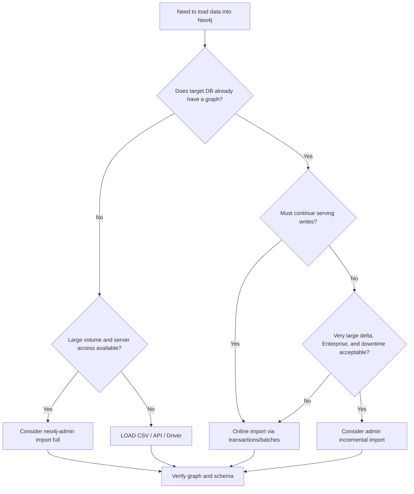

# Distinguishing Initial Import, Incremental Import, and Updates on a Running Database in Neo4j

## 1. Three data needs that look similar but operate differently

An application uses **Neo4j** to represent connected data as a *property graph*: each `AppUser` and `Project` is a node, `MEMBER_OF` relationships connect members to projects, and `userId`, `projectId`, `name`, and `role` are properties. Even when originating from CSV files or a single source system, bringing data into Neo4j falls into **three distinct scenarios**:

1. **Initial / full import:** building the graph for the first time from source data, typically into a database that does not yet exist or holds no data.
2. **Incremental import:** adding large batches of data into a database that already holds a graph; specifically, `neo4j-admin database import incremental` carries operational boundaries and version/edition restrictions.
3. **Updates on a running database (online/transactional updates):** the application continues reading and writing while new data is ingested, via Cypher, the Java Driver, Spring Data Neo4j, or an event sync pipeline.

**Crucial distinction:** "incremental" describes **the delta of data being added** relative to existing data, whereas "online" describes **the database's ability to keep serving queries during updates**. An incremental batch can be imported **offline** with an admin tool or **online** via transactions. The two terms are not synonymous.

### Quick decision matrix

| Approach | Target data | Can the DB serve continuous writes? | Typical tools | Guarantee scope |
| --- | --- | --- | --- | --- |
| High-speed initial import | New/empty database loading millions of nodes and relationships | Target DB is not serving the app yet; tool writes store directly | `neo4j-admin database import full` | Store creation and DB activation steps; not a normal Cypher transaction |
| High-volume incremental import | **Existing** database adding batched deltas; some versions support updates/deletes via suitable formats | **Not completely**: requires stopped DB stages, though read-only may be possible during `build` | `neo4j-admin database import incremental` (Enterprise) | `prepare/build/merge` stages; requires offline windows and backups |
| Online import/updates | Database actively serving users | Yes, though it consumes resources and incurs transaction contention | `LOAD CSV`, `UNWIND`, Java Driver, Spring Data Neo4j, connectors | Atomicity per transaction/batch; multiple batches commit independently |

Choose an approach based on **database state**, **volume**, **downtime SLA**, **edition/version**, and **change complexity**, not simply because the source data is CSV.

## 2. Designing identity before importing

Whichever approach you choose, the most important prerequisite for wiring the right nodes and avoiding duplicates is a **stable business key**.

Example logical schema:

```text
(:AppUser {userId: "u-101", name: "Lan"})
        |
        +--[:MEMBER_OF {role: "DEV"}]-->
                                      (:Project {
                                          projectId: "p-01",
                                          title: "Graph API"
                                      })
```

Here:

- `userId` identifies the user; `projectId` identifies the project, even across reloads.
- The relationship is **directed** from `AppUser` to `Project`, with type `MEMBER_OF`.
- Do not use `id(n)` or `elementId(n)` as long-term keys to correlate data across imports, environments, or databases.
- Define what "duplicate" means for relationships. If a user has at most one `MEMBER_OF` relationship to a project, use the endpoint-key pair and type; if multiple memberships are allowed, add a distinct event ID or identifying property.

For transactional updates, create uniqueness constraints before loading:

```cypher
CREATE CONSTRAINT app_user_user_id_unique IF NOT EXISTS
FOR (u:AppUser)
REQUIRE u.userId IS UNIQUE;

CREATE CONSTRAINT project_project_id_unique IF NOT EXISTS
FOR (p:Project)
REQUIRE p.projectId IS UNIQUE;
```

These constraints keep `MERGE` by business key efficient and protect identity under concurrent transactions. For **incremental admin import**, Neo4j requires uniqueness constraints matching the labels/properties used to identify nodes; missing required constraints can cause the import to be rejected. For **full admin import** into a new database, schema can be established after creating/starting the database, or using schema import options supported by your version.

Validate and clean source data before importing:

| Check item | Error example | How to handle |
| --- | --- | --- |
| Business key | Two rows with the same `userId = u-101` | Define whether duplicates are errors, updates, or merges; deduplicate per rules |
| Relationship endpoints | Membership pointing to a non-existent `projectId` | Decide whether to reject, create target entity, or route to a queue |
| Data types | `joinedAt` as text, `amount` non-numeric | Normalize formats and cast explicitly |
| Empty values | Blank `userId` or `projectId` | Filter/fix before `MERGE`, avoid null keys |
| Change ordering | Older update arrives after newer update | Use source version or timestamp to prevent backward overwrites |
| Retries | Batch submitted twice | Use idempotent keys, checkpoints, and result reconciliation |

## 3. Initial import: `neo4j-admin database import full`

### 3.1. Nature and operating conditions

`neo4j-admin database import full` is a **high-speed bulk import** tool that writes directly into Neo4j's store format rather than executing individual `CREATE` statements over Bolt transactions. It fits building a large graph from clean CSV/Parquet sources.

Operational points:

- The **target** database must not yet exist or must be in a state suited for full import; never use this command to "add a few rows" to a live graph.
- The DBMS may remain running to serve **other** databases, provided the target database obeys the offline/non-existent preconditions of the import workflow.
- Full import creates **store data files for the database**; when importing into a database name that does not yet exist, run `CREATE DATABASE` afterward to register/activate it (in editions supporting multiple databases).
- The `--overwrite-destination` flag can replace **all** existing target data. This is not an upsert; never use it as a default when you only want to append data.
- Syntax and flags depend on the Neo4j version; the tool runs on the server with store access and must match the target DBMS.

### 3.2. Preparing input CSVs with linking IDs

Suppose three files exist on the Neo4j server:

**`import/users.csv`**

```csv
userId:ID(AppUser),name
u-101,Lan
u-102,Minh
```

**`import/projects.csv`**

```csv
projectId:ID(Project),title
p-01,Graph API
p-02,Data Platform
```

**`import/memberships.csv`**

```csv
:START_ID(AppUser),:END_ID(Project),role
u-101,p-01,DEV
u-102,p-02,LEAD
```

In admin importer CSV syntax:

- `:ID(AppUser)` and `:ID(Project)` declare ID spaces to wire nodes accurately. `userId:ID(AppUser)` also stores `userId` as a property; likewise for `projectId`.
- `:START_ID(AppUser)` and `:END_ID(Project)` specify relationship endpoints, **not properties**.
- Node labels and relationship types can be passed via CLI flags such as `--nodes=AppUser=...` and `--relationships=MEMBER_OF=...`.
- This format is **different** from CSVs imported via `LOAD CSV`: headers like `:ID` are admin-importer conventions, not ordinary Cypher row keys.

### 3.3. Illustrative full import workflow

On a **test environment where database creation is permitted**, after confirming `training_graph` does not yet exist:

```bash
bin/neo4j-admin database import full \
  --nodes=AppUser=import/users.csv \
  --nodes=Project=import/projects.csv \
  --relationships=MEMBER_OF=import/memberships.csv \
  training_graph
```

Run the command above from the **OS terminal on the Neo4j host**, not as a Cypher query in Neo4j Browser. This example uses Unix/Linux syntax; adjust executable and CSV paths for your OS and installation layout.

Once the tool reports success, register the new database in the `system` database if your version/edition supports it:

```cypher
CREATE DATABASE training_graph;
```

Once `training_graph` is online, switch your client to that database and verify with Cypher:

```cypher
MATCH (u:AppUser)
RETURN count(u) AS users;

MATCH (p:Project)
RETURN count(p) AS projects;

MATCH (:AppUser)-[r:MEMBER_OF]->(:Project)
RETURN count(r) AS memberships;
```

With the three clean sample files, expect **2 users, 2 projects, 2 memberships**. Also verify a specific relationship pattern:

```cypher
MATCH (u:AppUser {userId: 'u-101'})-[r:MEMBER_OF]->
      (p:Project {projectId: 'p-01'})
RETURN u.name AS user, r.role AS role, p.title AS project;
```

If using Neo4j Community with database-naming restrictions or a managed cloud service, follow the **initialization workflow supported by that environment** rather than copying `CREATE DATABASE training_graph` verbatim. On Neo4j Aura, you cannot access the store directly with `neo4j-admin` as shown above.

### 3.4. When is full import unsuitable?

Do not use full import to handle an event like "rename user `u-101`" in a running graph. Applying full import to existing data typically requires operating on an offline target database and can **overwrite the whole database**; that is completely different from updating a property in a transaction.

Large initial loads can follow a **build new database → verify → cut over application traffic to the new database** pattern to reduce operational disruption, if infrastructure, edition, routing, and migrations permit. Switching does not automatically preserve new writes occurring on the old database: you need an explicit sync/cutover strategy.

## 4. Incremental import with the admin importer: additive, yet still has offline phases

### 4.1. Concept

`neo4j-admin database import incremental` targets an **existing database** and large batches of changes. It is a feature of **Neo4j Enterprise Edition**; verify server version and store format compatibility.

For example, after an initial full import, the system receives another 300,000 users and many memberships. Loading row by row via transactions may take too long; incremental admin import may be a better fit if a **database stop window**, administrative privileges, and backup requirements are acceptable.

Per current Neo4j documentation:

- It can add new nodes and new relationships connecting new or existing nodes.
- Starting in **Neo4j 2025.01**, certain property, label, node, or relationship updates/deletes via incremental import are supported **only with the `block` store format** and input-file action conventions. Do not assume every version or format supports updates/deletes.
- Matching **uniqueness constraints** must exist to resolve node keys.
- The `--force` confirmation flag is required per current guidance.
- Neo4j strongly recommends **backing up before running**, because a failure during the merge stage can corrupt the database.

### 4.2. Single command with `--stage=all`

Example supplemental file following the same ID rules:

**`import/users-delta.csv`**

```csv
userId:ID(AppUser),name
u-103,Hoa
```

Once `training_graph` exists with proper constraints, the conceptual workflow is:

1. Finalize delta scope and validate keys and relationship endpoint IDs.
2. Back up the database and verify restorability.
3. **Stop the target database** and wait until it is fully stopped.
4. Run the importer on the server against the delta source.
5. Restart the database and verify status and data.

In the `system` database:

```cypher
STOP DATABASE training_graph WAIT;
```

In the Neo4j terminal (verify exact flags and requirements against `--help` for your version):

```bash
bin/neo4j-admin database import incremental \
  --stage=all \
  --force \
  --nodes=AppUser=import/users-delta.csv \
  training_graph
```

After the import tool reports success, start the database:

```cypher
START DATABASE training_graph WAIT;
```

Verify `u-103` along with total node/relationship counts. The example leaves `u-101` and `u-102` untouched unless the input file contains valid update actions and the operational setup supports them.

**Never run this command sequence on a production database just to test syntax**: it stops the service, requires admin privileges, and demands a verified backup.

### 4.3. Three-stage import to shorten downtime

Neo4j supports splitting incremental import into three stages:

| Stage | Target DB state during execution | Purpose |
| --- | --- | --- |
| `prepare` | **Offline (stopped)** | Parse headers and prepare the increment |
| `build` | Can remain running in **READ ONLY** mode, or offline | Build, validate, and process increment data; typically the longest step |
| `merge` | **Offline (stopped)** | Merge the increment into the target DB and update related indexes/constraints |

Illustrative stage syntax:

```bash
bin/neo4j-admin database import incremental \
  --stage=prepare --force \
  --nodes=AppUser=import/users-delta.csv \
  training_graph
```

```bash
bin/neo4j-admin database import incremental \
  --stage=build --force \
  --nodes=AppUser=import/users-delta.csv \
  training_graph
```

```bash
bin/neo4j-admin database import incremental \
  --stage=merge --force \
  training_graph
```

These are **separate commands**, not run concurrently. Before each stage, satisfy the required database state: `prepare` and `merge` require the database to be stopped; during `build`, if the database continues serving queries, switch it to **read-only** per Neo4j procedures. Between stages, manage stop/start state and access permissions at the DBMS. After `merge` succeeds, start the database and restore access as designed.

**"Semi-online" does not mean continuous writes.** Reads can continue during `build`, but `prepare` and `merge` still require downtime. If your SLA **forbids stopping the database**, choose a transactional/streaming solution or an appropriate database switchover architecture.

### 4.4. Incremental import is not row-by-row `MERGE`

Admin incremental import operates in stages on store data and imposes specific schema/format prerequisites; it **does not share the features, API, or commit boundaries** of Cypher `MERGE` running on an online database.

In versions/formats that allow CSV update/delete actions, make sure you understand `:ACTION`, node/relationship identity rules, and version-specific limits from the official docs. Never use Cypher `MERGE` or Java logic as a stand-in explanation for the internal behavior of the admin import tool.

## 5. Online updates: `LOAD CSV` and Cypher transactions

When users are actively querying the graph and the application needs daily updates, **Cypher transactional import** is typically used. Inputs can come from CSVs, API payloads, the Java Driver, Spring Data Neo4j, or message broker connectors. The database remains online while each transaction applies changes to the existing graph and indexes.

### 5.1. `LOAD CSV` to insert or update by key

Example source `users-updates.csv`:

```csv
userId,name
u-101,Lan Anh
u-104,Phuong
```

On a self-managed Neo4j server, place the file in the configured import directory and execute:

```cypher
LOAD CSV WITH HEADERS FROM 'file:///users-updates.csv' AS row
WITH row
WHERE row.userId IS NOT NULL AND trim(row.userId) <> ''
MERGE (u:AppUser {userId: trim(row.userId)})
SET u.name = row.name;
```

Business outcome:

- If `u-101` already exists, `MERGE` matches that node and updates `name`.
- If `u-104` does not exist, a new node is created and `name` is assigned.
- With appropriate keys and logic, re-running does not spawn duplicate users. This is an **upsert**.

**Note:** `file:///...` URLs are read **from the Neo4j server side**, according to the configured import directory and permissions—not automatically from the local disk of the machine running Neo4j Browser. Neo4j Aura does not support local file URLs like this; use a suitable `HTTPS` source with appropriate download permissions. `LOAD CSV` reads CSV values as strings, so cast explicitly when importing numbers, dates, datetimes, or booleans.

### 5.2. Batching to avoid giant transactions

For large CSVs, split into many small transactions:

```cypher
LOAD CSV WITH HEADERS FROM 'file:///users-updates.csv' AS row
CALL (row) {
  WITH row
  WHERE row.userId IS NOT NULL AND trim(row.userId) <> ''
  MERGE (u:AppUser {userId: trim(row.userId)})
  SET u.name = row.name
} IN TRANSACTIONS OF 1000 ROWS;
```

The `CALL (row) { ... }` form is the subquery variable-import syntax in newer Cypher releases; older Neo4j 5 versions use `CALL { WITH row ... }`. Always verify against your version. A batch size of `1000` is merely a starting point for experimentation, not a universal optimum for every graph.

Crucial points:

- `CALL { ... } IN TRANSACTIONS` **must run in a client implicit transaction** (for example via `session.run(...).consume()` in the Java Driver)—**never place it** inside `executeWrite(...)` or `beginTransaction()`.
- **Each batch commits independently.** If batch 4 fails, the first three batches may already be committed. You cannot roll back the entire file as one single transaction.
- You still need source IDs, uniqueness constraints, a checkpointing mechanism, error logs, and safe reruns.
- `MERGE` on the node key prevents duplicate **nodes**; relationships or event creation still need their own idempotency rules.

For small datasets requiring **all-or-nothing** guarantees, use a single Cypher transaction instead of batching. For large datasets, accept and explicitly design batch boundaries, or pick a staging/cutover strategy.

### 5.3. Creating relationships after ensuring nodes exist

With an input CSV containing `userId,projectId,role`:

```cypher
LOAD CSV WITH HEADERS FROM 'file:///memberships-updates.csv' AS row
CALL (row) {
  MATCH (u:AppUser {userId: row.userId})
  MATCH (p:Project {projectId: row.projectId})
  MERGE (u)-[r:MEMBER_OF]->(p)
  SET r.role = row.role
} IN TRANSACTIONS OF 1000 ROWS;
```

A `MATCH` that cannot find an endpoint **creates no relationship and may raise no error**. Reconcile total source rows, expected relationship counts, and unresolved IDs. If policy requires rejecting orphan relationships, add a pre-check or route errors to a staging table/import report before running the update.

In models where one user can hold multiple memberships between the same two endpoints, `MERGE (u)-[:MEMBER_OF]->(p)` cannot represent event identity. Model a dedicated relationship/entry ID or intermediate node to avoid merging distinct records incorrectly.

## 6. Online updates via Java Driver and Spring Data Neo4j

### 6.1. Java Driver: sending parameterized batches

When data arrives from APIs or event streams, a Java application typically sends record groups via `UNWIND $rows`. Example receiving a small normalized batch:

```java
import java.util.List;
import java.util.Map;
import org.neo4j.driver.AuthTokens;
import org.neo4j.driver.Driver;
import org.neo4j.driver.GraphDatabase;
import org.neo4j.driver.Session;
import org.neo4j.driver.SessionConfig;

public class OnlineUserImport {
    public static void main(String[] args) {
        List<Map<String, Object>> batch = List.of(
            Map.of("userId", "u-101", "name", "Lan Anh"),
            Map.of("userId", "u-104", "name", "Phuong")
        );

        try (
            Driver driver = GraphDatabase.driver(
                "neo4j://localhost:7687",
                AuthTokens.basic("neo4j", "change-me")
            );
            Session session = driver.session(
                SessionConfig.forDatabase("neo4j")
            )
        ) {
            session.executeWrite(tx -> {
                tx.run("""
                    UNWIND $rows AS row
                    MERGE (u:AppUser {userId: row.userId})
                    SET u.name = row.name
                    """, Map.of("rows", batch)
                ).consume();
                return null;
            });
        }
    }
}
```

Meaning:

- `UNWIND` turns a parameter list into rows for processing without building concatenated Cypher per user.
- `executeWrite(...)` places **the current batch in a single managed transaction**; it commits only if successful. Subsequent batches run as separate transactions.
- A managed transaction callback may be retried by the Driver on transient errors, so logic inside must be **idempotent**—never send emails, trigger payments, or perform side effects outside Neo4j.
- In production applications, batch from the source stream according to size and throughput limits, validate nulls/types before writing, configure secrets and timeouts properly, and never load millions of rows into RAM at once.

When source version ordering is needed, run `SET` only when the incoming record carries a newer version. Example for an **existing** node:

```cypher
MATCH (u:AppUser {userId: $userId})
WHERE u.sourceVersion IS NULL
   OR u.sourceVersion < $incomingVersion
SET u.name = $incomingName,
    u.sourceVersion = $incomingVersion
RETURN count(u) AS updated;
```

A result of 0 can mean either no matching user or an older/equal version already processed; distinguish these per business requirements. For upsert events that also create nodes, design the initial-creation branch with version initialization and the update branch consistently to avoid overwriting newer data with late-arriving events.

### 6.2. Spring Data Neo4j

In a Spring Boot application, you can place `@Transactional` on a service to persist a group of entities/relationships using a repository or `Neo4jClient`:

```java
import org.springframework.stereotype.Service;
import org.springframework.transaction.annotation.Transactional;

@Service
public class UserSyncService {
    private final UserRepository userRepository;

    public UserSyncService(UserRepository userRepository) {
        this.userRepository = userRepository;
    }

    @Transactional
    public void saveBatch(Iterable<AppUser> users) {
        userRepository.saveAll(users);
    }
}
```

This snippet assumes the project already defines the `AppUser` entity and corresponding `UserRepository`. Each call through the Spring proxy runs in its own transaction per configuration; saving many entities in one large transaction does not automatically guarantee good performance.

Specifically in Spring Data Neo4j, `saveAll` depends on **entity mapping**, entity state, IDs, and Spring versioning; it is not strictly equivalent to Cypher `MERGE` on a business key. Verify `@Id`/`@Version` mappings, cascading relationships, and create/update semantics. For very large bulk loads, executing batched Cypher `UNWIND` via `Neo4jClient` or the Java Driver generally provides clearer control.

## 7. Choosing an approach in a real system

### 7.1. Decision tree



Practical rules:

- **Full import** for large initial graph creation when you can provision a dedicated target database and have server access.
- **Admin incremental import** for large deltas on an existing database when Enterprise/store format/feature scope, uniqueness constraints, and downtime/read-only windows fit.
- **Online transactional updates** for continuously arriving data when the system cannot stop, when upserts are needed, or when business rules must run transactionally.
- **Zero-downtime replacement of a large graph** may require building a fresh database and cutting over traffic while syncing interim deltas; that is a system-deployment architecture problem, not solved automatically by a single import command.

### 7.2. Comparison of commonly confused characteristics

| Characteristic | Admin full | Admin incremental | Transactional online |
| --- | --- | --- | --- |
| Starting from a non-existent database | **Strongest** for initial import | No; requires an existing database | Can import into a running empty database |
| Adding data to an existing graph | Not as an upsert; has full-overwrite option | Yes, within version/store limits | Yes |
| Frequent property updates | Unsuitable | Only certain versions/stores/actions; involves offline steps | Well suited via `SET`/`MERGE` |
| Target DB continuously accepting writes during import | No | Not guaranteed; prepare/merge offline, build may be read-only | Yes, though load and transactions must be managed |
| Schema/uniqueness management | Verify after DB creation or use supported importer flags | Requires constraints to identify nodes | Should create constraints before `MERGE` |
| Single rollback of the entire import | Not a Cypher transaction | Not a single Cypher transaction | Can roll back **individual transactions**, not committed batches |
| Dirty source data | Clean beforehand or inspect importer report | Validate carefully; back up before merge | Can validate, quarantine per batch, and log |
| Available on Aura as a server command | No | No | Use Cypher/APIs/connectors supported by Aura |

## 8. Common risks, reruns, and reconciliation

### 8.1. Do not treat a total count as sole proof

After an import run, a result like `count(n) = 500000` does not prove every node has the right labels/properties or that relationships point in the right direction. Verify in layers:

1. **Source:** valid row count, unique keys, rejected rows, delta version/cutoff.
2. **Nodes:** check each label, business keys, and representative property values.
3. **Relationships:** verify types, directions, edge counts, and valid endpoints—especially many-to-many links.
4. **Schema and plans:** confirm uniqueness constraints exist/remain valid and indexes are `ONLINE` if the app depends on them.
5. **Operations:** database `ONLINE`, application reads/writes healthy, latency and memory within bounds.

Sample verification queries:

```cypher
MATCH (u:AppUser)
RETURN count(u) AS users;

MATCH (p:Project)
RETURN count(p) AS projects;

MATCH (:AppUser)-[r:MEMBER_OF]->(:Project)
RETURN count(r) AS memberships;

MATCH (u:AppUser {userId: 'u-101'})-[r:MEMBER_OF]->
      (p:Project {projectId: 'p-01'})
RETURN u.userId AS userId, r.role AS role, p.projectId AS projectId;
```

If you need to check for duplicate keys in a test graph lacking constraints:

```cypher
MATCH (u:AppUser)
WITH u.userId AS userId, count(*) AS copies
WHERE userId IS NOT NULL AND copies > 1
RETURN userId, copies
ORDER BY copies DESC
LIMIT 20;
```

In a real database with valid uniqueness constraints, duplicates for the same label/key are blocked, yet you must still inspect source error logs and differences between expected IDs and persisted IDs.

### 8.2. Batches, retries, and watermarks

An online pipeline may process multiple batches:

```text
Source snapshot + events
       |
       v
Validate / normalize / deduplicate
       |
       v
Batch n  --> commit n --> checkpoint/watermark n
       |
       v
Batch n+1 --> commit n+1 --> checkpoint/watermark n+1
       |
       v
Reconcile IDs, versions, relationships
```

Confirm a checkpoint only after **its corresponding transaction has committed**. If a batch commits and the worker crashes before recording the checkpoint, a rerun may reprocess that batch: idempotent keys and versions prevent duplicate creation or backward overwrites.

For delete events, explicitly define "hard delete" vs. "mark inactive", how related relationships are handled, and event ordering. Never run `DETACH DELETE` simply because a partial sync omitted a node.

### 8.3. Do not confuse "import" with "CDC"

Change Data Capture (CDC) can synchronize changes across systems, but **store updates performed by `neo4j-admin database import` are not recorded by Neo4j CDC like ordinary write transactions**. If your architecture relies on CDC to replay changes, implement an explicit snapshot/baseline and cutover strategy. Updates via Cypher/Driver do flow through transactions, though you must still verify CDC edition/version support and configuration.

## 9. Scenario exercises

Considering the same graph system managing users and projects, choose an approach and explain:

1. **Day-one launch:** 80 million users, 5 million projects, 300 million relationships; target database does not exist yet and server access is available. Which approach should you evaluate first, and how do you prepare data and keys?
2. **Nightly addition of 20 million relationships:** database already exists and the business accepts a maintenance window. When would you consider incremental admin import, and what backups, constraints, and stages are required?
3. **Business hours with hundreds of changes per second:** the application must keep serving writes. Why is `neo4j-admin incremental` unsuitable for continuous online requirements? How do you design `UNWIND`/Driver batch transactions?
4. **User rename:** an edit message for `u-101` arrives twice due to a retry. How do you avoid creating a duplicate? If an older message arrives after a newer one, what condition should you add?
5. **Batch 6 fails:** five prior `CALL { ... } IN TRANSACTIONS` batches already committed. Can you roll back the whole file? How do you structure checkpoints and reruns?
6. **Import finishes but 2% of relationships are missing:** node counts match. What hypotheses should you check across relationship endpoints, ID spaces, source data, and error reports?

**Completion criteria:** clearly distinguish *initial* (target initialization), *incremental* (delta load), and *online* (continuous write service); never confuse admin incremental import with `MERGE`; pick the right tool by edition, downtime, and volume; design appropriate keys, transactions, retries, backups, and reconciliation.

## Official references

- [Neo4j Operations Manual — Import](https://neo4j.com/docs/operations-manual/current/import/): overview of import tools, formats, and use cases.
- [Neo4j Operations Manual — Full import](https://neo4j.com/docs/operations-manual/current/import/full-import/): syntax, options, and conditions for full import.
- [Neo4j Operations Manual — Full data import tutorial](https://neo4j.com/docs/operations-manual/current/tutorial/neo4j-admin-import/): CSV `:ID`/`:START_ID`/`:END_ID` format, import, and database activation.
- [Neo4j Operations Manual — Incremental import](https://neo4j.com/docs/operations-manual/current/import/incremental-import/): Enterprise Edition, `--force`, stages, uniqueness constraints, version/store updates, and downtime requirements.
- [Neo4j Cypher Manual — LOAD CSV](https://neo4j.com/docs/cypher-manual/current/clauses/load-csv/): importing CSV into a running database, type casting, and subquery batching.
- [Neo4j Cypher Manual — CALL subqueries in transactions](https://neo4j.com/docs/cypher-manual/current/subqueries/subqueries-in-transactions/): batched commits and rollback limits.
- [Neo4j Java Driver Manual — Transactions](https://neo4j.com/docs/java-manual/current/transactions/): `session.run`, managed transactions, and retry callbacks.
