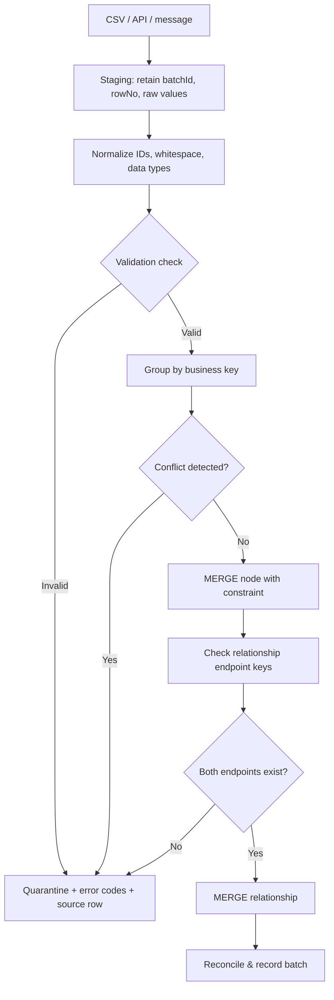

# Normalizing Duplicate Data, Invalid Records, and Missing-Endpoint Relationships When Importing into Neo4j

## 1. The problem: a valid file does not guarantee a valid graph

Neo4j stores data as a **property graph**: nodes represent entities, relationships connect entities, and properties hold attribute values. When importing data from CSVs, APIs, or external systems, source data often fails to satisfy the target graph's rules immediately:

- Two rows share the same user code but differ in letter casing or whitespace.
- The same identifier appears multiple times with identical content, or **conflicting** content.
- Empty identifiers, non-numeric age values, or invalid dates.
- A relationship row points to a person or team that has not been imported yet, does not exist in the source, or was rejected for bad data.
- Re-running the same import batch creates duplicate nodes or relationships.

Within the **Data Import** chapter of the `DATABASE_ENGINE_GRAPH_NEO4J` module, this lesson covers the cleaning and reconciliation workflow before writing to the graph. Techniques include Cypher expressions, `UNWIND`, `LOAD CSV`, `MERGE`, `OPTIONAL MATCH`, **indexes/constraints**, along with how imports run via the **Neo4j Java Driver** or **Spring Data Neo4j**.

### Objectives

After this lesson, you will be able to:

1. Distinguish **duplicate rows**, **duplicate entities**, and **duplicate keys with conflicting attributes**.
2. Establish identifier normalization and type validation rules before `MERGE`.
3. Route invalid data to **quarantine** (records needing remediation) instead of silently dropping it.
4. Detect missing endpoints and decide whether to wait for backfill, reject, or create placeholder nodes per business rules.
5. Write a **rerunnable** import pipeline, verify counts after each step, and manage batched imports.

> **Important note:** In Neo4j, a valid relationship **always connects two existing nodes**. "Missing-endpoint relationships" in this lesson refers to **source relationship rows** whose reference keys do not match a target node; they are not dangling relationships inside the graph.

## 2. Classifying errors before designing handling logic

| Issue group | Example | Risk if loaded directly | How to handle |
| --- | --- | --- | --- |
| Identical duplicate records | Two rows `p001, An, 29` | Redundant processing; may create duplicate relationships | Normalize, then collapse by key |
| Duplicate key with differing data | Same `P003` with names "Dung" and "Dung Nguyen" | Later row silently overwrites earlier row | Flag **CONFLICT**, require resolution rules |
| Differing key formatting | ` p001 `, `P001`, `p001` | Creates multiple nodes for one entity | Normalize identifiers before matching |
| Missing required key | Empty `personId` | `MERGE` with `null` key fails, or creates unidentified node | Flag **MISSING_ID**; do not load |
| Wrong type / domain range | `age = "abc"`, `age = -3` | Type-conversion error or nonsensical data | Flag **BAD_AGE** |
| Relationship missing source | `P999 -> T01` | Person node not found | Flag **MISSING_PERSON** |
| Relationship missing target | `P004 -> T99` | Team node not found | Flag **MISSING_TEAM** |
| Repeated relationship | Two rows `P001 -> T01` | May create multiple edges with the same meaning | Define relationship key rule and deduplicate |
| Relationship conflict | Same person–team pair with different roles | Ambiguous state | Flag conflict; do not pick arbitrarily |

**Identifying keys and duplicate criteria must be decided by the business domain.** Two people with the same name are not necessarily the same person; two orders with identical amounts can still be two distinct transactions. Never put every attribute into `MERGE` for "automatic deduplication."

## 3. Safe data import architecture

The practical flow below separates raw source rows from official business nodes and relationships:



Steps to keep distinct:

- **Staging** preserves raw values and source line numbers so errors can be explained or retried without losing auditability.
- **Normalization** computes normalized keys for matching without destroying raw keys.
- **Validation** checks mandatory rules; only valid rows advance.
- **Deduplication/conflict detection** runs **before** updating official properties.
- **Endpoint resolution** runs only after endpoint nodes have been successfully imported.
- **Reconciliation** compares total input rows, accepted rows, rejected rows, and actually created entities/edges.

Not every system needs to store staging as Neo4j nodes: an ETL service or message queue can hold raw data. This lesson uses staging nodes so the entire workflow can be practiced in Cypher.

## 4. Sample dataset: people, teams, and memberships

Suppose an application manages members joining specialty teams:

```text
(:ImportPerson {personId, fullName, age})
       |
       +--[:MEMBER_OF {membershipKey, role}]-->
                       (:ImportTeam {teamId, teamName})
```

We receive three source datasets. `rowNo` is the line number within each source; all belong to `batchId = 'neo4j-import-demo-01'`.

### 4.1. Person source

| rowNo | raw person_id | raw full_name | raw age | Issue |
| ---: | --- | --- | --- | --- |
| 1 | `" p001 "` | `"An"` | `"29"` | Valid after trim/uppercase ID |
| 2 | `"P001"` | `"An"` | `"29"` | Duplicate entity/data with row 1 |
| 3 | `"P002"` | `"Binh"` | `"abc"` | Invalid age type |
| 4 | `""` | `"Chi"` | `"25"` | Missing identifier |
| 5 | `"P003"` | `"Dung"` | `"31"` | Conflicts with row 7 |
| 6 | `"P004"` | `"Em"` | `"28"` | Valid |
| 7 | `"p003 "` | `"Dung Nguyen"` | `"31"` | Same key as row 5, different name |

### 4.2. Team source

| rowNo | raw team_id | raw team_name | Issue |
| ---: | --- | --- | --- |
| 1 | `" t01 "` | `"Graph"` | Valid |
| 2 | `"T01"` | `"Graph"` | Duplicates row 1 after normalization |
| 3 | `"T02"` | `"Data"` | Valid |

### 4.3. Membership source

| rowNo | person_id | team_id | role | Issue |
| ---: | --- | --- | --- | --- |
| 1 | `p001` | `t01` | `member` | Valid |
| 2 | `P001` | `T01` | `MEMBER` | Duplicates row 1 relationship |
| 3 | `P003` | `T02` | `MEMBER` | Person P003 is quarantined due to conflict |
| 4 | `P004` | `T99` | `MEMBER` | Target T99 does not exist |
| 5 | `P004` | `T02` | `UNKNOWN` | Role outside allowed set |
| 6 | `P004` | `T02` | `LEAD` | Valid |

**Lesson policy:** Person and team IDs consist solely of Latin letters/digits, are case-insensitive, and leading/trailing spaces are insignificant; personal names only strip extra outer spaces. Valid roles are `MEMBER` and `LEAD`. If normalized attributes conflict for the same key, **never automatically pick the last row**.

## 5. Creating staging and loading raw data rerunnably

First create constraints for target keys. Uniqueness constraints protect data under concurrent imports and provide indexes for key lookups:

```cypher
CREATE CONSTRAINT import_person_id_unique IF NOT EXISTS
FOR (p:ImportPerson)
REQUIRE p.personId IS UNIQUE;

CREATE CONSTRAINT import_team_id_unique IF NOT EXISTS
FOR (t:ImportTeam)
REQUIRE t.teamId IS UNIQUE;
```

On Neo4j 5.x supporting uniqueness constraints on **relationship properties**, you can constrain a stable relationship key:

```cypher
CREATE CONSTRAINT import_membership_key_unique IF NOT EXISTS
FOR ()-[m:MEMBER_OF]-()
REQUIRE m.membershipKey IS UNIQUE;
```

A membership has the business key `personId + '|' + teamId` if each person has at most **one active membership** with a team. That condition does **not** hold for historical models with multiple join/leave episodes; in that case, use a dedicated event key (such as source + participation ID) and a proper historical model.

### 5.1. Staging people

```cypher
UNWIND [
  {rowNo: 1, id: ' p001 ', name: 'An', age: '29'},
  {rowNo: 2, id: 'P001', name: 'An', age: '29'},
  {rowNo: 3, id: 'P002', name: 'Binh', age: 'abc'},
  {rowNo: 4, id: '', name: 'Chi', age: '25'},
  {rowNo: 5, id: 'P003', name: 'Dung', age: '31'},
  {rowNo: 6, id: 'P004', name: 'Em', age: '28'},
  {rowNo: 7, id: 'p003 ', name: 'Dung Nguyen', age: '31'}
] AS raw
MERGE (r:ImportPersonRow {
  batchId: 'neo4j-import-demo-01',
  rowNo: raw.rowNo
})
SET r.personIdRaw = raw.id,
    r.nameRaw = raw.name,
    r.ageRaw = raw.age;
```

### 5.2. Staging teams

```cypher
UNWIND [
  {rowNo: 1, id: ' t01 ', name: 'Graph'},
  {rowNo: 2, id: 'T01', name: 'Graph'},
  {rowNo: 3, id: 'T02', name: 'Data'}
] AS raw
MERGE (r:ImportTeamRow {
  batchId: 'neo4j-import-demo-01',
  rowNo: raw.rowNo
})
SET r.teamIdRaw = raw.id,
    r.nameRaw = raw.name;
```

### 5.3. Staging relationships

```cypher
UNWIND [
  {rowNo: 1, person: 'p001', team: 't01', role: 'member'},
  {rowNo: 2, person: 'P001', team: 'T01', role: 'MEMBER'},
  {rowNo: 3, person: 'P003', team: 'T02', role: 'MEMBER'},
  {rowNo: 4, person: 'P004', team: 'T99', role: 'MEMBER'},
  {rowNo: 5, person: 'P004', team: 'T02', role: 'UNKNOWN'},
  {rowNo: 6, person: 'P004', team: 'T02', role: 'LEAD'}
] AS raw
MERGE (r:ImportMembershipRow {
  batchId: 'neo4j-import-demo-01',
  rowNo: raw.rowNo
})
SET r.personIdRaw = raw.person,
    r.teamIdRaw = raw.team,
    r.roleRaw = raw.role;
```

In environments where multiple jobs write to staging, add a composite constraint on `(batchId, rowNo)` **for each staging label** or use a stable unique source key. `MERGE` does not replace uniqueness constraints when concurrent writers exist.

## 6. Normalizing and identifying bad data before `MERGE`

### 6.1. Normalizing keys and types

For IDs, for example use:

```cypher
MATCH (r:ImportPersonRow {batchId: 'neo4j-import-demo-01'})
RETURN r.rowNo AS dong,
       r.personIdRaw AS idGoc,
       toUpper(trim(coalesce(r.personIdRaw, ''))) AS idChuan,
       trim(coalesce(r.nameRaw, '')) AS tenChuan,
       toIntegerOrNull(trim(coalesce(r.ageRaw, ''))) AS tuoiChuyenDoi
ORDER BY dong;
```

Here:

- `coalesce(x, '')` handles missing values when computing check keys.
- `trim()` strips whitespace from both ends.
- `toUpper()` is **the identifier normalization rule under this example's data contract**, not a universal rule for all business codes.
- `toIntegerOrNull()` returns `null` when a string does not parse as an integer, **detecting errors** without failing the entire query over `"abc"`.

Do not uppercase personal names, do not automatically strip Vietnamese diacritics, and do not collapse similar-looking strings into one person. If real IDs are **case-sensitive**, do not apply `toUpper()` to IDs either.

### 6.2. Classifying invalid rows

```cypher
MATCH (r:ImportPersonRow {batchId: 'neo4j-import-demo-01'})
WITH r,
     toUpper(trim(coalesce(r.personIdRaw, ''))) AS personId,
     trim(coalesce(r.nameRaw, '')) AS fullName,
     toIntegerOrNull(trim(coalesce(r.ageRaw, ''))) AS age
RETURN r.rowNo AS dong,
       personId,
       fullName,
       age,
       CASE
         WHEN personId = '' THEN 'MISSING_ID'
         WHEN fullName = '' THEN 'MISSING_NAME'
         WHEN age IS NULL OR age < 0 OR age > 120 THEN 'BAD_AGE'
         ELSE 'VALID'
       END AS validationStatus
ORDER BY dong;
```

Expected: row 3 `BAD_AGE`, row 4 `MISSING_ID`; other rows `VALID` at the **per-row validation** step. Rows 5 and 7 are not flagged here because conflicts surface only when **grouping by normalized key**.

Why errors must be filtered before writing:

```cypher
// Do not run with empty/null id data:
// MERGE (p:ImportPerson {personId: null})
```

`MERGE` on a `null` property can error; an empty string `''`, though not `null`, must also never be treated as a valid identifier. Moreover, setting a property to `null` in Neo4j removes that property, so `null` cannot serve as a marker for "wrote a valid empty value" on a node.

### 6.3. Validating dates and tricky values

For temporal fields, `date('2026-02-30')` can throw an error instead of returning `null`. Regex checks verify only **format**, not calendar validity:

```cypher
WITH '2026-02-30' AS rawDate
RETURN rawDate =~ '^[0-9]{4}-[0-9]{2}-[0-9]{2}$'
       AS dungDinhDang;
```

The format check returns `true`, yet February 30 does not exist. For untrusted source rows, parse dates with exception handling in **ETL/Java** or a dedicated validation pass before calling `date()` inside a graph write query. Also check validity, timezones, currency units, character encoding, and business value ranges.

## 7. Distinguishing duplicate rows from key conflicts

### 7.1. Why `DISTINCT` across raw rows is not enough

Two rows with `' p001 '` and `'P001'` are not identical in raw form. Thus `DISTINCT r.personIdRaw` still treats them as two distinct values. To detect **duplicate entities**, normalize first and then group by the **normalized key**.

Another common pitfall:

```cypher
// Prone to "last write wins" depending on execution order:
MATCH (r:ImportPersonRow {batchId: 'neo4j-import-demo-01'})
WITH toUpper(trim(r.personIdRaw)) AS id,
     trim(r.nameRaw) AS name
WHERE id <> ''
MERGE (p:ImportPerson {personId: id})
SET p.fullName = name;
```

The snippet above **is shown solely as a design anti-pattern**: it skips age validation and can silently write `fullName` from a conflicting row. Never use it as a production import flow.

### 7.2. Grouping by ID and counting attribute variants

```cypher
MATCH (r:ImportPersonRow {batchId: 'neo4j-import-demo-01'})
WITH r,
     toUpper(trim(coalesce(r.personIdRaw, ''))) AS personId,
     trim(coalesce(r.nameRaw, '')) AS fullName,
     toIntegerOrNull(trim(coalesce(r.ageRaw, ''))) AS age
WHERE personId <> ''
  AND fullName <> ''
  AND age IS NOT NULL AND age >= 0 AND age <= 120
WITH personId,
     count(*) AS soDongNguon,
     collect(r.rowNo) AS cacDongNguon,
     collect(DISTINCT {fullName: fullName, age: age}) AS variants
RETURN personId,
       soDongNguon,
       cacDongNguon,
       size(variants) AS soBienThe,
       CASE
         WHEN size(variants) = 1 AND soDongNguon > 1 THEN 'DUPLICATE_IDENTICAL'
         WHEN size(variants) > 1 THEN 'CONFLICT'
         ELSE 'UNIQUE'
       END AS classification
ORDER BY personId;
```

Notable results:

| personId | Valid rows | Data variants | Classification |
| --- | ---: | ---: | --- |
| `P001` | 2 | 1 | `DUPLICATE_IDENTICAL` |
| `P003` | 2 | 2 | `CONFLICT` |
| `P004` | 1 | 1 | `UNIQUE` |

`P002` is excluded at the age check, and the row without an ID is not grouped into an entity. Case `P003` requires a decision via authoritative source, effective timestamp, source priority, or manual review; **never blindly pick the later record just because it came last**.

### 7.3. Common conflict resolution policies

| Policy | When appropriate | What to control |
| --- | --- | --- |
| **Reject/quarantine** the entire conflicting key group | No clear source priority; critical data | Log ID, rowNo, conflicting values, and reason |
| Authoritative source (*source of truth*) | One designated system holds canonical data | Documented precedence rules, data version |
| Latest record by trusted `updatedAt` | Source-supplied timestamps exist | Ties, clock skew, and backdated edits |
| Field-level merge | Different sources own different fields | Explicit rules per property without data loss |
| Manual review | Duplicate entities might not be the same person | Audit trail of decision and approver |

Every choice must be **deterministic on rerun**, independent of arbitrary `UNWIND`, `MATCH`, or concurrent load ordering.

## 8. Writing only valid, conflict-free nodes

### 8.1. Importing people by normalized key

```cypher
MATCH (r:ImportPersonRow {batchId: 'neo4j-import-demo-01'})
WITH r,
     toUpper(trim(coalesce(r.personIdRaw, ''))) AS personId,
     trim(coalesce(r.nameRaw, '')) AS fullName,
     toIntegerOrNull(trim(coalesce(r.ageRaw, ''))) AS age
WHERE personId <> ''
  AND fullName <> ''
  AND age IS NOT NULL AND age >= 0 AND age <= 120
WITH personId,
     collect(DISTINCT {fullName: fullName, age: age}) AS variants
WHERE size(variants) = 1
WITH personId, variants[0] AS value
MERGE (p:ImportPerson {personId: personId})
SET p.fullName = value.fullName,
    p.age = value.age
RETURN count(p) AS soPersonDaXuLy;
```

Result on an empty target graph after the first pass: **2 people**, `P001` and `P004`. Identical duplicates create only one node; `P003` has multiple variants so it is not written; `P002` with bad age and the missing-ID row are not written either.

In production, `SET` on reruns or newer batches can update properties of existing nodes. If **overwrites from the current source are disallowed**, use `ON CREATE SET` or compare against **already persisted data** before updating. Being conflict-free **within a batch** does not automatically guarantee no conflict **with prior batches**.

### 8.2. Importing teams by normalized key

```cypher
MATCH (r:ImportTeamRow {batchId: 'neo4j-import-demo-01'})
WITH toUpper(trim(coalesce(r.teamIdRaw, ''))) AS teamId,
     trim(coalesce(r.nameRaw, '')) AS teamName
WHERE teamId <> '' AND teamName <> ''
WITH teamId, collect(DISTINCT teamName) AS names
WHERE size(names) = 1
MERGE (t:ImportTeam {teamId: teamId})
SET t.teamName = names[0]
RETURN count(t) AS soTeamDaXuLy;
```

Expected result: **2 teams**, `T01` and `T02`. Both source rows `t01`/`T01` converge to one node after normalization.

### 8.3. Why you should not `MERGE` on every property

Wrong intent in many problems:

```cypher
// A changed name can prevent MERGE from matching the existing node:
MERGE (p:ImportPerson {personId: 'P001', fullName: 'An New'});
```

If `P001` already exists with `fullName = 'An'`, the full property pattern above fails to match. With a uniqueness constraint on `personId`, the statement may **fail with a constraint violation**; without a constraint, it may spawn a second node. The right pattern with a stable business key is:

```cypher
MERGE (p:ImportPerson {personId: 'P001'})
SET p.fullName = 'An New';
```

Of course, **update the name only when confirmed by source policy**. Valid syntax alone does not prove an overwrite decision is right for the domain.

## 9. Verifying both endpoints before creating relationships

### 9.1. Detecting orphan rows with `OPTIONAL MATCH`

Only after nodes are normalized and imported should source relationships be checked:

```cypher
MATCH (r:ImportMembershipRow {batchId: 'neo4j-import-demo-01'})
WITH r,
     toUpper(trim(coalesce(r.personIdRaw, ''))) AS personId,
     toUpper(trim(coalesce(r.teamIdRaw, ''))) AS teamId,
     toUpper(trim(coalesce(r.roleRaw, ''))) AS role
OPTIONAL MATCH (p:ImportPerson {personId: personId})
OPTIONAL MATCH (t:ImportTeam {teamId: teamId})
RETURN r.rowNo AS dong,
       personId, teamId, role,
       CASE
         WHEN personId = '' THEN 'MISSING_PERSON_ID'
         WHEN teamId = '' THEN 'MISSING_TEAM_ID'
         WHEN role NOT IN ['MEMBER', 'LEAD'] THEN 'BAD_ROLE'
         WHEN p IS NULL AND t IS NULL THEN 'MISSING_BOTH_ENDPOINTS'
         WHEN p IS NULL THEN 'MISSING_PERSON'
         WHEN t IS NULL THEN 'MISSING_TEAM'
         ELSE 'READY'
       END AS validationStatus
ORDER BY dong;
```

Expected outcomes:

| rowNo | Status | Reason |
| ---: | --- | --- |
| 1, 2 | `READY` | Both endpoints exist, valid role |
| 3 | `MISSING_PERSON` | `P003` was not imported due to conflict |
| 4 | `MISSING_TEAM` | No `T99` exists |
| 5 | `BAD_ROLE` | `UNKNOWN` is invalid |
| 6 | `READY` | `P004` and `T02` exist, role `LEAD` |

**The branch order in `CASE` defines error precedence.** A single row can have both a bad role and a missing endpoint; in detailed reports, retain **all error codes** rather than only the first one so operators know everything that needs fixing.

### 9.2. Why direct `MATCH` can silently lose errors

```cypher
MATCH (r:ImportMembershipRow {batchId: 'neo4j-import-demo-01'})
WITH r,
     toUpper(trim(r.personIdRaw)) AS personId,
     toUpper(trim(r.teamIdRaw)) AS teamId
MATCH (p:ImportPerson {personId: personId})
MATCH (t:ImportTeam {teamId: teamId})
RETURN r.rowNo, p.personId, t.teamId;
```

If either endpoint is missing, `MATCH` fails to match and **the source row disappears from the result set**. That is not an error visible in the returned rows; without reconciliation, missing links are silently dropped.

During the **bad-data inventory** step, use `OPTIONAL MATCH` to keep source rows and check `p IS NULL`, `t IS NULL`. During the **post-validation write** step, use `MATCH` to enforce that both endpoints exist.

### 9.3. Three policies for missing endpoints

| Option | Use when | Risk |
| --- | --- | --- |
| **Quarantine + retry** after source fix | Relationships are only valid when both endpoints have canonical records | Requires reconciliation and backfill workflow |
| **Hold pending** by raw key in staging | Missing endpoint will arrive in another batch or messages arrive out of order | Needs TTL, retry limits, and alerts |
| **Create placeholder node** flagged unverified | Business allows temporary stub entities | Requires distinguishing, verifying, and merging placeholders later |

Never do this automatically:

```cypher
// DANGEROUS when source is bad: auto-creating unverified person/team nodes
// MERGE (:ImportPerson {personId: 'P999'})
// MERGE (:ImportTeam {teamId: 'T99'})
```

Creating placeholders can mask source errors and cause business queries to treat incomplete nodes as real people or teams. Only do this if the model explicitly designs `isPlaceholder`/`verificationStatus`, access rules, and a backfill workflow.

## 10. Deduplicating relationship rows and writing edges rerunnably

In the practice model, **a person has at most one active membership with a team**. Before `MERGE`, group relationship rows by the normalized ID pair and validate the role.

```cypher
MATCH (r:ImportMembershipRow {batchId: 'neo4j-import-demo-01'})
WITH toUpper(trim(coalesce(r.personIdRaw, ''))) AS personId,
     toUpper(trim(coalesce(r.teamIdRaw, ''))) AS teamId,
     toUpper(trim(coalesce(r.roleRaw, ''))) AS role
WHERE personId <> ''
  AND teamId <> ''
  AND role IN ['MEMBER', 'LEAD']
WITH personId, teamId, collect(DISTINCT role) AS roles
WHERE size(roles) = 1
MATCH (p:ImportPerson {personId: personId})
MATCH (t:ImportTeam {teamId: teamId})
WITH p, t, personId, teamId, roles[0] AS role,
     personId + '|' + teamId AS membershipKey
MERGE (p)-[m:MEMBER_OF {membershipKey: membershipKey}]->(t)
SET m.role = role
RETURN count(m) AS soMembershipDaXuLy;
```

Expected result: **2 relationships**:

```text
(P001)-[:MEMBER_OF {membershipKey:'P001|T01', role:'MEMBER'}]->(T01)
(P004)-[:MEMBER_OF {membershipKey:'P004|T02', role:'LEAD'}]->(T02)
```

- Rows 1 and 2 share **the same endpoint pair + role**, so they collapse into one relationship.
- Row 3 does not pass `MATCH` because `P003` was not accepted.
- Row 4 does not pass `MATCH` because team `T99` does not exist.
- Row 5 is dropped for an invalid role; row 6 creates `P004 -> T02`.

Never conclude "zero errors" simply because the query returned two relationships. **The two created relationships and the remaining source rows must all be reconciled** across duplicates, role errors, endpoint errors, and conflicts.

### Relationship keys must align with business semantics

`membershipKey = personId + '|' + teamId` is safe only if `|` cannot appear inside the IDs themselves, or if IDs use deterministic escaping/encoding. If multiple participations represent distinct events, the key must include an **event ID** or source-verified effective timestamp instead of collapsing history into one edge.

When using a uniqueness constraint on `MEMBER_OF.membershipKey`, an existing relationship with the same key but **different endpoints** can raise a constraint error during `MERGE`. That signals bad data or miswired legacy data that must be investigated—never drop the constraint just to force the import through.

## 11. Quarantine: retaining errors for explanation and backfill

### 11.1. Quarantine can be a report table, file, or staging node

In production systems, each bad row should carry:

| Field | Purpose |
| --- | --- |
| `batchId`, `sourceFile`, `rowNo` | Pinpoints the source and line to fix |
| `rawPayload` or raw columns | Preserves original input in an appropriate store |
| `canonicalKey` | Shows the key after normalization |
| `errorCodes` | One or more codes such as `BAD_AGE`, `CONFLICT`, `MISSING_TEAM` |
| `status` | `NEW`, `REVIEWED`, `FIXED`, `RETRIED`... |
| `detectedAt`, `resolvedAt` | Supports operations and SLA reporting |
| `decisionSource` / `ruleVersion` | Traces which rule and source won during conflicts |

In this lesson, raw data already lives on `Import*Row` nodes. Results from the classification queries in Sections 6, 7, and 9 can be **exported to a quarantine report** or used by a validation job to stamp statuses onto staging nodes. Do not delete staging rows immediately after creating target nodes, or you lose traceability for source errors.

### 11.2. Example: stamping validation statuses onto person rows

This snippet stamps only **per-row** errors; flagging `CONFLICT` must run separately per key group:

```cypher
MATCH (r:ImportPersonRow {batchId: 'neo4j-import-demo-01'})
WITH r,
     toUpper(trim(coalesce(r.personIdRaw, ''))) AS personId,
     trim(coalesce(r.nameRaw, '')) AS fullName,
     toIntegerOrNull(trim(coalesce(r.ageRaw, ''))) AS age
SET r.validationStatus =
  CASE
    WHEN personId = '' THEN 'MISSING_ID'
    WHEN fullName = '' THEN 'MISSING_NAME'
    WHEN age IS NULL OR age < 0 OR age > 120 THEN 'BAD_AGE'
    ELSE 'VALID_ROW'
  END
RETURN r.rowNo AS dong, r.validationStatus AS ketQua
ORDER BY dong;
```

Note: `VALID_ROW` **does not yet mean "imported"**. Duplicate-key grouping and endpoint checks must still run before writing to the target graph. For sensitive data, quarantine storage must obey the application's access controls and data retention policies.

## 12. Loading from real CSVs, batching, and handling reruns

### 12.1. `LOAD CSV` creating staging from an actual file

For a UTF-8 CSV file with headers `rowNo,person_id,full_name,age`:

```cypher
LOAD CSV WITH HEADERS FROM 'file:///people.csv' AS row
CALL (row) {
  MERGE (r:ImportPersonRow {
    batchId: 'neo4j-import-demo-01',
    rowNo: toInteger(row.rowNo)
  })
  SET r.personIdRaw = row.person_id,
      r.nameRaw = row.full_name,
      r.ageRaw = row.age
} IN TRANSACTIONS OF 1000 ROWS;
```

**Example precondition:** `row.rowNo` is guaranteed by the source to be a **non-null, unique integer within the file**. If the source lacks reliable line numbers, generate a stable **sourceRowId** in ETL or preprocessing; never use `null` as part of a `MERGE` key. Do not assume `LOAD CSV` invents a business-grade row ID automatically.

`CALL (row) { ... } IN TRANSACTIONS` uses the variable-scope syntax introduced in Neo4j 5.23+; on earlier versions, use the subquery syntax documented for that release. `IN TRANSACTIONS` must run inside an **implicit transaction** (e.g., an auto-commit query), not nested inside an outer explicit/managed transaction. When calling via the Java Driver, pick the appropriate execution API rather than wrapping it inside `executeWrite`.

For `file:///people.csv`, the file must be accessible to the Neo4j server under its import settings—**not a path on the client machine running the Java Driver**. In Neo4j Aura or managed services, local file reading differs; use an allowed URL, upload via the Driver, or use a supported import tool.

### 12.2. Batching does not make the whole file one transaction

`IN TRANSACTIONS OF 1000 ROWS` splits work into many small transactions to bound resource consumption. If a later batch fails, earlier committed batches **may already be persisted**. Therefore, you must:

1. Keep batch/source-row identifiers stable to detect duplicates on retry.
2. Put uniqueness constraints on **business keys** and staging keys needing concurrency protection.
3. Record batch state, count succeeded/failed rows, and allow targeted retries of failed portions.
4. Use deterministic `MERGE`/update rules so reruns do not multiply nodes or relationships.
5. Never assume the number of rows processed by a write query equals the number of **unique entities** validly imported.

For very large initial datasets, offline bulk loaders such as `neo4j-admin database import` may fit better than `LOAD CSV` against a running database. That tool has its own rules for database state, CSV formatting, ID policies, and error handling; consult the docs for your Neo4j version.

### 12.3. Java Driver and Spring Data Neo4j

A Java application can perform validation and normalization in the ETL layer, persist errors separately, and pass normalized keys as parameters:

```cypher
UNWIND $acceptedPeople AS item
MERGE (p:ImportPerson {personId: item.personId})
SET p.fullName = item.fullName,
    p.age = item.age;
```

`$acceptedPeople` must be a list already checked for non-empty keys, types, and conflicts **both within the batch and against existing data**. In the Java Driver, managed transactions may retry on transient errors; validation or external notifications must be idempotent or placed outside the callback if side effects cannot roll back.

In **Spring Data Neo4j**, `save()` operations do not automatically solve business-key merging, source conflict resolution, or missing-endpoint relationship detection. For large imports, you may need custom `@Query` Cypher or a dedicated import pipeline while carefully inspecting transaction boundaries and framework-generated queries.

## 13. Post-import data reconciliation

### 13.1. Checking target entities

After running the lesson examples on a clean test database for `ImportPerson`/`ImportTeam` labels:

```cypher
MATCH (p:ImportPerson)
RETURN p.personId AS personId, p.fullName AS name, p.age AS age
ORDER BY personId;
```

Expected:

| personId | name | age |
| --- | --- | ---: |
| `P001` | An | 29 |
| `P004` | Em | 28 |

```cypher
MATCH (t:ImportTeam)
RETURN t.teamId AS teamId, t.teamName AS teamName
ORDER BY teamId;
```

Expected: `T01 / Graph` and `T02 / Data`.

### 13.2. Checking target relationships

```cypher
MATCH (p:ImportPerson)-[r:MEMBER_OF]->(t:ImportTeam)
RETURN p.personId AS personId,
       t.teamId AS teamId,
       r.membershipKey AS membershipKey,
       r.role AS role
ORDER BY personId, teamId;
```

Expected:

| personId | teamId | membershipKey | role |
| --- | --- | --- | --- |
| `P001` | `T01` | `P001|T01` | `MEMBER` |
| `P004` | `T02` | `P004|T02` | `LEAD` |

### 13.3. Source row counts differ from entity counts

```cypher
MATCH (r:ImportPersonRow {batchId: 'neo4j-import-demo-01'})
RETURN count(r) AS soDongPersonNguon;
```

```cypher
MATCH (p:ImportPerson)
RETURN count(p) AS soPersonDich;
```

With the sample set, `soDongPersonNguon = 7` and `soPersonDich = 2`. The gap **does not by itself mean data loss**: it reflects two identical valid rows merged into one, two conflicting rows quarantined, one bad-age row, and one missing-ID row; only two normalized `personId` values were accepted.

For relationships, six source rows yielded two edges; the remaining four rows comprise **one duplicate**, **one missing person**, **one missing team**, and **one invalid role**. Batch reports should break down those reasons instead of merely reporting "4 rows not imported."

### 13.4. Checking schema and signs of duplicate imports

```cypher
SHOW CONSTRAINTS
YIELD name, type, labelsOrTypes, properties
RETURN name, type, labelsOrTypes, properties
ORDER BY name;
```

Uniqueness constraints on `personId`/`teamId` prevent two nodes from sharing the same key under a label once the schema is applied. For nodes with **different identifiers representing the same real-world entity**, a uniqueness constraint will not catch duplicates automatically; controlled identity-resolution algorithms or workflows are still needed.

Never run a query like "find all duplicate relationships and delete all but one" in production without knowing the history, direction, and identity rules of the relationships. Two edges sharing endpoints and type **may** be two valid events in another model.

## 14. Common mistakes

| Anti-pattern | Impact | Recommended approach |
| --- | --- | --- |
| `MERGE` with unnormalized keys | `p001` and `P001` become two entities | Normalize keys before grouping and writing |
| `MERGE` on all properties | Name changes spawn new nodes or hit uniqueness errors | `MERGE` on business key; update properties by policy |
| `SET` on duplicate-key rows in file order | Unintentional "last write wins" | Group by key and inspect variants first |
| Writing nodes despite missing identifiers | Unlinked/unreconcilable nodes | Quarantine and request source fix |
| Calling `toInteger()`/`date()` on unvalidated sources | Entire batch can abort | Validate/parse safely before writing |
| `MATCH`ing both endpoints and assuming all rows loaded | Missing-endpoint rows vanish silently | Audit with `OPTIONAL MATCH`, reconcile row counts |
| Auto-`MERGE`-ing placeholders for unknown IDs | Hides source errors, creates untrusted entities | Only with explicit placeholder policy and verification lifecycle |
| `CREATE`-ing relationships from every row | Spawns duplicate edges on retry | Collapse by edge key and `MERGE` with proper constraints |
| Relying on `MERGE` alone against race conditions | Concurrent writers can create duplicates without constraints | Enforce uniqueness constraints and manage conflicts |
| Assuming `IN TRANSACTIONS` is all-or-nothing for the file | Earlier batches stay committed when a later batch fails | Design checkpoints, quarantine, retries, and reconciliation |

## 15. Practice exercises

### Exercise 1. Find all conflicting personId keys

Group person rows that pass key/age checks, and return IDs having more than one `(fullName, age)` variant. Sample output must include `P003`.

**Sample solution:**

```cypher
MATCH (r:ImportPersonRow {batchId: 'neo4j-import-demo-01'})
WITH toUpper(trim(coalesce(r.personIdRaw, ''))) AS id,
     trim(coalesce(r.nameRaw, '')) AS name,
     toIntegerOrNull(trim(coalesce(r.ageRaw, ''))) AS age
WHERE id <> '' AND name <> '' AND age IS NOT NULL
WITH id, collect(DISTINCT {name: name, age: age}) AS variants
WHERE size(variants) > 1
RETURN id, variants
ORDER BY id;
```

### Exercise 2. Distinguish endpoint errors from role errors

Run the query in Section 9.1 and explain why row 3 gets `MISSING_PERSON` even though a source person row carries ID `P003`.

**Suggested answer:** The two `P003` rows conflict on name, so that group was not imported as a business node. An ID **existing in the source file** is not synonymous with a **valid imported node**.

### Exercise 3. Choosing an edge key

If a person can leave and rejoin a team multiple times, is `personId + '|' + teamId` still an accurate key for every historical `MEMBER_OF` relationship?

**Suggested answer:** No. That key represents only a single membership per person–team pair. You need an event/participation ID or a `Membership` entity with a stable key and validity window instead of collapsing history.

### Exercise 4. Why can't staging be deleted yet?

After import, target person count is two and edge count is two. Can you immediately delete all staging data and still easily explain why the remaining rows were not imported?

**Suggested answer:** Not yet. You must reconcile duplicates, bad rows, conflicts, and missing-endpoint relationships; export quarantine records or persist an audit trail and ensure backfill capability before purging staging per retention policy.

### Exercise 5. Designing retries after an interrupted CSV import

An `IN TRANSACTIONS OF 1000 ROWS` job committed three batches and failed on the fourth. Design a rerun strategy that avoids multiplying nodes/edges and reports remaining errors.

**Suggested answer:** Use stable `batchId`/`sourceRowId` values, constraints on target and staging keys, idempotent `MERGE` statements, per-batch checkpoints/metrics, and detailed quarantine statuses. Never assume the three committed batches rolled back with the failed batch.

## 16. Summary

To import a graph accurately, address three issues **before creating business entities**: normalize keys and validate types; separate valid identical duplicates from **same-key conflicts**; and verify both **endpoints** before creating relationships. `MERGE` and uniqueness constraints are essential to prevent duplication on reruns, yet they **do not replace business rules** for choosing winning records, handling missing values, or deciding when to create placeholders.

A trustworthy import pipeline always pairs **staging, quarantine, checkpoints, and count reconciliation**. In applications using the Java Driver or Spring Data Neo4j, validation checks still belong explicitly in the ETL/repository layer; calling save or retrying a transaction does not fix corrupted source data.

### References

- [Neo4j Cypher Manual – LOAD CSV](https://neo4j.com/docs/cypher-manual/current/clauses/load-csv/)
- [Neo4j Cypher Manual – MERGE](https://neo4j.com/docs/cypher-manual/current/clauses/merge/)
- [Neo4j Cypher Manual – Subqueries in transactions](https://neo4j.com/docs/cypher-manual/current/subqueries/subqueries-in-transactions/)
- [Neo4j Cypher Manual – Constraints](https://neo4j.com/docs/cypher-manual/current/constraints/)
- [Neo4j Java Driver Manual](https://neo4j.com/docs/java-manual/current/)
