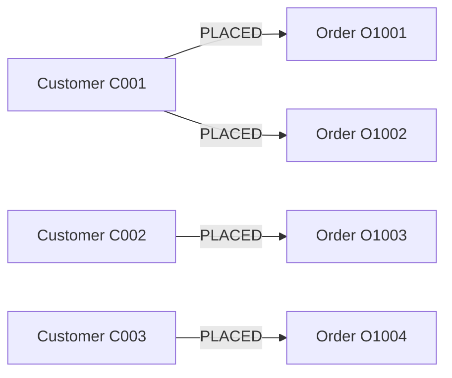
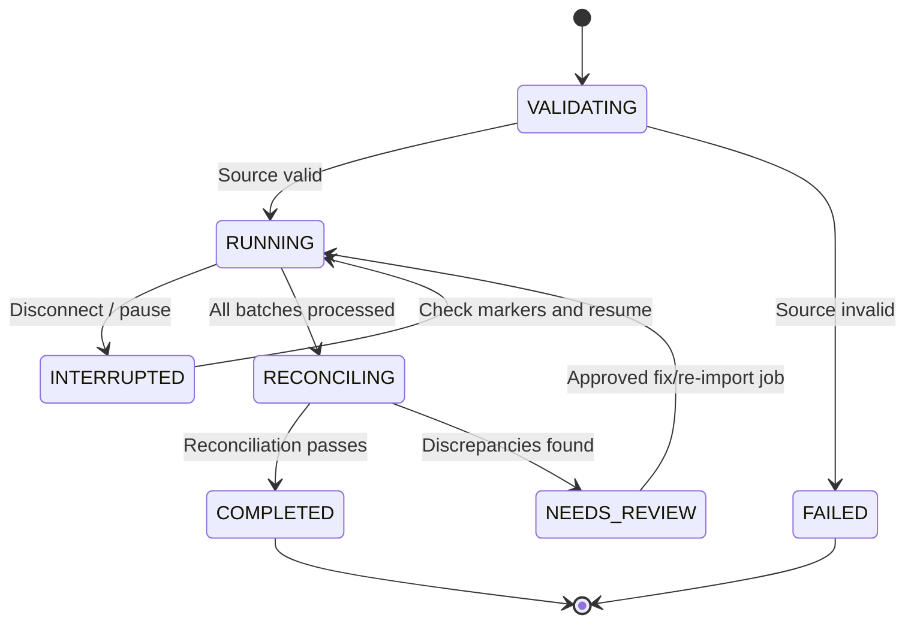

# Designing Safe Re-Imports, Failure Recovery, and Result Reconciliation in Neo4j

## Learning objectives

In Neo4j, a data import can create **nodes**, **relationships**, and **properties** in the graph. For large datasets, import jobs are typically split into multiple transactions: each transaction can commit independently, network connections can drop mid-flight, some records may be malformed, or business keys may collide.

Consequently, "safe re-import" means more than simply re-running the same `LOAD CSV` or `MERGE` statement. You need to design three capabilities together:

1. **Idempotent replay:** re-running the same source and data version neither duplicates entities nor re-applies business effects a second time.
2. **Resume / recovery after failure:** knowing which batches already committed and which must be retried, even when the application missed the final response.
3. **Reconciliation:** proving that target data matches the source in identities, properties, relationships, and business invariants rather than relying on an "executed successfully" message alone.

This lesson belongs to the **Data Import** chapter of the `DATABASE_ENGINE_GRAPH_NEO4J` module, combining the **property graph** model, Cypher, constraints/indexes, the Neo4j Java Driver, Spring Data Neo4j, and operations. After this lesson, you will be able to design an import pipeline with checkpoints, safe replay, and auditable discrepancy reports.

> **Scope:** Primary Cypher syntax targets Neo4j 5. Examples using `CALL (row) { ... }` leverage the *variable scope clause* introduced in Neo4j 5.23; earlier releases use different variable-import syntax. Java examples target Java 17+ and Neo4j Java Driver 5.x. Performance numbers and retry behavior must be verified in your actual environment.

## 1. An import scenario that can fail

Suppose the system receives an orders CSV with columns:

```csv
tenantId,orderId,customerId,placedAt,total
T1,O1001,C001,2026-11-20T09:00:00Z,120.50
T1,O1002,C001,2026-11-20T09:05:00Z,80.00
T1,O1003,C002,2026-11-20T10:00:00Z,200.00
T1,O1004,C003,2026-11-21T08:30:00Z,50.00
```

Target graph:



Each order belongs to **exactly one** customer within the same tenant. Customer and order identifiers are unique only **within a tenant**, so composite keys `(tenantId, customerId)` and `(tenantId, orderId)` must be used.

Suppose the pipeline processes four batches:

| Batch | What happens | What actually occurred? |
| --- | --- | --- |
| 1 | Neo4j commits and returns success | Data is persisted |
| 2 | Neo4j commits, but the network drops before the client receives the response | **Client state is unknown**; must not assume failure |
| 3 | One row has an invalid `total`; transaction rolls back | Batch did not commit; bad data needs handling |
| 4 | Application crashes before running | Batch not yet submitted |

If you rerun the entire job using `CREATE`, duplicate nodes and relationships can be created. If you skip batch 2 assuming it ran, you cannot prove it committed. If you only check a log saying "4 batches submitted," you have no proof entity counts are accurate.

## 2. Defining the import contract before writing Cypher

A reliable pipeline requires a consistent **data contract** across source, write operations, and reconciliation:

| Component | Decision to lock down |
| --- | --- |
| Business keys | Tenant + immutable IDs for customers and orders |
| Relationships | Each `Order` has exactly one `PLACED` edge from its expected `Customer` |
| Source duplicate rule | Reject repeated keys, or apply explicit versioning/precedence rules |
| Replay semantics | Same input snapshot and mapping yield the same target state |
| Update policy | Overwrite with latest source record, insert-only, or enforce version checks |
| Transaction boundary | One batch is one commit unit; marker/checkpoint is tied to that commit |
| Recovery point | Source ID, batch ID, fingerprint, and commit status |
| Reconciliation criteria | Valid source row count, existing identities, accurate properties, accurate relationships |

**Distinguish three concepts:** a **source row** does not necessarily create a **new node**; an existing node may simply be updated; multiple source rows may reference the same customer. Therefore `rowsProcessed`, `nodesCreated`, and `relationshipsCreated` are **distinct metrics**.

## 3. Stable keys and uniqueness constraints

Before importing, create constraints in the practice database (run each statement separately):

```cypher
CREATE CONSTRAINT customer_key_unique IF NOT EXISTS
FOR (c:Customer)
REQUIRE (c.tenantId, c.customerId) IS UNIQUE;
```

```cypher
CREATE CONSTRAINT order_key_unique IF NOT EXISTS
FOR (o:Order)
REQUIRE (o.tenantId, o.orderId) IS UNIQUE;
```

To record each committed batch, also create a key for the batch marker:

```cypher
CREATE CONSTRAINT import_batch_key_unique IF NOT EXISTS
FOR (b:ImportBatch)
REQUIRE (b.jobId, b.batchNo) IS UNIQUE;
```

Uniqueness constraints protect keys from duplication even with multiple concurrent writers. They also create indexes supporting lookups by those keys. However, they **do not automatically guarantee** that each order has at most one `PLACED` relationship, or that customer names/codes in the source are accurate. Those invariants must be enforced in write logic and reconciliation checks.

### 3.1. Data must be validated before MERGE

Examples of errors to reject or route to a remediation queue:

- Missing, empty, or invalid `tenantId`, `orderId`, or `customerId`.
- `total` cannot be parsed as a number or violates business constraints (e.g., negative when refunds are unsupported).
- `placedAt` is not a valid timestamp, lacks timezone info, or violates formatting rules.
- Two rows share `(tenantId, orderId)` with differing `customerId` or content while the pipeline lacks conflict-resolution rules.
- Oversized or malformed rows preventing safe batch writes.

`MERGE (o:Order {orderId: row.orderId})` is wrong in a multi-tenant scenario because the key omits `tenantId`. `MERGE` with a `null` key property also fails; validate data before sending it to Neo4j.

## 4. Designing rerunnable write operations

For a normalized batch from the source, pass the list as parameter `$rows` instead of concatenating CSV content into Cypher strings:

```cypher
UNWIND $rows AS row
MERGE (c:Customer {
  tenantId: row.tenantId,
  customerId: row.customerId
})
MERGE (o:Order {
  tenantId: row.tenantId,
  orderId: row.orderId
})
SET o.placedAt = datetime(row.placedAt),
    o.total = toFloat(row.total)
MERGE (c)-[:PLACED]->(o);
```

Assuming `$rows` has been validated and contains no conflicting updates for the same order:

1. `MERGE (c)` finds an existing customer or creates a new one by key.
2. `MERGE (o)` finds or creates the order by key.
3. `SET` assigns properties from snapshot values rather than incrementing/decrementing relative to current state.
4. `MERGE (c)-[:PLACED]->(o)` finds or creates the relationship between **two constrained nodes**. Re-running the same batch will not proactively create a duplicate matching relationship if one already exists.

This is a **state-setting upsert** that can be safely replayed with the same data. Other write patterns do not share that property:

| Write pattern | Replay risk |
| --- | --- |
| `CREATE (o:Order {...})` | Creates duplicates or triggers unique constraint errors |
| `CREATE (c)-[:PLACED]->(o)` | Can create duplicate relationships |
| `SET o.total = row.total` | Same final value if inputs and write rules are unchanged |
| `SET o.total = o.total + row.delta` | Can add the delta a second time on replay |
| `SET o.importedAt = datetime()` | Produces a new timestamp on every replay, no longer identical state |

**Business caveat:** `MERGE` does not automatically delete an older relationship from a different customer to the same order. If a later source changes the `customerId` of `O1001`, the query can add a second `PLACED` edge, leaving the order with two customers. The pipeline must enforce a policy: **reject owner changes**, or delete/repoint the old relationship inside the transaction under controlled rules. Never assume `MERGE` automatically enforces the "exactly one customer" invariant.

### 4.1. Newer updates and concurrent writes

If the source provides a monotonically increasing `sourceVersion` or `eventSequence` per order, you can design a policy that applies only newer versions. Otherwise, replaying an older batch after a newer one can overwrite fresher values.

One implementation checks the current version and applies conditional updates inside a conflict-managed **transaction** alongside uniqueness constraints. Evaluate cases where multiple writers touch the same node, transaction locking, and retries. Simply adding `WHERE row.version > o.version` to a complex query does not by itself guarantee correctness under all write races.

When the domain is **event-based** (e.g., increasing inventory by 5 units), you need a unique event ID and an atomic marker preventing duplicate application within the same transaction; plain node `MERGE` cannot replace that mechanism.

## 5. Identifying jobs, source snapshots, and batches

To know **exactly what is being replayed**, import job metadata should contain:

```json
{
  "jobId": "orders-T1-2026-11-25-v1",
  "sourceHash": "sha256-of-immutable-source",
  "mappingVersion": "orders-to-graph-v1",
  "expectedRows": 4,
  "batchSize": 500,
  "createdAt": "2026-11-25T08:00:00Z"
}
```

`sourceHash` in the example is an **illustrative placeholder**, not a real SHA-256 digest. In production, compute the fingerprint over **immutable source bytes** or canonicalized record streams under agreed rules. Changing the source or mapping must produce a new job version or be blocked by version checks.

Designing batches with stable identities:

```text
Job: orders-T1-2026-11-25-v1
  Batch 0000: source rows 00001..00500, batchHash H0
  Batch 0001: source rows 00501..01000, batchHash H1
  Batch 0002: source rows 01001..01500, batchHash H2
  ...
```

A batch record can store `jobId`, `batchNo`, `batchHash`, `rowCount`, `committedAt`, and post-commit metadata. Hashes must be computed using **the exact same ordering and normalization rules**; if source ordering can shift, freeze an ordering by key or offset over an immutable snapshot.

### 5.1. Avoid checkpoints based solely on rows read

Reading 1,000 lines from CSV does not mean 1,000 rows committed. On a mutating source, `OFFSET 1000` or "item 1,001 in the live list" may point to a different record after insertions or deletions.

A proper cursor must:

- Point to a **fixed source snapshot or version**.
- Follow a **durable order** (line number in a frozen file or monotonically increasing key).
- Be marked **committed** only after the corresponding batch is confirmed.
- Reconstruct the exact batch deterministically from `jobId`, `batchNo`, and the source.

If checkpoints are stored outside Neo4j, the process can crash after Neo4j commits but before writing the external checkpoint. Hence **safe replay** is still mandatory.

## 6. Server-side batching in Neo4j with CALL ... IN TRANSACTIONS

For CSV files accessible by the Neo4j server, batching can run directly in Cypher. The example below **assumes inputs are already validated** and the file resides where Neo4j is permitted to read:

```cypher
LOAD CSV WITH HEADERS FROM 'file:///orders.csv' AS row
CALL (row) {
  MERGE (c:Customer {
    tenantId: row.tenantId,
    customerId: row.customerId
  })
  MERGE (o:Order {
    tenantId: row.tenantId,
    orderId: row.orderId
  })
  SET o.placedAt = datetime(row.placedAt),
      o.total = toFloat(row.total)
  MERGE (c)-[:PLACED]->(o)
} IN TRANSACTIONS OF 500 ROWS;
```

`IN TRANSACTIONS OF 500 ROWS` splits input rows into multiple transactions. If the third batch fails, earlier committed batches **do not automatically roll back**. Neo4j does not turn the entire import into one atomic transaction just because it is written as a single outer Cypher query.

Three operational constraints:

1. `CALL { ... } IN TRANSACTIONS` must execute inside an **implicit transaction**—never place it inside `session.executeWrite(...)` or another explicit transaction. In Neo4j Browser, the `:auto` prefix may be needed depending on version.
2. `file:///orders.csv` is a path readable by the **Neo4j server**, not necessarily a file on the machine running the Java Driver; verify import configuration and permissions.
3. This batching controls **rows per transaction** but does not create per-batch atomic checkpoints in the snippet above. For pipelines requiring exact per-batch tracking, application-driven orchestration is often easier to implement and reconcile.

On Neo4j 5 prior to 5.23, queries use the `CALL { WITH row ... }` subquery variable-import syntax. Choose the syntax supported by your target version.

### 6.1. Should you skip bad rows to keep importing?

Never automatically convert type errors, missing keys, or business conflicts into "success." If you want valid rows to proceed, the pipeline needs an **error quarantine / dead-letter zone** capturing source location, error codes, and payload for remediation, then reconcile:

```text
Total source rows
  = accepted rows
  + explained rejected rows
  + unclassified rows
```

In a clean terminal state, **unclassified rows must equal 0**. Rejected rows can be valid under business policy, yet must be counted and reported transparently.

## 7. Java Driver: writing data and batch markers in the same transaction

A clear recovery pattern gives **each batch one transaction** with two parts:

1. Upsert the batch's nodes and relationships.
2. Write an `:ImportBatch` marker carrying `(jobId, batchNo)` and the batch fingerprint **within that same transaction**.

Both parts commit or roll back together in Neo4j. If the process is interrupted after commit but before receiving the response, a retry checks the marker to see that the batch was already persisted.

Java 17+ example with Neo4j Java Driver 5.x (assuming an initialized `Driver` and normalized, validated `rows`):

```java
import java.util.List;
import java.util.Map;
import org.neo4j.driver.Driver;
import org.neo4j.driver.Record;
import org.neo4j.driver.Session;
import org.neo4j.driver.SessionConfig;

public final class OrderImporter {
    private static final String UPSERT = """
        UNWIND $rows AS row
        MERGE (c:Customer {
          tenantId: row.tenantId,
          customerId: row.customerId
        })
        MERGE (o:Order {
          tenantId: row.tenantId,
          orderId: row.orderId
        })
        SET o.placedAt = datetime(row.placedAt),
            o.total = toFloat(row.total)
        MERGE (c)-[:PLACED]->(o)
        """;

    public static boolean writeOneBatch(
        Driver driver,
        String jobId,
        long batchNo,
        String batchHash,
        List<Map<String, Object>> sourceRows
    ) {
        if (jobId == null || jobId.isBlank()
            || batchHash == null || batchHash.isBlank()
            || batchNo < 0 || sourceRows == null || sourceRows.isEmpty()) {
            throw new IllegalArgumentException("Invalid import batch");
        }

        // Parameter snapshot kept immutable when the driver retries the callback.
        List<Map<String, Object>> rows = List.copyOf(sourceRows);
        Map<String, Object> key = Map.of(
            "jobId", jobId,
            "batchNo", batchNo
        );
        Map<String, Object> marker = Map.of(
            "jobId", jobId,
            "batchNo", batchNo,
            "batchHash", batchHash,
            "rowCount", rows.size()
        );

        try (Session session =
                 driver.session(SessionConfig.forDatabase("neo4j"))) {
            return session.executeWrite(tx -> {
                List<Record> committed = tx.run("""
                    MATCH (b:ImportBatch {
                      jobId: $jobId,
                      batchNo: $batchNo
                    })
                    RETURN b.batchHash AS digest
                    """, key).list();

                if (!committed.isEmpty()) {
                    String existingHash =
                        committed.get(0).get("digest").asString();
                    if (!existingHash.equals(batchHash)) {
                        throw new IllegalStateException(
                            "Batch identity reused with different content"
                        );
                    }
                    return false; // Already committed: do not write again.
                }

                tx.run(UPSERT, Map.of("rows", rows)).consume();
                tx.run("""
                    CREATE (:ImportBatch {
                      jobId: $jobId,
                      batchNo: $batchNo,
                      batchHash: $batchHash,
                      rowCount: $rowCount,
                      committedAt: datetime()
                    })
                    """, marker).consume();
                return true; // Transaction will commit when the callback completes.
            });
        }
    }
}
```

**Meaning of the return value:** `true` means the callback executed a new batch and `executeWrite` returned after the transaction succeeded; `false` means a marker with the same hash already existed, so the batch was treated as already written and skipped. Do not interpret this boolean as a "new nodes created" metric.

This pattern requires a uniqueness constraint on `ImportBatch(jobId, batchNo)`. If two workers process the same batch concurrently, both may read no marker initially, yet only one transaction is allowed to create the marker with that key. The other transaction can roll back due to lock contention or a uniqueness constraint error; the coordinator must re-read the marker and retry safely. Never assume the driver automatically retries every constraint error.

`executeWrite` can **re-execute the callback** on transient errors. Therefore:

- Never send emails, call payment APIs, or trigger external side effects inside the callback; the callback must perform only safely rerunnable database work.
- Never recompute hashes from volatile state or mutate `rows` across retry attempts.
- When a commit succeeded but the application lost the response, rerun with the same `jobId`, `batchNo`, and `batchHash` so the marker is detected.
- If a marker exists with a different hash, **halt and report a conflict**; never silently overwrite the marker.
- If `sourceRows` contains mutable maps, the caller must construct a genuinely immutable snapshot; `List.copyOf` freezes the list structure but **does not deep-copy** each map.

### 7.1. Transaction boundaries with Spring Data Neo4j

In Spring Data Neo4j, a `@Transactional` method can wrap an entire batch loop into **one single transaction**. To let each batch commit independently, place the transaction boundary **per batch**—for example in a dedicated service or `TransactionTemplate`—and write the marker in the same transaction as the data.

Watch out for Spring proxy behavior: calling another `@Transactional` method **within the same instance** can bypass the proxy, yielding different transaction boundaries than intended. The Java Driver code above manages driver transactions directly; avoid placing an arbitrary standalone driver transaction inside an existing unit of work managed by the Spring Transaction Manager without explicit coordination rules.

## 8. Resume algorithm after an application stop

An orchestrator can execute:

```text
1. Open job using stored jobId + sourceHash + mappingVersion.
2. Verify source snapshot has not changed.
3. Recreate batches in the same order and with the same hashes.
4. For each batch:
   a. Check marker (jobId, batchNo) if optimizing.
   b. If marker hash matches: mark committed, advance to next batch.
   c. If marker is absent: run data + marker transaction.
   d. If transient error: retry with bounded backoff.
   e. If data error: quarantine batch/bad rows; do not report success.
   f. If hash differs: stop because input/logic changed.
5. Once all batches are in a known state: run reconciliation.
6. Mark job COMPLETED only when reconciliation passes.
```

Batch markers and source cursors can be two distinct layers. **The marker in Neo4j** proves the batch transaction committed alongside its data; **the source reading cursor** tracks playback position. When a cursor is stored externally, you can advance it after verifying markers, while still tolerating a cursor lagging behind actually committed data.

### 8.1. Classifying errors to decide actions

| Error class | Example | Handling |
| --- | --- | --- |
| Transient | Brief disconnect, lock contention, transient error | Retry with backoff; inspect marker when commit outcome is uncertain |
| Invalid data | Missing `orderId`, bad `total` type, invalid timestamp | Quarantine, pinpoint bad rows, fix source or reject with reason |
| Business conflict | Same order with different customer, older version overwriting newer | Reject or apply explicit conflict-resolution policy |
| Job contract mismatch | Same `jobId` and `batchNo` with differing hash | Halt; do not treat as the same batch |
| Resource / performance | Oversized transaction, timeout, high memory | Reduce batch size, check query plans, and limit concurrency |

When a batch contains a bad row, you can split it to isolate the offending record **only if splitting does not alter the batch/checkpoint identity used for resume**. One option is quarantining bad rows during staging before running the main job; another is creating a separate remediation job. Never "re-split" batch 3 into new batches while reusing the old batch's `batchHash`.

### 8.2. Uncertain commit outcomes

If the driver loses connectivity right when sending commit, the application cannot know whether the server committed. Safe procedure:

1. Do not immediately record "FAILED AND NOT COMMITTED" as fact.
2. Reconnect and query the marker by key `(jobId, batchNo)`.
3. If a marker with the matching hash exists, the batch committed under the **data + marker in same transaction** design.
4. If no marker exists, rerun with the exact same data and keys; uniqueness constraints plus idempotent writes prevent duplicates during retries or races.
5. If the marker hash differs or data fails reconciliation, raise an error and investigate.

This delivers **no-duplicate-application within properly coordinated Neo4j operations**, rather than promising "exactly once" across arbitrary external systems or out-of-transaction side effects.

## 9. Reconciliation: from counts to graph state

Do not look only at `nodesCreated` or `relationshipsCreated`: with `MERGE`, a valid replayed batch can report **0 new nodes** while still having processed all records accurately.

Design multi-layer reconciliation:

1. **Source:** total physical lines, valid rows, explained rejected rows, distinct keys, snapshot fingerprint.
2. **Transactions:** batch marker count, total acknowledged `rowCount`, missing batches or hash mismatches.
3. **Identities:** every expected order key has a matching node, and no out-of-scope records were wrongly created by the job.
4. **Properties:** `total`, `placedAt`, and business fields match after normalization and type conversion.
5. **Relationships:** every order links to the right customer with the right relationship count—no duplicates or cross-tenant mislinks.

### 9.1. Checking written batch markers

```cypher
MATCH (b:ImportBatch {jobId: $jobId})
RETURN count(b) AS committedBatches,
       coalesce(sum(b.rowCount), 0) AS acknowledgedRows;
```

Compare against the manifest's batch list. If batches had `rowCount` values of 500, 500, and 200, the acknowledged total must equal 1,200. **However, you still cannot conclude** there are 1,200 new nodes, because multiple rows may reference the same customer or update existing nodes.

To detect **missing batches**, compare every `batchNo` and `batchHash` against the source manifest in application or staging data; comparing sums alone is insufficient because two different batches can share the same `rowCount`.

### 9.2. Reconciling individual orders and expected relationships

Example where the application passes `$expectedRows` containing normalized records for a batch or manifest slice:

```cypher
UNWIND $expectedRows AS row
OPTIONAL MATCH (c:Customer {
  tenantId: row.tenantId,
  customerId: row.customerId
})
OPTIONAL MATCH (o:Order {
  tenantId: row.tenantId,
  orderId: row.orderId
})
OPTIONAL MATCH (c)-[r:PLACED]->(o)
WITH row, c, o, count(r) AS expectedLinks
WHERE c IS NULL
   OR o IS NULL
   OR expectedLinks <> 1
   OR o.total IS NULL
   OR o.total <> toFloat(row.total)
   OR o.placedAt IS NULL
   OR o.placedAt <> datetime(row.placedAt)
RETURN row.tenantId AS tenantId,
       row.orderId AS orderId,
       row.customerId AS expectedCustomerId,
       expectedLinks
ORDER BY tenantId, orderId;
```

An **empty result** means the listed checks found no discrepancies for `$expectedRows` at query time. It does not check records **outside** the expected list or extra relationships from other customers. With millions of rows, run reconciliation by batch/key slice and aggregate results rather than loading the entire manifest into one giant list.

Also check the invariant "each order has exactly one customer" across the imported `orderId` scope:

```cypher
UNWIND $expectedOrderIds AS orderId
OPTIONAL MATCH (o:Order {tenantId: $tenantId, orderId: orderId})
OPTIONAL MATCH (:Customer)-[r:PLACED]->(o)
WITH orderId, o, count(r) AS incomingPlaced
WHERE o IS NULL OR incomingPlaced <> 1
RETURN orderId, incomingPlaced
ORDER BY orderId;
```

The second query detects orders with **zero** or **multiple** `PLACED` relationships, even when extra relationships come from customers outside the manifest. To verify the single relationship comes from the right customer and tenant, record-level checks like the first query are still needed.

### 9.3. Count parity is not enough to prove correctness

Two sets with 1,000 nodes each can still differ by 100 IDs. Two graphs with 5,000 relationships each can still wire the wrong node pairs. A thorough reconciliation report includes:

| Metric | What to compare |
| --- | --- |
| `sourceRows` | Source rows per snapshot |
| `acceptedRows` / `rejectedRows` | Must sum to classified rows, with rejection reasons |
| `distinctOrderKeys` | Distinct order IDs in source |
| `committedBatches` | Every batch number present, every hash matching |
| `acknowledgedRows` | Sum of marker `rowCount` against manifest |
| `missingOrders` | Source IDs absent in Neo4j |
| `propertyMismatches` | IDs with wrong values after normalization |
| `missingOrExtraRelationships` | Wrong order owner, missing or extra `PLACED` edges |

For large datasets, use partitioned manifests, canonicalized checksums, and drill-down checks on mismatched keys. Hashes are meaningful only when both sides use **the same encoding, ordering, datetime format, numeric representation, and canonicalization**; never compare a raw CSV file directly against typed property-graph values without agreeing on serialization.

## 10. Observability and job completion criteria

A job can transition through operational states:



Monitor `jobId`, `batchNo`, row counts, error counts, transaction latency, retries, lock contention, memory, throughput, missing-data signals, and reconciliation deltas. `EXPLAIN`/`PROFILE` help confirm `MERGE` uses appropriate indexes; `PROFILE` actually executes the query, so run write-capable profiles in a test environment.

Transition a job to `COMPLETED` only when:

- Source and mapping match the versions recorded in the manifest.
- Every valid batch is confirmed by a marker with the matching hash.
- Rejected rows have logged reasons and an accepted remediation policy.
- Key, property, relationship, and business-invariant reconciliations pass.
- No batch remains in an unknown state and no discrepancy remains unclassified.

**Never use "no exceptions thrown" as the sole criterion for marking an import successful.**

## 11. Common mistakes

| Mistake | Consequence | Fix |
| --- | --- | --- |
| Replaying with `CREATE` | Duplicate nodes and relationships | Use business keys + appropriate `MERGE` |
| `MERGE`-ing nodes only and skipping relationships | Node counts look right while graph wiring is broken | Reconcile endpoints and relationship counts |
| Using `batchNo` without checking hash | New batch overwrites old batch identity | Key on `(jobId, batchNo)` plus immutable fingerprint |
| Saving checkpoints before commit | May mark done when data was never persisted | Write marker inside the same data transaction |
| Treating timeouts/disconnects as certain rollbacks | Wrong reruns or inaccurate status reporting | Read marker whenever commit outcome is uncertain |
| Accumulating properties on retry | Applies deltas twice | Use idempotency keys or state-setting writes |
| Changing source file while keeping `jobId` | Resumes at wrong offset/batch | Pin `sourceHash` + `mappingVersion` |
| Inferring processed rows from `nodesCreated` | Misleading when `MERGE` matches existing nodes | Use marker `rowCount` + key reconciliation |
| Assuming right total node/edge counts mean right data | Wrong keys, properties, or endpoints go unseen | Compare expected ID lists and relationships |
| Retrying all errors endlessly | Data bugs spin in infinite loops | Classify transient vs. permanent errors, cap retry budget |
| Concurrent workers writing keys without constraints | Races create duplicates or hard conflicts | Enforce uniqueness constraints, transactions, backoff, and verification |

## 12. Practice exercises

### Exercise 1: Distinguishing success from uncertain commit

A job has 3 batches of 400, 400, and 200 rows. Batch 1 succeeded. Batch 2 lost its response after sending commit. Batch 3 has not run. How many rows can you declare committed, and what is the next step?

**Hint:** you can confirm **400 rows** from batch 1 via its response/marker. For batch 2, read the marker using `(jobId, batchNo, batchHash)` to determine its outcome—do not guess. Once batch 2's state is known, run batch 3 and then reconcile everything.

### Exercise 2: Fixing an unsafe-on-replay operation

Given:

```cypher
UNWIND $rows AS row
CREATE (o:Order {orderId: row.orderId})
SET o.total = o.total + row.delta;
```

List at least three issues and design a replacement.

**Hint:** missing tenant, creates duplicates on every run, `o.total` initially `null`, and addition is non-idempotent. If data represents final totals, use `MERGE` by key with `SET o.total = row.total`. If data represents delta events, use a unique event ID and an atomic marker protecting the addition inside the transaction.

### Exercise 3: Writing a reconciliation query

Valid source data has 4 orders and 3 customers. Neo4j holds 4 `Order` nodes and 3 `Customer` nodes, but only 3 `PLACED` relationships. Why don't matching node counts prove complete import? Use `UNWIND $expectedRows` and `OPTIONAL MATCH` to list the order missing its relationship.

**Hint:** reconcile on order key, expected customer, and `count(r)`; the query should surface the order with `0` matching relationships.

### Exercise 4: Designing resume from a shifting source

A job uses `OFFSET` on a source API sorted by "newest." After importing 2,000 rows, the source inserts 100 new rows at the top of the list. If the job resumes at `OFFSET 2000`, what happens?

**Hint:** positions shift so previously imported rows reappear while other rows are skipped. Solve this with an immutable source snapshot, a stable key/keyset cursor tied to source version or fixed manifest ID, plus idempotent replay and reconciliation.

### Exercise 5: Choosing completion criteria

A job has all 10 batch markers and `acknowledgedRows = 5000`, yet reconciliation detects 3 orders wired to the wrong customers. Can it be marked `COMPLETED`?

**Hint:** no. Markers prove batches committed with the processed rows, but **graph business invariants** failed. Move the job to `NEEDS_REVIEW` or equivalent, fix the root cause, and re-reconcile.

## 13. Import pipeline design checklist

- [ ] Source has explicit `jobId`, hash, mapping version, and normalization rules.
- [ ] Data is validated, errors classified, and duplicates handled before writing.
- [ ] Nodes have business keys and uniqueness constraints, including tenant where required.
- [ ] Relationships are wired between properly matched/merged nodes with endpoint invariants.
- [ ] All replayed writes are idempotent or guarded against duplicate application by markers.
- [ ] Rules exist for stale records, newer updates, delta events, and concurrent writes.
- [ ] Batches have fixed IDs, hashes, and order; commit markers are written in the data transaction.
- [ ] Lost commit responses do not cause the system to guess commit state.
- [ ] Resume reads checkpoints from an immutable snapshot with a retry budget and quarantine.
- [ ] Reconciliation verifies row counts, keys, properties, relationships, and invariants.
- [ ] Job succeeds only when all markers exist and reconciliation passes.
- [ ] Crash scenarios tested before commit, after commit, on network drop, on bad data, and with two workers.

## Conclusion

Designing safe re-imports in Neo4j requires more than batching. **Business keys + uniqueness constraints + idempotent writes** enable replay without duplicating data. **Batch markers written in the same transaction as data** reveal what actually committed even when responses are lost. **Immutable source manifests and resume logic** keep recovery aligned. Finally, **reconciling nodes, properties, relationships, and business invariants** confirms whether the target graph is genuinely correct. Together, these layers form the foundation for large-scale ingestion via Cypher, the Java Driver, and Spring Data Neo4j.

### References

- [Neo4j Cypher Manual — MERGE](https://neo4j.com/docs/cypher-manual/current/clauses/merge/)
- [Neo4j Cypher Manual — Constraints](https://neo4j.com/docs/cypher-manual/current/constraints/)
- [Neo4j Cypher Manual — LOAD CSV](https://neo4j.com/docs/cypher-manual/current/clauses/load-csv/)
- [Neo4j Cypher Manual — CALL subqueries in transactions](https://neo4j.com/docs/cypher-manual/current/subqueries/subqueries-in-transactions/)
- [Neo4j Java Driver Manual — Transactions](https://neo4j.com/docs/java-manual/current/transactions/)
