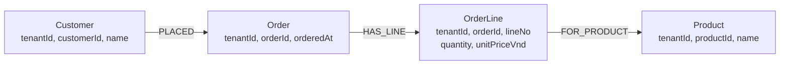
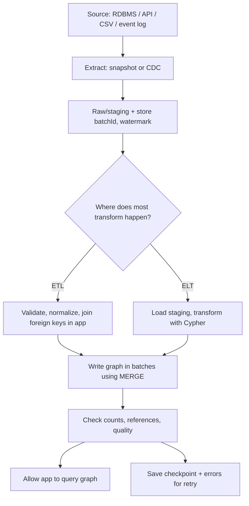

# Designing ETL or ELT Pipelines to Ingest Business Data into a Neo4j Graph

An operational database typically stores information across multiple tables or events: customers, orders, products, order lines, payments, and shipping statuses. When bringing that data into Neo4j, the goal is not to mechanically copy each table into a node label. You must decide **which entities become nodes, which business relationships become relationships, which keys identify records, and how changing data will be synchronized**.

This lesson belongs to the **Data Integration** chapter of the `DATABASE_ENGINE_GRAPH_NEO4J` module. The focus is on **designing ETL or ELT pipelines** from business sources to a property graph using Cypher, data constraints, batch loading workflows, and incremental updates. These principles apply when building services with the Neo4j Java Driver or Spring Data Neo4j, as well as when operating a production graph system.

The desired outcome of a good pipeline is: **correct model, correct keys, re-runnable without creating duplicates, able to detect erroneous records, scalable with data volume, and provably complete after every sync**.

## 1. Where Do ETL and ELT Differ?

Both ETL and ELT share three core activities:

- **Extract (E):** reading data from relational databases, CSV/JSON files, APIs, or event streams.
- **Transform (T):** cleaning, type casting, normalizing keys, determining nodes/relationships, and validating records and business rules.
- **Load (L):** writing results to Neo4j via Cypher, data import tools, connectors, or applications using a Driver.

The difference lies in **where and when most of the transformation takes place**.

| Criterion | ETL | ELT |
| --- | --- | --- |
| Primary order | Extract → Transform → Load | Extract → Load → Transform |
| Where transformation happens | ETL application, Spark, SQL staging, integration service, etc. | Inside the data platform after loading, e.g., using Cypher on staging data in Neo4j |
| Data entering the target graph | Usually already validated and normalized | Source data can be loaded into a staging area first, then transformed into the business graph |
| Quality control | Blocks invalid records before writing to the target graph | Must clearly separate staging from the validated graph |
| Suitable scenarios | Systems requiring strict constraints, data coming from multiple heterogeneous sources | Wanting to retain raw source traces and iterate transformations directly in the target environment |
| Trade-offs | Requires maintaining transformation logic outside Neo4j | Requires managing staging resources and lifecycle, preventing raw data from affecting business queries |

For example, an order management system has currency values stored as strings, emails containing whitespace, and some non-existent customer IDs. In **ETL**, the application cleans and filters out errors before creating `:Customer`, `:Order`, and `:Product`. In an **ELT** variant, the pipeline may load records into `:StageOrder` nodes with a batch identifier, validate them with Cypher, and only then create the business graph.

**There is no absolute choice:** both approaches can work well. Choose based on where data is best controlled, scale, update latency, traceability, and the isolation level between staging and user-facing graph queries.

## 2. Start from Business Questions, Then Design the Graph

Suppose you need to answer:

1. Which customers placed which orders?
2. Which products are in an order, along with their quantity and unit price **at the time of purchase**?
3. Which products frequently appear together in a shopping cart?
4. Within each tenant, how many orders are there, and what is the total revenue per customer?

Source data may include:

| Source Dataset | Source Primary Key | Example Attributes | Reference Keys |
| --- | --- | --- | --- |
| `customers` | `(tenant_id, customer_id)` | `customer_name` | — |
| `products` | `(tenant_id, product_id)` | `product_name` | — |
| `orders` | `(tenant_id, order_id)` | `ordered_at` | `customer_id` |
| `order_lines` | `(tenant_id, order_id, line_no)` | `quantity, unit_price_vnd` | `order_id, product_id` |

A suitable graph model:



Reasons for choosing `OrderLine` as a **separate node**:

- An order can contain the same product multiple times, for instance the same SKU on different lines with different promotions. If collapsed directly into an `Order-[:CONTAINS]->Product` relationship, you would have to manually decide how to distinguish each line item.
- `quantity` and `unitPriceVnd` are values of the **purchase event**, not immutable attributes of `Product`. Listed prices may change, but historical order data must remain intact.
- `OrderLine` has a stable source key `(tenantId, orderId, lineNo)`, which is convenient for updates, reconciliation, and change events.

Not every table needs a separate node: a pure join table with no independent lifecycle, attributes, or identity can become a relationship. Base the decision on semantics, not solely on SQL structure.

## 3. Standardize Keys, Relationships, and Properties Before Writing the Pipeline

### 3.1. Business Keys Must Be Stable

Neo4j has `elementId()` to identify elements in query operations, but **do not use internal element IDs as long-term synchronization keys across systems**. When deleting/re-importing data or switching environments, internal IDs are not a business identity contract.

In the example, two customers with the same code `C001` belonging to different tenants are two distinct entities. Therefore, the key must include both `tenantId` and `customerId`:

```text
Customer:  tenantId + customerId
Product:   tenantId + productId
Order:     tenantId + orderId
OrderLine: tenantId + orderId + lineNo
```

If a source has keys that are only unique **within each branch**, do not drop the branch code when consolidating data. Conversely, adding mutable fields to the key (such as customer name) will cause the same entity to be created as multiple nodes.

### 3.2. Define Data Mutation Rules

Agree on the following:

- **Required properties:** `tenantId`, `customerId`, `orderId`, `productId`, and `lineNo` must be valid before `MERGE`.
- **Formatting:** dates in ISO `YYYY-MM-DD`, quantities and prices as non-negative integers per business rules, and codes consistently normalized.
- **Historical accuracy:** `unitPriceVnd` lives on `OrderLine` to reflect the price at the time of sale.
- **Updates:** customer names and product names can be overwritten with newer versions; key codes used for `MERGE` should not be changed arbitrarily.
- **Deletions:** should deleting a customer at the source delete the node and its orders, or merely mark it inactive? This is a business decision that must be clarified upfront.

### 3.3. Constraints to Prevent Duplicate Keys

Before ingesting, create uniqueness constraints on business keys. Example Cypher syntax on Neo4j 5:

```cypher
CREATE CONSTRAINT biz_customer_unique IF NOT EXISTS
FOR (c:BizCustomer)
REQUIRE (c.tenantId, c.customerId) IS UNIQUE;
```

```cypher
CREATE CONSTRAINT biz_product_unique IF NOT EXISTS
FOR (p:BizProduct)
REQUIRE (p.tenantId, p.productId) IS UNIQUE;
```

```cypher
CREATE CONSTRAINT biz_order_unique IF NOT EXISTS
FOR (o:BizOrder)
REQUIRE (o.tenantId, o.orderId) IS UNIQUE;
```

```cypher
CREATE CONSTRAINT biz_order_line_unique IF NOT EXISTS
FOR (l:BizOrderLine)
REQUIRE (l.tenantId, l.orderId, l.lineNo) IS UNIQUE;
```

Composite uniqueness guarantees that no two nodes share the same **present key tuple**. It does not replace checking required properties: if a key is missing or `null`, it must be caught before writing. When the edition and version support it, a **node key** can enforce both existence and uniqueness; if using basic uniqueness, the pipeline must still check for missing keys. Furthermore, node uniqueness **does not automatically guarantee** that every order has a valid customer or every OrderLine has a valid product.

> **Note:** creating a constraint on an existing graph will fail if existing data violates it. For initial loads, create constraints before loading; for migrations, audit and clean existing data first.

## 4. Source Data Contracts and Quality Checks

Do not pass every row from `orders` straight into `MERGE`. Define a clear **input contract**:

| Check | Example Condition | Error Handling |
| --- | --- | --- |
| Required keys | `tenant_id`, `order_id` non-empty | Exclude from valid batch, send to error table/queue |
| Unique keys in snapshot | No two conflicting rows with the same `tenant_id + order_id` | Analyze source or apply a winning-record rule |
| Referential integrity | `orders.customer_id` exists within the same tenant | Defer edge creation or send to reference error list |
| Data types | `quantity` is a positive integer | Do not cast blindly |
| Timestamps | `ordered_at` parses to a valid date | Flag conversion error |
| Currency | `unit_price_vnd` in VND, no mixed units | Normalize units or reject as error |
| Normalization | Trim extra whitespace in codes, standardize casing per contract | Apply identical rules to both snapshot and delta |

One way to structure a record:

```json
{
  "source": "order-service",
  "batchId": "orders-2026-11-25-001",
  "tenantId": "T1",
  "orderId": "O100",
  "customerId": "C001",
  "orderedAt": "2026-11-05",
  "sourceVersion": 7
}
```

`batchId` aids ingestion traceability; `sourceVersion` (if the source system provides a monotonically increasing version per entity) helps handle out-of-order events. These fields are **integration metadata** and do not automatically become part of the business key.

For CSV data, you can use `trim()` on string codes during transformation, but you must decide whether `ABC` and `abc` represent the same entity. Do not automatically apply `toLower()` to every key if the source is case-sensitive.

## 5. ETL/ELT Pipeline Architecture for Neo4j

A typical pipeline consists of the following components:



Several operational decisions are required:

1. **Initial snapshot:** ingest all entities and relationships at a consistent point in time.
2. **Incremental load:** read changes after the snapshot point using `updated_at` or CDC (Change Data Capture).
3. **Graph creation order:** create referenced nodes first, then create dependent nodes and relationships.
4. **Batching strategy:** limit rows per transaction based on record size and database load; do not put the entire dataset into a single transaction.
5. **Tracking and retry:** store batch ID, committed offset/watermark, valid row count, error count, and failure reasons.

For ELT, if storing raw source records in Neo4j using nodes like `:StageOrder {batchId, payload, ...}`, define rules to protect the staging area, track processed states, and enforce cleanup policies. Do not let business applications accidentally query unvalidated staging nodes.

## 6. Standardized Data Ingestion Examples with Cypher and MERGE

The examples in this section use **inline sample data** so they can be studied independently. Run them only on a **test database**, once per dataset when initializing data. In production, replace the inline list with a `$rows` parameter supplied by the pipeline.

### 6.1. Loading Customers

```cypher
UNWIND [
  {tenantId: 'T1', customerId: 'C001', name: 'An'},
  {tenantId: 'T1', customerId: 'C002', name: 'Bình'}
] AS row
MERGE (c:BizCustomer {
  tenantId: row.tenantId,
  customerId: row.customerId
})
SET c.name = row.name;
```

**Put only key properties inside `MERGE`.** If you write `MERGE (c:BizCustomer {tenantId:..., customerId:..., name:...})`, changing `name` can cause the entire pattern not to match and attempt to create a new node. With a uniqueness constraint on the key, the operation may fail; without a constraint, the graph can end up with duplicate entities.

### 6.2. Loading Products

```cypher
UNWIND [
  {tenantId: 'T1', productId: 'P01', name: 'Neo4j Book'},
  {tenantId: 'T1', productId: 'P02', name: 'Cypher Course'}
] AS row
MERGE (p:BizProduct {
  tenantId: row.tenantId,
  productId: row.productId
})
SET p.name = row.name;
```

The first two steps create **2 Customers** and **2 Products**. Re-running these queries with the same keys matches existing nodes and updates their names without creating additional nodes, assuming no pre-existing duplicates.

### 6.3. Loading Orders and Linking to Customers

```cypher
UNWIND [
  {
    tenantId: 'T1', orderId: 'O100',
    customerId: 'C001', orderedAt: '2026-11-05'
  },
  {
    tenantId: 'T1', orderId: 'O101',
    customerId: 'C002', orderedAt: '2026-11-06'
  }
] AS row
MATCH (c:BizCustomer {
  tenantId: row.tenantId,
  customerId: row.customerId
})
MERGE (o:BizOrder {
  tenantId: row.tenantId,
  orderId: row.orderId
})
SET o.orderedAt = date(row.orderedAt)
MERGE (c)-[:BIZ_PLACED]->(o);
```

`MATCH` finds the customer **within the same tenant**. `MERGE` creates or finds the order and the `BIZ_PLACED` relationship. With valid keys and applied constraints, re-running the batch does not create duplicate customers, orders, or relationships for the same pattern.

**Critical pitfall:** if a `customerId` does not exist yet, `MATCH` returns **0 rows** for that record. The query does not automatically warn that a row was skipped; therefore, you must check references before loading or reconcile the actual number of processed rows after each batch (Section 7).

### 6.4. Loading Order Lines and Two Dependent Relationships

```cypher
UNWIND [
  {
    tenantId: 'T1', orderId: 'O100', lineNo: 1,
    productId: 'P01', quantity: 2, unitPriceVnd: 120000
  },
  {
    tenantId: 'T1', orderId: 'O100', lineNo: 2,
    productId: 'P02', quantity: 1, unitPriceVnd: 50000
  },
  {
    tenantId: 'T1', orderId: 'O101', lineNo: 1,
    productId: 'P01', quantity: 1, unitPriceVnd: 120000
  }
] AS row
MATCH (o:BizOrder {
  tenantId: row.tenantId,
  orderId: row.orderId
})
MATCH (p:BizProduct {
  tenantId: row.tenantId,
  productId: row.productId
})
MERGE (l:BizOrderLine {
  tenantId: row.tenantId,
  orderId: row.orderId,
  lineNo: row.lineNo
})
SET l.quantity = toInteger(row.quantity),
    l.unitPriceVnd = toInteger(row.unitPriceVnd)
MERGE (o)-[:BIZ_HAS_LINE]->(l)
MERGE (l)-[:BIZ_FOR_PRODUCT]->(p);
```

The graph now has **2 Orders and 3 OrderLines**, with relationships linked by the correct keys. Unit prices in VND are stored as integers because this example has no fractional currency units. In multi-currency applications, add a `currency` property and conversion rules; do not sum amounts across different currencies into a single total.

**`MERGE` does not equate to full-state synchronization:** if the source changes an order's customer or a line item's product, `MERGE`ing the new relationship may **leave the old relationship intact**. That is a business relationship change requiring dedicated reconciliation rules rather than silently adding another edge.

### 6.5. Query to Verify Business Results

```cypher
MATCH (c:BizCustomer)-[:BIZ_PLACED]->(o:BizOrder)
      -[:BIZ_HAS_LINE]->(l:BizOrderLine)
      -[:BIZ_FOR_PRODUCT]->(p:BizProduct)
RETURN c.tenantId AS tenantId,
       c.customerId AS customerId,
       o.orderId AS orderId,
       sum(l.quantity * l.unitPriceVnd) AS totalVnd,
       collect({
         productId: p.productId,
         quantity: l.quantity,
         unitPriceVnd: l.unitPriceVnd
       }) AS lines
ORDER BY tenantId, orderId;
```

Expected total amounts:

| tenantId | customerId | orderId | totalVnd |
| --- | --- | --- | ---: |
| T1 | C001 | O100 | 290000 |
| T1 | C002 | O101 | 120000 |

The order of elements inside `collect()` is not guaranteed unless sorted before aggregation. The total amount is only accurate when there are no duplicate line-item relationships; besides the uniqueness constraint on `BizOrderLine`, the pipeline must ensure each order line links to exactly one order and one product.

## 7. Detecting Dropped Records or Missing References

In an ingestion flow, a `MATCH` that fails to find a target node will silently drop the current row. This is dangerous when a dashboard merely reports "Cypher command completed" without comparing source record counts against target counts.

Suppose an order batch from an API may contain invalid references. Check **before writing**:

```cypher
UNWIND $orderRows AS row
OPTIONAL MATCH (c:BizCustomer {
  tenantId: row.tenantId,
  customerId: row.customerId
})
WITH row, c
WHERE c IS NULL
RETURN row.tenantId AS tenantId,
       row.orderId AS orderId,
       row.customerId AS missingCustomerId;
```

Similarly, before creating an OrderLine, check both the order and the product simultaneously:

```cypher
UNWIND $lineRows AS row
OPTIONAL MATCH (o:BizOrder {
  tenantId: row.tenantId,
  orderId: row.orderId
})
OPTIONAL MATCH (p:BizProduct {
  tenantId: row.tenantId,
  productId: row.productId
})
WITH row, o, p
WHERE o IS NULL OR p IS NULL
RETURN row.tenantId AS tenantId,
       row.orderId AS orderId,
       row.lineNo AS lineNo,
       o IS NULL AS missingOrder,
       p IS NULL AS missingProduct;
```

If invalid rows exist, send them to an **error queue/dead-letter queue** with source metadata rather than treating the batch as fully synchronized. Once the referenced data appears, those rows can be retried using the same business keys.

Check for missing keys **before `MERGE`**, because `MERGE` with a `null` key property can raise an error. Functions like `toInteger()`/`date()` must also run after validation: unparseable inputs should be logged as errors instead of silently writing `null` into the target data.

Some post-load audit queries:

```cypher
// Orders without a customer who placed them
MATCH (o:BizOrder)
WHERE NOT EXISTS {
  MATCH (:BizCustomer)-[:BIZ_PLACED]->(o)
}
RETURN o.tenantId AS tenantId, o.orderId AS orderId;
```

```cypher
// OrderLines that do not have exactly one product
MATCH (l:BizOrderLine)
OPTIONAL MATCH (l)-[:BIZ_FOR_PRODUCT]->(p:BizProduct)
WITH l, count(p) AS productLinks
WHERE productLinks <> 1
RETURN l.tenantId AS tenantId,
       l.orderId AS orderId,
       l.lineNo AS lineNo,
       productLinks;
```

These audit examples check **edge completeness**, a requirement that node uniqueness constraints alone cannot enforce. Depending on the model, you should also verify that each order has exactly one `BIZ_PLACED` from a customer, each line has exactly one `BIZ_HAS_LINE` from an order, and all endpoints belong to the same tenant.

## 8. Batch Loading: UNWIND Parameters, LOAD CSV, and Transactions

### 8.1. Prefer Parameterization Over Building One Cypher Statement per Row

In a Java pipeline, pass a validated and normalized list:

```cypher
UNWIND $rows AS row
MERGE (c:BizCustomer {
  tenantId: row.tenantId,
  customerId: row.customerId
})
SET c.name = row.name;
```

`$rows` is a parameter, such as a list of maps. The pipeline splits data into multiple batches, executing each batch in an appropriate transaction. This approach reduces the overhead of issuing one query per record and avoids string-concatenating Cypher from user input.

Conceptual example in the Neo4j Java Driver:

```java
import java.util.List;
import java.util.Map;
import org.neo4j.driver.Driver;
import org.neo4j.driver.Session;

// Assume driver is already created; batch has passed data validation.
List<Map<String, Object>> batch = List.of(
    Map.of("tenantId", "T1", "customerId", "C001", "name", "An"),
    Map.of("tenantId", "T1", "customerId", "C002", "name", "Bình")
);

try (Session session = driver.session()) {
    session.executeWrite(tx -> {
        tx.run("""
            UNWIND $rows AS row
            MERGE (c:BizCustomer {
              tenantId: row.tenantId,
              customerId: row.customerId
            })
            SET c.name = row.name
            """, Map.of("rows", batch)).consume();
        return null;
    });
}
```

`executeWrite` runs a write transaction and the Driver may retry certain transient errors. Therefore, operations inside the transaction should be designed to be **idempotent**; do not place side effects external to Neo4j (such as sending emails or charging payments) inside a callback that may be re-invoked on retry.

**Choose batch size by measurement.** Batches that are too small increase network/transaction overhead; batches that are too large increase transaction memory usage and make retries harder. Test from a few hundred to a few thousand rows depending on record width, relationship count, and environment resources, then monitor DB Hits, latency, heap/page cache, and error rates.

### 8.2. LOAD CSV for File-Based Ingestion

When data is already in CSV format with headers, you can use `LOAD CSV`:

```cypher
LOAD CSV WITH HEADERS FROM 'file:///customers.csv' AS row
CALL {
  WITH row
  MERGE (c:BizCustomer {
    tenantId: trim(row.tenant_id),
    customerId: trim(row.customer_id)
  })
  SET c.name = trim(row.customer_name)
} IN TRANSACTIONS OF 1000 ROWS;
```

This is a **syntax example** and cannot run unless `customers.csv` exists in the import directory permitted by Neo4j. For other environments, adjust the URI, permissions, and import configuration, or switch to Driver-based ingestion. `CALL { ... } IN TRANSACTIONS` should be run in an appropriate **implicit/autocommit** transaction context, not inside an explicit application transaction.

In the example, `trim()` helps normalize strings but **is not sufficient as a quality check**: CSVs with blank codes, malformed numbers, or duplicate keys still need handling in a staging/validation step. Every ingestion method must share the same key and reference rules; otherwise, a snapshot loaded via CSV and deltas loaded via the Driver can produce divergent results.

### 8.3. Do Not Confuse LOAD CSV with Offline Initial Import

Neo4j also provides the **neo4j-admin database import** tool for very large data volumes when building a new database under an appropriate workflow. It differs from `LOAD CSV`/Cypher writing to a live database; choose based on downtime requirements, input structure, and deployment process. APOC, Kafka connectors, or Spark connectors can also participate in integration, though their availability depends on the version, plugins, and deployed infrastructure.

## 9. Idempotency: Re-Running the Same Batch Creates No Duplicates

**Idempotent** means re-feeding an already-processed event or batch does not alter the business outcome beyond expected updates. To design for it:

1. **Stable keys:** use `(tenantId, customerId)`, `(tenantId, orderId)`, `(tenantId, orderId, lineNo)` rather than mutable properties.
2. **Uniqueness constraints:** prevent two concurrent workers from creating two nodes with the same key, and surface conflicts instead of silently overwriting.
3. **`MERGE` on keys:** match or create the node, then `SET` updatable properties.
4. **`MERGE` relationships with clear identity:** only when ensuring a single edge of a given type between endpoints. If a relationship has its own lifecycle or identity, model an appropriate key.
5. **No unchecked accumulation:** `SET c.totalSpent = c.totalSpent + row.amount` will double-count if a batch is replayed. To maintain totals, compute them from OrderLines, use events deduplicated by `eventId`, or apply versioning checks.
6. **Checkpoint after commit:** only mark a batch/offset as successfully processed once the corresponding graph transaction has committed.

`MERGE` **does not automatically guarantee** business idempotency if the match pattern includes mutable properties, data has missing keys, or out-of-order events are unhandled.

### 9.1. When Events Arrive Out of Order

Suppose a customer has two updates: version `8` changes the name to "An Nguyễn", and version `7` arrives late. If you blindly execute `SET c.name = row.name`, the older version can overwrite newer data.

If the source provides a monotonically increasing `version` **per customer**, you can apply a conditional guard:

```cypher
UNWIND $rows AS row
MERGE (c:BizCustomer {
  tenantId: row.tenantId,
  customerId: row.customerId
})
WITH c, row
WHERE c.sourceVersion IS NULL
   OR toInteger(row.version) > c.sourceVersion
SET c.name = row.name,
    c.sourceVersion = toInteger(row.version);
```

Only apply this pattern if `version` has been verified to be strictly monotonic for that exact key scope. Timestamps from systems with unsynchronized clocks or broker ordering do not automatically guarantee the same property. In environments where multiple sources concurrently write to the same entity, add source-priority and conflict-resolution rules.

### 9.2. Delete Events and Relationship Changes

Do not automatically `DETACH DELETE` a customer when the source emits a delete event if the graph still needs historical orders or reporting. You can use `isDeleted`/`deletedAt`, or perform controlled deletion according to retention policies.

When `Order.customerId` changes from C001 to C002, adding `(C002)-[:BIZ_PLACED]->(O100)` without handling the old C001 edge will leave the order with **two customers placing it**. The pipeline must detect the foreign-key change, locate the old edge, and replace the relationship within an appropriate transaction while respecting ownership-history rules.

## 10. Snapshots, CDC, and Watermarks for Long-Term Synchronization

A one-time load is only the starting point. As the source system continuously creates orders, updates products, or cancels orders, the graph must have a strategy to stay in sync.

### 10.1. Initial Snapshot

- Establish a **consistent point in time** in the source system, such as a snapshot transaction or CDC log position.
- Load root entities and reference data first; then load orders, lines, and edges in dependency order.
- Run reconciliation, separating retryable errors from errors that must be fixed at the source.
- Switch to reading change events **after the snapshot point**, avoiding gaps during long-running snapshots.

### 10.2. CDC (Change Data Capture)

A flow can use source DBMS CDC → Kafka or an event log → integration worker → Neo4j. Important fields include:

| CDC Field | Purpose |
| --- | --- |
| Source table/entity | Select the corresponding mapper |
| Operation: insert/update/delete | Choose creation, update, or deletion policy |
| Business key | Locate existing node/relationship |
| Before/after (if available) | Detect foreign-key and relationship changes |
| Offset/LSN/version | Resume from the exact checkpoint, guarding against replay/reordering per source mechanics |
| Event ID, event time | Traceability, deduplication, and lag monitoring |

Many production pipelines operate with **at-least-once delivery**: an event may be redelivered after a network failure or worker restart. Therefore, idempotency in Neo4j and proper checkpointing are usually more reliable than assuming "every event is guaranteed to arrive exactly once."

**Data dependency ordering:** an OrderLine creation event may arrive before the corresponding Order/Product creation event reaches the graph. Use a retry queue with backoff, a dependency buffer, or a staged-edge strategy; never treat a row dropped by `MATCH` as successful.

### 10.3. ELT with a Staging Area

If choosing ELT, the flow can:

1. Load raw records tagged with `batchId` into a controlled staging area.
2. Validate duplicate keys, references, data types, and quantities.
3. Run Cypher to transform valid records into `BizCustomer`, `BizOrder`, `BizOrderLine`, and `BizProduct`.
4. Mark the batch as processed after the graph write succeeds, recording failed rows separately.
5. Reconcile and clean up staging data according to retention policies.

If using staging nodes inside the same database, assign clear labels and indexes, restrict access permissions, and account for memory/storage overhead. If staging resides in a data lake/warehouse, the T step can execute there before writing nodes to Neo4j; classifying as ETL vs. ELT depends on **where the transformation actually occurs**.

## 11. Measuring Quality and Reconciling After Ingestion

A batch that "ran without errors" is not sufficient proof that the graph is accurate. You must measure **record counts**, **links**, and **business metrics**.

A checklist may include:

| Metric | Meaning |
| --- | --- |
| `extractedRows` | Number of rows/events read from the source in the batch |
| `validatedRows` | Number of rows passing data validation |
| `rejectedRows` | Number of invalid rows, along with reason and source |
| `matched/created/updated` | Operation counts on nodes/relationships (broken down by type) |
| `missingReferences` | Number of rows that could not connect to an endpoint |
| `duplicateKeys` | Number of duplicate or conflicting source keys |
| `lagSeconds` | Latency from source change to graph visibility |
| `lastCommittedOffset` | Processing checkpoint committed and recoverable |

**Do not compare mismatched units:** 100 source rows might produce 80 nodes and 120 relationships; 100 update events might create zero new nodes. Reconciliation must be based on **the unit and expectations of each source**, rather than forcing every count to be equal.

Example node and relationship inventory queries on the sample dataset:

```cypher
MATCH (c:BizCustomer)
RETURN count(c) AS customers;
```

```cypher
MATCH (o:BizOrder)
RETURN count(o) AS orders;
```

```cypher
MATCH (l:BizOrderLine)
RETURN count(l) AS orderLines;
```

```cypher
MATCH ()-[r:BIZ_HAS_LINE]->()
RETURN count(r) AS orderLineLinks;
```

For the `T1` example, the expected counts are **2 customers, 2 orders, 3 order lines, and 3 BIZ_HAS_LINE relationships**. Also verify **2 BIZ_PLACED** and **3 BIZ_FOR_PRODUCT** relationships, then cross-check the order totals from Section 6.5.

In multi-tenant datasets, avoid checking only global graph totals. Reconcile by `tenantId`, source, and time window to catch discrepancies in a small subset that large aggregate numbers would hide.

## 12. Performance: Load Order, Batch Size, and Indexes

A pipeline that succeeds on a few hundred records may not scale to tens of millions of nodes. Principles to verify:

- **Create key constraints before loading into an empty database:** prevents duplicates and supports `MERGE` lookups. Confirm indexes/constraints are `ONLINE` before running heavy loads.
- **Load nodes before dependent relationships:** reduces failed `MATCH` endpoints and excessive retries.
- **Pass multiple rows via `UNWIND $rows`:** reduces round-trips from the application; split into batches to control transaction size and recoverability.
- **Do not return all nodes after `MERGE`:** write statements typically only need summary/counters and necessary validation outputs, avoiding payload bloat.
- **Avoid `collect()` across the entire dataset:** count and track progress per batch rather than accumulating millions of IDs in a single list.
- **Inspect `EXPLAIN`/`PROFILE` on read and write queries in a controlled test environment:** observe `NodeIndexSeek`, `NodeByLabelScan`, `Expand`, `Rows`, and `DB Hits`. Note that `PROFILE` actually executes write statements.
- **Bound concurrency by key and DB capacity:** two batches updating the same customer/order concurrently can contend on locks; shard by tenant or business key when needed.
- **Measure throughput and errors:** records/second, batch duration, retries, lock contention, heap/page cache, and application query latency.

For massive initial loads into a new database with an acceptable downtime window, an offline import tool may outperform millions of online `MERGE` statements. For continuous application integration, Drivers/connectors combined with constraints and controlled retries are usually more suitable.

## 13. Deployment Plan and Resilience

A rollout workflow can include:

1. **Schema design:** align on labels, relationship types, directions, keys, properties, and update/delete semantics.
2. **Source profiling:** inspect volumes, missing/duplicate records, data types, references, and security requirements.
3. **Test environment setup:** create constraints/indexes, test with a small snapshot, and verify business queries.
4. **Backfill execution:** load in dependency order, batch records, save checkpoints, and route failed records to a queue.
5. **Reconciliation:** count nodes/edges, detect orphans, and compare revenue/totals by tenant and date.
6. **Incremental sync:** enable CDC or watermark-based deltas after the snapshot point, ensuring no data gaps.
7. **Shadow reads/comparison:** compare source results against the graph for critical use cases before cutting over applications to the graph.
8. **Monitoring and recovery:** alert on lag, conversion errors, duplicates, and missing references; ensure replay from checkpoints without duplication.

Never treat wiping the entire graph and reloading as a default "quick fix": it can destroy application-created relationships, referenced IDs, cause downtime, and lose data generated outside the ingestion source. Build rollback/migration plans scoped by batch, schema, backups, and data ownership policies.

For sensitive data such as PII or payment details, ingest into the graph only the fields that are authorized and genuinely needed for the use case. Control read permissions, retention periods, and data handling when records are deleted at the source.

## 14. Common Pitfalls When Moving Relational Data into Neo4j

| Mistake | Consequence | Fix |
| --- | --- | --- |
| Using `CREATE` for every sync | Creates duplicate nodes/relationships on replay | Business keys + constraints + `MERGE` |
| Putting name, status, or price inside `MERGE` | Property changes create new nodes or uniqueness errors | `MERGE` on stable keys, `SET` mutable properties |
| Omitting `tenantId` from keys | Two tenants with identical IDs get merged by mistake | Use appropriately scoped composite keys |
| Modeling OrderLine as an edge without a clear key | Hard to represent and update multiple lines for the same product | Use an OrderLine node with stable lineNo/ID when needed |
| Loading relationships before endpoints | `MATCH` drops rows or creates orphan data via workarounds | Load in dependency order, retry missing-reference records |
| Treating error-free Cypher execution as sufficient | Rows may have been silently dropped by `MATCH` | Reconcile row counts and check for orphans |
| Accumulating totals on every event | Replay double-counts totals | Deduplicate events or recompute from underlying data |
| Loading only snapshots without deltas | Graph quickly becomes stale | CDC/watermarks, manage offsets and lag |
| Deleting nodes on delete events without checking relationships | Loses historical data or business links | Deletion policies, soft deletes, reconciliation |
| Merging multiple sources without a key contract | Entities with different meanings collapse into one | Source namespaces, mapping, and precedence rules |

## 15. Practice Exercises

**Exercise 1 — Identifying Nodes and Relationships.** Given `customers`, `orders`, `order_lines`, and `products`, explain why modeling `OrderLine` as a node is appropriate when an order can contain the same product across multiple lines.

**Exercise 2 — Detecting Invalid References.** Suppose a line item `{tenantId:'T1', orderId:'O999', lineNo:1, productId:'P01'}` arrives. Use `OPTIONAL MATCH` to detect that `O999` does not exist before loading.

**Exercise 3 — Preventing Duplicates on Replay.** Re-run the `UNWIND...MERGE` snippets in Section 6 and verify that node and relationship counts do not increase. Explain the role of uniqueness constraints if two workers load concurrently.

**Exercise 4 — Updating Relationships.** Suppose the source reassigns order `O100` from customer `C001` to `C002`. Describe the steps to validate and replace the relationship so that an order still belongs to strictly one customer per business rules.

**Exercise 5 — Late-Arriving CDC.** Customer `C001` already has `sourceVersion = 8`, and then a version 7 event arrives. Write the condition to ignore the stale event and explain why `version` must not be replaced by the local machine's arrival timestamp.

**Exercise 6 — Reconciliation.** Using the sample dataset, verify the node/relationship counts and order totals `O100 = 290000 VND`, `O101 = 120000 VND`. If the line-item count is correct but the total amount is wrong, which properties or links should you inspect?

## References

- [Neo4j Cypher Manual — MERGE](https://neo4j.com/docs/cypher-manual/current/clauses/merge/): pattern matching or creation mechanics, handling keys and relationships.
- [Neo4j Cypher Manual — LOAD CSV](https://neo4j.com/docs/cypher-manual/current/clauses/load-csv/): reading source files and transforming rows.
- [Neo4j Cypher Manual — Transactions and CALL subqueries](https://neo4j.com/docs/cypher-manual/current/subqueries/subqueries-in-transactions/): organizing operations into batches/transactions.
- [Neo4j Cypher Manual — Constraints](https://neo4j.com/docs/cypher-manual/current/constraints/): ensuring valid and unique data according to edition capabilities.
- [Neo4j Java Driver Manual](https://neo4j.com/docs/java-manual/current/): parameter binding, transactions, and retries.

**Remember:** designing ETL/ELT for Neo4j must begin with **business keys, meaningful relationships, and synchronization rules**, and only then selecting the tools. A reliable pipeline must be **re-runnable, able to detect dropped data, process changes in the proper order, and reconcile results on the property graph**.
