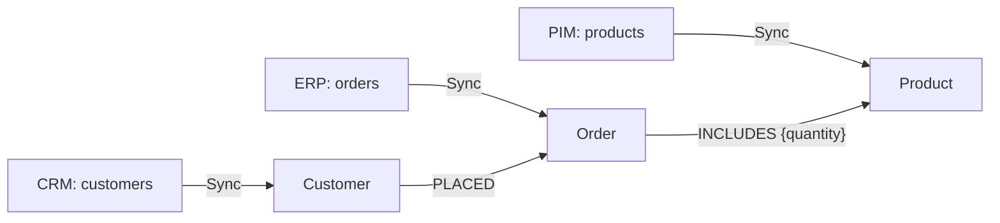
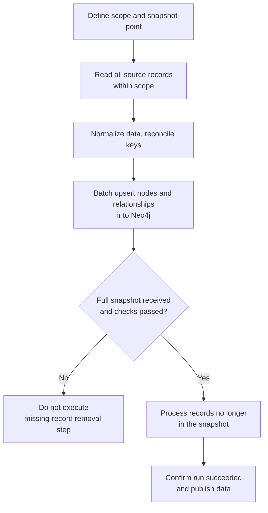
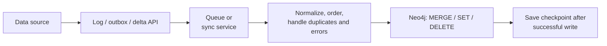
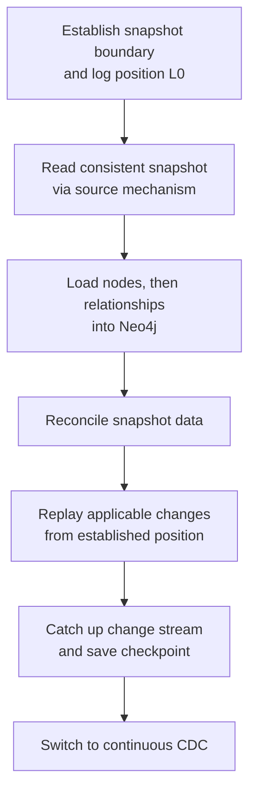

# Full Synchronization vs. Incremental Synchronization

When bringing data from operational systems into **Neo4j**, the challenge does not stop at importing nodes and relationships once. Customers change segments, new orders are created, products are discontinued, and some records may be deleted at the source system. A graph serving search, path analysis, or Java applications must reflect those changes accurately and in a timely manner.

Two common strategies in the **Data Integration** chapter of the **DATABASE_ENGINE_GRAPH_NEO4J** module are:

- **Full synchronization** (*full synchronization / full refresh*): re-read the entire dataset within the managed scope and make the target graph match that source data snapshot.
- **Incremental synchronization** (*incremental synchronization / delta sync*): transfer only new changes since a processed checkpoint, typically via update columns, change logs, or *change data capture* (CDC).

Both can use **Cypher** to update the property graph, **constraints/indexes** to enforce business keys, and the **Neo4j Java Driver** to orchestrate batched writes. The key differences lie in **how data to be transferred is identified, how disappeared records are handled, how progress is tracked, and how consistency is guaranteed**.

## 1. An End-to-End Scenario: From Source Systems into the Graph

Suppose an enterprise has three sources:

| Source | Managed Entity | Business Key | Data to Bring into Neo4j |
| --- | --- | --- | --- |
| CRM | Customer | `customerId` | Name, segment, status |
| ERP | Order | `orderId` | Order date, total amount, placing customer |
| PIM | Product | `productId` | Name, product category, status |

Target graph:



Cypher queries like the following consume the synchronized graph:

```cypher
MATCH (c:Customer {customerId: $customerId})
      -[:PLACED]->(o:Order)
RETURN o.orderId AS orderId, o.createdAt AS createdAt
ORDER BY createdAt DESC;
```

Here, **CRM/ERP/PIM remain the source of truth** for the attributes they own. Neo4j is the integration layer for querying relationships. If an application allows direct edits inside Neo4j, clear ownership and sync-direction rules are required to prevent two systems from updating back and forth and overwriting each other.

### 1.1. How Does Source State Change?

For example, CRM and ERP initially contain:

| Source Table | Key | Value |
| --- | --- | --- |
| Customer | C01 | An, Retail segment |
| Customer | C02 | Bình, SMB segment |
| Order | O01 | Placed by C01, date 2026-11-01 |
| Order | O02 | Placed by C02, date 2026-11-03 |

The next day:

- C01 changes from `Retail` to `VIP`.
- C03 is a new customer.
- O03 is a new order from C03.
- C02 is deactivated or deleted per business rules.

**Full synchronization** re-discovers the entire picture defined by the snapshot scope. **Incremental synchronization** processes only events such as "C01 updated", "C03 created", "O03 created", and "C02 deleted/deactivated".

## 2. What Is Full Synchronization?

Full synchronization re-reads the **entire dataset within a defined scope**, such as all customers of tenant A, the full product catalog, or all orders for a period. "Full" does not necessarily mean scanning **the entire database**: the scope must be clearly defined.

A typical cycle:



There are several implementation approaches:

1. **Rebuild in a separate environment and switch read traffic** after validation. This suits cases where displaying a half-built graph must be avoided, but requires extra resources and an environment switching mechanism.
2. **Batch upsert + last-seen marking** (*mark and sweep*) in the serving graph. Only clean up absent records once the entire snapshot has finished loading and passed reconciliation.
3. **Delete and reload the data subset within the owned scope.** This is straightforward to understand but causes disruption, risks losing relationships from other data domains, and should not be applied indiscriminately.

### 2.1. Strengths

- **Easy to build initially:** tables/CSVs/JSON can be exported and loaded by business key; no CDC infrastructure is required.
- **Catches cumulative drift:** data missed or corrupted in prior runs has a chance to be repaired when re-reading the full source.
- **Can identify disappeared records:** if the snapshot is complete, comparing key sets detects records deleted at the source.
- **Useful for initialization/rebuilds:** the initial load usually needs to transfer large volumes of historical data into Neo4j.

### 2.2. Limitations

- **Bandwidth and I/O intensive:** every cycle reads a large amount of data even when only a small fraction changed.
- **Long cycle times:** the graph can lag behind the source when data volumes grow large.
- **Higher write, index, and log load:** continuous updates can consume CPU, memory, storage, locks, and transaction logs.
- **Hard to guarantee snapshot consistency while the source is still writing:** reading pages at different points in time allows concurrent changes to make the dataset internally inconsistent.
- **Risk of mistakenly removing records:** running a "delete unseen records" step after an incomplete or failed snapshot causes data loss.

**Do not equate "re-reading everything" with "wiping the whole graph and rebuilding."** In a property graph, a node from another domain may reference a node being synced. Broad deletions can destroy critical cross-domain relationships.

## 3. What Is Incremental Synchronization?

Incremental synchronization pulls only operations or records **newer than a processed checkpoint**. Incoming data may originate from:

- **`updated_at` / `version` columns:** periodically querying records modified after the checkpoint.
- **Event/outbox or audit tables:** the application records changes for the integration layer to consume.
- **CDC from the source transaction log:** dedicated tools convert INSERT, UPDATE, and DELETE operations in the transaction log into events.
- **Delta/cursor APIs:** external systems return only changes since a supplied cursor.

Basic flow:



Instead of reading one million customers every hour, the system can transfer just a few thousand changes that occurred during that hour. This is a major advantage when the **rate of change is much smaller than the total dataset**.

### 3.1. Strengths

- Reduces data read/transferred and redundant writes when change volume is low.
- Can lower **sync latency** to minutes or seconds depending on source and architecture.
- Valuable when applications need a relatively fresh graph for personalization, recommendations, fraud detection, or operations.
- Scales well via partitioning, micro-batching, and checkpoints.

### 3.2. Challenges

- **Higher complexity:** requires tracking offsets/watermarks, idempotency, ordering, and duplicate events.
- **Deletions:** reading only currently existing records will miss vanished records; requires tombstones, soft deletes, or CDC with DELETE events.
- **Out-of-order events:** an older update arriving after a newer one can revert values to stale states.
- **Lost events or lost checkpoints:** without replay/reconciliation mechanisms, the graph can suffer prolonged drift.
- **Relationship dependencies:** an order event may arrive before its customer event, meaning endpoint nodes are not ready yet to form an edge.

**Incremental synchronization does not automatically guarantee correctness.** It simply moves less data; reliability requires solving event-processing challenges.

## 4. Direct Comparison of the Two Approaches

| Criterion | Full Synchronization | Incremental Synchronization |
| --- | --- | --- |
| Data transferred per cycle | Most or all data within scope | Only changed records or events |
| Cost on large datasets with low churn | Typically high | Typically low |
| Data latency | Depends on snapshot completion cycle | Depends on delta detection and processing latency |
| Infrastructure complexity | Low to medium | Medium to high |
| Handling deleted records | Reconcile full snapshot | Requires DELETE events/tombstones/soft deletes |
| Recovery from missed data | Re-running snapshot can fix drift | Requires replaying retained events or re-running snapshot |
| Read pressure on source system | Can be heavy, especially during business hours | Usually lower when deltas are small |
| Write impact on Neo4j | May upsert very large numbers of records | Writes only the change set |
| Consistency | Depends on source snapshot and target publishing | Depends on ordering, offsets, idempotency, and dependencies |
| Suitable scenarios | Initial load, small datasets, rebuilds, reconciliation | Large datasets, frequent changes, near-real-time requirements |

**Illustrative** quantitative example: a source has 10 million records and an average of 20,000 changed records per day. One full sync must inspect 10 million records; an incremental sync might only process around 20,000 changed records if events are compacted by key. Delta volume can therefore be hundreds of times smaller, yet **actual cost** still depends on the number of relationships per record, payload size, index updates, and duplicate event volume. Do not assume execution time scales down by the exact same ratio.

## 5. Business Key Model: A Prerequisite for Both

When syncing into Neo4j, you must know **which target node corresponds to which source record**. Do not rely on `elementId()` as a long-term integration key across systems; use stable business identifiers.

In this lesson, assume each source has its own namespace for codes:

```cypher
CREATE CONSTRAINT customer_source_key IF NOT EXISTS
FOR (c:Customer)
REQUIRE (c.source, c.sourceId) IS UNIQUE;

CREATE CONSTRAINT order_source_key IF NOT EXISTS
FOR (o:Order)
REQUIRE (o.source, o.sourceId) IS UNIQUE;

CREATE CONSTRAINT product_source_key IF NOT EXISTS
FOR (p:Product)
REQUIRE (p.source, p.sourceId) IS UNIQUE;
```

Example node in the graph:

```cypher
(:Customer {
  source: 'CRM',
  sourceId: 'C01',
  name: 'An',
  segment: 'Retail',
  active: true
})
```

Here, the key tuple `(source, sourceId)` distinguishes identical codes coming from two different systems. If multiple **tenants** must be separated, add `tenantId` to the key design and constraint. Never alter a key once it is used to link relationships unless there is an explicit data migration workflow.

**`MERGE` on stable keys**, then `SET` mutable attributes:

```cypher
MERGE (c:Customer {source: 'CRM', sourceId: $customerId})
SET c.name = $name,
    c.segment = $segment,
    c.active = true;
```

When re-run with the same key, `MERGE` matches the existing node rather than creating a new one. Constraints enforce uniqueness under concurrent writes; relying solely on `MERGE` without proper constraints does not strictly guarantee uniqueness when multiple workers write concurrently.

## 6. Implementing Batched Full Synchronization

A full refresh is usually too large for a single transaction. **Split it into batches** of appropriate size and write each batch in an independent transaction. Only after all batches succeed should you perform reconciliation and handle absent records.

### 6.1. Loading All Customers in a Snapshot

Example payload sent by the application:

```json
{
  "runId": "CRM-20261125-01",
  "customers": [
    {"id": "C01", "name": "An", "segment": "Retail"},
    {"id": "C02", "name": "Bình", "segment": "SMB"}
  ]
}
```

Cypher using `UNWIND`:

```cypher
UNWIND $customers AS row
MERGE (c:Customer {source: 'CRM', sourceId: row.id})
SET c.name = row.name,
    c.segment = row.segment,
    c.active = true,
    c.lastSeenRun = $runId;
```

When loading a full snapshot across multiple batches, **every batch of the same run must use the same `runId`**. `UNWIND` expands the input list into individual rows for Neo4j to process. `MERGE` prevents record C01 from creating a duplicate node if a batch is retried; `SET` brings properties up to date with the source.

The `lastSeenRun` marker here is a **snapshot batch tag**, not a business timestamp or version for ordering CDC events.

### 6.2. Syncing Orders and PLACED Relationships

Suppose ERP provides:

```json
{
  "orders": [
    {"id": "O01", "customerId": "C01", "createdAt": "2026-11-01"},
    {"id": "O02", "customerId": "C02", "createdAt": "2026-11-03"}
  ]
}
```

Load `Order` nodes:

```cypher
UNWIND $orders AS row
MERGE (o:Order {source: 'ERP', sourceId: row.id})
SET o.createdAt = date(row.createdAt),
    o.lastSeenRun = $runId,
    o.active = true;
```

After ensuring `Customer` and `Order` nodes exist, create the relationships:

```cypher
UNWIND $orders AS row
MATCH (c:Customer {source: 'CRM', sourceId: row.customerId})
MATCH (o:Order {source: 'ERP', sourceId: row.id})
MERGE (c)-[placed:PLACED]->(o)
SET placed.source = 'ERP',
    placed.lastSeenRun = $runId;
```

**Why separate nodes and relationships?** If orders are loaded before customers, the two `MATCH` clauses may fail to find both endpoints, causing the edge not to be created. A simple pipeline typically loads **nodes first, edges second**; continuous event pipelines need retry/dependency-resolution mechanisms for out-of-order arrivals.

If the domain allows multiple `PLACED` edges between the same pair of nodes, `MERGE (c)-[:PLACED]->(o)` cannot distinguish individual relationship records. In that case, model a relationship key or an intermediate node per event/item, such as `OrderLine`.

### 6.3. Handling Records No Longer Present in the Snapshot

After **receiving and validating every customer batch within the CRM scope**, you can mark customers unseen in the new `runId` as inactive:

```cypher
MATCH (c:Customer {source: 'CRM'})
WHERE c.lastSeenRun IS NULL
   OR c.lastSeenRun <> $runId
SET c.active = false;
```

This is called **soft delete**: preserving nodes and edges for auditing while business queries filter for active entities when needed:

```cypher
MATCH (c:Customer {source: 'CRM', active: true})
RETURN c.sourceId AS customerId, c.name AS name
ORDER BY customerId;
```

If physical deletion is required, you must clarify **who owns the attached edges**, retention obligations, and rules for referencing orders. Never run `MATCH (n) DETACH DELETE n` or sweep-delete unseen nodes from an incomplete snapshot: `DETACH DELETE` removes all connected edges, including those created by other business domains.

**Mandatory condition for the "sweep" step:** the snapshot must be complete, scoped accurately to the tenant/source, with all batches succeeded and counts/keys verified. Skipping a page due to a timeout or truncated API response and then running "sweep" will wrongly deactivate valid records.

### 6.4. Verifying Results

Typical checks after synchronization:

```cypher
MATCH (c:Customer {source: 'CRM', active: true})
RETURN count(c) AS activeCustomers;
```

```cypher
MATCH (o:Order {source: 'ERP'})
WHERE o.active = true
  AND NOT EXISTS {
    MATCH (:Customer)-[:PLACED]->(o)
  }
RETURN o.sourceId AS orderWithoutCustomer;
```

The second query finds active orders not yet linked to a customer. This is a **signal to investigate**, not an automatic trigger to delete those orders: the customer event might not have arrived yet, or the business model might allow guest orders without a registered customer.

## 7. Incremental Sync Using updated_at and Watermarks

A straightforward incremental approach stores a **processed checkpoint** (*watermark*) and queries source records updated after that mark.

Suppose a SQL source has a table `customers(id, name, segment, updated_at)`. The extraction query might look like:

```sql
SELECT id, name, segment, updated_at
FROM customers
WHERE updated_at > :last_updated_at
   OR (updated_at = :last_updated_at AND id > :last_id)
ORDER BY updated_at, id
LIMIT :batch_size;
```

The `(updated_at, id)` pair establishes a deterministic pagination order: if two records share the exact same timestamp, the `id` condition prevents skipping later records at that timestamp. After processing a batch **successfully**, advance the checkpoint to the last `(updated_at, id)` pair of that batch.

**Prerequisite:** the source must guarantee that the update column used as a watermark reflects every change needing sync, has proper ordering semantics, and never produces "late-appearing" records with timestamps earlier than the checkpoint. In systems with long-running transactions, skewed application clocks, or backfilled records, relying solely on `updated_at` easily misses rows. In such cases, use an overlap/lookback window + deduplication, reliable monotonic versions, or commit-ordered CDC from the transaction log.

### 7.1. Why a Simple Watermark Misses Deleted Records

If the source executes:

```sql
DELETE FROM customers WHERE id = 'C02';
```

Record `C02` no longer appears in `SELECT ... FROM customers`. Consequently, querying only `updated_at` on the **current table** cannot detect that deletion.

Options:

- **Soft delete at the source:** a `deleted = true` column with `updated_at` updated upon deletion.
- **Tombstone/audit/outbox table:** records `DELETE` events for the sync pipeline to read.
- **CDC from the transaction log:** captures delete operations at the source.
- **Periodic snapshot reconciliation:** identifies records present in Neo4j but absent from the source.

Without one of these mechanisms, an incremental strategy can leave source-deleted nodes **existing forever** in Neo4j.

## 8. Incremental Sync Using CDC or Outbox

CDC (*change data capture*) tracks source changes and emits records carrying the details needed for the target to update. An illustrative event:

```json
{
  "eventId": "evt-103",
  "entityType": "Customer",
  "entityId": "C01",
  "operation": "UPSERT",
  "version": 103,
  "payload": {
    "name": "An",
    "segment": "VIP"
  }
}
```

In this example design, `version` is a **monotonically increasing number per entityId**, not a global sequence number. In practice, CDC may supply an offset, commit log position, sequence number, or timestamp depending on the source; use it as a version only when you understand its monotonicity and semantics.

A delete event:

```json
{
  "eventId": "evt-104",
  "entityType": "Customer",
  "entityId": "C02",
  "operation": "DELETE",
  "version": 104
}
```

Typical processing pipeline:

1. Consume events from the log/outbox/stream.
2. Validate keys, event type, version, and payload.
3. Determine the impact on Neo4j nodes/relationships.
4. Write changes **transactionally**, handling retryable errors.
5. **Checkpoint the offset only after the transaction has committed successfully.**
6. Track late, duplicate, or unprocessable events and route failures to a dedicated error queue when needed.

Under "at-least-once" delivery, an event may be replayed. Target writes should be **idempotent**: applying the same event once or multiple times yields the equivalent business state.

## 9. Idempotency and Preventing Out-of-Order Overwrites

### 9.1. MERGE Alone Does Not Block Stale Events

`MERGE` prevents creating duplicate nodes when backed by appropriate keys, but **it does not stop an older update from overwriting a newer one**.

Suppose C01 receives two events:

- Version `v12`: `segment = 'VIP'`.
- Version `v11` arriving late: `segment = 'Retail'`.

If you simply run `SET c.segment = event.segment`, the stale event can revert the data back to `Retail` even though the latest state is `VIP`.

A version-checked UPSERT pattern:

```cypher
UNWIND $events AS event
WITH event
WHERE event.operation = 'UPSERT'
MERGE (c:Customer {source: 'CRM', sourceId: event.entityId})
WITH c, event
WHERE c.sourceVersion IS NULL
   OR c.sourceVersion < event.version
SET c.name = event.payload.name,
    c.segment = event.payload.segment,
    c.sourceVersion = event.version,
    c.active = true;
```

This pattern assumes all events for **the same entity** carry monotonically increasing versions and that the payload represents the **full state** of the synchronized attributes. If an event contains only changed fields (partial update), never blindly assign absent fields to `null`: Cypher deletes a property when you `SET property = null`. In that case, apply field-level patching or another pattern matching the event contract.

**Concurrency note:** `MERGE` combined with a `sourceVersion` check does not automatically enforce ordering if multiple workers write concurrently to the same key. Route events for the same entity to the same sequentially processed partition/stream, or use proven transaction/locking and retry strategies. Constraints guarantee **key uniqueness**, not that version logic is serialized under concurrent updates.

### 9.2. Soft Deletes with Tombstones Retain Versions

You can handle `DELETE` by **retaining the node as a tombstone**:

```cypher
UNWIND $events AS event
WITH event
WHERE event.operation = 'DELETE'
MERGE (c:Customer {source: 'CRM', sourceId: event.entityId})
WITH c, event
WHERE c.sourceVersion IS NULL
   OR c.sourceVersion < event.version
SET c.active = false,
    c.sourceVersion = event.version;
```

Why not delete the node immediately?

- Deleting the node also removes its `sourceVersion`; a late-arriving stale UPSERT could **recreate the node**.
- A tombstone retains the latest processed version, allowing older events to be ignored.
- Attached relationships may need to be preserved for audit or history.

If physical deletion is mandatory due to data policies, maintain **version/tombstone state elsewhere** long enough to reject stale replays and decide how to handle remaining connected relationships. Tombstones cannot expire safely if event streams can be delayed indefinitely.

### 9.3. Duplicate Events, Ordering, and Atomicity

An event application should ideally ensure **either all changes for the event commit, or none commit**. For example, an event creating an `Order` and linking `PLACED` should not persist only the node and advance the offset while the edge failed to write.

When checkpoints are stored **outside Neo4j** (Kafka offsets, state databases, API cursors), you cannot assume an atomic distributed transaction across both systems. The practical pattern is:

- Write to Neo4j **idempotently**.
- Acknowledge/commit the offset/cursor only after the Neo4j commit succeeds.
- If a crash happens in between, re-process the event on restart. Because writes are idempotent, no corrupt state occurs.
- If an event fails persistently, keep it uncommitted or route it to an observable dead-letter flow; never silently skip and checkpoint past data loss.

This is the standard strategy for achieving reliable business semantics in replayable systems, rather than claiming cross-component "exactly-once" without an underlying mechanism.

## 10. Syncing Relationships: A Property-Graph-Specific Challenge

A tabular application often only needs to upsert rows. With Neo4j, you must also maintain **edges between nodes**.

For instance, order event O03 for customer C03 arrives before customer creation event C03. This Cypher:

```cypher
MATCH (c:Customer {source: 'CRM', sourceId: $customerId})
MERGE (o:Order {source: 'ERP', sourceId: $orderId})
MERGE (c)-[:PLACED]->(o);
```

will create neither the order nor the edge if `MATCH (c)` finds nothing, because zero rows proceed downstream. This is not necessarily a syntax error, so **links can be silently lost** unless affected record counts are monitored.

### 10.1. Options for Handling Dependencies

- **Load nodes before relationships** during full refreshes.
- **Create minimal placeholder (stub) nodes** by business key if the architecture allows, then populate attributes when the full event arrives. Distinguish stubs from complete nodes and enforce version guards.
- **Queue/retry edge-creation events** when endpoints do not yet exist, with timeouts and monitoring to prevent infinite waiting.
- **Use ordered processing streams per related key** when feasible; note that ordering across different entity types is not guaranteed merely by partitioning on `orderId`.

Example loading a node and edge with verified keys:

```cypher
MERGE (o:Order {source: 'ERP', sourceId: $orderId})
SET o.createdAt = date($createdAt), o.active = true
WITH o
MATCH (c:Customer {source: 'CRM', sourceId: $customerId})
MERGE (c)-[r:PLACED]->(o)
SET r.source = 'ERP';
```

**Limitation of this example:** If the customer does not exist yet, the order node may already be processed in the first half of the query while the relationship remains missing because `MATCH` returned zero rows. For workflows requiring **both node and edge** to be created from one event, the application must verify preconditions and trigger a retry, or intentionally create a stub. Do not rely on the absence of Cypher errors to conclude an event was fully applied.

### 10.2. When a Relationship Is No Longer Valid

If O03 moves from C03 to C01, running only `MERGE (C01)-[:PLACED]->(O03)` leaves the old edge from C03 behind. You need to know whether the relationship represents **exclusive ownership**.

For example, under the rule "each Order has strictly one placing Customer," after verifying both target and source nodes:

```cypher
MATCH (newCustomer:Customer {source: 'CRM', sourceId: $customerId})
MATCH (o:Order {source: 'ERP', sourceId: $orderId})
OPTIONAL MATCH (:Customer)-[old:PLACED]->(o)
WITH newCustomer, o, collect(old) AS previousEdges
FOREACH (r IN previousEdges | DELETE r)
MERGE (newCustomer)-[:PLACED]->(o);
```

This snippet enforces **replacing all existing `PLACED` edges pointing to an Order** with the new edge, so it is valid only if the business model dictates a single placer per order and all `PLACED` edges are owned by this pipeline. If co-ownership or edges from other sources exist, do not apply this rule.

In models allowing multiple identical line items, a single `INCLUDES` edge between `(Order, Product)` cannot distinguish individual `lineId` entries; model an `OrderLine` node or an appropriate relationship key instead.

## 11. Combining Initial Snapshots with Long-Term CDC

On large datasets, the standard pattern is **snapshot + CDC**: run a full sync to establish the baseline, then continuously apply incoming changes.

The subtle issue is that **the source keeps changing while the snapshot is being read**. If you read a snapshot at time A and deltas starting from time B without stitching them properly, changes can be missed or applied out of order.

### 11.1. A Principled Workflow



Specific steps:

1. **Establish a reproducible boundary:** use the source's snapshot/transaction-log capabilities or CDC tooling to know which data is already inside the snapshot and which changes must be replayed.
2. **Ensure change events are not lost during the snapshot:** start or retain logs appropriately; do not simply record an arbitrary application-tier timestamp and assume the snapshot matches that instant.
3. **Load the snapshot cleanly:** enforce business keys, scope by source/tenant, load nodes before relationships, batch writes, and reconcile.
4. **Apply CDC from a compatible position:** boundary duplicates may occur; use versions/idempotency to prevent bad overwrites.
5. **Declare "caught up" only after offsets and results are verified**, then maintain the incremental stream and alert on lag.

A capable CDC tool often provides a built-in snapshot workflow. If not, the engineering team must solve **consistent snapshot + log position** coordination themselves. Never treat the start time of an arbitrary `SELECT` query as a consistent boundary for replaying all deltas.

### 11.2. Full Refresh While CDC Is Running

If you re-run a snapshot while CDC is actively updating the same nodes in Neo4j, the two write streams can step on each other:

- An older snapshot overwrites `segment = 'Retail'` after CDC already wrote `VIP`.
- The snapshot's "sweep" step deactivates a newly created CDC node absent from the older snapshot.
- An edge is rebuilt from stale snapshot data after CDC already updated ownership.

Controls typically include **pausing/aligning CDC with the snapshot boundary**, **writing into a staging space before switching**, or **comparing source versions** before allowing updates. Define an explicit coordination policy; stamping `lastSeenRun` alone does not resolve timing races between two streams.

## 12. Java Driver: Transactional Batched Sync Writes

A Java application can receive rows from CRM/ERP or CDC, convert them into a list of maps, and send them to Neo4j via the **Neo4j Java Driver**. The example below uses `executeWrite` so each batch executes inside a managed transaction, suitable for driver 5.x. Assume `Driver` is properly configured and `(source, sourceId)` is protected by a constraint.

```java
import java.util.List;
import java.util.Map;
import org.neo4j.driver.Driver;

public final class CustomerSyncService {
    private static final String UPSERT_BATCH = """
        UNWIND $rows AS row
        MERGE (c:Customer {source: 'CRM', sourceId: row.id})
        SET c.name = row.name,
            c.segment = row.segment,
            c.active = true,
            c.lastSeenRun = $runId
        """;

    public static void importBatch(
            Driver driver,
            List<Map<String, Object>> rows,
            String runId) {

        try (var session = driver.session()) {
            session.executeWrite(tx -> {
                tx.run(
                    UPSERT_BATCH,
                    Map.of("rows", rows, "runId", runId)
                ).consume();
                return null;
            });
        }
    }
}
```

In this example:

- `rows` is a **batch**, not the entire database.
- `runId` remains constant across all batches of the same snapshot.
- `executeWrite` manages the transaction and may retry transient errors per driver mechanics; therefore, operations must be **idempotent**.
- `consume()` ensures the driver drains all results/summaries from the write query before the transaction completes.
- **Do not run the "sweep" step after a single batch:** run it only after the entire snapshot is loaded and verified.

With Spring Data Neo4j, you can use repositories or `Neo4jClient` to execute parameterized Cypher within Spring-managed transactions. However, persisting entities one statement at a time can generate excessive round-trips; tune batch queries, concurrency, and transaction sizes based on actual measurements.

### 12.1. Checkpointing Must Follow a Successful Commit

A CDC processing loop in the application can follow this pseudocode:

```text
event = readNextChange()
validated = validateAndNormalize(event)

begin Neo4j transaction
    applyIdempotentChange(validated)
commit Neo4j transaction

acknowledge / persist source offset
```

If the process crashes **after the Neo4j commit but before acknowledging the offset**, the event may be replayed: that is why idempotency is essential. If the process acknowledges the offset **before** committing and the write then fails, the event can be permanently lost from the consumer stream. Monitor checkpoint progress independently of Neo4j write metrics.

## 13. Measuring and Validating Consistency

A sync job that "runs without errors" is not proof of correctness. Define reconciliation criteria aligned with **data scope**:

| Metric Group | Meaning |
| --- | --- |
| Node counts by type/source/tenant | Are all customers, orders, and products present? |
| Relationship counts by type | Are all `PLACED` and `INCLUDES` links present? |
| Duplicate business keys | Are constraints or processes preventing duplicates? |
| Nodes missing required relationships | Are there orders without customers or lines without products? |
| Deactivated records | Are deletes/tombstones accurately reflected? |
| Source-to-target lag | How far behind is Neo4j compared to the source? |
| Committed offset/version | Where can processing resume upon restart? |
| Retry rate and unprocessable errors | Are events stuck or being dropped? |
| Batch size, commit latency, DB Hits | Are write/lookup costs growing over time? |

Example counting active customers ingested from CRM:

```cypher
MATCH (c:Customer {source: 'CRM', active: true})
RETURN count(c) AS activeCustomers;
```

Counting order placement relationships:

```cypher
MATCH (:Customer)-[r:PLACED]->(:Order)
RETURN count(r) AS placedEdges;
```

Finding sample orders without a placing customer relationship:

```cypher
MATCH (o:Order {source: 'ERP', active: true})
WHERE NOT EXISTS {
    MATCH (:Customer)-[:PLACED]->(o)
}
RETURN o.sourceId AS orderId
ORDER BY orderId
LIMIT 20;
```

Comparing **counts** is a fast sanity check, yet matching counts **do not prove content matches completely**. For critical data, compare checksums/hashes of source-owned fields, reconcile per partition/tenant, verify keys, and spot-check relationship traversal queries.

### 13.1. Evaluating Performance in the Right Place

Use `EXPLAIN` to inspect whether Neo4j plans index lookups or scans; use `PROFILE` on **safe read queries or in test environments** to examine `Rows`, `DB Hits`, relationship expansions, and operator costs.

- Constraints/indexes speed up `MERGE` and `MATCH` key lookups.
- Batched `UNWIND` reduces round-trips, but overly large batches consume memory and hold locks longer.
- Full sync creates periodic steady loads; CDC creates event-driven loads with potential **bursts** when catching up after outages.
- When profiling write queries, remember **`PROFILE` executes the write effects**; do not treat it as a harmless plan viewer.

Monitor CPU, I/O, page cache, transaction latency, queue lag, and sync service memory usage as well. Cypher tuning cannot compensate for missing source events or broken checkpoints.

## 14. Which Model Should You Choose?

No single option fits every system. Evaluate:

1. **Data volume and change rate:** 1,000 rarely changing records differ completely from 50 million continuously updated records.
2. **Acceptable latency:** nightly reporting versus recommendations or event detection within seconds?
3. **Source capabilities:** does it offer CDC, outbox, versions, deletion tombstones, and consistent snapshots?
4. **Who mutates the data:** is Neo4j strictly a one-way replica, or are there writes going back?
5. **Deletion and history rules:** do you need hard deletes, deactivation, or change history?
6. **Relationship integrity:** can related nodes arrive asynchronously at different times?
7. **Operational readiness:** do you have monitoring, replay, error queues, checkpoints, and periodic reconciliation?

Some practical strategies:

| Context | Typically Suitable Approach |
| --- | --- |
| Small dataset, daily updates | Controlled full refresh |
| Initial data migration | Snapshot/full load |
| Millions of records, continuous changes | Initial snapshot + CDC/incremental |
| Source only has paginated API, provides no delta | Scoped full refresh or periodic reconciliation |
| Source has reliable `updated_at` but no DELETE events | Incremental for updates + snapshot reconciliation for deletes |
| Critical business data requiring long-term drift repair | Continuous incremental + scheduled reconciliation/full rebuild |

A **hybrid architecture** often balances performance and correctness: load an initial snapshot, apply continuous deltas, and run periodic reconciliation. However, if CDC is unavailable or the model is still evolving, a well-scoped full refresh remains a sound choice.

## 15. Common Implementation Mistakes

| Mistake | Consequence | Prevention |
| --- | --- | --- |
| Using `CREATE` for every record on each sync | Creates duplicate nodes and edges | Stable business keys, constraints, and `MERGE` |
| Running the "sweep" step before receiving the full snapshot | Wrongly marks/deletes valid data | Mark run complete, verify batch counts and scope |
| Relying solely on `updated_at` with no DELETE mechanism | Fails to reflect deleted records | Tombstones, soft deletes, CDC, or reconciliation |
| Checkpointing offset before Neo4j write succeeds | Can lose changes when commit fails | Commit offset after DB commit, idempotent replay |
| Applying UPSERTs in arrival order without version checks | Stale events overwrite newer state | Per-key monotonic versions, ordered processing, and retries |
| Deleting nodes immediately without keeping tombstones | Late stale UPSERTs can resurrect nodes | Retain version/tombstone or external state long enough |
| Loading relationships before endpoint nodes | Missing edges or partially applied events | Load nodes first, dependency retry queues |
| Assuming `MERGE` alone prevents concurrency races | Errors or logic bugs under concurrent workers | Constraints + key-partitioned transactions |
| Indexing every property without workload analysis | Increases storage and write overhead | Prioritize indexes for keys and measured queries |
| Checking only counts without checking values/relationships | Misses wrong attributes or broken edges | Reconcile by key, checksums, and integrity queries |
| Wiping/deleting all of Neo4j to "refresh" one source | Destroys data/relationships from other domains | Strict source/tenant scoping, staging, or soft deletes |
| Uncoordinated concurrent snapshot and CDC writes | Stale snapshot overwrites fresh changes | Log boundaries, versioning, cutover, and apply order |

## 16. Practice Exercises

### Exercise 1 — Choosing Full vs. Incremental

A system has 500,000 products, with 300 updated daily. The catalog page only needs to be accurate by the next morning. Choose an approach and state its operational cost/complexity; then explain when switching to CDC becomes worthwhile.

*Hint:* a nightly full refresh may be simple enough if the system tolerates the load and processing window. Incremental becomes advantageous as record counts and update frequency grow or freshness SLAs tighten.

### Exercise 2 — Detecting Absent Records

During a full refresh, the new snapshot contains only C01 and C03. Previously Neo4j held C01, C02, and C03. Write Cypher using `lastSeenRun` to mark C02 inactive **after** verifying all batches arrived. Why should you avoid bulk `DETACH DELETE`?

### Exercise 3 — Writing an Idempotent Upsert

Given an order list `$orders`, use `UNWIND` and `MERGE` on key `(source, sourceId)`. Set `createdAt` using `date(row.createdAt)` and `lastSeenRun`. Explain why retrying the same batch does not create multiple `Order` nodes when constraints are in place.

### Exercise 4 — Preserving Newer Updates

C01 receives `v10 = Retail` and then `v11 = VIP`; afterward `v10` is replayed. Write the `sourceVersion` check condition so `v10` does not overwrite `VIP`. If a `DELETE v12` and late `UPSERT v11` occur, why is keeping a tombstone important?

### Exercise 5 — Handling Out-of-Order Edge Creation

An event creating Order O10 arrives before Customer C10. Try running `MATCH (c:Customer {source:'CRM',sourceId:'C10'}) ... MERGE (c)-[:PLACED]->(o)`. Which relationship is missing? Propose retrying after C10 appears or creating a stub node; list pros and cons.

### Exercise 6 — Combining Snapshot and CDC

A snapshot takes three hours while ERP continuously inserts orders. Describe how to establish a log boundary and replay events missing from the snapshot; give two failure scenarios if an arbitrary timestamp not aligned with a consistent snapshot is used.

### Exercise 7 — Reconciliation and Monitoring

Design a dashboard including at minimum: node/edge counts by source, CDC lag, last committed offset, retry count, orders missing `PLACED`, and full refresh run status. Pick one alert and explain which business SLA its threshold should be based on.

### Key Takeaways

**Full synchronization** is simpler for initialization and reconciliation, but its cost scales with the entire dataset scope and requires consistent snapshots. **Incremental synchronization** transfers less data and updates faster, yet demands managing watermarks/offsets, idempotency, event ordering, deletions, and dependent relationships.

With Neo4j, sync quality depends not only on writing all nodes, but also on **accurate relationships, stable business keys, reliable checkpoints, and explicit deletion rules**. On large systems, the common solution is **initial snapshot + CDC + periodic reconciliation**; choose and measure each component based on source capabilities, actual workload, and business requirements.
