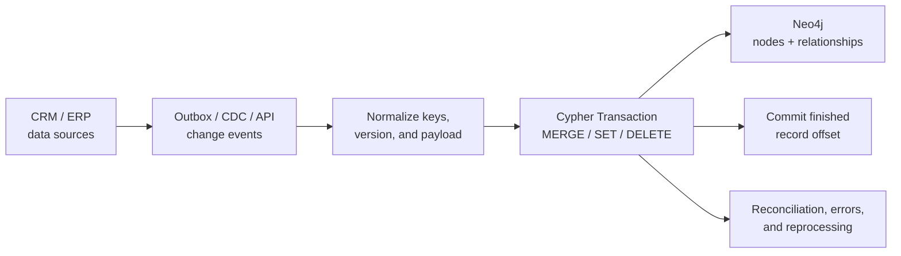

# Mapping Source Create, Update, and Delete Operations

## 1. The Problem: Syncing Source Data into Neo4j

In a system using **Neo4j** to model a *property graph*, nodes represent entities (customers, orders, products) and relationships represent links between them. Data may originate in other operational systems such as CRM, ERP, or relational databases, and then be ingested into Neo4j to query relationships, paths, and patterns with Cypher.

An initial data import is relatively straightforward; the hard part is keeping the graph **accurate across numerous create, update, and delete events**. When the source system changes a customer's email, reassigns an order to another customer, or deletes an order, those changes must be represented consistently in Neo4j. Incorrect synchronization can create duplicate nodes, retain stale relationships, resurrect deleted records due to late-arriving old events, or overwrite properties not owned by that source.

Example data flow:



**Lesson scope:** mapping source `CREATE/INSERT`, `UPDATE`, and `DELETE` operations into equivalent Cypher operations. We will use a CRM/ERP example, verify repeatability (*idempotency*), handle event ordering, and weigh **soft deletes** against **physical deletes**.

After this lesson, you will be able to:

1. Design **stable identifiers** for nodes and relationships coming from multiple sources.
2. Map creates/updates/deletes using `MERGE`, `SET`, `REMOVE`, `DELETE`, and `DETACH DELETE` with accurate semantics.
3. Distinguish **snapshots** from **patches**, and `null` values from fields omitted in an event.
4. Handle duplicate events, out-of-order arrivals, missing referenced nodes, and deletes with attached relationships.
5. Structure processing with Java Driver/Spring Data Neo4j, and measure and reconcile after synchronization.

## 2. From Source Records to the Property Graph

Suppose CRM is the source of truth for customers, and ERP is the source of truth for orders and customer–order links.

| Source System | Record or Link | Neo4j Model | Sync Key |
|---|---|---|---|
| CRM | `customer(id, full_name, email)` | `(:DI003Customer)` | (`sourceSystem`, `sourceId`) |
| ERP | `order(id, status, total_amount)` | `(:DI003Order)` | (`sourceSystem`, `sourceId`) |
| ERP | `order.customer_id` | `(:DI003Customer)-[:DI003_PLACED]->(:DI003Order)` | Endpoint pair if each order has strictly one customer |

```text
(:DI003Customer {
   sourceSystem: "crm",
   sourceId:     "C-001",
   fullName:     "An Nguyễn",
   sourceVersion: 10,
   isDeleted:    false
})
  |
  +--[:DI003_PLACED]--> (:DI003Order {
                           sourceSystem: "erp",
                           sourceId:     "O-100",
                           status:       "CREATED",
                           sourceVersion: 5
                         })
```

The **source business key** (`sourceSystem` + `sourceId`) serves as a stable address to locate a record when subsequent events arrive. Do not use Neo4j's `elementId()` or internal IDs as cross-system sync keys: they are technical identifiers of the current graph, not replacements for long-term source keys.

A `customer.id = 001` in CRM and an `order.id = 001` in ERP are not the same entity. A source-namespaced key prevents collisions and lets you integrate additional systems later.

### 2.1. Input Event Contract

A source event can be normalized into this structure:

```json
{
  "eventId": "crm-c001-v11",
  "sourceSystem": "crm",
  "entityType": "customer",
  "sourceId": "C-001",
  "operation": "UPDATE",
  "version": 11,
  "occurredAt": "2026-10-05T09:15:00Z",
  "changed": {
    "fullName": "An Trần",
    "email": null
  }
}
```

| Field | Purpose | Notes |
|---|---|---|
| `eventId` | Traceability and event deduplication | Must remain stable when the same event is replayed |
| `sourceSystem`, `entityType`, `sourceId` | Select target node/relationship | Never derive keys from display names or emails |
| `operation` | Branch `CREATE / UPDATE / DELETE` | Clearly define soft vs. hard deletion |
| `version` | Reject stale/duplicate events | Must be **monotonically increasing per entity** |
| `occurredAt` | Auditing, monitoring source → graph lag | Do not substitute timestamps for versions without ordering guarantees |
| `changed` | Modified attributes | Distinguish omitted fields from fields sent as `null` |

This example assumes upstream provides a **monotonically increasing version per entity** starting above 0; in other systems this could be a `sequence`, log position, or deterministic ordering token. If only unreliable timestamps exist, add a tie-breaking mechanism when two updates occur close together.

**Distinguish two CDC directions:** outbox/CDC tools reading source logs at CRM/ERP emit events **into Neo4j**. Conversely, the **Neo4j CDC** feature captures changes **originating inside Neo4j** for downstream consumers; it is not an automatic log reader for arbitrary external databases.

## 3. Setting Up Constraints Before Synchronization

In the practice database, create two identity constraints:

```cypher
CREATE CONSTRAINT di003_customer_identity IF NOT EXISTS
FOR (c:DI003Customer)
REQUIRE (c.sourceSystem, c.sourceId) IS UNIQUE;
```

```cypher
CREATE CONSTRAINT di003_order_identity IF NOT EXISTS
FOR (o:DI003Order)
REQUIRE (o.sourceSystem, o.sourceId) IS UNIQUE;
```

Verify the schema:

```cypher
SHOW CONSTRAINTS
YIELD name, type, entityType, labelsOrTypes, properties
WHERE name STARTS WITH 'di003_'
RETURN name, type, entityType, labelsOrTypes, properties
ORDER BY name;
```

**Uniqueness constraints** prevent multiple nodes from having the same non-`null` property pair and back `MERGE` lookups with an index. However, uniqueness constraints **do not enforce property existence**; the ingestion application must still reject empty or null `sourceSystem`/`sourceId` values. When a *node key* enforcing both uniqueness and existence is needed, verify feature support on the running Neo4j edition.

Avoid packing all data into `MERGE`:

```cypher
// WRONG FOR SYNC PURPOSES: email is a mutable field.
// MERGE (c:DI003Customer {
//   sourceSystem: 'crm',
//   sourceId: 'C-001',
//   email: 'an@example.test'
// })
```

When the email changes, that `MERGE` pattern no longer matches the old node and will try to create a new node or trigger a constraint conflict. The resilient pattern is **`MERGE` strictly on identity keys, then `SET` business properties afterward**.

## 4. Mapping CREATE: Creating Nodes with MERGE

Suppose CRM emits customer record `C-001` at version `10`:

```cypher
MERGE (c:DI003Customer {
  sourceSystem: 'crm',
  sourceId: 'C-001'
})
ON CREATE SET
  c.sourceVersion = 0,
  c.isDeleted = false
WITH c
WHERE 10 > c.sourceVersion
SET c.fullName = 'An Nguyễn',
    c.email = 'an@example.test',
    c.sourceVersion = 10,
    c.isDeleted = false,
    c.deletedAt = null
RETURN c.sourceId AS id, c.fullName AS fullName,
       c.sourceVersion AS version;
```

Meaning of each part:

1. `MERGE` locates the customer by **stable key**, creating the node if absent.
2. `ON CREATE SET` initializes version 0; when matching an existing node, it does not reset the version.
3. `WHERE 10 > c.sourceVersion` allows only newer events to update the data.
4. `SET` updates properties; setting `deletedAt = null` **removes the `deletedAt` property** if present.

Re-running the **same query** after version 10 has been written will not update the node because `10 > 10` is false. The re-run may **return 0 rows** due to `WHERE`, yet the node still exists. Verify with a read query:

```cypher
MATCH (c:DI003Customer {
  sourceSystem: 'crm',
  sourceId: 'C-001'
})
RETURN c.sourceId AS id, c.fullName AS fullName,
       c.email AS email, c.sourceVersion AS version,
       c.isDeleted AS isDeleted;
```

Expect **exactly one** node with version `10` and `isDeleted = false`.

To prepare for the order ownership transfer example, create customer `C-002`:

```cypher
MERGE (c:DI003Customer {
  sourceSystem: 'crm',
  sourceId: 'C-002'
})
ON CREATE SET c.sourceVersion = 0
WITH c
WHERE 1 > c.sourceVersion
SET c.fullName = 'Bình',
    c.email = 'binh@example.test',
    c.isDeleted = false,
    c.sourceVersion = 1
RETURN c.sourceId AS id, c.sourceVersion AS version;
```

### 4.1. Mapping Order CREATE

```cypher
MERGE (o:DI003Order {
  sourceSystem: 'erp',
  sourceId: 'O-100'
})
ON CREATE SET o.sourceVersion = 0
WITH o
WHERE 5 > o.sourceVersion
SET o.status = 'CREATED',
    o.totalAmount = 250000,
    o.sourceVersion = 5,
    o.isDeleted = false
RETURN o.sourceId AS id, o.status AS status,
       o.totalAmount AS totalAmount;
```

**Note on write contention:** uniqueness constraints prevent duplicate nodes when two workers process the same key concurrently. However, a `WHERE version > sourceVersion` clause alone **does not guarantee correctness when multiple transactions update the same node in parallel**. In real pipelines, partition events by entity key so updates for the same key run sequentially, or use locking/conditional write mechanisms designed and tested for concurrency.

## 5. Mapping Relationships: Linking Existing Entities

Suppose ERP confirms order `O-100` belongs to customer `C-001`. Before adding the relationship, require **both endpoints to exist**:

```cypher
MATCH (c:DI003Customer {
  sourceSystem: 'crm',
  sourceId: 'C-001'
})
MATCH (o:DI003Order {
  sourceSystem: 'erp',
  sourceId: 'O-100'
})
WHERE coalesce(c.isDeleted, false) = false
  AND coalesce(o.isDeleted, false) = false
MERGE (c)-[r:DI003_PLACED]->(o)
ON CREATE SET r.sourceSystem = 'erp'
RETURN c.sourceId AS customerId, o.sourceId AS orderId;
```

`MERGE`ing the relationship between two **already bound** nodes avoids accidentally creating extra source nodes. Here the model specifies that **each order belongs to only one customer at a time**, so a single `DI003_PLACED` edge suffices to represent the link. If the domain allows multiple ownerships, multiple transactions, or multiple relationships of the same type between the same two nodes, you need a **dedicated key on the relationship record** or an intermediate node; do not assume `MERGE (c)-[:TYPE]->(o)` covers all event types.

When an endpoint does not exist yet because events arrived out of order, `MATCH` cannot create the link. The pipeline must choose a clear rule: **hold the event in a retry/dead-letter queue** until the endpoint appears, or create a flagged placeholder and backfill data later. Never silently drop relationship events; equally, do not synthesize full nodes from an event carrying only reference keys.

Verify the link:

```cypher
MATCH (c:DI003Customer)-[:DI003_PLACED]->(o:DI003Order)
RETURN c.sourceId AS customerId, o.sourceId AS orderId
ORDER BY orderId;
```

Initial expectation: `C-001 → O-100`.

## 6. Mapping UPDATE: Patches, Snapshots, and Null Fields

Sources typically emit **partial update events** or **full entity snapshots**. You must know the payload format before choosing `SET`:

| Event Type | Meaning | Appropriate Cypher |
|---|---|---|
| Patch | Only included fields change | `SET n += $changed` |
| Full snapshot | State of all source-owned attributes | Explicitly assign fields or construct map per schema |
| Field present with `null` | Remove property value | `SET n.prop = null` or `SET n += {prop: null}` |
| Field omitted | Keep existing property in a patch | Omit that field from the `changed` map |
| Explicit property deletion | Field no longer has a value in the graph | `REMOVE n.prop` |

**Crucially:** `SET n += $changed` **modifies only the supplied keys**, whereas `SET n = $properties` **replaces all properties** on the node. Using `SET n = ...` without including `sourceSystem`, `sourceId`, or `sourceVersion` can wipe out identity and metadata. Never use `SET =` with a patch map.

### 6.1. UPDATE Changing Name and Deleting Email

CRM event `C-001 / version 11` changes `fullName` and explicitly deletes `email`:

```cypher
MATCH (c:DI003Customer {
  sourceSystem: 'crm',
  sourceId: 'C-001'
})
WHERE 11 > c.sourceVersion
SET c += {
      fullName: 'An Trần',
      email: null
    },
    c.sourceVersion = 11
RETURN c.sourceId AS id, c.fullName AS fullName,
       c.email AS email, c.sourceVersion AS version;
```

After this query, **the `email` property no longer exists**. In Neo4j, setting a property to `null` **removes the property**, unlike storing a SQL null value in some relational databases. You can also use `REMOVE c.email`.

A patch event changing only the name should pass `changed = {fullName: 'New Name'}` and run `SET c += $changed`; the existing email is preserved. Avoid writing `SET c.email = $email` when the message **omits the email field** and the integration layer fills in `null`: that would unintentionally delete the email.

**Protecting sync metadata:** before passing `$changed` to `SET c += $changed`, the integration layer must filter against an allowlist of updatable properties, stripping control keys such as `sourceSystem`, `sourceId`, `sourceVersion`, and `isDeleted`. Allowing the source to arbitrarily overwrite these keys lets a patch corrupt identity or bypass stale-event protection.

### 6.2. Blocking Stale Updates and Duplicate Replays

After version 11, a version 10 event must be ignored:

```cypher
MATCH (c:DI003Customer {
  sourceSystem: 'crm', sourceId: 'C-001'
})
WHERE 10 > c.sourceVersion
SET c.fullName = 'An Nguyễn',
    c.sourceVersion = 10
RETURN c.sourceVersion AS version;
```

Expect **0 rows**; the name stays `An Trần` and version stays `11`. Similarly, replaying version 11 applies no further changes. If two events share the **same version but carry different payloads**, do not silently treat them as identical valid events: compare `eventId`/checksums and flag an upstream conflict.

Version checks catch stale events, yet **are insufficient** if updates for the same entity are handled by competing concurrent workers. A common solution is partitioning by `sourceSystem + entityType + sourceId` to preserve order, applying changes sequentially inside transactions, and saving checkpoints after commit.

## 7. Mapping Foreign-Key Updates: Changing Relationships

The `order.customer_id` field in ERP changes from `C-001` to `C-002`. Updating `o.customerId` alone **does not automatically update the graph edge**; you must replace the link.

Rule: locate the order and new customer, verify the version, delete stale ownership edges pointing elsewhere, and create the new edge **in the same transaction**.

```cypher
MATCH (newCustomer:DI003Customer {
  sourceSystem: 'crm', sourceId: 'C-002'
})
MATCH (o:DI003Order {
  sourceSystem: 'erp', sourceId: 'O-100'
})
WHERE coalesce(newCustomer.isDeleted, false) = false
  AND coalesce(o.isDeleted, false) = false
  AND 6 > o.sourceVersion
OPTIONAL MATCH (oldCustomer:DI003Customer)
               -[oldRel:DI003_PLACED]->(o)
WHERE oldCustomer <> newCustomer
FOREACH (r IN CASE
    WHEN oldRel IS NULL THEN []
    ELSE [oldRel]
  END | DELETE r)
WITH DISTINCT newCustomer, o
MERGE (newCustomer)-[:DI003_PLACED]->(o)
SET o.sourceVersion = 6
RETURN newCustomer.sourceId AS customerId,
       o.sourceId AS orderId, o.sourceVersion AS version;
```

**Expected result:** `C-002 → O-100`, the `C-001 → O-100` relationship is gone, and the order version is `6`. `OPTIONAL MATCH` handles the case where no prior edge exists; `FOREACH ... DELETE` does nothing when `oldRel` is null. `WITH DISTINCT` ensures a single row per endpoint pair before `MERGE`, avoiding row multiplication if legacy data had multiple relationships.

In production systems, relationship ownership must be explicit. Never delete relationships managed by another source or historical edges required by business retention rules. If history is needed, consider event-based nodes or relationships with `validFrom/validTo` instead of deleting old edges.

## 8. Mapping DELETE: Choosing the Right Policy

A `DELETE` event has at least three distinct interpretations:

| Policy | Representation in Neo4j | When to Use |
|---|---|---|
| **Soft delete (tombstone)** | Keep node, set `isDeleted = true` and version | Need to block stale events from resurrecting data, or support audit/recovery |
| **Delete edge** | `MATCH ...-[r:TYPE]->... DELETE r` | Link record was deleted while endpoints still exist |
| **Hard delete** | `DELETE n` if no relationships remain, or `DETACH DELETE n` | Physical deletion policy exists with external sync-state tracking |

### 8.1. Soft-Deleting a Customer with Version Tracking

CRM emits `DELETE(C-001, version=12)`:

```cypher
MATCH (c:DI003Customer {
  sourceSystem: 'crm', sourceId: 'C-001'
})
WHERE 12 > c.sourceVersion
SET c.isDeleted = true,
    c.sourceVersion = 12,
    c.deletedAt = datetime('2026-10-06T00:00:00Z'),
    c.fullName = null,
    c.email = null
RETURN c.sourceId AS id, c.isDeleted AS deleted,
       c.sourceVersion AS version;
```

The node retains **its source key and version 12** while stripping name/email, so stale version 10 or 11 events will not apply. Business queries must actively filter out deleted nodes, for example:

```cypher
MATCH (c:DI003Customer)
WHERE coalesce(c.isDeleted, false) = false
RETURN c.sourceId AS id, c.fullName AS fullName
ORDER BY id;
```

Expect to see only `C-002` after executing all preceding steps in order. For systems subject to personal-data erasure rules, tombstones should not retain sensitive attributes; retention duration and audit contents must comply with organizational data policies.

### 8.2. Deleting a Relationship Without Deleting Endpoints

Suppose the source removes the link between `C-002` and `O-100`:

```cypher
MATCH (c:DI003Customer {
  sourceSystem: 'crm', sourceId: 'C-002'
})-[r:DI003_PLACED]->
(o:DI003Order {
  sourceSystem: 'erp', sourceId: 'O-100'
})
DELETE r;
```

Re-running the command after the edge is gone matches zero rows and produces no further changes. However, **deleting a relationship from a stale event** can accidentally remove a newly recreated link if there is no `relationshipId`/`version` or proper checkpointing. In real sync pipelines, versioning rules must cover relationship events too, not just nodes.

### 8.3. When to Use DELETE vs. DETACH DELETE

```cypher
// Run only in a learning database, when the node has no remaining edges.
MATCH (o:DI003Order {
  sourceSystem: 'erp', sourceId: 'O-100'
})
DELETE o;
```

`DELETE o` cannot delete a node that still has relationships. `DETACH DELETE o` deletes both the node **and all attached relationships**, including edges created by other teams. Therefore, never use `DETACH DELETE` as the default when cross-source links or history must be preserved.

When physically deleting a node, you lose the `sourceVersion` stored on that node. A stale `CREATE` event could recreate the record. To hard-delete safely under *at-least-once* delivery, maintain an **external ledger/tombstone outside the deleted node** (such as an ingestion table storing offsets and versions per source key), or obtain upstream guarantees that stale events can no longer arrive. Deleting the node alone does not mean sync state is fully handled.

## 9. From Snapshot to CDC Stream: Avoiding Data Loss and Duplicates

A pipeline typically has two phases:

1. **Snapshot:** load the initial baseline using `UNWIND` and `MERGE` by source key. Record a watermark/offset at the snapshot boundary using the source event system's mechanism.
2. **Streaming:** read changes after the watermark from logs/outbox/APIs, processing in order within each entity's scope. Persist the consumed offset **only after the Neo4j transaction commits successfully**.

If the snapshot and CDC **lack a consistent boundary**, updates occurring while the snapshot is being read can be missed. Follow the snapshot/CDC procedure provided by the source platform with recoverable offsets; do not guess an arbitrary wall-clock timestamp and treat it as equivalent to a transaction log sequence.

### 9.1. Batching Multiple Records with UNWIND

Suppose you receive a **complete snapshot** batch of customers with positive versions, ordered per key. You can pass the `$rows` parameter:

```json
[
  {
    "sourceId": "C-010",
    "version": 2,
    "fullName": "Lan",
    "email": "lan@example.test"
  },
  {
    "sourceId": "C-011",
    "version": 3,
    "fullName": "Minh",
    "email": "minh@example.test"
  }
]
```

```cypher
UNWIND $rows AS row
WITH row
WHERE row.sourceId IS NOT NULL AND row.version IS NOT NULL
MERGE (c:DI003Customer {
  sourceSystem: 'crm', sourceId: row.sourceId
})
ON CREATE SET c.sourceVersion = 0
WITH c, row
WHERE row.version > c.sourceVersion
SET c.fullName = row.fullName,
    c.email = row.email,
    c.isDeleted = false,
    c.sourceVersion = row.version
RETURN count(c) AS appliedCount;
```

In this example, `appliedCount` is the **number of updated rows** in the batch, which does not prove there are that many distinct entities if the batch contains duplicate keys. In real streams, deduplicate/enforce order **before** batching or keep only the latest version per key within a batch. Specifically, `UNWIND` **does not inherently guarantee execution ordering**; never rely on array element order to enforce version semantics.

Batch limits should be tuned using measurements of heap, transaction duration, locks, DB Hits, and throughput. Very large batches hold locks longer, increase memory usage, and risk timeouts. You can batch at the consumer layer or use **`CALL { ... } IN TRANSACTIONS`** for suitable import tasks, paying attention to transaction boundaries and runtime context; do not nest it inside an outer Java Driver managed transaction.

### 9.2. Idempotency and Exactly-Once Considerations

Distributed streams should generally be designed around **at-least-once delivery + idempotent writes**:

- `MERGE` on stable keys prevents creating duplicate nodes for the same record; uniqueness constraints backstop concurrent writes.
- `sourceVersion` skips stale/duplicate events when per-key processing order is enforced.
- `eventId` detects differing payloads sharing the same version for auditing and debugging.
- Checkpoints/offsets are committed **only after database commit**; if commit succeeds but checkpointing fails, replaying the event must be safe.
- When the source and Neo4j live in **two separate transactional systems**, do not claim end-to-end exactly-once semantics without an actual coordination mechanism. Practice aims for an **effectively-once end state** via safe replays.

If a single event mutates **multiple entities** that must succeed or fail together, execute the relevant Cypher statements **within one Neo4j transaction**, without assuming that a Neo4j transaction encompasses commits/acks in Kafka, queues, or the source database.

## 10. Applying with Java Driver and Spring Data Neo4j

The Java Driver provides `executeWrite` to run write transactions with retries for transient errors. **The callback may be executed more than once**, so external side effects (sending emails, incrementing global counters, acknowledging messages) must never be placed inside the callback. Pass parameters instead of concatenating input strings into Cypher:

```java
String cypher = """
    MERGE (c:DI003Customer {
      sourceSystem: $sourceSystem,
      sourceId: $sourceId
    })
    ON CREATE SET c.sourceVersion = 0
    WITH c
    WHERE $version > c.sourceVersion
    SET c += $changed,
        c.sourceVersion = $version,
        c.isDeleted = false
    RETURN c.sourceId AS id
    """;

var params = java.util.Map.<String, Object>of(
    "sourceSystem", "crm",
    "sourceId", "C-020",
    "version", 4L,
    "changed", java.util.Map.of("fullName", "Hà")
);

try (var session = driver.session()) {
    var result = session.executeWrite(tx ->
        tx.run(cypher, params).list()
    );
    System.out.println("Applied rows: " + result.size());
}
```

This snippet assumes `driver` (`org.neo4j.driver.Driver`) is properly configured. Never pass `null` into `Map.of(...)` since Java prohibits null values in immutable `Map.of`. For payloads containing fields to delete (`email: null`), use a `HashMap` (which permits null values), or construct parameters and handle deleted fields explicitly per the input contract. On the Neo4j side, `SET c += $changed` with a null value **removes** the corresponding property.

**Note on retries and ordering control:** the driver retries transient errors within a transaction; it does not coordinate event versions across multiple consumers. If multiple workers can update the same `sourceId` simultaneously, the pipeline needs dedicated concurrency handling.

In **Spring Data Neo4j (SDN)**, entities can be mapped with `@Node`, `@Id`, `@Relationship`, and repositories, though CDC patch updates, event-driven relationship deletions, or version checks often fit better with explicit parameterized Cypher via `Neo4jClient`. Distinguish calling `save()` on a mapped aggregate from an event updating **a single field**: never assume `save()` has partial-patch semantics. In multi-source integrations, choosing a persistence approach must consider field ownership, dirty checking, and relationship handling in your specific SDN version.

## 11. Reconciliation, Observability, and Error Handling

A solid pipeline must prove target data mirrors the source, not merely count processed messages.

### 11.1. Verifying the Graph After the Example Sequence

After running the operations **in order from Section 4 through Section 8.1** (excluding the edge deletion in 8.2 and hard delete in 8.3), expect:

| Entity | Final State | Version |
|---|---|---:|
| `C-001` | `isDeleted = true`; `fullName/email` removed | 12 |
| `C-002` | Active, still has email `binh@example.test` | 1 |
| `O-100` | Active, belongs to `C-002` | 6 |

Quick check:

```cypher
MATCH (c:DI003Customer)
WHERE c.sourceSystem = 'crm'
  AND c.sourceId IN ['C-001', 'C-002']
RETURN c.sourceId AS customerId, c.isDeleted AS isDeleted,
       c.fullName AS fullName, c.email AS email,
       c.sourceVersion AS version
ORDER BY customerId;
```

```cypher
MATCH (o:DI003Order {
  sourceSystem: 'erp', sourceId: 'O-100'
})
OPTIONAL MATCH (c:DI003Customer)-[:DI003_PLACED]->(o)
RETURN o.sourceId AS orderId,
       o.sourceVersion AS orderVersion,
       collect(c.sourceId) AS currentCustomerIds;
```

Expect `orderVersion = 6` and `currentCustomerIds = ['C-002']`. If the query returns multiple customers, the one-order–one-customer rule has been violated; inspect ownership transfer events or stale link records.

### 11.2. Pipeline Monitoring Metrics

| Category | Metrics | Detects |
|---|---|---|
| Event stream | Current offset, event lag, consumption rate | Sync delays or stalls |
| Data quality | Empty keys, missing endpoints, version conflicts | Invalid or out-of-order events |
| Graph | Node counts by source, orphan nodes, business edge counts | Data drift between source and Neo4j |
| Reliability | Retries, dead-letter count, poison messages, duplicate rate | Recurring errors, unprocessable data |
| Performance | Transaction latency p50/p95, QPS, DB Hits, CPU, heap | Bottlenecks in batching/constraints/indexes |

Strong reconciliation also requires **per-source checkpoints**, entity counts by status, queries for missing keys, latest-version comparisons, and random spot-checks of attributes/relationships. Matching `count(*)` between two systems is not enough to prove identical data: two datasets can have equal counts while differing in keys and links.

### 11.3. Error Classification and Remediation

| Scenario | Common Cause | Action |
|---|---|---|
| `MERGE` with `sourceId = null` | Missing upstream key | Validate, send to dead-letter queue, never write unidentified nodes |
| Uniqueness constraint violation | Duplicate key / collision with legacy data | Reconcile identity, fix migration/duplicates; never drop constraints |
| Relationship endpoint not found | Event arrived before referenced CREATE | Bounded retry or create placeholder per convention |
| Version lower than current | Replay / out-of-order arrival | Safely ignore, increment stale counter; investigate if abnormal |
| Same version, different payload | Upstream conflict | Log conflict, never arbitrarily pick the later-arriving message |
| Transient transaction failure | Lock contention / brief disconnect | Idempotent retry with driver backoff |
| Unable to determine safe physical delete | Missing tombstone/ledger or unclear ownership | Defer hard delete, design checkpoint/retention policy |

## 12. Implementation Workflow and Practice Exercises

When building a source → Neo4j integration, you can follow this workflow:

1. **Lock down ownership and keys:** which system owns each entity; are keys unique and immutable; are relationships one-to-one, one-to-many, or multi-valued?
2. **Define the event contract:** snapshot vs. patch, versions, `eventId`, null rules, deletes, and foreign keys.
3. **Create constraints and test with small data:** cover create/update/delete, replays, out-of-order events, and missing relationship endpoints.
4. **Map Cypher transactions:** `MERGE` only keys, `SET` properties, update relationships on foreign-key changes; use parameters.
5. **Design operations:** snapshot watermarks, post-commit offsets, retry/dead-letter queues, per-key ordering, and race prevention.
6. **Reconcile by keys and relationships:** compare counts, latest versions, detect dirty data, and benchmark batch sizes.

### Exercises

1. **Idempotency:** re-run the `C-001` version 10 CREATE query twice after the graph is already at version 11. Which query proves the name and email were not reverted?
2. **Snapshots and patches:** consider three payloads: `{}`, `{email: null}`, and `{email: 'new@example.test'}`. Predict the result of `SET c += $changed` for each case.
3. **Foreign-key change:** move `O-100` from `C-001` to `C-002`; verify the order has strictly one `DI003_PLACED` edge.
4. **Physical deletion:** explain why `DETACH DELETE` on `C-001` can cause data loss outside the source's scope; propose a way to prevent stale version replays from recreating the node.
5. **CDC batching:** given out-of-order events with versions `[4, 6, 5, 6]` for the same customer, outline how to partition, order/deduplicate before writing; explain why `UNWIND` alone is insufficient.
6. **Business scenario:** a customer is deleted from CRM, yet orders must be retained for ERP reconciliation. How will you handle keeping/deleting the customer node, relationship links, personal fields, and version?

**Completion criteria:** the learner accurately explains `MERGE` on keys, distinguishes `SET +=` from `SET =`, handles nulls and omitted fields, avoids duplicating nodes/relationships, understands why version + per-key ordering are needed, and designs deletion policies aligned with ownership.

### Cleaning Up Sample Data

Run only in your practice database after completing verification; the following statements delete the sample nodes and all attached relationships:

```cypher
MATCH (c:DI003Customer)
DETACH DELETE c;
```

```cypher
MATCH (o:DI003Order)
DETACH DELETE o;
```

```cypher
DROP CONSTRAINT di003_customer_identity IF EXISTS;
```

```cypher
DROP CONSTRAINT di003_order_identity IF EXISTS;
```

## 13. References

- [Neo4j Cypher Manual — MERGE](https://neo4j.com/docs/cypher-manual/current/clauses/merge/): identity matching, `ON CREATE`/`ON MATCH`, constraints, and `MERGE` on patterns.
- [Neo4j Cypher Manual — SET](https://neo4j.com/docs/cypher-manual/current/clauses/set/): `SET =`, `SET +=`, property mutation, and null handling.
- [Neo4j Cypher Manual — DELETE](https://neo4j.com/docs/cypher-manual/current/clauses/delete/): deleting nodes, relationships, and `DETACH DELETE`.
- [Neo4j Java Driver Manual — Transactions](https://neo4j.com/docs/java-manual/current/transactions/): managed write transactions, retries, and idempotency.
- [Neo4j Change Data Capture — Introduction](https://neo4j.com/docs/cdc/current/): distinguishing Neo4j CDC (where Neo4j is the source of changes) from pipelines ingesting external source changes.
