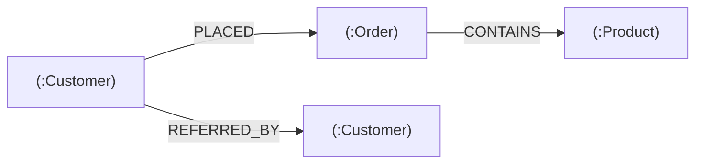
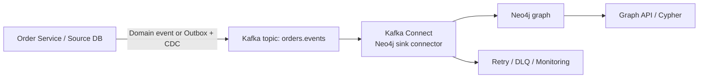
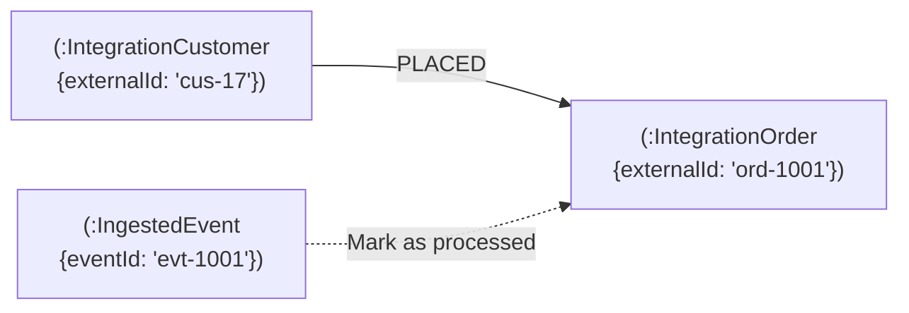

# Integrating Event Streams and Connectors Driven by Business Requirements

In a **Neo4j**-based system, connected data often arrives from multiple sources: transactional applications, CRMs, relational databases, data warehouses, and event-emitting services. When the graph must reflect continuous changes—instead of re-importing everything daily via CSV—the architecture can use **event streams** and **connectors** to turn mutations into nodes, relationships, and properties in Neo4j.

However, not every application needs Kafka or a connector. The decision must stem from **business requirements**: data freshness, number of sources, reliability, change rate, recoverability, and operational cost. This lesson belongs to the **Data Integration** chapter of the **DATABASE_ENGINE_GRAPH_NEO4J** module: the **property graph** model is updated with **Cypher**, using options such as Neo4j Connector for Apache Kafka, Kafka Connect, the **Neo4j Java Driver**, and **Spring Data Neo4j**.

## 1. When Does a Problem Truly Need Events and Connectors?

Suppose an e-commerce platform records transactions in an Order Service. Neo4j maintains a graph to analyze relationships among customers, orders, and products:



If the orders table changes continuously, the graph can serve queries like "what did this customer just order?", "which products are frequently bought together?", or "who in the referral network just placed a new order?". The right synchronization mechanism depends on how fresh the data needs to be:

| Requirement | Option to Consider | Why |
| --- | --- | --- |
| One-time historical load, rarely changing graph | CSV, `LOAD CSV`, bulk import | Few moving parts, straightforward to verify |
| Nightly or multi-hour updates | Scheduled ETL/batch, incremental import | High latency tolerance, easy to organize in batches |
| Single application transaction needing immediate graph writes | Java Driver or Spring Data Neo4j inside the app workflow | Less infrastructure without a broker; must handle cross-system failures |
| Multiple event producers, multiple consumers, near-real-time updates | Broker (e.g., Kafka) + connector/consumer | Decouples producers/consumers, supports retention and replay |
| Streaming source DB changes when the app doesn't emit domain events | CDC + connector, optionally via a broker | Converts database mutations into a stream |
| Data updated only a few times per month | Controlled batch or manual import | Streaming overhead likely outweighs benefits |

**The deciding question:** does the graph need to be fresh within seconds, minutes, or by end of day? If only end-of-day reporting is required, a streaming stack may be unnecessary. If the graph powers operational features immediately after every transaction at high volume, streaming is much better justified.

## 2. Distinguishing Events, Streams, Brokers, and Connectors

- **Event:** a record that something happened, such as `OrderPlaced`, typically carrying an ID, payload, and timestamp.
- **Event stream:** a time-ordered sequence of emitted events that can be retained, read by offset, and replayed.
- **Broker:** infrastructure that ingests, persists, and distributes streams to consumers; Apache Kafka is a common example.
- **Connector:** a packaged integration component for a source or target system. With Kafka, **Kafka Connect** manages connector workers/tasks; a connector can read from a source (**source**) or write to a target (**sink**).
- **Custom consumer:** an application that reads messages, validates data, maps them to Cypher, and writes via the Neo4j Driver.

**Neo4j Connector for Apache Kafka** integrates Neo4j with Kafka across roles/strategies supported by each connector version. When acting as a **sink**, records from Kafka become Neo4j write operations. When acting as a **source**, data or changes from Neo4j can be published to Kafka using mechanisms supported by the connector and environment. **Capabilities, configuration property names, and version/edition requirements vary by release**; always consult the docs for your exact deployed connector version.

> The name "Neo4j Streams" often appears in older articles or legacy systems. Never assume configuration snippets for Neo4j Streams are compatible with current Neo4j Connector for Apache Kafka releases.

## 3. Typical Architecture: Application → Kafka → Neo4j

A common pattern for a query-serving graph is:



Processing flow:

1. The **source** writes a transaction and produces an event with clear identity and schema.
2. The event lands on the appropriate broker **topic**.
3. The **connector or consumer** receives the message, applies necessary structural transformations, and executes Cypher.
4. Neo4j **commits** graph mutations inside a transaction.
5. Only then does the consumer/connector acknowledge progress using the system's offset mechanism.
6. On failure, the system separates transient issues needing retries from malformed data needing separate handling.

Neo4j's commit point and Kafka's offset commit point are **two separate boundaries**. If Neo4j commits and the consumer disconnects before committing the offset, the event will be redelivered. Therefore, **design for duplicate handling** from day one; never assume "every message is applied strictly once."

### Domain Events, Outbox, and CDC: Different Emission Sources

| Emission Method | Data Emitted | Strengths | Caveats |
| --- | --- | --- | --- |
| **Domain event** from app | Business semantics, e.g., `OrderPlaced` | Expresses domain intent cleanly | If app writes DB then publishes separately, one side can fail |
| **Transactional outbox** | Event stored in the same transaction as business mutations | Prevents "DB committed but intent to publish lost" | Requires a process/connector reading outbox, publishing, and handling duplicates |
| **CDC (Change Data Capture)** on source DB | Storage-level row/table changes | Minimal app code changes; suited for data replication | Raw row changes lack full domain intent; requires mapping and schema handling |
| **App writes directly to Neo4j** | Cypher commands / graph objects | Simple when few systems are involved | Risk of dual-write inconsistency if writing another datastore simultaneously |

**Dual-write** occurs when a single request attempts to write to two independent systems hoping both succeed. The source database's transaction does not span Neo4j's transaction. For critical business data, outbox + idempotent consumption is usually safer than firing events outside a transaction.

## 4. Designing the Event Contract Before Writing Cypher

Example of a new-order event:

```json
{
  "eventId": "evt-1001",
  "eventType": "OrderPlaced",
  "schemaVersion": 1,
  "aggregateId": "ord-1001",
  "aggregateVersion": 1,
  "occurredAt": "2026-11-25T03:10:00Z",
  "customerId": "cus-17",
  "orderId": "ord-1001",
  "amount": 259000,
  "currency": "VND"
}
```

Fields should have explicit responsibilities:

| Field | Purpose |
| --- | --- |
| `eventId` | Unique event identifier to detect replays/duplicates |
| `eventType` | Determines business type and handler logic |
| `schemaVersion` | Supports schema evolution and selects decoding logic |
| `aggregateId` | Source entity identifier; commonly used as the **Kafka message key** |
| `aggregateVersion` | Mutation order within an aggregate, if source guarantees monotonicity |
| `occurredAt` | Business occurrence timestamp; distinct from consumer arrival time |
| `customerId`, `orderId` | Keys used to `MERGE` nodes/relationships |
| `amount`, `currency` | Business properties requiring exact units and types |

Within a Kafka topic, using `orderId` as the **message key** normally routes all events for the **same order** to the same partition. Kafka preserves message order **within a single partition**, not globally across all orders or all topics. If a single aggregate emits events from multiple independent streams, ordering must be enforced at the data layer.

### Contract Principles to Agree On

1. **Stable identifiers** from the source system; never generate a fresh `randomUUID()` each time the same event is consumed.
2. **Versioned schemas** with compatibility rules when producers add or modify fields.
3. **Timezone-aware timestamps**, or a consistent UTC convention.
4. **Exact data types**: monetary values may need integers in minor currency units to avoid rounding errors; never mix currencies.
5. **Required mapping keys**: a relationship-creating event must include both endpoint IDs, or define explicit rules when an endpoint does not exist yet.
6. **Data minimization**: emit only fields Neo4j actually needs; avoid putting sensitive fields in topics/logs without authorization.

## 5. Preparing the Graph Model and Constraints

For `OrderPlaced`, we want to create:



`IngestedEvent` is an ingestion metadata node, not necessarily part of the domain graph. It tracks processed events inside the **same transaction** as graph mutations. In production, you can also use another idempotency store with appropriate transactional boundaries.

On the **practice database**, create constraints:

```cypher
CREATE CONSTRAINT integration_customer_id_unique IF NOT EXISTS
FOR (c:IntegrationCustomer)
REQUIRE c.externalId IS UNIQUE;
```

```cypher
CREATE CONSTRAINT integration_order_id_unique IF NOT EXISTS
FOR (o:IntegrationOrder)
REQUIRE o.externalId IS UNIQUE;
```

```cypher
CREATE CONSTRAINT ingested_event_id_unique IF NOT EXISTS
FOR (e:IngestedEvent)
REQUIRE e.eventId IS UNIQUE;
```

Constraints prevent duplicate nodes per business key and support `MERGE`. **They do not automatically guarantee every external side effect runs once**, nor do they resolve all concurrent write contention; consumers mutating the same aggregate still require explicit partitioning/concurrency design.

## 6. Writing Re-Runnable Safe Cypher

The following Cypher assumes event fields are validated and supplied via **parameters** by a connector or consumer. Handling an `OrderPlaced` event:

```cypher
MERGE (mark:IngestedEvent {eventId: $eventId})
ON CREATE SET
    mark.applied = false,
    mark.firstSeenAt = datetime()
WITH mark
WHERE mark.applied = false
MERGE (customer:IntegrationCustomer {externalId: $customerId})
MERGE (o:IntegrationOrder {externalId: $orderId})
ON CREATE SET o.createdAt = datetime($occurredAt)
MERGE (customer)-[:PLACED]->(o)
SET o.amount = $amount,
    o.currency = $currency,
    o.status = 'PLACED',
    o.sourceVersion = $aggregateVersion,
    mark.applied = true,
    mark.appliedAt = datetime()
RETURN o.externalId AS orderId;
```

To run manually in Neo4j Browser without a connector, use `:param` (depending on the UI) or bind values inline via `WITH`:

```cypher
WITH {
  eventId: 'evt-1001',
  customerId: 'cus-17',
  orderId: 'ord-1001',
  amount: 259000,
  currency: 'VND',
  aggregateVersion: 1,
  occurredAt: '2026-11-25T03:10:00Z'
} AS event
MERGE (mark:IngestedEvent {eventId: event.eventId})
ON CREATE SET mark.applied = false,
              mark.firstSeenAt = datetime()
WITH mark, event
WHERE mark.applied = false
MERGE (customer:IntegrationCustomer {externalId: event.customerId})
MERGE (o:IntegrationOrder {externalId: event.orderId})
ON CREATE SET o.createdAt = datetime(event.occurredAt)
MERGE (customer)-[:PLACED]->(o)
SET o.amount = event.amount,
    o.currency = event.currency,
    o.status = 'PLACED',
    o.sourceVersion = event.aggregateVersion,
    mark.applied = true,
    mark.appliedAt = datetime()
RETURN o.externalId AS orderId;
```

**First run:** returns `ord-1001` and creates the nodes/relationship. **Second run with the same `eventId`:** `WHERE mark.applied = false` filters out the already-applied message, skipping the business creation/update block. Returning **0 rows** on a replay here signals **already processed**, not an automatic error.

You can verify:

```cypher
MATCH (c:IntegrationCustomer {externalId: 'cus-17'})
      -[r:PLACED]->(o:IntegrationOrder {externalId: 'ord-1001'})
RETURN c.externalId AS customerId,
       o.externalId AS orderId,
       o.status AS status,
       o.sourceVersion AS sourceVersion,
       count(r) AS relationshipCount;
```

```cypher
MATCH (e:IngestedEvent {eventId: 'evt-1001'})
RETURN e.eventId AS eventId,
       e.applied AS applied,
       e.appliedAt AS appliedAt;
```

In a clean single-stream test environment per aggregate, the expected `PLACED` relationship count is **1**, with `applied = true`. Verifying actual record/relationship counts remains essential when running concurrently, importing from multiple sources, or recovering legacy data.

### Why Must the Marker Be in the Same Transaction?

Suppose the consumer persists the order first and **only then** writes the marker in a separate transaction. If the process crashes in between, the order exists without a marker. Upon retry, non-idempotent logic (like adding funds) could execute twice. Conversely, committing the marker before the business update risks losing the actual update on crash.

When both the marker and graph mutations live **inside one Neo4j transaction**, they either commit together or roll back together. This handles Neo4j-local failures cleanly; however, if event handling touches external systems outside Neo4j, separate safeguards are still needed for those side effects.

### Limitations of This Example

- This handles **the initial order creation event**. If a cancellation event arrived earlier or the order already reached a newer version, `SET o.status = 'PLACED'` could **regress state**; multi-event pipelines must enforce version and ordering guards.
- Parallel consumers processing the same `eventId` or endpoint pair can contend. **Unique constraints** protect node identity, whereas concurrent write safety requires explicit locking, partitioning, transaction design, and concurrency testing.
- Retaining markers forever accumulates graph metadata. Define retention policies while recognizing that purging markers reduces detection of very old replays.
- Here `amount` is passed as an integer in VND; define explicit rules for `null`, negative numbers, and multi-currency handling before production use.

## 7. Event Ordering and Version-Guarded Updates

Suppose a source emits an order's event sequence:

```text
OrderPlaced    version = 1
OrderPaid      version = 2
OrderCancelled version = 3
```

In distributed systems, a consumer might **receive** version 2 again after version 3 due to retries, partition reassignments, or multiple sources. Blindly running `SET o.status` from the latest arrived message could flip the graph back from `CANCELLED` to `PAID`.

A simple rule for **monotonically increasing `aggregateVersion`** allows updates only when the incoming version exceeds the stored one:

```cypher
MATCH (o:IntegrationOrder {externalId: $orderId})
WHERE coalesce(o.sourceVersion, 0) < $aggregateVersion
SET o.status = $status,
    o.sourceVersion = $aggregateVersion,
    o.updatedAt = datetime($occurredAt)
RETURN o.externalId AS orderId,
       o.sourceVersion AS appliedVersion;
```

Interpretation table:

| Current Graph State | Incoming Event | Logical Action |
| --- | --- | --- |
| Version 1 | Version 2 | Accept update |
| Version 3 | Version 2 | Ignore stale event |
| Version 3 | Version 3 | Treat as duplicate or verify `eventId` |
| Order does not exist yet | Version 3 | Handle missing baseline: wait, recover, or dead-letter |

**Concurrency warning:** checking `WHERE` then `SET` in a Cypher query **does not replace** synchronization when multiple consumers can write the same aggregate simultaneously. Partition by aggregate key, serialize processing per stream, and verify locking/transaction behavior. When stricter ordering is needed, add explicit synchronization or lock-verified conditional updates.

**`occurredAt` is not a version.** Machine clocks skew across hosts; message arrival time is even less reliable as business order. If the source lacks stable versions, define explicit ordering/priority rules instead of assuming "last event received is newest."

## 8. Neo4j Kafka Connector vs. Custom Consumer Application

### 8.1. Using Neo4j Connector for Apache Kafka

A **sink connector** lets Kafka Connect drive the pipeline from topics into Neo4j. Typical deployment tasks include:

1. Selecting a connector version compatible with Kafka Connect and Neo4j.
2. Configuring the **Neo4j connection** (URI, auth, TLS), topic names, and converters/schemas.
3. Choosing how to **map events to Cypher** using strategies supported by that connector release.
4. Defining **retry** mechanics, error tolerance policies, and a **dead-letter queue (DLQ)** if supported.
5. Tuning task counts, batch sizes, and rate limits to avoid overloading Neo4j.
6. Testing commits, replays, and deduplication before scaling traffic.

Example **logical** fields to configure (not a copy-paste config for a specific release):

```text
Connector role:       Kafka Connect Sink -> Neo4j
Topics:               orders.events
Kafka record key:     orderId
Message format:       JSON / Avro / Protobuf matching converter
Neo4j URI:            neo4j+s://<host>
Authentication:       least-privilege account
Cypher mapping:       MERGE Customer/Order + PLACED relationship
Error handling:       bounded retries + DLQ + alerting
Observability:        consumer lag, failed records, latency
```

**Exact technical property names** such as `connector.class`, strategy keys, query templates, and Neo4j parameters **differ across versions**. Never guess field names. Consult the official docs for your installed Neo4j Connector for Apache Kafka version and test in staging before production rollout.

If you have only one source and highly custom mapping logic, a connector may still demand complex transformations—a sign to consider a custom consumer app.

### 8.2. Custom Consumer with the Neo4j Java Driver

When business logic requires complex validation, internal service calls, event-type branching, or tailored retry policies, a team-managed Kafka consumer may fit better. Example handler for a **validated/parsed** event:

```java
import org.neo4j.driver.Driver;
import org.neo4j.driver.Session;

import java.util.Map;

public final class OrderEventProjector {
    private final Driver driver;

    public OrderEventProjector(Driver driver) {
        this.driver = driver;
    }

    public void onOrderPlaced(Map<String, Object> event) {
        try (Session session = driver.session()) {
            session.executeWrite(tx -> {
                tx.run("""
                    MERGE (mark:IngestedEvent {eventId: $eventId})
                    ON CREATE SET mark.applied = false,
                                  mark.firstSeenAt = datetime()
                    WITH mark
                    WHERE mark.applied = false
                    MERGE (c:IntegrationCustomer {externalId: $customerId})
                    MERGE (o:IntegrationOrder {externalId: $orderId})
                    ON CREATE SET o.createdAt = datetime($occurredAt)
                    MERGE (c)-[:PLACED]->(o)
                    SET o.amount = $amount,
                        o.currency = $currency,
                        o.status = 'PLACED',
                        o.sourceVersion = $aggregateVersion,
                        mark.applied = true,
                        mark.appliedAt = datetime()
                    """, event
                ).consume();
                return null;
            });
        }
    }
}
```

**Parameter binding:** `tx.run` accepts the `event` `Map<String,Object>` directly—never concatenate map values into Cypher strings. Input fields must pass schema, numeric type, timestamp, and required-value checks before invoking this method.

`session.executeWrite(...)` manages the transaction and may retry the callback on eligible transient errors. Therefore, the callback must perform only **retry-safe Neo4j work**; never send emails or publish external messages inside the callback without an idempotency strategy.

**Commit Kafka offsets only after the Neo4j transaction succeeds** per your chosen consumer API. With auto-commit offsets, understand exactly when offsets can be committed; never treat auto-commit as a default business guarantee. Also handle the case where DB commit succeeds but offset ack fails → message is re-read.

### 8.3. Where Does Spring Data Neo4j Fit?

If a Spring application consumes the stream, **Spring Data Neo4j** repositories or `Neo4jClient` can write to the graph inside a properly scoped `@Transactional` boundary. Ensure the transaction manager and entity mappings are configured accurately.

A Neo4j transaction **does not automatically merge** with Kafka offset commits or relational DB transactions. While Spring supports multiple transaction managers, **never assume** a single `@Transactional` annotation provides atomic commits across brokers, source DBs, and Neo4j. Replay/idempotency design remains mandatory.

## 9. Errors, Retries, and DLQs: Ensuring System Recoverability

Events can fail in different ways:

| Error Group | Example | Typical Handling |
| --- | --- | --- |
| **Transient** | Neo4j connection drop, leader switch, busy server | Bounded retry with backoff; monitor failure counts |
| **Schema error** | Missing `orderId`, bad `schemaVersion`, invalid `amount` type | Route to DLQ/quarantine, fix contract or bad data |
| **Business rule error** | Canceling a nonexistent order, invalid product reference | Defer processing, enrich via lookup, or DLQ per policy |
| **Duplicate event** | Same `eventId` redelivered | Safely ignore or apply idempotently |
| **Out-of-order** | Version 2 arrives after version 3 | Check version, do not regress state |
| **Security** | Connector lacks graph write permissions, invalid TLS cert | Fix permissions/config; do not infinitely retry identical auth errors |
| **Overload** | High lag, slow transactions, heavy lock contention | Reduce concurrency/batching, scale carefully, tune indexes/Cypher |

A **DLQ (dead-letter queue)** holds messages that cannot be processed safely in the main flow, along with diagnostic metadata. A DLQ is not a "data trash bin": establish review workflows, root-cause fixes, controlled replays, and safeguards for sensitive data.

### Three Points Where Data Loss or Duplication Commonly Occur

```mermaid
sequenceDiagram
    participant K as Kafka
    participant C as Connector/Consumer
    participant N as Neo4j
    K->>C: Deliver eventId=evt-1001
    C->>N: Cypher transaction
    N-->>C: Commit succeeded
    Note over C,K: Consumer fails before committing offset
    K->>C: Redeliver evt-1001
    C->>N: Check idempotency marker
    N-->>C: Already processed; skip duplicate write
    C-->>K: Commit progress
```

Here, idempotency checking matters far more than assuming the broker or connector provides **end-to-end exactly-once**. Exactly-once guarantees inside a single component do not automatically create a **distributed transaction** spanning Kafka, Neo4j, and external sources.

## 10. Coordinating Graph Initialization with Incremental Sync

Many systems already hold millions of orders **before** event streaming is enabled. Consuming only new events leaves the graph missing historical records. A complete workflow typically needs:

1. **Initial snapshot/backfill:** ingest historical data in controlled batches (CSV/ETL/driver).
2. **Mark stream starting point:** record an offset or CDC boundary via a source-supported mechanism.
3. **Run the incremental stream:** apply changes occurring after the established boundary.
4. **Handle overlaps/gaps:** events may appear in both snapshot and stream; rely on upserts/idempotency.
5. **Periodic reconciliation:** compare totals, ID samples, logical checksums, or aggregate counts between source and graph.

There is no universally safe naive "run snapshot first, start stream second" sequence: mutations occurring **between** the two steps without coordination can be lost. Use an official snapshot + CDC/offset workflow from your source tooling or design explicit gap protection. A plain application wall-clock timestamp is often insufficient.

Example count checks in Neo4j:

```cypher
MATCH (o:IntegrationOrder)
RETURN count(o) AS orderCount;
```

```cypher
MATCH (:IntegrationCustomer)-[r:PLACED]->(:IntegrationOrder)
RETURN count(r) AS placedRelationshipCount;
```

Counts are only a coarse sanity check. Two systems can have identical record counts while **differing in IDs, properties, or relationships**; cross-check samples and critical business invariants.

## 11. Deciding How Events Update the Graph Model

An event may carry relationship information where one endpoint node might not exist yet.

For example, `ProductAddedToOrder` carries `orderId` and `productId`. Three strategies exist:

| Strategy | Implementation | Best When |
| --- | --- | --- |
| **Wait for both nodes** | `MATCH` both endpoints; if missing, defer/retry with bounds | Relationships may only link already-existing entities |
| **Create placeholders** | `MERGE` missing node, backfill attributes when later event arrives | Domain tolerates temporary incomplete nodes |
| **Enrich via lookup** | Consumer fetches missing entity via source API/query before writing | Immediate completeness needed, accepting extra latency/coupling |

Example **creating the relationship only when both endpoints exist**:

```cypher
MATCH (o:IntegrationOrder {externalId: $orderId})
MATCH (p:IntegrationProduct {externalId: $productId})
MERGE (o)-[:CONTAINS]->(p)
RETURN o.externalId AS orderId,
       p.externalId AS productId;
```

If either node is missing, the query returns **0 rows without throwing an exception**. The consumer must check the result and act per business policy. Treating 0 rows as success acks the message while the required edge is never created.

### Should Events Embed Full Payloads?

Fat events reduce source lookups at the sink, but increase message size and stale-snapshot risks. Thin ID-only events are smaller, yet force consumers to query the source, adding network coupling, version races, and point-in-time skew.

Choose payload granularity based on **autonomous processing needs**, **data immutability**, and **security boundaries**. Avoid copying broad personal data into streams merely because the graph "might" use it later.

## 12. Operating and Monitoring the Pipeline

Beyond verifying Cypher works, an event-integration pipeline requires continuous monitoring:

| Metric / Check | What Does It Reveal? |
| --- | --- |
| **Consumer lag** | Volume/age of unprocessed events |
| **End-to-end latency** | Time from event emission to graph visibility |
| **Processed / failed / retried records** | Success rate, transient errors, or permanent failures |
| **DLQ depth and message age** | Backlogged messages requiring manual or automated remediation |
| **Neo4j transaction time** | Graph write cost and lock contention levels |
| **Cypher query plan / index usage** | Whether writes locate nodes efficiently by ID |
| **Skipped duplicates or stale events** | Abnormal replay spikes or out-of-order storms |
| **Source reconciliation** | Silent gaps, mapping bugs, or dropped updates |

Define **data freshness SLOs**, such as "95% of order changes appear in the graph within 30 seconds" if the business genuinely requires it. Base SLOs on real system capabilities rather than picking arbitrary technology numbers for every domain.

When investigating rising lag, isolate each layer:

1. Is the producer emitting events properly?
2. Does the topic hold data and is the consumer group lagging?
3. Are connector tasks running, retrying, or routing to the DLQ?
4. Does Neo4j have constraints/indexes on business keys?
5. Are write queries hitting lock contention, oversized transactions, or data conflicts?
6. Were there recent changes to schemas, Neo4j privileges, TLS, or networking?

## 13. Common Pitfalls

1. **Adding Kafka just because Kafka exists:** simple batch needs are often solved better by scheduled imports.
2. **Using `CREATE` for all events:** message replays create duplicate nodes without unique keys/idempotency.
3. **Coupling offset commits with Neo4j commits:** two systems do not share an automatic distributed transaction.
4. **Treating `MERGE` as an absolute exactly-once guarantee:** incremental counters, external side effects, and concurrent updates can still break.
5. **Lacking stable business keys:** missing proper `orderId`/`customerId` makes relationship mapping unreliable.
6. **Skipping version checks:** stale events can overwrite newer state.
7. **Consuming messages without checking for 0-row Cypher results:** especially with missing endpoint nodes, data drops silently without errors.
8. **Ignoring backfill:** the graph only reflects data from when the connector started, missing history.
9. **Omitting DLQs, replays, and reconciliation:** the system runs smoothly on happy paths yet cannot recover from incidents.
10. **Cramming complex business logic into connector configs:** hard to test and version; consider extracting into a dedicated consumer/service.

## 14. Self-Check Exercises

**Q1.** A graph report only needs nightly updates. Is it necessary to build a Kafka pipeline and Neo4j sink connector?

<details>
<summary>Suggested Answer</summary>

No. For end-of-day freshness requirements, incremental batch or scheduled ETL is simpler and sufficient. Choose streaming only when freshness, throughput, multiple producers/consumers, or replay capabilities justify the operational overhead.

</details>

**Q2.** Neo4j committed event `evt-1001`, but the Kafka consumer crashed before committing its offset. What can happen upon restart?

<details>
<summary>Suggested Answer</summary>

Kafka may redeliver `evt-1001`. If the consumer only uses `CREATE` or increments values without deduplication, the graph will suffer duplicate writes. Idempotent handling is needed, such as recording an `eventId` marker in the same Neo4j transaction as graph updates alongside business-key constraints.

</details>

**Q3.** `OrderCancelled(version=3)` has already been applied, and `OrderPaid(version=2)` arrives afterward. Should status be updated back to `PAID`?

<details>
<summary>Suggested Answer</summary>

No, if the domain uses a monotonically increasing `aggregateVersion` per order. Ignore the stale event or route it for investigation per policy. With concurrent consumers, ordering and write contention must still be managed.

</details>

**Q4.** An event creates a relationship to a `Product` not yet in the graph. Can a `MATCH` returning 0 rows be treated as success?

<details>
<summary>Suggested Answer</summary>

Not automatically. Follow business rules: wait and retry with limits, create a placeholder if permitted, or look up/fetch missing data. Acking without handling it risks permanently losing the relationship.

</details>

**Q5.** An operational source writes an order and publishes an event as two independent actions. Why consider a transactional outbox?

<details>
<summary>Suggested Answer</summary>

Because the source database might commit while publishing fails, or vice versa. An outbox persists the intent to emit an event in the same transaction as business data; a separate relay turns outbox rows into a stream, while consumers still handle duplicate retries.

</details>

**Q6.** Does a consumer lag of 0 prove Neo4j holds accurate data?

<details>
<summary>Suggested Answer</summary>

No. Events could have been acked despite mapping bugs, missing nodes, logic errors, or silent skips. Monitor the DLQ, applied update counts, graph invariants, and business-key reconciliation between the source and Neo4j.

</details>

## Key Takeaways

- **Business requirements dictate the integration pattern**: batches for relaxed latency; streams/connectors when frequent updates and replayability are needed.
- **Connectors** bridge source/target systems; **Kafka Connect** manages tasks and offsets, while **Neo4j** persists graphs via Cypher transactions. They do not form a single distributed transaction by default.
- Events should carry **`eventId`**, business keys, `schemaVersion`, timestamps, and aggregate versions when ordering matters.
- **At-least-once / replays** require idempotency: unique constraints, properly keyed `MERGE`, markers or version guards, and concurrent-write handling.
- **Outbox/CDC** turns source mutations into streams, yet still needs mapping, backfill, and reconciliation for a complete graph.
- **Retries, DLQs, consumer lag, latency, and source reconciliation** are integral parts of the design, not post-deployment afterthoughts.
- When adopting Neo4j Connector for Apache Kafka, **check documentation matching your exact version** for configuration keys, source/sink strategies, and security requirements.

### References

- [Neo4j Connector for Apache Kafka — Documentation](https://neo4j.com/docs/kafka/)
- [Neo4j Java Driver — Transactions](https://neo4j.com/docs/java-manual/current/transactions/)
- [Neo4j Cypher — MERGE](https://neo4j.com/docs/cypher-manual/current/clauses/merge/)
- [Neo4j Cypher — Create constraints](https://neo4j.com/docs/cypher-manual/current/constraints/managing-constraints/)
- [Apache Kafka — Kafka Connect](https://kafka.apache.org/documentation/#connect)
- [Spring Data Neo4j Reference](https://docs.spring.io/spring-data/neo4j/reference/)
