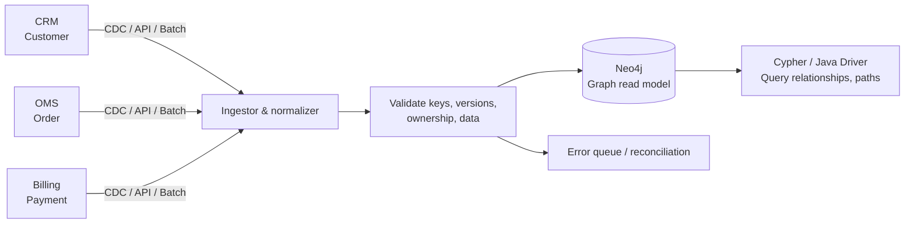
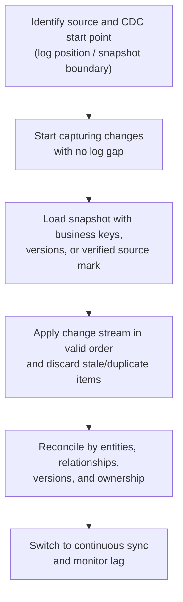

# Controlling Synchronization Lag and Choosing the Authoritative Source

A Neo4j graph is often assembled from **multiple source systems**: a CRM manages customers, an order management system (OMS) records transactions, a billing service tracks payment status, and a product catalog service supplies SKUs. These sources do not necessarily update at the exact same instant. A customer might update their address in the CRM while Neo4j still shows the old one; an order might be canceled in the OMS while the graph still holds a relationship reflecting its previous state.

Two design questions always go hand in hand:

1. **Which source holds authority over the true value of each piece of information?** This is the *authoritative source* (*source of truth* or *system of record*) question.
2. **How fast and accurately does data travel from the source into Neo4j?** This is the *synchronization lag* and cross-system consistency question.

This lesson belongs to the **Data Integration** chapter of the **DATABASE_ENGINE_GRAPH_NEO4J** module. Within the scope of using Neo4j to model property graphs and query relationships or paths with Cypher, you will combine business keys, indexes/constraints, data ingestion, the Java Driver, Spring Data Neo4j, and system operations to build a sync pipeline that can be monitored, verified, and recovered.

## 1. Distinguishing Source Data from the Query-Serving Graph

Consider an e-commerce platform with three systems:

| System | Primary Data | Example |
| --- | --- | --- |
| **CRM** | Customer profile, contact name, verified email | `Customer C-101` |
| **OMS** | Orders, total amounts, order status, placing customer | `Order O-901` |
| **Billing** | Payment status, payment transactions | `Payment P-501` |
| **Neo4j** | Linked representation and data serving graph queries | `(Customer)-[:PLACED]->(Order)` |

Illustrative diagram:



**Neo4j can serve as an integrated read model**, while CRM, OMS, and Billing remain the primary systems of record for their respective domains. In that setup, never assume a value in Neo4j is more accurate simply because it is convenient to query. Conversely, for relationships managed natively inside Neo4j—such as user-curated groups created via graph-native actions—**Neo4j itself can be the authoritative source** for those relationships.

Authority over a source of truth is a **business rule**, not an inherent property of a database technology.

## 2. Choosing the Authoritative Source by Domain and Property

There does not have to be **one single authoritative database for an entire entity**. The very same `:Customer` node in Neo4j may hold fields owned by different systems.

| Entity/Field in Neo4j | Authoritative Source | Update Rule |
| --- | --- | --- |
| `Customer.customerId` | Identity from customer-ID issuing system | Keep stable; never mutate on email change |
| `Customer.fullName` | CRM | Only valid CRM events may update it |
| `Customer.verifiedEmail` | CRM or designated identity service | Do not let another source overwrite it |
| `Order.status` | OMS | Follow OMS event version/sequence |
| `Order.totalAmount` | OMS | Store exact currency units and rounding rules |
| `Payment.status` | Billing | Never infer completely from `Order.status` |
| `(Customer)-[:PLACED]->(Order)` | OMS owning `Order.customerId` | Relationship reflects order ownership data |
| `Customer.recommendationScore` | Designated analytics processor | Derived value with calculation timestamp and version |
| User-created relationships managed directly on the graph | Neo4j, if product defines it so | Written and authorized in Neo4j |

The table above is a **policy example**. Another company might delegate verified email ownership to a dedicated identity service; never assume CRM owns every customer attribute by default.

### 2.1. Every Property Should Have One Clear Write Owner

If both CRM and OMS emit events containing `Customer.fullName` without precedence rules, the outcome depends on which event happens to arrive last. A "last arrival wins" approach easily causes **stale overwrites** whenever the later-arriving source actually holds an outdated copy.

Establish a *data ownership contract*:

- Which source is permitted to create and update each property group?
- Are other sources read-only, allowed to propose changes, or permitted to write?
- How are conflicting values from two sources resolved?
- Is there a temporary override policy if the authoritative source goes down?
- Who is responsible for fixing bad data at the source, and how is that fix re-synced?

Never use event arrival time at Neo4j as an **automatic arbiter between two different sources**. Arrival time reflects transport order, not which source holds the truth.

### 2.2. The Authoritative Source Is Not Always the One with the Latest Wall-Clock Timestamp

For example:

- CRM confirms email `an@example.com` at profile version 42.
- OMS sends `old@example.com` inside a new order event emitted a few seconds later.
- Even though the OMS event arrives later, it **has no authority to overwrite `Customer.verifiedEmail`** if CRM is the authoritative source for that field.

This is why **data ownership** must be separated from **event arrival order**.

## 3. Establishing Unified Business Keys Across Sources

Fast synchronization that merges the wrong entities still produces a corrupt graph. Neo4j must locate nodes using **stable business keys**, such as `tenantId` combined with `customerId`.

```cypher
CREATE CONSTRAINT customer_business_key IF NOT EXISTS
FOR (c:Customer)
REQUIRE (c.tenantId, c.customerId) IS UNIQUE;

CREATE CONSTRAINT order_business_key IF NOT EXISTS
FOR (o:Order)
REQUIRE (o.tenantId, o.orderId) IS UNIQUE;
```

When writing, supply the full key scope:

```cypher
MERGE (c:Customer {
  tenantId: $tenantId,
  customerId: $customerId
});
```

If two tenants share the code `C-101`, `customerId` alone cannot identify the right node. If CRM and OMS use **two different ID schemes**, maintain a governed cross-reference mapping table, e.g., `crmCustomerId -> canonicalCustomerId <- omsCustomerId`. Never auto-merge users by name, email, or similar-looking strings without a verified matching rule.

### Why Not Use `elementId()` as a Sync Key?

`elementId()` identifies an element inside Neo4j, not a stable business key suitable for long-term persistence in source events or database re-imports. Entities must be matched using keys issued by the business systems and guarded by appropriate uniqueness constraints.

## 4. Synchronization Models and Latency Trade-Offs

| Mechanism | How It Works | Advantages | Limitations |
| --- | --- | --- | --- |
| **Scheduled batch** | Reads and loads data hourly/daily | Simple, easy to reconcile | Latency can approach batch interval plus processing time |
| **Incremental polling** | Periodically queries records changed since last mark | Easy to adopt when source exposes suitable APIs | Requires accurate cursors; updates/deletes can be missed if poorly designed |
| **Webhooks / app events** | Source application emits changes | Can propagate quickly | Requires handling retries, duplicates, reordering, and missed emits |
| **CDC (Change Data Capture)** | Captures committed changes at source | Reflects frequent changes including updates and deletes | Requires managing transaction logs, initial snapshots, offsets, and privileges |
| **On-demand lookup** | API queries authoritative source directly when needed | Ensures accuracy at decision time | Increases request latency and couples to source availability |

Depending on requirements, combine them: CDC for continuous updates, batches for periodic reconciliation, and direct lookups against the authoritative source for decisions needing real-time transactional accuracy.

**Low latency does not equal high reliability.** A pipeline updating in 100 ms that drops delete events remains wrong over the long haul. Conversely, a report designed for hourly refreshes satisfies requirements as long as its freshness level is explicitly communicated.

## 5. Defining "Synchronization Lag" Precisely

A source mutation passes through multiple timestamps:

```text
Source confirms COMMIT
   t0
    |
    | CDC reads log and emits event
    v
Broker / queue receives event
   t1
    |
    | Queue wait, retries, backpressure
    v
Consumer starts processing
   t2
    |
    | Validate, resolve keys, write to Neo4j
    v
Neo4j COMMIT succeeds
   t3
    |
    | Application reads result from database / read model
    v
Result visible to user
   t4
```

Distinguish each interval:

- **Capture/publish lag:** `t1 - t0`.
- **Queue wait time:** `t2 - t1`.
- **Processing and graph write time:** `t3 - t2`.
- **Source-to-Neo4j lag:** `t3 - t0`.
- **User-perceived lag:** roughly `t4 - t0` when caching, read replicas, or post-processing layers exist.

This is a measurement model. Timestamps from different hosts are trustworthy only when clocks are synchronized and `t0` accurately reflects **source commit time**. An application-assigned `event.createdAt` generated before commit **is not equivalent to** `sourceCommittedAt`.

### 5.1. Metrics to Track

| Metric | Answers | Inspect When Increasing |
| --- | --- | --- |
| `sync_apply_lag_seconds` | How long from source commit to graph commit? | CDC, broker, consumer, DB writes |
| `oldest_pending_age_seconds` | How long has the oldest unprocessed event waited? | Queue backlog, retries, poison messages |
| `queue_depth` / offset lag | How many events remain queued per partition? | Input/output throughput, bottlenecks |
| `applied_events_per_second` | At what rate is the consumer committing successfully? | Batch size, CPU, I/O, indexes |
| `retry_count`, `dead_letter_count` | Are transient failures or unprocessable records occurring? | Error breakdown, DLQ |
| `last_source_heartbeat_at` | Does the connector still see the source alive? | CDC stream, network, log permissions |
| `last_successful_apply_at` | When was the last successful write? | Consumer, DB, or idle source |
| `reconciliation_mismatch_count` | How far has graph state drifted from the source? | Dropped events, mapping bugs, missed deletes |

Do not assume the pipeline is broken simply because **no changes occurred for a while**: the source might genuinely be idle. To separate idle from dead, rely on source heartbeats/cursors or independent liveness signals.

### 5.2. Event Time, Processing Time, and Clock Skew

- **Event/source commit time:** when the mutation was committed or confirmed at the source.
- **Ingestion/processing time:** when the consumer received or processed the event.
- **Graph commit time:** when the mutation committed in Neo4j.

If the source clock trails the processor clock by 3 minutes, subtracting timestamps can show negative or artificially inflated lag. Synchronize clocks, standardize on UTC, tag timestamp provenance, and cross-check **log position/offset** rather than relying solely on wall-clock charts.

**Offsets/LSNs are not seconds.** The difference between two offsets measures stream position progress, not wall-clock duration. Offsets are typically ordered **only within their corresponding partition/stream**; never compare offsets across independent sources as a global clock.

### 5.3. Sample SLO

Suppose a product commits to: "99% of customer profile updates appear in Neo4j within 30 seconds of source commit, measured over a 7-day window." This is an **illustrative SLO**, not a built-in Neo4j default.

To make an SLO measurable, clarify:

1. Which mutations count: creates, updates, deletes, and relationship edits?
2. Does the clock start at source commit or broker receipt?
3. Does it stop at Neo4j commit or user-visible read after cache?
4. Do rejected malformed events count as violations or track under a separate metric?
5. Do all sources share one SLO, or do orders/payments require tighter bounds than descriptive profiles?

**p95/p99** percentiles are far more informative than averages alone, because a small tail of delayed events can cause major business errors.

## 6. Choosing the Right Consistency Level for the Business

Not every screen needs data updated at the exact same speed.

| Scenario | Required Freshness | Approach |
| --- | --- | --- |
| Related product recommendations | Short delay acceptable | Asynchronous sync into Neo4j |
| Daily customer network report | Accepts scheduled cutoff point | Batch with explicit watermark |
| Displaying a freshly edited profile | Expects changes visible quickly | Fast CDC, cache invalidation, or read authoritative source |
| Checking inventory at checkout | Must be accurate at transaction decision time | Query the authoritative inventory system |
| Confirming payment status | Requires authoritative Billing state | Query Billing / confirmed status; never infer solely from graph |
| Relationship path analysis | Depends on product requirements | Query graph alongside freshness indicator |

Neo4j typically serves as an **analytical read layer for connected data**. Committing a payment in OMS/Billing does not create a **cross-system ACID transaction** spanning Neo4j. Thus, when data may still be syncing, the application needs a clear policy: display results with freshness metadata, defer decisions temporarily, or fall back to reading the authoritative source.

## 7. What Should an Event Contract Include?

A sync payload might look like this; it is an **illustrative application-defined schema**, not a mandatory Neo4j connector format:

```json
{
  "eventId": "crm-evt-00241",
  "sourceSystem": "CRM",
  "entityType": "Customer",
  "tenantId": "T-01",
  "entityId": "C-101",
  "operation": "UPSERT",
  "sourceVersion": 42,
  "sourceCommittedAt": "2026-11-25T03:20:15Z",
  "payloadMode": "FULL_SNAPSHOT",
  "data": {
    "fullName": "Nguyễn An",
    "verifiedEmail": "an@example.com"
  }
}
```

Each field serves a specific role:

| Field | Purpose |
| --- | --- |
| `eventId` | Traceability and duplicate detection, assuming stable source IDs |
| `sourceSystem` | Identifies emitter and write authorization scope |
| `tenantId` + `entityId` | Locates the exact Neo4j entity |
| `operation` | Distinguishes create/update/delete |
| `sourceVersion` or log position | Blocks stale events from overwriting newer ones within **the same ownership stream** |
| `sourceCommittedAt` | Measuring lag and incident investigation |
| `payloadMode` | Distinguishes full snapshots from partial-field patches |
| `data` | Authorized attributes to synchronize |

**Never substitute broker arrival order or consumer timestamps for source versions** when guarding against out-of-order delivery. If the source lacks monotonically increasing versions, choose a reliable sequential token—such as per-partition commit log positions or transaction IDs—with a verified comparison rule.

When a source spans multiple entities/partitions, a version may only be meaningful within **one entity or aggregate**, not globally across the system. Document this scope in the contract.

## 8. Blocking Late and Duplicate Events with Cypher

### 8.1. Flawed Example: Updating Every Event in Arrival Order

```cypher
MERGE (c:Customer {tenantId: $tenantId, customerId: $customerId})
SET c.fullName = $fullName,
    c.verifiedEmail = $verifiedEmail;
```

If CRM emits version 42 then version 43, yet network routing delivers version 43 first, this statement applies version 42 **last**, overwriting newer data. If event 43 updated the email, the final state reverts to the old email.

### 8.2. Version-Guarded Example

First, create uniqueness constraints on business keys as in Section 3. The consumer feeds only events verified to be **CRM-owned for those fields** with an integer increasing `sourceVersion`.

```cypher
UNWIND $events AS e
WITH e
WHERE e.tenantId IS NOT NULL
  AND e.customerId IS NOT NULL
  AND e.sourceVersion IS NOT NULL
MERGE (c:Customer {
  tenantId: e.tenantId,
  customerId: e.customerId
})
ON CREATE SET c.crmVersion = -1
WITH c, e
WHERE e.sourceVersion > coalesce(c.crmVersion, -1)
SET c.fullName = e.fullName,
    c.verifiedEmail = e.verifiedEmail,
    c.crmVersion = e.sourceVersion,
    c.crmCommittedAt = datetime(e.sourceCommittedAt)
RETURN count(c) AS updatedCustomers;
```

Read its semantics carefully:

1. `MERGE` locates/creates the node by business key, not by name or email.
2. `crmVersion` tracks **CRM data specifically**. Never reuse it for OMS-owned order status.
3. `WHERE e.sourceVersion > ...` rejects duplicates and events older than the applied version.
4. After applying a valid record, the node records the source version and commit time to verify freshness.

Once **version 43** is applied, a stale version **42** or a replayed event **43** fails the condition, preventing overwrites of the higher version.

**Preconditions for this example to hold:** `$events` holds a **full snapshot** of CRM-updatable attributes, versions are reliably ordered, each key is processed sequentially or coordinated concurrently, and inputs are pre-validated. Because `SET c.fullName = null` in Cypher **removes the property**, this exact query cannot be used as-is for **PATCH** events where omitted fields mean "keep unchanged."

Additionally, a version comparison inside Cypher **does not automatically make concurrent writers safely ordered**. With multiple consumers updating the same customer, partition events by entity key, assign one writer per partition, or apply tested concurrency-control mechanisms. Uniqueness constraints stop duplicate nodes, not out-of-order property updates.

### 8.3. When Data Has Multiple Field Owners

Suppose CRM updates `fullName` and OMS updates `latestOrderStatus` on the same `:Customer` node. Never share a single `version` field if CRM version 42 and OMS version 100 **belong to different scales**.

Maintain separate version state, for instance:

```text
(:Customer {
  tenantId: "T-01",
  customerId: "C-101",
  fullName: "Nguyễn An",
  crmVersion: 42,
  latestOrderStatus: "SHIPPED",
  omsVersion: 100
})
```

Or split into separate `:Order` nodes and relationships representing OMS data, depending on graph design. Each property group must update strictly according to the order of **that group's authoritative source**.

## 9. Never Confuse Delete Events with Missing-Field Events

Synchronization must separate three cases:

- **Field omitted in a PATCH event:** retain existing data.
- **Field explicitly set to `null` per contract:** may mean clear the property, or unknown at source; enforce an explicit rule.
- **Entity DELETE event:** the entity was deleted/hidden at the source and requires lifecycle handling.

Example payload from source:

```json
{
  "operation": "PATCH",
  "sourceVersion": 44,
  "fieldMask": ["verifiedEmail"],
  "data": {"verifiedEmail": null}
}
```

Only if the contract states "`null` inside `fieldMask` clears the email" should you execute `SET c.verifiedEmail = null` (which removes the property in Cypher). Never default to `coalesce($email, c.verifiedEmail)` if **intentional clearing** is valid, because `coalesce` cannot distinguish "omitted" from "explicit `null` to delete."

### 9.1. Delete Event Arrives Before an Older Create Event

Suppose the source deletes a customer at version 50, and a version 49 update reaches Neo4j later. If the node and its version were hard-deleted, a subsequent `MERGE` could **resurrect the old node**.

Retain a **tombstone/deletion version** in an auditable store, or use soft deletes:

```cypher
MERGE (c:Customer {
  tenantId: $tenantId,
  customerId: $customerId
})
ON CREATE SET c.crmVersion = -1
WITH c
WHERE $sourceVersion > coalesce(c.crmVersion, -1)
SET c.crmVersion = $sourceVersion,
    c.isDeleted = true,
    c.deletedAt = datetime($sourceCommittedAt);
```

This illustrates a **soft-delete marker** policy. Hiding/removing relationships, filtering deleted nodes in read queries, and handling personal-data erasure requests require dedicated procedures. Never treat this alone as a complete solution for all regulatory deletion mandates; tombstone retention must comply with system data governance policies.

## 10. Syncing Relationships When Endpoints Arrive Asynchronously

An OMS event may state that `Order O-901` was placed by `Customer C-101` before the customer node has synced from CRM. Running:

```cypher
MATCH (c:Customer {
  tenantId: $tenantId,
  customerId: $customerId
})
MATCH (o:Order {
  tenantId: $tenantId,
  orderId: $orderId
})
MERGE (c)-[:PLACED]->(o);
```

returns zero rows when either endpoint is missing, so **no relationship is created**. This avoids fabricating an unverified customer node, yet it also requires the pipeline to **record unresolved links**.

One handling pattern:

1. Validate `tenantId`, `customerId`, and `orderId` against the OMS contract.
2. Upsert the `:Order` node guarded by the OMS version.
3. Look up the `:Customer` node synced from CRM.
4. If both endpoints exist, create `:PLACED`; if missing, enqueue the link into a **pending-link queue** with source, keys, and version.
5. Once the missing node appears, retry the pending link; track retry counts and wait age.
6. Reconcile periodically to catch perpetually stuck links or cross-tenant mismatches.

**Important:** the authoritative source for "which customer placed an order?" is **OMS**, not "whichever record hit Neo4j first." When OMS reassigns an order's customer, the pipeline must handle both **the old relationship** and **the new relationship** under the order's version. Adding the new edge without removing the stale one leaves the graph inconsistent.

If the business permits an "unknown customer," design an explicit flagged placeholder. Never silently `MERGE (c:Customer {customerId: ...})` from an OMS event and treat it as a complete CRM profile.

## 11. Coordinating Initial Loads with Continuous Change Streams

Pipelines typically manage two streams:

- **Snapshot/backfill:** loads existing state from the source into Neo4j.
- **Change stream/CDC:** consumes mutations occurring during and after the snapshot.

A dangerous bug occurs when a snapshot taken at an earlier point finishes writing into Neo4j **after** newer CDC events arrived, causing the snapshot to **overwrite fresher data**.

A design-level safe workflow:



Prerequisites:

- Establish a **consistent boundary** between the snapshot and change stream using source/connector capabilities.
- Retain all changes from that boundary onward for replay; leave no gap when transitioning from snapshot to streaming.
- Use a comparable version or commit position to stop old snapshots from overwriting newer events.
- Verify counts and contents after backfill, rather than merely checking that the consumer "drained the queue."

Not all connectors share identical snapshot mechanics or offset semantics. Verify with documentation for your exact deployed version and test an "update occurs mid-snapshot" scenario.

## 12. At-Least-Once, Idempotency, and Progress Checkpoints

In distributed systems, this sequence commonly occurs:

1. Consumer receives event E.
2. Consumer writes E to Neo4j and **commits successfully**.
3. Consumer loses connection before acking the event to the broker.
4. Broker redelivers **E**.

Without idempotency, redelivery can create duplicate relationships or double-count metrics.

**At-least-once delivery** permits redeliveries; **idempotent application** guarantees retries cause no unintended state changes. Keyed `MERGE` paired with source version checks achieves this for many upsert patterns. Still, no single Cypher keyword turns a multi-source distributed pipeline into **end-to-end exactly-once**.

### Checkpoint Rule

**Acknowledge progress only after confirming Neo4j committed successfully.** Updating offsets/acks before graph commit risks losing events if the process dies mid-flight. Acking after commit and dying before ack causes redelivery; logic must handle duplicates idempotently.

If a commit may have succeeded when the client disconnected with an **ambiguous outcome**, query state by source key/version or safely replay—never assume the transaction rolled back.

With Kafka or partitioned queues, checkpoints must match **partition and contiguous processed order**, avoiding advancing an offset past an unresolved earlier event. Never silently skip a poison message just to move an offset forward; enforce DLQ policies and replay mechanisms.

### Idempotency Strategies by Operation Type

| Operation | Replay Risk | Design Approach |
| --- | --- | --- |
| Upsert `Customer` by key + version | Reverting to stale version | Compare version before `SET` |
| Create `:PLACED` relationship | Creating duplicate edges | Match exact endpoints, `MERGE`/relationship key per model |
| `SET c.total = c.total + $delta` | Double-adding money or counts | Deduplicate by event ID, or sync versioned absolute state |
| Delete relationship | Stale event resurrects edge | Retain link version/tombstone or serialize by aggregate |
| Send email when event processed | Sending twice | Move side effects into an outbox/idempotency layer |

Graph totals should generally be **derived values recomputable** from owned underlying entities, unless requirements and update mechanics dictate explicit guarded counters.

## 13. Using the Java Driver for Controlled Event Application

The Java Driver fits consumers passing validated events into Neo4j transactions. The example below applies **one CRM full-snapshot event**; assume keys, fields, and `sourceVersion` were validated before calling.

```java
import java.util.Map;
import org.neo4j.driver.Driver;
import org.neo4j.driver.Session;
import org.neo4j.driver.SessionConfig;

public final class CrmCustomerSync {
    private final Driver driver;

    public CrmCustomerSync(Driver driver) {
        this.driver = driver;
    }

    public void applyCustomerSnapshot(Map<String, Object> event) {
        String cypher = """
            MERGE (c:Customer {
              tenantId: $tenantId,
              customerId: $customerId
            })
            ON CREATE SET c.crmVersion = -1
            WITH c
            WHERE $sourceVersion > coalesce(c.crmVersion, -1)
            SET c.fullName = $fullName,
                c.verifiedEmail = $verifiedEmail,
                c.crmVersion = $sourceVersion,
                c.crmCommittedAt = datetime($sourceCommittedAt)
            """;

        try (Session session = driver.session(
                SessionConfig.builder()
                    .withDatabase("neo4j")
                    .build())) {
            session.executeWrite(tx -> {
                tx.run(cypher, event).consume();
                return null;
            });
        }
    }
}
```

In this code:

- `event` must provide `tenantId`, `customerId`, `sourceVersion`, `sourceCommittedAt`, `fullName`, and `verifiedEmail` with valid types; the snippet omits validation of missing/malformed inputs.
- `executeWrite` runs a driver-managed transaction and **may retry** the callback on transient errors. Hence, the callback must contain only retry-safe database operations; never send emails or call external services inside it.
- `.consume()` forces the driver to drain results so the Cypher work completes inside the transaction before the callback returns.
- The consumer **acks the event only after this method returns cleanly**, and can inspect keys/versions if a connection failure leaves commit status uncertain.
- Manage `Driver` as an application-scoped singleton reusing its connection pool; `Session` is short-lived and never shared across threads.

**Limitation of this example:** version comparisons work safely when events for **a single customer** are processed sequentially or coordinated concurrently. With multiple writers targeting one node, test under contention and partition by key.

### In Spring Data Neo4j

Spring Data Neo4j works well for entity mapping and service-layer transactions. However, event pipelines typically need:

- Custom `MERGE` or parameterized Cypher queries to reconcile keys and source versions.
- Explicit `@Transactional` boundaries per event group.
- Avoiding wrapping massive batches in one long lock-holding transaction.
- Never assuming `save()` on an entity checks CDC versions or per-property ownership automatically.
- Tracking retries, lag, DLQs, and reconciliation at the **pipeline layer**, since repositories do not replace sync progress management.

## 14. Reconciliation: How Do You Know the Graph Is Still Accurate?

Even a fast pipeline can drop events. Run periodic **reconciliation** between authoritative sources and Neo4j.

Each reconciliation cycle can verify:

1. **Keys:** counts and key sets segmented by tenant/source and time window.
2. **Source-owned properties:** hashes or samples of critical values like order status and profile version.
3. **Relationships:** every `Order.customerId` in OMS corresponds to strictly one `(:Customer)-[:PLACED]->(:Order)` edge per the model.
4. **Deletions:** are entities deleted/hidden at the source still mistakenly exposed in the graph?
5. **Versions:** are `crmVersion` and `omsVersion` in the graph lagging behind source watermarks?
6. **Pending links:** counts and age of unresolved links.
7. **Errors:** are events rejected, stuck in DLQs, or failing schema/type validation?

Illustrative Neo4j query detecting orders missing a customer relationship:

```cypher
MATCH (o:Order)
WHERE coalesce(o.isDeleted, false) = false
  AND NOT EXISTS {
    MATCH (:Customer)-[:PLACED]->(o)
  }
RETURN o.tenantId AS tenantId,
       o.orderId AS orderId,
       o.sourceCustomerId AS expectedCustomerId
LIMIT 100;
```

To detect **relationships pointing to the wrong customer**, compare the current endpoint key with the authoritative customer key stored from OMS:

```cypher
MATCH (c:Customer)-[:PLACED]->(o:Order)
WHERE o.sourceCustomerId IS NOT NULL
  AND (
    c.tenantId <> o.tenantId
    OR c.customerId <> o.sourceCustomerId
  )
RETURN o.orderId AS orderId,
       o.sourceCustomerId AS expectedCustomer,
       c.customerId AS actualCustomer
LIMIT 100;
```

These checks rely on `sourceCustomerId` synced from OMS; if that property is absent or itself stale, reconciliation must compare directly against authoritative OMS data. Avoid concluding "everything matches" merely because two stale copies inside Neo4j happen to agree.

### When to Backfill vs. Replay Individual Events?

- **A few corrupted events with intact payloads/versions:** fix the root cause and execute controlled replays.
- **Broken logs or unknown missed ranges:** run a scoped snapshot/reconciliation across the affected dataset.
- **Broken key normalization:** audit duplicate nodes, mislinked relationships, and entity merges—do not blindly replay events.
- **Ownership change on a field:** establish a cutover timestamp, lock old writers, and backfill from the new owner.

## 15. Preventing the Pipeline from Becoming a Bottleneck

Watching backlog counts is not enough; diagnose why apply throughput lags emission rate.

| Cause | Symptom | Remediation |
| --- | --- | --- |
| Missing uniqueness constraints or indexes | Slow `MERGE` lookups, high DB hits | Create constraints on business keys |
| Excessive round-trips, one request per event | High per-event latency, low throughput | Use parameterized `UNWIND` batches of sensible size |
| Oversized batches | High transaction memory, long locks, timeouts | Shrink batch size, optimize individual statements |
| Multiple consumers mutating the same hot node | Lock contention, rising retries | Partition by entity/aggregate key to reduce contention |
| Relationships arriving before endpoint nodes | Growing pending-link backlog | Prioritize node ingestion, add retries and reconciliation |
| Missing fields or unannounced schema changes | Growing DLQ, failing batches | Enforce schema contracts, validation, and versioned mappers |
| Source CDC emits faster than graph writes | Rising queue depth and oldest pending age | Tune write queries, size consumers, apply backpressure |
| Heavy read queries competing on graph | API and ingest compete for CPU/RAM | Optimize Cypher, indexes, isolate workloads |
| App caches holding stale data | Neo4j is fresh while UI lags | Tune TTLs, cache invalidation, measure end-user lag |

Example sending a version-checked batch via `UNWIND`:

```cypher
UNWIND $events AS e
WITH e
WHERE e.tenantId IS NOT NULL
  AND e.customerId IS NOT NULL
  AND e.sourceVersion IS NOT NULL
MERGE (c:Customer {
  tenantId: e.tenantId,
  customerId: e.customerId
})
ON CREATE SET c.crmVersion = -1
WITH c, e
WHERE e.sourceVersion > coalesce(c.crmVersion, -1)
SET c.fullName = e.fullName,
    c.verifiedEmail = e.verifiedEmail,
    c.crmVersion = e.sourceVersion;
```

**Note:** if a single batch contains **multiple events for the same customer in arbitrary order**, parallel execution or non-deterministic processing order can trigger contention or unpredictable behavior. Before batching, compact/group events by key and version, or ensure partitioned sequential ordering. Never use `collect(DISTINCT e)` or sort by arrival time hoping to "auto-heal" source conflicts.

## 16. Incident Investigation and Recovery

Suppose dashboards show order sync lag spiking from a few seconds to 12 minutes. A structured response:

1. **Scope the incident:** which source system, tenant, event type, and start time show lag?
2. **Inspect the source:** are changes committing, are CDC logs healthy, did connectors lose privileges or exceed log retention?
3. **Inspect the broker:** check queue depth, oldest pending age, stalled partitions, and hot retry loops.
4. **Inspect the consumer:** check worker count, schema errors, retry rates, batch submission, and contiguous committed offsets.
5. **Inspect Neo4j:** check transaction durations, lock contention, memory, indexes/constraints, driver errors, and host resources.
6. **Assess business impact:** should critical screens temporarily fall back to reading the authoritative source or show a staleness banner?
7. **Controlled recovery:** fix the root cause, replay from a trusted checkpoint, filter stale events via versions, and drain pending links.
8. **Reconcile:** verify a sample/scope against authoritative source figures—never close an incident solely because queue depth returned to 0.
9. **Postmortem:** identify root cause, add pre-SLO alerts, and rehearse replay drills.

### Example Incident Triage Matrix

| Observation | Likely Interpretation | Next Step |
| --- | --- | --- |
| Queue growing, Neo4j CPU low | Stalled consumer or network bottleneck | Check poll/ack loops, retries, and errors |
| Queue growing, Neo4j lock waits high | Multiple writers contending on nodes | Reduce per-key concurrency, optimize write queries |
| Queue at 0, graph missing 1,000 orders | Events dropped or wrongly filtered | Reconcile, audit checkpoints and DLQs |
| CRM at version 52, graph stuck at 50 | Newer changes not yet applied | Inspect events 51/52, queues, and error logs |
| Graph at version 52, UI still shows 50 | Stale cache/read layer | Inspect cache TTL and invalidation |
| Deleted version 60 resurrected by UPSERT 59 | Missing tombstone or skipped version check | Fix deletion model, replay/reconcile |

## 17. Common Mistakes

| Mistake | Why It Is Dangerous | Mitigation |
| --- | --- | --- |
| "Last source to arrive is right" | Non-owning source overwrites authoritative truth | Domain/field ownership matrix |
| Using consumer `updatedAt` as source version | Arrival order differs from commit order | Trusted version/commit position from source |
| Sharing one version across CRM and OMS | Independent versions use incompatible scales | Separate versions per source and aggregate |
| Monitoring only `lastSuccessfulSyncAt` | Silent source looks identical to dead connector | Source heartbeats and watermarks |
| Measuring lag only by offset count | Hides actual delay in seconds | Track both stream position and wall-clock lag |
| Acking event before Neo4j commit | Crashes lose updates | Ack post-commit with idempotent replays |
| Accumulating metrics on every event | Duplicate events over-count | Deduplicate events or sync versioned absolute state |
| Using `MERGE` to fabricate endpoint nodes from any edge | Creates unverified placeholder nodes | Load nodes first, reconcile pending links |
| Hard-deleting and forgetting deletion version | Stale events resurrect deleted nodes | Policy-compliant tombstones/soft deletes |
| Assuming empty queue means accurate data | Empty queue does not prove zero dropped events | Reconcile against authoritative source |
| Treating Neo4j as payment source of truth | Graph may lag behind live transactions | Query the owning transactional system |
| Running uncoordinated consumers on the same key | Causes out-of-order writes and contention | Partition by key, serialize writers |
| Letting old snapshots overwrite live streams | Loses mutations committed during backfill | Consistent CDC boundary and version guards |
| Failing to distinguish omitted PATCH fields from nulls | Accidentally deletes properties | Explicit field masks and contracts |

## 18. Practice Exercises

**Exercise 1 — Choosing the Authoritative Source.** CRM owns `Customer.fullName`, OMS owns `Order.status`, and Billing owns `Payment.status`. OMS emits the newest event carrying an outdated `Customer.fullName`. Should Neo4j overwrite `fullName`? Explain using an ownership matrix.

**Exercise 2 — Computing Lag.** An event commits at the source at 10:00:00, enters the broker at 10:00:02, reaches the consumer at 10:00:12, and commits in Neo4j at 10:00:18. Compute capture lag, queue wait, apply time, and source-to-graph lag. If the source clock lags by 40 seconds, which metrics must be re-evaluated?

**Exercise 3 — Out-of-Order Delivery.** A node already holds CRM version 27. A consumer receives version 29 followed by version 28. Write the Cypher condition preventing version 28 from overwriting version 29. State additional conditions needed for concurrency safety.

**Exercise 4 — Deletion and Resurrection.** A DELETE event at version 50 arrives before an UPSERT at version 49. Why can `DETACH DELETE` followed by `MERGE` on event 49 resurrect the node? Propose how to preserve deletion version state.

**Exercise 5 — Picking a Sync Strategy.** A product recommendation widget tolerates 60 seconds of lag; a checkout inventory check requires exact accuracy at order placement. Where should each screen read from? Explain the difference.

**Exercise 6 — Verifying Relationships.** OMS states `O-901` belongs to `C-101`, yet the graph contains `(C-102)-[:PLACED]->(O-901)`. Write a Cypher query detecting the mismatch given `Order.sourceCustomerId` holds the authoritative customer key.

**Exercise 7 — Snapshot and Stream.** During a 30-minute snapshot import, a user changes their email in CRM twice. Describe how to guarantee the snapshot does not overwrite newer events while avoiding missing changes between snapshot start and streaming start.

**Exercise 8 — Crash Recovery.** A consumer commits an event to Neo4j but dies before acking Kafka. What happens when the event is redelivered? Identify which pipeline stages must be idempotent and when offsets may advance.

### Design and Operations Checklist

- [ ] Every critical field/relationship has a **confirmed authoritative owner**.
- [ ] Nodes are located via **stable business keys** backed by uniqueness constraints.
- [ ] Events include keys, operation, source, version/position, and traceable timestamps.
- [ ] **FULL_SNAPSHOT**, **PATCH**, nulls, and DELETEs are clearly distinguished.
- [ ] Duplicate/late events and per-entity ordering are explicitly handled.
- [ ] Missing-endpoint relationships and ownership-transfer updates have clear workflows.
- [ ] Initial snapshots connect to CDC via a gap-free cutover boundary.
- [ ] Acks/checkpoints occur strictly post-Neo4j commit, with replay support.
- [ ] Metrics cover lag in seconds, offsets, backlog, heartbeats, retries, DLQs, and reconciliation.
- [ ] Freshness SLOs align with actual product usage requirements.
- [ ] Incident response and reconciliation workflows run before declaring recovery complete.

## 19. Reference Documentation

Depending on your Neo4j, Java Driver, and CDC/broker versions, consult these references for exact syntax and behavior:

- [Neo4j Cypher Manual — MERGE](https://neo4j.com/docs/cypher-manual/current/clauses/merge/): locating or creating entities by pattern.
- [Neo4j Cypher Manual — Constraints](https://neo4j.com/docs/cypher-manual/current/constraints/): uniqueness constraints, node keys, and schema rules.
- [Neo4j Java Driver Manual — Transactions](https://neo4j.com/docs/java-manual/current/transactions/): managed transactions, commits, and retries.
- [Neo4j Connector for Kafka — Documentation](https://neo4j.com/docs/kafka/current/): integrating Neo4j with event streams across connector versions.
- [Neo4j CDC — Documentation](https://neo4j.com/docs/cdc/current/): capturing Neo4j data changes when Neo4j acts as the change emitter.

**Remember:** trustworthy data does not come merely from a fast pipeline. You must know **which system holds authority for the truth**, **which version has been applied**, **which events are pending**, **where lag is measured from and to**, and **how to detect when Neo4j drifts from the authoritative source**. Combining clear ownership, stable keys, versioning, idempotent retries, and reconciliation lets Neo4j serve graph queries reliably even when operational sources update asynchronously.
