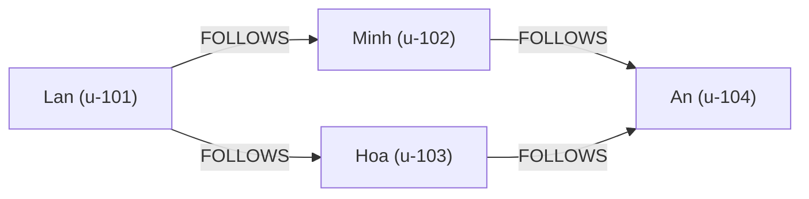

# Conversion, Data Structure, and Graph Processing Utilities with APOC in Neo4j

## 1. What Does APOC Add to Cypher?

Neo4j stores data under the **property graph** model: nodes have labels and properties, while relationships have a type, direction, and properties. **Cypher** lets you match nodes, link relationships, manipulate data, query paths, and call procedures. However, systems needing data cleansing, JSON transformation, list/map manipulation, or graph refactoring often need supplementary utilities.

**APOC** (*Awesome Procedures On Cypher*) is a library of **functions** and **procedures** extending Cypher's capabilities. For example, a user synchronization pipeline might need to:

1. Receive JSON from an API and convert it into a Cypher map.
2. Strip empty values, normalize text, and merge data fields.
3. Traverse a relationship network by direction, relationship type, and depth limits.
4. During a controlled data cleanup run, merge duplicate nodes and reconcile related relationships.

APOC supports these tasks, yet **not every operation requires APOC**. Cypher increasingly provides native equivalents. Before picking a utility, verify **whether it belongs to Core or Extended, whether it is still supported in your Cypher version, and whether it mutates the graph**.

### 1.1. How do functions and procedures differ?

| Characteristic | Function | Procedure |
| --- | --- | --- |
| Invocation | Used inside expressions: `RETURN apoc.convert.toJson(...)` | `CALL apoc.path.expandConfig(...) YIELD path` |
| Output | Returns a single value, e.g., `STRING`, `MAP`, `LIST` | Can return multiple rows and multiple columns |
| Side Effects | Usually computes/transforms input values | May only read the graph **or** mutate the graph depending on the procedure |
| Examples | `apoc.text.clean`, `apoc.coll.frequencies` | `apoc.path.expandConfig`, `apoc.refactor.mergeNodes` |

A procedure that mutates the graph must be treated like any Neo4j write operation: **transactions, privileges, constraints, backups, and post-commit verification** all matter.

### 1.2. Utility groups to know

| Group | Goal | Representative APIs |
| --- | --- | --- |
| `apoc.convert.*` | Convert JSON and data representations | `apoc.convert.toJson`, `apoc.convert.fromJsonMap`, `apoc.convert.fromJsonList` |
| `apoc.text.*` | Clean and process strings | `apoc.text.clean`, `apoc.text.regexGroups` |
| `apoc.map.*` | Build, clean, merge maps, handle key-value structures | `apoc.map.fromPairs`, `apoc.map.clean`, `apoc.map.mergeList` |
| `apoc.coll.*` | Process collections/lists | `apoc.coll.frequencies`, `apoc.coll.flatten`, `apoc.coll.toSet` |
| `apoc.path.*` | Traverse graphs with configured types, directions, labels, and hops | `apoc.path.expandConfig`, `apoc.path.subgraphNodes` |
| `apoc.refactor.*` | Modify graph structure, merge/clone/invert relationships | `apoc.refactor.mergeNodes`, `apoc.refactor.cloneSubgraph` |

The examples below focus on **APOC Core**, while pointing out cases where Cypher 25 already offers a better native approach.

## 2. Verifying the Environment Before Running Examples

### 2.1. APOC Core, APOC Extended, and Cypher versions

Since Neo4j 5, APOC is split into:

- **APOC Core:** officially supported by Neo4j; includes commonly used conversion, collection, path expansion, and graph refactoring functions/procedures. Many features are pre-installed in AuraDB.
- **APOC Extended:** community-maintained project offering additional integrations and procedures needing external libraries or having broader experimental scope. Do not assume it is installed in every database, especially managed services.

For self-managed Neo4j Server, the APOC version must be **compatible** with the Neo4j version. APOC Core may be bundled in `labs` and enabled in `plugins`; Neo4j Desktop and Docker provide their own mechanisms. In a cluster, plugins must be deployed consistently across appropriate servers. Never drop a JAR from an arbitrary version into production.

**A crucial versioning change:** starting in Neo4j 2025.06, the platform supports **Cypher 5** and **Cypher 25**. From Neo4j 2026.02 onward, Cypher 25 is the default language for new databases per current docs. Many APOC functions now have native replacements and are *deprecated* in Cypher 25; some older APIs only continue working if executed under `CYPHER 5`. Always check the **database version, APOC version, and Cypher language mode** when consulting API docs.

### 2.2. Checking that APOC is actually available

If APOC is installed and permitted:

```cypher
RETURN apoc.version() AS apocVersion;
```

List APOC functions exposed by the database:

```cypher
SHOW FUNCTIONS
YIELD name
WHERE name STARTS WITH 'apoc.'
RETURN name
ORDER BY name
LIMIT 30;
```

List procedures:

```cypher
SHOW PROCEDURES
YIELD name
WHERE name STARTS WITH 'apoc.'
RETURN name
ORDER BY name
LIMIT 30;
```

Quickly look up loaded API help:

```cypher
CALL apoc.help('path');
```

If `apoc.version()` or an API is missing from the catalog, check plugins, versions, Cypher mode, and privileges. **Do not** conclude that every name starting with `apoc.` is installed, or that any user can call a procedure simply because it exists.

For self-managed Neo4j, security settings such as `dbms.security.procedures.allowlist` and `dbms.security.procedures.unrestricted` control procedure loading and elevated access. Apply the principle of **least privilege**: allow only required APIs, especially those reading files/network or mutating the graph. On AuraDB, privileges and the supported catalog are managed by the service; do not assume plugin configuration works like a self-managed server.

## 3. Data Conversion Group: `apoc.convert.*` and `apoc.text.*`

### 3.1. Converting a JSON string to a map

Suppose an API sends this payload:

```json
{
  "userId": "u-101",
  "profile": {
    "name": "Lan",
    "active": true
  },
  "tags": ["neo4j", "graph"]
}
```

When the payload is a **JSON string**, use `apoc.convert.fromJsonMap`:

```cypher
WITH '{"userId":"u-101","profile":{"name":"Lan","active":true},"tags":["neo4j","graph"]}' AS raw
WITH apoc.convert.fromJsonMap(raw) AS payload
RETURN
  payload.userId AS userId,
  payload.profile.name AS name,
  payload.profile.active AS active,
  payload.tags AS tags;
```

Expected result:

| userId | name | active | tags |
| --- | --- | --- | --- |
| `u-101` | `Lan` | `true` | `["neo4j", "graph"]` |

Key distinctions:

- `fromJsonMap` requires the JSON input to have an **object/map** at the target location. If the root JSON is an array (e.g., `[{"id":1},{"id":2}]`), use `apoc.convert.fromJsonList` instead.
- This is an **in-query type conversion**; it does not automatically create nodes or relationships.
- Parsed values still require checking structure, required keys, types, lengths, access rights, and provenance. Valid JSON syntax does not mean the payload is valid per business rules.

### 3.2. Querying nested structures with JSONPath

`apoc.convert.fromJsonMap` supports an optional JSONPath argument:

```cypher
WITH '{"profile":{"name":"Lan","active":true},"userId":"u-101"}' AS raw
RETURN apoc.convert.fromJsonMap(raw, '$.profile') AS profile;
```

Expected `profile = {name: 'Lan', active: true}`. If the path does not exist, behavior depends on the function's *path options*; specify explicitly whether you want `null`, a list, or an error. Never assume external payloads always contain every field.

For a JSON array input, standalone example:

```cypher
RETURN apoc.convert.fromJsonList('[{"id":"a"},{"id":"b"}]') AS items;
```

Expected output is a **list** of two maps. To turn each element into a row, apply `UNWIND` after parsing:

```cypher
WITH apoc.convert.fromJsonList('[{"id":"a"},{"id":"b"}]') AS items
UNWIND items AS item
RETURN item.id AS id
ORDER BY id;
```

### 3.3. Converting a map to a JSON string

```cypher
WITH {
  userId: 'u-101',
  name: 'Lan',
  roles: ['DEV', 'REVIEWER']
} AS payload
RETURN apoc.convert.toJson(payload) AS jsonString;
```

The output is a **STRING** containing JSON. Useful scenarios:

- Sending results to an external system expecting a JSON string.
- Storing raw payloads for reconciliation/auditing under a data policy.
- Serializing a nested map/list structure into a string because Neo4j properties **cannot directly store arbitrary maps or lists of maps**. Standard Neo4j property graph properties store scalars and lists of supported primitive types.

Example simulating storing a JSON string on a demo node:

```cypher
MERGE (u:DemoApocUser {userId: 'u-101'})
SET u.rawProfile = apoc.convert.toJson({
  name: 'Lan',
  preferences: {theme: 'dark', language: 'vi'}
})
RETURN u.userId AS userId, u.rawProfile AS rawProfile;
```

Reading it back:

```cypher
MATCH (u:DemoApocUser {userId: 'u-101'})
RETURN apoc.convert.fromJsonMap(u.rawProfile).preferences.theme AS theme;
```

**Design trade-off:** storing JSON strings sacrifices the ability to create individual property indexes on fields inside the JSON. If `preferences.theme` is filtered frequently, consider dedicated properties or appropriate nodes/relationships instead of storing only a blob.

### 3.4. String normalization with `apoc.text.*`

```cypher
RETURN apoc.text.clean(' User #101! ') AS normalized;
```

Expected result is `user101`: `apoc.text.clean` strips non-alphanumeric characters and lowercases letters. This is a utility for building **relatively simple lookup keys**, not a full Unicode or linguistic normalizer.

| Need | Approach | Caution |
| --- | --- | --- |
| Trim whitespace | Native `trim(text)` | Simple and requires no APOC |
| Lowercase | Native `toLower(text)` | Does not automatically resolve Vietnamese diacritic matching issues |
| Strip punctuation/separators | `apoc.text.clean(text)` | Can discard useful information; test Unicode before creating keys |
| Regex parsing | Selected `apoc.text.*` functions or Cypher regex where applicable | Do not rely on APIs removed in newer versions |

For emails, person names, or identifier keys, **never strip diacritics or special characters** and treat the result as a unique ID. Two distinct raw strings can collide after cleaning; preserve source IDs and apply uniqueness constraints aligned with business semantics.

## 4. Data Structure Group: `apoc.map.*`

A map is a collection of `key -> value` pairs. Cypher uses maps for parameters, payloads, and projections; APOC provides additional merging, filtering, and construction helpers.

### 4.1. Building a map from key-value pairs

```cypher
WITH [
  ['userId', 'u-101'],
  ['role', 'DEV'],
  ['active', true]
] AS pairs
RETURN apoc.map.fromPairs(pairs) AS userMap;
```

Expected result:

```json
{"userId":"u-101","role":"DEV","active":true}
```

**Version note:** `apoc.map.fromPairs` is marked deprecated in Cypher 25 because of the equivalent **map comprehension**:

```cypher
WITH [
  ['userId', 'u-101'],
  ['role', 'DEV'],
  ['active', true]
] AS pairs
RETURN {pair IN pairs | pair[0]: pair[1]} AS userMap;
```

This map comprehension example targets environments supporting **Cypher 25** syntax; on Neo4j 5/Cypher 5 you may need to retain the corresponding APOC version. Do not assume Cypher 25 syntax works if your application must run on older Neo4j servers.

### 4.2. Cleaning a map while preserving business semantics

Example of a form containing blank fields:

```cypher
WITH {
  userId: 'u-101',
  name: 'Lan',
  alias: '',
  internalNote: 'for-review'
} AS input
RETURN apoc.map.clean(input, ['internalNote'], ['']) AS cleaned;
```

The output keeps `userId` and `name`, dropping `internalNote` and `alias`. The second argument is the **list of keys to remove**, and the third is the **list of values to remove**.

In **Cypher 25**, `apoc.map.clean` is deprecated; you can use a map comprehension:

```cypher
WITH {
  userId: 'u-101',
  name: 'Lan',
  alias: '',
  internalNote: 'for-review'
} AS input
RETURN {
  k: v IN input
  WHERE NOT k IN ['internalNote'] AND v <> ''
  | k: v
} AS cleaned;
```

In real data, distinguish clearly between:

- `''`: empty string.
- `null`: missing value.
- `0`: zero, which can carry valid numeric meaning.
- `false`: valid boolean value, not to be dropped merely for being "falsy" in other programming languages.

A cleaning function configured with the wrong value list can delete valid business data, especially counts, status flags, and measurements.

### 4.3. Merging multiple maps

```cypher
WITH [
  {userId: 'u-101', name: 'Lan'},
  {department: 'Engineering'},
  {name: 'Lan Anh'}
] AS parts
RETURN apoc.map.mergeList(parts) AS merged;
```

On duplicate keys, `apoc.map.mergeList` merges in list order so values in **later maps** overwrite earlier ones. The result has `name = 'Lan Anh'`. This represents **source precedence**, which should never be left implicit:

- Source A is raw data; source B is a user-confirmed override.
- If A should win, swap the order or write only when keys are missing.
- Never use map merging as a substitute for version/timestamp checks on update events.

There is also `apoc.map.merge(map1, map2)` for two maps. This function is also marked deprecated in Cypher 25; prefer native syntax when targeting a compatible version. Before using other `apoc.map.*` APIs, check the signature and deprecation status for your exact version.

## 5. Collection Group: `apoc.coll.*`

Lists appear in JSON arrays, `collect()` results, `UNWIND` inputs, and node/relationship lists. APOC offers list transformation, deduplication, and frequency functions.

### 5.1. Deduplicating elements

```cypher
RETURN apoc.coll.toSet(['neo4j', 'cypher', 'neo4j', 'graph'])
       AS uniqueTags;
```

The output contains three unique values. **Do not rely on element ordering** from a set-like operation when business logic does not enforce ordering; if stable display order is needed, sort explicitly.

As of Cypher 25, `apoc.coll.toSet` is deprecated in favor of the native function:

```cypher
RETURN coll.distinct(['neo4j', 'cypher', 'neo4j', 'graph'])
       AS uniqueTags;
```

If you want to deduplicate **Cypher rows** (rather than an already constructed list), using `RETURN DISTINCT`/`WITH DISTINCT` is direct and avoids materializing intermediate lists.

### 5.2. Flattening nested lists

```cypher
RETURN apoc.coll.flatten(
  [['neo4j', 'cypher'], ['graph', ['apoc']]],
  true
) AS flattened;
```

With `true`, the function recursively flattens nested lists, yielding `neo4j`, `cypher`, `graph`, `apoc`. With `false`, it flattens only one level, leaving deeper sublists intact.

In Cypher 25, `apoc.coll.flatten` is deprecated; native `coll.flatten(...)` can be used. The native function's syntax and depth parameter **differ** from APOC's boolean argument; check version-specific Cypher docs before migrating.

### 5.3. Counting frequencies

```cypher
WITH ['neo4j', 'graph', 'neo4j', 'cypher', 'graph', 'neo4j'] AS tags
RETURN apoc.coll.frequencies(tags) AS frequencies;
```

The output is a list of maps with `item` and `count` fields corresponding to `neo4j: 3`, `graph: 2`, `cypher: 1`. Do not rely on the ordering of maps if only frequencies matter.

When an ordered table is required:

```cypher
WITH ['neo4j', 'graph', 'neo4j', 'cypher', 'graph', 'neo4j'] AS tags
UNWIND apoc.coll.frequencies(tags) AS entry
RETURN entry.item AS tag, entry.count AS occurrences
ORDER BY occurrences DESC, tag ASC;
```

Choose `apoc.coll.frequencies` when you already have a list to analyze. If the data is still **multiple rows from the graph**, group directly in Cypher:

```cypher
UNWIND ['neo4j', 'graph', 'neo4j', 'cypher', 'graph', 'neo4j'] AS tag
RETURN tag, count(*) AS occurrences
ORDER BY occurrences DESC, tag;
```

This is **native Cypher with zero APOC dependency**. For very large datasets, avoid building a massive `collect(...)` just to count it later with an APOC function; aggregating via `count(*)` inline in the query stream is usually much better.

## 6. Graph Processing Group: Path Traversal with `apoc.path.*`

Cypher already supports relationship matching and path patterns. `apoc.path.*` adds **configured traversal**, useful when combining multiple types, directions, label filters, termination nodes, or uniqueness modes.

### 6.1. Creating a small practice graph

In a **test database**, run:

```cypher
CREATE CONSTRAINT demo_apoc_user_id_unique IF NOT EXISTS
FOR (u:DemoApocUser)
REQUIRE u.userId IS UNIQUE;
```

```cypher
MERGE (lan:DemoApocUser {userId: 'u-101'})
  ON CREATE SET lan.name = 'Lan'
MERGE (minh:DemoApocUser {userId: 'u-102'})
  ON CREATE SET minh.name = 'Minh'
MERGE (hoa:DemoApocUser {userId: 'u-103'})
  ON CREATE SET hoa.name = 'Hoa'
MERGE (an:DemoApocUser {userId: 'u-104'})
  ON CREATE SET an.name = 'An'
MERGE (lan)-[:FOLLOWS]->(minh)
MERGE (lan)-[:FOLLOWS]->(hoa)
MERGE (minh)-[:FOLLOWS]->(an)
MERGE (hoa)-[:FOLLOWS]->(an);
```

Graph illustration:



Using `MERGE` on IDs and relationships allows safe re-execution without duplicating demo nodes/edges on clean demo data; the uniqueness constraint protects `userId`.

### 6.2. Bounded path traversal with type filtering

```cypher
MATCH (start:DemoApocUser {userId: 'u-101'})
CALL apoc.path.expandConfig(start, {
  relationshipFilter: 'FOLLOWS>',
  labelFilter: '+DemoApocUser',
  minLevel: 1,
  maxLevel: 2,
  uniqueness: 'NODE_PATH',
  bfs: true
})
YIELD path
RETURN
  [n IN nodes(path) | n.userId] AS route,
  length(path) AS hops
ORDER BY hops;
```

Explanation:

- `relationshipFilter: 'FOLLOWS>'` traverses only **outgoing** `FOLLOWS` relationships. Syntax `'<FOLLOWS'` means incoming; `'FOLLOWS'` without a marker traverses both directions.
- `labelFilter: '+DemoApocUser'` acts as an allowlist for traversed node labels. `'-Label'` is a denylist; `'/Label'` marks termination nodes (stop expanding further); `'>Label'` marks nodes to return while potentially continuing expansion per rules.
- `minLevel` and `maxLevel` constrain **hop/relationship** counts, not node counts.
- `uniqueness: 'NODE_PATH'` prevents visiting the **same node twice within a single path**. This does **not** guarantee a destination node appears in only one result row: `u-104` still has two distinct paths via `u-102` and `u-103`.
- `bfs: true` selects breadth-first traversal. Different uniqueness strategies and options affect memory usage, return order, and path counts.

On the demo graph, expect two 1-hop paths to `u-102` and `u-103`, and two 2-hop paths to `u-104` via the two branches. If you only want **distinct destination nodes** rather than all paths, choose `DISTINCT last(nodes(path))` or a subgraph-node procedure.

### 6.3. Retrieving nodes in a subgraph

```cypher
MATCH (start:DemoApocUser {userId: 'u-101'})
CALL apoc.path.subgraphNodes(start, {
  relationshipFilter: 'FOLLOWS>',
  maxLevel: 2
})
YIELD node
RETURN DISTINCT node.userId AS userId
ORDER BY userId;
```

This traverses to reachable nodes within range. **Depending on default settings, the start node may be included in the results**; if you only want nodes at least one hop away, set `minLevel: 1` or explicitly filter `node <> start`.

With `apoc.path.subgraphAll(...)`, the procedure returns both the node list and relationship list of the subgraph, useful for building a sub-view. However, "fetching the entire subgraph" on a densely branching network can consume significantly more memory than fetching a few nodes/paths.

### 6.4. Controlling path explosion

In graphs with hubs, even a few hops can generate **huge numbers of paths**. Always specify:

| Parameter / Measure | Why It Is Needed |
| --- | --- |
| `maxLevel` | Prevents overly deep traversal when business logic only needs 2–3 hops |
| `relationshipFilter` | Excludes irrelevant relationship types or directions |
| `labelFilter` | Excludes out-of-scope node groups |
| `uniqueness` | Controls node/relationship repetition per path or across the whole traversal |
| `limit` | Caps **returned paths**; do not treat it as a hard cap on all internal work |
| `EXPLAIN` / `PROFILE`, load metrics | Spot fan-out, DB Hits, and memory to compare against native Cypher |

The default `uniqueness` of `apoc.path.expandConfig` is `RELATIONSHIP_PATH`. Choosing `NODE_GLOBAL` ensures each node is visited once across the traversal, but can drop **alternative paths** to the same node. If the problem requires *all valid routes*, never switch modes arbitrarily just to reduce row counts.

Do not use path expansion as a substitute for full graph algorithms. Problems like PageRank, community detection, or weighted shortest path on large graphs typically require evaluating Cypher or **Graph Data Science (GDS)**, which is a separate product/library, not synonymous with APOC.

## 7. Refactoring Group: `apoc.refactor.*`

Unlike JSON parsers or path expanders, `apoc.refactor.*` **directly mutates graph structure**: merging nodes, merging relationships, cloning subgraphs, inverting relationship directions, or changing labels/types. These are schema/data migration operations with lasting impact.

### 7.1. Understanding `apoc.refactor.mergeNodes`

The `apoc.refactor.mergeNodes(nodes, config)` procedure:

- Takes a **list of nodes** and retains the **first** node as the surviving target.
- Moves/merges relationships from the remaining nodes onto the target per configuration.
- Resolves conflicting property values using strategies such as `discard` (keep existing value), `overwrite`, or `combine`.
- Deletes the merged-away nodes per procedure semantics; hence it is **not equivalent** to Cypher's `MERGE (n:Label {key: ...})`.

Data preparation example **strictly in a demo database**:

```cypher
MERGE (a:DemoDuplicateContact {sourceId: 'source-a'})
SET a.email = 'lan@example.test',
    a.name = 'Lan'
MERGE (b:DemoDuplicateContact {sourceId: 'source-b'})
SET b.email = 'lan@example.test',
    b.name = 'Lan Anh';
```

Preview the candidate set to merge:

```cypher
MATCH (c:DemoDuplicateContact {email: 'lan@example.test'})
RETURN c.sourceId AS sourceId, c.name AS name
ORDER BY sourceId;
```

Once certain the two nodes represent the same entity and a recovery plan is in place, run:

```cypher
MATCH (c:DemoDuplicateContact {email: 'lan@example.test'})
WITH c ORDER BY c.sourceId
WITH collect(c) AS nodes
WHERE size(nodes) > 1
CALL apoc.refactor.mergeNodes(nodes, {
  properties: 'discard',
  mergeRels: true
})
YIELD node
RETURN node.sourceId AS survivingSourceId,
       properties(node) AS mergedProperties;
```

With `properties: 'discard'`, values on the surviving node are kept when keys collide. The `ORDER BY c.sourceId` above explicitly **selects which node survives**; changing the sort order changes the resulting properties. On production data, merging alters internal IDs, edges, and properties, and may encounter constraints, locks, or incompatible relationship semantics.

### 7.2. Risks and safe workflows

Never merge nodes solely because one property matches: two people can share a name, two events can share a timestamp, or an entity may intentionally retain multiple historical versions. Before refactoring:

1. Define the true **identity rule** (source ID, node label, business conditions) and collect exact duplicate groups.
2. Explicitly choose the **surviving node**, property/relationship policies, and self-loop handling. Check constraints that could block or be violated.
3. Back up or stand up a **test clone**; use `EXPLAIN` to inspect plans, remembering only `CALL ...` in an executed write transaction changes data.
4. Batch appropriately with business-consistent transactions. Large refactors can lock data and spike memory; never run concurrent write transactions touching overlapping nodes without coordination.
5. Post-commit, verify node counts, key uniqueness, relationship directions/types, properties, and business query results.

Related procedures:

| Procedure | Goal | Warning |
| --- | --- | --- |
| `apoc.refactor.mergeNodes` | Merge duplicate nodes | Deletes nodes and alters relationships; choose target carefully |
| `apoc.refactor.mergeRelationships` | Merge multiple relationships sharing both endpoints | First relationship survives; verify business type and properties |
| `apoc.refactor.cloneNodes` | Duplicate nodes (optionally with relationships per config) | May create copies violating uniqueness constraints |
| `apoc.refactor.cloneSubgraph` | Copy a subgraph | Check size and how IDs/relationships are handled |
| `apoc.refactor.invert` | Reverse relationship direction | Changes semantics of directional queries |

Changing graph structure does not automatically synchronize systems external to Neo4j. If node IDs are referenced by applications, plan to map via **business keys** or update downstream references.

## 8. End-to-End Example: From JSON to Graph and Paths

Scenario: the system receives a payload containing a user and a list of skills. We need to parse JSON, normalize inputs, create nodes/relationships, and traverse the graph.

Illustrative payload:

```json
{
  "userId": "u-201",
  "name": "  Mai  ",
  "skills": ["Neo4j", "Cypher", "Neo4j"]
}
```

### Step 1: Parse and normalize before writing

```cypher
WITH '{"userId":"u-201","name":"  Mai  ","skills":["Neo4j","Cypher","Neo4j"]}' AS raw
WITH apoc.convert.fromJsonMap(raw) AS payload
WITH
  payload.userId AS userId,
  trim(payload.name) AS displayName,
  apoc.coll.toSet(payload.skills) AS skills
RETURN userId, displayName, skills;
```

In Cypher 25, use `coll.distinct(payload.skills)` instead of `apoc.coll.toSet`. The example above intentionally shows APOC processing; applications should choose APIs supported by their actual version.

### Step 2: Upsert nodes and relationships in Cypher

You can persist the normalized data within a **single transaction**:

```cypher
WITH '{"userId":"u-201","name":"  Mai  ","skills":["Neo4j","Cypher","Neo4j"]}' AS raw
WITH apoc.convert.fromJsonMap(raw) AS payload
WITH
  payload.userId AS userId,
  trim(payload.name) AS displayName,
  apoc.coll.toSet(payload.skills) AS skills
MERGE (u:DemoApocUser {userId: userId})
SET u.name = displayName
WITH u, skills
UNWIND skills AS skillName
MERGE (s:DemoApocSkill {name: skillName})
MERGE (u)-[:HAS_SKILL]->(s)
RETURN u.userId AS userId, collect(s.name) AS persistedSkills;
```

For `DemoApocUser.userId` and `DemoApocSkill.name`, create appropriate uniqueness constraints when running on real data. `MERGE` prevents creating duplicate nodes/relationships on retries when matching keys and data are accurate, though it **does not automatically detect synonymous skill names** like `Neo4j` and `Neo 4j`.

Production practice requires validating `payload.userId`, ensuring `skills` is non-null, checking lengths and naming standards, handling source-versioned updates, and confirming success only after commit. If one bad record triggers a transaction rollback, all updates in that transaction are discarded.

### Step 3: Read back results in Cypher

```cypher
MATCH (u:DemoApocUser {userId: 'u-201'})-[:HAS_SKILL]->
      (s:DemoApocSkill)
RETURN u.userId AS userId, u.name AS name,
       collect(DISTINCT s.name) AS skills;
```

This is a standard graph read; **no APOC needed**. Expected output includes user `u-201`, trimmed name `Mai`, and skills `Neo4j`, `Cypher`.

If you want to traverse two-hop relationships between users and skills or other relationship types, consider `apoc.path.expandConfig` with filters and hop bounds; do not blindly replace a simple `MATCH` pattern with a complex procedure.

## 9. APOC vs. Native Cypher: Choosing the Long-Term Path

Several familiar utilities now have native equivalents in **Cypher 25**. When upgrading, prefer APIs with long-term support:

| Task | APOC Function | Cypher 25 Alternative | Status to Note |
| --- | --- | --- | --- |
| Deduplicate list elements | `apoc.coll.toSet` | `coll.distinct(list)` | APOC deprecated in Cypher 25 |
| Flatten list | `apoc.coll.flatten` | `coll.flatten(list)` or depth-parameterized form | APOC deprecated in Cypher 25; signature differs |
| Build map from pairs | `apoc.map.fromPairs` | Map comprehension `{pair IN pairs \| pair[0]: pair[1]}` | APOC deprecated in Cypher 25 |
| Filter map | `apoc.map.clean` | Map comprehension with `WHERE` | APOC deprecated in Cypher 25 |
| Merge two maps | `apoc.map.merge` | Version-appropriate native expression/syntax | APOC deprecated in Cypher 25 |
| Convert JSON string to map | `apoc.convert.fromJsonMap` | Cases remain where APOC is needed per supported release | Verify signature and version |
| Flexible filtered path traversal | `apoc.path.expandConfig` | Cypher path/quantified path patterns if expressible | Compare results and performance |
| Merge real nodes and relationships | `apoc.refactor.mergeNodes` | No complete single Cypher `MERGE` equivalent | Write/migration operation; test carefully |

Additionally, some older functions have been **removed in Cypher 25**, such as `apoc.text.regreplace`. Never copy examples from Neo4j 3.x/4.x articles assuming they run unchanged on Neo4j 2026. For systems running both Cypher 5 and Cypher 25, test each branch, favor native syntax/libraries supported on the target version, and monitor official deprecation notices.

## 10. Performance, Transactions, and Security

### 10.1. Filter data before invoking procedures

```cypher
MATCH (u:DemoApocUser {userId: $userId})
CALL apoc.path.expandConfig(u, {
  relationshipFilter: 'FOLLOWS>',
  minLevel: 1,
  maxLevel: 2
})
YIELD path
RETURN path;
```

Starting from **one specific user** is vastly different from scanning all `DemoApocUser` nodes and invoking the path expander on each one. A uniqueness constraint or range index on `userId` speeds up locating the root node. On large graphs, add depth bounds, type/label filters, and measure generated path counts.

Avoid:

- Collecting millions of nodes via `collect(n)` only to pass them all at once into a refactor/collection function unnecessarily.
- Calling `apoc.path.expandConfig` without `maxLevel` on a high-branching graph expecting the query to stop early on its own.
- Running concurrent write refactors over overlapping graph regions without designing locking and consistency.
- Treating a small `RETURN count(*)` as proof a query is cheap: earlier expansions and aggregations may have processed huge intermediate sets.

### 10.2. Transactions and retries

Conversion functions such as `apoc.convert.fromJsonMap` do not initiate write transactions. However, refactoring procedures that mutate the graph must run in appropriate write transactions, roll back if uncommitted, and may acquire locks while running.

When calling via the **Java Driver**, for example:

```java
import java.util.Map;
import org.neo4j.driver.Driver;
import org.neo4j.driver.Session;
import org.neo4j.driver.SessionConfig;

public class ApocReadExample {
    public static long countReachable(Driver driver, String userId) {
        try (Session session = driver.session(
                SessionConfig.forDatabase("neo4j"))) {
            return session.executeRead(tx -> tx.run("""
                MATCH (u:DemoApocUser {userId: $userId})
                CALL apoc.path.subgraphNodes(u, {
                  relationshipFilter: 'FOLLOWS>',
                  minLevel: 1,
                  maxLevel: 2
                })
                YIELD node
                RETURN count(DISTINCT node) AS total
                """, Map.of("userId", userId))
                .single()
                .get("total")
                .asLong());
        }
    }
}
```

This code only illustrates calling APOC through the Driver. With `executeWrite`, the callback can be retried on transient errors; never place external side effects or non-idempotent logic inside the callback. Verify database procedure privileges, log errors with context, and validate data **post-commit** for write operations.

In **Spring Data Neo4j**, Cypher executed through `Neo4jClient` or custom repositories can call APOC functions/procedures just like other Cypher queries, while remaining subject to Spring's transaction config, plugin versions, and database privileges. Entity mapping `save(...)` does not automatically run APOC refactoring procedures for you.

### 10.3. Security warnings for privileges and external data

- JSON conversion or map-handling functions do not access network/files themselves; import/export/integration procedures may require separate permissions/config.
- Never set `dbms.security.procedures.unrestricted=apoc.*` in production to fix a missing privilege error when only one procedure is needed. Configure allowlist/unrestricted under **least privilege**.
- When using procedures capable of dynamic Cypher, file import, or URL calls, validate sources, parameters, and input paths. Never let untrusted user data dictate arbitrary statements or targets.
- In AuraDB, plugin availability and config are service-managed. Use only procedures supported by your instance rather than following self-managed JAR installation steps.

## 11. Practice Lab and Self-Assessment

Execute on a **test database** with a compatible APOC Core installed:

1. Run `RETURN apoc.version()` and use `SHOW FUNCTIONS`/`SHOW PROCEDURES` to list available features. Record Neo4j version, APOC version, and Cypher mode.
2. Parse a JSON payload into a map with `apoc.convert.fromJsonMap`; extract `profile.name`; serialize a map back into a JSON string with `apoc.convert.toJson`.
3. Build a map from pairs, filter empty keys/values, and merge maps. Compare results with Cypher 25 map comprehensions if available.
4. Use `apoc.coll.frequencies` to count tag occurrences; use `apoc.coll.toSet` and native `coll.distinct` to deduplicate.
5. Create the four-node `DemoApocUser` graph from Section 6. Traverse `FOLLOWS>` up to two hops, switch `NODE_PATH` to `NODE_GLOBAL`, and explain why the path count to `u-104` can differ.
6. On backed-up `DemoDuplicateContact` data, merge two nodes via `apoc.refactor.mergeNodes`. Inspect node counts, retained properties, relationships, and whether any constraints are affected.
7. For the JSON-to-graph example, re-run the upsert statement and read back results post-commit. Explain why `MERGE`, business keys, and uniqueness constraints matter when pipelines retry.

Self-check questions:

- How does `apoc.convert.fromJsonMap` differ from `apoc.convert.fromJsonList`?
- When should you use `apoc.coll.frequencies` versus counting directly with `count(*)` in Cypher?
- Why can `NODE_PATH` return multiple distinct paths leading to the **same** destination node?
- Why is `apoc.refactor.mergeNodes` riskier than `MERGE (n:Label {key: ...})`?
- On newer Neo4j releases running Cypher 25, what strategy do you follow for deprecated APOC functions?

**Completion criteria:** learners can pick the right conversion/data-structure/graph utility group, write `RETURN apoc.*` and `CALL apoc.* YIELD`, constrain path expansions, recognize side-effect procedures, verify APIs by version, and transition to native Cypher where appropriate.

## Official References

- [Neo4j APOC Core — Introduction](https://neo4j.com/docs/apoc/current/introduction/): distinguishing APOC Core and Extended, roles of functions and procedures.
- [Neo4j APOC Core — Procedures & Functions](https://neo4j.com/docs/apoc/current/overview/): complete API catalog, types, and signatures.
- [Neo4j APOC Core — Installation](https://neo4j.com/docs/apoc/current/installation/): compatible versions, deploying plugins on servers/clusters.
- [Neo4j APOC — Cypher Versions](https://neo4j.com/docs/apoc/current/apoc-and-cypher/cypher-versions/): Cypher 5/Cypher 25 compatibility.
- [Neo4j APOC — Migrate from APOC to Cypher](https://neo4j.com/docs/apoc/current/apoc-and-cypher/cypher-migration/): functions with native equivalents.
- [Neo4j APOC — JSON Conversion](https://neo4j.com/docs/apoc/current/overview/apoc.convert/): `toJson`, `fromJsonMap`, and `fromJsonList`.
- [Neo4j APOC — Map](https://neo4j.com/docs/apoc/current/overview/apoc.map/): from key/value pairs, filtering, and merging maps.
- [Neo4j APOC — Collection](https://neo4j.com/docs/apoc/current/overview/apoc.coll/): deduplication, flattening, and list statistics.
- [Neo4j APOC — Path Expander](https://neo4j.com/docs/apoc/current/graph-querying/expand-paths-config/): relationship directions, label filters, uniqueness, and traversal limits.
- [Neo4j APOC — Merge Nodes](https://neo4j.com/docs/apoc/current/graph-refactoring/merge-nodes/): effects, configuration, and property rules when merging nodes.
