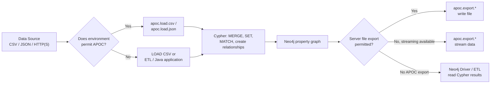
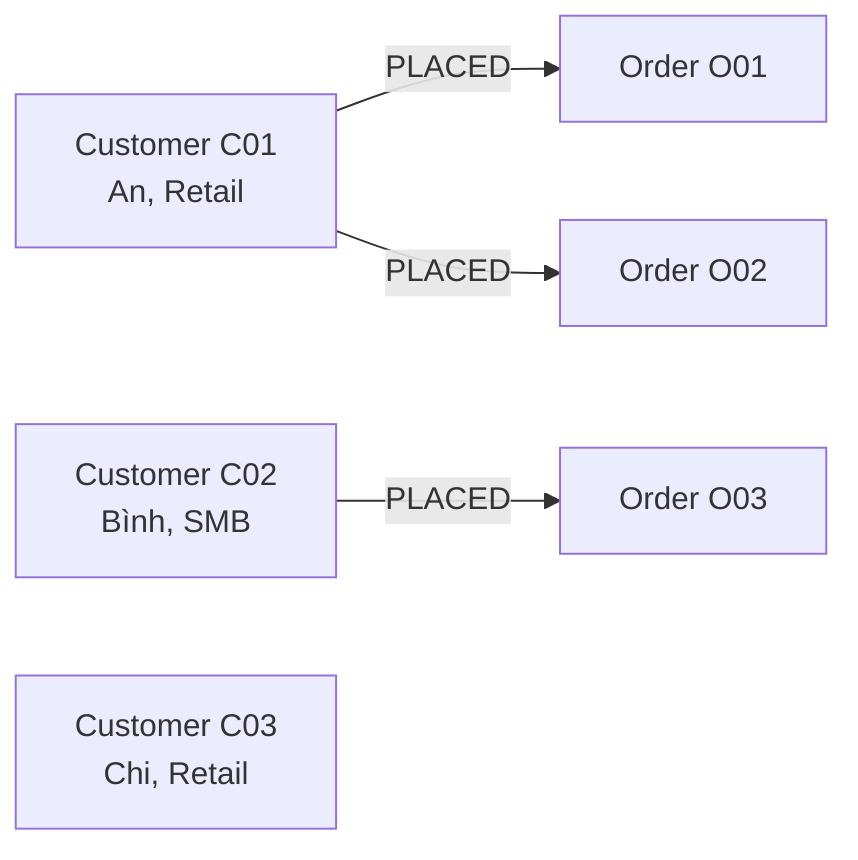

# Importing or Exporting Data with APOC When the Environment Permits

In Neo4j, graph data consists of **nodes**, **relationships**, and properties. Many systems need to ingest data from CSV/JSON, synchronize business data, or export data for exchange, auditing, or migration to another environment. Beyond built-in Cypher mechanisms like `LOAD CSV`, Neo4j can use **APOC (Awesome Procedures On Cypher)** for several import, export, and data-processing tasks.

This lesson belongs to the **APOC and Extensions** chapter of the **DATABASE_ENGINE_GRAPH_NEO4J** module. The focus is on using procedures such as `apoc.load.csv`, `apoc.load.json`, and `apoc.export.*` **when versions, deployment environments, and access privileges permit**, as well as choosing alternatives when APOC cannot be used. All examples tie back to the *property graph* model and Cypher queries; several write operations mutate real data, so run them on a **practice database**.

> **First rule:** Having Neo4j installed **does not mean** every APOC procedure is installed and authorized. Having APOC **does not mean** you may read or write arbitrary files on the server. Verify actual capabilities before designing a pipeline that depends on a specific procedure.

## 1. Where Does APOC Fit in the Data Integration Flow?

APOC is a collection of functions and procedures extending Cypher. For import/export, APOC can read CSV/JSON, process results row by row, and export data into exchange formats. Graph structure is still governed by Cypher: which labels, business keys, relationship types, and deduplication rules are applied.



Do not treat APOC as the default solution for every requirement. For example:

| Scenario | Commonly Considered Approach |
| --- | --- |
| Small/medium CSV import with simple Cypher | `LOAD CSV` or `apoc.load.csv` |
| Deeply nested JSON import | `apoc.load.json` if available and allowed; otherwise application parses JSON |
| Scheduled ingestion requiring retries and monitoring | ETL/Java Driver pipeline, calling APOC where appropriate |
| Massive initial graph load | Evaluate Neo4j's dedicated bulk import tool alongside Cypher/APOC |
| Exporting a summary report | `RETURN` via Driver or `apoc.export.csv.query` |
| Exporting the full graph | APOC export procedures if permissions and format fit |
| Managed environment disallowing file access | Stream export if supported by the procedure, or export from the application |

## 2. Checking APOC Capabilities Before Running

### 2.1. Differences between APOC Core and Extended

Depending on version and packaging, APOC has feature sets commonly referred to as **APOC Core** and **APOC Extended**. Never infer procedure availability solely from the plugin name: procedures or settings can change location, support status, or execution permissions across Neo4j versions.

First, inspect relevant procedures in the connected database:

```cypher
SHOW PROCEDURES
YIELD name, signature
WHERE name IN [
  'apoc.load.csv',
  'apoc.load.json',
  'apoc.export.csv.query',
  'apoc.export.csv.all',
  'apoc.export.json.query',
  'apoc.export.json.all',
  'apoc.periodic.iterate',
  'apoc.import.csv'
]
RETURN name, signature
ORDER BY name;
```

This query helps distinguish:

- **Absent from the list:** may be uninstalled, unavailable in that edition, or hidden under current version/config.
- **Present in the list:** syntax advertised by the system; still verify **EXECUTE privileges**, file access policy, and actual runtime behavior.
- **Signature differs from examples:** trust the signature reported by your live Neo4j/APOC environment.

If you lack permission to run `SHOW PROCEDURES`, ask an administrator for the supported feature list. On Neo4j Aura or other managed services, available procedures and filesystem access may be restricted compared to self-managed Neo4j.

### 2.2. File-related configuration

Common settings in self-managed APOC deployments include:

```properties
# Server-side APOC configuration, e.g., in apoc.conf
apoc.import.file.enabled=true
apoc.export.file.enabled=true
apoc.import.file.use_neo4j_config=true
```

Meaning:

| Setting | Meaning to Consider |
| --- | --- |
| `apoc.import.file.enabled` | Allows supporting APOC procedures to read local files |
| `apoc.export.file.enabled` | Allows supporting APOC procedures to write local files |
| `apoc.import.file.use_neo4j_config` | When supported and enabled, import paths obey Neo4j's configured import directory boundary |

This is an **illustrative server-side config snippet** for administrators to evaluate; it is not Cypher and has no effect if pasted into Neo4j Browser. How config is supplied, reloaded, and enforced depends on the Docker image, host server, Kubernetes platform, or managed service. Never expose the entire server filesystem for a single ingestion utility.

Other factors to verify before running:

1. Are the **Neo4j** and **APOC** versions compatible?
2. Is APOC installed properly and has the server loaded the plugin?
3. Does the executing role/account have permission to call the procedure?
4. Are **local file**, **HTTP(S)** access, or file writes permitted by policy?
5. In multi-host or containerized setups, files reside on the **host/container running the query**, not the laptop running Browser.

### 2.3. Understanding `file:///` and file paths properly

When running:

```cypher
CALL apoc.load.csv('file:///customers.csv')
YIELD map
RETURN map
LIMIT 3;
```

`file:///customers.csv` resolves according to import configuration **on the Neo4j server side**. It does not read `customers.csv` from the laptop displaying Neo4j Browser. With Docker/Kubernetes, check that the file has been copied/mounted into the permitted directory inside the container.

Similarly, exporting to `customers-export.csv` creates **a file on the server or the procedure's configured target path**, rather than downloading it automatically to the client. If a managed database disallows file read/write, consider streaming APIs or exporting via an application.

## 3. Sample Data: Customers and Orders

Suppose CRM supplies customers and ERP supplies orders. We want to build this graph:



Create two UTF-8 files in the permitted directory of your practice environment. **These are sample file contents**, not file-creation commands.

`customers.csv`:

```csv
customerId,name,segment
C01,An,Retail
C02,Bình,SMB
C03,Chi,Retail
```

`orders.csv`:

```csv
orderId,customerId,createdAt,totalAmount
O01,C01,2026-11-01,200000
O02,C01,2026-11-03,120000
O03,C02,2026-11-04,300000
```

Target model:

- `(:Customer {customerId, name, segment})`
- `(:Order {orderId, createdAt, totalAmount})`
- `(:Customer)-[:PLACED]->(:Order)`

To load this data repeatedly, define **unique keys**. Run in the practice database:

```cypher
CREATE CONSTRAINT customer_id_unique IF NOT EXISTS
FOR (c:Customer) REQUIRE c.customerId IS UNIQUE;

CREATE CONSTRAINT order_id_unique IF NOT EXISTS
FOR (o:Order) REQUIRE o.orderId IS UNIQUE;
```

Constraints stabilize lookup/upsert by business key and protect against duplicate creation under concurrent transactions. On an existing database, inspect existing constraints and duplicate data first; do not assume constraint creation will succeed if existing records violate uniqueness.

## 4. Importing CSV with `apoc.load.csv` and Cypher

### 4.1. Inspecting contents before writing

First read a few rows and examine parsed columns:

```cypher
CALL apoc.load.csv('file:///customers.csv', {header: true})
YIELD lineNo, map
RETURN lineNo, map
ORDER BY lineNo
LIMIT 5;
```

`apoc.load.csv` reads CSV content and returns each row as a map when headers are enabled. Keys `map.customerId`, `map.name`, and `map.segment` come from the header row. Raw CSV fields default to **strings**, unless explicit typing configuration or conversion is applied.

Checks during preview:

- Do column names match conventions (including case sensitivity)?
- Are there blank rows or empty business keys?
- Is the delimiter actually a comma, semicolon, or tab?
- Do values contain delimiters or double quotes needing proper CSV escaping?
- Does UTF-8 preserve Vietnamese diacritics properly?

### 4.2. Creating/updating Customer via MERGE

```cypher
CALL apoc.load.csv('file:///customers.csv', {header: true})
YIELD map AS row
WITH row
WHERE row.customerId IS NOT NULL
  AND trim(row.customerId) <> ''
MERGE (c:Customer {customerId: trim(row.customerId)})
SET c.name = row.name,
    c.segment = row.segment
RETURN count(c) AS processedRows;
```

With the sample data, expected `processedRows = 3` and three `Customer` nodes exist. Re-running the same data causes `MERGE` to match existing nodes instead of creating duplicate keys.

Understand clearly that **`count(c)` is the number of rows processed in the query**, not necessarily the number of newly created nodes. To see actual created nodes or updated properties, inspect the **query update counters** from execution metadata.

### 4.3. Converting property types when reading CSV

`orders.csv` contains numbers and dates stored as text in CSV. Cast their types explicitly:

```cypher
CALL apoc.load.csv('file:///orders.csv', {header: true})
YIELD map AS row
WITH row
WHERE row.orderId IS NOT NULL
  AND trim(row.orderId) <> ''
MERGE (o:Order {orderId: trim(row.orderId)})
SET o.createdAt = date(row.createdAt),
    o.totalAmount = toInteger(row.totalAmount),
    o.customerId = trim(row.customerId)
RETURN count(o) AS processedOrders;
```

This creates/updates **Order nodes first**, temporarily storing `customerId` for reconciliation. With three valid rows, `processedOrders = 3`.

If a date is malformed or `totalAmount` holds non-numeric text, casting may raise an error or yield `null` depending on the expression. In production, **validate and quarantine bad rows** before writing; never silently store `null` for mandatory fields.

### 4.4. Loading relationships after both endpoints exist

To create `PLACED` relationships:

```cypher
CALL apoc.load.csv('file:///orders.csv', {header: true})
YIELD map AS row
MATCH (c:Customer {customerId: trim(row.customerId)})
MATCH (o:Order {orderId: trim(row.orderId)})
MERGE (c)-[:PLACED]->(o)
RETURN count(*) AS processedRelations;
```

With the sample data, `processedRelations = 3`. `MERGE` on the relationship avoids creating duplicate edges between the same node pair on sequential re-runs when the model expects one `PLACED` relationship per pair.

**Note:** If either `Customer` or `Order` is missing, `MATCH` drops the row; the statement does not silently create dangling edges. Production pipelines must reconcile input row counts against matched relationships and handle skipped records.

Reconciliation check example:

```cypher
MATCH (o:Order)
WHERE NOT EXISTS {
  MATCH (:Customer)-[:PLACED]->(o)
}
RETURN o.orderId AS orderWithoutCustomer
ORDER BY orderWithoutCustomer;
```

With clean sample data and all three relationships loaded, the query returns zero rows.

## 5. Importing JSON with `apoc.load.json`

JSON fits hierarchical sources or APIs returning nested objects. For instance, `customers.json` contains **a root object** holding a `customers` array:

```json
{
  "customers": [
    {"customerId": "C01", "name": "An", "segment": "Retail"},
    {"customerId": "C02", "name": "Bình", "segment": "SMB"},
    {"customerId": "C03", "name": "Chi", "segment": "Retail"}
  ]
}
```

Inspect the structure returned by APOC:

```cypher
CALL apoc.load.json('file:///customers.json')
YIELD value
RETURN value
LIMIT 1;
```

Here, the returned root element has a `customers` key holding the list. Use `UNWIND` to turn each list element into a row:

```cypher
CALL apoc.load.json('file:///customers.json')
YIELD value
UNWIND value.customers AS row
WITH row
WHERE row.customerId IS NOT NULL
MERGE (c:Customer {customerId: row.customerId})
SET c.name = row.name,
    c.segment = row.segment
RETURN count(c) AS processedRows;
```

If the JSON has a **top-level array** or deeper nesting, the number of rows emitted by `apoc.load.json` and the `value.*` access path will differ. Preview with `YIELD value RETURN value LIMIT ...` before writing `UNWIND`.

### 5.1. Importing JSON over HTTP(S)

If environment policy permits remote data access, the URI argument may be an approved HTTP(S) endpoint:

```cypher
CALL apoc.load.json($sourceUrl)
YIELD value
RETURN value
LIMIT 3;
```

This snippet illustrates **call syntax only**; it does not assume the server has Internet access or that the endpoint returns valid JSON. In practice:

1. Allow URLs only from approved domains and protocols.
2. Configure timeouts, authentication, and response size caps.
3. Never let users supply arbitrary URLs for the server to fetch uncontrolled; this introduces **SSRF** and internal network probing risks.
4. Never embed secrets inside Cypher queries, logs, or published examples.
5. If headers/tokens are required, use environment-supported authentication mechanisms, or have an ETL application fetch the payload and pass it to Neo4j.

APOC does not replace secret management or external data access governance.

## 6. High-Volume Ingestion: Batching and `apoc.periodic.iterate`

Loading an entire large file inside one transaction spikes memory, holds locks longer, and bloats transaction logs. When authorized to use `apoc.periodic.iterate`, you can chunk CSV rows into smaller batches:

```cypher
CALL apoc.periodic.iterate(
  'CALL apoc.load.csv("file:///customers.csv", {header: true})
   YIELD map AS row
   WHERE row.customerId IS NOT NULL AND trim(row.customerId) <> ""
   RETURN row',
  'MERGE (c:Customer {customerId: trim(row.customerId)})
   SET c.name = row.name, c.segment = row.segment',
  {batchSize: 500, parallel: false, retries: 1}
)
YIELD batches, total, failedBatches, errorMessages
RETURN batches, total, failedBatches, errorMessages;
```

Meaning:

- First argument: **query supplying rows** to process.
- Second argument: **query applied per batch**.
- `batchSize: 500`: number of rows grouped into each batch under APOC's batching mechanism.
- `parallel: false`: sequential execution to reduce write contention when records may share keys or dependencies.
- `retries: 1`: retries failed batches per procedure capabilities; safe only when the write action is idempotent.

With three customers, typically one batch suffices. `total` reflects rows fed into the batch stage, **not newly created nodes**. If `failedBatches` is non-zero or `errorMessages` is populated, **do not mark the sync successful** until failures are resolved and reconciled.

> **Privilege note:** `apoc.periodic.iterate` spawns child/batch transactions to perform work. Transaction management, parallelism, and execution privileges vary by version and environment. Do not treat the entire call as a single atomic transaction capable of rolling back already-committed batches.

### 6.1. How to choose batch size?

No single number fits all workloads. Benchmark with these factors in mind:

| Factor | Effect When Batch Size Is Too Large |
| --- | --- |
| Many properties/rows | Increases transaction memory footprint |
| Complex nodes and relationships | Increases traversal/expansion cost and write locks |
| Constraints/indexes | Increases index update overhead |
| Parallel writes | Raises lock contention on shared keys |
| Large CSV/HTTP(S) sources | Increases transfer, parsing, and error-handling duration |
| Retries | One failed huge batch forces replaying many rows |

Measure **throughput, per-batch duration, errors, memory consumption, and transaction latency**, then tune to realistic data.

### 6.2. Another option: `apoc.import.csv`

Some APOC versions and packages include **`apoc.import.csv`** to import graph data from CSV files following specific conventions for node IDs, relationships, and property mapping. This differs from reading rows with `apoc.load.csv` and writing custom Cypher.

Do not confuse the two:

- `apoc.load.csv`: streams CSV rows into Cypher so **you control `MERGE`/`SET` logic**.
- `apoc.import.csv`: specialized bulk-import procedure expecting **specific input formats and configuration**, usable only where available and approved.

When considering `apoc.import.csv`, check its signature via `SHOW PROCEDURES` and version-specific docs, prepare files in the required format, and test on a small database first. Never assume an arbitrary business `customers.csv` can be fed directly without schema header adjustments.

## 7. Exporting CSV with APOC

Data export serves two distinct goals:

1. **Selective tabular export:** extracting a slice of properties for downstream apps or reconciliation.
2. **Graph structure export:** representing nodes, relationships, IDs, and properties to reconstruct/link data in a target system.

For tabular reports, defining an explicit `MATCH ... RETURN` query with `apoc.export.csv.query` is easiest to govern.

### 7.1. Exporting a customer table to a file

When the server permits APOC file writes:

```cypher
CALL apoc.export.csv.query(
  'MATCH (c:Customer)
   RETURN c.customerId AS customerId,
          c.name AS name,
          c.segment AS segment
   ORDER BY customerId',
  'customers-export.csv',
  {}
)
YIELD file, rows, done
RETURN file, rows, done;
```

This instructs APOC to **execute the read query** and write results to CSV at the server-permitted path.

- First argument: **query string** defining data to export.
- Second argument: **target filename** per APOC environment conventions.
- Third argument: **export configuration map**.
- `rows`: exported row count reported by the procedure; `done` indicates completion per procedure status.

File formatting and escaping depend on the export library. For Vietnamese names, verify character encoding, CSV quoting, and how the target reader parses the file.

### 7.2. Without file write privileges: try stream export

In environments disallowing server file writes, export procedures often support **streaming** by passing `null` as filename and `stream: true`:

```cypher
CALL apoc.export.csv.query(
  'MATCH (c:Customer)
   RETURN c.customerId AS customerId,
          c.name AS name,
          c.segment AS segment
   ORDER BY customerId',
  null,
  {stream: true}
)
YIELD data
RETURN data;
```

`data` returns the exported content so the client receives and persists it application-side. This is **not** a guarantee every APOC package or managed service supports streaming. Verify the procedure, execute privileges, and live signature/configuration.

**Size caution:** stream exports can return a massive single string; do not assume they suit returning millions of nodes/edges in one request. For large volumes, partition by scope (tenant, date, key range), paginate deterministically, or use dedicated ETL pipelines.

### 7.3. Exporting the entire graph

Some environments provide `apoc.export.csv.all` and `apoc.export.json.all` for exporting beyond a selective table. Example **for illustration only when permitted**:

```cypher
CALL apoc.export.csv.all('graph-export.csv', {})
YIELD file, nodes, relationships, done
RETURN file, nodes, relationships, done;
```

Unlike `csv.query`, full-graph export must encode **multiple node labels, relationship types, identifiers, and properties**. Its output format is designed for graph serialization, **not** as a normalized, column-oriented business table.

Before running on production data, verify scope, size, sensitive fields, and whether a full graph export is truly needed over a targeted query. Never run a full export casually just to pull a small report.

## 8. Exporting JSON with APOC

JSON works well when exchanging multi-property objects or integrating with HTTP APIs. For a specific set of properties:

```cypher
CALL apoc.export.json.query(
  'MATCH (c:Customer)
   RETURN c.customerId AS customerId,
          c.name AS name,
          c.segment AS segment
   ORDER BY customerId',
  'customers-export.json',
  {}
)
YIELD file, rows, done
RETURN file, rows, done;
```

When file export is disabled but streaming is supported:

```cypher
CALL apoc.export.json.query(
  'MATCH (c:Customer)
   RETURN c.customerId AS customerId,
          c.name AS name,
          c.segment AS segment
   ORDER BY customerId',
  null,
  {stream: true}
)
YIELD data
RETURN data;
```

**Inspect the actual JSON output format** before feeding downstream systems. Depending on export mode, output may be JSON Lines or a graph-specific serialization layout. Never assume output is always a single JSON array of objects ready for any API without transformation.

### 8.1. Choosing CSV or JSON?

| Factor | CSV | JSON |
| --- | --- | --- |
| Tabular data, uniform schema across rows | Very convenient | Convenient |
| Nested fields, lists | Usually requires encoding/flattening | Better suited |
| Dates, numbers, booleans | Easily loses types as plain text | Structured, though special types still need conventions |
| Spreadsheet compatibility | Good | Requires parsing/transformation |
| Graph relationship representation | Needs explicit source/target column conventions | Can represent objects/edges depending on format |
| Volume and streaming | Export options, splittable by rows | Export options, verify streaming behavior |

A clean, readable export file is not necessarily **sufficient to reconstruct the graph**. Full round-trip fidelity requires preserving business keys, relationship types, endpoints, properties, and multiplicity semantics.

## 9. Exporting/Importing Relationships Without Losing Semantics

In the Customer–Order model, exporting nodes alone is insufficient; rebuilding the graph requires exporting **`PLACED` edges**. A controllable approach is exporting a relationship table:

```cypher
CALL apoc.export.csv.query(
  'MATCH (c:Customer)-[:PLACED]->(o:Order)
   RETURN c.customerId AS customerId,
          o.orderId AS orderId
   ORDER BY customerId, orderId',
  'placed-relations.csv',
  {}
)
YIELD file, rows, done
RETURN file, rows, done;
```

Resulting logical file structure:

```csv
customerId,orderId
C01,O01
C01,O02
C02,O03
```

When loading into a target environment, ingest nodes first and create edges afterward:

```cypher
CALL apoc.load.csv('file:///placed-relations.csv', {header: true})
YIELD map AS row
MATCH (c:Customer {customerId: row.customerId})
MATCH (o:Order {orderId: row.orderId})
MERGE (c)-[:PLACED]->(o)
RETURN count(*) AS matchedRelations;
```

On large graphs, never use Neo4j internal IDs as exchange keys across databases. Use **business keys** (e.g., `customerId`, `orderId`); an `elementId()` from a source database cannot be assumed to mean the same thing when restored in another database.

If relationships carry properties—such as `[:INCLUDES {quantity, lineId}]`—export and import those fields as well, and decide whether each node pair can have **one or multiple edges of the same type**. A plain endpoint-only `MERGE` can accidentally collapse multiple business line items if the model distinguishes `lineId`.

## 10. Alternatives When APOC Cannot Be Used

In production, managed clouds, or tightly locked-down databases, lacking APOC file import/export privileges is normal. Never open server filesystem permissions just for a one-off data transfer.

### 10.1. Using Cypher's `LOAD CSV`

Neo4j provides a built-in `LOAD CSV` clause that does not depend on APOC being installed:

```cypher
LOAD CSV WITH HEADERS FROM 'file:///customers.csv' AS row
WITH row
WHERE row.customerId IS NOT NULL
  AND trim(row.customerId) <> ''
MERGE (c:Customer {customerId: row.customerId})
SET c.name = row.name,
    c.segment = row.segment;
```

This still requires a file source accessible to Neo4j; `LOAD CSV` **does not bypass filesystem boundaries**. If files cannot be placed on the server, use an approved HTTP(S) source if permitted by config, or send data from the application via the Driver.

### 10.2. Batching from a Java application via UNWIND

The Java Driver can pass a list of maps as a parameter so the server never touches files:

```cypher
UNWIND $customers AS row
MERGE (c:Customer {customerId: row.customerId})
SET c.name = row.name,
    c.segment = row.segment;
```

This fits well when files live on the ETL service host and **Neo4j has no access to those files**. Java reads and validates the file, then sends batches over an authorized Bolt/driver connection.

Minimal example with Java Driver 5.x, assuming an initialized `Driver` and validated batch list:

```java
import java.util.List;
import java.util.Map;
import org.neo4j.driver.Driver;

public final class CustomerBatchImport {
    private static final String UPSERT = """
        UNWIND $customers AS row
        MERGE (c:Customer {customerId: row.customerId})
        SET c.name = row.name,
            c.segment = row.segment
        """;

    public static void importBatch(
            Driver driver,
            List<Map<String, Object>> customers) {
        try (var session = driver.session()) {
            session.executeWrite(tx -> {
                tx.run(UPSERT, Map.of("customers", customers)).consume();
                return null;
            });
        }
    }
}
```

This handles **one batch**. Production applications need chunking, monitoring, retries, and dead-letter handling for bad records. `executeWrite` may retry transient errors per driver behavior; hence the query must be safe to replay, typically via `MERGE` backed by constraints.

### 10.3. Exporting via the Neo4j Driver

You do not need an export procedure to extract data. An application can run a read query and format CSV/JSON client-side:

```cypher
MATCH (c:Customer)
RETURN c.customerId AS customerId,
       c.name AS name,
       c.segment AS segment
ORDER BY customerId;
```

The Driver streams records for the application to serialize into the target format. This works well when you need **application-level authorization, pagination, custom formatting, or direct storage in an integrated system**.

Avoid loading huge datasets into memory all at once; stream records or keyset-paginate with deterministic ordering for large volumes.

### 10.4. Massive initial loads and specialized tools

When creating a brand-new database from a massive graph dataset, `neo4j-admin database import` is another deployment option. It imposes its own requirements on runtime environment, source formatting, and database state; it is not an APOC procedure callable inside live user transactions.

Pick the tool matching the real goal: **full initial load** differs from **periodic incremental updates** against a live graph.

## 11. Data Rules and Safety During Import/Export

### 11.1. Never equate file format with graph schema

A CSV may contain `customerId` and `orderId`, yet it does not specify:

- Which field is a unique key.
- How many `PLACED` relationships one customer can have.
- Whether history is retained or only latest state.
- Which properties are mandatory non-null.
- Whether source deletions delete, mark inactive, or create tombstones in Neo4j.

These rules must be designed into the **property graph model** and Cypher ingestion logic; APOC only assists with transport/conversion.

### 11.2. Protecting source data and export files

Practices to implement per organizational policy:

1. **Restrict file reads:** permit only designated directories; disallow arbitrary paths.
2. **Restrict file writes:** define export destinations, retention lifetimes, and file permissions.
3. **Restrict remote URLs:** domain/protocol allowlists, SSRF checks, and payload size limits.
4. **Scope procedure EXECUTE privileges:** ETL accounts should only invoke required procedures.
5. **Avoid careless full-graph exports:** `apoc.export.*.all` may expose PII, internal data, and sensitive relationships.
6. **Protect logs:** never log access keys, tokens, PII, or unneeded export contents in application logs.
7. **Govern export storage:** enforce encryption, retention limits, and secure deletion per compliance rules.

### 11.3. Consistency and live exports

An export generated while write transactions are active may reflect a **point-in-time/transaction boundary** per execution semantics, yet does not automatically yield a consistent snapshot **across multiple independent export files**.

For instance, exporting `customers.csv` and `placed-relations.csv` in separate transactions while new orders arrive can leave the edge file referencing a node missing from the customer file. Critical migrations require coordinated snapshot/sync points or target-side referential reconciliation.

### 11.4. Preview first, write second, reconcile last

When importing:

- Preview a few rows with `RETURN` before running `MERGE`.
- Define business keys and create matching constraints.
- Normalize dates, numbers, booleans, and identifiers.
- Load nodes before relationships when dependencies exist.
- Use explicit transactions/batching and clear error handling.
- Reconcile input row counts, post-import node/relationship counts, and unlinked records.
- Verify **idempotency** if imports may be re-run.

When exporting:

- Specify the exact labels/properties/relationships required.
- Verify permissions, target path, estimated size, and encoding.
- Validate that the resulting file or stream has expected row counts and formatting.
- Govern file handoff to the target system; never assume export `"done"` means the consumer ingested it cleanly.

## 12. Performance Measurement and Troubleshooting

Common symptoms and responses:

| Symptom | Possible Cause | How to Check / Fix |
| --- | --- | --- |
| "Unknown procedure" | APOC not installed or procedure absent in this version | `SHOW PROCEDURES`, check plugin/version |
| "Not authorized" / missing privilege | Role cannot invoke the procedure | Ask admin to verify EXECUTE privileges |
| Cannot read `file:///...` | File outside server-allowed directory or file access disabled | Check mounts/import directory and configuration |
| Cannot write export file | File export disabled or disallowed path | Try streaming if supported; otherwise use Driver |
| `date(...)` / `toInteger(...)` errors | CSV data has invalid types | Validate and quarantine bad rows before writing |
| Edges missing after import | Endpoint nodes absent or `MATCH` failed | Load nodes first, reconcile orphaned edges |
| Re-run creates duplicate data | Used `CREATE` or unstable keys | Add constraints, `MERGE` on business keys |
| Slow or high memory usage | Oversized batches, missing indexes, high fan-out | Shrink batches, add needed indexes, inspect query plan |
| Export output too huge | Single-shot full graph/stream export | Filter scope, chunk exports, use dedicated pipeline |
| Export fails to rebuild graph accurately | Missing relationship keys and properties | Define explicit node/edge schema contracts |

### 12.1. Verifying results on sample data

After importing both customer and order CSVs:

```cypher
MATCH (c:Customer)
RETURN count(c) AS customers;
```

```cypher
MATCH (o:Order)
RETURN count(o) AS orders;
```

```cypher
MATCH (:Customer)-[r:PLACED]->(:Order)
RETURN count(r) AS placedRelations;
```

If the database contains only the sample dataset, results should be **3 customers**, **3 orders**, and **3 PLACED relationships**.

Topological integrity check:

```cypher
MATCH (o:Order)
WHERE NOT EXISTS {
  MATCH (:Customer)-[:PLACED]->(o)
}
RETURN o.orderId AS orderWithoutCustomer;
```

The final query should return zero rows for a complete sample dataset.

### 12.2. Using EXPLAIN and PROFILE appropriately

For complex `MATCH/MERGE` Cypher steps, use `EXPLAIN` to inspect the plan. Use `PROFILE` to measure `Rows` and `DB Hits` during live execution. **`PROFILE` executes the query**, including writes and updates; never use it as a harmless preview on a production import pipeline.

In import workloads, performance is also shaped by file/HTTP I/O, CSV/JSON parsing, network latency, index maintenance, transaction logs, and batch counts. Cypher `DB Hits` alone do not capture external loading overhead.

## 13. Practice Exercises

### Exercise 1 — Checking environment capabilities

Run the `SHOW PROCEDURES` query from Section 2 and report which procedures are present: `apoc.load.csv`, `apoc.load.json`, `apoc.export.csv.query`, `apoc.export.json.query`, `apoc.periodic.iterate`. If file writing is disallowed, describe two ways to export data without enabling `apoc.export.file.enabled`.

*Hint:* try `stream: true` if supported, or execute `MATCH ... RETURN` via the Java Driver and write the file client-side.

### Exercise 2 — CSV and idempotency

Using `customers.csv` from Section 3, import via `apoc.load.csv` combined with `MERGE`. Run twice; explain why the node count stays **3** when keys are accurate, while `SET` property operations may still be reported.

### Exercise 3 — Type casting and data validation

Load `orders.csv` with `createdAt` as `DATE` and `totalAmount` as an integer. Add one row with an invalid date format, observe the impact, and design a way to route bad rows into an error report for traceability instead of silently dropping errors.

### Exercise 4 — Reconstructing relationships

Export `PLACED` edges using `apoc.export.csv.query`. Import the file into another practice database after loading Customer and Order nodes. Why must you avoid using `elementId()` from the source database as the linking key in the target database?

### Exercise 5 — Batching and failures

Run `apoc.periodic.iterate` with `batchSize: 2` on the three customers. Record `batches`, `total`, and `failedBatches`. Explain how to handle a failed batch and why already-committed batches cannot be assumed to roll back automatically.

### Exercise 6 — Scoped export

Design an export query containing only `Retail` segment customers, projecting `customerId` and `name`. Choose CSV or JSON and explain what file/stream structure the receiver should expect. In the sample dataset, this matches **C01** and **C03**.

### Exercise 7 — Without APOC

Suppose a managed environment lacks APOC import/export procedures. Propose a pipeline reading CSV in a Java service, passing maps via `UNWIND`, and writing CSV files client-side from Driver records. Highlight controls for keys, transactions, batch size, and access privileges.

### Exercise 8 — Security controls

An API lets users pass a URL into `apoc.load.json($sourceUrl)`. List the risks to evaluate before allowing execution and how to restrict URL origins, payload sizes, procedure privileges, and secrets.

## 14. Key Takeaways

**APOC extends Neo4j's data import/export capabilities**, yet usage depends on **Neo4j/APOC versions, procedure privileges, data source reachability, and filesystem policies**. `apoc.load.csv` and `apoc.load.json` commonly pair with Cypher `MERGE`/`SET` to populate the *property graph*. `apoc.export.csv.query` and `apoc.export.json.query` work well for exporting targeted subsets; full-graph exports require careful attention to format, volume, and access privileges.

For every import, define **business keys, schema, data types, relationships, and safe re-runnability**. For every export, define **scope, format, storage location, and how the consumer reconstructs the data**. When an environment disallows APOC or file access, `LOAD CSV` (where permitted) and **Neo4j Java Driver/ETL** remain reliable options for controlled data integration.
