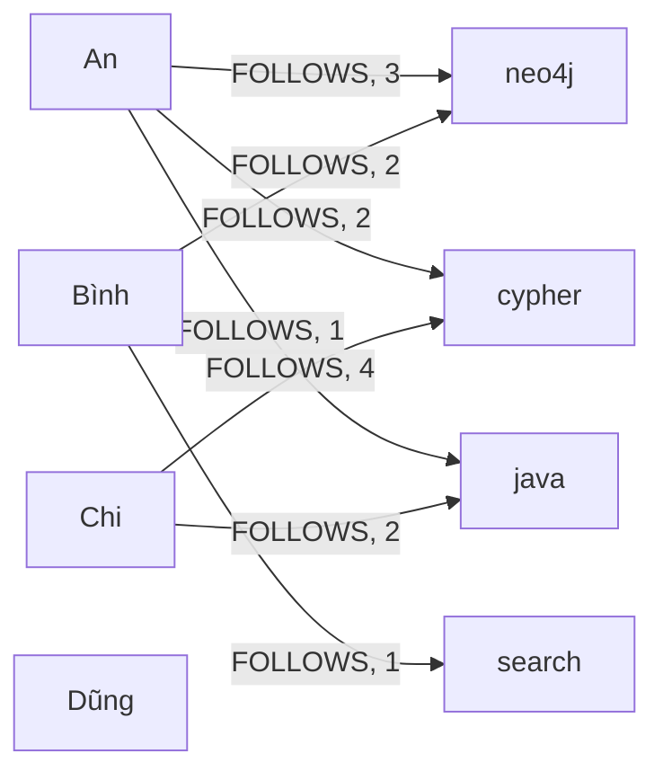

# Criteria for Choosing APOC, Plain Cypher, or Application-Layer Processing

## 1. Three Places to Place Graph Processing Logic

In Neo4j, data is organized as a **property graph**: nodes carry labels and properties, while relationships have a type, direction, and properties. To fulfill a requirement—such as finding people with shared interests, normalizing data, performing bulk updates, or calling external systems—a development team usually has three options:

1. **Plain Cypher:** using `MATCH`, `WHERE`, `WITH`, `UNWIND`, `MERGE`, expressions, functions, and subqueries provided natively by Neo4j.
2. **APOC:** using *functions* or *procedures* from the *Awesome Procedures On Cypher* extension library for supplementary operations.
3. **Application layer:** using the Java Driver, Spring Data Neo4j, or another service to run algorithms, integrate APIs, control workflows, and send parameterized Cypher to Neo4j.

**No single choice is universally best by default.** The decision depends on business semantics, transaction boundaries, data transfer volume, planner optimization visibility, operational cost, and what your Neo4j environment permits.

This content belongs to the **APOC and Extensions** chapter in the `DATABASE_ENGINE_GRAPH_NEO4J` module. It connects to relationship/path querying, indexes, constraints, data ingestion, Cypher tuning, the Java Driver, Spring Data Neo4j, and graph operations.

### Learning objectives

After this lesson, you will be able to:

- Distinguish the capabilities of Cypher, APOC Core/APOC Extended, and the application layer.
- Choose where logic should live based on **correctness, portability, observability, transactions, load, and security**.
- Compare two ways to find people with shared interests using `MATCH` and `apoc.path.expandConfig`.
- Evaluate when to use `CALL { ... } IN TRANSACTIONS` versus `apoc.periodic.iterate` for bulk updates.
- Design an A/B test and explain why row counts, `DB Hits`, latency, and resource costs all matter.

## 2. Core Capabilities and Limitations

| Aspect | Plain Cypher | APOC | Application Processing |
|---|---|---|---|
| **Graph querying** | Strong at patterns, filtering, paths, and aggregations | Adds traversal configs, structural refactoring, specialized utilities | Combines multiple queries or custom algorithms |
| **Query optimization** | Planner sees patterns/indexes and optimizes the plan | Some procedures hide internal steps from the Cypher plan | App must manage round-trips and intermediate data itself |
| **Multi-node writes in transactions** | `MERGE`, `SET`, `DELETE`, and subqueries | Some procedures manage internal batching/transactions | Driver manages transactions and retries |
| **HTTP/file/external integration** | Not the primary focus of a graph query language | Certain load/export procedures available if environment permits | Ideal for auth, rate limits, retries, and system adapters |
| **Installation/dependencies** | Built into Neo4j/Cypher version | Requires procedures/functions installed and permitted | Depends on app build, runtime, and libraries |
| **Testability** | Easy to assert with fixtures and `PROFILE` | Must verify behavior/config and measure inside DB | Easy to unit test, contract test, mock APIs, and trace |
| **Data transfer cost** | Executes close to the data | Executes close to the data | Can incur network overhead when pulling many rows out |

**Placement principle:** logic requiring multi-relationship traversal and consistency within a single transaction should generally be tried in Cypher first. External service integrations, complex business policies, or computations ill-suited to a query language are usually easier to govern in the application. APOC adds value when it supplies a concrete capability verified to exist and offering a clear advantage.

### 2.1. APOC Core and APOC Extended

APOC is a collection of **many functions and procedures**, not a single Cypher operator. Depending on Neo4j version and distribution, it is split into **APOC Core** and **APOC Extended**, with differing feature sets, installation steps, and support levels. Never assume a procedure documented online will run on Neo4j Aura, your container, or your cluster.

Before committing to APOC, verify:

1. Neo4j and APOC versions are compatible; consult documentation matching the **actual running version**.
2. The procedure/function is deployed and visible.
3. The application account has appropriate execute privileges, and security settings permit the feature.
4. Managed environments (such as cloud services) permit the specific procedure; never assume arbitrary plugin installation rights.
5. Whether the capability has been superseded by newer Cypher syntax in your Neo4j version.

Read-only statements to inspect availability:

```cypher
SHOW PROCEDURES
YIELD name
WHERE name STARTS WITH 'apoc.'
RETURN name
ORDER BY name
LIMIT 50;
```

```cypher
SHOW FUNCTIONS
YIELD name
WHERE name STARTS WITH 'apoc.'
RETURN name
ORDER BY name
LIMIT 50;
```

Check specifically for capabilities used in this lesson:

```cypher
SHOW PROCEDURES
YIELD name
WHERE name IN ['apoc.path.expandConfig', 'apoc.periodic.iterate']
RETURN name
ORDER BY name;
```

If a needed procedure name is absent, **do not proceed assuming it is installed**. Upgrading Neo4j, configuring plugins, and granting privileges are operational tasks, not the job of a business query.

## 3. A Verifiable Sample Dataset

We build a small graph of members following topics:



`AP009Member`, `AP009Topic`, and `AP009_FOLLOWS` are labels/relationships dedicated to this lesson. The snippets below use `MERGE` and run in a **test database**; do not blindly wipe data in shared systems.

### 3.1. Create identifying constraints

```cypher
CREATE CONSTRAINT ap009_member_id IF NOT EXISTS
FOR (m:AP009Member)
REQUIRE m.id IS UNIQUE;
```

```cypher
CREATE CONSTRAINT ap009_topic_slug IF NOT EXISTS
FOR (t:AP009Topic)
REQUIRE t.slug IS UNIQUE;
```

Constraints protect uniqueness for non-null values; the application must still validate non-null, well-formed IDs. If duplicate data already exists, clean it up before creating constraints.

### 3.2. Create nodes and relationships

```cypher
UNWIND [
  {id: 'an', name: 'An'},
  {id: 'binh', name: 'Bình'},
  {id: 'chi', name: 'Chi'},
  {id: 'dung', name: 'Dũng'}
] AS row
MERGE (m:AP009Member {id: row.id})
SET m.name = row.name;
```

```cypher
UNWIND ['neo4j', 'cypher', 'java', 'search'] AS slug
MERGE (:AP009Topic {slug: slug});
```

```cypher
UNWIND [
  {member: 'an', topic: 'neo4j', weight: 3},
  {member: 'an', topic: 'cypher', weight: 2},
  {member: 'an', topic: 'java', weight: 1},
  {member: 'binh', topic: 'neo4j', weight: 2},
  {member: 'binh', topic: 'search', weight: 1},
  {member: 'chi', topic: 'cypher', weight: 4},
  {member: 'chi', topic: 'java', weight: 2}
] AS row
MATCH (m:AP009Member {id: row.member})
MATCH (t:AP009Topic {slug: row.topic})
MERGE (m)-[f:AP009_FOLLOWS]->(t)
SET f.weight = row.weight;
```

Verify one row per member, including Dũng who follows zero topics:

```cypher
MATCH (m:AP009Member)
OPTIONAL MATCH (m)-[f:AP009_FOLLOWS]->(t:AP009Topic)
WITH m, count(t) AS topicCount,
     sum(coalesce(f.weight, 0)) AS totalWeight,
     collect(DISTINCT t.slug) AS topics
RETURN m.id AS memberId, topicCount, totalWeight, topics
ORDER BY memberId;
```

| memberId | topicCount | totalWeight | topics (order not guaranteed) |
|---|---:|---:|---|
| `an` | 3 | 6 | `neo4j, cypher, java` |
| `binh` | 2 | 3 | `neo4j, search` |
| `chi` | 2 | 6 | `cypher, java` |
| `dung` | 0 | 0 | `[]` |

`collect()` does not guarantee order without prior sorting. **Next problem:** find other members who share **at least one topic with An**, returning each person exactly once and sorted by ID.

## 4. Option 1: Plain Cypher for Clear Patterns

A direct solution to the problem above:

```cypher
MATCH (m:AP009Member {id: 'an'})
      -[:AP009_FOLLOWS]->(topic:AP009Topic)
      <-[:AP009_FOLLOWS]-(other:AP009Member)
WHERE other <> m
RETURN DISTINCT other.id AS memberId
ORDER BY memberId;
```

**Expected result:** `binh` and `chi`. Bình shares `neo4j` with An; Chi shares `cypher` and `java`. `DISTINCT` eliminates duplicate rows caused by multiple paths reaching the same member.

Strengths of this approach:

- Pattern, relationship directions, and filter predicates are immediately readable and easy to review.
- The Neo4j planner can exploit an **index** on `m.id` and optimize expansion order; use `EXPLAIN`/`PROFILE` to inspect index seek/scan leaves, `Expand`, `Rows`, and `DB Hits`.
- The query has zero extension dependencies as long as the Neo4j version supports the Cypher syntax used.
- Runs inside a Java Driver transaction, preserving database read semantics within that transaction.

When a query is straightforward and meets latency goals, **never add APOC merely to shave off a couple of lines**.

### 4.1. Counting shared topics instead of only listing IDs

```cypher
MATCH (m:AP009Member {id: 'an'})
      -[:AP009_FOLLOWS]->(topic:AP009Topic)
      <-[:AP009_FOLLOWS]-(other:AP009Member)
WHERE other <> m
RETURN other.id AS memberId,
       count(DISTINCT topic) AS sharedTopics
ORDER BY sharedTopics DESC, memberId;
```

Result: `chi = 2`, `binh = 1`. This is a classic graph-matching plus aggregation task well suited to Cypher. On large datasets, inspect degree cardinality for high-fanout members; starting from a member with millions of edges behaves very differently from a small fixture.

## 5. Option 2: APOC When Advanced Traversal Configuration Is Needed

APOC's `apoc.path.expandConfig` supports traversal options like depth limits, permitted relationship types/directions, uniqueness, allow/deny node lists, and custom termination rules. Exact options depend on APOC version; always check docs for your installed release.

To emulate the `Member → Topic → Member` path, configure:

```cypher
MATCH (m:AP009Member {id: 'an'})
CALL apoc.path.expandConfig(m, {
  relationshipFilter: 'AP009_FOLLOWS>|<AP009_FOLLOWS',
  minLevel: 2,
  maxLevel: 2,
  uniqueness: 'NODE_PATH',
  bfs: true
})
YIELD path
WITH m, last(nodes(path)) AS other
WHERE other:AP009Member AND other <> m
RETURN DISTINCT other.id AS memberId
ORDER BY memberId;
```

When the procedure exists and is compatible, the **expected result on the fixture** remains `binh`, `chi`. At each edge, `AP009_FOLLOWS>` allows outgoing edges and `<AP009_FOLLOWS` allows incoming edges; on this two-hop bipartite fixture, nodes only connect in matching directions, so paths follow the member–topic–member pattern.

**Semantic warning:** `uniqueness: 'NODE_PATH'` forbids repeating nodes **within a single path**. Other APOC uniqueness modes such as `NODE_GLOBAL` can change path counts, particularly when multiple routes lead to the same node. Plain Cypher variable-length paths also follow their own relationship-uniqueness rules. Therefore, never compare **path counts** between the two approaches without first aligning path definitions and uniqueness semantics.

### 5.1. When is APOC path traversal worthwhile?

APOC can be a good fit when requirements genuinely include:

- Traversing a set of **relationship types/directions** driven by trusted configuration.
- Enforcing node non-repetition via a specific uniqueness strategy.
- Complex path limits, end nodes, allow/deny node filters, or custom termination/emission rules.
- Reusing an existing APOC traversal pipeline already benchmarked and tested on a pinned version.

Conversely, for a clean two-hop `Member → Topic → Member` pattern, direct Cypher is usually **easier to audit**, gives the planner full visibility, and avoids extension coupling.

### 5.2. The cost of a procedure during plan analysis

Inspect the Cypher version:

```cypher
EXPLAIN
MATCH (m:AP009Member {id: 'an'})
      -[:AP009_FOLLOWS]->(:AP009Topic)
      <-[:AP009_FOLLOWS]-(other:AP009Member)
WHERE other <> m
RETURN DISTINCT other.id AS memberId;
```

And the APOC version:

```cypher
EXPLAIN
MATCH (m:AP009Member {id: 'an'})
CALL apoc.path.expandConfig(m, {
  relationshipFilter: 'AP009_FOLLOWS>|<AP009_FOLLOWS',
  minLevel: 2,
  maxLevel: 2,
  uniqueness: 'NODE_PATH'
})
YIELD path
RETURN path;
```

Plan output shows `ProcedureCall` for APOC, yet **does not necessarily break down internal traversal steps the way a Cypher pattern does**. Do not treat outer `DB Hits` as the procedure's full CPU/memory cost. Measure end-to-end latency, page cache behavior, and system resources on representative data.

## 6. Option 3: Processing in the Java Application

The application tier fits logic that sits **outside the boundary of a single graph query**, such as:

- Calling CRM/ERP APIs involving OAuth, tokens, rate limits, timeouts, circuit breakers, or retries.
- Linguistic normalization, complex data validation using Java libraries, schema checks, and message versioning.
- Joining Neo4j outputs with Elasticsearch, ML services, caches, or data sources outside the same transaction.
- CPU-specialized algorithms or multi-step workflows needing independent logging, tracing, and unit tests.
- Service-layer authorization/masking rules applied before returning responses to clients.

However, **pulling the entire graph into Java just to perform a two-hop join** introduces heavy overhead: extra round-trips, network serialization, higher application memory usage, and losing Neo4j planner index/join optimizations.

Java Driver example running the plain Cypher query from Section 4:

```java
import java.util.Map;
import org.neo4j.driver.Driver;

public class SharedTopics {
    private final Driver driver;

    public SharedTopics(Driver driver) {
        this.driver = driver;
    }

    public java.util.List<String> findPeople(String memberId) {
        String cypher = """
            MATCH (m:AP009Member {id: $memberId})
                  -[:AP009_FOLLOWS]->(:AP009Topic)
                  <-[:AP009_FOLLOWS]-(other:AP009Member)
            WHERE other <> m
            RETURN DISTINCT other.id AS memberId
            ORDER BY memberId
            """;

        try (var session = driver.session()) {
            return session.executeRead(tx ->
                tx.run(cypher, Map.of("memberId", memberId))
                  .list(row -> row.get("memberId").asString())
            );
        }
    }
}
```

Key point: the application **orchestrates and shapes results**, while the graph traversal remains in Cypher inside Neo4j. `$memberId` is parameterized; never concatenate user input into query syntax.

### 6.1. Small-logic example: don't use an extension just because it's installed

Joining two words with a hyphen is trivial and can live in several places:

```cypher
RETURN reduce(
  acc = '',
  word IN ['neo4j', 'cypher'] |
  CASE WHEN acc = '' THEN word ELSE acc + '-' + word END
) AS joined;
```

If the environment has the corresponding APOC function:

```cypher
RETURN apoc.text.join(['neo4j', 'cypher'], '-') AS joined;
```

Or in Java:

```java
String joined = String.join("-", java.util.List.of("neo4j", "cypher"));
```

All three yield `neo4j-cypher`. If it is purely for formatting an HTTP response, Java is the natural place; if formatting a value inline inside a query without wanting plugin dependencies, plain Cypher works fine. Simply having an APOC function **does not justify adding a dependency on APOC**.

## 7. Batch Processing: Native Batching or APOC?

A common requirement is updating many nodes without holding one massive transaction. You can use Cypher's `CALL { ... } IN TRANSACTIONS` or an APOC procedure like `apoc.periodic.iterate`. **The two approaches can differ in chunking, retries, error handling, and transaction boundaries**; choose based on operational contracts.

Suppose we want to stamp `lastAuditedAt` on `AP009Member` nodes lacking that property. The fixture has only four nodes; batch size `2` is solely to observe multiple batches, not a production recommendation.

### 7.1. Plain Cypher: CALL ... IN TRANSACTIONS

Example using Neo4j 5.23+ variable-import syntax `CALL (m) { ... }`:

```cypher
MATCH (m:AP009Member)
WHERE m.lastAuditedAt IS NULL
CALL (m) {
  SET m.lastAuditedAt = datetime()
} IN TRANSACTIONS OF 2 ROWS;
```

On the baseline fixture, this updates four members in two batches; re-running finds no remaining unmarked nodes. On older Neo4j versions, verify which variable-import syntax that version supports.

**Critical transaction boundary:** `CALL { ... } IN TRANSACTIONS` must run in an appropriate **implicit transaction**; never embed it directly inside a managed/explicit transaction already opened by the Java Driver expecting it to auto-commit per batch.

### 7.2. APOC: apoc.periodic.iterate

To compare on the exact same dataset, **strictly in the practice database**, reset state before running the APOC variant:

```cypher
MATCH (m:AP009Member)
REMOVE m.lastAuditedAt;
```

Once `apoc.periodic.iterate` is verified present:

```cypher
CALL apoc.periodic.iterate(
  'MATCH (m:AP009Member)
   WHERE m.lastAuditedAt IS NULL
   RETURN m',
  'SET m.lastAuditedAt = datetime()',
  {batchSize: 2, parallel: false}
)
YIELD batches, total, failedBatches, errorMessages
RETURN batches, total, failedBatches, errorMessages;
```

Expected output on the first run against the fixture: `total = 4`, `batches = 2`, `failedBatches = 0`. Running a second time after all nodes are updated gives `total = 0`. Exact results depend on data state and APOC version.

This procedure chunks data into batches and executes updates; committed batches persist **even if another batch fails**. Never treat it as an atomic all-or-nothing transaction across the entire record set. When updating interconnected records, shared keys, or potential lock contention areas, start with `parallel: false` and enable parallelism only after understanding contention mechanics.

### 7.3. Criteria for choosing between the two

| Question | Native `IN TRANSACTIONS` | APOC `periodic.iterate` |
|---|---|---|
| Want to avoid plugin dependencies | Suitable | Requires APOC available |
| Already have clear Cypher SELECT and UPDATE | Suitable | Also suitable |
| Need procedure-specific batch/parallel/retry options | Depends on Neo4j version capabilities | Offers procedure config options; check version docs |
| Invoked inside a Java managed transaction | Must redesign transaction boundary | Also spawns internal transactions; do not treat as a simple write inside an outer tx |
| Need all-or-nothing rollback across millions of rows | No atomicity across batches | No atomicity across batches |
| Need per-batch error logging/monitoring | Combine driver/orchestration and query counters | Use procedure result fields and monitoring |

When processing large volumes of orders/customers, plan for **idempotency** and **checkpointing**: if a batch commits and the caller loses its connection, replaying must not create duplicates or corrupt versions. `MERGE` on stable keys and version guards are extras you usually must add, not automatic guarantees from APOC or `IN TRANSACTIONS`.

## 8. Decision Criteria That Must Be Verified

### 8.1. Correctness and semantics

Define upfront: what does one output row represent, are repeated nodes/relationships allowed in a path, are unmatched nodes retained, and do property updates overwrite source keys? Compare speed **only after proving both approaches return identical business results**.

A fixture verification query:

```cypher
MATCH (m:AP009Member)
OPTIONAL MATCH (m)-[f:AP009_FOLLOWS]->(t:AP009Topic)
WITH m, count(DISTINCT t) AS topicCount,
     sum(coalesce(f.weight, 0)) AS totalWeight
WITH collect({
  id: m.id,
  count: topicCount,
  weight: totalWeight
}) AS actual
RETURN size(actual) = 4
  AND any(x IN actual WHERE x.id = 'an' AND x.count = 3 AND x.weight = 6)
  AND any(x IN actual WHERE x.id = 'binh' AND x.count = 2 AND x.weight = 3)
  AND any(x IN actual WHERE x.id = 'chi' AND x.count = 2 AND x.weight = 6)
  AND any(x IN actual WHERE x.id = 'dung' AND x.count = 0 AND x.weight = 0)
  AS passed;
```

Expected `passed = true`. This verifies the fixture; to confirm equivalence between Cypher and APOC, run **both** searches on the same snapshot and compare deduplicated ID sets. For create/update/delete queries, also verify property states, relationships, and replayability.

### 8.2. Latency, resources, and processing placement

| Metric | Practical Meaning | Measurement Source |
|---|---|---|
| `p50/p95/p99` | Typical latency and tail latency | Java Driver/API benchmarks |
| `Rows`, `Estimated Rows` | Actual vs. estimated rows between operators | `PROFILE` |
| `DB Hits` | Storage engine access work | `PROFILE`; not identical to disk reads |
| CPU, heap, GC, page cache | Resource pressure inside Neo4j | System/database monitoring |
| Records transferred over Bolt | Network and deserialization cost | Driver/application metrics |
| Batch duration, failed batches | Batch job health | Pipeline metrics/APOC output |
| Throughput and errors at target concurrency | Capacity under realistic load | Load tests |

With plain Cypher, the planner sees the pattern and selects indexes/traversal order. With APOC, part of the work runs **inside the procedure**, so outer plan stats may not capture all internal activity. When pulling many nodes into Java, cost shifts from the database to the network and application heap; never conclude something is faster solely because `DB Hits` dropped.

### 8.3. Portability, versions, and operability

- **Plain Cypher** minimizes extension dependencies, though syntax still evolves across versions; never assume new Cypher runs on old servers.
- **APOC** can require installation, upgrades aligned with Neo4j, procedure configs, privileges, and post-upgrade testing. Procedures replaced or deprecated across product generations must be re-evaluated.
- **Applications** easily package logic into testable units/libraries, yet must manage SDKs, retries, timeouts, connection pools, data transport, and cross-system consistency.
- **Aura/managed Neo4j** exposes a managed subset of extensions: never port an APOC-dependent design from self-managed to managed without checking available features.

When two options achieve equivalent results and performance with similar maintainability, the option **with fewer special deployment dependencies** usually wins long term.

### 8.4. Security and access control

Each placement has a distinct security surface:

| Issue | Decision Needed |
|---|---|
| Procedures reading files/calling URLs | Restrict runnable procedures and actual privileges; avoid default database I/O |
| User-driven dynamic queries | Parameterize values, use allowlisted labels/relationship types; never concatenate arbitrary Cypher |
| External APIs needing OAuth/mTLS | Prefer dedicated app/adapters with secret management |
| Sensitive fields | Control projected properties, masking, auditing, and role-based access |
| Custom in-DB algorithms | Enforce resource caps, timeouts, and node/path bounds to prevent overload |

For instance, `apoc.load.json` and certain load/export functions can talk to external sources **when** version, module, and configuration permit. Never use them as a shortcut around organizational network policies or API auth mechanisms. When calling services with tokens and complex retries, the application layer is usually the right place to manage credentials and observe failures.

## 9. A/B Testing Workflow Before Deciding

A verifiable selection process applicable to all three options:

1. **Write the output contract.** For the sample problem, return `['binh', 'chi']` sorted by ID; exclude self-matches and emit members sharing multiple topics only once.
2. **Capture data state.** Record Neo4j/APOC versions, indexes/constraints, node/relationship counts, input types, query parameters, and compute environment.
3. **Measure plain Cypher as baseline.** Use `EXPLAIN` to confirm starting points, `PROFILE` for rows/`DB Hits`, and measure app latency after consuming all records.
4. **Measure APOC on the same snapshot.** Confirm the procedure exists, configure matching uniqueness and min/max levels, verify identical ID lists, then measure latency/CPU/heap.
5. **Measure the application variant.** If running Java logic, include record transfer time from Neo4j, processing, result mapping, and retries—not Java CPU time alone.
6. **Run representative load.** Execute warm-up plus multiple iterations covering common, rare, and empty-result inputs at realistic concurrency, capturing p50/p95/p99.
7. **Decide against thresholds.** Pick the option meeting correctness, latency budgets, and resource caps with acceptable maintenance cost. When differences are noisy, keep the simpler, easier-to-operate choice.

### 9.1. Hypothetical results table to practice decisions

The numbers below are **not real Neo4j benchmarks**; they only illustrate how to document trade-offs for a single problem:

| Option | Correct Results? | End-to-End p95 | DB CPU/Heap | Network/App | Operational Dependencies |
|---|---|---|---|---|---|
| Plain Cypher | Yes | 24 ms | Low | Low | Neo4j/Cypher |
| APOC traversal | Yes | 31 ms | Medium | Low | Procedure + version + privileges |
| Java loads graph and traverses | Yes | 92 ms | Lower on DB | High | Driver + app memory |

In this hypothetical table, **plain Cypher is the sensible choice** for a two-hop query. If requirements shift to multi-hop traversals with complex uniqueness, node filters, and termination rules, test APOC and re-measure: this table cannot settle a different problem.

### 9.2. Reading EXPLAIN and PROFILE fairly

Evaluating plain Cypher:

```cypher
PROFILE
MATCH (m:AP009Member {id: 'an'})
      -[:AP009_FOLLOWS]->(:AP009Topic)
      <-[:AP009_FOLLOWS]-(other:AP009Member)
WHERE other <> m
RETURN DISTINCT other.id AS memberId
ORDER BY memberId;
```

For APOC, run `PROFILE` on the Section 5 query (prepending `PROFILE` before `MATCH`), keeping in mind the procedure may hide internal work. Measure **application end-to-end duration** and system-wide CPU/memory for both. Never compare `DB Hits` alone while ignoring APOC CPU time or network transfer latency.

## 10. Real-World Scenarios: Choosing the Right Layer

| Requirement | First Option to Try | Why? | When to Switch Options? |
|---|---|---|---|
| Two-hop lookup filtered by labels and properties | Cypher | Clear pattern, planner-optimized, easy to `PROFILE` | Need specialized traversal/path bounds |
| Counting/aggregating over relationships, index filtering | Cypher | Data never leaves the DB | Combining external rules or specialized CPU work |
| Paths with allow/deny lists and special uniqueness rules | APOC or advanced Cypher | APOC provides rich traversal configuration | Current Cypher version handles it clearly and faster |
| Backfilling a property across millions of nodes | Native `IN TRANSACTIONS` | Zero plugins needed, bounded batches | APOC offers a verified batch option you need |
| Simple string normalization | Cypher or Java | No extra library needed | An APOC helper expresses it cleanly and is already available |
| Merging nodes and refactoring complex links | Evaluate dedicated APOC refactor | Avoids fragile hand-rolled graph update queries | Need strict per-field business rules/audits |
| Calling partner APIs with OAuth and rate limits | Application | Security, retries, timeouts, tracing | An approved dedicated ingest service exists |
| CDC pipeline with checkpoints, retries, dead-lettering | App orchestrator + Cypher writes | Clear transaction boundaries and workflow state | Use APOC for a specific internal graph step |
| Computing ML embeddings then storing vectors | App/ML service + Cypher writes | Models, GPUs, versioning, and batching live outside DB | Platform provides benchmarked in-DB support |

**Watch version changes:** operations that once required APOC (such as dynamic labels/relationship types) may now have native syntax in newer Cypher releases. Before choosing a procedure solely because an old guide used it, check syntax and capabilities in your **current Neo4j/Cypher version**.

## 11. Common Design Mistakes

### 11.1. Using APOC merely to replace a short MATCH

A simple two-hop traversal is usually far easier to read as an explicit Cypher pattern. A procedure with many options makes it harder for reviewers to verify uniqueness, ordering, row counts, and cost.

### 11.2. Pulling large datasets into the app to run a graph join

Fetching all nodes/relationships into Java and rebuilding an in-memory graph copy per request overloads the app, forfeits DB indexes, and spikes network traffic. Keep graph filtering/joins close to the data and return only columns and rows the app needs.

### 11.3. Believing every APOC procedure runs in one atomic transaction

A graph-reading procedure and a batch procedure operate with very different transaction boundaries. With `apoc.periodic.iterate`, already-committed batches do not roll back if another batch fails. Inspect `failedBatches`, design idempotent replays, and never conflate source offsets with Neo4j commits.

### 11.4. Comparing outputs while ignoring path semantics

Two traversals may return identical node sets on a small fixture yet yield different path counts when cycles, parallel edges, repeated nodes, or longer paths exist. Before replacing Cypher with APOC (or vice versa), verify **both uniqueness contracts and traversal bounds**.

### 11.5. Treating APOC as guaranteed in every environment

`Unknown procedure/function` errors stem from missing plugins, version mismatches, disabled deployments, or insufficient privileges. Any APOC-based design must verify availability in the target environment; never ship code calling a procedure absent from production infrastructure.

### 11.6. Building dynamic queries from untrusted inputs

Never concatenate user-provided strings into procedure names, `MATCH`/`WHERE` clauses, or APOC dynamic-Cypher calls without strict validation. Use **parameters** for data values; for dynamic labels/relationship types or structural slots not parameterizable in your version, enforce a fixed allowlist and check official Cypher support.

## 12. Self-Practice Exercises

1. **Compare results:** run both plain Cypher and `apoc.path.expandConfig` to find members sharing topics with An. Use `DISTINCT`, sort by ID, and explain why Chi has two paths yet appears in only one result row.
2. **Change uniqueness:** add one more node and a cycle of test relationships; compare path results under `NODE_PATH` versus another APOC uniqueness mode. Explain why cardinality changes.
3. **Evaluate plans:** run `EXPLAIN`/`PROFILE` on both Cypher and APOC. Note index operators, rows, and `DB Hits`; point out procedure work that may remain hidden from detail.
4. **Compare batching:** run `CALL ... IN TRANSACTIONS` and `apoc.periodic.iterate` on the fixture after resetting `lastAuditedAt`. Inspect `batches`, `total`, and `failedBatches`; explain why batched transactions do not provide whole-job atomicity.
5. **Architecture decision:** a service must call an OAuth-protected REST API, transform payloads, create nodes/relationships, and persist checkpoints. Clearly separate responsibilities across Java and Cypher, and state whether APOC is genuinely needed.
6. **Environment constraints:** suppose deployment moves to managed Neo4j lacking an APOC procedure currently used. Design a plain Cypher/app replacement and verify equivalence against the same golden dataset.
7. **Benchmark report:** set targets `p95 < 100 ms`, CPU increase <= 20%, and exact correctness including cyclic cases. Build an A/B table and choose an option only after collecting sufficient sample runs.

**Completion criteria:** explain why plain Cypher fits a simple traversal; identify when APOC provides a clear capability win; distinguish batched transactions from a single transaction; place external integrations properly in the application layer; and consistently verify correctness, performance, privileges, and versions before deployment.

### Cleaning up practice data

Run only in the test database containing the `AP009` dataset. `DETACH DELETE` also removes relationships attached to deleted nodes:

```cypher
MATCH (m:AP009Member)
DETACH DELETE m;
```

```cypher
MATCH (t:AP009Topic)
DETACH DELETE t;
```

```cypher
DROP CONSTRAINT ap009_member_id IF EXISTS;
```

```cypher
DROP CONSTRAINT ap009_topic_slug IF EXISTS;
```

## 13. Documentation to Cross-Check by Deployment Version

- [Neo4j APOC Documentation](https://neo4j.com/docs/apoc/current/): procedure/function groups, Core/Extended, and usage prerequisites.
- [Neo4j APOC — Path Expander](https://neo4j.com/docs/apoc/current/overview/apoc.path/apoc.path.expandConfig/): configuring `relationshipFilter`, uniqueness, and depth limits.
- [Neo4j APOC — Periodic Iterate](https://neo4j.com/docs/apoc/current/overview/apoc.periodic/apoc.periodic.iterate/): batching, parallel options, and error outputs.
- [Neo4j Cypher Manual — Subqueries in Transactions](https://neo4j.com/docs/cypher-manual/current/subqueries/subqueries-in-transactions/): `CALL { ... } IN TRANSACTIONS` and transaction boundaries.
- [Neo4j Cypher Manual — Execution Plans](https://neo4j.com/docs/cypher-manual/current/planning-and-tuning/execution-plans/): `EXPLAIN`, `PROFILE`, `Rows`, `DB Hits`.
- [Neo4j Java Driver Manual](https://neo4j.com/docs/java-manual/current/): transactions, parameters, retries, and consuming results.
