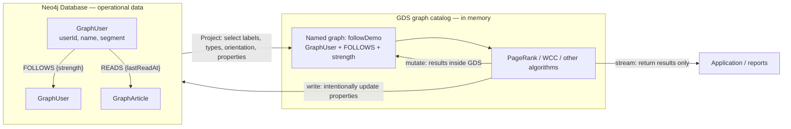
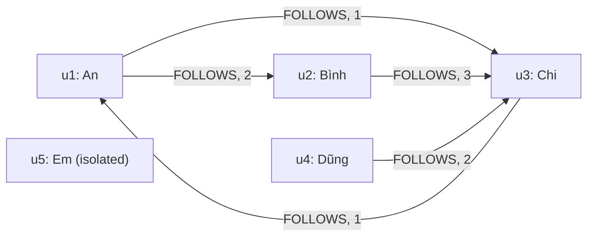
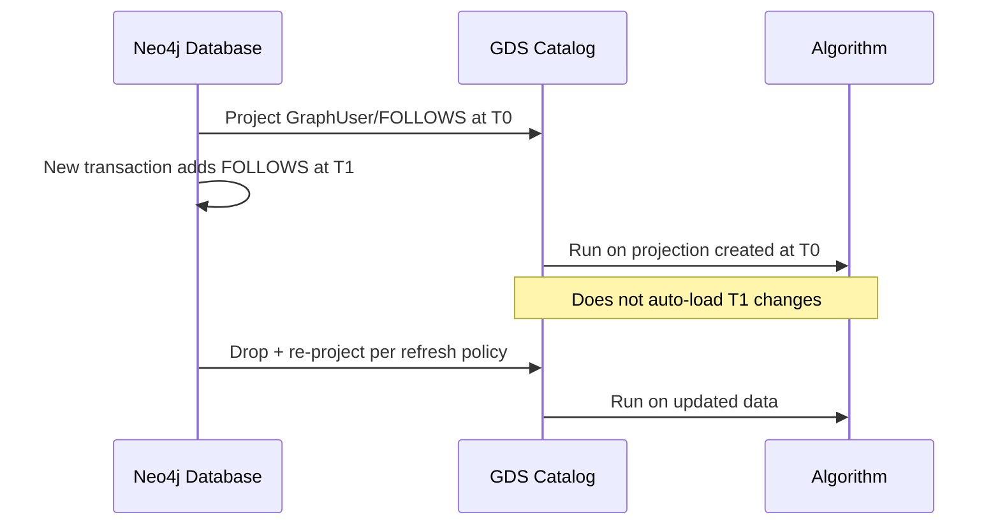
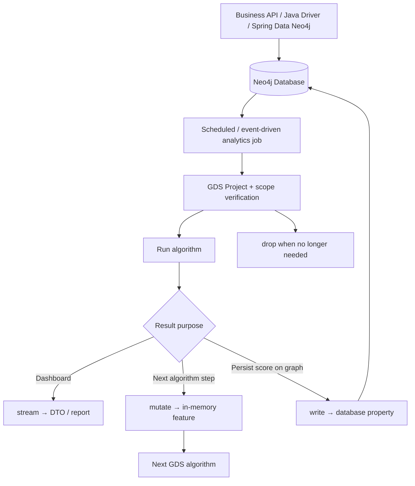

# Distinguishing Operational Data in Neo4j from Graphs Used for Computation

## 1. Two Perspectives on the Same Graph System

Neo4j stores application data using the **property graph** model: nodes represent entities, relationships represent connections, and properties store information for each entity or relationship. Applications use Cypher, the **Neo4j Java Driver**, or **Spring Data Neo4j** to read, write, and maintain operational state within transactions.

When you need to compute **PageRank, communities, connected components, similarity, or algorithmic paths**, you typically use the **Neo4j Graph Data Science (GDS)** library. GDS can create a **graph projection**: a graph representation **loaded into memory** so algorithms can process it efficiently. A projection extracts only the required nodes, relationships, edge orientations, and properties from the source. It does not automatically become a "second operational copy" that synchronizes transactions with the database.

This is the first lesson in the **Graph Algorithms** chapter of the `DATABASE_ENGINE_GRAPH_NEO4J` module. The goal is to properly understand the boundary between **the persistently stored graph serving business operations** and **the graph serving computation**, before choosing algorithms or building analytical pipelines.

After this lesson, you will be able to:

1. Distinguish a database property graph from a **named graph projection** in GDS.
2. Explain which nodes, relationships, and properties go into a projection and why that selection changes the meaning of the results.
3. Execute the **project → inspect → estimate → stream/mutate/write → drop** workflow.
4. Know when an algorithm **does not write** to the database and when it **intentionally writes results**.
5. Identify risks such as stale data, memory overhead, incorrect relationship orientation, and losing business identifiers when exporting results.

> The GDS examples below use the common API family of **Neo4j Graph Data Science 2.x**. GDS is a component that must be installed and granted appropriate permissions; `gds.*` procedures are not available by default in every Neo4j Database. Check your GDS version, documentation, and actual environment support before running them, especially when using Aura or managed systems with restricted permissions.

## 2. Foundational Concept: Operational Graph vs. Computational Graph

### 2.1. Operational Data Stored in Neo4j Database

For example, a community platform has `:GraphUser` and `:GraphArticle` nodes along with `:FOLLOWS` and `:READS` relationships:

```text
(u1:GraphUser {userId, name, segment})
    |
    +--[:FOLLOWS {strength}]->(u2:GraphUser)
    |
    +--[:READS {lastReadAt}]->(a1:GraphArticle {articleId, title})
```

The database must store the information the application needs to maintain:

- **Business identifiers**, such as `userId` or `articleId`, for exact lookups.
- **Business attributes** such as display name, segment, reading timestamp, and account status.
- **Actual relationships** representing events or connections accepted by the system.
- **Constraints/indexes** to protect data integrity and speed up queries.
- **Transactions, access controls, backups**, and operational mechanisms that persist data across restarts.

The operational graph is the **managed source of truth**. Every operation that adds or deletes nodes, changes properties, or creates relationships must adhere to application rules.

### 2.2. In-Memory Graph Projection in GDS

A graph projection can retain only `GraphUser` and `FOLLOWS` relationships. It does not need article nodes, `READS` relationships, or display names if the algorithm only requires the follow structure.



At projection time, GDS builds a structure tailored for algorithms, typically using internal node IDs and an optimized relationship representation for parallel traversal and computation. **The graph name in the catalog** lets you reuse the projected data without re-reading the entire database for every algorithm.

### 2.3. Comparison Table

| Criterion | Operational Graph in Neo4j | Named Graph Projection in GDS |
| --- | --- | --- |
| Purpose | Stores real application state and relationships | Provides input data for algorithms |
| Location | Managed and persistently stored database | GDS in-memory graph catalog |
| Contents | Written nodes, relationships, and properties | Subset/representation selected at projection time |
| Modifying data | `CREATE`, `MERGE`, `SET`, `DELETE` in transactions | Recreate the projection; or `mutate` to add results into the GDS graph |
| Sync on DB changes | Database is where changes are committed | **Does not auto-refresh** after each commit |
| Across DBMS restarts | Committed data is stored via persistence mechanisms | In-memory named graphs must be recreated when memory is lost or after restart |
| Deleting the graph | `DELETE`/`DETACH DELETE` can delete real data | `gds.graph.drop` frees the graph projection; **does not delete operational nodes/relationships** |
| Data returned to client | Cypher results, records/DTOs | Algorithm results; supports `stream`, `stats`, `mutate`, `write` |
| Permissions and operations | Database permissions, backups, transactions | Requires GDS and catalog/algorithm permissions; must manage memory and projection lifecycle |

**Common misconception:** Both are called a "graph," which does not mean there are two independent Neo4j databases. A GDS graph projection is a **computational structure** managed in a graph catalog; it does not provide the same persistence semantics or transactional updates as the source database.

## 3. Why Not Run Algorithms Directly on the Entire Operational Graph?

A real system may contain millions of nodes of many types: customers, orders, products, locations, event histories, authorization data, technical edges, and temporary data.

If the problem is **measuring user influence through follow relationships**, PageRank typically only needs:

- Eligible user nodes for analysis.
- `FOLLOWS` relationships in the proper direction.
- Relationship weight properties if using weighted PageRank.

Including `READS`, `PURCHASED`, order nodes, or login histories can **alter the computational graph** and thus change the meaning of the algorithm's output. "Adding more data" does not always yield greater accuracy.

Projections help you:

1. **Define the scope** strictly according to the business question.
2. **Choose edge orientation**: directed or undirected.
3. **Select weights** for algorithms requiring weighted relationships.
4. **Omit non-computational properties** to reduce memory usage and avoid bringing sensitive data into the analytics pipeline.
5. **Reuse the in-memory structure** across multiple consecutive algorithms.

In exchange, projections consume memory, take time to build, and **do not automatically update when the source database changes**.

## 4. Hands-On Data: One Operational Graph, One Scoped Projection

The examples use the `GraphUser` and `GraphArticle` labels dedicated to hands-on practice. Suppose there are five users: An, Bình, Chi, Dũng, and Em. In the sample dataset, Em does not follow anyone and is not followed by anyone.



### 4.1. Creating Operational Nodes and Relationships

First, create uniqueness constraints for identifiers:

```cypher
CREATE CONSTRAINT graph_user_id_unique IF NOT EXISTS
FOR (u:GraphUser)
REQUIRE u.userId IS UNIQUE;

CREATE CONSTRAINT graph_article_id_unique IF NOT EXISTS
FOR (a:GraphArticle)
REQUIRE a.articleId IS UNIQUE;
```

Create the five users:

```cypher
UNWIND [
  {userId: 'u1', name: 'An', segment: 'STANDARD'},
  {userId: 'u2', name: 'Bình', segment: 'STANDARD'},
  {userId: 'u3', name: 'Chi', segment: 'PREMIUM'},
  {userId: 'u4', name: 'Dũng', segment: 'STANDARD'},
  {userId: 'u5', name: 'Em', segment: 'PREMIUM'}
] AS row
MERGE (u:GraphUser {userId: row.userId})
SET u.name = row.name,
    u.segment = row.segment;
```

Create five follow relationships, each with a positive `strength` weight:

```cypher
UNWIND [
  {source: 'u1', target: 'u2', strength: 2.0},
  {source: 'u1', target: 'u3', strength: 1.0},
  {source: 'u2', target: 'u3', strength: 3.0},
  {source: 'u3', target: 'u1', strength: 1.0},
  {source: 'u4', target: 'u3', strength: 2.0}
] AS edge
MATCH (source:GraphUser {userId: edge.source})
MATCH (target:GraphUser {userId: edge.target})
MERGE (source)-[r:FOLLOWS]->(target)
SET r.strength = edge.strength;
```

Create additional operational data that is **not needed for the user PageRank algorithm**:

```cypher
MERGE (a:GraphArticle {articleId: 'art01'})
SET a.title = 'Introduction to Neo4j';

MATCH (u:GraphUser {userId: 'u1'})
MATCH (a:GraphArticle {articleId: 'art01'})
MERGE (u)-[r:READS]->(a)
SET r.lastReadAt = datetime('2026-10-01T08:00:00Z');
```

When run on a clean practice database without prior data for these labels, the result is **5 `GraphUser` nodes, 1 `GraphArticle` node, 5 `FOLLOWS` edges, and 1 `READS` edge**.

Verify the operational data:

```cypher
MATCH (u:GraphUser)
RETURN u.userId, u.name, u.segment
ORDER BY u.userId;
```

```cypher
MATCH (a:GraphUser)-[r:FOLLOWS]->(b:GraphUser)
RETURN a.userId AS nguoiTheoDoi,
       b.userId AS nguoiDuocTheoDoi,
       r.strength AS mucDo
ORDER BY nguoiTheoDoi, nguoiDuocTheoDoi;
```

These are **Cypher queries against the database**, without involving GDS yet. They read persistently stored state.

## 5. Creating a Graph Projection with GDS

### 5.1. Checking GDS Availability

```cypher
RETURN gds.version() AS gdsVersion;
```

If GDS is not installed or execution permissions are restricted, you may encounter a missing function/procedure error or a permission error. In that case, you must complete the GDS installation for the right version; you cannot replace a `gds.graph.project` procedure with regular `MATCH` queries and expect the same in-memory computation capabilities.

### 5.2. Projecting the Required Nodes, Relationship Types, and Weights

With **GDS 2.x**, a common way to project from the database is:

```cypher
CALL gds.graph.project(
  'followDemo',
  'GraphUser',
  {
    FOLLOWS: {
      orientation: 'NATURAL',
      properties: 'strength'
    }
  }
)
YIELD graphName, nodeCount, relationshipCount
RETURN graphName, nodeCount, relationshipCount;
```

Here:

- `'followDemo'`: the name of the **named graph** in the GDS catalog.
- `'GraphUser'`: projects only nodes with this label; `GraphArticle` nodes are excluded.
- `FOLLOWS`: projects only relationships of this type; `READS` is excluded from the computational graph.
- `orientation: 'NATURAL'`: preserves the relationship direction stored in the database, suitable for directed PageRank.
- `properties: 'strength'`: loads the edge weight property so algorithms can use it.

With the sample dataset, the projection is expected to have **5 nodes and 5 relationships**. Node `u5` is still included in the projection even though it has no edges, because we projected **all nodes carrying the `GraphUser` label**. If you use a projection approach that only starts from connected node pairs, isolated nodes like `u5` may be omitted; you must decide based on your computational requirements.

> GDS provides multiple projection methods. **Native projection** via `gds.graph.project` and **Cypher projection** using the `gds.graph.project(...)` function inside a Cypher query can differ in filtering capabilities depending on the GDS version. Some older APIs have been changed or deprecated. Consult the manual for your running version, especially if complex node/relationship filtering conditions are needed.

### 5.3. Projecting Does Not Copy All Properties

The `followDemo` graph can use the `strength` weight, but that **does not mean** fields like `name`, `segment`, `lastReadAt`, or `title` are projected as well.

If an algorithm needs a node property, you must **declare the corresponding node property** during the projection step and ensure the values have a type supported by the algorithm. Do not assume GDS algorithms automatically see every property present in the database.

For example, an algorithm requiring `segment` as a grouping label may need the input variable encoded/transformed, or require an algorithm that supports that property type. Not every operational property is a suitable computational feature.

## 6. Inspecting the Graph in the Catalog Before Running Algorithms

### 6.1. Reading Node and Relationship Counts

```cypher
CALL gds.graph.list('followDemo')
YIELD graphName, nodeCount, relationshipCount
RETURN graphName, nodeCount, relationshipCount;
```

This reports information about the **graph projection**, not a `MATCH` count across the entire database. If the node or relationship counts differ from expectations, check:

1. Were the right node labels projected?
2. Is the relationship type scope correct?
3. Did the computational graph convert orientation to `UNDIRECTED` or drop edges during projection?
4. Were isolated nodes, nodes missing required properties, or unintended edge types filtered out?
5. Has the database data changed since the projection was created?

### 6.2. Comparing Against the Source Database

```cypher
MATCH (u:GraphUser)
RETURN count(u) AS databaseUserCount;
```

```cypher
MATCH (:GraphUser)-[r:FOLLOWS]->(:GraphUser)
RETURN count(r) AS databaseFollowCount;
```

Right after creating the projection without modifying the source, these two counts are expected to match **5 nodes, 5 relationships**. However, the database also contains article nodes and `READS` edges, so `MATCH (n) RETURN count(n)` across the whole database can be much larger.

**Do not use `gds.graph.list` to infer all stored data.** The GDS catalog only reflects named graphs that have been created and still exist.

## 7. Choosing Relationship Orientation and Weights Before Running Algorithms

### 7.1. Edge Orientation Determines Semantics

For `(An)-[:FOLLOWS]->(Chi)`, the operational reading direction is **An follows Chi**. If the goal is to analyze who receives the most attention using PageRank, this direction usually makes sense: signal flows from the follower to the followed user.

Some algorithms treat relationships as **undirected**, such as weakly connected components analysis. When projecting with `orientation: 'UNDIRECTED'`, GDS can represent a relationship in both directions for algorithmic purposes. This **does not automatically create a reverse `FOLLOWS` relationship in the database**.

| Orientation in Projection | Main Meaning | What to Watch Out For |
| --- | --- | --- |
| `NATURAL` | Preserves source relationship direction | Suitable for algorithms needing true directionality |
| `REVERSE` | Reverses direction in the computational representation | Useful for reverse propagation problems |
| `UNDIRECTED` | Treats relationships bidirectionally | Can change the edge count in the projection and algorithm results |

If a business domain refers to "friends," which is inherently bidirectional, model and project it accordingly; do not blindly treat `FOLLOWS` as `FRIEND`.

### 7.2. Weights Are Business Rules

The `strength` property in the example represents connection intensity. When running weighted PageRank, positive weights can influence how scores propagate across edges. If weights are omitted, edges are processed according to the unweighted model of the algorithm.

Before feeding data into computation, determine:

- How is `strength` measured? Does it share the same scale and meaning across all relationships?
- Are values missing or of the wrong type? Does the algorithm require **numeric weights**?
- Does the algorithm accept `0`, negative numbers, or null values? Do not generalize across all algorithms.
- Does the weight accurately reflect the analytical question? A high weight does not always mean a positive relationship.

Do not arbitrarily replace every missing value with `1` if doing so could distort the meaning of the results. Decide on a missing-value handling policy during projection preparation.

## 8. Running Algorithms in `stream` Mode: Read-Only Results

### 8.1. PageRank on the Projection

```cypher
CALL gds.pageRank.stream(
  'followDemo',
  {
    maxIterations: 20,
    dampingFactor: 0.85,
    relationshipWeightProperty: 'strength'
  }
)
YIELD nodeId, score
WITH gds.util.asNode(nodeId) AS user, score
RETURN user.userId AS userId,
       user.name AS name,
       score AS pageRankScore
ORDER BY pageRankScore DESC, userId;
```

Key points to read accurately:

- `gds.pageRank.stream` runs PageRank **on the projected `followDemo` graph**.
- `relationshipWeightProperty: 'strength'` instructs the algorithm to use the edge property present in the projection.
- `nodeId` in the algorithm output must be **mapped** back to the corresponding node when displaying business identifiers or users.
- `gds.util.asNode(nodeId)` retrieves the corresponding Neo4j node for nodes projected from the database that support this mapping.
- `stream` **returns results to the query** and does not automatically add a `pageRankScore` property to `GraphUser` nodes in the database.

Do not assume fixed expected PageRank numbers: scores depend on the algorithm, parameters, edge orientation, weights, and node set in the projection. In the example, `u3` receives many incoming edges, yet conclusions about score ordering must still rely on actual execution results.

### 8.2. Computing Weakly Connected Components

```cypher
CALL gds.wcc.stream('followDemo')
YIELD nodeId, componentId
WITH gds.util.asNode(nodeId) AS user, componentId
RETURN user.userId AS userId,
       componentId
ORDER BY componentId, userId;
```

Because `u5` is isolated, it belongs to a separate component from the group `u1`–`u4` in the sample data. `componentId` is an **algorithm output identifier**, not a stable business key to store as a user ID or group code. Grouping results depend on the projected graph, so run metadata must also be recorded if used to build historical reports.

### 8.3. When Is `stream` Appropriate?

`stream` is suitable when you need to:

- Experiment with algorithms and parameters.
- Display results on dashboards or export reports.
- Compare outputs before deciding to persist them.
- Process results in the application **without modifying operational data**.

If an algorithm returns a very large number of rows, the application needs streaming/batched handling and limits on data transferred over the network. Do not assume that merely adding `LIMIT` at the end reduces the internal computational work performed by the GDS algorithm.

## 9. Distinguishing `stream`, `stats`, `mutate`, and `write`

This is the most critical aspect when connecting a computational pipeline to an operational application.

| GDS Mode | Output Data | Modifies Source Database? | Modifies GDS Graph? |
| --- | --- | --- | --- |
| `stream` | Per-node/edge results returned to query | **No**, unless an extra write step is added | No |
| `stats` | Summary statistics without returning per-node results | No | No |
| `mutate` | Computed results added as **properties/edges in the in-memory graph** if supported | **No** | **Yes** |
| `write` | Writes algorithm results back to properties/relationships in **Neo4j Database** if supported | **Yes** | Does not automatically sync other existing projections |

**Note:** Not every algorithm supports all four modes, and configuration/output fields may vary. Check the documentation for the exact algorithm and version. `stats` mode is typically used for distributions/summary metrics and is not equivalent to streaming all results and running `count(*)`.

### 9.1. `mutate` Writes to the GDS Graph, Not Neo4j Database

```cypher
CALL gds.pageRank.mutate(
  'followDemo',
  {
    maxIterations: 20,
    dampingFactor: 0.85,
    relationshipWeightProperty: 'strength',
    mutateProperty: 'pageRankScore'
  }
)
YIELD nodePropertiesWritten
RETURN nodePropertiesWritten;
```

Afterward, you can read the property **inside the projection**:

```cypher
CALL gds.graph.nodeProperties.stream(
  'followDemo',
  ['pageRankScore']
)
YIELD nodeId, nodeProperty, propertyValue
WITH gds.util.asNode(nodeId) AS user,
     nodeProperty,
     propertyValue
RETURN user.userId AS userId,
       nodeProperty,
       propertyValue
ORDER BY userId;
```

If right after `mutate` you run:

```cypher
MATCH (u:GraphUser)
RETURN u.userId, u.pageRankScore
ORDER BY u.userId;
```

then in the **source database**, the `pageRankScore` property has still not been created by the `mutate` algorithm. If the database originally lacked this field, the read value is `null`. `mutate` results live inside the computational graph and can be consumed by subsequent GDS steps.

### 9.2. `write` Intentionally Persists Results Back to the Database

Once the business purpose and target property name are confirmed, you can run:

```cypher
CALL gds.pageRank.write(
  'followDemo',
  {
    maxIterations: 20,
    dampingFactor: 0.85,
    relationshipWeightProperty: 'strength',
    writeProperty: 'computedPageRank'
  }
)
YIELD nodePropertiesWritten
RETURN nodePropertiesWritten;
```

Then read directly from the database:

```cypher
MATCH (u:GraphUser)
RETURN u.userId AS userId,
       u.computedPageRank AS score
ORDER BY score DESC, userId;
```

In this example, the algorithm writes `computedPageRank` onto the operational nodes mapped from the projection. This is a **real database modification** and requires considering write permissions, property naming, transactions, system load, and update policies.

**Do not use `writeProperty: 'rank'` if `rank` already carries a different business meaning.** Use a clear name or namespace such as `computedPageRank`, along with algorithm/data version and computation timestamp in a metadata system or audit pipeline for production use.

### 9.3. `mutate` and `write` Are Not Bidirectional Synchronization

If `mutate` creates `pageRankScore` in the catalog and the application then modifies `GraphUser` in the database, the two sides **do not automatically merge**. If `write` adds `computedPageRank` to the database, previously created named graphs **do not automatically load the new property**. You must actively re-project or use an appropriate API to load properties into the GDS graph if the workflow requires it.

## 10. Data Changes Over Time: The Projection "Snapshot" Problem

Suppose after creating the `followDemo` graph, the application adds a relationship:

```cypher
MATCH (a:GraphUser {userId: 'u5'})
MATCH (b:GraphUser {userId: 'u3'})
MERGE (a)-[r:FOLLOWS]->(b)
SET r.strength = 1.0;
```

After commit, a `MATCH` on the database sees the `u5 -> u3` edge. However, the previously loaded `followDemo` **does not automatically pick up the new relationship**. If you run PageRank/WCC on the old projection, the algorithm still operates on **data from the previous projection**, so `u5` may still be treated as isolated.



To ensure results meet requirements, a refresh policy is needed:

- **Batch:** re-project hourly/daily after ETL completes.
- **Event-driven:** when critical updates commit, mark the graph for rebuild according to workflow rules.
- **On-demand:** create a new graph for an analytical run with an explicit source version/snapshot.

Note that **freshness** and **point-in-time consistency at projection time** are two separate concerns. A projection operation on a graph undergoing heavy concurrent write transactions must be evaluated against the specific read mechanism and version, rather than assuming it is a strict point-in-time snapshot of the entire database.

In environments requiring reproducibility, record at least: **graphName, projection timestamp, filter scope, projected graph schema, weight configuration, GDS version, algorithm name, parameters, and source data batch ID**.

## 11. The Graph Catalog Is an Operational Resource

### 11.1. Graph Projections Consume Memory

A named graph can hold millions of nodes and tens of millions of relationships, plus projected properties and `mutate` results. Memory usage depends on graph type, topology, property formats, algorithm, and GDS configuration.

Before projecting/running algorithms on large datasets:

1. Select exact labels and relationship types; avoid projecting everything "just in case."
2. Load only the properties the algorithm requires.
3. Choose the appropriate edge orientation, since an `UNDIRECTED` structure can have a different memory footprint than `NATURAL`.
4. Use GDS **memory estimation** if supported by the algorithm and version.
5. Check RAM limits and concurrency across multiple graphs/algorithms in the runtime environment.

Example memory estimation for PageRank in stream mode (GDS 2.x syntax; verify for your version):

```cypher
CALL gds.pageRank.stream.estimate(
  'followDemo',
  {
    relationshipWeightProperty: 'strength',
    maxIterations: 20
  }
)
YIELD nodeCount, relationshipCount, requiredMemory
RETURN nodeCount, relationshipCount, requiredMemory;
```

Estimates are planning tools; they are **not a guarantee** that every run consumes that exact byte count. Having enough RAM for the projection does not automatically guarantee enough RAM for all algorithms running concurrently.

### 11.2. Dropping Projections When No Longer Needed

```cypher
CALL gds.graph.drop('followDemo')
YIELD graphName
RETURN graphName;
```

This removes the `followDemo` graph from the GDS catalog and frees projection resources. It **does not delete** `GraphUser` or `GraphArticle` nodes, operational edges, or the `computedPageRank` property already written via `write` into the database.

After `drop`, running an algorithm on `followDemo` requires re-projecting. Upon DBMS restart, in-memory graphs are also not guaranteed to persist; pipelines must include a recreation step.

### 11.3. Clustered Environments Do Not Automatically Share Projections

Do not treat named graphs as resources automatically synchronized and replicated across all cluster members like operational data. The GDS graph catalog and memory are tied to the algorithm execution environment and GDS management setup. If a request is routed to another member, a graph projected elsewhere may not exist there.

In production applications, clearly define where to **project**, where to **run algorithms**, where to **write results**, and what retry/refresh mechanisms fit your GDS architecture.

## 12. Identifiers: Do Not Equate Algorithm `nodeId` with Business IDs

In regular Cypher, applications should identify users using a stable `userId`, such as `'u3'`. GDS results typically return `nodeId` representing the projected node. For graphs projected from the database, `gds.util.asNode(nodeId)` helps retrieve the source node:

```cypher
CALL gds.pageRank.stream('followDemo')
YIELD nodeId, score
WITH gds.util.asNode(nodeId) AS user, score
RETURN user.userId AS businessId,
       score;
```

**Never store `nodeId` as a permanent business key.** It is an identifier used for computation/mapping, not a replacement for `userId` and not a stable contract across imports, graph recreations, or different environments. Especially when using **Cypher projection** or virtual nodes, verify ID mapping behavior and whether source nodes exist.

Results handed off to applications should include the **business key**, algorithm name, timestamp/data version, and required metric. For example, a record might contain:

```json
{
  "userId": "u3",
  "metric": "pageRank",
  "score": 1.234,
  "projection": "followDemo",
  "calculatedAt": "2026-11-25T00:00:00Z"
}
```

The value `1.234` in the JSON is strictly a **data structure illustration**, not an actual PageRank score calculated from the sample dataset.

## 13. When to Use Cypher Only vs. When to Use GDS?

| Requirement | Usually Suitable Tool | Reason |
| --- | --- | --- |
| Fetch a user's profile by `userId` | Cypher + index | Direct operational lookup; no projection needed |
| Find direct friends or paths up to a few hops | Cypher `MATCH` / path patterns | Suited for online queries on specific pairs |
| Find a shortest path by hop count between two nodes | Version-appropriate Cypher shortest-path | Solvable in a query; avoids building a large projection for a single lookup |
| Periodically compute PageRank for millions of users | GDS PageRank | Whole-graph computation; projection can be reused |
| Community detection / connected components on large networks | GDS | Specialized algorithms on an in-memory graph |
| Compute similarity scores / embeddings as ML features | GDS and feature pipeline | Results require version management; can use mutate/write |
| Write orders, follow relationships, or permission updates | Cypher transaction | Operational changes requiring consistency guarantees |

Tool selection depends on **update frequency, required freshness, node/relationship volume, RAM limits, and SLAs**. Do not use GDS to replace every Cypher query; likewise, do not force a regular Cypher query to enumerate all paths or hand-roll PageRank using `collect`.

## 14. Connection to Java Driver, Spring Data Neo4j, and Analytical Pipelines

A typical application pipeline:



### 14.1. Separating Operational Transactions from Algorithm Jobs

A request writing a `FOLLOWS` relationship is typically a short transaction. A PageRank job on a large graph can require substantial time and memory. Never hold a long-running application transaction open just to wait for projection/computation to finish.

With the Java Driver, the application can:

- Execute Cypher queries managing operational data inside **managed read/write transactions**.
- Call `CALL gds.graph.project(...)` and `CALL gds.pageRank.stream(...)` as permitted queries in an environment with GDS installed.
- Process result records in streams/batches and map them back to `userId`.
- Use a separate, controlled step to **write** results to the database when business rules allow.

Retry policies must match the workload. Transaction callbacks can be executed multiple times on transient errors; avoid placing non-idempotent side effects inside callbacks expecting single execution. When writing scores back to the database, you may need metadata such as **calculationRunId**, computation timestamp, and safeguards against older jobs overwriting newer job results.

### 14.2. Spring Data Neo4j Does Not Create Projections Automatically

Spring Data Neo4j handles entity/repository mapping and executes Cypher, but `@Node` entities or relationship mappings in Java **do not implicitly create an in-memory GDS graph**. Graph projections, algorithm configurations, and catalog lifecycles must still be managed explicitly.

Conversely, properties written by GDS `write` into database nodes become part of stored data. If the Java domain model needs to consume that property, consider mapping, optionality, write permissions, versioning, and the fact that the property may not yet be computed for some nodes.

## 15. Common Pitfalls

| Misconception or Mistake | Why It Is Wrong | Recommended Approach |
| --- | --- | --- |
| "GDS runs on all existing nodes" | Projections only include selected parts and may omit isolated nodes depending on creation method | Verify labels/types, scope, and `nodeCount`/`relationshipCount` |
| "A GDS graph name is a Neo4j database name" | A named graph belongs to the computational catalog, not an independent database | Distinguish database names from `graphName` |
| "After `MERGE` on a new edge, PageRank sees it automatically" | Existing projections do not auto-update | Refresh/re-project according to workflow |
| "`mutate` saved to Neo4j" | Mutate only modifies the in-memory representation | Use `write` when intentionally persisting results |
| "`write` only writes to the catalog" | Write updates database data | Choose appropriate property names, permissions, and rollback plans |
| "Dropping the projection deletes source nodes" | `gds.graph.drop` only removes the graph from the catalog | Separate GDS cleanup from operational data management |
| "`nodeId` is a long-term customer ID" | Computational/mapping IDs do not replace business keys | Return/store `userId` or explicit domain identifiers |
| "Switching to `UNDIRECTED` adds edges in the database" | Projection orientation is strictly a computational setting | Understand the difference between algorithmic representation and source relationships |
| "With GDS, indexes/constraints aren't needed" | Indexes/constraints still govern database correctness and lookups | Keep the operational schema; use GDS for algorithms |
| "A projection is available across all cluster nodes" | The catalog is tied to the runtime environment, not auto-replicated like DB data | Manage target location/instance and job lifecycle |
| "Projecting more properties always increases accuracy" | Extra properties increase memory usage and can skew models | Load only meaningful features with valid types |

## 16. Practice Exercises

### Exercise 1. Identifying the Dataset for PageRank

The database contains 5 `GraphUser` nodes, 1 `GraphArticle` node, 5 `FOLLOWS` edges, and 1 `READS` edge. When projecting as in Section 5.2, predict `nodeCount` and `relationshipCount`.

**Answer:** `nodeCount = 5`, `relationshipCount = 5`. The graph only contains `GraphUser` and `FOLLOWS`; `GraphArticle`/`READS` are not selected. Node `u5` is still projected because it carries the `GraphUser` label despite having no edges.

### Exercise 2. Predicting Changes After `mutate`

After running `gds.pageRank.mutate(..., mutateProperty:'pageRankScore')`:

1. Can `gds.graph.nodeProperties.stream` read `pageRankScore`?
2. Does `MATCH (u:GraphUser) RETURN u.pageRankScore` in the database return the new values?

**Answer:** (1) Yes, once mutate succeeds and while the graph remains in the catalog. (2) Not from the mutate operation alone; the database has not been updated with that property.

### Exercise 3. Detecting a Stale Projection

A new transaction adds `(u5)-[:FOLLOWS]->(u3)` and commits, but `followDemo` was created before this transaction. Will re-running `gds.wcc.stream('followDemo')` change `u5`'s connected component?

**Answer:** Not from the database change alone. Unless the graph is refreshed/re-projected or similarly updated in GDS, the algorithm still uses the old projection. After re-projecting with the new edge, `u5` can join `u3`'s component.

### Exercise 4. Choosing the Right Mode

Choose the appropriate mode for three requirements:

- An API only wants to display the list of users and their current PageRank scores.
- A pipeline wants to use PageRank as an input property for a subsequent GDS algorithm in the same named graph.
- Operational reporting wants to store scores on `GraphUser` nodes for later Cypher queries.

**Answer:** Use `stream`, `mutate`, and `write`, respectively. Manage data versioning, resources, and metadata if scores are used long-term.

### Exercise 5. Selecting Projected Data for User Communities

An application has `FOLLOWS`, `READS`, and `PURCHASED`, but the objective is "groups of users with direct/indirect follow connections." Should all relationships be included in the projection to make it "richer"?

**Suggested Answer:** Not automatically. You must define which relationship network defines the group. If the problem is based on `FOLLOWS`, project only that type and eligible user nodes. Including `READS` or `PURCHASED` requires a different model, potentially involving articles/products and changing the nature of the discovered communities.

### Exercise 6. Designing Result Metadata

To explain why `u3`'s score today differs from yesterday's, propose at least five metadata fields besides `userId` and `score`.

**Suggested Answer:** `algorithmName`, `gdsVersion`, `projectionName`, `projectionConfig` (labels/types/orientation/properties), `calculationRunId`, `dataCutoff` or `projectedAt`, `algorithmConfig` (damping factor, iterations, weights), `calculatedAt`, and refresh policy.

## 17. Summary

**The operational graph** in Neo4j is where the application stores nodes, relationships, and properties under transactions and data integrity rules. **A GDS graph projection** is a purposefully created computational representation, typically containing only a subset of labels, edge types, orientations, and weights needed for algorithms. Projections do not automatically sync with every database change and require lifecycle, memory, version, and freshness management.

The key to using algorithms effectively is understanding result modes: **`stream` to inspect, `mutate` for downstream GDS use, and `write` to intentionally persist to Neo4j Database**. Results should be mapped back to **business keys** rather than treating computational `nodeId` values as durable identifiers. When using Java Driver or Spring Data Neo4j, cleanly separate operational transactions from algorithmic pipelines and validate the projection model before interpreting scores.

### References

- [Neo4j Graph Data Science – Introduction](https://neo4j.com/docs/graph-data-science/current/introduction/)
- [Neo4j Graph Data Science – Graph projection](https://neo4j.com/docs/graph-data-science/current/management-ops/graph-creation/)
- [Neo4j Graph Data Science – Graph catalog](https://neo4j.com/docs/graph-data-science/current/management-ops/graph-list/)
- [Neo4j Graph Data Science – PageRank](https://neo4j.com/docs/graph-data-science/current/algorithms/page-rank/)
- [Neo4j Graph Data Science – Weakly Connected Components](https://neo4j.com/docs/graph-data-science/current/algorithms/wcc/)
- [Neo4j Graph Data Science – Understanding algorithm modes](https://neo4j.com/docs/graph-data-science/current/common-usage/running-algos/)
