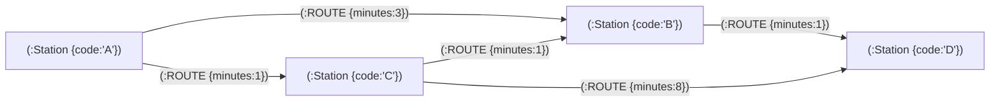
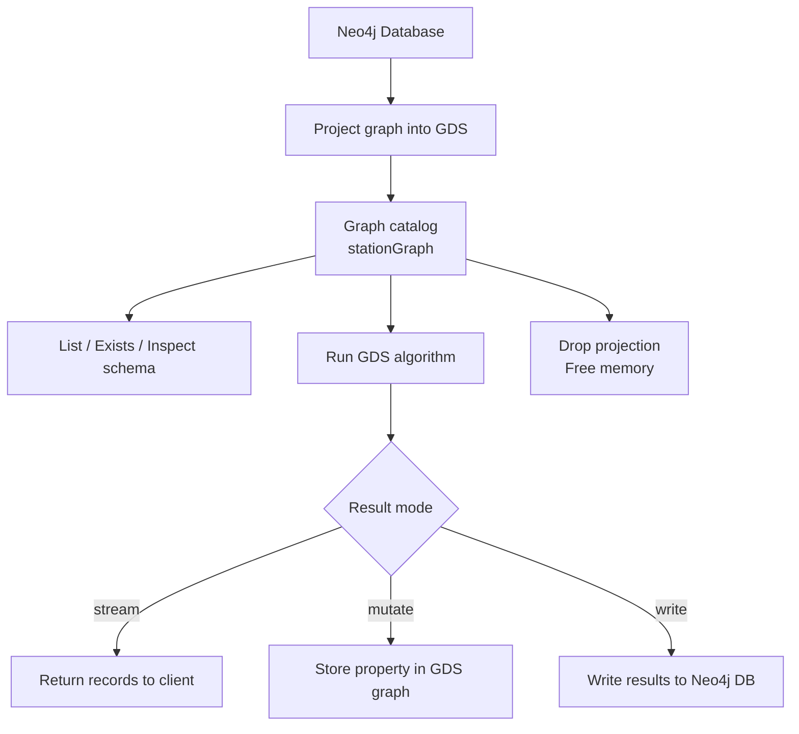
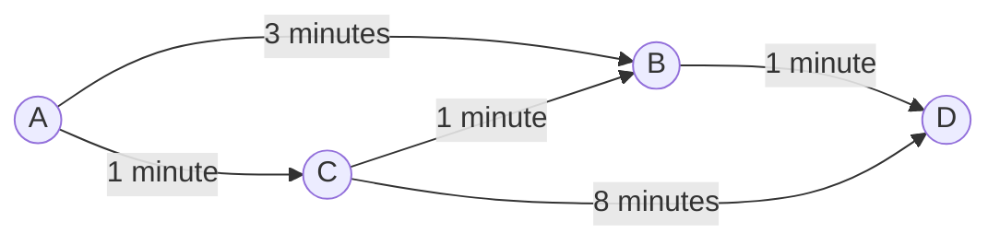
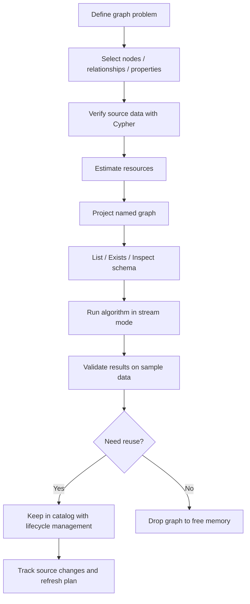

# Projecting Graphs into Memory and Managing the Graph Catalog in Neo4j

In **Neo4j**, nodes and relationships are stored in the database to serve **Cypher** queries. When running algorithms such as PageRank, community detection, weighted path finding, or similarity, **Neo4j Graph Data Science (GDS)** typically operates on an **in-memory graph projection**. Developers select the required node labels, relationship types, properties, and edge orientations; GDS creates a named graph representation in the **graph catalog**, and then uses that name when executing algorithms.

This lesson belongs to the **Graph Algorithms** chapter of the **DATABASE_ENGINE_GRAPH_NEO4J** module. The goal is to understand **what a projection is, how to select the right data to project, how to inspect the graph catalog, and how to manage memory lifecycles**. These operations are equally important when an application uses the **Neo4j Java Driver** or **Spring Data Neo4j** to coordinate standard Cypher queries with GDS algorithms.

> **Practice prerequisites:** The examples assume an environment with **Neo4j Graph Data Science** installed and enabled, compatible with your running Neo4j version. `gds.*` procedures are not automatically present in every Neo4j distribution or managed service. Practice on a dedicated database to avoid graph name collisions and sample data conflicts.

## 1. Stored Graph and In-Memory Graph Are Two Different Layers

Suppose the graph stored in Neo4j contains:



Cypher can read and update these entities directly. For GDS to compute the shortest-time path, you can create a projection containing only:

- Nodes labeled `:Station`.
- Relationships of type `:ROUTE`, preserving direction from origin to destination.
- The `minutes` property on relationships to serve as **weights**.

GDS does not necessarily need other properties such as `address`, `description`, or `createdAt` if the algorithm does not use them. Scoped projection avoids holding unnecessary data in memory.

| Criterion | Stored Neo4j Graph | GDS Projection |
| --- | --- | --- |
| Location | Persistent data in the database | Graph representation in GDS memory |
| Identification | Nodes, relationships, and properties in Neo4j | Named graph in the **graph catalog** |
| Updates | Cypher `CREATE`, `MERGE`, `SET`, `DELETE`... | Recreate projection or use supported catalog update mechanisms |
| Purpose | Storing, querying, and constraining business data | Computing graph algorithms over the chosen structure |
| Lifecycle | Tied to database data | Tied to the catalog, GDS process, and drop operations |
| Deletion | Data operations like `DELETE`/`DETACH DELETE` | `gds.graph.drop(...)` removes the **projection**, not Neo4j nodes/relationships |

**A projection is not a database copy for arbitrary business writes.** It is a computational representation whose node/edge/property set and orientation are determined at creation time.

## 2. What Is the Graph Catalog?

The **graph catalog** is where GDS manages graphs projected into memory. Each graph has a **name**, structure, memory footprint information, and associated metadata. Typically, the lifecycle follows:



Key operational characteristics:

1. **Graph names** such as `stationGraph` serve as reference names passed to `gds.pageRank.stream('stationGraph', ...)`, `gds.shortestPath.dijkstra.stream(...)`, and other algorithms.
2. Graphs remain in memory until dropped or the GDS runtime lifecycle ends. **Do not treat the graph catalog as persistent storage across restarts**.
3. Graphs are scoped to the database context and GDS access permissions. Whether graphs can be viewed or shared across accounts depends on the version, edition, and security configuration; do not assume all users see all graphs.
4. A graph with the same name causes a **collision on re-projection** within the corresponding catalog scope. Before recreating, check `exists` and manage drops intentionally.
5. Projections can consume significant RAM or managed GDS memory, especially for graphs with millions of nodes/edges and many properties; always estimate before creating.

### The Graph Catalog Is Not a Query Plan Cache

The Cypher planner chooses an **execution plan** for queries, whereas the GDS graph catalog holds **graphs prepared for algorithms**. These are separate mechanisms:

- `EXPLAIN` or `PROFILE` analyzes Cypher query execution plans.
- `gds.graph.list`, `gds.graph.exists`, and `gds.graph.drop` manage GDS graphs.
- Optimizing a Cypher query with an index does not automatically add new data or properties to an already-created projection.

## 3. Deciding Projection Contents Before Creation

A projection requires deciding at least the following:

| Decision | Question to Ask | Example |
| --- | --- | --- |
| **Nodes** | Which nodes should the algorithm run on? | `:Station`, excluding `:AuditLog` |
| **Relationships** | Which edges reflect the relationship to analyze? | Only `:ROUTE`, excluding `:VIEWED` |
| **Orientation** | Are edges directed or treated bidirectionally? | One-way routes use `NATURAL` |
| **Properties** | Which node/edge data does the algorithm need? | `minutes` as edge weight |
| **Format/type** | Are weights valid numeric values? | All `minutes` are non-negative numbers |
| **Data scope** | Should we filter by tenant, time window, or region? | Routes within a single city only |
| **Memory and lifecycle** | How much RAM is needed, and when should it be dropped? | Short-lived graph for one batch run |

If you only need to count nodes or traverse a few direct relationships, Cypher may suffice. If you need algorithmic computation over a large connected network, a GDS projection is worth considering.

### Relationship Orientation Is a Business Decision

Given the same source data:

- `NATURAL` keeps the source relationship direction when projecting; traversing from `A` to `B` does not imply traversing from `B` to `A`.
- `UNDIRECTED` represents relationships so the algorithm treats endpoints as connected regardless of original direction.
- `REVERSE` reverses relationship direction in the projection for APIs that support this mode.

Choosing `UNDIRECTED` changes how adjacency lists are stored compared to a directed projection, affecting the number of edges represented and memory usage. Do not choose undirected "for convenience when running algorithms" if the domain is genuinely a one-way network.

## 4. Creating Verifiable Practice Data

The dataset has four stations `A`, `B`, `C`, `D` and five directed route segments. Each relationship carries `minutes`, representing travel time in minutes.

### 4.1. Creating a Unique Key

Run on a practice database:

```cypher
CREATE CONSTRAINT alg_station_code_unique IF NOT EXISTS
FOR (s:AlgStation)
REQUIRE s.code IS UNIQUE;
```

The constraint ensures each `code` corresponds to at most one `AlgStation` node. It also helps reliably locate exact start and end nodes when running algorithms.

### 4.2. Creating Nodes, Relationships, and Weights

```cypher
MERGE (a:AlgStation {code: 'A'})
MERGE (b:AlgStation {code: 'B'})
MERGE (c:AlgStation {code: 'C'})
MERGE (d:AlgStation {code: 'D'})
MERGE (a)-[ab:ALG_ROUTE]->(b)
SET ab.minutes = 3.0
MERGE (a)-[ac:ALG_ROUTE]->(c)
SET ac.minutes = 1.0
MERGE (c)-[cb:ALG_ROUTE]->(b)
SET cb.minutes = 1.0
MERGE (b)-[bd:ALG_ROUTE]->(d)
SET bd.minutes = 1.0
MERGE (c)-[cd:ALG_ROUTE]->(d)
SET cd.minutes = 8.0;
```

Diagram of the dataset:



Use Cypher to verify the input data:

```cypher
MATCH (from:AlgStation)-[r:ALG_ROUTE]->(to:AlgStation)
RETURN from.code AS fromCode,
       to.code AS toCode,
       r.minutes AS minutes
ORDER BY fromCode, toCode;
```

The reference dataset must have **4 nodes** and **5 relationships**; the sum of segment times is `3 + 1 + 1 + 1 + 8 = 14` minutes. The path `A → C → B → D` totals **3 minutes**, which is the optimal path by `minutes` in this example; `A → B → D` takes 4 minutes.

## 5. Projecting a Graph via Native Projection

GDS supports projecting by **node labels**, **relationship types**, and property configurations. For example, naming the projection `stationGraph`:

```cypher
CALL gds.graph.project(
  'stationGraph',
  'AlgStation',
  {
    ALG_ROUTE: {
      orientation: 'NATURAL',
      properties: 'minutes'
    }
  }
)
YIELD graphName, nodeCount, relationshipCount, projectMillis
RETURN graphName,
       nodeCount,
       relationshipCount,
       projectMillis;
```

Explanation:

- `'stationGraph'`: graph name in the catalog; not a node label, database name, or file name.
- `'AlgStation'`: includes only nodes with this label.
- `ALG_ROUTE`: includes only relationships of this type between projected nodes.
- `orientation: 'NATURAL'`: preserves original relationship direction.
- `properties: 'minutes'`: loads the weight property into the in-memory graph.
- `nodeCount` and `relationshipCount`: node/edge counts in the projection, not necessarily the entire database.
- `projectMillis`: elapsed time to project, useful for observing data-loading cost.

Expected result for the sample dataset: `graphName = stationGraph`, `nodeCount = 4`, `relationshipCount = 5`. `projectMillis` varies by environment, so do not expect a fixed number.

> **Compatibility:** Native projection still appears in many GDS versions, while in newer versions **Cypher projection** offers greater flexibility and is emphasized in GDS documentation. API names and deprecation status can vary by version. This lesson illustrates both so you recognize them in real-world systems.

### Projecting Multiple Node Labels or Relationship Types

For richer datasets, you can project multiple types, for instance:

```cypher
CALL gds.graph.project(
  'commerceNetwork',
  ['Customer', 'Product'],
  {
    BOUGHT: {
      orientation: 'NATURAL'
    },
    VIEWED: {
      orientation: 'NATURAL'
    }
  }
)
YIELD graphName, nodeCount, relationshipCount
RETURN graphName, nodeCount, relationshipCount;
```

This example only shows a **configuration pattern**: matching nodes and relationships must exist in the database to produce meaningful counts. When nodes carry multiple labels or relationships have multiple types, choose a scope matching the target algorithm rather than projecting everything simply because it exists.

## 6. Inspecting the Graph Catalog: `list`, `exists`, and Schema

After projecting successfully, verify that the graph has the expected structure before running algorithms.

### 6.1. Listing Graphs

```cypher
CALL gds.graph.list()
YIELD graphName, nodeCount, relationshipCount, memoryUsage
RETURN graphName, nodeCount, relationshipCount, memoryUsage
ORDER BY graphName;
```

The output can list **multiple graphs** visible to the current account. `memoryUsage` reflects memory usage reported by GDS as supported by the version; do not assume it equals the total RAM consumption of the Neo4j process.

To inspect `stationGraph` specifically:

```cypher
CALL gds.graph.list('stationGraph')
YIELD graphName, nodeCount, relationshipCount, schema
RETURN graphName, nodeCount, relationshipCount, schema;
```

`schema` confirms which labels, relationship types, and properties were projected. A graph that looks right in Neo4j Browser **does not guarantee** that the catalog graph contains the properties or edge orientations required by the algorithm.

### 6.2. Checking Existence Before Use

```cypher
CALL gds.graph.exists('stationGraph')
YIELD graphName, exists
RETURN graphName, exists;
```

If `exists = true`, a graph with that name exists in the catalog accessed by the statement. If `false`, you cannot run algorithms against that name until the graph is created—or until you target the right database/user/accessible catalog.

### 6.3. Checking Labels and Relationship Types

Catalog inspection procedures can list labels and relationship types in a projection:

```cypher
CALL gds.graph.nodeLabels('stationGraph')
YIELD nodeLabel
RETURN nodeLabel;
```

```cypher
CALL gds.graph.relationshipTypes('stationGraph')
YIELD relationshipType
RETURN relationshipType;
```

For the example, expect `AlgStation` and `ALG_ROUTE`. For properties, prefer inspecting `schema` from `gds.graph.list` to verify whether `minutes` was included in the projection.

## 7. Running an Algorithm to Verify Projection Data

To verify that GDS uses the **projected edges and weights**, run Dijkstra on `stationGraph`. The algorithm finds the path with the minimum **total time** given non-negative edge weights.

```cypher
MATCH (source:AlgStation {code: 'A'}),
      (target:AlgStation {code: 'D'})
CALL gds.shortestPath.dijkstra.stream('stationGraph', {
  sourceNode: source,
  targetNodes: [target],
  relationshipWeightProperty: 'minutes'
})
YIELD totalCost, nodeIds
RETURN [nodeId IN nodeIds | gds.util.asNode(nodeId).code] AS route,
       totalCost AS totalMinutes;
```

Expected output:

```text
route                   totalMinutes
["A", "C", "B", "D"]      3.0
```

The three-hop path `A → C → B → D` takes `1 + 1 + 1 = 3` minutes, shorter than `A → B → D` (4 minutes) and `A → C → D` (9 minutes). This demonstrates that:

- `gds.shortestPath.dijkstra.stream` reads the **in-memory** `stationGraph`, rather than automatically reading all nodes and relationships in Neo4j.
- `relationshipWeightProperty: 'minutes'` instructs the algorithm to compute cost from the projected property.
- `gds.util.asNode(nodeId)` maps GDS node IDs back to source Neo4j nodes in this projection style, allowing `code` to be displayed.
- `stream` mode only **returns results**; it does not write the optimal path back as new relationships in Neo4j.

If the projection lacks `minutes` or contains invalid values for the algorithm, the query can fail or return results misaligned with business goals. Therefore, checking schema and input data is essential.

## 8. Cypher Projection: Explicitly Selecting Matching Nodes and Edges

Beyond native projection, GDS supports **Cypher projection** using the `gds.graph.project(...)` function inside a Cypher query. This is useful when selecting nodes/edges using logic more specific than taking an entire label or relationship type.

Example creating **a differently named graph** `stationCypherGraph` from the same `ALG_ROUTE` relationships:

```cypher
MATCH (source:AlgStation)-[r:ALG_ROUTE]->(target:AlgStation)
WITH gds.graph.project(
  'stationCypherGraph',
  source,
  target,
  {
    sourceNodeLabels: labels(source),
    targetNodeLabels: labels(target),
    relationshipType: type(r),
    relationshipProperties: r { .minutes }
  }
) AS g
RETURN g.graphName AS graphName,
       g.nodeCount AS nodeCount,
       g.relationshipCount AS relationshipCount;
```

In this example:

- `MATCH` determines which node pairs and relationships enter the graph.
- `sourceNodeLabels` and `targetNodeLabels` copy labels from the source nodes.
- `relationshipType: type(r)` preserves the source relationship type.
- `relationshipProperties: r { .minutes }` projects each edge's `minutes` property.
- `stationCypherGraph` uses a different name from `stationGraph` to avoid conflicts, since they are **two independent graphs in the catalog** even though they reference the same source data.

**Important difference:** A Cypher projection driven by `MATCH (source)-[r]->(target)` includes only nodes appearing in rows returned by `MATCH`. **Isolated nodes** (with no matching relationships) may be omitted. If the algorithm needs isolated nodes as well, design the projection query to include them according to your GDS version's syntax and capabilities.

### Example Filtering a Subgraph

Suppose relationships also have `r.region`. You could change the source clause to:

```cypher
MATCH (source:AlgStation)-[r:ALG_ROUTE]->(target:AlgStation)
WHERE r.region = 'north'
WITH gds.graph.project(
  'northRoutes',
  source,
  target,
  {
    relationshipType: type(r),
    relationshipProperties: r { .minutes }
  }
) AS g
RETURN g.graphName AS graphName,
       g.nodeCount AS nodeCount,
       g.relationshipCount AS relationshipCount;
```

This is an **extension pattern**; the lesson's `AlgStation` dataset has no `region` property, so this filter query will not yield a useful edge set if run verbatim. On a real graph, verify the filter returns rows and handle empty-projection cases properly.

### When to Use Which?

| Scenario | Native Projection | Cypher Projection |
| --- | --- | --- |
| Taking all nodes of a label and all relationships of a type | Concise, readable | Possible, though more verbose |
| Filtering by property, tenant, or multi-hop conditions | Less flexible | Expresses conditions directly in Cypher |
| Highly customized node/relationship/property shaping | Limited by projection parameters | Usually better suited |
| Ensuring compatibility with newer GDS versions | Check API support in that version | Check projection syntax for that version |
| Controlling isolated nodes | Can select nodes directly by label | Pay attention to how `MATCH` produces projection rows |

**Do not mix up the syntax:** `CALL gds.graph.project(...)` in native projection is a **procedure**; `gds.graph.project(...)` inside a `WITH` clause in Cypher projection is a **function**. The two APIs have different semantics and configuration structures despite similar names.

## 9. The Graph Catalog Is a Snapshot, Not Auto-Synced with the Database

An easy mistake to overlook: once `stationGraph` is projected, it reflects data **at projection creation time**. If weights are edited or relationships are added in Neo4j afterward, the projection **does not automatically pick up the updates**.

For example:

```cypher
MATCH (:AlgStation {code: 'A'})-[r:ALG_ROUTE]->
      (:AlgStation {code: 'B'})
SET r.minutes = 0.5;
```

This statement updates `A → B` travel time in the **database** from 3 to 0.5 minutes. However, if `stationGraph` was created **before** this change, algorithms running on `stationGraph` will still use the old weight. Once you recreate the projection from the updated data, `A → B → D` totals `0.5 + 1 = 1.5` minutes and becomes the new optimal route.

### Simple Refresh Workflow for Practice

1. Check for running algorithm jobs using the graph; avoid dropping while still needed.
2. Drop the old projection once confirmed unused.
3. Re-project from current Neo4j data.
4. Verify node count, relationship count, and schema before re-running algorithms.

```cypher
CALL gds.graph.drop('stationGraph')
YIELD graphName
RETURN graphName;
```

```cypher
CALL gds.graph.project(
  'stationGraph',
  'AlgStation',
  {
    ALG_ROUTE: {
      orientation: 'NATURAL',
      properties: 'minutes'
    }
  }
)
YIELD graphName, nodeCount, relationshipCount
RETURN graphName, nodeCount, relationshipCount;
```

In production systems, design safer updates if multiple jobs share a graph. You can create a new versioned graph (e.g., `stationGraph_v2`), validate it, and switch jobs to the new graph before dropping the old one, within memory limits.

**Simply renaming a graph in Cypher does not refresh its data.** You must create a new projection or use GDS update/mutate APIs designed for that specific type of change.

## 10. Estimating Memory and Keeping the Graph Catalog Clean

Each GDS graph consumes memory depending on:

- Number of projected nodes and relationships.
- Edge orientation (directed/undirected) and adjacency representation.
- Number of node/relationship properties, numeric types, and missing values.
- Auxiliary structures and algorithms executed on the graph.
- Number of concurrent graphs, concurrency settings, and memory configuration.

If you have 10 million relationships and only need the `minutes` weight, do not project dozens of text properties just because they exist on source nodes.

### Estimating Cost Before Creation

For native projection, GDS provides a projection size estimation procedure:

```cypher
CALL gds.graph.project.estimate(
  'AlgStation',
  {
    ALG_ROUTE: {
      orientation: 'NATURAL',
      properties: 'minutes'
    }
  }
)
YIELD nodeCount, relationshipCount, requiredMemory
RETURN nodeCount, relationshipCount, requiredMemory;
```

The `nodeCount`/`relationshipCount` values returned by estimate are **estimates** based on GDS metadata and methods; `requiredMemory` is guidance for needed resources, not a strict guarantee of peak memory for the entire analytical pipeline.

Beyond projection memory, each algorithm requires its own working memory. Depending on the algorithm, GDS offers corresponding **estimate** procedures (such as `gds.pageRank.stream.estimate` or `gds.wcc.stream.estimate` on an existing graph); exact calculations and parameters depend on the algorithm.

### Cleaning Up the Graph Catalog Afterward

```cypher
CALL gds.graph.drop('stationCypherGraph')
YIELD graphName
RETURN graphName;
```

```cypher
CALL gds.graph.drop('stationGraph')
YIELD graphName
RETURN graphName;
```

These drop commands apply only to graphs created **in the catalog** for this example. They **do not delete** `AlgStation` nodes, `ALG_ROUTE` relationships, constraints, or Neo4j data. Drop a graph only when no jobs depend on it; if the graph does not exist or permissions are missing, the call may fail.

## 11. Distinguishing `stream`, `mutate`, and `write`

Once a GDS graph exists, the execution mode determines **where results go**:

| Algorithm Mode | Result | Impact |
| --- | --- | --- |
| `stream` | Returned via Cypher/Driver result records | Does not automatically persist algorithm properties |
| `stats` | Returns summary statistics where supported | Used to inspect outcomes/costs without per-node storage |
| `mutate` | Writes properties or results into the **in-memory graph** | Catalog graph changes; **Neo4j database does not change** |
| `write` | Writes results back to Neo4j nodes/relationships per algorithm | **Persistent data change**; requires write permissions and operational planning |

Example **stream-only** PageRank:

```cypher
CALL gds.pageRank.stream('stationGraph')
YIELD nodeId, score
RETURN gds.util.asNode(nodeId).code AS station,
       score
ORDER BY score DESC;
```

The output consists of scores computed by GDS on the existing graph. To persist `pagerank` in the database for future queries, implement an explicit write step using the appropriate GDS API; running `stream` **does not automatically create a `pagerank` property** on Neo4j nodes.

### Verify Results—Do Not Confuse Them with Source Data

A projection may have used an older `minutes` property while `MATCH ... RETURN r.minutes` reads the current database property directly. If the two disagree, check **when the projection was created and what is in the graph catalog** before concluding the algorithm is wrong.

## 12. Using GDS from Java Applications and Spring Data Neo4j

### Neo4j Java Driver

Catalog operations like `gds.graph.list` or `gds.graph.exists` are invoked via Cypher/procedures through the driver. Example checking if a graph exists:

```java
import org.neo4j.driver.Driver;
import org.neo4j.driver.Session;
import org.neo4j.driver.SessionConfig;

import java.util.Map;

public boolean graphExists(Driver driver, String graphName) {
    try (Session session =
             driver.session(SessionConfig.forDatabase("neo4j"))) {

        return session.executeRead(tx ->
            tx.run("""
                CALL gds.graph.exists($name)
                YIELD exists
                RETURN exists
                """, Map.of("name", graphName))
              .single()
              .get("exists")
              .asBoolean()
        );
    }
}
```

In real applications:

- **Specify the target database explicitly** in multi-database environments.
- Enforce graph naming conventions and access control so jobs do not collide on names or accidentally drop another job's graph.
- A graph projected in GDS **is not bound to a Java `Session` object**—closing the Java session does not auto-drop it.
- Never call `gds.graph.project` on every incoming API request: repeated projections cause name collisions and waste memory and time.
- Separate the workflow—**prepare projection → run algorithm → read results → drop graph**—alongside monitoring and failure recovery.

### Spring Data Neo4j

Spring Data Neo4j helps interact with operational nodes and relationships via repositories or `Neo4jClient`, but the **GDS graph catalog is a separate layer**. `repository.save(entity)` does not update an existing projection.

To invoke GDS via `Neo4jClient`, the application must issue appropriate Cypher while managing permissions, resources, and graph lifetimes. Never assume a `@Transactional` annotation around entity saves automatically syncs a GDS graph upon transaction commit.

## 13. Common Errors and Root-Cause Diagnostics

| Symptom | Possible Cause | How to Check |
| --- | --- | --- |
| `There is no procedure with the name gds...` | GDS missing, incompatible version, or insufficient permissions | Verify GDS installation, version, and privileges |
| Graph already exists on recreate | Name `stationGraph` still present in catalog | Check `gds.graph.exists`, `gds.graph.list`; manage naming/drops |
| Algorithm reports missing weight property | Projection lacks `minutes` or property name differs | Inspect `schema` in `gds.graph.list` |
| `nodeCount` smaller than expected | Label/`MATCH` filter excludes nodes, especially isolated nodes | Compare source Cypher and projection config |
| `relationshipCount` differs from Neo4j data | Relationship type, orientation, endpoint nodes, or projection config differ | Check relationshipProjection/schema and source data |
| Algorithm results differ from recently edited data | GDS graph is an earlier snapshot | Refresh/re-project; verify creation timestamp |
| Out-of-memory or projection too slow | Broad scope, too many properties, or multiple concurrent graphs | Estimate memory, narrow scope, drop unused graphs |
| Dijkstra finds no path | Edge orientation or critical nodes/edges excluded | Check `NATURAL`/`UNDIRECTED` and projection set |
| One user sees the graph, another does not | Different database context or catalog permissions | Verify database, principal, and GDS policies |
| Dropping graph breaks another job | Multiple jobs sharing the same catalog name | Manage ownership, usage tracking, and versioned names |

Do not jump to fixing issues by projecting **the entire database**. First determine exactly which nodes, edges, and properties the algorithm requires.

## 14. Practical Workflow Applicable to Real Projects



An implementation checklist:

1. **Right dataset:** node/relationship scale, tenant filter, time window, and labels/relationship types.
2. **Right edge orientation:** truly directed or bidirectional relationships.
3. **Right properties:** present in GDS schema, valid numeric types, consistent units, and valid values.
4. **Right resources:** estimate memory first, limit concurrent graphs, and pick suitable algorithms.
5. **Right lifecycle:** avoid name collisions; know when to refresh and when to drop.
6. **Right write boundary:** distinguish `stream`, `mutate`, and `write` outputs.
7. **Right operations:** monitor the graph catalog, projection duration, memory, and concurrent jobs.

## 15. Self-Check Questions

**Question 1.** Neo4j data has `:Station` nodes and `:ROUTE` relationships. After running `gds.graph.project`, does the GDS graph automatically update if another Cypher statement adds a `:ROUTE`?

<details>
<summary>Suggested Answer</summary>

No. A projection contains data captured at creation time. Adding relationships in Neo4j does not automatically add edges to the graph catalog. You must refresh/re-project or use supported graph update APIs designed for that use case.

</details>

**Question 2.** Why does calling `gds.graph.drop('stationGraph')` not delete `AlgStation` nodes from the database?

<details>
<summary>Suggested Answer</summary>

Because `gds.graph.drop` removes the in-memory graph object from the **GDS graph catalog**, rather than executing `DELETE` on Neo4j's stored graph.

</details>

**Question 3.** An algorithm requires `relationshipWeightProperty: 'minutes'`, but the projection only includes topology without properties. How should you fix this?

<details>
<summary>Suggested Answer</summary>

Inspect `schema` in `gds.graph.list`; re-project with `properties: 'minutes'` or configure Cypher projection to include that property. Also verify numeric types and weight values meet algorithm requirements.

</details>

**Question 4.** Why can a Cypher projection using `MATCH (source)-[r]->(target)` miss isolated nodes?

<details>
<summary>Suggested Answer</summary>

Because nodes without matching relationships do not produce rows from `MATCH`. The projection function only receives nodes present in the supplied rows; to include isolated nodes, design the projection query to explicitly include them.

</details>

**Question 5.** After running `gds.pageRank.stream('stationGraph')`, can you assume Neo4j nodes now have a new `pagerank` property?

<details>
<summary>Suggested Answer</summary>

No. `stream` returns results without writing properties to the database. To persist them, choose an explicit write step or an appropriate `write` mode; `mutate` only updates the in-memory graph.

</details>

**Question 6.** Why should an analytics job create a newly versioned graph name and switch over rather than immediately dropping the old graph?

<details>
<summary>Suggested Answer</summary>

If other jobs are still using the old graph, dropping it prematurely causes failures. Creating a new projection, validating its schema/results, switching jobs over, and dropping the old graph only when safe reduces disruption—provided sufficient memory is available to temporarily hold both graphs.

</details>

## Key Takeaways

- **A GDS projection** is an **in-memory** representation of nodes, relationships, edge orientations, and properties for running algorithms, accessed by name via the **graph catalog**.
- **Native projection** is convenient for selecting by label/relationship type; **Cypher projection** is flexible when custom filtering and shaping are needed.
- Inspect `gds.graph.list`, `gds.graph.exists`, and `schema` before running algorithms; use `gds.graph.drop` to free memory promptly.
- The graph catalog reflects data at **projection time**; Cypher writes do not automatically update an existing graph.
- **`stream` returns results, `mutate` updates the GDS graph, and `write` writes back to the database** as supported by the algorithm.
- Control **relationship orientation, weights, memory, graph names, and lifecycle** so results are both semantically accurate and operationally stable.

### References

- [Neo4j Graph Data Science Manual — Graph catalog](https://neo4j.com/docs/graph-data-science/current/management-ops/graph-catalog-ops/)
- [Neo4j Graph Data Science Manual — Native projection](https://neo4j.com/docs/graph-data-science/current/management-ops/graph-creation/graph-project/)
- [Neo4j Graph Data Science Manual — Cypher projection](https://neo4j.com/docs/graph-data-science/current/management-ops/graph-creation/graph-project-cypher-projection/)
- [Neo4j Graph Data Science Manual — Dijkstra Source-Target](https://neo4j.com/docs/graph-data-science/current/algorithms/dijkstra-source-target/)
- [Neo4j Graph Data Science Manual — Memory estimation](https://neo4j.com/docs/graph-data-science/current/common-usage/memory-estimation/)
- [Neo4j Java Driver Manual](https://neo4j.com/docs/java-manual/current/)
