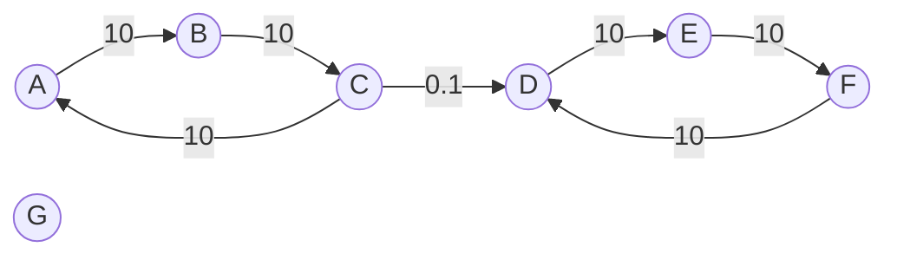

# Community Detection and Connected Components in Neo4j

A graph typically consists of groups of nodes connected in very different ways. In a social network, users may form friend groups; in a transaction network, multiple accounts may form exchange clusters; in a product network, a set of items may be frequently bought together. However, a **connected group** and a **community with strong internal connectivity** are two distinct concepts.

This lesson belongs to the **Graph Algorithms** chapter of the **DATABASE_ENGINE_GRAPH_NEO4J** module. Neo4j stores data using the property graph model comprising nodes, relationships, and properties; Cypher queries relationships, paths, indexes/constraints, and operational data. When analyzing network-wide structure, the **Neo4j Graph Data Science (GDS)** library provides dedicated algorithms such as **Weakly Connected Components (WCC)**, **Strongly Connected Components (SCC)**, **Louvain**, **Leiden**, and **Label Propagation**.

After this lesson, you will be able to distinguish these problems, build graph projections, run algorithms on sample data, interpret outputs, avoid over-interpreting community IDs, and design how results are consumed in Java Driver / Spring Data Neo4j applications.

## 1. Three Questions That Look Similar but Are Different

Consider three requirements:

1. **Which nodes can reach one another if edge direction is ignored?** This asks about *weakly connected components*.
2. **Which nodes can reach one another following arrow direction in both directions?** This asks about *strongly connected components*.
3. **Within an already connected network, which groups are more densely connected internally than to the rest?** This asks about *community detection*.

| Concept | Core Condition | Typical Algorithms | Note |
| --- | --- | --- | --- |
| **WCC** (*Weakly Connected Components*) | Treats directed edges as undirected; nodes reachable via a chain of edges | `gds.wcc` | A single bridge can merge two large groups into one component |
| **SCC** (*Strongly Connected Components*) | For every pair of nodes in the group, a directed path exists in both directions | `gds.scc` | Only carries full meaning when the data is directed |
| **Community Detection** | Finds group structure based on density, weights, or label propagation | Louvain, Leiden, Label Propagation | A community is not required to be a separate connected component |
| **Shortest Path** | Finds the shortest path between two nodes by a specific criterion | Cypher shortest path, Dijkstra… | Does not directly answer clustering questions |

Remember: **one connected component can contain multiple communities**. Conversely, a community detected by an algorithm is purely an **output of the chosen method and configuration**—not inherently a department, organization, fraud ring, or group sharing identical behavior.

## 2. Intuition from a Small Graph

Suppose there are seven nodes A, B, C, D, E, F, and G. Two triads A–B–C and D–E–F are tightly connected; there is one weak bridge between C and D; G stands alone:



The diagram shows the exact **stored edge directions** and weights. The table below lists the relationships for reference:

| Stored Directed Relationship | `strength` Weight |
| --- | ---: |
| A → B | 10 |
| B → C | 10 |
| C → A | 10 |
| D → E | 10 |
| E → F | 10 |
| F → D | 10 |
| C → D | 0.1 |
| G | No relationships |

For **WCC**, nodes A–F belong to the same component because the bridge C → D connects them, even though it is very weak; G forms another component. For **SCC**, the directed cycles A → B → C → A and D → E → F → D form two separate strong components, since no directed path leads from D/E/F back to A/B/C. G is a singleton component.

For **Louvain/Leiden** on an undirected weighted graph, the two strongly connected triangles are likely recognized as two communities, while G may be treated as its own community. **Do not pre-assert specific IDs or exact community counts across every run**: optimization heuristics and parameters can produce different partitions.

## 3. Preparing the Practice Database

The examples use Neo4j with a compatible **GDS** installation. GDS algorithms are not automatically available in every Neo4j distribution; procedure execution privileges and sufficient memory for graph projections are required. Practice in a dedicated database to avoid affecting other data.

First, create a uniqueness constraint on the sample node identity:

```cypher
CREATE CONSTRAINT demo_member_id_unique IF NOT EXISTS
FOR (p:DemoMember)
REQUIRE p.demoId IS UNIQUE;
```

Create the seven nodes:

```cypher
UNWIND ['A', 'B', 'C', 'D', 'E', 'F', 'G'] AS id
MERGE (:DemoMember {demoId: id});
```

Create the seven relationships and weights:

```cypher
UNWIND [
  ['A', 'B', 10.0],
  ['B', 'C', 10.0],
  ['C', 'A', 10.0],
  ['D', 'E', 10.0],
  ['E', 'F', 10.0],
  ['F', 'D', 10.0],
  ['C', 'D', 0.1]
] AS edge
MATCH (src:DemoMember {demoId: edge[0]})
MATCH (dst:DemoMember {demoId: edge[1]})
MERGE (src)-[r:DEMO_LINK]->(dst)
SET r.strength = edge[2];
```

Inspect the graph:

```cypher
MATCH (n:DemoMember)
OPTIONAL MATCH (n)-[r:DEMO_LINK]->(m:DemoMember)
RETURN n.demoId AS source,
       m.demoId AS target,
       r.strength AS strength
ORDER BY source, target;
```

Node G has no outgoing edges and thus appears with `target = null`. This query returns relationships **in their stored direction**, without displaying imaginary reverse links.

### Why Include Weights?

The `strength` property represents link intensity, such as interaction level between two people. When running weighted community detection algorithms, strong edges (`10`) exert more influence than weak edges (`0.1`). However, **standard WCC only checks edge existence**: a weak edge still connects components unless edge filters or weight thresholds are explicitly configured.

Do not blindly use interaction counts as weights if data is heavily skewed or the "higher means stronger" semantics has not been validated. In some path-finding problems, weights represent *cost* where lower is better; in many community algorithms, weights represent *strength* where higher means tighter coupling. These two weight meanings are distinct.

## 4. Cypher vs. GDS: When Do You Need Algorithms?

Cypher can find paths or reachable nodes within a bounded traversal depth:

```cypher
MATCH (a:DemoMember {demoId: 'A'})
MATCH p = (a)-[:DEMO_LINK*0..6]-(b:DemoMember)
RETURN DISTINCT b.demoId AS reachable
ORDER BY reachable;
```

On the sample graph, A can reach A–F when **ignoring direction**. G does not appear. In the query above, `*0..6` caps path length, which suits small examples.

However, when asked to "find **all connected components** in a network of millions of nodes," enumerating paths followed by `DISTINCT` is not a scalable default strategy. Path counts can explode exponentially, whereas WCC/SCC are specifically engineered to identify structural components.

Similarly, a plain `MATCH` query does not optimize *modularity* or partition nodes by connection density. That is where community detection algorithms excel.

## 5. Graph Projection: Input to GDS Algorithms

GDS algorithms generally run on an **in-memory named graph** *projected* from the Neo4j database. A projection specifies which nodes participate, which relationships participate, edge orientation, and which properties are loaded.

We create **two projections** from the same data:

- `demoCommunityUndirected`: treats edges as undirected for WCC and community detection.
- `demoSccDirected`: preserves original direction for SCC.

### 5.1. Weighted Undirected Projection

```cypher
CALL gds.graph.project(
  'demoCommunityUndirected',
  'DemoMember',
  {
    DEMO_LINK: {
      type: 'DEMO_LINK',
      orientation: 'UNDIRECTED',
      properties: 'strength'
    }
  }
)
YIELD graphName, nodeCount, relationshipCount
RETURN graphName, nodeCount, relationshipCount;
```

`orientation: 'UNDIRECTED'` lets the algorithm treat a relationship stored in one direction as usable in both directions inside the projection. Depending on the projection mechanics, reported `relationshipCount` reflects the in-memory directional representation and therefore **does not necessarily equal the stored relationship count**.

`properties: 'strength'` loads edge weights. If you omit this property yet pass `relationshipWeightProperty: 'strength'` to an algorithm, the configuration will fail to find the expected input.

### 5.2. Direction-Preserving Projection

```cypher
CALL gds.graph.project(
  'demoSccDirected',
  'DemoMember',
  {
    DEMO_LINK: {
      type: 'DEMO_LINK',
      orientation: 'NATURAL'
    }
  }
)
YIELD graphName, nodeCount, relationshipCount
RETURN graphName, nodeCount, relationshipCount;
```

`NATURAL` preserves relationship direction so SCC accurately detects whether paths exist **following data direction**.

### 5.3. Inspecting Projections Before Running

```cypher
CALL gds.graph.list('demoCommunityUndirected')
YIELD graphName, nodeCount, relationshipCount
RETURN graphName, nodeCount, relationshipCount;
```

Create a named graph only when the name is unused and you have permission to manage that projection. When re-running examples while a graph still exists in the GDS catalog, projecting with the same name will fail. Updating nodes/relationships in Neo4j **does not automatically update existing projections**, so establish an appropriate refresh/re-projection strategy before analyzing new data.

## 6. WCC: Finding Weakly Connected Components

A **weakly connected component** is a set of nodes where a path exists between any two nodes **after ignoring relationship direction**.

In the sample data, A–F fall into the same component because C connects to D. G stands alone. The algorithm does not split triangles merely because the link between them is weaker than internal links.

Run WCC:

```cypher
CALL gds.wcc.stream('demoCommunityUndirected')
YIELD nodeId, componentId
RETURN gds.util.asNode(nodeId).demoId AS member,
       componentId
ORDER BY componentId, member;
```

Semantically, the output contains **two components**:

- A component containing A, B, C, D, E, F.
- A component containing only G.

**Never assume specific `componentId` values** like 0 or 1. These IDs are assigned by the algorithm and can change across runs, graph edits, or GDS versions. To inspect grouped results without relying on raw ID numbers, aggregate them:

```cypher
CALL gds.wcc.stream('demoCommunityUndirected')
YIELD nodeId, componentId
WITH componentId,
     collect(gds.util.asNode(nodeId).demoId) AS members
RETURN componentId,
       size(members) AS componentSize,
       members
ORDER BY componentSize DESC;
```

To inspect overall summary statistics:

```cypher
CALL gds.wcc.stats('demoCommunityUndirected')
YIELD componentCount, componentDistribution
RETURN componentCount, componentDistribution;
```

Summary statistics answer: how many disconnected network fragments exist, what is the largest component size, and are there many singleton nodes? In applications, this helps detect missing link data or isolated operational clusters.

### 6.1. A Weak Edge Still Connects Two Components

Suppose edge C → D has weight `0.1` from a rare interaction. Standard WCC still places both triangles in the same component as long as that edge exists. To inspect "connected components **based only on sufficiently strong relationships**," create an edge-filtered projection or configure a weight threshold if supported by the algorithm, using a threshold meaningful to the business.

This differs from community detection: a community detection algorithm can **retain weak edges in the graph while separating nodes into two groups** based on overall connection structure.

### 6.2. Applications of WCC

- Auditing data networks for unintended isolated "islands."
- Partitioning a large graph into connected pieces for separate processing or inspection.
- Finding indirectly linked entity clusters when direction does not matter.
- Detecting products or users disconnected from the rest of the network.

**Limitation:** WCC does not prove nodes in the same component are closely related. A long path across many weak edges suffices to place nodes in the same WCC.

## 7. SCC: Finding Strongly Connected Components

In a directed graph, a **strongly connected component** requires that for every pair of nodes `u` and `v` in the group, both a directed path `u → v` and a directed path `v → u` exist.

Example:

```text
A -> B -> C -> A

D -> E -> F -> D

C -> D

G (isolated)
```

Inside each directed triangle, you can traverse a cycle back to the starting node. However, bridge C → D only permits travel **from the first triangle to the second triangle**, with no path back to A/B/C. Thus SCC partitions nodes into:

- A, B, C.
- D, E, F.
- G.

Run SCC on the **directed** projection:

```cypher
CALL gds.scc.stream('demoSccDirected')
YIELD nodeId, componentId
WITH componentId,
     collect(gds.util.asNode(nodeId).demoId) AS members
RETURN componentId,
       size(members) AS componentSize,
       members
ORDER BY componentSize DESC;
```

Do not use an `UNDIRECTED` projection to interpret **strong connectivity of directed data**: making the graph undirected alters bidirectional reachability requirements, so the output no longer answers the original question.

### When Is SCC Useful?

- Identifying dependency cycles in a directed network.
- Checking navigation or transaction regions where entities can reach each other mutually.
- Decomposing a directed network into mutually reachable internal groups.
- Analyzing dependency graphs, workflows, or other directed structures.

SCC reflects **directed reachability**, not link density. A very long cycle is still a single SCC if every node can reach every other node along edge direction.

## 8. Communities: Grouping by Internal Structure

**Community detection** goes beyond checking whether any path exists. It attempts to identify groups whose internal relationships are denser or stronger than external relationships, according to the **algorithm's objective function or rules**.

The two triangles A–B–C and D–E–F share a weak bridge C–D. Across the whole undirected network, they belong to one WCC. Yet a weighted community detection method can split them into two communities because each triangle has strong `10` edges whereas the bridge is only `0.1`.

Communities are commonly interpreted as:

- Groups of users interacting heavily in a social network.
- Groups of products frequently co-purchased or closely related.
- Groups of documents with dense mutual citations.
- Groups of accounts with internal transaction patterns warranting **further domain expert review**.

**Never use community labels to automatically conclude an individual belongs to an organization or commits fraud.** Algorithms see only the supplied structure and weights; source data can be incomplete, biased, or contain coincidental edges.

## 9. Louvain: Multi-Level Modularity Optimization

**Louvain** is a popular community detection method that typically optimizes **modularity** through iterative grouping and hierarchical aggregation. It can produce multi-level partitions where smaller communities become super-nodes in subsequent aggregation passes.

### 9.1. What Is Modularity?

For an undirected graph, modularity compares **actual internal connectivity within communities** against **expected connectivity under a null model**. Intuitively:

- If a community has more internal edges than expected at random, its modularity contribution tends to be positive.
- If grouping is arbitrary and fails to reflect structure, modularity is poor.
- Splitting into more groups does not automatically yield higher modularity.

A standard expression for the undirected unweighted case is:

\[
Q=\frac{1}{2m}\sum_{i,j}
\left(A_{ij}-\frac{k_i k_j}{2m}\right)\delta(c_i,c_j)
\]

Where `A_{ij}` denotes the edge between nodes `i,j`, `k_i` is the degree of node `i`, `m` is the edge count, and `\delta(c_i,c_j)` equals 1 if both nodes share the same community. For weighted graphs, the formulation adjusts using weight sums.

**Modularity is not absolute "truth."** It exhibits a *resolution limit*: small communities can be merged due to the objective function's behavior and graph scale. High-modularity partitions still require evaluation against business questions.

### 9.2. Running Weighted Louvain

```cypher
CALL gds.louvain.stream('demoCommunityUndirected', {
  relationshipWeightProperty: 'strength'
})
YIELD nodeId, communityId
RETURN gds.util.asNode(nodeId).demoId AS member,
       communityId
ORDER BY communityId, member;
```

The output shows **which community the algorithm assigned each node to**. On the sample dataset, the two strongly connected triangles can separate into two communities, though exact IDs or partitions are not guaranteed across every version and configuration.

To inspect members grouped by community:

```cypher
CALL gds.louvain.stream('demoCommunityUndirected', {
  relationshipWeightProperty: 'strength'
})
YIELD nodeId, communityId
WITH communityId,
     collect(gds.util.asNode(nodeId).demoId) AS members
RETURN communityId,
       size(members) AS communitySize,
       members
ORDER BY communitySize DESC;
```

When the graph changes or the algorithm re-runs, communities can split or merge; **`communityId` is not a durable business identifier** to use directly as `tenantId`, `organizationId`, or an authorization key.

### 9.3. Parameters to Understand

Depending on the GDS version, Louvain may support options such as `maxLevels`, `maxIterations`, weight configuration, and parameters affecting reproducibility. Never tune levels or iterations merely to "get more communities" without measuring stability, quality, and runtime.

If `relationshipWeightProperty` is omitted, the algorithm interprets edges using its default unweighted behavior. When interaction weights truly matter, specify the property explicitly and verify data types and units.

## 10. Leiden: Improving Community Structure

**Leiden** is a community detection algorithm related to Louvain that adds a *refinement* phase to address structural partitioning flaws. Its design prevents producing internally disconnected or poorly connected communities, which can occasionally occur with Louvain.

Calling Leiden:

```cypher
CALL gds.leiden.stream('demoCommunityUndirected', {
  relationshipWeightProperty: 'strength'
})
YIELD nodeId, communityId
RETURN gds.util.asNode(nodeId).demoId AS member,
       communityId
ORDER BY communityId, member;
```

For large networks, graph complexity, edge counts, and partition quality requirements determine whether to choose Louvain or Leiden. There is no blanket rule that "Leiden is always faster" or "Louvain is always less accurate" across all datasets and settings.

### How Do Louvain and Leiden Differ?

| Criterion | Louvain | Leiden |
| --- | --- | --- |
| Core idea | Improves communities and aggregates levels by partition quality | Adds a refinement step to form better-structured communities |
| Structural risk | Can occasionally produce poorly connected internal communities | Specifically designed to prevent that issue |
| Output | `communityId` per node | `communityId` per node |
| Weights | Supports edge weights | Supports edge weights |
| Stability | Depends on structure, processing order, and version/config | Also depends on structure and version/config |
| Evaluation | Modularity, community sizes, stability, business fit | Similar metrics plus internal connectivity checks |

To decide between them, run both on **the same projection and weight setup**, then compare size distributions, stability, and domain meaning.

## 11. Label Propagation: Propagating Labels from Neighbors

**Label Propagation** initializes nodes with labels and iteratively updates each node's label based on neighbor influence until convergence or stopping criteria. It works well for quick exploratory grouping, though results can be sensitive to update order, initialization, and algorithmic choices.

In GDS:

```cypher
CALL gds.labelPropagation.stream('demoCommunityUndirected')
YIELD nodeId, communityId
RETURN gds.util.asNode(nodeId).demoId AS member,
       communityId
ORDER BY communityId, member;
```

Some versions/configs support weight properties and seed labels; check the specific procedure docs before production use. Never assume LPA and Louvain/Leiden produce identical partitions: they use **different grouping heuristics**.

LPA is handy for initial exploration or fast clustering, but if you need stable community reporting, measure **run-to-run sensitivity** and compare against other partitioning methods.

## 12. Choosing an Algorithm by Business Question

| Question | Start With | Reason |
| --- | --- | --- |
| Which network parts have no connecting path ignoring direction? | **WCC** | Identifies weakly connected components |
| In a directed network, which groups reach each other both ways? | **SCC** | Preserves directed path semantics |
| Which densely interacting groups exist inside an overall connected network? | **Louvain or Leiden** | Partitions by structure and weights |
| Want to try neighbor-based label clustering? | **Label Propagation** | Explores grouping via label spread |
| Check if node A connects to B within 2 hops? | **Cypher MATCH/EXISTS** | Local neighborhood query; no full-graph partitioning needed |
| Find the lowest-cost route between two nodes? | **Dijkstra/A\*** or path algorithms | Weighted path-finding problem, not community detection |
| Find customers belonging to the same known `companyId`? | **Cypher and business keys** | Grouping already exists in source data; no algorithm needed |

A common point of confusion: **community detection is not entity resolution**. Two nodes landing in the same community does not prove they represent the same real-world entity. Merging duplicate customer records requires identity rules, canonical keys, and business validation.

## 13. A Sound Analysis Workflow on Real Graphs

A practical workflow:

1. **Clarify node and relationship semantics.** `:PAID_TO`, `:KNOWS`, and `:MEMBER_OF` carry vastly different meanings.
2. **Define the exact question.** Do you need connected components, dense clusters, or directed mutual-reachability groups?
3. **Define the projection scope.** Include only relevant labels, relationship types, statuses, and time windows.
4. **Choose edge orientation.** For SCC, preserve direction; for symmetric interactions, undirected may be appropriate.
5. **Validate weights.** Are any missing, negative, or inconsistent? Does higher weight mean stronger bond or higher cost?
6. **Estimate resources and pilot.** Check memory, CPU, runtime, and graph size.
7. **Run in `stream` or `stats` mode first.** Do not rush to write community IDs to the database.
8. **Evaluate results.** Inspect group counts, size distributions, internal quality, and parameter sensitivity.
9. **Validate with domain experts.** Confirm groups make sense in business terms; never treat technical labels as ground truth.
10. **Persist and refresh on a controlled schedule.** Track run versions, graph snapshots, and recompute triggers.

### Defining the Right Graph Matters More Than Picking a Complex Algorithm

If a graph includes all `:VIEWED` relationships where every user views hundreds of products, communities can be dominated by popular products and bots. In that case, filter for reliable interactions, normalize weights by frequency, bound the time window, and consider excluding extreme hub nodes before interpreting behavioral groups.

In a payment graph, a money transfer link is not automatically a social tie. Weights might represent total transfer volume, yet large amounts do not necessarily mean "close" relationships. Define link types and direction strictly around the analytical question.

## 14. Evaluating Community Quality

No single metric proves a community partition is "correct." Combine multiple checks:

| Criterion | What to Observe | Limitation |
| --- | --- | --- |
| **Community count** | Too few or too many relative to expectations? | No single right count fits every network |
| **Size distribution** | One giant community plus thousands of singletons? | Can reflect real topology or poor projection design |
| **Internal link density** | How tightly connected are nodes within each group? | Depends on orientation, type, and edge weights |
| **Modularity** | Does the partition beat random expectation? | Suffers from resolution limit; does not prove business validity |
| **Stability** | Do results shift drastically across runs and settings? | Compare sets of member nodes, not numeric IDs |
| **Coverage** | How many nodes are isolated or singletons? | Singleton nodes may be valid data |
| **Data freshness** | Does the projection reflect recent relationships? | Stale projections yield stale partitions |
| **Expert review** | Are groups meaningful to product/business teams? | Guard against confirmation bias when labeling |

### Never Compare `communityId` Across Runs with Equality

A community in run 1 might have `communityId = 17`, whereas in run 2 the exact same node set gets `communityId = 42`. Conversely, the same numeric ID can represent completely different nodes.

To measure stability, compare **group membership sets** or partition similarity metrics such as ARI/NMI over the same node set instead of comparing raw IDs. If groups serve as long-lived business objects, build an explicit cross-run community matching/mapping process with clear versioning.

### Why Avoid Evaluating Solely on a Tiny Example?

A seven-node graph illustrates mechanics but does not represent networks with millions of nodes, high-degree hubs, and multi-period data. On tiny graphs, adding or removing a single edge can dramatically alter results. Evaluate on representative datasets across multiple time slices.

## 15. Stream, Stats, Mutate, and Write in GDS

GDS algorithms typically offer multiple execution modes. Exact names and output fields vary by algorithm and version, though the core distinctions are:

| Mode | Purpose | Impact |
| --- | --- | --- |
| `stream` | Returns per-node rows via Cypher | Does not persist community properties to the database |
| `stats` | Returns algorithm summary statistics | Does not write per-node results to store |
| `mutate` | Writes result property into the **in-memory named graph** | Supports downstream algorithm pipelines; does not write to store |
| `write` | Writes result property back to **Neo4j database** | Real write operation; requires permissions, cost review, and update policy |

To avoid unintended side effects, start with `stream` or `stats`. When persisting components in a test database:

```cypher
CALL gds.wcc.write('demoCommunityUndirected', {
  writeProperty: 'demoWccComponent'
})
YIELD nodePropertiesWritten, componentCount
RETURN nodePropertiesWritten, componentCount;
```

This adds or updates `demoWccComponent` on processed `:DemoMember` nodes in the database. It **does not** create separate `:Community` nodes. From here, regular Cypher can filter:

```cypher
MATCH (p:DemoMember)
RETURN p.demoId AS member,
       p.demoWccComponent AS componentId
ORDER BY componentId, member;
```

**Be careful with property names:** never overwrite business fields owned by upstream source systems. A new run may assign different IDs. Use clearly scoped names and record `algorithm`, `projectionVersion`, `computedAt`, and run configuration in an audit/metadata record if applications rely on results long-term.

To persist Louvain communities, a similar workflow uses `gds.louvain.write` with a designated `writeProperty`. Never run bulk writes in production before verifying `stream` outputs and resource impact.

## 16. Managing Graph Projections and Data Freshness

A GDS named graph is an in-memory computational structure. After edges or properties change in the Neo4j store, a previously created projection **does not automatically synchronize those updates**.

This matters especially in systems ingesting data from CRMs, social networks, or event streams: last month's community assignments may miss today's new relationships.

Operationally:

- Record the **source data timestamp/version** for every projected graph.
- Know which changes require recreating or updating projections via GDS-supported mechanisms.
- Never compare two algorithms if they ran against **two different projections**.
- Schedule recomputes around freshness requirements; avoid rebuilding the whole graph on every minor event if cost is prohibitive.
- Monitor projection footprints; holding multiple redundant projections wastes memory.

When finished with the examples and certain no jobs still need the sample graphs, drop them:

```cypher
CALL gds.graph.drop('demoCommunityUndirected')
YIELD graphName
RETURN graphName;
```

```cypher
CALL gds.graph.drop('demoSccDirected')
YIELD graphName
RETURN graphName;
```

These commands **remove projections from GDS memory**, without deleting source nodes or relationships from the Neo4j database. Never drop a graph actively used by another job or user.

## 17. Performance and Resources

Graph algorithms on large networks can consume substantial CPU and RAM. Verify:

### 17.1. Is the Graph Projection Properly Scoped?

If you only need interactions among `:Customer` nodes, projecting every node type—products, transactions, sessions, locations—can distort community semantics and inflate resource usage. Restrict labels and relationship types to the problem scope.

### 17.2. Are Weights Reasonably Distributed?

If one edge has weight 1,000,000 while most edges have weight 1, results can be dominated by a few outlier edges. Validate semantics, normalize if business-approved, and check for `null`, invalid values, and consistent units.

### 17.3. Is High Concurrency Necessary?

Raising concurrency can speed up execution on suitable hardware, yet it increases CPU/RAM pressure and competes with transactional queries. Avoid maxing out resources during peak hours without measuring impact.

### 17.4. Estimating Memory Before Execution

GDS provides memory estimation procedures for many algorithms. For WCC:

```cypher
CALL gds.wcc.stream.estimate('demoCommunityUndirected', {})
YIELD nodeCount, relationshipCount, requiredMemory
RETURN nodeCount, relationshipCount, requiredMemory;
```

`.estimate` syntax and returned statistics depend on the GDS version; verify in your running environment. Account for projection memory, algorithm working memory, and other Neo4j loads, since required bytes are never a simple constant times node count.

### 17.5. Avoid Mixing Algorithm Outputs with Authoritative Data

Treat WCC/SCC/Louvain/Leiden outputs as **derived data**. If an application relies on group assignments for access control, billing, or high-impact decisions, enforce verification steps and clear business accountability, because groupings can shift whenever data or algorithms change.

## 18. Reading Results from Java Driver and Spring Data Neo4j

Applications can invoke GDS algorithms via Cypher just like other procedures. The following example reads WCC via the **Neo4j Java Driver** assuming the projection already exists:

```java
import java.util.List;
import org.neo4j.driver.Driver;
import org.neo4j.driver.Session;
import org.neo4j.driver.SessionConfig;

public final class ConnectivityService {
    private final Driver driver;

    public ConnectivityService(Driver driver) {
        this.driver = driver;
    }

    public record MemberComponent(String memberId, long componentId) {}

    public List<MemberComponent> readComponents() {
        String cypher = """
            CALL gds.wcc.stream('demoCommunityUndirected')
            YIELD nodeId, componentId
            RETURN gds.util.asNode(nodeId).demoId AS memberId,
                   componentId
            ORDER BY memberId
            """;

        try (Session session = driver.session(
                SessionConfig.builder()
                    .withDatabase("neo4j")
                    .build())) {

            return session.executeRead(tx ->
                tx.run(cypher).list(record -> new MemberComponent(
                    record.get("memberId").asString(),
                    record.get("componentId").asLong()
                ))
            );
        }
    }
}
```

Notes:

- Reuse `Driver` across the application lifecycle; keep `Session` short-lived.
- GDS procedures must be installed and permitted, and the named graph must exist in a catalog accessible to the session.
- `executeRead` may retry callbacks on transient errors, so keep callbacks strictly read-only.
- On graphs with millions of nodes, `.list()` loads all rows into application memory. Use pagination, streaming/cursor consumption, or precomputed derived tables to avoid client OOMs.
- `componentId` here is an algorithm-generated number, **not a permanent business ID to persist**.

In **Spring Data Neo4j**, entities map nodes/relationships while `CALL gds...` queries can run via custom queries or `Neo4jClient`. To return `communityId` alongside run metadata, map to a **dedicated DTO** rather than embedding transient community IDs directly into `Organization` or `Tenant` domain entities.

In production services, consider running GDS analytics as an **orchestrated background job** over a versioned data snapshot, having APIs read the finalized outputs. An interactive HTTP request is rarely the right place to trigger whole-network graph analysis if runtime exceeds request SLAs.

## 19. Common Misconceptions

| Claim | Why It Is Wrong or Incomplete | Accurate Understanding |
| --- | --- | --- |
| "WCC finds communities." | WCC only checks mutual reachability | A single WCC can contain many communities |
| "SCC and WCC are identical on directed graphs." | SCC requires directed reachability in both directions | WCC ignores direction; SCC preserves direction |
| "One weak bridge eliminates two distinct communities." | Community detection evaluates structure/weights, not just edge existence | Louvain/Leiden can separate groups within one WCC |
| "`communityId = 1` means that community exists forever." | Technical IDs can change across runs | Track versions and compare groups by member sets |
| "High modularity proves business validity." | Modularity is a structural metric with assumptions | Validate against domain context and data |
| "GDS automatically uses `strength` weights on relationships." | Algorithms only use weights when configured | Project the property and specify weight config |
| "Using an undirected projection for SCC is fine." | Destroys source edge direction semantics | Use a directed graph for SCC |
| "LPA, Louvain, and Leiden must give identical results." | Each algorithm uses different heuristics | Compare partition quality on the same graph |
| "`mutate` updated Neo4j directly." | Mutate modifies only the in-memory GDS graph | `write` persists properties to the store |
| "Projections auto-reflect every database change." | Projections have independent lifecycles and freshness | Design refresh/recompute schedules |
| "Two nodes in the same community are the same person." | Community detection is not entity resolution | Use canonical keys and identity rules |
| "One run on a tiny graph proves production performance." | Cardinality, node degrees, and real load differ vastly | Benchmark memory/CPU/stability on representative data |

## 20. Applied Exercises

**Exercise 1 — WCC and SCC.** Given a directed graph A → B → C → A, C → D, and D → E → D (ignoring any other nodes), determine the number of WCCs and SCCs. Why can A and E belong to the same WCC yet different SCCs?

**Exercise 2 — Communities Inside One Connected Component.** Two densely interacting user groups are linked by one rare relationship. Does WCC return one group or two? Why can Louvain or Leiden return two communities?

**Exercise 3 — Weights.** In an interaction graph, strong edges have `strength=10` and a weak bridge has `strength=0.1`. What happens when a community algorithm is configured with versus without `strength`? Why inspect units and weight distributions?

**Exercise 4 — Wrong Projection Orientation.** A workflow contains directed `:DEPENDS_ON` relationships. Explain the bug when using an `UNDIRECTED` projection to find SCCs and fix it with the right configuration.

**Exercise 5 — Stability Check.** You run Louvain twice and see a group get ID 12 on the first run and 88 on the second. How can you determine whether it is still the same node set or whether the group changed?

**Exercise 6 — Cypher Query or GDS?** One API asks "is user A connected to B within at most two hops?", while a periodic report asks "how many connected components exist in the network?". Pick the tool for each need and explain the cost.

**Exercise 7 — Persisting Results.** A dashboard displays communities from last week's run. List the metadata to store alongside results to explain why communities changed next week.

**Exercise 8 — Java System.** Design a service that runs WCC periodically, checks projection readiness, persists versioned results, and exposes an API to read nodes in the same component. Explain how to handle graph updates occurring while a job is running.

### Checklist Before Running Algorithms on Real Graphs

- [ ] Clearly distinguish **connectivity** from **community detection**.
- [ ] Select appropriate labels, relationship types, orientation, and time windows.
- [ ] Verify weights are interpreted correctly with valid types and units.
- [ ] Ensure the projection includes all target nodes and follows a freshness policy.
- [ ] Estimate resources and schedule runs at appropriate times.
- [ ] Verify WCC/SCC or community behavior on test cases with known expected outcomes.
- [ ] Never use `componentId` / `communityId` as immutable business keys.
- [ ] Evaluate group sizes, modularity/stability, and domain relevance.
- [ ] Establish persistence, versioning, metadata, and recompute policies.
- [ ] Distinguish `stream`, `mutate`, and `write` before touching the database.
- [ ] Ensure Java applications do not load massive results into memory all at once.

## 21. Reference Documentation

When applying this lesson in a specific environment, verify syntax and options against your **installed Neo4j/GDS version**:

- [Neo4j GDS — Weakly Connected Components](https://neo4j.com/docs/graph-data-science/current/algorithms/wcc/): WCC, stream/stats/write modes, and configuration.
- [Neo4j GDS — Strongly Connected Components](https://neo4j.com/docs/graph-data-science/current/algorithms/scc/): SCC and directed graph semantics.
- [Neo4j GDS — Louvain](https://neo4j.com/docs/graph-data-science/current/algorithms/louvain/): community algorithm and parameters.
- [Neo4j GDS — Leiden](https://neo4j.com/docs/graph-data-science/current/algorithms/leiden/): community method with refinement.
- [Neo4j GDS — Label Propagation](https://neo4j.com/docs/graph-data-science/current/algorithms/label-propagation/): communities based on label propagation.
- [Neo4j GDS — Native Projection](https://neo4j.com/docs/graph-data-science/current/management-ops/graph-creation/graph-project/): selecting nodes, relationships, orientation, and properties in projections.

**Key Takeaways:** **WCC** answers "are nodes connected if direction is ignored?", **SCC** answers "can nodes reach one another in both directions?", while **Louvain, Leiden, and Label Propagation** find community structures per each algorithm's rules. Results are meaningful only when graph modeling, weights, data freshness, and evaluation align with the business question.
