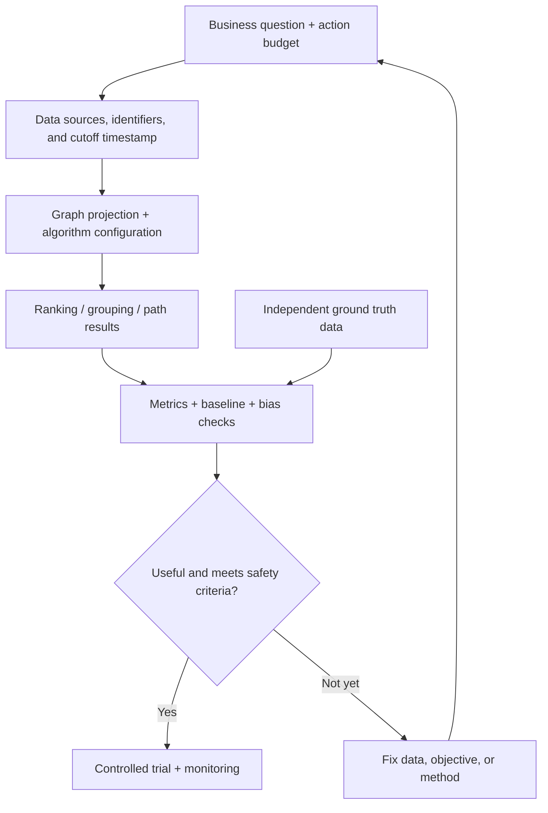
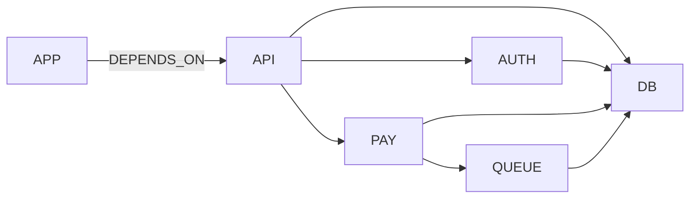

# Evaluating Algorithm Results by Business Meaning and Ground Truth Data in Neo4j

## 1. Why Running an Algorithm Successfully Does Not Guarantee Useful Results

In Neo4j, a **property graph** represents data using nodes, relationships, and properties. Graph algorithms can rank important nodes, detect communities, recommend links, uncover anomalous structures, or find paths. Neo4j **Graph Data Science (GDS)** provides algorithms to run over a graph projected into memory (*graph projection*).

Suppose GDS returns a node with the highest PageRank score. That tells you the node is **prominent under a specific computation on the chosen graph**; it **does not prove** that the node has the highest failure probability, causes the greatest damage, or needs immediate investment. Similarly, two nodes in the same community do not necessarily belong to the same business group; a mathematically lowest-cost route is not automatically valid under operational policies.

This lesson belongs to the **Graph Algorithms** chapter of the `DATABASE_ENGINE_GRAPH_NEO4J` module. It connects graph modeling, Cypher querying, GDS, indexes/constraints, data validation, and Java Driver / Spring Data Neo4j integration to answer the question:

> **Does this algorithm's output drive better business decisions than the current baseline, and what independent data do we have to verify it?**

After this lesson, you will be able to:

1. Translate a business objective into an algorithm output and measurable acceptance criteria.
2. Verify the **input graph, relationship orientation, properties, node set, and data snapshot timestamp**.
3. Construct trustworthy validation data (*ground truth*) while preventing future data leakage.
4. Evaluate rankings using `Precision@K`, `Recall@K`, and `Lift@K`; compare against baselines; and understand metric limitations.
5. Select tailored validation criteria for PageRank, shortest paths, community detection, similarity, and link prediction.
6. Record configurations, versions, and run IDs, and monitor drift as models or graphs evolve.

> **Prerequisites for running examples:** Basic Cypher uses Neo4j 5. Examples calling `gds.*` work only if **GDS is installed, permitted, and supports the corresponding signatures**. APOC is a separate extension, not a prerequisite for using GDS. Procedure names and options may vary by release; verify via `SHOW PROCEDURES` on your actual system.

## 2. Start from the Business Decision, Not the Algorithm Name

In a software service ecosystem, suppose we have a directed relationship:

```text
(caller:Service)-[:DEPENDS_ON]->(dependency:Service)
```

This means **caller requires dependency** to operate. A node depended upon by many other services may merit prioritizing for fault-tolerance testing. However, "used by many services" is not the same as "frequently fails."

Write an evaluation contract first:

| Question | Example Answer to Lock In |
| --- | --- |
| Decision to support? | Select 5 services for resilience testing each week |
| Candidate set? | Active services within administrative scope |
| Action after ranking? | SRE team runs chaos/failover tests on the top 5 services |
| Definition of "useful"? | Surfaces more verified high-impact outages than the baseline |
| Independent evidence? | Incident reports, audited dependency maps, controlled fault drills |
| Cost of error? | Testing the wrong service wastes effort; missing a critical service risks outages |
| Guardrails? | Never treat PageRank score as failure probability or auto-disable services |

The example above aims to **prioritize resilience testing**, not predict failure probability. If the goal shifts to "which service will fail in the next 7 days?", PageRank alone is usually **insufficient**: you need reliability metrics, error rates, load, deployment changes, and an appropriate predictive model.

Proposed evaluation workflow:



**Never work backward** by running a ready-made algorithm, inspecting the top-ranked nodes, and then inventing a business story to justify why they look "right."

## 3. Running Example: Ranking Service Dependencies with PageRank

### 3.1. Preparing a Small Property Graph

In a practice database, create six demo nodes. Use a dedicated `:GdsEvalService` label to avoid colliding with application data. Run the constraint first:

```cypher
CREATE CONSTRAINT gds_eval_service_unique IF NOT EXISTS
FOR (s:GdsEvalService) REQUIRE s.id IS UNIQUE;
```

Create the nodes:

```cypher
UNWIND ['APP', 'API', 'AUTH', 'PAY', 'DB', 'QUEUE'] AS serviceId
MERGE (s:GdsEvalService {id: serviceId});
```

Create directed relationships from consuming service to consumed dependency:

```cypher
UNWIND [
  {from: 'APP',   to: 'API'},
  {from: 'API',   to: 'AUTH'},
  {from: 'API',   to: 'PAY'},
  {from: 'API',   to: 'DB'},
  {from: 'AUTH',  to: 'DB'},
  {from: 'PAY',   to: 'DB'},
  {from: 'PAY',   to: 'QUEUE'},
  {from: 'QUEUE', to: 'DB'}
] AS edge
MATCH (caller:GdsEvalService {id: edge.from})
MATCH (dependency:GdsEvalService {id: edge.to})
MERGE (caller)-[:EVAL_DEPENDS_ON]->(dependency);
```

Visualization:



In this model, `DB` has many **incoming dependency paths** and may be a dependency concentration point. Yet the diagram says nothing about DB's failure rate, the criticality of APP users, or each service's failover capabilities.

Verify the input graph:

```cypher
MATCH (s:GdsEvalService)
RETURN count(s) AS nodeCount;
```

```cypher
MATCH (a:GdsEvalService)-[r:EVAL_DEPENDS_ON]->(b:GdsEvalService)
RETURN count(r) AS relationshipCount;
```

On clean sample data, expect **6 nodes** and **8 relationships**. If the database contains extra nodes with the same label from other exercises, counts will be higher. Always verify the source set before comparing against expected outputs.

### 3.2. Running an Interpretable Baseline: Direct Dependent Count

Without GDS, you can rank by **in-degree** (*number of incoming callers*):

```cypher
MATCH (s:GdsEvalService)
OPTIONAL MATCH (caller:GdsEvalService)-[:EVAL_DEPENDS_ON]->(s)
RETURN s.id AS serviceId,
       count(DISTINCT caller) AS directDependents
ORDER BY directDependents DESC, serviceId ASC;
```

In the demo graph, `DB` has four direct callers: `API`, `AUTH`, `PAY`, and `QUEUE`. This baseline is measurable, easy to explain, and helpful when testing budgets are tight.

**Limitation:** in-degree ignores caller importance, indirect dependencies, and redundancy mechanisms. A service with many callers does not automatically cause the worst damage if it fails.

### 3.3. Checking GDS Availability Before Calling Procedures

```cypher
SHOW PROCEDURES
YIELD name, signature
WHERE name IN [
  'gds.graph.project',
  'gds.pageRank.stream',
  'gds.graph.drop'
]
RETURN name, signature
ORDER BY name;
```

If any procedure is missing, check GDS installation, account privileges, and Neo4j/GDS versions. **Never** skip verification by assuming "Neo4j always has GDS." GDS maintains its own in-memory graph catalog and permission model separate from disk-stored data.

### 3.4. Projecting the Graph and Running PageRank

Example using standard GDS 2.x signatures:

```cypher
CALL gds.graph.project(
  'eval-service-pr-010',
  'GdsEvalService',
  'EVAL_DEPENDS_ON'
)
YIELD graphName, nodeCount, relationshipCount
RETURN graphName, nodeCount, relationshipCount;
```

This projection selects only `GdsEvalService` nodes and matching `EVAL_DEPENDS_ON` relationships. If the graph name already exists in the user's catalog, recreating it will fail: pick a different name or drop only your own demo graph once sure nobody else uses it.

Run PageRank in **stream** mode without writing scores to node properties:

```cypher
CALL gds.pageRank.stream(
  'eval-service-pr-010',
  {dampingFactor: 0.85, maxIterations: 20}
)
YIELD nodeId, score
RETURN gds.util.asNode(nodeId).id AS serviceId,
       score
ORDER BY score DESC, serviceId ASC;
```

Reading the output:

- `nodeId` in GDS output is the algorithmic node identifier; use `gds.util.asNode(nodeId)` to fetch the node in the same database context when supported by your version. For APIs and long-term reporting, persist the business **`serviceId`**, never just the internal ID.
- `score` is the PageRank score **on the chosen projection and configuration**. It is neither a service failure probability nor a count of impacted customers.
- `ORDER BY score DESC, serviceId ASC` guarantees **deterministic tie-breaking** when scores match.
- `maxIterations` and `dampingFactor` affect scores; record them alongside the graph version. Stopping conditions and actual convergence should also be verified per config/version.

With `caller -> dependency` direction, nodes receiving links from other services tend to score higher. Flipping all relationship directions **changes PageRank semantics**. Choose direction based on the business question, never flip it just for "prettier" results.

Once finished, if no other task uses the demo graph:

```cypher
CALL gds.graph.drop('eval-service-pr-010')
YIELD graphName
RETURN graphName;
```

This frees the graph **in the GDS catalog**, without deleting `GdsEvalService` nodes from the Neo4j database. Drop only demo graphs you own, never projections serving active jobs.

### 3.5. Why Not Compare Raw PageRank Scores Directly Against In-Degree?

PageRank and in-degree use **different scales**. Never conclude PageRank is "better" just because its raw numbers look larger or smaller. Instead compare:

1. Whether the two rankings select the **same top-K services**.
2. Whether selected services match **verified impact evidence** from validation data.
3. Given the same testing budget, which approach uncovers more critical cases.
4. Compute cost, refresh latency, explainability to operators, and sensitivity to missing data.

That is comparison grounded in business objectives.

## 4. Building Independent Ground Truth Data

**Ground truth** is data representing the true or target outcome under the business definition. No universal ground truth exists for every algorithm: communities may lack a single "correct label," and PageRank has no inherent true/false label.

### 4.1. Fixing the Cutoff Time: What Can Be Known When Scoring?

Suppose you want to predict or prioritize outage impact over the next 7 days:

```text
Before T0                             After T0
────────────────────────────────────┬──────────────────────
Graph, telemetry, access scopes,    │  Actual incidents,
and properties observed up to T0    │  measured blast radius
               ↓                    │        ↓
         Compute ranking            │  Ground truth
                                    └─ [T0, T0 + 7 days]
```

Rule: graph projections and features **must not contain information known only after T0**. Likewise, never use incident labels from the evaluation window itself to shape the candidate pool or tune parameters and then report that result as an independent test.

For temporal data, verify:

- Effective start and end dates of relationships.
- When ETL ingested events, not solely source-emitted timestamps.
- Services decommissioned or newly launched after T0.
- Tenant permissions, deployment regions, and real user filters.
- Whether missing dependency edges were added *after* an incident during post-mortem investigation. Backfilling post-incident knowledge before T0 causes **data leakage**.

### 4.2. Label Definitions Must Match the Decision

These three labels answer **three different questions**:

| Validation Label | Meaning | What Can It Support? |
| --- | --- | --- |
| `hadOutageInNext7Days` | Service suffered downtime within 7 days after T0 | Evidence for **outage occurrence prediction**, not blast radius |
| `affectedServicesIfFailed` | Count of services actually impacted when this service failed | Measures **observed impact**, available only for past failures or drills |
| `expertCriticalTier` | Expert-assigned criticality tier under defined criteria | Measures alignment with **expert judgment**, subject to human bias |

If the goal is prioritizing **critical single points of failure**, `affectedServicesIfFailed` from controlled chaos/failover drills or thoroughly investigated post-mortems aligns closer with business intent than a binary "did it fail?" label.

**Selection bias:** a service that has never failed does not mean its failure would be harmless. Never treat "unobserved impact" as "zero impact" during evaluation; you may need an **unknown** label, a thoroughly observed benchmark subset, or a controlled sampling plan.

### 4.3. Separating Algorithm Inputs from Evaluation Data

A rigorous setup includes:

1. **Feature/graph snapshot:** graph and properties at T0.
2. **Validation window:** used to choose orientation, `dampingFactor`, K, and thresholds.
3. **Test window:** a future period or independent group/tenant never touched during configuration decisions.
4. **Baseline:** the incumbent approach, such as in-degree, operational rules, or a human-curated list.

For graphs, randomly splitting individual relationships can leak neighborhood structure into the test set. For link prediction or node similarity, split by **relationship creation time** or an appropriate evaluation design, ensuring target edges never appear in any feature or projection at prediction time.

With highly imbalanced data, building a test set full of trivially easy negatives inflates metrics artificially. Score on the **realistic candidate set the production app actually evaluates**.

## 5. Evaluating Rankings with Precision@K, Recall@K, and Lift@K

If operators can only test **K = 3** services per week, the problem is candidate ranking—`score` need not be a calibrated probability. Given independent binary validation labels:

- **Precision@K** = positive cases in top K / actual selected count.
- **Recall@K** = positive cases in top K / total positives across the evaluated candidate pool.
- **Prevalence** = positive rate across the valid candidate pool.
- **Lift@K** = Precision@K / Prevalence (when denominator > 0); values > 1 mean top K is richer in positives than the candidate pool average.

Expressed concisely:

```text
TP@K        = number of positives in the top K results
Precision@K = TP@K / K              (when at least K candidates exist)
Recall@K    = TP@K / TotalPositive  (when TotalPositive > 0)
Lift@K      = Precision@K / (TotalPositive / TotalCandidates)
```

If fewer than K candidates exist, use the **actual selected count** as denominator and state it explicitly. If zero positives exist, Recall/Lift are **undefined**—do not silently set them to 0 or 1 without an explicit reporting convention.

### 5.1. Small Hand-Calculable Example (Not Real GDS Output)

To illustrate the metrics, suppose a scoring system produced this table while auditors collected **independent** incident labels:

| Rank | Service | Simulated Score | Incident in Eval Window? |
| ---: | --- | ---: | --- |
| 1 | S1 | 0.92 | Yes |
| 2 | S2 | 0.84 | No |
| 3 | S3 | 0.77 | Yes |
| 4 | S4 | 0.65 | No |
| 5 | S5 | 0.50 | Yes |
| 6 | S6 | 0.21 | No |

> These are **simulated scores for metric practice**, not PageRank outputs from the `GdsEvalService` graph in Section 3. The "incident" label practices ranking evaluation; if the real goal is **failure blast radius**, substitute the corresponding impact label.

With `K = 3`: top 3 are `S1, S2, S3`, containing two positives; the full set has three positives.

```text
Precision@3 = 2 / 3 ≈ 0.667
Recall@3    = 2 / 3 ≈ 0.667
Prevalence  = 3 / 6 = 0.5
Lift@3      = (2 / 3) / 0.5 ≈ 1.333
```

### 5.2. Computing in Cypher Without Creating Nodes

The snippet below uses only a list of maps and runs standalone in Neo4j:

```cypher
WITH [
  {id: 'S1', score: 0.92, incident: true},
  {id: 'S2', score: 0.84, incident: false},
  {id: 'S3', score: 0.77, incident: true},
  {id: 'S4', score: 0.65, incident: false},
  {id: 'S5', score: 0.50, incident: true},
  {id: 'S6', score: 0.21, incident: false}
] AS cases
UNWIND cases AS item
WITH item ORDER BY item.score DESC, item.id ASC
WITH collect(item) AS ranking
WITH ranking,
     ranking[0..3] AS topK,
     size([x IN ranking WHERE x.incident = true]) AS positives
WITH ranking, topK, positives,
     size([x IN topK WHERE x.incident = true]) AS hits
RETURN size(ranking) AS evaluatedCandidates,
       size(topK) AS selected,
       positives AS actualPositives,
       hits AS truePositives,
       toFloat(hits) / size(topK) AS precisionAt3,
       CASE WHEN positives = 0 THEN null
            ELSE toFloat(hits) / positives
       END AS recallAt3,
       CASE WHEN positives = 0 THEN null
            ELSE (toFloat(hits) / size(topK))
                 / (toFloat(positives) / size(ranking))
       END AS liftAt3;
```

Expected output: `selected = 3`, `actualPositives = 3`, `truePositives = 2`, and the ratios shown above. `ORDER BY item.score DESC, item.id ASC` before `collect` creates an ordered list for top-K slicing; `id` breaks ties deterministically.

### 5.3. Metrics Must Tie to Budget and Business Impact

`Precision@K` answers "out of K inspected cases, how many match the label." Yet if one service impacts 100,000 users while another affects 10, two true positives do not carry **equal business value**.

Beyond @K metrics, consider:

- **Utility@K:** total business value protected or discovered in top K, net of testing cost.
- **Cost-weighted recall:** fraction of total impact covered on an agreed-upon severity scale.
- **Time-to-action:** time from fresh data to an actionable operational decision.
- **False positive burden:** wasted investigations/tests yielding no actionable findings.
- **Coverage:** percentage of services/tenants scored vs. records lacking labels.

Never combine metrics into an unexplained "composite score." If weights are applied, publish their source and rationale.

## 6. Fair Baseline Comparisons

If a business heuristic already operates, a new algorithm only proves value when compared against it **on the exact same dataset**.

Candidate baselines:

| Baseline | How It Is Built | Question to Answer |
| --- | --- | --- |
| In-degree | Count direct callers into each service | Does PageRank beat a simple rule? |
| SRE-curated P0/P1 list | Existing criticality tiers | What does the algorithm catch beyond current knowledge? |
| Valid random selection | Random sample from the same candidate pool | How much lift over chance does it provide? |
| Load or traffic rule | Rank by live request throughput | What does graph structure add over telemetry? |

For a fair comparison:

1. Use the **same candidate set**, tenant/permission scope, cutoff timestamp, and validation labels.
2. Apply the same **K budget**, or equal real cost if individual tests differ in effort.
3. Freeze algorithms and parameters before inspecting the **test window**.
4. Report both quality and runtime cost, deployment complexity, and explainability.
5. Repeat across multiple time windows or system cohorts to avoid generalizing from one anomalous week.

`Lift@K > 1` over prevalence does not prove PageRank beats the current baseline; a simple baseline might achieve even higher lift. Reports should present a **comparison table**, not just a single model's numbers.

## 7. Each Algorithm Family Needs Different Validation

### 7.1. Centrality: PageRank, Degree, Betweenness

**Output:** node scores or rankings.

**Typical meaning:** structural prominence; "importance" depends on edge semantics and the business question. PageRank tracks importance along link flows; betweenness measures presence on shortest paths as defined by the algorithm; degree counts local links.

**Appropriate validation:**

- Does the top-K ranking overlap with **independently recorded** high-impact outage points?
- In controlled fault-injection drills, do higher-ranked services exhibit wider blast radii?
- Compared to in-degree and existing criticality lists, how do coverage and operational effort change?

**Pitfall:** reading `PageRank = 0.2` as "20% probability of outage," or directly comparing uncalibrated scores across **two different graph projections**.

### 7.2. Community Detection: Louvain, Leiden

**Output:** each node assigned to a community, potentially with modularity or hierarchical levels depending on the algorithm.

**Potential business value:** grouping tightly coupled subsystems for architecture visibility, operational ownership, or uncovering blurred boundaries.

**Validation:**

- Inspect **intra-group vs. inter-group** edge ratios, group sizes, and bridge nodes.
- If reliable independent group labels exist, compute clustering metrics like **ARI** or **NMI** alongside expert review.
- Re-run across snapshots or seeds to verify whether communities are **stable** or volatile.
- Audit tiny groups, mega-clusters, or groups mixing isolated tenants improperly.

**Pitfall:** treating `communityId = 7` as a durable business label. Group IDs are algorithmic tokens that change across runs; high modularity alone does not prove "true organizational structure."

### 7.3. Shortest Path: BFS, Dijkstra, and Weighted Paths

**Output:** one or more paths and total cost under the path-selection rule.

**Meaning:** depends on **edge direction**, traversal eligibility, and **weight units**. The fewest-hop path is not necessarily the lowest-latency, cheapest, or lowest-risk path.

Two-option example:

```text
A ─────────9─────────> D
A ──3──> B ──4─────> D
```

If weights represent additive **latency**, `A -> B -> D` totals `7`, beating direct `A -> D` at `9` despite taking more hops. If the goal is "fewest hops," `A -> D` wins.

**Validation:**

- Verify every edge on the path **exists and follows valid direction** in the target snapshot.
- Recompute total weight independently in consistent units; define handling for missing or negative weights.
- Enforce business rules: restricted links, non-existent routes, schedule windows, capacity limits.
- Compare real operational costs against current routing baselines across routes with ground truth.

**Pitfall:** claiming "cost optimized" when the model uses hop counts only, or feeding invalid/missing weights into Dijkstra and misinterpreting results.

### 7.4. Node Similarity and Link Recommendations

**Output:** highly similar node pairs based on shared neighbors or embeddings.

**Validation:** in recommendation tasks, track `Precision@K`, `Recall@K`, acceptance rate, and diversity; use temporal splits to verify whether suggested links **actually form after prediction time**.

**Pitfall:** assuming two accounts with similar neighbors share identical roles or definitely ought to connect. Similarity describes chosen features, not "real relationships."

### 7.5. Link Prediction and Graph Embeddings

**Output:** predicted link probabilities/scores or node vector representations; raw scores may need calibration if interpreted as probabilities.

**Validation:**

- Keep **future edges** out of training/projection graphs and all features; avoid leakage via post-hoc properties.
- Evaluate on realistic candidate pools including hard negatives, not just trivial negatives.
- For rare events, inspect **precision–recall curves / PR-AUC**, `Precision@K`, and handling cost; **ROC-AUC** alone can mask massive false-positive counts.
- Monitor drift, new nodes, cold start, segment fairness, and embedding stability over time.

**Pitfall:** scoring "new link" predictions using edges already present in the graph that generated the embeddings, or creating test samples wildly unrepresentative of production candidate ratios.

## 8. Auditing Input Graph Quality Before Scoring Algorithms

A result can be mathematically valid yet operationally wrong because the **graph projection is wrong**.

### 8.1. Minimum Pre-Run Checks

| Check | Reason |
| --- | --- |
| Projected node labels and relationship types | Avoid omitting services or pulling in test nodes |
| Relationship orientation | Flipping `DEPENDS_ON` alters centrality/path semantics |
| Weights and units | `cost` is not `latencyMs`; reject negative weights if non-negative is required |
| Duplicate relationships or self-loops | Can distort degree, PageRank, similarity, and communities |
| Isolated nodes and coverage | Zero-edge nodes may still matter operationally; know why they drop out |
| Temporal cutoffs | Exclude edges/properties appearing only after T0 |
| Multi-tenancy and permissions | Never project or score across unauthorized tenant boundaries |
| Missing/mismatched property types | Weight configurations and filters must handle nulls deterministically |

Example checking parallel relationships between the same endpoint pair:

```cypher
MATCH (a:GdsEvalService)-[r:EVAL_DEPENDS_ON]->(b:GdsEvalService)
WITH a, b, count(r) AS parallelRelationships
WHERE parallelRelationships > 1
RETURN a.id AS caller,
       b.id AS dependency,
       parallelRelationships
ORDER BY parallelRelationships DESC, caller, dependency;
```

If rows appear, decide whether parallel relationships are domain-valid or duplicate ingestion errors. Never blindly apply `DISTINCT` or delete them if each relationship represents a distinct dependency channel.

Check self-loops:

```cypher
MATCH (s:GdsEvalService)-[:EVAL_DEPENDS_ON]->(s)
RETURN s.id AS serviceId;
```

A self-loop may be valid in other graphs; in a service dependency graph, investigate whether it is an ingestion bug or an internal loop representation.

### 8.2. Projections Are Point-in-Time Snapshots

GDS typically executes algorithms on **in-memory named graphs**. When Neo4j data changes after projection creation, do not assume algorithms immediately see those changes. Maintain a refresh/re-projection strategy or supported catalog update mechanism per your GDS version.

When evaluating, log:

```text
sourceSnapshotId
projectionCreatedAt
nodeLabels
relationshipTypes
relationshipOrientation
relationshipWeightProperty (if any)
nodeCount, relationshipCount
excludedNodes / missingProperties
```

If algorithm A ran on yesterday's projection while baseline B queries today's live database, the comparison is unfair.

## 9. Designing Leak-Free Experiments and Stability Checks

### 9.1. Temporal Splitting

A **rolling-origin** scheme:

```text
Fold 1: graph up to T1 → evaluate outcomes (T1, T2]
Fold 2: graph up to T2 → evaluate outcomes (T2, T3]
Fold 3: graph up to T3 → evaluate outcomes (T3, T4]
```

Use folds 1–2 to select algorithms/settings; hold fold 3 as an unseen final test. On graphs with seasonal or release-cycle shifts, evaluate multiple windows and report variance rather than a single average.

### 9.2. Measuring Ranking Stability

Even with solid @K metrics, two runs can surface very different service sets. Compare:

- **Jaccard@K:** intersection size of two top-K sets divided by their union size.
- **Rank correlation:** ordering agreement over the same node set, with explicit handling for missing nodes.
- **Sensitivity:** how results shift when dropping a suspect edge, fixing a misdirected edge, or slightly perturbing parameters.
- **Coverage drift:** counts of unscored nodes, new nodes, disappeared nodes, and missing-edge ratios.

If a minor ETL shift completely scrambles the top 5, operations needs to know before integrating rankings into testing workflows.

### 9.3. Estimating Uncertainty

Never take `Precision@3 = 0.667` on six examples and declare the algorithm proven superior. Evaluate on sufficiently large samples, report breakdowns by time window/tenant, and estimate confidence via resampling at the **appropriate independent group level** (e.g., by week or system cluster), rather than treating every relationship as an independent observation.

When many candidates lack labels, report **label coverage** and check for bias: heavily tested services get labeled more often, which can make the active selection heuristic look artificially better.

## 10. From Offline Metrics to Real Business Impact

Beating a baseline on historical data is a **necessary condition**, rarely a sufficient one for full rollout.

### 10.1. Controlled Rollouts

For SRE workflows, start with a **shadow mode** phase:

1. Compute GDS rankings without directly altering test schedules yet.
2. Compare GDS top K against the current baseline on the exact same service pool.
3. Feed selected cases into approved, blast-radius-limited fault drills.
4. Record actual impact, engineering hours spent, and novel issue discovery rate.
5. Expand only after results prove reliable and safe kill-switches are in place.

Never use PageRank to automatically disable critical services. Algorithm outputs should support explainable, human-governed decisions.

### 10.2. Post-Deployment Monitoring

| Monitoring Area | Example Metrics |
| --- | --- |
| Data | Node/edge counts, missing-weight rate, ETL lag, out-of-window records |
| Algorithm | Runtime, projection memory, convergence status, top-K overlap |
| Quality | Precision@K on delayed labels, coverage, utility, per-tenant drift |
| Business | Useful findings/week, testing hours, reduced incident cost |
| Safety | Access controls, excluded-from-testing allowlists, bias alerts |

When labels arrive weeks later, dashboards must explicitly display both **scoring timestamp** and **label maturity timestamp**; never treat pending labels as false. Analyzing "improved outcomes" must also account for non-algorithmic changes such as SRE process updates, infrastructure upgrades, and seasonality.

## 11. Java Driver and Spring Data Neo4j Integration

### 11.1. Invoking GDS Stream from the Java Driver

Once a projection exists and GDS permissions are granted, the Java Driver can parameterize the graph name and settings:

```java
import java.util.List;
import java.util.Map;
import org.neo4j.driver.Driver;
import org.neo4j.driver.Session;
import org.neo4j.driver.SessionConfig;

public final class ServiceRanking {
    public record RankedService(String serviceId, double score) {}

    public static List<RankedService> readTopK(
        Driver driver, String graphName, int topK
    ) {
        if (graphName == null || graphName.isBlank()
            || topK < 1 || topK > 100) {
            throw new IllegalArgumentException("Invalid ranking request");
        }

        String cypher = """
            CALL gds.pageRank.stream(
              $graphName,
              {dampingFactor: 0.85, maxIterations: 20}
            )
            YIELD nodeId, score
            RETURN gds.util.asNode(nodeId).id AS serviceId, score
            ORDER BY score DESC, serviceId ASC
            LIMIT $topK
            """;

        try (Session session =
                 driver.session(SessionConfig.forDatabase("neo4j"))) {
            return session.executeRead(tx ->
                tx.run(cypher, Map.of(
                    "graphName", graphName,
                    "topK", topK
                )).list(record -> new RankedService(
                    record.get("serviceId").asString(),
                    record.get("score").asDouble()
                ))
            );
        }
    }
}
```

**Important note:** `LIMIT $topK` only caps **the number of returned rows after computation**. Do not conclude GDS processes only K nodes of the projection; PageRank generally evaluates the entire projected graph. Measure actual cost before invoking per HTTP request. On large graphs, run rankings periodically, persist results with `runId`, and serve APIs from validated data.

Keep graph names, permissions, and projection creation controlled by the backend; never let clients supply arbitrary projection names exposing unauthorized data. When persisting results, store stable `serviceId` keys alongside run metadata.

### 11.2. Role of Spring Data Neo4j

Spring Data Neo4j excels at managing business entities/relationships and application queries. For GDS, use `Neo4jClient` or supported Cypher queries to read stream outputs into DTOs. **A GDS graph projection is not an auto-updating entity table** inside an SDN repository; manage projection lifecycles and algorithm jobs separately.

Never automatically run `SET s.riskProbability = score`: PageRank is **not a risk probability**. When storing scores on the graph for display, use accurate property names like `pageRankScore`, attach `runId`/timestamp/projection info, and enforce expiration policies when underlying data changes.

### 11.3. Profiling Performance with the Right Tools

- Use `EXPLAIN` and `PROFILE` for Cypher queries preparing data, filtering, locating source nodes, and reading persisted results per operational rules.
- For GDS, inspect **execution statistics, the graph catalog, logs, and resource metrics** supported by your version; do not expect Cypher `EXPLAIN` to expose GDS internal algorithm execution like a standard plan operator.
- Indexes and constraints accelerate Neo4j node lookups by ID/property, yet they do not proportionally speed up PageRank iterations inside an already projected graph. GDS performance depends on graph size, topology, configuration, and hardware.

## 12. Common Pitfalls

| Misconception | Consequence | Resolution |
| --- | --- | --- |
| "High PageRank means high failure probability" | Decisions based on wrong metric semantics | Interpret score topologically; use task-aligned labels and models |
| Inverted graph edge direction | Rankings reflect unintended directionality | Verify `caller -> dependency` semantics before projection |
| Directly comparing scores across two different graphs | Differing node sets, edges, or normalizations | Compare rankings/metrics on identical candidate pools and logged configs |
| Using future labels to build the current graph | Data leakage | Enforce cutoffs and separate feature sources from label windows |
| Using ROC-AUC alone when positives are rare | Hides massive false positives in top K | Inspect PR-AUC, Precision@K, and operational cost |
| Judging community quality solely by modularity | Mathematical clusters may not align with business groups | Add independent labels, expert review, and stability checks |
| Treating fewest-hop paths as cheapest | Ignores weights and real constraints | Validate the cost function and constraints |
| Running the baseline on a newer snapshot | Unfair comparison | Enforce identical cutoffs and candidate sets |
| Inflating scores via trivially easy test negatives | Overstates real-world quality | Test chronologically with realistic negatives and coverage |
| Re-running stale projections after data edits | Results ignore current reality | Manage refresh/re-projection and versioning |
| Looking only at aggregate averages | Masks failures on smaller tenants or critical subsystems | Break down by segment and inspect error cases |
| Thinking `LIMIT 10` computes only 10 nodes | Underestimates compute cost | Measure total GDS runtime and memory |

## 13. Guided Practice Exercises

### Exercise 1: Interpreting Scores in Business Terms

`DB` has a higher PageRank than `APP` in the demo graph. Can we conclude `DB` has a higher failure probability than `APP`? If the task is choosing three services to test outage blast radius, what ground truth data is required?

**Hint:** No. PageRank reflects prominence in the projected topology. You need counts of affected services/users during failures, incident reports, or controlled drills, alongside baseline comparisons and cost metrics.

### Exercise 2: Computing Top-K Metrics

For the six cases `S1..S6` in Section 5, compute `Precision@3`, `Recall@3`, and `Lift@3`. If the baseline's top 3 contains only **one** of the three positive cases, what is the baseline's precision?

**Answer:** The simulated algorithm scores `2/3`, `2/3`, and `(2/3)/(3/6) = 4/3`. The baseline has `Precision@3 = 1/3`. Comparisons hold only under identical labels, candidate sets, and budget K.

### Exercise 3: Fewest Hops vs. Lowest Total Cost

Given edges `A -> D` with weight 9, `A -> B` with weight 3, and `B -> D` with weight 4, pick the route optimizing hop count, then pick the route optimizing total latency.

**Answer:** Fewest hops is `A -> D` (1 hop); lowest latency is `A -> B -> D` (total 7, less than 9). Before running Dijkstra, verify weights, edge direction, and model validity.

### Exercise 4: Detecting Data Leakage

On Nov 20, a system computes scores to predict incidents for Nov 21–27. After a Nov 24 outage, operations adds missing dependency edges and then uses the Nov 25 graph to "re-validate" the Nov 20 predictions. What is wrong?

**Hint:** The graph contains information discovered after the Nov 20 cutoff—future data leakage. Use only the snapshot and knowledge genuinely available on Nov 20, then score against labels from the future window.

### Exercise 5: Community ID Changes

Louvain assigns `communityId = 2` to the payment services group on run 1, and `communityId = 5` on the next run. Can you conclude the group changed?

**Hint:** No. Group IDs are arbitrary tokens; compare **member sets**, overlap, stability, and snapshot data. IDs 2 and 5 may differ in label only while holding identical nodes.

### Exercise 6: Designing a Complete Evaluation

You have dependency data across 10,000 services and budget to test 20 services per week. Describe:

1. Candidate scope and relationship direction semantics.
2. Pre-T0 snapshot, independent impact labels, and policy for untested services.
3. Baseline, @20 metrics, and cost/safety guardrails.
4. Checks for missing edges, tenant isolation, and ranking volatility.
5. Criteria for advancing from offline evaluation to shadow mode and production.

**Reference Answer:** Use a directed dependency graph with in-degree or SRE tiers as baselines; evaluate on audited impact labels while distinguishing unknowns; compare Precision@20/Utility@20, compute cost, stability, and per-tenant breakdowns; deploy only after controlled trials.

## 14. Checklist Before Using Algorithm Results

- [ ] Explicit business decision, action boundaries, and success criteria defined.
- [ ] Clear understanding of **what the score measures** and **what it does not measure**.
- [ ] Nodes, relationships, direction, weights, and permissions in the projection verified.
- [ ] Clear snapshot/cutoff for graph and candidates; missing or excluded data documented.
- [ ] Ground truth comes from an independent source matching target label definitions and timing.
- [ ] Zero leakage from graph/features into label windows or from test sets into tuning.
- [ ] Reliable baseline evaluated on identical candidates and budget.
- [ ] Appropriate metrics chosen: @K ranking, route cost, community stability, PR-AUC, or real utility.
- [ ] Bias, false positives/negatives, minority cohorts, and unknown labels analyzed.
- [ ] Results validated for stability across time windows and reasonable graph changes.
- [ ] Run ID, GDS/Neo4j versions, projection, parameters, seed (if supported), labels, and outputs logged.
- [ ] Java Driver / SDN code never mistakes structural scores for probabilities or triggers unchecked automation.
- [ ] Controlled trials, monitoring, and rollback/kill-switch mechanisms established.

## Conclusion

**Picking the right algorithm is not enough; you need the right question, the right graph, and the right validation evidence.** PageRank, community detection, shortest paths, and similarity each produce mathematically meaningful outputs, yet they only become decision-making tools when interpreted in business terms, benchmarked against baselines on identical data, and verified with independent labels or constraints. The disciplined workflow is: **define objective → audit graph projection → run algorithm → measure against ground truth → analyze bias → run controlled trials → monitor**. Done this way, Neo4j and GDS deliver not just numbers, but explainable, reproducible, and responsibly actionable results.

### References

- [Neo4j Graph Data Science — Documentation](https://neo4j.com/docs/graph-data-science/current/)
- [Neo4j GDS — Graph catalog](https://neo4j.com/docs/graph-data-science/current/management-ops/graph-catalog/)
- [Neo4j GDS — PageRank](https://neo4j.com/docs/graph-data-science/current/algorithms/page-rank/)
- [Neo4j GDS — Louvain](https://neo4j.com/docs/graph-data-science/current/algorithms/louvain/)
- [Neo4j GDS — Dijkstra source-target](https://neo4j.com/docs/graph-data-science/current/algorithms/dijkstra-source-target/)
- [Neo4j Cypher Manual — Execution plans](https://neo4j.com/docs/cypher-manual/current/planning-and-tuning/execution-plans/)
- [Neo4j Java Driver Manual](https://neo4j.com/docs/java-manual/current/)
