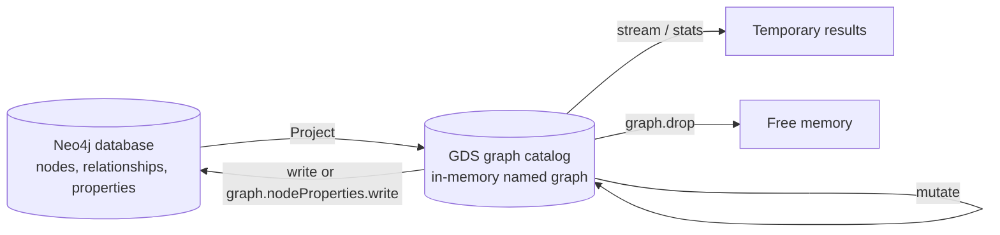
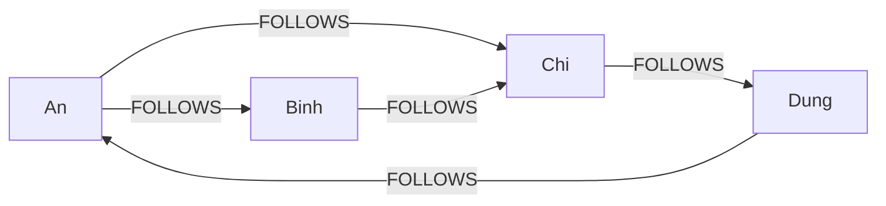

# Managing Projected Graph Lifecycle and Writing Results Back to Source Data in Neo4j GDS

## 1. Two Graph Layers: Source Data and Analytical Graph

In **Neo4j**, business data resides in the database's *property graph*: nodes carry labels and properties, while relationships carry types, directions, and properties. Cypher creates, queries, and updates that data. **Neo4j Graph Data Science (GDS)** adds graph analytics algorithms such as PageRank, Louvain, Weakly Connected Components, Node Similarity, and path-finding algorithms.

To run most GDS algorithms repeatedly, applications typically **project** a subset of source data into an **in-memory named graph** inside the *graph catalog*. For instance, from `:GdsLifecycleUser` nodes and `:FOLLOWS` relationships, we create a graph named `gds_lifecycle_demo` to compute user importance.

The two graphs have **independent lifecycles**:

| Aspect | Source Graph in Neo4j Database | Projected Graph in GDS Graph Catalog |
| --- | --- | --- |
| Storage | Neo4j database, managed by the database engine | Algorithm-optimized data structures, primarily in memory |
| Contents | Operational nodes, relationships, and properties | Nodes, relationships, orientations, and properties **selected at projection time** |
| How to read | `MATCH ... RETURN` | GDS algorithms, `gds.graph.*.stream` |
| How to modify | Cypher `SET`/`CREATE`/`DELETE`, Java Driver, Spring Data Neo4j | GDS graph operations or algorithms in `mutate` mode |
| Auto-sync | Receives committed transactions | **Does not auto-update with new source transactions** |
| Deletion | Cypher data deletion within transactions | `gds.graph.drop(...)` only removes the graph from the catalog, freeing memory |
| Restart | Committed data persists | Named graphs normally vanish when the database/DBMS stops; must be re-projected or restored |

Flow visualization:



**Key distinction:** `mutate` modifies the graph inside GDS; `write` updates the source database. Completing an algorithm **does not** mean results have been written to operational nodes.

## 2. Defining the Full Lifecycle Before Running Algorithms

A controlled GDS job typically moves through these stages:

1. **Prepare source data:** define node/relationship sets, verify business keys, data types, orientation, and permissions.
2. **Estimate:** inspect node/relationship scale, projected graph footprint, and algorithm memory.
3. **Project:** create a named graph in the catalog with an explicit name and scope.
4. **Verify:** confirm the graph exists, matches expected node/edge counts, schema, orientation, and memory usage.
5. **Compute:** run algorithms in `stream` or `stats` mode to explore, or `mutate` to chain algorithms.
6. **Write back if needed:** use `algorithm.write` or `gds.graph.nodeProperties.write` to persist results back to the source database, then read them via Cypher.
7. **Clean up:** run `gds.graph.drop` when no longer needed; if source data changes and fresh analytics are required, **re-project**.

Before building a pipeline, answer three questions:

- Are results for a one-off report, or must another application **query them long-term**?
- If source data changes continuously, what is the **maximum acceptable staleness** for the analytical graph?
- Does the job need to retain intermediate results across multiple algorithms, or run a single algorithm and drop the graph?

These answers determine whether to use `stream`, `mutate`, or `write`, and when to free memory.

## 3. Preparing GDS and Sample Data

### 3.1. Checking GDS Installation and Permissions

GDS is a **separate library** from Cypher and APOC, with compatibility requirements for Neo4j version, edition, and deployment environment. On self-managed Neo4j, install/configure GDS per documentation; on Aura, use capabilities provided by the corresponding service. Never assume every database has GDS available.

Verify:

```cypher
RETURN gds.version() AS gdsVersion;
```

```cypher
SHOW PROCEDURES
YIELD name
WHERE name STARTS WITH 'gds.graph.'
   OR name STARTS WITH 'gds.pageRank.'
RETURN name ORDER BY name;
```

If functions/procedures are missing or permissions fail, check the plugin version, active database, and procedure execute grants. **Permissions to create catalog graphs and permissions to write source data are not identical.** For instance, `stream` may be permitted while `write` is denied.

### 3.2. Demo Data: Four Users and Follow Relationships

Run the following statements **on a test database**. The `userId` key verifies identity in Neo4j, while GDS uses internal graph IDs during computation.

```cypher
CREATE CONSTRAINT gds_lifecycle_user_id IF NOT EXISTS
FOR (u:GdsLifecycleUser)
REQUIRE u.userId IS UNIQUE;
```

```cypher
MERGE (a:GdsLifecycleUser {userId: 'gds-u-1'})
  ON CREATE SET a.name = 'An'
MERGE (b:GdsLifecycleUser {userId: 'gds-u-2'})
  ON CREATE SET b.name = 'Binh'
MERGE (c:GdsLifecycleUser {userId: 'gds-u-3'})
  ON CREATE SET c.name = 'Chi'
MERGE (d:GdsLifecycleUser {userId: 'gds-u-4'})
  ON CREATE SET d.name = 'Dung'
MERGE (a)-[:FOLLOWS]->(b)
MERGE (a)-[:FOLLOWS]->(c)
MERGE (b)-[:FOLLOWS]->(c)
MERGE (c)-[:FOLLOWS]->(d)
MERGE (d)-[:FOLLOWS]->(a);
```

Diagram:



Check counts from the source database:

```cypher
MATCH (u:GdsLifecycleUser)
RETURN count(u) AS sourceNodes;
```

```cypher
MATCH (a:GdsLifecycleUser)-[r:FOLLOWS]->(b:GdsLifecycleUser)
RETURN count(r) AS sourceRelationships;
```

On a clean database containing only the newly created demo data, expect **4 nodes** and **5 relationships**. If nodes with the same label or relationships with the same type already existed, counts will differ. `MERGE` helps avoid duplicating records by business key; these demo statements do not delete or reset pre-existing data.

## 4. Estimating Memory and Creating the Projected Graph

### 4.1. Estimating Before Projecting

For large graphs, estimate graph size before projecting:

```cypher
CALL gds.graph.project.estimate(
  'GdsLifecycleUser',
  'FOLLOWS'
)
YIELD nodeCount, relationshipCount, requiredMemory
RETURN nodeCount, relationshipCount, requiredMemory;
```

`.estimate` **does not create** a named graph. It helps evaluate data volume and memory requirements, yet remains an **estimate**, not exact runtime memory. When a graph uses `UNDIRECTED` orientation, relationships can be represented in both directions, so the GDS edge count differs from physical database relationships.

For large algorithms, `gds.pageRank.mutate.estimate(...)`, `gds.pageRank.write.estimate(...)`, and algorithm-specific estimate modes are also available. Estimate **both graph and algorithm**, especially when running concurrent jobs on the same heap.

### 4.2. Creating a Named Graph

```cypher
CALL gds.graph.project(
  'gds_lifecycle_demo',
  'GdsLifecycleUser',
  {FOLLOWS: {orientation: 'NATURAL'}}
)
YIELD graphName, nodeCount, relationshipCount, projectMillis
RETURN graphName, nodeCount, relationshipCount, projectMillis;
```

Components:

- `'gds_lifecycle_demo'`: graph name in the catalog. Must differ from existing graphs within the user/database catalog scope.
- `'GdsLifecycleUser'`: projects only nodes carrying this label.
- `FOLLOWS`: projects only relationships of this type whose both endpoints lie in the selected node set.
- `orientation: 'NATURAL'`: preserves relationship direction as stored in Neo4j. You can choose `UNDIRECTED` or `REVERSE` when **matching algorithm semantics**.
- `projectMillis`: projection build duration reported by GDS, distinct from algorithm compute time.

On an isolated demo dataset, expect `nodeCount = 4` and `relationshipCount = 5`. This command only creates a graph **in memory**; it creates no duplicate nodes in the Neo4j database and writes no PageRank properties.

**Re-running with the same name:** `gds.graph.project` fails if a named graph with the same name still exists in the catalog. Check `gds.graph.exists` first. Drop a graph only when certain it belongs to your job and no algorithm is still using it.

### 4.3. Distinguishing Native Projection and Cypher Projection

The example above uses **native projection** because only labels, types, and orientations are needed. For complex filtering, an alternative is **Cypher projection** via the `gds.graph.project(...)` aggregation function:

```cypher
MATCH (a:GdsLifecycleUser)-[r:FOLLOWS]->(b:GdsLifecycleUser)
WHERE a.userId IN ['gds-u-1', 'gds-u-2']
RETURN gds.graph.project(
  'gds_lifecycle_subset',
  a,
  b,
  {
    sourceNodeLabels: labels(a),
    targetNodeLabels: labels(b),
    relationshipType: type(r)
  }
) AS projection;
```

This example projects only nodes and relationships appearing in matching `MATCH` rows; **isolated nodes absent from those rows are not automatically included**. Cypher projection has specific handling for isolated nodes, properties, and identifiers; consult your version's docs when needed.

In current GDS releases, the older **procedure** `gds.graph.project.cypher(...)` is deprecated; avoid copying legacy Neo4j 4.x/5.x guides without checking current APIs. Native projection suffices for the remaining exercises; the subset graph merely illustrates filtered projection. If you ran the `gds_lifecycle_subset` snippet, drop it explicitly with `CALL gds.graph.drop('gds_lifecycle_subset', false)` when done to avoid keeping spare graphs in memory.

## 5. Managing the Graph Catalog: `exists`, `list`, and `drop`

### 5.1. Checking If a Graph Exists

```cypher
CALL gds.graph.exists('gds_lifecycle_demo')
YIELD graphName, exists
RETURN graphName, exists;
```

Or invoke it as a function:

```cypher
RETURN gds.graph.exists('gds_lifecycle_demo') AS graphExists;
```

If `exists = false`, algorithms referencing that graph will fail. A common scenario is a database restart: the in-memory graph catalog is cleared even though **source nodes and relationships remain intact**.

### 5.2. Listing Graph Metadata

```cypher
CALL gds.graph.list('gds_lifecycle_demo')
YIELD graphName, nodeCount, relationshipCount,
      memoryUsage, creationTime, modificationTime
RETURN graphName, nodeCount, relationshipCount,
       memoryUsage, creationTime, modificationTime;
```

To view all graphs accessible to the current user:

```cypher
CALL gds.graph.list()
YIELD graphName, nodeCount, relationshipCount, memoryUsage
RETURN graphName, nodeCount, relationshipCount, memoryUsage
ORDER BY graphName;
```

Fields to inspect:

| Metric | Meaning / Usage |
| --- | --- |
| `graphName` | Name used in algorithm and management calls |
| `nodeCount`, `relationshipCount` | Scale of the **projected** graph, not necessarily the entire database |
| `schema` / `schemaWithOrientation` | Labels, relationship types, properties, and orientations in the projection |
| `memoryUsage` / `sizeInBytes` | Footprint info if supported by runtime/JDK; may not always return useful numbers |
| `creationTime` | Timestamp when the projection was created in the catalog |
| `modificationTime` | Timestamp when the GDS graph was modified, e.g., via `mutate` |

**Do not confuse `modificationTime` with source database timestamps:** it reflects the catalog graph, never proving the graph absorbed recent application transactions.

The catalog is scoped to **database and owner/user**. Graphs projected by another user may not be visible or accessible unless appropriate administrative privileges apply. Identical graph names across two databases or users do not guarantee identical datasets.

### 5.3. Dropping Graphs from the Catalog When Finished

```cypher
CALL gds.graph.drop('gds_lifecycle_demo')
YIELD graphName, nodeCount, relationshipCount
RETURN graphName, nodeCount, relationshipCount;
```

This operation **frees the in-memory GDS graph**. It **does not** execute `DELETE` on source nodes, **does not** delete source relationships, and **does not** remove properties written back to the database.

If you want cleanup scripts to re-run safely without failing when the graph is already gone, pass `false` as the second argument:

```cypher
CALL gds.graph.drop('gds_lifecycle_demo', false)
YIELD graphName;
```

Run cleanup only at the **end of the workflow** after reading, writing, and verifying results; the practice steps below still require the graph to exist.

## 6. Four Algorithm Execution Modes: `stream`, `stats`, `mutate`, `write`

To manage lifecycles cleanly, distinguish **where results are stored**:

| Mode | Returned Output | Modifies GDS Graph? | Writes Source Neo4j Data? | When to Use |
| --- | --- | --- | --- | --- |
| `stream` | Result rows, e.g., `nodeId` and `score` | No | No | Inspecting top N, checking distributions, deciding whether to persist |
| `stats` | Single algorithm summary row | No | No | Checking statistics and compute duration |
| `mutate` | Summary plus new properties/relationships in GDS | **Yes** | No | Passing results as input to the next algorithm |
| `write` | Summary; results written to Neo4j | Does not auto-sync back into GDS graph | **Yes** | When Cypher/Spring apps need to read results long-term |

Mode availability depends on the **specific algorithm**: not every algorithm supports all four modes or writes identical property/relationship structures.

### 6.1. `stream`: Viewing PageRank Without Writing

```cypher
CALL gds.pageRank.stream('gds_lifecycle_demo', {
  maxIterations: 20,
  dampingFactor: 0.85
})
YIELD nodeId, score
RETURN gds.util.asNode(nodeId).userId AS userId,
       score
ORDER BY score DESC, userId;
```

`nodeId` in GDS results maps back to the source node; `gds.util.asNode(nodeId)` accesses the corresponding source node in the database. **Never store `nodeId`/`elementId` as durable business keys**; in integrations, use `userId` or immutable domain IDs.

PageRank values depend on topology, edge orientation, and configuration. **There is no fixed reference score across graphs**; never assume which user ranks first simply from node creation order.

### 6.2. `stats`: Checking Statistics Before Publishing Results

```cypher
CALL gds.pageRank.stats('gds_lifecycle_demo', {
  maxIterations: 20
})
YIELD ranIterations, didConverge, computeMillis, centralityDistribution
RETURN ranIterations, didConverge, computeMillis,
       centralityDistribution;
```

`stats` fits when you only need to verify how the algorithm performed without storing per-node scores. `didConverge = false` can occur if convergence is not reached within permitted iterations; applications should inspect output quality, not merely API success/failure.

### 6.3. `mutate`: Keeping PageRank Scores Inside the GDS Graph

```cypher
CALL gds.pageRank.mutate('gds_lifecycle_demo', {
  maxIterations: 20,
  dampingFactor: 0.85,
  mutateProperty: 'pagerankScore'
})
YIELD nodePropertiesWritten, ranIterations, didConverge
RETURN nodePropertiesWritten, ranIterations, didConverge;
```

The algorithm adds the `pagerankScore` property to nodes **inside the projected graph**. You can read it immediately from the catalog:

```cypher
CALL gds.graph.nodeProperty.stream(
  'gds_lifecycle_demo',
  'pagerankScore'
)
YIELD nodeId, propertyValue
RETURN gds.util.asNode(nodeId).userId AS userId,
       propertyValue AS pagerankScore
ORDER BY pagerankScore DESC, userId;
```

However, without a separate `write` step, a source Cypher query:

```cypher
MATCH (u:GdsLifecycleUser)
RETURN u.userId, u.pagerankScore;
```

**does not automatically see** the new property created solely by `mutate` (unless the source already had a property with that name from an earlier write). `mutate` excels in multi-algorithm workflows—such as PageRank → community detection → scoring—without persisting intermediate outputs to the database.

### 6.4. `write`: Running an Algorithm and Writing Directly to Neo4j

When intermediate retention in GDS is unnecessary, run:

```cypher
CALL gds.pageRank.write('gds_lifecycle_demo', {
  maxIterations: 20,
  dampingFactor: 0.85,
  writeProperty: 'pagerankDirect'
})
YIELD nodePropertiesWritten, ranIterations, writeMillis
RETURN nodePropertiesWritten, ranIterations, writeMillis;
```

Once complete, read back from the source database:

```cypher
MATCH (u:GdsLifecycleUser)
RETURN u.userId AS userId, u.pagerankDirect AS pagerankDirect
ORDER BY pagerankDirect DESC, userId;
```

**Difference from `mutate`:** `write` computes and persists `pagerankDirect` onto source Neo4j nodes. It **does not** simultaneously add `pagerankDirect` to an already projected GDS graph. If a subsequent algorithm needs the newly written Neo4j property missing from the GDS graph, re-project or load the property via supported APIs.

## 7. Writing Batched `mutate` Results Back to Source Data

A pipeline sometimes runs **multiple algorithms** before deciding which results to persist. In that case:

1. Project the graph once.
2. Run `mutate` to add properties inside GDS.
3. Read results back from GDS and verify quality.
4. Persist required properties via `gds.graph.nodeProperties.write`.
5. Verify source nodes via Cypher, then `drop` the graph when done.

Example following the `pageRank.mutate` step in Section 6.3:

```cypher
CALL gds.graph.nodeProperties.write(
  'gds_lifecycle_demo',
  'pagerankScore'
)
YIELD graphName, nodeProperties, propertiesWritten, writeMillis
RETURN graphName, nodeProperties, propertiesWritten, writeMillis;
```

Then verify:

```cypher
MATCH (u:GdsLifecycleUser)
RETURN u.userId AS userId, u.pagerankScore AS pagerankScore
ORDER BY pagerankScore DESC, userId;
```

You can rename the property when writing back to the source:

```cypher
CALL gds.graph.nodeProperties.write(
  'gds_lifecycle_demo',
  {pagerankScore: 'pagerankScorePublished'}
)
YIELD propertiesWritten
RETURN propertiesWritten;
```

This persists outputs under an application-owned name while keeping intermediate property names inside GDS. `propertiesWritten` counts **property write operations reported by the procedure**, not new business users or proof that scores are semantically valid.

### 7.1. Algorithms Creating Relationships and Node Labels

Not every algorithm outputs node scores. For example, Node Similarity can write **relationships between similar nodes**:

```cypher
// Illustrative syntax for an appropriate similarity task.
CALL gds.nodeSimilarity.write('graphForSimilarity', {
  writeRelationshipType: 'SIMILAR_TO',
  writeProperty: 'similarityScore'
})
YIELD nodesCompared, relationshipsWritten
RETURN nodesCompared, relationshipsWritten;
```

This example **does not run on the lesson's `gds_lifecycle_demo`**, as data and structure must fit similarity algorithms; the graph name is hypothetical. When writing relationships, review edge direction, duplicate relationships on re-runs, thresholds, and business rules. Additionally, GDS offers procedures to write `mutate`-created relationships/labels back to Neo4j per your version's API.

For Louvain communities, a node property example:

```cypher
CALL gds.louvain.mutate('gds_lifecycle_demo', {
  mutateProperty: 'communityId'
})
YIELD communityCount, nodePropertiesWritten
RETURN communityCount, nodePropertiesWritten;
```

This illustrates chaining `mutate` results. For real community detection, Louvain generally fits better when relationships are projected as `UNDIRECTED`; evaluate the model and create a projection with suitable orientation rather than reusing PageRank's `NATURAL` graph by default. Once community IDs are validated against analytical goals, persist them:

```cypher
CALL gds.graph.nodeProperties.write(
  'gds_lifecycle_demo',
  ['pagerankScore', 'communityId']
)
YIELD propertiesWritten
RETURN propertiesWritten;
```

Remember that community IDs are **algorithm-generated cluster labels** that can change across runs when graphs or settings shift; never use them as immutable business IDs.

## 8. Projected Graphs Become Stale When the Source Database Changes

Suppose after projecting and computing PageRank, the application executes:

```cypher
MERGE (u:GdsLifecycleUser {userId: 'gds-u-5'})
ON CREATE SET u.name = 'Em'
WITH u
MATCH (v:GdsLifecycleUser {userId: 'gds-u-1'})
MERGE (u)-[:FOLLOWS]->(v);
```

The source database now has an additional user and relationship, yet `gds_lifecycle_demo` **remains the graph projected earlier**. Verify:

```cypher
MATCH (u:GdsLifecycleUser)
RETURN count(u) AS sourceNodes;
```

```cypher
CALL gds.graph.list('gds_lifecycle_demo')
YIELD nodeCount, relationshipCount
RETURN nodeCount AS projectedNodes,
       relationshipCount AS projectedRelationships;
```

On the fresh demo dataset, the source grows to 5 nodes while the GDS graph still has only 4. **A new Cypher transaction does not automatically re-project a GDS graph.** Even if source properties change without adding nodes, properties already loaded into the projection can become **stale**.

### 8.1. Re-Projecting When Fresh Results Are Needed

When no active job uses the old graph:

```cypher
CALL gds.graph.drop('gds_lifecycle_demo')
YIELD graphName;
```

```cypher
CALL gds.graph.project(
  'gds_lifecycle_demo',
  'GdsLifecycleUser',
  {FOLLOWS: {orientation: 'NATURAL'}}
)
YIELD graphName, nodeCount, relationshipCount
RETURN graphName, nodeCount, relationshipCount;
```

The new graph captures source data committed prior to projection; **properties that existed only in the old GDS graph from `mutate` are lost** unless written back to Neo4j and re-projected in the projection config. You must re-run algorithms to obtain scores reflecting the new topology.

### 8.2. Avoiding Persisting Stale Analytical Results

In production, re-projecting alone is insufficient if source data **mutates continuously**. For example:

- 09:00: project graph from last week's data.
- 09:10: relationships are deleted or added in Neo4j.
- 09:30: PageRank job writes scores computed from the 09:00 projection onto existing nodes.

The write command succeeds technically, yet scores **no longer reflect current state**. Establish policies:

- Anchor source snapshots by version, timestamp, or watermark.
- Attach run metadata (job ID, projection timestamp, algorithm, parameters, and source data version) to published outputs via appropriate domain mechanisms.
- Enforce freshness checks before overwriting properties actively read by applications.
- For critical pipelines, write to staging properties/graphs and promote to active serving properties/labels only after reconciliation.
- If source nodes are deleted or modified mid-job, handle ID mapping errors and verify actual written counts; never assume every GDS node still exists unchanged in the source.

## 9. Reruns, Cleanup, and Ownership

### 9.1. Safe Reruns Require Distinct Naming

Before projecting, check existence:

```cypher
CALL gds.graph.exists('gds_lifecycle_demo')
YIELD graphName, exists
RETURN graphName, exists;
```

If a graph already exists, **do not drop it mechanically**: another job might still rely on it. In concurrent systems, name graphs per job/run, or enforce orchestration and ownership rules so two processes never contend over the same graph name.

A cleanup discipline:

```text
validate source + check estimate
        |
        v
project with a unique, owned name
        |
        v
verify graph metadata
        |
        v
algorithm stream/stats -> quality checks
        |
        v
mutate (optional) -> verify -> write (optional)
        |
        v
verify persisted Neo4j data
        |
        v
drop owned graph; release memory
```

If a job fails midway, still clean up graphs **it owns**, even if results were not persisted. However, never drop a shared graph serving other algorithms.

### 9.2. Memory and Catalog Lifecycles

- GDS graphs can consume significant memory alongside algorithm structures, batches, and `mutate` results. Do not look only at `nodeCount` while ignoring `relationshipCount`, loaded properties, orientation, and concurrent jobs.
- `gds.graph.drop` removes the graph from the catalog; the runtime may still take time to reclaim physical heap via GC.
- When a Neo4j database/DBMS stops, catalog named graphs are normally lost. GDS backup/restore features exist depending on **edition, API stability, and environment**; do not assume they are enabled everywhere by default.
- The graph catalog is scoped by user/database. `gds.graph.exists(...)` returning `false` for one user does not prove no graph exists under another user.

### 9.3. Java Driver and Spring Data Neo4j

In Java, GDS is invoked via Cypher through the Neo4j Java Driver. Example checking graph existence and streaming PageRank without writing:

```java
import java.util.Map;
import org.neo4j.driver.AuthTokens;
import org.neo4j.driver.Driver;
import org.neo4j.driver.GraphDatabase;
import org.neo4j.driver.Session;
import org.neo4j.driver.SessionConfig;

public class GdsLifecycleRead {
    public static void main(String[] args) {
        try (
            Driver driver = GraphDatabase.driver(
                "neo4j://localhost:7687",
                AuthTokens.basic("neo4j", "change-me")
            );
            Session session = driver.session(
                SessionConfig.forDatabase("neo4j")
            )
        ) {
            boolean exists = session.run("""
                RETURN gds.graph.exists($graphName) AS found
                """, Map.of("graphName", "gds_lifecycle_demo"))
                .single()
                .get("found")
                .asBoolean();

            if (!exists) {
                throw new IllegalStateException(
                    "GDS graph for analysis does not exist yet"
                );
            }

            var rows = session.run("""
                CALL gds.pageRank.stream($graphName)
                YIELD nodeId, score
                RETURN gds.util.asNode(nodeId).userId AS userId, score
                ORDER BY score DESC
                LIMIT 10
                """, Map.of("graphName", "gds_lifecycle_demo"))
                .list();

            rows.forEach(row ->
                System.out.printf("%s = %.6f%n",
                    row.get("userId").asString(),
                    row.get("score").asDouble())
            );
        }
    }
}
```

When an application needs to **write**:

- Execute `gds.pageRank.write(...)` or `gds.graph.nodeProperties.write(...)` through a path with **write permissions**, handling errors and verifying written count metadata.
- Never treat `gds.pageRank.mutate(...)` as a Neo4j database write transaction; it operates on the in-memory catalog.
- Separate project, compute, persist, verify, and cleanup steps into a retry-safe pipeline. **Never assume an entire GDS workflow behaves as one atomic rollbackable Cypher transaction.**
- Inside Driver `executeWrite(...)` callbacks, avoid non-idempotent external side effects since callbacks may retry. For GDS catalog/mutation calls, explicitly manage in-memory state and idempotency on retries.

In **Spring Data Neo4j**, custom repositories or `Neo4jClient` can invoke GDS procedures via Cypher; standard `repository.save(...)` neither projects graphs nor runs algorithms automatically. Pay attention to procedure permissions, transaction boundaries, and post-write verification. In production, offloading heavy GDS jobs to a dedicated service/batch worker usually simplifies resource and lifecycle management.

## 10. Common Errors and Remedies

| Symptom | Common Cause | Resolution |
| --- | --- | --- |
| Cannot call `gds.version()` or `gds.graph.project` | GDS not installed, version mismatch, or missing permissions | Verify plugin, edition, database, and privileges |
| Projection fails saying graph name already exists | Existing named graph was not dropped | Inspect `gds.graph.list/exists`; drop only graphs owned by your job |
| Algorithm reports graph does not exist | Not projected yet, already dropped, restarted, or wrong user/database | Re-project in the right database with proper permissions |
| `nodeCount` lower than source data | Wrong label/predicate; relationships have endpoints outside projected nodes | Cross-check source, projection config, and node labels/types |
| `relationshipCount` double expected | `UNDIRECTED` orientation duplicates directed edges | Confirm orientation matches algorithm semantics |
| Insufficient heap/memory | Overly broad projection, heavy properties, multiple graphs or concurrent jobs | Estimate memory, narrow scope, drop unused graphs, tune resources |
| After `mutate`, source `MATCH` misses scores | Written only to GDS graph | Run `gds.graph.nodeProperties.write` or `algorithm.write` |
| After `write`, GDS graph lacks the new property | `write` does not refresh existing projections | Re-project or load property if downstream algorithms need it |
| New Neo4j nodes missing in GDS | Projections do not auto-refresh | Create fresh projection from updated data and re-run algorithms |
| After `drop`, `pagerankScore` still exists on nodes | `drop` only clears the in-memory graph | Remove/update source properties via separate Cypher **if** required |
| Job succeeds yet scores are stale | Source data changed while job ran | Pin data snapshots and enforce freshness checks before publishing |
| Same graph code yields different results across runs | Topology, orientation, GDS version, parameters, or algorithm stability changed | Log config, seed (if any), source version, and stats |

## 11. Practice Exercise and Completion Criteria

On a test database with a compatible GDS installation:

1. Create `GdsLifecycleUser` and `FOLLOWS` data; verify node/edge counts.
2. Run `gds.graph.project.estimate`, then create `gds_lifecycle_demo`. Use `gds.graph.exists` and `gds.graph.list` to confirm projection.
3. Run PageRank in `stream` and `stats` modes; record the top three users by score and convergence status.
4. Run PageRank in `mutate`, inspect `pagerankScore` via `gds.graph.nodeProperty.stream`, and confirm the property does not appear automatically in source Neo4j nodes.
5. Use `gds.graph.nodeProperties.write` to persist `pagerankScore` to source nodes. Verify with `MATCH` and note `propertiesWritten`.
6. Optionally run `gds.pageRank.write` targeting a separate property `pagerankDirect`. Explain how it differs from `mutate`.
7. Create `gds-u-5` and a new relationship, compare source counts against the catalog to verify the projection is stale, drop and re-project, and re-run PageRank.
8. Finally, drop the exercise graph and confirm source nodes and written properties **still remain intact**. Do not delete demo data nodes unless permitted and finished with the lesson.

A GDS workflow meets standards when:

- Graphs are projected with **exact labels, types, orientation, and scope**, with memory estimated before heavy runs.
- Engineers know clearly which graph sits in the **catalog** versus **source data**.
- Algorithms run in the right mode (`stream`/`stats`/`mutate`/`write`).
- Before publishing, **result quality, write status, node identifiers, and data freshness** are verified.
- Explicit **drop/re-project** policies and job/user graph naming prevent memory leaks and accidental cross-job deletions.

## Official References

- [Neo4j Graph Data Science — Graph management](https://neo4j.com/docs/graph-data-science/current/management-ops/): catalog, projected graph lifecycle, writing, and cleanup.
- [Neo4j GDS — Native graph projection](https://neo4j.com/docs/graph-data-science/current/management-ops/graph-creation/graph-project/): `gds.graph.project`, orientation, labels/types/properties.
- [Neo4j GDS — Cypher projection](https://neo4j.com/docs/graph-data-science/current/management-ops/graph-creation/graph-project-cypher-projection/): creating conditional projected graphs from Cypher.
- [Neo4j GDS — Listing graphs](https://neo4j.com/docs/graph-data-science/current/management-ops/graph-list/): inspecting metadata, sizes, and modification times.
- [Neo4j GDS — Check graph existence](https://neo4j.com/docs/graph-data-science/current/management-ops/graph-exists/): checking whether a graph exists in the catalog.
- [Neo4j GDS — Dropping graphs](https://neo4j.com/docs/graph-data-science/current/management-ops/graph-drop/): removing projected graphs from memory.
- [Neo4j GDS — Running algorithms](https://neo4j.com/docs/graph-data-science/current/common-usage/running-algos/): distinguishing `stream`, `stats`, `mutate`, and `write`.
- [Neo4j GDS — PageRank](https://neo4j.com/docs/graph-data-science/current/algorithms/page-rank/): modes, parameters, and score writing.
- [Neo4j GDS — Write node properties](https://neo4j.com/docs/graph-data-science/current/management-ops/graph-write-to-neo4j/write-back-to-nodes/): persisting `mutate` properties back to source database nodes.
- [Neo4j GDS — Memory estimation](https://neo4j.com/docs/graph-data-science/current/common-usage/memory-estimation/): estimation for projections and algorithms.
