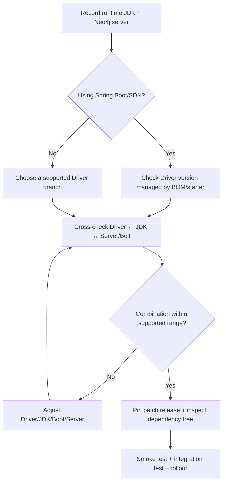

# Adding the Neo4j Java Driver and Choosing a Compatible Version

For a Java application to work with a property graph in Neo4j, it needs a **Neo4j Java Driver** capable of opening Bolt connections, authenticating, executing Cypher, passing parameters, reading nodes/relationships/paths, and managing transactions. Adding the dependency is only the first step: **the running JDK, the Driver version, the Neo4j server version, and the library management framework must all be compatible**.

This lesson belongs to the **Java Driver** chapter of the `DATABASE_ENGINE_GRAPH_NEO4J` module, where Neo4j is used to model connected data, traverse relationships/paths, optimize with indexes/constraints, and integrate with Java/Spring Data Neo4j. The goal of this lesson is to select the right library, add it via Maven or Gradle, verify connectivity, and establish a safe upgrade process.

> **Core principle:** do not choose a Driver merely because it is the "latest" or shares the same major version number as the server. You must verify **Driver ↔ JDK ↔ Bolt/Neo4j server ↔ Spring Boot/SDN**, pin a specific patch version, and test on an environment equivalent to production.

## 1. Four Compatibility Layers Not to Confuse

```text
Java Application
  ├── Compile-time JDK and runtime JDK
  ├── Neo4j Java Driver
  │      └── Bolt protocol / connection / transaction
  ├── Spring Boot & Spring Data Neo4j (if used)
  │      └── dependency management / mapping / transaction
  └── Cypher sent by the application
            │
            ▼
      Neo4j Server or Cluster
      (schema, index, APOC, Cypher, data)
```

| Component | Why does it matter? | How to verify? |
| --- | --- | --- |
| **JDK runtime** | The Driver must be able to load bytecode and the required Java APIs | `java -version` on the actual machine/container running it |
| **Neo4j Java Driver** | Provides Java APIs, routing mechanism, Bolt, connection pool | Dependency tree and documentation for the Driver branch |
| **Neo4j server** | Determines Cypher syntax, indexes, constraints, and supported procedures | Server version, release notes, and compatibility matrix |
| **Spring Boot/SDN** | May automatically manage the Driver version and lifecycle configuration | BOM, starter, dependency tree |

**Do not infer by version numbers:** Neo4j server and Neo4j Java Driver do not have to share the same major number. A newer Driver release can communicate with several older server releases within the vendor-supported range, and vice versa. However, **a successful Bolt connection does not mean all Cypher features of a newer server are present on an older server**.

For example, the Java Driver merely sends `CREATE FULLTEXT INDEX ...` or `CALL apoc.path.expandConfig(...)` to the server. Full-text/APOC capabilities still depend on the **Neo4j version, server plugins, edition, and permissions**—they do not appear automatically when upgrading the Driver.

## 2. Surveying the Environment Before Choosing a Version

Before editing `pom.xml` or `build.gradle`, build an information table:

1. **Build JDK and runtime JDK:** `java -version`, `mvn -version`, or `gradle -version`. CI/CD and containers may use a different JDK than the development machine.
2. **Server/cluster version:** Neo4j 5.x or a newer release line; whether there are multiple databases/a cluster.
3. **Framework:** plain Java, Spring Boot, Spring Data Neo4j, or a library that manages the Driver itself.
4. **Connection environment:** URI schemes like `bolt://`, `neo4j://`, `neo4j+s://`; TLS/certificate requirements.
5. **Technical requirements:** whether managed transactions, reactive APIs, routing, specific authentication, or new APIs are needed.
6. **Upgrade constraints:** whether JDK, Spring Boot, and the server can be changed together or must be upgraded step by step.

You can query the server using Cypher (in Neo4j Browser or a tool with appropriate permissions):

```cypher
CALL dbms.components()
YIELD name, versions, edition
RETURN name, versions, edition;
```

`versions` is the version information of the server component. Record the **environment** where the command was run; results from a laptop cannot substitute for staging/production information.

A sample decision table:

| Component | Example entry | Needs verification |
| --- | --- | --- |
| Runtime JVM | Java 17 | Container `java -version` |
| Neo4j server | Version provided by the operations team | Actual server version/release channel |
| Java Driver | Chosen specific patch release | Dependency resolution, compatibility page |
| Spring Boot/SDN | Yes or No | BOM and dependency tree |
| URI/TLS | `neo4j+s://...` if required by the system | Smoke test in staging |
| Result | PASS/FAIL | Test logs, free of secrets |

## 3. Adding the Dependency in Maven

The official library coordinates are:

| Maven coordinate | Value |
| --- | --- |
| `groupId` | `org.neo4j.driver` |
| `artifactId` | `neo4j-java-driver` |
| `version` | An **exact** patch version compatible with the system |

Example `pom.xml` for a plain Java application:

```xml
<project xmlns="http://maven.apache.org/POM/4.0.0"
         xmlns:xsi="http://www.w3.org/2001/XMLSchema-instance"
         xsi:schemaLocation="http://maven.apache.org/POM/4.0.0
                             https://maven.apache.org/xsd/maven-4.0.0.xsd">
    <modelVersion>4.0.0</modelVersion>

    <groupId>example</groupId>
    <artifactId>neo4j-driver-demo</artifactId>
    <version>1.0.0</version>

    <properties>
        <maven.compiler.release>17</maven.compiler.release>
        <neo4j.driver.version>6.0.0</neo4j.driver.version>
    </properties>

    <dependencies>
        <dependency>
            <groupId>org.neo4j.driver</groupId>
            <artifactId>neo4j-java-driver</artifactId>
            <version>${neo4j.driver.version}</version>
        </dependency>
    </dependencies>
</project>
```

**The two numbers in the example are purely illustrative configuration values:** Java 17 is an assumed environment and `6.0.0` is a version *pinned to illustrate syntax*, **not a claim that it is the latest patch or the recommended choice for every deployment**. Before deploying, replace it with a supported patch version verified according to Section 5. Do not treat this as the default version for the entire module.

If the project already has a POM, simply add `<dependency>` under `<dependencies>` and declare/manage the version according to the project's convention rather than creating another POM.

Check the version Maven actually resolves:

```bash
mvn dependency:tree -Dincludes=org.neo4j.driver:neo4j-java-driver
```

In multi-module projects, run this in the module that packages the application. A `<version>` in a POM can be affected by `dependencyManagement`, a parent POM, or framework dependencies; **the runtime classpath is the final result you must observe**.

## 4. Adding the Dependency in Gradle

### Groovy DSL — build.gradle

```groovy
plugins {
    id 'java'
}

java {
    toolchain {
        languageVersion = JavaLanguageVersion.of(17)
    }
}

dependencies {
    implementation 'org.neo4j.driver:neo4j-java-driver:6.0.0'
}
```

### Kotlin DSL — build.gradle.kts

```kotlin
plugins {
    java
}

java {
    toolchain {
        languageVersion.set(JavaLanguageVersion.of(17))
    }
}

dependencies {
    implementation("org.neo4j.driver:neo4j-java-driver:6.0.0")
}
```

These are **two alternative syntaxes**, not two dependencies to add simultaneously. As with Maven, `6.0.0` is only an illustrative version; lock a verified patch release, preferring centralized management via a version catalog or the project's Gradle conventions.

View the version actually selected:

```bash
./gradlew dependencyInsight --dependency neo4j-java-driver --configuration runtimeClasspath
```

In projects with multiple modules or configurations, select the exact runtime classpath of the component running the application. If a different version is detected, inspect the platform/BOM, constraints, resolution strategy, and transitive dependencies before resorting to forcing a version.

## 5. How to Choose a Compatible Version Using the Matrix

There is no single static version table that stays valid forever. The safe workflow is to **select a specific release, read the compatibility matrix, and test it on the target system**.



### 5.1. Mandatory Questions

- **Driver ↔ Java:** What minimum JDK level does that Driver branch require? Does the container's actual Java runtime meet it?
- **Driver ↔ Server/Bolt:** Is the version pair within the supported range? Are there special requirements for cluster/routing?
- **Driver API ↔ code:** Does the application use APIs that were replaced, deprecated, or removed in a new major release?
- **Spring Boot/SDN ↔ Driver:** Does the framework confirm compatibility with that Driver branch?
- **Cypher features ↔ server:** Do the features used by actual queries exist on the server?
- **TLS/auth ↔ environment:** Do the URI, certificates, trust store, and access permissions work in the target environment?

### 5.2. Patch, Minor, and Major

| Change type | Primary risk | How to act |
| --- | --- | --- |
| Patch within the same branch | Bug/security fixes may affect certain code paths | Read release notes, run regression tests |
| Minor | New APIs/features, conditional compatibility changes | Check APIs, server, and run tests |
| Major | May change minimum Java level, APIs, and connection behavior | Read upgrade guide, plan migration |
| Upgrading Driver independently with a BOM | The framework may not have tested that combination | Prefer the BOM-managed version or test any override thoroughly |

**Do not assume** "Neo4j server 5.26 must use Driver 5.26" or "Driver 6.x only works with server 6.x" without confirmation from the compatibility documentation. Product version numbers and Bolt protocol versions do not follow the same numbering scheme.

Some older Driver lines may still *connect*, yet be past their maintenance end-of-life. **Being able to connect**, **being supported**, and **being able to use new server features** are three separate questions.

### 5.3. Reference Sources to Consult When Finalizing

- [Neo4j Java Driver Manual — Install](https://neo4j.com/docs/java-manual/current/install/): how to add dependencies, Java support.
- [Neo4j Java Driver Manual — Upgrade](https://neo4j.com/docs/java-manual/current/upgrade/): changes when upgrading major versions.
- [Neo4j Java Driver Manual — Connect](https://neo4j.com/docs/java-manual/current/connect/): URIs, authentication, and TLS.
- [Neo4j Java Driver Manual](https://neo4j.com/docs/java-manual/current/): compatibility table for the Driver branch under review.
- [Maven Central — Neo4j Java Driver](https://central.sonatype.com/artifact/org.neo4j.driver/neo4j-java-driver): exact published releases.

These pages can change over time; **do not copy example version numbers from this lesson as production decisions**. Check the actively maintained patch release at deployment time and record the test results/version matrix in release documentation.

## 6. Neo4j Java Driver Is a Client, Not an Embedded Database

Distinguish the components:

| Library/component | Role |
| --- | --- |
| `org.neo4j.driver:neo4j-java-driver` | Java client connecting to the server over Bolt |
| Neo4j server / cluster | Stores nodes, relationships, indexes, constraints, and executes Cypher |
| `spring-boot-starter-data-neo4j` | Integrates Spring Boot and Spring Data Neo4j, using the Driver underneath |
| APOC | Extension procedures/functions **on the server**; adding the Driver does not install APOC |
| Graph Data Science | Graph algorithms/server extensions depending on deployment environment |

Adding `neo4j-java-driver` does not run a Neo4j server inside the JVM. You still need a Neo4j instance/cluster, a connection URI, valid credentials, and network access.

Similarly, a newer Driver does not automatically upgrade the Cypher version, APOC plugins, or index/constraint features in the database. This is especially important when the application performs path queries, data ingestion, and graph optimization.

## 7. First Smoke Test with the Java Driver

Assume a test server is running locally and environment variables are configured:

```text
NEO4J_URI       = bolt://localhost:7687
NEO4J_USERNAME  = neo4j
NEO4J_PASSWORD  = (secret, do not hardcode in source code)
NEO4J_DATABASE  = neo4j
```

The Java code below uses standard Java Driver APIs and assumes JDK 17:

```java
import java.util.Map;
import org.neo4j.driver.AuthTokens;
import org.neo4j.driver.Driver;
import org.neo4j.driver.GraphDatabase;
import org.neo4j.driver.Record;
import org.neo4j.driver.Session;
import org.neo4j.driver.SessionConfig;

public class Neo4jConnectionCheck {

    public static void main(String[] args) {
        String uri = envOrDefault(
            "NEO4J_URI", "bolt://localhost:7687");
        String user = envOrDefault("NEO4J_USERNAME", "neo4j");
        String password = requiredEnv("NEO4J_PASSWORD");
        String database = envOrDefault("NEO4J_DATABASE", "neo4j");

        try (Driver driver = GraphDatabase.driver(
                uri, AuthTokens.basic(user, password))) {

            driver.verifyConnectivity();

            try (Session session = driver.session(
                    SessionConfig.forDatabase(database))) {

                Record row = session.run(
                    "RETURN $value AS answer",
                    Map.of("value", 42)
                ).single();

                System.out.println("Connected. Answer = "
                    + row.get("answer").asInt());
            }
        }
    }

    private static String requiredEnv(String key) {
        String value = System.getenv(key);
        if (value == null || value.isBlank()) {
            throw new IllegalStateException(
                "Missing required environment variable: " + key);
        }
        return value;
    }

    private static String envOrDefault(String key, String fallback) {
        String value = System.getenv(key);
        return value == null || value.isBlank() ? fallback : value;
    }
}
```

Expected output when server/URI/credentials are correct:

```text
Connected. Answer = 42
```

This is a minimal smoke test: it loads the Driver into the JVM, authenticates, opens a Session, passes a parameter, retrieves a returned value, and closes resources. It **does not prove** that all application transactions or graph APIs will work.

Key points to understand:

1. `GraphDatabase.driver(...)` creates a Driver with a connection pool; you should **not** create a new Driver per query.
2. `verifyConnectivity()` actively checks connectivity; do not call it on every HTTP request.
3. `SessionConfig.forDatabase(...)` specifies the target database, which is useful in multi-database environments.
4. `Map.of("value", 42)` is parameter binding rather than concatenating input into Cypher strings.
5. `single()` fits here because `RETURN $value` returns exactly one row; multi-row queries require different result consumption.
6. `try-with-resources` closes the Driver/Session. **Long-running web applications** should only close the Driver on shutdown rather than after every request.

If the server runs in Docker while the program runs in another container, `localhost` refers to the current container, not necessarily the Neo4j address. Use the host and port configured for your deployment network.

## 8. Bolt URI, Routing, and TLS

The URI prefix is not merely cosmetic. It tells the Driver whether to use a direct connection or routing, as well as TLS expectations:

| URI | Meaning |
| --- | --- |
| `bolt://localhost:7687` | Direct Bolt connection, commonly used in local development |
| `neo4j://host:7687` | Connection using the routing mechanism supported by the Neo4j Driver |
| `neo4j+s://host:7687` | Routing with TLS and trusted certificate verification |
| `bolt+s://host:7687` | Direct connection with TLS and certificate verification |
| `neo4j+ssc://...` / `bolt+ssc://...` | TLS accepting certificates not verified like `+s`; only use per approved policy |

**Do not change `neo4j+s://` to `neo4j://` just to bypass a certificate error.** In production, configure the CA certificate, hostname, trust store, and DNS properly according to your security design.

With Neo4j Aura, use the **URI provided on the instance's connection details page** instead of guessing the host, scheme, or port. With self-managed clusters, routing may need to connect to member addresses advertised by the server; a valid initial URI can still fail if those addresses are unreachable from the application.

Common errors not directly related to the Driver version:

- Wrong host/port, firewall blocking Bolt, or DNS resolution failure.
- Untrusted TLS certificate, hostname mismatch, or trust store missing the CA.
- Incorrect username/password or account lacking permissions on the database.
- Using a routing URI when the returned cluster addresses are unreachable.
- Container using `localhost` in the wrong network scope.

Therefore, test in staging with real production-like TLS/routing/networking, not just on a laptop.

## 9. Driver Lifecycle, Session, and Connection Pool

```text
Long-running Java Application
  └── 1 shared Driver (thread-safe; connection pool)
        ├── Request A → Session A → read/write → close Session A
        ├── Request B → Session B → read/write → close Session B
        └── Worker C  → Session C → read/write → close Session C
  └── Close Driver on application shutdown
```

`Driver` is designed to be shared across threads and manage the pool; `Session` is a short-lived unit of work and **must not be arbitrarily shared across multiple threads**.

Anti-pattern:

```java
// Wrong approach: creating and closing a Driver for every HTTP request
void handleEveryRequest() {
    try (Driver driver = GraphDatabase.driver(
            uri, AuthTokens.basic(user, password))) {
        // Run one query then close the entire Driver...
    }
}
```

`uri`, `user`, and `password` in the anti-pattern example are assumed pre-declared variables. Continuously creating and closing Drivers increases connection setup overhead, TLS handshakes, and defeats connection pooling.

A web/worker application should initialize the Driver once via dependency injection, use a Session per unit of work, and only close the Driver on shutdown. Under increasing load, observe connection acquisition time, pool usage, active Sessions/transactions, and DB latency before tuning pool size.

## 10. Transactions and Parameterized Cypher Queries

Once connected, the application needs to ingest/query data according to business logic. For example, using node `:DriverDemoPerson` and key `personId`. On a test database, you can create a uniqueness constraint before loading data:

```cypher
CREATE CONSTRAINT driver_demo_person_id IF NOT EXISTS
FOR (p:DriverDemoPerson)
REQUIRE p.personId IS UNIQUE;
```

**This is DDL that actually modifies the schema**; do not run it arbitrarily in production. The constraint prevents duplicate keys when multiple workers write concurrently.

A Java class writing data with a managed transaction:

```java
import java.util.Map;
import org.neo4j.driver.Driver;
import org.neo4j.driver.Session;
import org.neo4j.driver.SessionConfig;

public class PersonWriter {
    private final Driver driver;

    public PersonWriter(Driver driver) {
        this.driver = driver;
    }

    public void upsert(String personId, String name) {
        try (Session session = driver.session(
                SessionConfig.forDatabase("neo4j"))) {
            session.executeWrite(tx -> {
                tx.run("""
                    MERGE (p:DriverDemoPerson {personId: $personId})
                    SET p.name = $name
                    """, Map.of(
                        "personId", personId,
                        "name", name
                    )).consume();
                return null;
            });
        }
    }
}
```

Explanation:

- `MERGE` on a stable key allows the operation to be safely retried. Avoid `MERGE`-ing on mutable properties like name or status.
- `session.executeWrite(...)` uses a managed transaction, which can retry certain transient errors. **The callback must be idempotent** and must not send emails or charge payments inside the transaction.
- `consume()` ensures the query result is consumed before the callback finishes.
- `SessionConfig.forDatabase("neo4j")` should be configured with the actual production database.
- For read-only queries, use `session.executeRead(...)` and return only the required fields/DTOs, avoiding returning massive graphs.

Java Driver results carry the `Value` type. For example, `row.get("name").asString()`, `row.get("count").asLong()`, `row.get("node").asNode()`. Before calling type conversion methods, verify that the value exists and is non-`null` according to your Cypher contract.

## 11. Spring Boot and Spring Data Neo4j: Avoiding BOM Conflicts

Applications using **Spring Data Neo4j (SDN)** via the Spring Boot starter typically let the **Spring Boot BOM/dependency management** determine the Driver version:

```xml
<dependency>
    <groupId>org.springframework.boot</groupId>
    <artifactId>spring-boot-starter-data-neo4j</artifactId>
</dependency>
```

For projects properly managed by the Spring Boot parent/BOM, there is no need to declare a separate version for the starter. If you explicitly add:

```xml
<dependency>
    <groupId>org.neo4j.driver</groupId>
    <artifactId>neo4j-java-driver</artifactId>
    <version>6.0.0</version>
</dependency>
```

it may **override** the Driver version selected by the framework. This is occasionally necessary to work around a known bug, but you must check compatibility for your exact Spring Boot/SDN version and run integration tests. Do not override just to get a "higher" version.

Common `application.yml` configuration example for Spring Boot (verify property names against your project's Boot version):

```yaml
spring:
  neo4j:
    uri: ${NEO4J_URI:bolt://localhost:7687}
    authentication:
      username: ${NEO4J_USERNAME:neo4j}
      password: ${NEO4J_PASSWORD}
  data:
    neo4j:
      database: ${NEO4J_DATABASE:neo4j}
```

Projects using the starter usually get an auto-configured `Driver` bean. Do not create a second Driver bean or connection pool unless there is a specific architectural requirement and you understand how auto-configuration behaves.

**Spring Data Neo4j is more than just the Java Driver:** it adds entity mapping, repositories, transaction integration, and framework lifecycle management. Thus, testing `driver.verifyConnectivity()` alone is insufficient; you must test repositories, relationship mapping, and Spring transactions.

## 12. Common Errors from Wrong Versions or Misconfiguration

| Symptom | Possible cause | What to check |
| --- | --- | --- |
| `ClassNotFoundException` / `NoClassDefFoundError` | Missing JAR on runtime classpath, wrong scope, or incomplete packaging | Dependency tree, deployed artifact |
| `UnsupportedClassVersionError` | Driver or app compiled for a higher Java version than runtime | `java -version` in container, JDK toolchain, Driver requirements |
| `NoSuchMethodError` / `NoSuchFieldError` | Compile-time API differs from runtime, duplicate JAR/transitive conflict | Runtime dependency tree, BOM, clean rebuild |
| `ServiceUnavailableException` / timeout | Network, URI, routing, server down | DNS, firewall, Bolt port, server logs |
| `AuthenticationException` | Invalid credentials | Credentials from secret store, database permissions |
| TLS / handshake error | Mismatched CA, trust store, hostname, or scheme | `+s`, certificate, hostname |
| `ClientException` with Cypher | Invalid query, missing server feature, insufficient permissions, or wrong database | Error code/message, server version, query |
| Pool exhaustion / waiting for connections | Too many requests, Sessions held too long, inadequate pool size | Lifecycle, pool metrics, and transactions |
| Spring startup failure after Driver override | Incompatible BOM/SDN, duplicate bean configuration | dependencyInsight, Boot release notes |

**Do not blame every connection error on the Driver version.** A compatible Driver will still fail if TLS, DNS, permissions, or cluster addresses are wrong. And a successful connection does not prove every Cypher query in the application is supported by the server.

## 13. Four-Layer Compatibility Testing

### Layer 1 — Build and Dependencies

- Build succeeds with the chosen JDK.
- Maven/Gradle resolves the exact single planned Driver version.
- No `UnsupportedClassVersionError` or `NoSuchMethodError` when running the packaged artifact.

### Layer 2 — Connectivity

- `verifyConnectivity()` succeeds with staging host, routing, TLS, and credentials.
- Session opens the correct database.
- Parameterized `RETURN 1 AS ok` returns the expected data type.

### Layer 3 — Business Features

- `MATCH` queries, index seeks, and relationship/path queries work.
- `MERGE`, constraints, and write/rollback transactions behave as expected.
- Special features such as APOC, full-text search, or newer Cypher syntax are available on the server.
- Retries on transient errors do not duplicate business side effects.

### Layer 4 — Spring and Operations

- SDN repositories/projections and node/relationship mappings run properly.
- The Driver is shared, and Sessions/transactions have proper lifecycles.
- The pool does not exhaust under representative load; the app emits timeout/error/latency metrics.
- Connections over real cluster/routing/TLS are verified, not just local ones.

A quick smoke test:

```cypher
RETURN 1 AS ok;
```

This proves the application can send/receive basic Cypher, but it **does not** replace tests for permissions, transactions, routing, APOC, or business queries.

## 14. Safe Driver Upgrade Process

1. **Baseline current state:** record JDK, Driver, server, URI/TLS, Spring Boot/SDN, dependency tree, and any current errors.
2. **Read the upgrade guide:** check API changes, JDK requirements, and behavioral changes in the new branch.
3. **Check BOM/framework:** upgrade Spring Boot/SDN as a tested pair if needed, rather than forcing the Driver alone.
4. **Pick a pinned patch release:** avoid dynamic versions, and document the version decision in the PR.
5. **Build and test:** smoke tests, integration tests, retries/transactions, TLS/routing.
6. **Deploy to staging/canary:** monitor timeouts, connection acquisition, Cypher errors, and latency.
7. **Planned rollout:** know how to roll back the artifact/Driver; check whether concurrent server/schema upgrades affect rollback.

### Self-Check Questions

**Question 1.** Why do Neo4j server and Neo4j Java Driver not necessarily share the same major version number?

**Question 2.** If an application builds successfully but the container throws `UnsupportedClassVersionError`, which versions should you check?

**Question 3.** Why should a Spring Boot project check the BOM before manually pinning `neo4j-java-driver`?

**Question 4.** Should `GraphDatabase.driver(...)` be created on every HTTP request? Why or why not?

**Question 5.** The Driver connects successfully, yet `CALL apoc.path.expandConfig(...)` fails. What causes might lie on the server?

**Question 6.** When using `executeWrite`, why should you avoid sending emails or charging payments directly inside the transaction callback?

**Suggested answers:** (1) Both components have independent release schedules and communicate over Bolt according to a compatibility matrix. (2) Compile-time JDK, container runtime JDK, and the Java level required by the Driver. (3) SDN/Boot manages a tested set of compatible versions. (4) No; the Driver holds a connection pool meant for reuse. (5) Missing APOC plugin, missing permissions, or unsupported procedure. (6) Managed transactions can retry, causing duplicate side effects.

## 15. Pre-Production Checklist

| Check | Requirement |
| --- | --- |
| Build and runtime JDK versions | Explicitly documented, matching Driver requirements |
| Neo4j server version and environment | Verified, not assumed from a local laptop |
| Java Driver | Specific patch release, within supported range |
| Dependency tree | Resolves cleanly without transitive conflicts |
| Spring Boot/SDN | No unverified BOM overrides |
| URI, routing, TLS | Correct scheme/certificate/cluster addresses |
| Login secrets | Secret store; no hard-coded passwords |
| Smoke test | `verifyConnectivity` + parameterized Cypher PASS |
| Integration test | Business queries, transactions, constraints, mappings PASS |
| Lifecycle | Shared Driver, properly closed Sessions |
| Operational observability | Timeouts, pool metrics, errors, and latency monitored |
| Rollback | Plan ready in case the upgrade causes failures |

## References

- [Neo4j Java Driver Manual](https://neo4j.com/docs/java-manual/current/): installation, connection, transactions, upgrades, and configuration.
- [Neo4j Java Driver API](https://neo4j.com/docs/api/java-driver/current/): `Driver`, `Session`, and `SessionConfig` types.
- [Neo4j Java Driver on Maven Central](https://central.sonatype.com/artifact/org.neo4j.driver/neo4j-java-driver): artifact coordinates and patch releases.
- [Spring Boot Reference — Neo4j](https://docs.spring.io/spring-boot/reference/data/nosql.html): dependency management and configuration in Boot.
- [Spring Data Neo4j Reference](https://docs.spring.io/spring-data/neo4j/reference/): repositories, entity mapping, and transactions.

**Key takeaway:** adding the Java Driver means declaring **`org.neo4j.driver:neo4j-java-driver`**, but picking the right version requires treating **JDK + Driver + Neo4j server/Bolt + Spring Boot/SDN** as a single system. Only consider the setup production-ready once you have pinned a patch release, verified the actual resolved dependencies, and validated both connectivity and business queries through testing.
