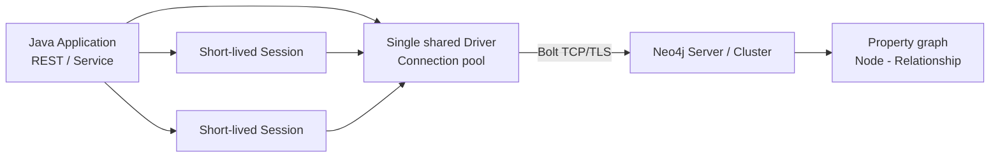
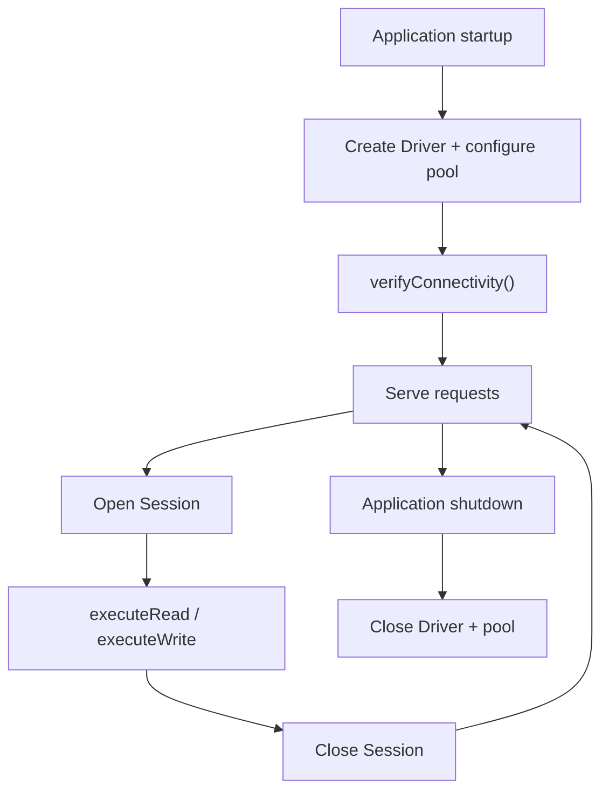
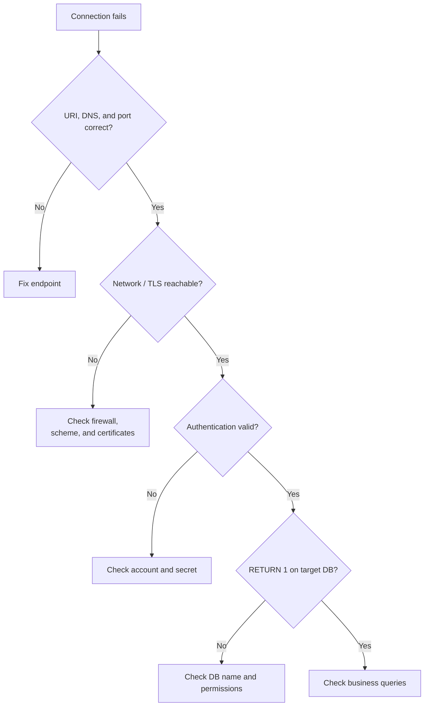

# Creating a Driver, Configuring URI, Authentication, and Verifying Connectivity

**Neo4j Java Driver** is the official library for Java applications to connect to Neo4j over the **Bolt** protocol, send parameterized **Cypher** queries, and manage sessions, transactions, and pooled connections. If an application selects the wrong URI, lacks authentication, or mismanages the driver lifecycle, operations on nodes, relationships, indexes, and graph data will fail even when the Cypher query itself is valid.

This lesson belongs to the **Java Driver** chapter of the **DATABASE_ENGINE_GRAPH_NEO4J** module, covering four tasks in the proper order: **add the library → create the Driver → configure the URI and authentication → verify real connectivity**. The examples use modern Java and the Neo4j Java Driver **5.x** API; for Driver 6.x or other versions, check the API documentation and server compatibility matrix before applying them.

## 1. Understanding Driver, Session, and Transaction



| Component | Responsibility | Recommended lifecycle |
| --- | --- | --- |
| `Driver` | Holds endpoint config, authentication, pool, and routing | **One reused instance**, typically matching application lifetime |
| `Session` | Scope of operations targeting a database | Created on demand and **closed early** after the request/task |
| `Transaction` | Groups statements requiring atomic commit/rollback | Tied to a short unit of business work |
| `Result` and `Record` | Returns records from a Cypher query | Consumed within the appropriate session/transaction scope |

**`Driver` is designed for concurrent use across threads**, whereas `Session` and transactions must not be arbitrarily shared across threads. Creating a new Driver for each HTTP request loses connection pooling benefits and incurs repeated TLS setup and authentication overhead. Conversely, sharing a single session across the entire application makes transaction lifecycles hard to control.

`GraphDatabase.driver(...)` on its own primarily constructs and configures the object. **It does not prove that Neo4j is reachable**: you must call `verifyConnectivity()` or run an actual query.

## 2. Adding the Java Driver Dependency

With Maven, add the dependency:

```xml
<dependency>
    <groupId>org.neo4j.driver</groupId>
    <artifactId>neo4j-java-driver</artifactId>
    <version>${neo4j.driver.version}</version>
</dependency>
```

`neo4j.driver.version` must be declared in the POM or managed by a BOM/build tool with a **chosen, real, and compatible** version. Do not leave this placeholder undefined when building. With Spring Boot/Spring Data Neo4j, the framework may already provide and manage the dependency version, so check your project's dependency management before adding it manually.

Core classes:

```java
import org.neo4j.driver.AuthTokens;
import org.neo4j.driver.Config;
import org.neo4j.driver.Driver;
import org.neo4j.driver.GraphDatabase;
import org.neo4j.driver.Session;
import org.neo4j.driver.SessionConfig;
```

The Driver is the connection communication layer; Spring Data Neo4j is the higher-level data mapping/repository layer used to build applications. A project can use Spring Data while still relying on the Driver underneath to communicate with Neo4j.

### 2.1. Checking Compatibility

Before deploying, verify that:

- The Driver version supports the JDK version used by the project.
- The Driver and Neo4j server are compatible over the Bolt protocol.
- APIs, timeout settings, certificates, and authentication handling have not changed in the target version.
- If using Spring Boot/BOM, two different Driver versions are not forced onto the classpath.

Use a supported release and document the exact version in the project's deployment documentation.

## 3. URI: Choosing the Address, Routing, and TLS

The URI is the address reachable by the **Java process**, not the URL used to open Neo4j Browser. Bolt typically uses port `7687`, though you should verify the actual server configuration.

| Scheme | Meaning | Commonly used when |
| --- | --- | --- |
| `bolt://host:7687` | Direct connection, scheme does not require TLS | Single Neo4j server in a test/trusted network |
| `bolt+s://host:7687` | Direct connection over TLS with trusted certificate | Single server requiring TLS |
| `bolt+ssc://host:7687` | Direct over TLS trusting self-signed certificates | Testing in controlled environments |
| `neo4j://host:7687` | Supports routing/discovery | Cluster or server configured with routing |
| `neo4j+s://host:7687` | Routing and TLS with certificate verification | Neo4j Aura or secured cluster |
| `neo4j+ssc://host:7687` | Routing and TLS with self-signed certificates | Special environments, never as production default |

`neo4j://` and `bolt://` differ in **routing versus direct connection**. `+s` and `+ssc` differ in how certificates are trusted. Do not switch to `+ssc` just to mask certificate errors in production, as doing so weakens server identity verification.

### 3.1. Neo4j Running on the Same Laptop

An illustrative URI:

```text
bolt://localhost:7687
```

`localhost` works when **the Java application runs on the same machine** as the Bolt listener. Neo4j Browser may use HTTP/HTTPS (for example port `7474` on some installations), but the Java Driver Bolt client does not connect through that Browser UI port.

### 3.2. Application Running in Docker

If Java runs in a different container from Neo4j, `localhost` points to the **Java container**. You must use a hostname resolvable within the container network, for example:

```text
bolt://neo4j:7687
```

Here `neo4j` is an assumed service name on the same network. If DNS/service discovery or network policy is misconfigured, changing the URI scheme will not fix connectivity.

### 3.3. Neo4j Aura and Clusters

Neo4j Aura typically issues a URI in the form:

```text
neo4j+s://example.databases.neo4j.io
```

Use the **exact URI provided**, including the TLS scheme and hostname; do not change it to an HTTP address. With self-managed clusters, the application may need access to the servers returned by routing; reaching only the entrypoint address is not enough if member addresses are blocked by a firewall.

### 3.4. Database Name Is a Separate Configuration

The database name is not something to arbitrarily append to the Bolt URI path. In Java:

```java
try (Session session = driver.session(
        SessionConfig.forDatabase("sales"))) {
    // Cypher will execute on the "sales" database.
}
```

If the database name is omitted, the driver uses the environment's default/home database for the user. In multi-database applications, **explicitly specify the target name** to avoid a scenario where connectivity succeeds but queries read from the wrong data.

## 4. Authentication with AuthTokens

The standard approach uses `username/password` credentials:

```java
Driver driver = GraphDatabase.driver(
    "bolt://localhost:7687",
    AuthTokens.basic("neo4j", "example-password")
);
```

This snippet illustrates the API; **never hardcode passwords in source code**. In real environments, obtain secrets from environment variables, a secret manager, or the deployment platform. Never include secrets in URIs, exception messages, source control, or application logs.

### 4.1. Recommended Environment Variables

| Variable | Meaning | Public example |
| --- | --- | --- |
| `NEO4J_URI` | Bolt endpoint and TLS/routing scheme | `bolt://localhost:7687` |
| `NEO4J_USER` | Database account | `neo4j` |
| `NEO4J_PASSWORD` | Authentication secret | Provisioned separately, never written in docs |
| `NEO4J_DATABASE` | Target database name, optional | `sales` |

Reading them in Java:

```java
String uri = System.getenv("NEO4J_URI");
String user = System.getenv("NEO4J_USER");
String password = System.getenv("NEO4J_PASSWORD");
```

Check for null/blank values before use. The `requiredEnv(...)` helper in the complete example reports the missing variable name without printing any secret value.

### 4.2. Environments Without Authentication

If a Neo4j server is **deliberately configured to not require authentication**, the Driver can use:

```java
Driver driver = GraphDatabase.driver(
    "bolt://localhost:7687",
    AuthTokens.none()
);
```

This is strictly for controlled development scenarios. **Never disable server authentication to work around password errors.** In real systems, prefer least-privilege accounts, secret rotation, and TLS enforcement.

## 5. Configuring the Driver and Connection Pool

Example of creating a Driver with a pool limit:

```java
Config config = Config.builder()
    .withMaxConnectionPoolSize(40)
    .build();

Driver driver = GraphDatabase.driver(
    uri, AuthTokens.basic(user, password), config
);
```

`40` is only an illustrative value. A pool that is too small can force requests to wait for a connection; a pool that is too large can leave the application and server holding too many sockets and resources. Tune it based on concurrent requests, transaction volume, and observed metrics.

Other options to consider depending on the Driver version include: **connection timeout**, **connection acquisition timeout**, **max connection lifetime**, and **liveness check**. When configuring specifics, verify the exact API names and time units against your Driver version.

Create **one Driver for the application's lifecycle**, reuse it across requests, open short-lived Sessions, and close the Driver on shutdown.



## 6. Complete Java Program: Creating and Verifying Connectivity

The program below uses standard **Neo4j Java Driver 5.x** APIs:

- Reads URI, user, and password from environment variables.
- Validates that required variables are non-blank.
- Creates a `Driver` with a connection pool.
- Calls **`driver.verifyConnectivity()`**.
- Runs `RETURN 1 AS ok` against the selected database to verify a read query.
- Closes `Session` and `Driver` via `try-with-resources`.

```java
import org.neo4j.driver.AuthTokens;
import org.neo4j.driver.Config;
import org.neo4j.driver.Driver;
import org.neo4j.driver.GraphDatabase;
import org.neo4j.driver.Session;
import org.neo4j.driver.SessionConfig;

public final class Neo4jConnectionCheck {

    public static void main(String[] args) {
        String uri = requiredEnv("NEO4J_URI");
        String username = requiredEnv("NEO4J_USER");
        String password = requiredEnv("NEO4J_PASSWORD");

        String database = System.getenv("NEO4J_DATABASE");

        SessionConfig sessionConfig =
            database == null || database.isBlank()
                ? SessionConfig.defaultConfig()
                : SessionConfig.forDatabase(database);

        Config config = Config.builder()
            .withMaxConnectionPoolSize(40)
            .build();

        try (Driver driver = GraphDatabase.driver(
                uri, AuthTokens.basic(username, password), config)) {

            // Initiate connection and verify URI + network + authentication.
            driver.verifyConnectivity();

            try (Session session = driver.session(sessionConfig)) {
                int ok = session.executeRead(tx ->
                    tx.run("RETURN 1 AS ok")
                      .single()
                      .get("ok")
                      .asInt()
                );
                if (ok != 1) {
                    throw new IllegalStateException(
                        "Unexpected Neo4j check result");
                }
            }

            System.out.println("Neo4j connectivity check: OK");
        }
    }

    private static String requiredEnv(String name) {
        String value = System.getenv(name);
        if (value == null || value.isBlank()) {
            throw new IllegalArgumentException(
                "Missing environment variable: " + name);
        }
        return value;
    }
}
```

On success:

```text
Neo4j connectivity check: OK
```

On failure, let exceptions or your monitoring setup classify and report the error, while **never printing passwords/tokens to logs**. For standalone CLI utilities, `try-with-resources` ensures the Driver closes upon exit. In long-running Java servers, bind the Driver to the application lifecycle instead of closing it after each request.

### 6.1. Why Are There Two Verification Steps?

| Step | What it verifies | Limitation |
| --- | --- | --- |
| `GraphDatabase.driver(...)` | Constructs object with URI/config/auth | Does not guarantee a connection can open or authenticate |
| `driver.verifyConnectivity()` | Can establish a connection to Neo4j with the configuration | Does not prove every database or business query is permitted |
| `RETURN 1 AS ok` in `SessionConfig.forDatabase(...)` | Can execute a read query on the selected database | Does not prove access to all labels/relationships or write permissions |
| Business `MATCH` query | Also checks schema, permissions, and actual data | Does not replace full business test coverage |
| Write query on a test database | Tests write permissions and transactions | Do not use as a default health check in production |

`RETURN 1` is a lightweight read operation with minimal data dependency. If you need to verify actual read permissions, run an additional read-only query matching the application schema and interpret results in context. `RETURN 1` succeeding while a `MATCH` query returns empty does not automatically indicate a connection failure: the data might genuinely be empty or a different database may have been selected.

### 6.2. Specifying the Right Database

Suppose the server has databases `neo4j` and `sales`. To read `Customer` nodes from `sales`:

```java
try (Session session = driver.session(
        SessionConfig.forDatabase("sales"))) {

    long total = session.executeRead(tx ->
        tx.run("MATCH (c:Customer) RETURN count(c) AS total")
          .single()
          .get("total")
          .asLong()
    );

    System.out.println("Customers visible: " + total);
}
```

A result of `0` may be completely valid. Do not treat an arbitrary count as a "server alive" check if the database has no data yet; rely on the specific purpose of each check.

## 7. First Query After Connecting

Suppose the application needs to look up a customer in the property graph, for example:

```cypher
MATCH (c:Customer {customerId: $customerId})
RETURN c.name AS name, c.segment AS segment;
```

Use **parameters** instead of string concatenation:

```java
import java.util.Map;
import java.util.Optional;
import org.neo4j.driver.Driver;
import org.neo4j.driver.Session;
import org.neo4j.driver.SessionConfig;

public final class CustomerService {

    public static Optional<String> findName(
            Driver driver, String customerId) {

        try (Session session = driver.session(
                SessionConfig.forDatabase("sales"))) {
            return session.executeRead(tx -> {
                var result = tx.run("""
                    MATCH (c:Customer {customerId: $id})
                    RETURN c.name AS name
                    """, Map.of("id", customerId));

                if (!result.hasNext()) {
                    return Optional.<String>empty();
                }
                return Optional.of(
                    result.next().get("name").asString());
            });
        }
    }
}
```

`executeRead` is a managed read transaction; the Driver can retry certain transient errors according to its current policy. The Session is created and closed in the proper scope. The `"sales"` database name should come from application configuration rather than being hardcoded as in the illustrative example.

When writing data, use `executeWrite` with Cypher such as `MERGE` and `SET` inside an appropriate transaction. **Do not use a write statement merely to "ping" Neo4j in production.** Idempotency rules are also essential because transaction callbacks may be retried under certain conditions.

## 8. Configuring the Application by Environment

### 8.1. Laptop and Docker

PowerShell example for setting **non-sensitive** variables:

```powershell
$env:NEO4J_URI = "bolt://localhost:7687"
$env:NEO4J_USER = "neo4j"
$env:NEO4J_DATABASE = "neo4j"
```

Supply `NEO4J_PASSWORD` through a dedicated secret mechanism in your environment/IDE/terminal, avoiding writing passwords to shell history. With Docker, replace `localhost` with an appropriate service hostname such as `neo4j` if Java runs in a separate container.

### 8.2. Spring Boot / Spring Data Neo4j

When using Spring Boot, URI/authentication configuration is commonly provided as:

```yaml
spring:
  neo4j:
    uri: ${NEO4J_URI}
    authentication:
      username: ${NEO4J_USER}
      password: ${NEO4J_PASSWORD}
```

This is Spring's **application config**, not `neo4j.conf` on the server. Other options, including target database name and pool settings, depend on your Spring Boot/Spring Data Neo4j version.

When the framework creates and manages the Driver, **inject the Driver bean**, and use repositories or `Neo4jClient` according to your design. Do not instantiate extra Drivers inside individual services, as that spawns unnecessary pools and complicates shutdown control.

## 9. Diagnosing Connection Errors Layer by Layer

If `verifyConnectivity()` or `RETURN 1` fails, classify the error before changing configuration.

| Symptom | Possible cause | What to check |
| --- | --- | --- |
| Host does not resolve | Wrong hostname or DNS/network issue | Check DNS from the **Java machine/container** |
| `Connection refused` | Wrong port, Bolt not running, or port/network mapping issue | Confirm Bolt endpoint and container/server readiness |
| `Connection timeout` | Firewall, network policy, routing, or unresponsive server | Check ports, firewall rules, and network path |
| Authentication failed | Wrong user/password or invalid account | Verify secret and account status |
| TLS handshake/certificate error | Mismatched scheme, hostname, or CA | Check `+s`, certificates, DNS, and system clock |
| Driver connects, wrong database | `SessionConfig` not specified or wrong DB name | Confirm target database from configuration |
| `RETURN 1` succeeds, `MATCH` fails | Permissions, labels, schema, or business query syntax | Check roles/privileges and the query |
| Intermittent connections under load | Pool, network, cluster topology, or overloaded server | Monitor connection acquisition and metrics |
| `localhost` works on host but fails in Docker | `localhost` points to the Java container | Use configured service DNS |
| `neo4j://` to cluster fails after discovery | Cluster member addresses unreachable by client | Check advertised addresses and network policy |

A systematic troubleshooting flow:



Do not switch to `+ssc` to ignore certificate errors. For monitored applications, log error type, timestamp, request ID, and a **sanitized** endpoint free of secrets, avoiding exposing credentials via public stack traces.

## 10. Connection Pool, Timeouts, and Transient Error Handling

The Driver manages a pool; key parameters affecting performance include:

- **Max connection pool size:** limits concurrent connections serving the workload.
- **Connection acquisition timeout:** how long to wait for an idle connection or to establish an available one.
- **Connection timeout:** timeout when establishing the TCP/Bolt connection.
- **Max connection lifetime:** maximum lifetime of a pooled connection.
- **Liveness check:** verifies an aged connection is still usable when reused.

API names, defaults, and time units may vary across Driver versions. Do not blindly increase pool size when the root cause is a DNS or TLS error. Do not repeatedly create and close Drivers as a "retry" mechanism, since that spawns extra pools and adds load.

### 10.1. Transaction Retries Require Idempotency

For `executeRead` and `executeWrite`, the driver may retry the callback on transient errors. Therefore, code inside the callback must handle re-execution safely.

```java
session.executeWrite(tx -> {
    tx.run("""
        MERGE (c:Customer {customerId: $id})
        SET c.name = $name
        """, Map.of("id", "C01", "name", "An")).consume();
    return null;
});
```

For side effects outside Neo4j such as sending emails or calling payment services, do not place them directly inside the callback assuming single execution. Use proper idempotency mechanisms and separate transaction boundaries.

### 10.2. Readiness and Liveness

- **Liveness:** the Java process is still alive.
- **Readiness:** the application can serve requests requiring Neo4j.
- **Business health:** business logic queries the right data/permissions and meets latency thresholds.

`verifyConnectivity()` or `RETURN 1` can support readiness checks at a reasonable frequency. Do not turn health checks into queries that write data or scan the whole graph, and do not instantiate a new Driver per probe.

## 11. Design Anti-Patterns to Avoid

| Practice | Consequence | Fix |
| --- | --- | --- |
| Creating a Driver per HTTP request | Wastes connections, pools, and resources | One Driver reused over the application lifecycle |
| Sharing one Session across threads | State corruption and transaction errors | Short-lived Sessions isolated per unit of work |
| Calling only `GraphDatabase.driver` and assuming connectivity | Misses undetected network/auth/TLS errors | `verifyConnectivity()` and a small read query |
| Hardcoding passwords | Easy leakage via Git, logs, docs | Secret manager/environment variables |
| Using `bolt://localhost` from another container | Targets the wrong host | Use proper service DNS/endpoint |
| Skipping TLS verification with `+ssc` in production | Weakens certificate verification | Fix CA/certificate configuration |
| Omitting target database name | Reads/writes wrong home/default database | `SessionConfig.forDatabase` |
| Not closing Driver on shutdown | Connection pool and socket leaks | Lifecycle hook or `try-with-resources` |
| Logging full connection details | Exposes secrets | Sanitize sensitive data before logging |
| Pinging with `CREATE` or `SET` | Causes unnecessary data mutations | Use `RETURN 1 AS ok` |

## 12. Practice Exercises

### Exercise 1 — Choosing a URI

Java runs on the same machine as a local Neo4j instance, with Bolt on port `7687`. Which test URI is appropriate? Next, move Java into another container with service DNS `neo4j`; how must the URI change?

*Reference answer:* `bolt://localhost:7687` for the same machine; `bolt://neo4j:7687` when the `neo4j` service resolves from the container.

### Exercise 2 — Creating a Driver and Verifying

Write code to read `NEO4J_URI`, `NEO4J_USER`, and `NEO4J_PASSWORD`, then create a Driver with `AuthTokens.basic`. Why is constructing the Driver object insufficient to prove connectivity? Add `driver.verifyConnectivity()`.

### Exercise 3 — Selecting a Database

The server has databases `neo4j` and `sales`. Create a `Session` with `SessionConfig.forDatabase("sales")`, then run `RETURN 1 AS ok`. What happens if connectivity is verified against the server but the application accidentally uses another home database?

### Exercise 4 — Handling Blank Variables

Write a `requiredEnv(name)` method that returns a non-blank string or throws an exception naming the missing **variable**. Explain why you must not print the value of `NEO4J_PASSWORD` on error.

### Exercise 5 — Lifecycle

An endpoint creates a new Driver and forgets to close the session when a request fails. Redesign it so the Driver lives with the application, while each session lives inside `try-with-resources` per unit of work.

### Exercise 6 — Reading Business Data

Using a connected `Driver`, run `executeRead` to query `MATCH (c:Customer {customerId: $id}) RETURN c.name`. Return `Optional.empty()` if not found. Explain the role of the parameter map.

### Exercise 7 — Debugging Errors

Java in Docker encounters `connection refused` when using `bolt://localhost:7687`, while the Neo4j container is running. Check hostname, DNS, port, and network; explain why changing the scheme to `neo4j+ssc://` does not address the underlying addressing error.

### Exercise 8 — Production Readiness

Design a verification sequence for an application running on Neo4j Aura: load the `neo4j+s://...` URI and secret from a secure source, create the Driver, call `verifyConnectivity()`, run `RETURN 1` on the target database, and close the Driver on shutdown. Specify which details must never be logged.

## Key Takeaways

**Creating a Driver** with `GraphDatabase.driver(...)` is the preparation step; **verifying real connectivity** requires `verifyConnectivity()` and, when appropriate, a small read query like `RETURN 1 AS ok` against the **selected database**. The URI must match the host, port, routing, and TLS configuration. Authentication via `AuthTokens` should use externally managed secrets; never hardcode passwords.

In Java applications, **reuse the Driver**, open **short-lived Sessions**, use proper transactions and Cypher parameters, and close resources at the end of their lifecycle. When connections fail, inspect **DNS/host/port → network/TLS → authentication → database/permissions → business queries** in order. This forms the foundation for working with graph relationships, tuning Cypher, indexes, constraints, data ingestion, and Spring Data Neo4j.
